# 6
Events for Cloud-Native Integrations

## This chapter covers

- 构建分布式系统时事件驱动架构的强大功能
- 如何在 Kubernetes 环境中生产和消费异步事件
- 事件如何帮助我们外部化服务内部发生的事情
- 事件如何成为实现不同系统之间集成的完美机制
- 在 Kubernetes 之上构建事件驱动应用时哪些工具可以为你节省时间

到目前为止，我们已经使用 HTTP 请求涵盖了非常基础的服务间交互。HTTP 请求本质上是同步的，这意味着接收端必须处于运行状态才能正确处理请求。虽然有一些机制可以在请求失败时重试 HTTP 请求，但在实际项目中，这是不够的。有时，你可能希望使用异步机制了解服务内部发生了什么，或者你可能希望在服务彼此不知道或不同时处于运行状态的情况下在多个服务之间共享信息。解耦服务并实现异步交互的常见方式是使用消息队列。其中一个服务可以生产消息，而多个服务可以以异步方式对消息感兴趣并消费它。

如果你开始深入研究消息队列，迟早会发现事件驱动架构以及这些工具如何用于构建基于事件和响应式的系统。一般来说，这些架构依赖于“事件”的概念。事件可以被认为是一件已经发生的事情，而其他事物可能对此感兴趣。在这些架构中，每个服务都负责通过发出事件来外部化内部发生的事情，其他服务可以消费或对这些事件做出反应。

在本章中，我们将深入探讨如何在 Kubernetes 之上构建事件驱动应用，以及哪些工具可以帮助我们获得更具响应性的方法的优势。本章在前几章的基础上，通过在 Conference Platform 应用中添加事件的生产者和消费者来实现新的流程。本章的内容分为三个主要部分：

- Producers and Consumers of Events
  - 为什么你会使用消息队列？
  - CloudEvents，它们是什么？
  - 我们如何在 Kubernetes 中使用生产者和消费者？
- 使用 Knative Eventing 构建事件驱动应用
  - 解耦组件并依赖 CloudEvents 进行系统间集成
- 为非常受欢迎的活动售票
  - 使用 CloudEvents 构建事件驱动流程

我们将从简单开始，先了解事件的生产者和消费者，事件驱动架构的基本构建块，然后再看看这些概念如何使用真实的工具和框架在 Kubernetes 之上实现。

## 6.1 Producers and Consumers of events

在本节中，我们将介绍事件驱动架构背后的基本原理，它们与消息队列和消息代理的关系，对编码事件的标准的需求，以及所有这些主题如何映射到 Kubernetes 世界。

如果你曾经被要求集成多个系统，你可能非常熟悉生产者和消费者数据的、消息或事件的概念。如果你不熟悉，我建议你查阅 Enterprise Integration Pattern 网站和书籍以获取更多细节（https://www.enterpriseintegrationpatterns.com/）。虽然生产者和消费者可用于集成目的，但它们也可以用于构建更具响应性的应用。因此，我不会花太多时间介绍基础知识，我将重点介绍好处，以便我们随后可以查看如何在设计和构建我们的云原生应用时依赖这些概念。


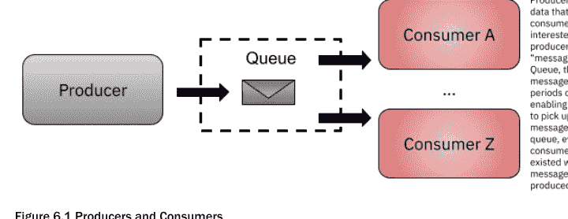

生产者生产出一个或多个消费者可能感兴趣的数据。生产者将“消息”放入队列中，队列可以长时间保存消息，使得消费者能够在队列中取出消息，即使在消息产生时消费者还不存在。

## 图 6.1 生产者与消费者

在典型的生产者/消费者场景中，你会发现生产者生产数据并将此数据放入某种队列中。一个非常好的类比就是邮政投递的方式，如果你想给别人寄一封信，你写好信，装进信封，然后去邮局或邮箱。软件中的邮箱就是队列。软件中的信封被称为消息，通常它们代表一种标准格式，用于在生产者和消费者之间交换信息。软件中的队列带有保证，例如，队列可以保证你的消息被送达，就像你寄信并期望收件人在到达时签收一样。与通过邮局寄信不同，消息通常不是发给特定收件人。我们不会带着目的地地址发送消息，我们让消费者挑选他们感兴趣的信件。这些队列中的消息可以带有元数据，提供有关消息所携带信息的更多细节。这些信息可用于将这些消息路由到已明确注册对某些特定消息感兴趣的消费者。消费者方面需要打开信封来消费消息中包含的信息，这就要求消费者理解信息在信封内编码的格式。

你可以拥有多个生产者、多个完全隔离的队列，以及以不同方式消费消息的多个消费者。例如，我们可能有兴趣确保每个消费者都消费队列中的每条消息，或者相反，只有唯一一个消费者可以消费一条消息。

请注意我使用的是“消息”这个术语，你放入队列的内容完全由你决定，但队列会期望用某种结构来包装你的数据。不同实现的队列会有不同的包装结构，生产者和消费者都需要理解这些结构才能将消息放入队列并从中消费消息。但使生产者和消费者真正强大的原因是，生产者不需要知道消费者的存在（或数量），消费者也不关心谁在生产消息。生产者和消费者只需要知道去哪里生产或消费消息。

让我们来看看这些队列提供的一些特性：

- **持久化消息：** 一旦生产者将消息放入队列，消息将被持久化。队列会确认消息，因此生产者可以确信消息已被持久化。
- **投递保证和重试机制：** 每次消息想要被消费者消费时，消费者需要确认消息已正确处理，这样队列才能将消息标记为已消费。如果由于某种原因消费者未能确认消息，队列允许其他消费者拾取同一条消息进行处理。
- **消费者可以异步消费消息：** 分布式系统倾向于出现故障，而能够以异步方式消费消息使我们的系统更能容忍故障。我们可以依赖队列的持久化机制来确保即使所有消费者都出现故障，消息仍会存在。一旦消费者恢复运行，它就可以回到队列并消费其消息。
- **根据队列负载实现弹性伸缩：** 如果有大量数据被生产到队列中并且这些数据需要紧急处理，我们可以启动多个消费者来并行处理这些消息。当消息量不大或消息不需要紧急处理时，我们可以缩减消费者数量，而不会影响生产者或队列。

你现在可能在想，如果队列这么好，为什么我们不把所有服务到服务的交互都用消息和队列来替换呢？

## 用消息替换 HTTP 请求

想象一下，如果你试图用消息替换 HTTP 请求，这可能是因为你想解耦生产者和消费者，因为它们可能不会同时运行，或者没有必要或你无法承受同步调用。你会很想把 HTTP 请求体中传输的数据包含到消息体中，这样消费者可以拾取消息，检查消息类型，然后以与 REST HTTP 端点处理 HTTP 请求相同的方式处理它。当消息被处理后，你会很想用另一个消息回复生产者，就像 REST HTTP 端点过去提供的那样回答。

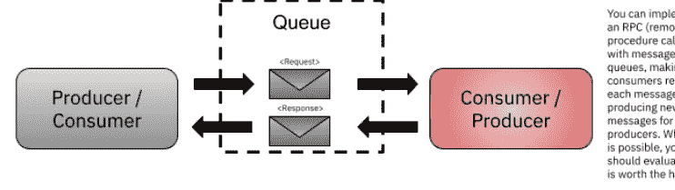

图 6.2 使用消息队列实现 RPC 风格的交互

虽然用消息队列复制 HTTP 请求是可行的，但这样做有几个缺点，最明显的是现在每次交互都将是异步的，调试出现问题会变得困难得多。你还会在基础设施中引入消息队列，为数据到达目标服务增加额外的跳数。为了保证投递和消息队列提供的重试机制而为此改变可能很诱人，但我鼓励你研究一下类似的机制是如何为 HTTP 和其他协议如 GRPC 实现的，这些协议更适合同步双向交互。

尝试将基于同步 HTTP 请求的分布式应用迁移到使用消息队列已被证明是一项非常大的工程，因此我建议将生产者和消费者用于最能受益于前面所述优势的场景。

## 6.1.1 事件与事件驱动架构

一种避免以消息实现 RPC 风格交互的替代方法变得相当流行，即将事件编码到这些消息中。事件可以定义为：

> “事件记录了某事已发生的数据。”

我们不再在消息中编码类似命令的数据，而是编码事件并使消费者能够对这些事件做出反应。这种方法使我们能够构建“事件驱动架构”，我们不再让服务相互调用，而是让服务发出关于服务内部发生的事情的事件，以便其他服务可以对这些事件做出反应。这些架构与消息队列映射得很好，因为我们希望确保对我们发出的事件感兴趣的各方知道去哪里获取它们。

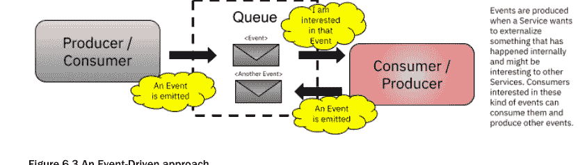

## 图 6.3 事件驱动方法

服务可以通过发出事件来外部化其内部正在发生的状态相关变化。服务需要知道将事件发送到哪里，它不需要知道哪个服务会消费它，或是否有服务在消费它。

要使这种方法奏效，重要的是我们在设计事件时不要将服务耦合在一起。换句话说，我们需要确保我们不是显式地将事件发送给另一个服务，该服务必须以特定类型的事件回复生产者。如果我们这样做，我们只是将 RPC 风格的调用伪装成事件。

此时，你可能在想关于如何实现图 6.3 中描述的事件驱动方法的技术细节，所以是时候我们深入到为我们的云原生应用实现这种方法的实际细节了。

## 6.1.2 CloudEvents 和消息队列

让我们从一些高层细节开始，说明你需要实现一个遵循事件驱动方法的可扩展解决方案。你首先需要根据需求选择一个消息队列系统。多个成熟的实现遵循 AMQP（高级消息队列协议）标准，例如 RabbitMQ、ActiveMQ 等。你也有云提供商特定的工具，如 Google Pub/Sub、AmazonMQ（托管 RabbitMQ）和 Azure Message Hub。

每个实现都有独特的功能，但如果你的实现实现了 AMQP 标准，你就拥有可以依赖的基础保证接口。


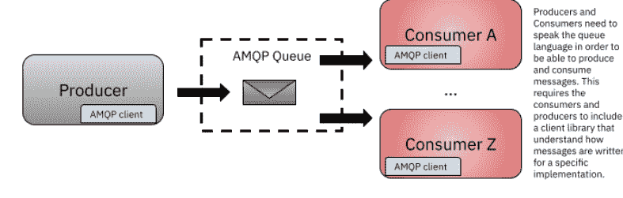

# 图 6.4 AMQP 生产者和消费者

值得考虑的是，如果你选择了 AMQP 标准，然后又想使用 Google Pub/Sub，例如，你就无路可走了，因为他们的托管服务并不实现 AMQP 协议。另一方面，如果你想使用 AmazonMQ，你可以轻松地从托管的 RabbitMQ 实例迁移到 AmazonMQ 托管服务。在这里你面临的是自托管或托管服务的权衡，例如，如果你选择 Google Pub/Sub，你就不需要管理它或使其扩展，Google Cloud 会为你完成。

在设计此类解决方案时，另一个需要尽早考虑的重要细节是消息内部的事件格式。生产者和消费者使用客户端库读写队列中的消息，然后解析内容以理解事件的含义。如果你选择使用基于 AMQP 的消息队列，你可以使用通用接口与队列交互，但现实中，你的生产者和消费者仍需要用于所使用队列的客户端库。如果你选择了 RabbitMQ，你很可能需要为你选择的语言提供 RabbitMQ 客户端库，以便像图 6.4 所示将其包含在生产者和消费者中。

NOTE: 请注意这些具体决策。当选择消息队列提供商时，你通过将客户端库添加到应用程序服务中，将生产者和消费者绑定到该提供商。一旦做出此决定，更换到另一个提供商，例如不支持相同接口或标准的提供商，将要求你同时更改每个生产者和消费者，这一点你的开发人员不会喜欢。

当你选择了消息队列实现后，你现在面临另一个问题：我如何编码我的事件？请记住，消息可以包含任何形式的信息。你需要定义事件的结构或形状。生产者如何写入事件，消费者如何读取事件？在事件中包含“事件类型”和“版本”以封装与特定事件相关联的信息在不同结构中是很常见的。关于产生它的源的信息也可能很有帮助。由于我们通过网络在服务之间交换数据，为每个事件提供唯一标识符可能有益于避免重复处理同一事件，并在多次投递尝试发生时进行去重。

为了避免在使用不同协议（HTTP、AMQP、AVRO 等）时定义事件是什么以及如何编码这些事件，创建了 CloudEvents 规范（ http://cloudevents.io ）。

## 什么是 CLOUDEVENTS？为什么我需要它们？

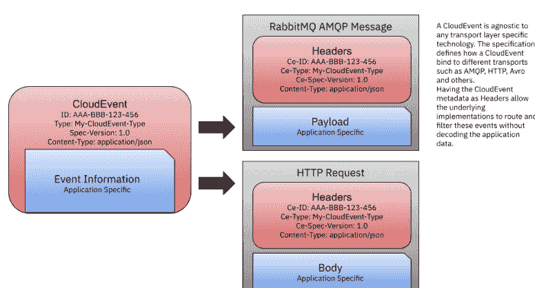

图 6.5 CloudEvent 对 AMQP 和 HTTP 的绑定

如图 6.5 所示，CloudEvents 只是一个薄包装，为我们的应用程序特定事件添加元数据。但这个包装对于我们构建健壮且与传输无关的解决方案至关重要。本章后面我们将看到 CloudEvents 的实际应用。现在让我们切换到我们的领域：Kubernetes。

## 6.1.3 Kubernetes 上的生产者、消费者和事件

不幸的是，第 2 章中引入的任何概念（抽象），例如 Services、Deployments、Pods、Ingresses，都不是为与事件一起工作而设计的。没有部署或 Pod 生产或消费事件的概念，也没有事件路由器或事件过滤器。

Kubernetes 中的 Services 和 Deployments 只是我们可以用来组合我们的云原生应用程序的抽象。如果我们的应用程序或某些功能遵循事件驱动方法，这些交互的一部分将被隐藏在 Kubernetes 之外。换句话说，通过使用 `kubectl` 或 Kubernetes Dashboard，我们无法理解谁在生产事件，事件被发送到哪里进行路由，或哪个组件在消费何种事件。

幸运的是，Knative Eventing 正是为解决这个问题而存在的。第 5 章介绍了 Knative Serving 如何基于原生 Kubernetes 资源构建，以简化不同发布策略的实现并提供高级流量路由。Knative Serving 提供了更高级别的抽象来管理服务以及它们如何根据需求自动扩缩容。

在以下部分，我们将介绍 Knative Eventing，它为事件生产者（Sources）、事件消费者（Sinks）、事件路由器（Brokers）和事件过滤器（Triggers）提供抽象。

## 6.2 使用 Knative Eventing 构建事件驱动应用程序

Knative Eventing 与 Knative Serving 独立。你可以在集群中未安装 Knative Serving 的情况下安装 Knative Eventing，但当然，你的事件驱动应用程序可以从自动扩缩容和高级流量管理中受益。如前所述，生产者和消费者可以是常规的 Knative 或 Kubernetes 服务，通常也是如此。

Knative Eventing，如 Knative Serving，建立在 Kubernetes API 之上，为事件消费者（sources）、事件生产者（sinks）、事件路由器（brokers）和事件过滤器（triggers）提供抽象。虽然自然的起点是消费者和生产者，但我们将从事件路由器和过滤器开始。

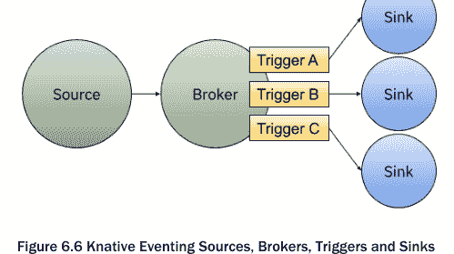

Sources（生产者）产生事件并将其发送到 Broker（路由器）。Broker 会查看定义的 Triggers（过滤器），并且只将与 Trigger 中指定的过滤器匹配的事件发送到 Sinks（消费者）。

图 6.6 Knative Eventing Sources、Brokers、Triggers 和 Sinks

Sources 和 Sinks 只是我们迄今为止构建的应用程序，但从 Knative Eventing 的角度来看，它们是事件生产者和消费者。

另一方面，Brokers 和 Triggers 是我们以前没有的东西。Broker 的主要职责是接收来自生产者的事件，并根据 Trigger 定义将其转发给消费者。

由于 Knative Eventing 建立在 Kubernetes 之上，你可以使用 `kubectl` 浏览这些资源。当你安装 Knative Eventing 时，一组自定义资源定义将被安装到你的集群中，以及一些用于管理这些资源的控制器：

```
brokers.eventing.knative.dev
triggers.eventing.knative.dev
```

对于 Sources，没有要求，因为 Sources 只需知道 Broker URL 即可将事件发布到 Broker。另一方面，Triggers 可以指定 Knative 服务或 Kubernetes 服务作为其目标 Sink，从而允许 Knative 检查消费者是否存在并反馈。

此时，你可能会想，好吧，但这些 Brokers 和 Triggers 是什么？Brokers 和 Triggers 只是 Kubernetes 世界的抽象。与任何其他 Kubernetes 资源一样，你将能够交互、添加和删除这些资源以将你的事件驱动应用程序连接起来。

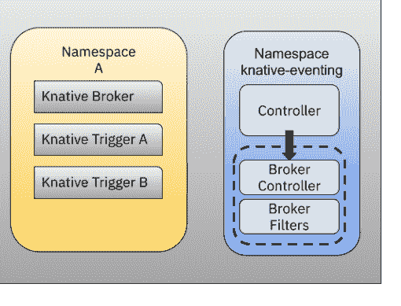

当你将 Knative Eventing 安装到 Kubernetes 集群时，会创建一个新的命名空间来托管管理 Brokers 和 Triggers 资源以供你在应用程序命名空间中创建的组件。Knative Eventing Controller 将负责管理一个或多个 Broker 和 Filter 实现，以便能够将事件从生产者路由到消费者。

图 6.7 Knative Eventing 组件和资源

正如我们在第 5 章中了解到的 Knative Serving，当我们安装 Knative Eventing 时，我们正在创建一个新的 Kubernetes 命名空间来托管 Knative Eventing 组件。在 `knative-eventing` 命名空间中，我们将找到一组控制器，它们负责处理 Brokers 和 Trigger 资源及其各自的实现。

这种方法适用于 Brokers 及其实现。图 6.7 显示了 3 个流行的 Knative Eventing Brokers 实现。虽然开始使用“内存中 Broker 实现”很常见，但 Kafka 和 RabbitMQ 实现是符合 Broker 规范的生产级实现的良好示例。

如图所示，Kafka Broker 实现和 RabbitMQ Broker 实现只是将事件的路由委托给其各自的提供商，即 Kafka 或 RabbitMQ 安装。

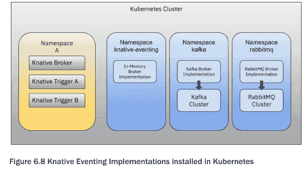

对于开发目的，从内存中 Broker 实现开始很有意义。这意味着事件将被路由，但不会持久化，并且提供的保证较少。内存中实现在资源效率方面也更好，因为它更容易安装，并且比例如完整的 RabbitMQ 或 Kafka 集群消耗的资源更少，使开发人员能够在笔记本电脑上运行所有组件。

对于声明、测试和/或生产，交换该实现为你选择的实现是有意义的。

需要注意的是，你可以安装多个实现，并且使用不同实现创建不同 broker 也是有效的方法。

图 6.8 安装在 Kubernetes 中的 Knative Eventing 实现

“内存中 Broker 实现”是为了便于在本地环境中开发而创建的，允许开发人员在本地环境中没有完整的消息队列安装的情况下快速开始构建事件驱动应用程序。由于所有这些实现都是按照 Knative Eventing 规范（https://github.com/knative/specs/tree/main/specs/eventing）构建的，将内存中 Broker 交换为 Kafka 或 RabbitMQ 应该对所有生产者和消费者都是透明的。

如果你已经有一个在 Kubernetes 集群外部运行的 Kafka 或 RabbitMQ 集群，或者你想连接到云提供商托管服务，例如 AmazonMQ 或 Google Cloud Pub/Sub，Broker 实现将负责与这些外部系统连接，再次不需要对生产者和消费者进行任何更改。


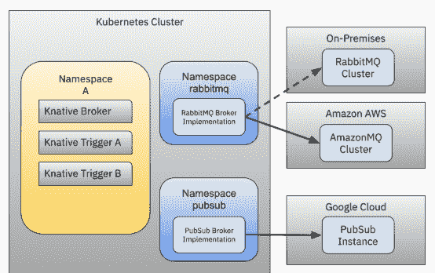

虽然 Broker 实现需要在安装了 Knative Eventing 的 Kubernetes 集群内部，但消息实现可以置于 Kubernetes 范围之外。这允许 Broker 实现连接到外部的本地部署服务以及云服务提供商上的托管服务。

图 6.9 Knative Eventing 外部托管的 Broker 实现

能够连接到所有实现相同抽象（Broker）的托管服务，使得我们的应用程序可以在云服务提供商之间移植，而无需更改消费或发出事件的服务。

作为开发者，你不必担心 Broker 背后是什么或实现位于何处。你只需要知道可以向 Broker 发送事件，并且根据配置的 Triggers，你的事件可以路由到一个或多个消费者。

## PRODUCING AND CONSUMING EVENTS

作为应用程序开发者，无论你使用哪种语言，都应该能够生产和消费事件。第 6.1.3 节介绍了 CloudEvents 是什么，在本节中我们将快速了解各个组件如何协同工作，使用 CloudEvents 和 Knative Eventing 构建事件驱动应用程序，以便我们进入本章的最后一节，在其中扩展 Conference Platform 以使用这种方法实现新功能。

由于 CloudEvents 与传输无关，我们可以生产一个 CloudEvent 并通过 HTTP 发送，或作为 Kafka 或 RabbitMQ 消息发送。为此从应用程序服务内部，我们很可能需要一种编写 HTTP 请求的方式，这在所有流行的编程语言中都可用，或者我们需要一个库来连接到 Kafka 或 RabbitMQ 集群，然后使用其特定协议写入 CloudEvent。一旦你在应用程序服务中添加了依赖于实现的库，交换或升级实现就会变得更加痛苦，因为你被迫更改或升级基础设施组件，例如 RabbitMQ 或 Kafka 版本以及消费者和生产者中的所有客户端库。

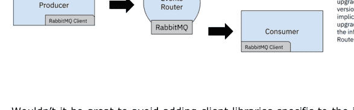

虽然生产者和消费者彼此解耦，但它们都与本例中的事件路由器实现 RabbitMQ 绑定（对于 Kafka 或任何其他 MQ 消息代理也是如此）。客户端库的版本和事件路由器版本需要保持同步，并在创建新版本或安全补丁时同时谨慎升级。这种隐式关系使我们升级服务（生产者和消费者）和基础设施组件（如事件路由器）变得复杂。

如果能避免添加特定于将路由我们事件的基础设施组件的客户端库，不是很好吗？如果能利用 HTTP 客户端在每个主要编程语言中都提供的事实，不是很好吗？使用 Knative Eventing Brokers，我们依赖于一个抽象了生产者和消费者基础设施的 HTTP 端点，而不会失去使用像 Kafka、RabbitMQ 或如前几节所述的云提供商特定实现的强大且经过实战检验的消息代理的优势。

使用 Knative Eventing，只要我们知道 Broker URL（HTTP 端点），我们就可以仅通过 HTTP 发送 CloudEvents 来生产事件。Knative Eventing Broker 实现将确认接收到的事件并将其转发到底层消息代理，以将事件路由到感兴趣的消费者。消费者只需要公开一个接受 CloudEvent 的 HTTP 端点。

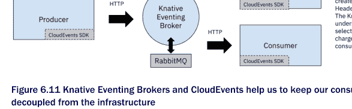

使用 Knative Eventing，生产者和消费者只需要理解如何生产和消费 CloudEvents。请注意，CloudEvents SDK 是可选的，因为你可以手动创建 CloudEvent 并添加 CloudEvents 规范中定义的 CloudEvents 头。Knative Eventing Broker 现在负责理解如何将消息转发到所选实现（RabbitMQ），后者负责将事件路由到感兴趣的消费者。

图 6.11 Knative Eventing Brokers 和 CloudEvents 帮助我们将消费者和生产者与基础设施解耦

现在我们可以更新生产者和消费者，而不必担心配置了哪个 RabbitMQ 版本，甚至不必知道幕后是否在使用 RabbitMQ。虽然图 6.11 中显示的 CloudEvents SDK 完全是可选的，但实际上它会为你节省大量时间，因为它提供了在大多数流行编程语言中读写 CloudEvents 的助手，节省了你在如何设置正确的头或用于序列化请求正文的内容类型方面犯傻错误的的时间。

检查 CloudEvents 网站，看看是否有适用于你选择的语言的 CloudEvents SDK（http://cloudevents.io），目前支持以下语言：Go、JavaScript、Java、C#、Ruby、PHP、Python、Rust 和 Powershell。

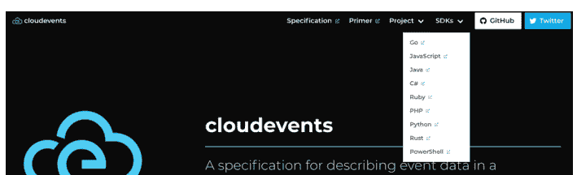

## Figure 6.12 CloudEvents supported SDKs

使用 CloudEvents 和 Knative Eventing Brokers，我们推广了一种通用且标准的格式来交换事件，依赖于 HTTP 请求，这简化了开发者生产和消费事件的认知负担。在下一节中，我们将在进入 Conference Platform 应用程序的完整示例之前，快速看看实践中它是什么样的。

如果你使用 Kubernetes，你应该充分利用使用不同技术栈和不同编程语言构建应用程序的可能性。通过采用 CloudEvents 作为描述事件的方式以及 HTTP 作为在到达 Knative Eventing 之前在网络上传输这些事件的方式，极大地简化并使开发者能够构建事件的消费者和生产者。

以下示例展示了一个使用 Spring Boot Reactive 框架用 Java 编写的生产者和用 Go 编写的消费者。两个示例都依赖于 CloudEvents SDK（https://cloudevents.io/），它简化了 CloudEvents 的解析和序列化。使用 CloudEvents SDKs 减少了创建符合 CloudEvents 规范的 CloudEvents 的时间和开销，并保证使用不同编程语言的应用程序可以读取和写入 CloudEvents。

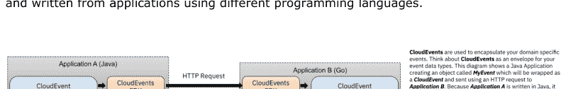

## Figure 6.13 Produce in Java and consume in Go

两个应用程序共享一组特征：

- 两者都在给定端口上公开 HTTP 端点，可以通过设置环境变量（SERVER_PORT）进行配置
- 两者都可以消费和生产 CloudEvent
  - 要生产 CloudEvent，可以向 `/produce` 发送 POST 请求
  - 要消费 CloudEvent，可以向 `/` 发送 POST 请求
- 两个应用程序都可以通过导出 `SINK` 环境变量来配置 CloudEvent 生产后发送到的 sink
- 两个应用程序生产的 CloudEvent 负载都是 JSON 负载
- 两者都有处理 CloudEvent 数据负载的数据结构（`MyCloudEventData` java 类和 Go 中的 `MyCloudEventData` 结构体）
- 两个应用程序都作为 Docker 容器提供（`salaboy/fmtok8s-java-cloudevents` 和 `salaboy/fmtok8s-go-cloudevents`）

你可以按照位于 https://github.com/salaboy/from-monolith-to-k8s/tree/master/cloudevents 的逐步教程，将这些应用程序在本地环境或使用 Knative Eventing 中运行。

逐步教程指导你使用 Docker 和 Docker 网络启动两个应用程序，以确保两个容器可以相互通信。我强烈建议你完成本教程并尝试这两个应用程序。教程中还链接了一篇博文，详细介绍了两个应用程序的内部细节，详细解释了不同编程语言和框架之间的比较：https://salaboy.com/2022/01/29/event-driven-applications-with-cloudevents-on-kubernetes/

在下一节中，我们将重点介绍如何让这个简单示例开始利用 Knative Eventing，而无需对示例应用程序源代码进行任何更改。

到目前为止，我们有两个服务，都在生产和消费 CloudEvents。但让服务直接相互发送事件并不太符合事件驱动方法。我们希望我们的服务发出事件，以便其他服务可以对它们做出反应。为了实现这种交互，我们需要事件路由器和一种让服务注册对某些类型事件的兴趣的方式。

一旦你的生产者和消费者准备好发布，它们将需要被容器化以部署到 Kubernetes。正如我们在第 2 章中学到的，你可能需要在 Kubernetes 中部署这些服务时使用 Deployment 和 Service，或者你可以使用我们在第 5 章中学到的 Knative Service。

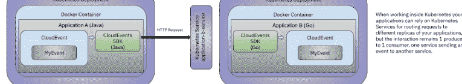

图 6.14 在 Kubernetes 内部运行的应用程序


无论使用哪种方案，让生产者和消费者直接相互发送事件都不是正确的做法，因为这会在这些服务之间创建紧密耦合，并且不允许其他服务对正在发生的事情做出反应。我们想要实现的是，能够在不知道事件将如何被消费的情况下生产事件，然后让任意数量的消费者对这些事件注册兴趣。如第 6.1 节所述，我们可以通过使用例如 RabbitMQ 的消息队列来实现这种模式。

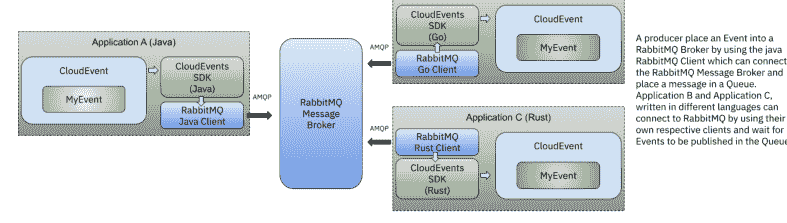

图 6.15 使用消息代理实现事件驱动方法

如果能在不更改应用程序代码或依赖项的情况下实现同样的效果，不是很好吗？让我们看看 Knative Eventing 如何帮助我们。使用 Knative Eventing 我们继续使用 HTTP 请求，并且不需要更改生产者或消费者。

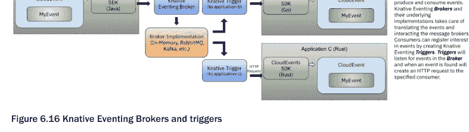

图 6.16 Knative Eventing Broker 和触发器

首先，你需要创建一个 Broker，启动后它会为你提供一个 URL，你需要将生产者指向该 URL，然后你需要创建一个 Trigger 资源来定义哪些事件将被转发给哪些消费者。

Knative Eventing Broker 和 Trigger 都是 Kubernetes 资源，你可以使用 `kubectl` 或任何你想要用来将 Kubernetes 资源同步到集群中的工具来创建它们。

```
A Broker resource will look like this:
apiVersion: eventing.knative.dev/v1
kind: Broker
metadata:
  name: default
  namespace: default
```

你可以为你的应用程序创建任意数量的 Broker。一旦你创建了 Broker，你就可以检查 Broker 是否已准备好接收事件，并且它是否提供了生产者发送事件的 URL。使用 `kubectl get brokers` 来检查可用的 Broker：

```
salaboy> kubectl get broker
NAME    URL                                     AGE   READY   REASON
default    http://broker-ingress.knative-eventing.svc.cluster.local/default/default   2s
          True
```

如果我们现在配置生产者（application-a）将事件发送到 Broker URL，事件将准备好从 Broker 中消费，并且我们可以通过创建 Knative Eventing Trigger 将消费者连接到 Broker，Trigger 如下所示：

```
apiVersion: eventing.knative.dev/v1
kind: Trigger
metadata:
  name: app-b-trigger
  namespace: default
spec:
  broker: default
  subscriber:
    ref:
      apiVersion: v1
      kind: Service
      name: application-b-service
```

Trigger 的职责是在 Broker 中发布事件时注册兴趣。此示例触发器正在注册对生产者发布到 Broker URL 的所有事件的兴趣。生产者发布到 Broker 的所有事件都将转发到 `subscriber.ref` 字段中指定的 `application-b-service` Kubernetes 服务。

如果我们对进入 Broker 的所有事件都不感兴趣，我们可以指定过滤器，例如：

```
apiVersion: eventing.knative.dev/v1
kind: Trigger
metadata:
  name: app-b-trigger
  namespace: default
spec:
  broker: default
  filter:
    attributes:
      type: app-a.MyCloudEvent
  subscriber:
    ref:
      apiVersion: v1
      kind: Service
      name: application-b-service
```

此触发器将仅将类型匹配 `app-a.MyCloudEvents` 的 CloudEvents 转发到 `application-b-service` Kubernetes 服务。

如图 6.15 所示，我们可以创建更多 Trigger，让 Broker 将收到的 CloudEvents 转发给多个消费者。

通过使用 Broker 和 Trigger，我们已从“1 个生产者到 1 个消费者”的通信转变为 1 个生产者和多个消费者的方法。我们可以使用 Kubernetes 资源以声明方式连接消费者和生产者，从而允许开发人员使用 HTTP 请求来生产和消费事件。

你可以通过按照此处找到的分步教程的最后一部分来在你的 Kubernetes 集群中安装这些服务、Broker 和触发器：https://github.com/salaboy/from-monolith-to-k8s/blob/master/cloudevents/README.md#with-knative-eventing

在本章的最后一部分，我们将使用 Knative Eventing 在 Conference Platform 应用程序之上实现一个更复杂的示例。该示例要复杂得多，但它依赖于相同的模式并使用与本简单示例所涵盖的相同方法。

## 6.3 为热门活动售票

在本节中，我们将使用 Knative Eventing 概念在我们的 Conference Platform 中构建票务销售功能。不是更改我们在前几章中介绍的服务，我们将引入一套新的服务，这些服务是使用“事件驱动”方法设计的。

让我们看看我们将要实现的场景，看看 Knative Eventing 和 CloudEvents 如何帮助我们构建它。

### 处理高需求

对于此示例，我们将模拟票务销售队列机制，该机制需要实施以应对希望获得有限数量门票的潜在客户的需求。这对于负责销售音乐会等活动的网站来说是一个相当典型的场景，销售在特定时间开始，并且可用的门票数量有限。

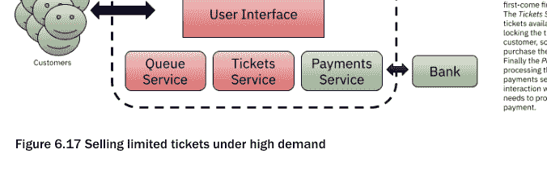

引入了三个新服务来处理售票功能。队列服务负责排队客户，以便按先到先得的方式服务。票务服务拥有可用的票务库存，并负责锁定客户选择的票务，以便其他客户不能同时购买它们。最后，支付服务负责处理付款。支付服务模拟与需要处理和授权付款的第三方银行的交互。

# 图 6.17 在高需求下销售有限门票

购买门票的正常流程要求客户排队，以便按先到先得的方式进行。当需求过大时，这将允许其他服务处理可管理的并发用户数量。一旦客户离开队列，就需要选择门票，并且平台将为客户锁定这些门票，以等待付款处理。如果付款处理正确，票务将从票务服务中移除。如果付款未通过或达到超时，票务将被释放供其他客户购买。对于此场景，支付服务模拟第三方系统，该系统不在我们的控制之下。做出这一决定的意图是演示如何使用事件包装一个未设计为以事件驱动方式运行的系统以实现集成目的。

每个应用程序的服务都设计为发出事件以外部化正在发生的事情。每个服务还设计为消费其感兴趣的事件，从而允许服务在有意义的事件出现时做出反应。

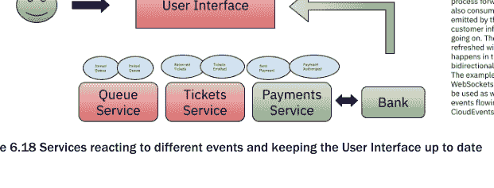

客户与用户界面交互，但后端服务对事件做出反应并推动流程前进。用户界面还消费服务发出的事件，以让客户了解正在发生的事情。应用程序不能在后端发生的每个事件时刷新，因此需要双向连接。示例应用程序使用了 WebSockets，但也可以使用 RSocket 或 SSE。请记住，服务之间流动的所有事件都是 CloudEvents。

# 图 6.18 服务对不同事件做出反应并保持用户界面最新

这比我们在 6.2 节中介绍的示例更复杂，但它使用的是之前相同的构建块。因此，以下各节探讨了在 Kubernetes 之上构建事件驱动应用程序的特定挑战，以及如何通过遵循事件驱动方法，你可以与外部和遗留系统集成，同时


保持服务彼此独立，允许团队独立地对其进行演进。

你可以在自己的 Kubernetes 集群中使用 Knative Eventing 运行此场景，一步一步的教程说明如何实现可在找到这里：https://github.com/salaboy/from-monolith-to-k8s/blob/master/knative/knative-eventing-example.md

请注意，该示例可以使用内存型 Knative Broker 实现、Kafka 或 RabbitMQ Broker 进行安装，这使你能够根据需求测试不同的技术栈。

## USE CASE STEP BY STEP

如果你按照教程进行，会议平台将扩展新的功能，允许用户在平台管理员将门票设为可售时为会议活动购买门票。以下图表显示了在应用程序中为售票实现的新行为。

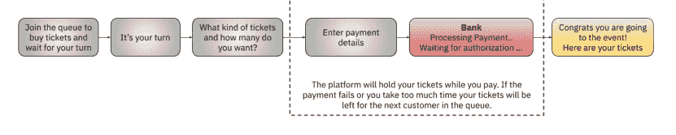

图 6.19 每位客户购买门票的步骤

正如你所见，这是一个非常简单的流程，遵循在线购买门票时非常知名且熟悉的流程，其中可能有大量人同时尝试购买。因此你面临的第一个步骤是一个队列。

以下截图显示了相同的流程，但实现为每个客户购买门票所需经过的一系列页面。

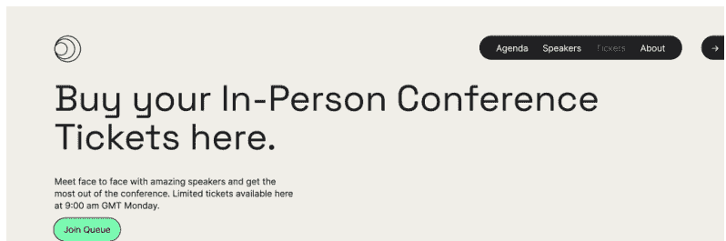

图 6.20 会议平台门票页面

所有售票功能都在新的门票部分下，可以在会议平台顶部菜单中找到。

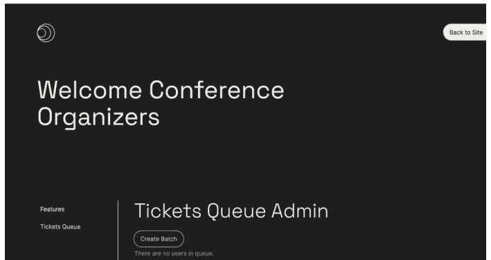

图 6.21 会议平台门票后台选项

还有一个后台部分可用于模拟其他人排队并使门票对客户可用。

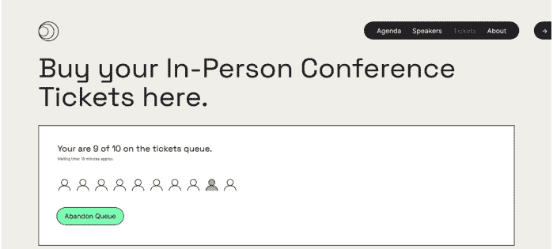

图 6.22 会议平台排队购买门票

作为客户，你需要等待轮到自己才能继续。如果刷新页面或转到不同部分，你需要重新加入队列，将你的位置留给队列中的下一个人。

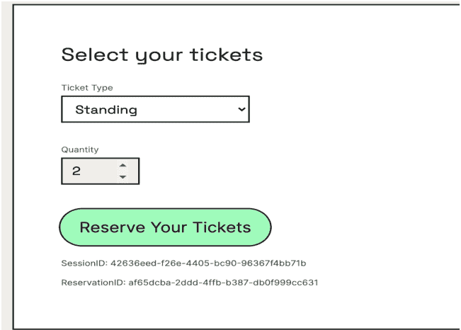

图 6.23 在你完成付款前保留门票

一旦你离开队列，你将能够预订你感兴趣的门票类型和数量。此时，平台会为你保留门票，直到你

完成付款。如果花费太多时间或放弃页面，你预订的门票将被自动释放，允许其他客户购买它们。

图 6.24 使用信用卡为你的门票付款

预订门票后，你需要遵循非常标准的流程为其付款。在此案例中，模拟了信用卡付款，并与银行进行第三方/外部交互以授权付款。

图 6.25 付款将由外部实体处理，例如你的银行

一旦你的付款获得授权，平台将为你提供会议门票。

以下部分涵盖与实现此功能相关的一些挑战以及你需要使所有服务对正确事件做出反应的 Knative Eventing 资源。

## CHALLENGES & SOLUTIONS WHEN BUILDING EVENT-DRIVEN APPLICATIONS

- 用户界面交互和通过 WebSockets 路由 CloudEvents，这需要在 API 网关中完成，如何.. 暴露端点并打开 websocket 连接
- 接线发生在 Knative Eventing Triggers 中，需要过滤器以确保每个服务接收到它们感兴趣的事件
- 处理需求，扩展事件处理器
- 与不产生事件的第三方或遗留系统集成，构建桥梁
- 使用事件来监控或增强现有系统/服务

## 6.4 Summary

- Kubernetes 内置机制不考虑事件消费者、生产者或路由器。
- 事件驱动架构允许你构建更具弹性且解耦的服务，这些服务可以依赖消息队列提供的消息传递保证
- 借助 CloudEvents 规范（http://cloudevents.io），使用不同技术栈构建事件驱动应用程序是可能的，该规范为我们在不同系统之间共享事件提供标准格式。CloudEvents SDK 允许开发人员使用不同编程语言读取和写入 CloudEvents
- Knative Eventing 为 Kubernetes 带来事件生产者、消费者和路由器的概念。它允许开发人员构建其事件驱动服务和应用程序，而无需定义将用于路由事件的底层技术。流行的 broker（事件路由器）实现均受支持，例如用于开发的内存型、用于生产工作负载的 RabbitMQ 和 Kafka，以及受支持的云提供商特定托管服务，例如 Google Pub/Sub。
