# 7

## Functions for Kubernetes

## This chapter covers

- 如何通过使用函数即服务（faas）方法提高开发人员生产力和体验
- 函数如何加快开发团队速度，同时提供简单的编程模型。我们将研究一个名为 Knative Functions（`func`）的项目。
- 如何利用 Kubernetes 的多语言特性，使用相同的工具、概念和标准在不同语言中编写函数以共享信息
- 如何连接多个函数以构建我们行走骨架的复杂场景

我们一直在讨论 Kubernetes 和可在 Kubernetes 之上构建应用程序时解决特定挑战的工具，但在本章中，我们将关注开发人员。为了使开发人员能够专注于编写业务所需的应用程序，我们需要确保他们拥有一种编程模型，该模型不会迫使他们学习事物如何在 Kubernetes 之上构建、容器化和部署。

在本章中，我们将研究一个名为 `func`（http://github.com/knative-sandbox/kn-plugin-func）的 Knative 工具，它使用我们在本书迄今为止学到的所有内容，提供简化的 Kubernetes-less 和 Dockerfile-less 多语言体验。`func` 通过提供开发人员体验来实现这一点，使开发人员能够专注于其应用程序/函数代码，而不是编写 YAML 或担心构建容器。

本章分为三个主要部分

- Function or Service? What’s the difference?
- 使用 `func` CLI 或 IDE 插件更接近开发人员
  - 让我们创建我们的第一个函数，预期内容和函数生命周期
- 为我们的会议活动主题演讲构建一个高度可扩展的游戏

让我们从第一个问题开始：Functions or Services？

## 7.1 Functions or Services? What’s the difference?

到目前为止，我们一直在谈论服务来描述我们在 Kubernetes 内部运行的应用程序。这些服务中的每一个通常映射到单个容器，可以通过同时运行同一容器的多个副本来扩展。我们还看到 Kubernetes 使用相同的命名法，因为 Kubernetes Service 资源帮助我们为运行的任意数量的容器副本提供单一入口点。

我们还看到了将 Kubernetes Ingress、Kubernetes Service、Kubernetes Deployment 以及容器镜像构建并准备好在容器注册表中，以便最终在用户或其他服务可以与其交互的环境中使服务运行所需的步骤数量。

Kubernetes 与流行的 Serverless 方案相比如何？你需要在 Kubernetes 和 AWS Lambdas 等 Serverless 平台之间做出选择吗？

在本节中，我们将讨论 Function as a Service（FaaS）平台以及它们与我们迄今为止介绍的方法的比较。我们将比较它们的优点和缺点与 Kubernetes 方法，并在第 7.2 节中了解如何在 Kubernetes 之上提供 FaaS 体验以获得两者兼得。

### 7.1.1 Functions, and Functions as a Service

Functions as a Service（FaaS）平台，也称为 Serverless 平台，旨在消除处理基础设施甚至构建容器的所有麻烦。在本章中，术语 Serverless 将与 FaaS 互换使用。Functions-as-a-Service 平台（FaaS）建立在函数是执行单一任务、有一个输入并产生输出的简单构造的想法之上。让我们从快速介绍函数是什么开始，以了解基于函数的平台 supposed to work 的工作原理。

## WHAT IS A FUNCTION?

函数是非常有范围的，通常是小型应用程序，负责执行单一任务。为了执行此任务，函数接收输入并创建可供另一个函数使用的输出。输入和输出通常以事件的形式出现。意味着函数对发生的事件做出反应，并在完成时产生事件。


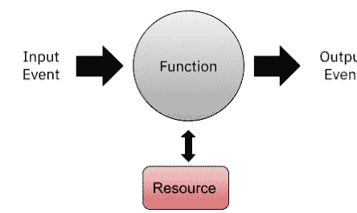

函数接收一个输入事件，进行一些处理，这可能包括访问外部资源，并在处理完成后为其他函数做进一步处理而发出一个输出事件。

图 7.1 函数的输入和输出

函数可以通过直接接入前一个函数的输出事件来串联起来。这里的思路是开发者不需要担心事件来自哪里或输出事件放置在哪里，这些都由平台处理。这降低了开发者的认知负担，并使平台能够提供简化的用户体验。

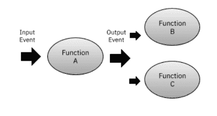

多个函数可能对特定事件感兴趣，而平台负责将这些事件路由到正确的函数。这使得应用程序开发者只需编写自己的函数，而无需担心如何消费事件或将输出事件放置在哪里。

图 7.2 基于事件串联多个函数

函数本身是非常有用的构造，但它们无法单独工作。要能够使用函数，你需要一个平台来负责运行这些函数、扩展它们并将事件路由到正确的函数，以便它们执行任务。

## 函数式平台的需求

如果你是一名开发者，负责编写一组函数来执行某些非常特定领域的任务，你就不想担心这些函数如何构建和部署，如何根据需求进行扩容或缩容，或如何将事件从一个函数路由到下一个函数。

函数可以根据需求弹性地扩容和缩容，但扩展将由平台自动执行，无需用户干预，从而减少了对运行时环境的维护量。更少的维护也意味着一个更复杂的平台将为我们处理诸如扩展之类的事情。这也意味着我们可以在函数内部包含的行为在某种程度上受到函数边界的限制。

在 FaaS 平台中，冷启动是一个常见的讨论话题，因为函数在新事件到达时可能会缩容到零，平台和最终用户需要等待函数启动后才能处理传入事件。如果你有几十个或数百个函数，这种延迟会累积起来。而且由于我们处理的是事件，我们处于一个非常异步的环境中。

但作为一个函数开发者，你不应该担心：

- 如何将函数代码构建成可运行的函数
- 如何消费事件，平台会提供一种方式让你注册对某类事件的兴趣。
- 如何产生事件，你只需产生它，平台将负责将事件路由给感兴趣的各方
- 被单一编程语言限制，你可以用任何你想要的语言编写函数，只要平台支持
- 在给定时间哪些其他函数正在运行，因为每个函数彼此独立
- 你需要多少个副本来支持不断变化的需求，因为平台会负责处理

一个非常突出的 FaaS（无服务器）平台，也是这种平台的很好的例子是 AWS Lambda，它提供了一个多语言环境，让你可以用不同的语言编写函数。但这显然不会在 Kubernetes 内部运行，并且是厂商特定的。

对于函数与服务有何不同存在一些先入为主的观念，下表将介绍这些差异，但正如我们稍后会看到的，在 Kubernetes 世界中我们可以模糊这些差异

| Functions | Services |
|---|---|
| 新副本会在需要时根据需求创建 | 服务启动后会一直运行，直到手动缩容。如果你需要扩展服务，你需要手动执行或配置自动扩缩器在满足某些条件时执行扩展。 |
| 函数需要快速启动，因为会有请求等待新实例启动 | 服务启动时可以稍慢一些，因为它是由操作员手动启动的。操作员可以决定服务何时启动并准备好使用。 |
| 如果没有人使用它们，函数会缩容到零。FaaS 平台会有一种方式缓存请求，直到目标函数的新的实例扩展并准备好处理请求 | 服务需要在没有需求时手动缩容。默认情况下，服务不能缩容到零，因为如果没有实例处理它们，传入请求将会失败。 |
| 函数专注于解决非常具体的问题，通常接收事件作为输入并产生事件作为输出 | 服务可以托管多个端点来执行不同的任务。服务的范围被认为更大 |

那么我们如何更接近 Kubernetes，同时也能获得 FaaS 平台的所有好处呢？
让我们快速了解一下一种名为容器即服务（CaaS）的新型平台。

## 7.1.2 容器即服务平台

随着容器的兴起，构建能够接受任何容器作为输入并为你运行、管理并扩展它的平台是有意义的。这些平台旨在利用 FaaS 平台方法，使开发者能够关注自己的代码，而不必担心如何运行或扩展容器。

这种平台的一个突出例子是 Google Cloud Run，它会为你处理容器的构建和部署：

- Java: https://cloud.google.com/run/docs/quickstarts/build-and-deploy/java
- Go: https://cloud.google.com/run/docs/quickstarts/build-and-deploy/go

AWS Lambda 也支持容器。Google Cloud Run 和 AWS Lambda 都是厂商特定的工具，但至少这两个产品都接受预构建的容器。

如果我们谈论的是容器，那么使用 Kubernetes 运行和编排它们就很有意义了。有了 Knative，我们可以为开发者构建一个容器即服务平台，利用自动扩缩、缩容到零以及 Knative 事件模型。

即使有了 Knative，主要缺少的部分仍然是，我们仍然需要使用 YAML 文件创建 Knative Service 资源，并且需要确保 Knative 可以访问某个需要构建的容器镜像，因此开发者需要创建某种 Dockerfile 来容器化他们的应用程序。

Knative 提供了构建这些开发者体验所需的所有构建块，这就是为什么 Knative 社区一直在开发一个名为 `func` 的项目，该项目专注于在你的 Kubernetes 集群之上启用 FaaS 和 CaaS 体验。我们将在下一节更详细地讨论这一点。

## 7.2 使用 Knative `func` 更接近开发者

在本节中，我们将研究 Knative Functions（`func`），这是一个为开发者能够使用基于函数的开发方法在 Knative 之上构建应用程序而创建的项目。Knative Functions 背后的主要设计目标之一是通过使开发者能够在无需考虑容器甚至 Kubernetes 的情况下编写函数来简化开发者体验。

研究 `func` 的设计和实现背后的主要思想是为了突出构建专门的开发者体验的必要性，这些体验隐藏了运行他们编写的软件所使用的技术栈的复杂性。`func` 专注于允许开发者选择自己的技术栈来编写函数，并使用 CloudEvents 作为这些函数的输入和输出。

通过使用函数作为主要构建块，`func` 允许你快速为一个空的函数模板搭建项目，该模板消费 CloudEvent 并产生 CloudEvent 作为结果。

在以下部分中，我们将：

- 使用 `func` CLI 创建一个项目
- 构建项目
- 在本地运行项目
- 将函数部署到 Kubernetes 集群

让我们开始吧。

### 7.2.1 使用 `func` 创建项目

一旦你创建了 `func` 项目，`func` 会通过提供构建、运行和部署项目的命令来负责项目的生命周期，该项目需要部署到已安装 Knative 的 Kubernetes 集群中。

你可以在一个空目录中，使用以下命令安装 `func` 并创建项目，我们称之为 `fmtok8s-java-function`：

```
func create fmtok8s-java-function -l springboot -t cloudevents
```

`-l` 参数指定你想要使用的技术栈，在本例中是使用 Spring Boot 框架和 Maven 作为构建工具的 Java。`-t` 参数指定我们想要使用的函数模板，在本例中是一个与 CloudEvents 配合工作的函数。

我鼓励你尝试 `-l go` 来使用 Golang 创建一个类似的函数。


这个命令创建了一个非常简单的函数，它回显作为输入接收到的 CloudEvent。如果你查看 `fmtok8s-java-function` 目录内生成的文件，你会发现一个非常典型的 Spring Boot 项目：

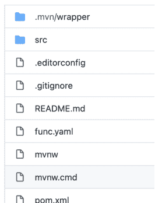

图 7.3 `func` 搭建的项目

接下来，让我们构建我们的函数

### 7.2.2 构建我们的函数

除了 `func.yaml` 文件外，项目中没有其他 YAML 文件或 Dockerfile。忽略 YAML 文件或 Dockerfile 缺失的情况，我们仍然可以运行以下命令为此 `func` 项目创建容器：

```
func build
```

你应该会看到以下输出：

```
A registry for Function images is required. For example, 'docker.io/tigerteam'.
? Registry for Function images: salaboy #1
Note: building a Function the first time will take longer than subsequent builds #2
Function image built: docker.io/salaboy/fmtok8s-java-function:latest #3
```

#1 `func` 需要知道将生成的镜像推送到哪里，如果你有 Docker Hub 账号，可以在此输入你的用户名，如果你已经使用 `docker login` 使用账号进行身份验证，它将使用这些凭据将函数容器上传到你的 Docker Hub 账号。

#2 由于 `func` 需要获取所有项目依赖项，第一次构建会花费较长时间，但后续构建会更快，因为 `func` 会为将来构建缓存这些依赖项。下次运行 `func build` 时，它会检查更改，并且只有在 `pom.xml` 文件发生更改时才下载新的依赖项，并在有更改时重新编译源代码。第一次构建所需的时间通常取决于你的互联网连接。

#3 最后，函数已构建、标记并准备使用

你可能会想，在没有 Dockerfile 的情况下如何创建容器？这是让开发者生活更轻松的第一步。`func` 使用 CNCF Buildpacks (http://buildpacks.io) 来构建和容器化你的 `func` 项目。Buildpacks 检测我们尝试构建的项目类型，并选择预定义的模板来构建并为我们的应用程序创建容器，而无需让开发者编写 Dockerfile。

如果你以前编写过 Dockerfile，你可能知道从互联网复制一个 Dockerfile 来开始工作是多么容易，但你会做出一些并不那么明显的决定，例如基础镜像、最终容器中包含的工具、可能存在安全问题或过时的库版本等。通过使用 buildpacks，我们将可能影响结果容器的这些决策与专注于编写函数内部逻辑的开发者解耦。我们可以为我们的 `func` 项目选择合理且安全的 buildpacks 来使用。

### 7.2.3 在本地运行我们的函数

作为下一步，你可以使用 `func run` 运行使用 `func build` 创建的容器。这将为你启动容器的本地实例以便进行交互，这通常比在远程集群中运行容器更快，并且可以帮助开发者在本地排查问题。

```
func run
```

应该显示函数在端口 8080 启动，这允许你向其发送 CloudEvent 并在本地查看响应。你可以使用 `curl` 或 `http` 发送 CloudEvent，这是一个更友好的命令行工具，用于创建请求。你也可以使用 `func invoke`，它专为提交 CloudEvent 而设计，无需从头创建 HTTP。

```
func invoke <LOCAL URL>
```

### 7.2.4 将我们的函数部署到 Kubernetes 集群

最后，如果你想将 `func` 项目部署到你的 Kubernetes 集群，你可以运行 `func deploy`，这实际上会将容器镜像推送到配置的镜像仓库，在本例中为 Docker Hub。正如你可能注意到的，执行此部署时没有编写单个 YAML 文件：

```
func deploy
✓ Function image built: docker.io/salaboy/fmtok8s-java-function:latest
✓ Pushing function image to the registry
```

现在 `func` 项目已部署并且我们有一个公共 URL，我们可以与在 Kubernetes 集群中运行的函数进行交互。

```
func invoke <REMOTE URL>
```

到目前为止，我们已经从创建 `func` 项目开始，构建它，在本地运行它，我们通过发送 CloudEvent 并接收响应来测试它按预期工作，最后，我们将我们的 `func` 部署到包含 Knative 的 Kubernetes 集群中，允许我们使用自动公开的公共 URL 与我们的函数交互，而无需开发者编写 YAML 文件。
最后，如果你想从远程集群中取消部署函数，可以运行 `func delete`。

### 7.2.5 开发者工具是必须的

虽然使用命令行工具对已经习惯使用 `kubectl` 与 Kubernetes 集群交互的人来说不应该有什么新奇之处，但将一些专用工具集成到日常 IDE 中肯定会有帮助。幸运的是，如果你使用 VSCode、IntelliJ 或 GoLand，你可以获得 Knative 和 Knative Functions 插件。这允许你直接从 IDE 构建、运行、部署和取消部署 `func` 项目。你还可以查看部署了哪些其他函数。

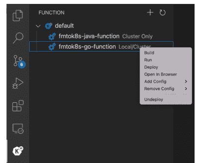

图 7.4 用于 VS Code 的 Knative `func` 插件

使用 VSCode Knative 插件你可以访问函数并在本地运行它们或将它们部署到集群中。如果你打开一个 `func` 项目，插件将自动识别哪个函数对应本地的 `func.yaml` 文件并为你启用选项。你可以在同一位置编写和运行函数。VSCode 被设计为可通过不同插件扩展以支持不同语言，这使其非常适合编写 NodeJS 或 Python 函数。

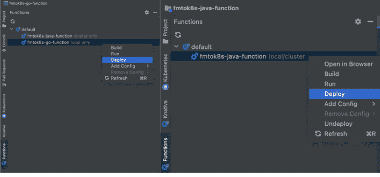

图 7.5 用于 GoLand 的 Knative `func` 插件（左）和 IntelliJ（右）

GoLand 和 IntelliJ 是更具体的发行版，分别针对 Golang 和 Java，因此你不需要从不同提供商安装插件，这些插件可能无法工作，并且默认情况下你拥有与所选语言非常先进的原生体验。从 Knative 的角度来看，Knative 插件提供的功能与 VSCode 中的相同，并且方式相同，它是需要在 GoLand 和 IntelliJ 中安装的插件。

到目前为止我们已经看到，`func` CLI 提供了免除 Dockerfile 和 YAML 文件的体验，允许开发者管理 `func` 项目的整个生命周期，从创建到在远程集群中运行。`func` CLI 为用户提供了 6 个主要命令来管理其 `func` 项目生命周期：create、build、run、deploy、emit 和 delete。

通过查看帮助开发者从日常 IDE 管理 `func` 项目的插件，体验变得更加简化，但到目前为止我们一直专注于 `func` 项目中的一个简单函数。当我们想要构建可能包含多个函数的真实应用程序时，会发生什么，以及我们如何将它们连接起来？

### 7.2.6 在多语言生态系统中连接函数

函数，如我们之前所见，消费一个 CloudEvent，进行一些处理，然后返回一个 CloudEvent。函数不会相互发送事件，因为它们不应该彼此感知。那么，如果你想组合更复杂的逻辑，如何将它们连接起来？

你可以按照逐步教程创建两个 `func` 项目，一个使用 Go，另一个使用 Java，共 3 个函数，它们将通过 Knative Eventing 相互连接：https://github.com/salaboy/from-monolith-to-k8s/blob/master/knative/func.md

虽然你可以非常极端地为每个函数映射一个容器，但将相关的多个函数捆绑到单个容器中以便一起扩展是有意义的。

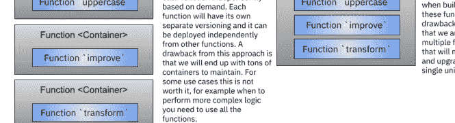

图 7.6 每项目一个函数 vs 每项目多个函数

如果你这样做，那么你将需要一种方法将事件路由到同一个 `func` 项目内的不同函数（你捆绑在一起的所有函数将共享同一个容器）。这种路由机制将特定于每种语言，但我们可以看到两种非常常见的模式：

- 基于 CloudEvent 属性（HTTP 头）路由
- 基于路径路由，每个函数可以公开不同的路径以接收 CloudEvent

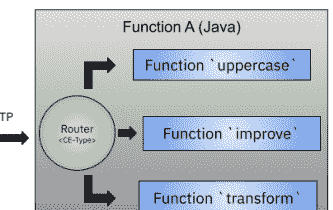

一个 `func` 项目可以包含多个函数，在此示例中为 3 个函数。项目可以公开单个端点，然后在内部使用例如 CE-Type 来决定哪个函数应处理特定的 CloudEvent。在某些情况下，将函数捆绑在一起非常有意义。虽然这些函数将一起扩展，并且不能独立扩展，但如果函数倾向于一起使用以实现更复杂的逻辑，这可能是一个很好的权衡。

图 7.7 使用内部路由机制的每 `func` 项目多个函数


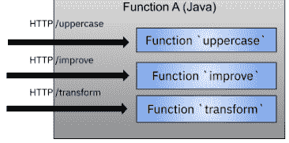

基于路径的路由要求生产者或某种路由机制知道用于处理传入 CloudEvent 的函数的路径。

Figure 7.8 Multiple functions per `func` project using path-based routing

虽然某些框架已经开箱即用地提供了其中一个或两个功能，但你可以使用任何编程语言实现这些方法。

但无论我们在同一个容器内有一个或多个函数，我们如何连接一个函数与另一个函数呢？最好让函数对它们设计用于消费的事件做出反应，而不是手动直接向我们想要使用的函数发送 HTTP 请求。如果一个函数返回一个 CloudEvent，能否自动将其路由到正在消费该 CloudEvent 的函数呢？

## ROUTING EVENTS BETWEEN FUNCTIONS USING KNATIVE EVENTING

等等，我们已经见过如何使用 Knative Eventing 将事件的消费者和生产者连接起来，我们能否对函数也做同样的事情？答案是肯定的，所以让我们看看连接两个函数需要什么。

正如我们在之前的图表中所看到的，我们需要有不同的函数执行不同的操作，以测试在正确的时间调用了正确的函数。

让我们介绍我们的两个函数：Uppercase 和 Improve。

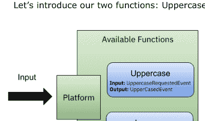

在处理函数时，让平台将事件路由到可以处理它们的函数是有意义的。生产事件的应用程序不会知道函数的具体位置以便直接请求它们。相反，它们会知道一个公共地址，在那里可以发送事件，而平台会负责路由。

正如你所看到的，作为输入，你可以提供一个 UppercaseRequestedEvent 或一个 UppercasedEvent，平台将知道如何将你的事件路由到正确的函数。如果你提供一个 UppercaseRequestedEvent，输出事件将自动转发到 Improve 函数，因为输出类型与 Improve 函数的输入类型匹配。

Figure 7.9 Uppercase and Improve function examples

为了让事情更有趣，我们可以用 Java 使用 Spring Boot 和 Spring Cloud functions 创建 *Uppercase* 函数，而用 Go 创建 *Improve* 函数。因为每个函数将使用不同的技术栈和编程语言，将两个函数放在同一个容器中是不可行的。因此我们将有两个函数，每个函数都在自己的容器中。对于创建这两个函数，我们可以使用 `func` 的另一个非常方便的功能，即使用来自自定义仓库的外部模板。我为这两个函数创建了模板，因此无需编码即可获得 Uppercase 和 Improve 函数的基础版本。

```
func create -l springboot -t uppercase --repository https://github.com/salaboy/func-templates
```

And

```
func create -l go -t improve --repository https://github.com/salaboy/func-templates
```

一旦我们有了两个函数，我们就需要弄清楚如何一起路由事件，为此我们将使用我们在第 6 章中学到的 Broker 和 Trigger 资源。

首先我们需要一个 Broker，它将作为来自我们应用程序的事件的主要入口点。关于我们可以有多少个 Broker 没有限制，但对于这个示例我们只需要一个。你可以通过将以下资源应用到你的集群来创建一个：

```
kubectl create -f - <<EOF
apiVersion: eventing.knative.dev/v1
kind: Broker
metadata:
  name: default #1
  namespace: default #2
EOF
```

#1 Broker 的名称是 default，你可以选择对你的应用程序有意义的任何名称
#2 这个 Broker 创建在 `default` 命名空间中，这对于理解如何从 Kubernetes 集群外部将事件路由到 Broker 很重要。

一旦我们有了 Broker，我们唯一需要做的就是创建 Triggers，以确保我们的函数接收到正确类型的事件。

我们将创建一个 Trigger 将事件转发到 `uppercase` 函数，并创建一个 Trigger 将事件转发到 `improve` 函数。

```
kubectl create -f - <<EOF
apiVersion: eventing.knative.dev/v1
kind: Trigger
metadata:
  name: uppercase-function-trigger
  namespace: default
spec:
  broker: default #1
  filter:
    attributes:
      type: UppercaseRequestedEvent #2
  subscriber:
    ref:
      apiVersion: serving.knative.dev/v1
      kind: Service
      name: fmtok8s-java-uppercase-function #3
---
apiVersion: eventing.knative.dev/v1
kind: Trigger
metadata:
  name: improve-function-trigger
  namespace: default
spec:
  broker: default
  filter:
    attributes:
      type: UppercaseRequestedEvent #4
  subscriber:
    ref:
      apiVersion: serving.knative.dev/v1
      kind: Service
      name: fmtok8s-go-improve-function
EOF
```

#1 两个 Triggers（`improve-function-trigger` 和 `uppercase-function-trigger`）都是为 `default` Broker 创建的。`default` 只是我们创建的 broker 的名称，它没有任何特殊含义。你可以拥有任意数量的 Broker，但触发器始终引用单个 broker。

#2 对于每个 Trigger，你可以定义过滤器。在撰写本书时，这些过滤器是精确匹配，这意味着只有匹配定义的过滤器的事件才会被转发给订阅者。你可以根据多个属性进行过滤，包括 CloudEvents 扩展，但所有属性都必须匹配。社区正在进行持续的努力，以为 Trigger 启用更高级和动态的过滤。

#3 正如我们在第 6 章中所看到的，我们可以通过指定可寻址的 Kubernetes 资源来引用订阅者，这允许 Trigger 验证订阅者是否存在。如果你的订阅者不是可寻址资源，你始终可以使用 `uri` 方法。有关这些选项的更多详细信息，请参阅官方 Knative 文档。

#4 通过对不同的事件类型进行过滤，我们可以串联函数或创建不同的拓扑来处理不同的事件。请注意，创建 Triggers 不需要开发人员来完成，并且函数如何连接可以在运行时完成，支持不同环境中的不同配置。

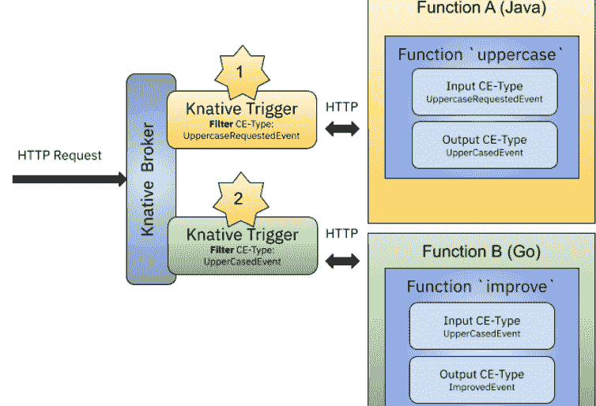

# Figure 7.10 Broker and Triggers to wire our functions together

回顾一下，我们创建了两个函数，每个函数期望不同种类的事件。`uppercase` 函数期望一个 `UppercaseRequestedEvent` 并返回一个 `UpperCasedEvent`，而 `improve` 函数期望一个 `UpperCasedEvent` 作为输入并返回一个 `ImprovedEvent` 事件，目前没有人消费它。

我期望 `func` 项目在未来包含一些工具，用于根据函数签名自动将触发器注册到 Broker，从而无需手动定义 Broker 和 Triggers。

要测试此设置，你只需要向 Broker URL 发送一个事件（你可以通过运行 `kubectl get broker` 找到 Broker URL，然后使用 `kubectl port-forward` 将 Broker Ingress Service 暴露到集群外部。如果你从集群内部发送事件，使用 Broker URL 是正确的方法。

## MONITORING ALL EVENTS GOING TO A BROKER WITH SOCKEYE

因为所有事件都进入 Broker，并且每个函数都将事件返回到 Broker，我们可以截取并将所有事件转发到另一个服务以查看发生了什么。为此我们可以使用 Sockeye，我们只需要再创建一个没有过滤器的 Trigger，换句话说，它会将所有事件发送到 Sockeye。

我们可以通过运行以下命令将 Sockeye 部署到我们的集群：

```
kubectl apply -f https://github.com/n3wscott/sockeye/releases/download/v0.7.0/release.yaml
```

并使用以下命令为 Sockeye 创建一个新的触发器：

```
kubectl create -f - <<EOF
apiVersion: eventing.knative.dev/v1
kind: Trigger
metadata:
  name: sockeye-trigger
  namespace: default
spec:
  broker: default #1
  subscriber:
    ref:
      apiVersion: serving.knative.dev/v1
      kind: Service
      name: sockeye #2
EOF
```

#1 再次，我们针对 `default` broker。请注意，此 Trigger 定义中没有 `filter` 部分，这意味着所有事件都将被转发到订阅者。

#2 对于此示例，我们使用 Sockeye，它也部署为 Knative Service。这个简单的 Web 应用程序将允许我们监控发送到 Broker 的所有事件。


## 图 7.11 使用无过滤器的触发器将所有事件发送到 Sockeye

如果我们现在从集群内部或外部向 Broker URL 发送事件，我们应该能够看到我们的函数如何挑选正确的事件并产生预期的输出。

你能否使用你选择的语言实现一个名为 `transform` 的第三个函数，该函数消费 `ImprovedEvent` 事件并对输入应用一些转换，例如反转输入字符的顺序？

在本节中，我们使用两种不同的技术栈创建了两个函数，然后使用 Knative Eventing 在这些函数之间路由事件。这种函数的手动连接可以被自动化，但 Knative Functions 提供了实现这一点的所有构建块，因为你可能对函数部署的位置或哪些函数可以相互通信有不同的限制。我个人希望在未来看到 Knative Functions 提供完整的连接体验，遵循无 YAML 文件的方法。

在下一节中，使用这些构建块，我们将在我们的会议平台之上构建一个更复杂的场景。我们将使用函数为我们的会议主题演讲创建一个实时游戏。

## 7.3 使用函数构建高可扩展且多语言的游戏

实时游戏的架构和构建相当困难，虽然本节中介绍的游戏在功能上相当有限，但它有助于我们在一个会根据需求扩展的真实云基础设施之上测试我们的函数。

本节的重点是高层次地考虑一个更复杂的场景，以便我们可以专注于在 Kubernetes 之上构建此类应用程序时将面临的挑战。我们将研究这些函数如何扩展，事件如何路由，以及在高需求场景中使用函数时最常见的一些问题。

这里介绍的游戏是作为我们的会议平台的一部分构建的，旨在作为会议主题演讲的一部分与现场观众一起游玩。为了让这个游戏有趣且引人入胜，它需要是交互式的，并且应该让观众中的每个人都能实时游玩并相互竞争。

游戏架构允许关卡设计师在游戏运行时添加新关卡。想象一个类似“Candy Crush”的游戏，每天都会添加新关卡。

要实现新关卡，开发人员只需实现一个函数，该函数接收来自每个玩家的 `KeyPressedEvents`，并具有内部逻辑来定义玩家何时完成关卡，在那时它应该发出一个 `LevelCompletedEvent`。用户界面在用户开始游玩新关卡时也会发送一个 `LevelStartedEvent`，以便游戏可以跟踪玩家完成每个关卡所需的时间。

游戏的架构如下所示：

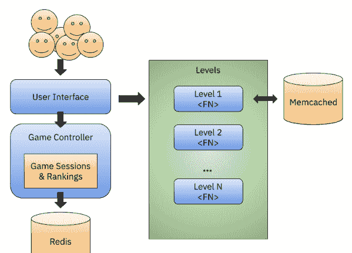

用户界面允许用户开始游戏会话，然后在完成不同挑战时与不同关卡交互。游戏控制器通过为每个玩家创建一个游戏会话来跟踪当前正在游玩的所有用户。作为开发人员，我们可以不断添加新关卡。这些关卡可以存储状态到 Memcached，用于判断玩家是否已完成当前关卡。

图 7.12 基于函数的游戏架构

由于我们使用函数作为游戏关卡的主要构建块，如果没有人游玩游戏，就不会有函数在运行，只有当新玩家想要游玩特定关卡时，StartLevelEvent 才会导致 Kubernetes 实例化关卡函数。

这种架构在支持多名用户同时游玩、处理不同事件之间的关联以及处理每个玩家的状态方面提出了不同的挑战。

在以下各节中，我们将研究各个部分如何协同工作，以及当并发玩家数量发送大量事件时它们如何扩展，因此我们将涵盖以下方面：

- 并发路由大量事件
- 处理函数状态
- 监控所有玩家并创建实时仪表板

让我们从路由开始。

### 7.3.1 并发路由大量事件

我们应用程序中的并非所有内容都是事件，例如，创建新的游戏会话，并不需要将该请求编码为事件。创建会话本质上是同步的，我们想要一个会话，并且我们现在就要。为实现此功能，游戏控制器服务公开了一个 REST 端点，接受一个 POST

请求，作为回复，用户界面接收到一个 SessionId 和有关已创建会话的其他信息。

现在当用户开始游玩特定关卡时，所有玩家交互都将作为事件发送到实现该关卡的函数。玩家在游玩游戏时按下的每个键盘键都将被转换为 CloudEvent 并发送到处理当前关卡的函数。为了将这些事件路由到正确的函数，我们将使用 Knative Broker 和 Triggers，这些触发器将为用户正在游玩的关卡过滤正确的事件。

在撰写本书时，Knative `func` 并不会自动为你的函数创建触发器，也不会创建 Broker(s)。这可能是社区在后续版本中努力实现的内容，或是建立在 `func` 或纯 Knative 之上的商业产品的一部分。

对于我们的示例，让我们假设我们希望将函数与如何连接它们的方式分开，因为我们可以以不同的方式将它们串联起来，具体取决于我们想要提供的游戏体验类型。

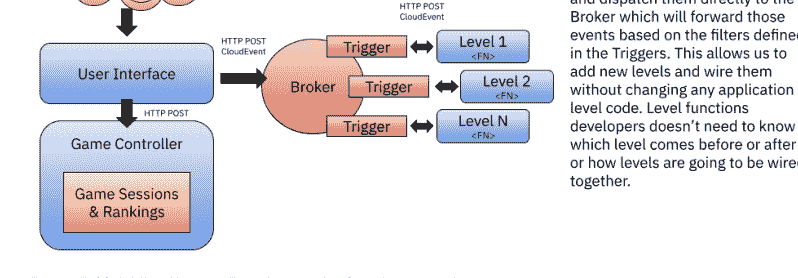

图 7.13 添加 Knative Eventing 以连接函数

通过将关卡交互分离到函数中，我们使应用程序能够通过仅在有需求时为每个关卡创建新副本来扩展。如果没有人游玩关卡 X，则该函数将由 Knative Serving 自动扩缩器自动缩放到零。

Broker 本身没有什么特别之处，并且由于我们可以选择 Broker 的不同实现，我们可以使用 RabbitMQ 或 Kafka 支持的 Broker 实现。这些实现中的每一个都将附带一套工具，用于监控在应用程序和关卡函数之间流动的所有事件。

另一方面，触发器将按关卡和事件类型进行过滤：

```
apiVersion: eventing.knative.dev/v1
kind: Trigger
metadata:
  name: level-1-trigger
  namespace: default
spec:
  broker: default #1
  filter:
    attributes:
      level: level-1 #2
      type: KeyPressedEvent #3
  subscriber:
    ref:
      apiVersion: serving.knative.dev/v1
      kind: Service
      name: level-1 #4
    uri: /KeyPressedEvent  #5
```

#1 我们有一个名为 `default` 的单个 Broker，为了保持此示例简单，我们仅使用单个 Broker，但创建不同的代理是有意义的，以确保如果事件太多，Broker 本身不会成为瓶颈。
#2 过滤器可以包含 CloudEvents 扩展，在本例中，我们定义了一个名为 `level` 的新扩展，该扩展由用户界面在向 Broker 发送事件时设置，这允许触发器仅将事件转发给玩家当前正在游玩的关卡
#3 对于此示例，我们仅关注 `KeyPressedEvents`，但这并不能阻止我们为不同事件创建更多触发器。需要注意的是，如果我们处理不同类型的事件并且想要关联它们，我们可能需要一种方法将这些不同事件组合在一起。常见的方法是包含另一个通常称为 `correlation-key` 的扩展，该扩展由属于同一逻辑组的事件共享。
#4 因为我们的函数是 Knative Service，我们可以使用 `subscriber.ref` 引用作为订阅者
#5 因为我们在函数中公开的端点不是 `/`，我们还可以指定事件预期的上下文 `uri`，在本例中为 `/KeyPressedEvent`

对于我们想要添加到游戏中的每个新关卡，我们需要定义其中一个触发器，以确保玩家产生的所有事件都被路由到正确的函数。

到目前为止，我们一直处理事件被发送到实现关卡的函数，但正如我们之前看到的，每个函数在处理每个传入事件后也会产生一个事件。对于此示例，当当前关卡成功完成时，将产生类型为 `LevelCompletedEvent` 的事件。如果关卡未完成，则会产生类型为 `LevelFailedEvent` 的事件。两个事件都将最终进入我们的 Broker，因此可以创建其他触发器来处理这些事件。

对于此示例，我们忽略了 `LevelFailedEvent`，但我们为 `LevelCompletedEvent` 注册了一个触发器，以将这些事件转发给具有将游戏推进到下一关卡的逻辑的游戏控制器。


Level functions 消费 `KeyPressedEvents` 并在玩家完成关卡时产生一个 `LevelCompletedEvent`。该 `LevelCompletedEvent` 会被转发给 Game Controller，后者推动游戏向前进行。

## Figure 7.14 Linking level functions and the Game Controller using Triggers

在此上下文中，Game Controller 负责编排玩家将要进行的关卡序列。这种编排是在不知道有多少关卡可用或下一关是哪一关的情况下完成的。虽然这种方法具有动态性，并且可以适用于简单场景，但拥有一个关卡注册表可以帮助我们提供更好的体验并降低检查哪些关卡可用的复杂性。

需要注意的是，在高负载下，Broker 本身可能会成为瓶颈，因为每个玩家都会访问同一个 Broker。

### 7.3.2 Dealing with function's State

游戏场景中有两个主要部分需要我们存储状态，以确保应用程序对崩溃具有弹性。Game Controller 需要将游戏会话外部存储，以确保我们可以通过多个副本来扩展此组件。Game Controller 需要存储的信息并不多，但我们需要确保这些信息始终可用，以便游戏体验按预期工作。由于 Game Controller 正在跟踪每个玩家的位置并在每个玩家完成关卡时接收事件，我们只想在推进每个会话的过程中跟踪关卡统计信息。因此，Game Controller 将跟踪从玩家开始一个关卡到关卡函数接收到 LevelCompletedEvent 所花费的时间。

我们需要持久化事件的第二个地方是每个函数逻辑，因为每个关卡都需要收集事件以验证玩家是否已完成关卡。由于有大量事件到达，我们需要确保关卡的不同实例可以访问相同的已接收事件。

当需求很高且多个玩家向 Level 1 发送事件时，将创建新的副本。如果这些副本无法共享相同的上下文，它们将无法检查关卡是否已完成。我们需要一种方法在不同的副本之间共享此状态。

Figure 7.15 Storing events for aggregation to enable scaling up of our functions

这可能很棘手，因为延迟将在我们的关卡反应性中发挥主要作用，这取决于当新事件到达时加载所有先前事件所需的时间。我们可以使用像 Memcached 这样的工具在事件到达时存储事件，然后获取并处理特定玩家的全部先前事件。我们甚至可以存储聚合先前事件的快照，但这最终取决于延迟以及访问每个到达事件的外部存储的效率。

另一种方法，如果你使用像 Kafka 这样的 Broker，则可以使用消息代理实现作为数据库，并使用任何允许你消费消息并在该层聚合它们的工具来聚合数据。通过采用这种方法，你可以避免在不同位置存储事件并聚合它们。

消息可以在基础设施层进行聚合，我们的函数可以消费这些聚合。在这种情况下，状态由消息代理本身维护。

Figure 7.16 Using Broker implementation’s tools to do aggregation

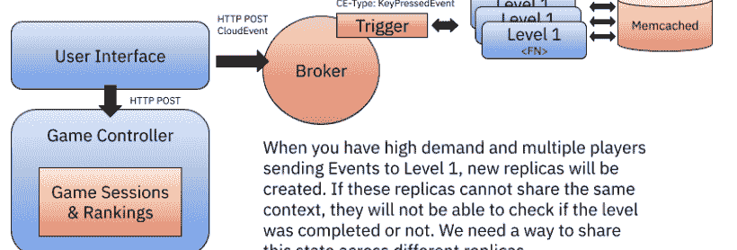

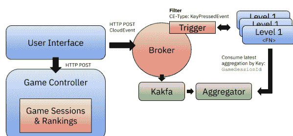

虽然这种选择性能更好，但我们现在以 Broker 实现特定的方式定义应用程序逻辑（如何聚合我们的事件）。

最后一种可能值得注意的方法是使函数基于例如 GameSessionId 粘性，如果我们知道同一关卡函数的同一副本将接收与 `GameSessionId` 关联的所有事件，我们就可以实现一个快速的本地存储机制，将事件尽可能靠近函数保存。不幸的是，Knative Serving 尚未支持此场景（https://github.com/knative/serving/issues/8160）

### 7.3.3 Monitoring all players and creating a real-time dashboard

正如我们在前两节中所讨论的，游戏体验分为 Game Controller 和发送到每个关卡函数的事件。

我们可以利用 Broker 事件来构建一个仪表板，显示每个玩家交互的实时数据。根据游戏需求，我们预计同时游戏的玩家数量，我们可以为每个关卡创建一个 Broker，从而将负载拆分到不同的 Broker。从监控/仪表板的角度来看，我们需要接入这些不同的代理，以全面了解正在发生的情况。

在本章中，我们研究了通过使用基于函数的 方法，我们可以为构建更精细化应用的开发人员提供简化的体验。我们看到了这些函数如何根据需求进行扩展，以及如何使用 Knative Eventing 来路由事件以将函数连接起来构建更复杂的功能。我们还看到了构建此类应用程序时将面临的挑战，因此总是有权衡。我讨论 Kubernetes 之上 FaaS 方法的意图是双重的：

- 推广一种利用 Kubernetes 生态系统并通过利用函数提供简化开发人员体验的多语言方法。
- 展示如何构建开发人员体验以减少实现生产力所需的认知负担。在这种情况下，`func` 旨在消除 Kubernetes 和构建容器的复杂性，但如果你正在构建自己的平台，你可能希望抽象出更多方面以使你的开发人员更具生产力。

在下一章中，我们将重用本书迄今为止学到的所有内容来描述构建以持续交付为设计目标的平台所需的所有组件。我们将研究如何构建此类平台，可以使用哪些工具，以及如果我们希望使团队能够更高效地在 Kubernetes 之上交付更多软件，我们应该追求哪种开发人员体验。

## 7.4 Summary

- 一个函数消费一个事件并作为结果产生一个事件。这些事件在 Kubernetes 和云原生应用程序的上下文中可以使用 CNCF CloudEvents 规范来表达。
- 你可以使用 Knative `func` 在不编写 Dockerfile 或任何一行 YAML 的情况下创建、构建、本地运行并将函数项目部署到 Kubernetes 集群中。这些函数可以使用你喜欢的编程语言，因此你可以利用 Kubernetes 的多语言特性。
- 你可以在一个容器中拥有一个或多个函数。你可以将相关的函数组合在一起，例如它们通常一起使用。当你将函数组合在同一个容器中时，你需要定义如何将到达容器的事件路由到正确的函数。本章讨论的两种方法分别是 `path-based` 路由和 `attribute-based` 路由。Spring Cloud Functions for Spring Boot 应用程序支持这两种方法。
- 你可以在 VSCode、IntelliJ Idea 和 GoLand 中使用一些 Knative 和 Knative `func` 插件来管理你的函数生命周期。
- 你可以使用 Knative 事件资源，例如 Brokers 和 Triggers，将函数链接起来以构建更复杂的交互。

