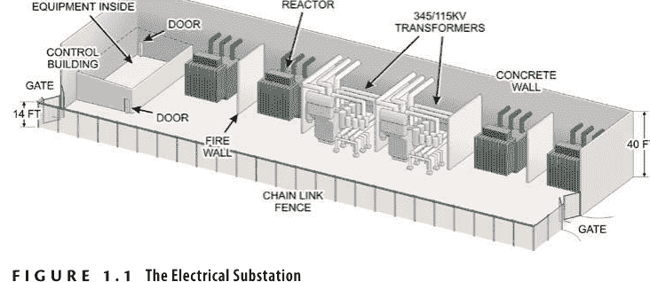
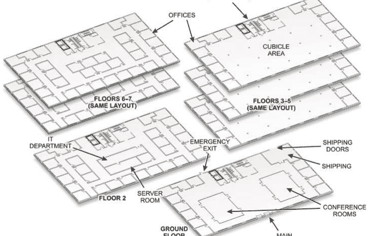

## Infrastructure Security in the Real World

*The following challenges will* provide contextual reference points for the concepts you will learn in Part I. Because you have not yet read the chapters in Part I, the challenges in this chapter are designed to introduce you to the infrastructure security scenarios you'll face in the real world. In this chapter, you'll learn to:

- Understand the relevance of infrastructure security
- Describe the functions, categories, subcategories, and reference structure of the NIST Cybersecurity Framework
- Apply the NIST Framework references to specific cybersecurity scenarios

### Security Challenges

The NIST Cybersecurity Framework was developed by the U.S. National Institute of Standards and Technology (NIST) to provide a set of independent guidelines that organizations can use to implement or upgrade their cybersecurity programs. Because the framework is a product-independent tool, it provides guidelines that any organization can tailor to meet its own cybersecurity needs.

The framework is divided into five functions (Identify, Protect, Detect, Respond, and Recover) that provide a top-level description of the cybersecurity development process. Each function is then divided into applicable categories that underpin the stated function. Each category is further divided into subcategories and implementation methodology. Finally, the subcategories are supported by lists of reference documents that contain the nuts and bolts of building the cybersecurity program.

This chapter will kickstart your thought processes for what you are about to learn in Part I. It contains two specific cybersecurity scenarios to which you will be asked to apply the NIST Framework in order to produce a cybersecurity solution that meets the desired objectives. In each case, you will be provided with specific subcategories to research, along with some guidance to help you produce your solutions.

In this first pass through the scenarios, you are expected to generate and record general observations about securing the infrastructure described, as you have not yet been introduced to the supporting material. As mentioned earlier, this activity is designed to get your cybersecurity thought processes started.

In Chapter 5, you will return to these scenarios and use what you have learned in Chapters 2, 3, and 4 to revise your initial assessments. You will also compare your observations to those of professional security specialists who have provided their observations and solutions for these scenarios.

### Infrastructure Security Scenario 1

You are in charge of planning and implementing a security system for a new electrical substation that will be built next to a new housing development. The substation is equipped with high-voltage electrical switchgear for the surrounding community. It is not manned on a full-time basis but does have a control building that houses instrumentation and communication equipment, as shown in Figure 1.1.

FIGURE 1.1 The Electrical Substation

The high-voltage switchgear accepts electrical power from different sources, which it then conditions and routes to the community users as needed.

The energy arrives on a set of different high-voltage supply lines and leaves the facility via different sets of distribution lines.

The monitoring devices and control systems in the substation communicate with different parts of the utility's transmission and distribution system to route electrical power where and when it is needed. These communication channels include wireless radio signals, signals transmitted across the power lines, and traditional network communications media.

### Risk Assessment 1

From the information provided in this first scenario, consider the National Institute of Standards and Technology (NIST) functions detailed in this section and then record your observations as they relate to each category.

### See Appendix C for the NIST Cyber Security Framework

A copy of the NIST Cyber Security Framework is available in Appendix C. This framework was developed by the U.S. National Institute of Standards and Technology to provide cybersecurity guidelines for Improving Critical Infrastructure Cybersecurity under Executive Order 13636. The ultimate goal of this initiative is to provide guidelines for the nation's critical infrastructure in business, industry, and utility organizations to reduce their cybersecurity risks.

### Identify

Create an inventory of physical assets (devices and systems) within the substation (NIST ID.AM-1).

### Understanding NIST References

NIST references include the function, the category, and the subcategory. In the example of ID.AM-1 mentioned earlier, the function is Identify (ID); the category is Asset Management (AM); and the subcategory is 1 (which is “physical devices and systems within the organization are inventoried”). To implement this portion of the Framework for the scenario presented, you may want to refer to an online copy of the designated reference documents listed under this subcategory. The same is true of the following subcategories as well.

### Protect

一般来说，你可能会如何保护前面提到的物理资产（NIST PR.AC-2）。

### Detect

你将如何知道有人或某物正在尝试访问、禁用、降低性能或破坏变电站中的一个或多个设备和/或系统？你如何检测可能影响变电站运行的异常和事件（NIST DE.CM-2, 8）？

### Respond

针对通过前面提到的设备、系统和步骤所识别出的异常和事件，你需要如何响应（NIST RS.AN-1, 2, 3）？

### Recover

可以采取哪些步骤来从旨在访问、禁用、降低性能或破坏你之前识别的资产的行动中恢复（NIST RC.RP-1）？

## Infrastructure Security Scenario 2

贵公司正在建设一座新的企业设施，如图 1.2 所示，用于容纳其 5,000 名总部员工。该设施将有多层楼。一些管理人员将使用带门窗的传统办公室，但大多数员工将在开放式隔间中工作。

每个办公室和隔间都将配备电话和网络连接。此外，许多员工因工作需要而出行，需要便携式电脑。其他员工使用台式个人电脑。

该设施将容纳一群计算机服务器和网络设备，为所有管理人员和员工提供工作流程和通信。该架构以电子方式操纵、存储和传输公司所有重要的业务信息和数据。这包括产品描述、会计信息、法律记录、客户记录、员工记录以及公司的知识产权。

FIGURE 1.2 Headquarters Facility Plans

## Risk Assessment 2

根据第二种情况提供的信息，考虑本节中详细说明的 NIST 功能，然后根据每个类别写下你的观察结果。

### Identify

- 创建组织内物理资产（设备和系统）的清单（NIST ID.AM-1）。
- 创建组织内网络资产（软件平台和应用程序）的清单（NIST ID.AM-2）。
- 根据资产对组织业务功能的关键性或价值对组织的资产进行优先级排序（NIST ID.BE-3）。
- 识别产生依赖关系或为组织关键服务提供关键功能的任何资产（NIST ID.BE-4）。
- 创建已识别资产漏洞的风险评估（NIST ID.RA-1, 3）。

### Protect

- 创建基于以下项目的授权设备和资源访问管理政策（NIST PR.AC-1）。
- 创建控制对安全资产的物理访问的方法（NIST PR.AC-2）。
- 创建告知和培训普通员工的行动计划（NIST PR.AT-1）。
- 创建帮助特权用户理解其工作角色和职责的计划（NIST PR.AT-2）。

### Detect

- 必须部署哪些类型的系统来识别物理安全侵害的发生（NIST DE.CM-2）？
- 必须部署哪些类型的系统来监控人员活动以检测潜在的网络安全威胁（NIST DE.CM-3）？

### Respond

- 当设施的一般物理安全遭到破坏时，可能需要哪种类型的响应计划（NIST RS.AN-1, 2, 3）？
- 鉴于公司服务器上保存的信息，当服务器机房的物理安全遭到破坏时，可能需要哪种类型的响应计划（NIST RS.CO-4, 5）？

### Recover

- 当设施中的一个隔间发生一般物理安全侵害时，可能需要哪种类型的恢复计划（NIST RC.RP-1）？
- 如果设施的服务器安全遭到破坏，恢复计划可能包括哪些项目（NIST RC.CO-1, 2）？

### Summary

记录本章中呈现的风险评估的观察结果。在第 5 章中，你将把这些原始想法和观察结果与阅读第 2、3 和 4 章后产生的想法和观察结果进行比较。你还将能够将你的答案与专业安全专家的答案进行比较。
