## Understanding Access-Control and Monitoring Systems

如果你跳过了阅读“Introduction”，你可能会想知道为什么整个第一部分都专门用于基础设施安全。然而，正如“Introduction”指出的那样，没有物理安全就没有安全。基础设施安全运营和管理基于三种基本类型的子系统：访问控制和监控系统（本章涵盖）、视频监控系统（第 3 章涵盖）以及入侵检测和报告系统（第 4 章涵盖）。在本章中，你将学习：

- 理解以下物理安全概念的应用：访问控制、物理屏障和生物识别
- 区分身份验证和授权
- 识别常用的物理访问控制系统/设备，包括键盘、读卡器、生物识别读卡器、接近读卡器、电子插销和磁锁

## A Quick Primer on Infrastructure Security

任何安全工作的总体目标都是建立一种安心状态（一种无忧无虑的状态）供个人、团体或组织使用。这种状态理想情况下是通过确保对资产（对象和信息）的专有权、对这些资产的访问以及对这些资产的使用来实现的。这种状态为资产所有者创造价值并提供安心感。

## No Time for Relaxing in the Cybersecurity World

在网络安全领域，真正的无忧状态永远无法实现。新的网络攻击类型不断被设计出来，导致网络安全专家和管理员必须时刻警惕可能造成损害的情况。

安全的一个更现代的定义是建立个人、系统、媒体、内容和对象排除和纳入系统的科学、技术和艺术。它还提供对机器或加工设备等物理资产的更大安全性和利用率。

*物理安全*是建立有形资产排除和纳入系统的科学、技术和艺术。实践中，这涉及旨在打击盗窃、防止物理损坏、维护系统完整性和服务、并限制信息未经授权披露的政策、做法和步骤。

同样，*网络安全*一词涉及保护对财产、系统和设备端口的物理访问，同时保护包括电子、光学和信息对系统数据和控制的访问在内的无形资产。

在任何现代系统中，安全都是物理和网络安全领域协同作用的函数。两者都是支持强大整体安全态势和计划所必需的。

当物理安全举措应用于为企业、组织或社会运营所需的物理和组织结构提供安全保障时，这被称为*基础设施安全*。

虽然我们可能以锁门、巡逻保安或用于保护资产的其他方法等简单的物理形式来思考基础设施安全；但构建有效的基础设施安全系统还有几个额外的组成部分。此类系统通常涉及一系列经过精心规划和测试的、旨在满足或超过运营和组织安全需求的关键安全程序的组合。

如图 2.1 所示，设计和实施物理保护基础设施资产（财产、建筑物、物理空间、系统或设备）计划的一般有三层：

### The Outer Perimeter

保护此空间涉及控制谁可以跨越标记此周界的法律或物理线移动（行走、驾驶、飞行）。

典型的物理外围示例包括产权线或建筑物或建筑群的外墙。

## 内围

该周界通常涉及物理屏障，例如墙壁、门和窗户——根据外围的上下文，可能是外部或内部的。

## 内部

这是安全的最内层，由建筑物、办公室、隔间等内部构成，其周围环绕着内围和外围。

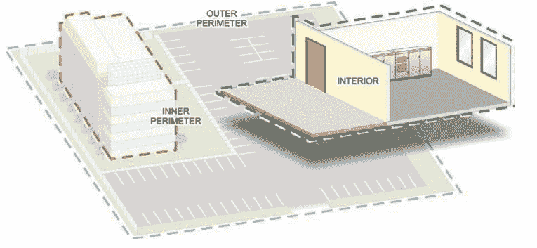

图 2.1 三个周界

在全面的安全计划中，所有三个层次的控制都会得到解决。每个层次的安全通常由一套专门选定的设备协同工作构成，以提供有效的物理安全系统。

## 保护逻辑周界

网络安全还涉及保护逻辑周界。它们将在后续章节中涉及计算和控制系统、网络和互联网的内容中进行介绍。这里开发的相同安全概念将在遇到这些主题时应用于这些主题。

在每个层次上都有两个概念在起作用：

**自然访问控制方法**  自然访问控制涉及使用自然设计元素，例如结构和景观，来引导人们进出空间。

**领地强化**  领地强化采用结构、系统和设备来防止未经授权的进入，并在公共和私人之间创造明确的区别。

基础设施安全运营和管理基于三种基本类型的子系统：

- 访问控制和监控系统
- 视频监控系统
- 入侵检测和报告系统

在本章中，您将了解访问控制和监控系统。然而，在继续阅读之前，请花几分钟时间更新第 1 章中的安全场景，以反映这些初步想法。

## 访问控制

大多数安全专家一致认为，任何基础设施安全系统的首要和最基本目标是阻止潜在入侵者，如图 2.2 所示。这是访问控制的目标。你无法物理访问的东西就无法造成损害、破坏或被盗。

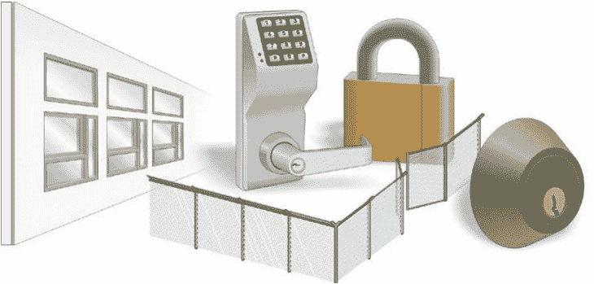

**图 2.2**  访问控制

设计高效访问控制系统的基础涉及三个术语：入境、离境和再入境。按定义，*入境*是个体进入财产的权利，而*离境*是合法离开财产的权利。同样，*再入境*是指重新进入财产的合法权利所使用的术语。

在物理安全的基础上，入境可以定义为个人正确进入财产的物理路径，而离境则是正确离开财产的物理路径。

在安全术语中，*权利*是由某个被认可的权威来源授予某人或某群人的法律特权或许可。该来源可以是政府、合法认可的政府代理人或合法认可的资产所有者。由此推断，被授予访问资产权利的人被称为*授权*的，而未被授予此权利的任何人则被标记为*未授权*。当未经授权的人试图获取他们没有权利访问的资产时，他们就成为*入侵者*。

因此，访问控制涉及能够根据授权控制对资产的入境、离境和再入境，如图 2.3 所示。特别是，限制未经授权人员对重要资产的访问是你能采取的最基本的安全措施。

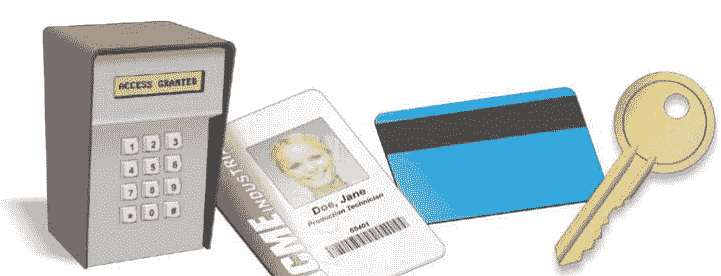

图 2.3 授权

从上一节的列表中可以看出，访问控制始于外围。视所研究的特定示例而定，这可能是组织物理财产的产权线或其设施的前门。

请记住，外围的目标是控制谁可以步行或驾车穿越周界。此处的控制可以简单到在财产边缘种植灌木丛或放置适当的视觉标志以警告未经授权的人不要进入，也可以复杂到带刺铁丝网、带门和武装警卫。

访问控制工作通常延伸到外围和内围之间的区域。这些工作可以包括自然访问控制技术，例如员工和访客停车的战略性放置，以及利用景观特征引导人们前往选定的出入口并阻止其他可能的出入口的进入。这还延伸到清晰地标记设施和财产的入境和离境通道。

## 通过环境设计预防犯罪（CPTED）

CPTED 是一套建筑和物业设计原则，基于预判潜在入侵者的思维过程，以阻止他们付诸行动。

物理基础设施的内围控制涉及使用物理结构，如墙壁、窗户和门，这些结构可以作为屏障，阻碍入侵者从外围向内部区域推进。再次，视所讨论的具体安全场景而定，这些屏障可能是封闭整个内部环境的建筑外部结构的一部分，也可能是控制进出单个工作区域的内部结构。

内部安全是基础设施安全的最内层，涉及监控内围内部区域的活动。这种监控可能包括人性和电子安全系统，以观察、跟踪和检测入侵者以及记录不同活动的证据。赋权人员和电子设备的结合使得内部安全层级成为有效的安保工具。

## 安全政策

将三个安全层级联系在一起的关键组成部分是设计良好的安全政策，说明每个层级如何实施安全。企业和组织制定全面的安全政策，定义谁有权访问不同资产以及在访问时可以对这些资产做什么。

例如，允许员工和访客自由访问组织内部的所有部门会带来各种安全风险。你需要保持访问控制，以创造一个减少人性诱惑的环境。如果每个人都可以在组织内部自由移动，就很难实施保障措施，防止他们访问或获取物理或网络资产。你还需要保持访问控制以防止事故发生。

例如，你不希望销售代表不小心将咖啡洒在工程部门的生产服务器上。

相反，在每个层级制定连贯的访问控制政策，为授权人员提供对选定资产的适当访问级别，同时阻止未经授权人员访问资产。然后根据需要使用正确类型和数量的访问控制设备（传感器、屏障、日志、身份证件或保安）来执行这些政策。

## 关于保安的一句话

> 尽管访问控制设备可能比人工警卫便宜，但警卫能够根据潜在入侵者的行为做出宝贵的判断性决策。他们是安全的象征，可以启动人工判断，并在事件发生期间提供及时干预。

经常使用徽章或智能卡来控制访问。员工在进入 RFID 传感器近距离范围时，也可能通过射频识别（RFID）应答器进行识别。应答器存储访问代码并使用无线接收器和发射器。

这些访问控制技术、系统和设备将在本章剩余部分中详细讨论。

## 物理安全控制

执行访问控制措施最初可能包括在通往办公室的门上安装锁，并用类似的物理屏障将部门或网络部分分开。许多公司有一个前门或入口，包括接待员来控制访问。在营业时间内，接待员充当物理屏障，询问客户访问的性质，如图 2.4 所示。

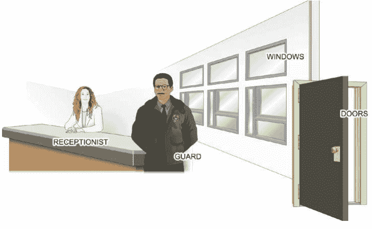

**图 2.4** 物理屏障

在一些机构中，访客可能被要求由一名陪同人员随行，以从物理上限制其在公司内的活动范围。为了进一步加强访问控制，可以安排一名人工警卫来控制对特定受限内部区域（如实验室）的访问，或对通往受限区域（如地下室）的电梯的访问。

夜间，物理屏障可能仅仅是一扇锁着的门。然而，门上也可能配备传感器和报警器。报警器可以是本地报警装置（如警笛），也可以直接连接到外部监控系统或警察部门。

## 锁与钥匙

在大多数安全周界中，主要的物理屏障是带锁的门。门本身提供物理屏障，但只能挡住诚实的人。而锁则通过其钥匙提供屏障的认证功能。持有钥匙意味着该人要么拥有、要么知晓通过这扇门所需的准入信息。

安全屏障使用多种不同类型的锁。同样，解除锁定机构也使用多种不同类型的钥匙。根据所用锁的类型，钥匙可以是物理钥匙，也可以是逻辑钥匙。

在大多数组织中，只有特定办公室工作的选定人员才可持有钥匙进入其工作环境。保持严格的钥匙管控，并使用明确编码为禁止复制的编号钥匙，有助于让带锁的门继续作为有效的物理屏障。

## 执行严格的钥匙管控政策

为了成功保护上锁门后的设备和想法，必须制定严格的钥匙管控政策。

## 标准钥匙锁闭闩锁

标准钥匙锁闭闩锁的锁定机构与电子电磁式闩锁类似，但通过钥匙来锁闭或撤回。它们为可手动操作的门提供了额外一层安全保护。钥匙锁闭闩锁可配备单锁芯或双锁芯，如图 2.5 所示。

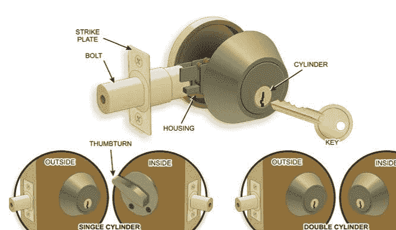

图 2.5 钥匙锁闭闩锁

## 电磁式闩锁

电子操作的闩锁为周界提供更高水平的安全保障。适应于任何安全系统，电子闩锁在需要访问控制的门上作为辅助锁表现出色。

电磁式闩锁（如图 2.6 所示）的主要驱动部件是电激活的电磁阀。当电流施加到电磁阀线圈时，线圈周围会产生电磁场。电磁场对线圈中心的磁芯施加磁压力，使其移动。该移动要么接合（激活）物理锁定机构，要么脱离（停用）锁定机构。

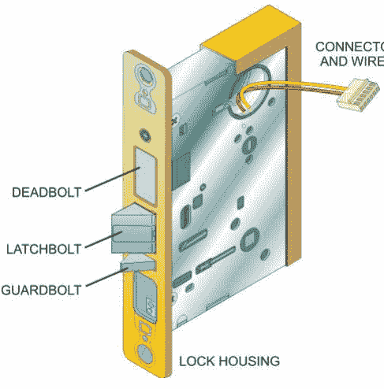

**图 2.6** 电子闩锁

电磁阀的操作通常由远程开关或电子访问控制系统控制。在后一种情况下，系统通常由智能识别卡访问设备的输入来触发。

电磁式闩锁可以设置为通电时锁定或解锁，并已被美国保险商实验室（UL）列为防盗保护设备。在安全应用中，电磁锁通常配置为在门关闭时自动移动到锁定位置。这有助于防止尾随，即未经授权的人紧跟在获得授权的人身后溜过锁定门。

然而，一些使用自动锁的门需要配置为在 fail-safe 模式下运行（断电时解锁）。必须采用此类配置，以便员工在紧急情况下能通过该门撤离。

配置为在 fail-secure 模式下运行（断电时锁定）的闩锁门不适合用作紧急出口，因为发生紧急情况时无法通过它撤离周界。对于 fail-secure 锁，门将默认为锁定状态，并因缺少电力而无法打开。

电子闩锁可用于平开门、推拉门、电动门和垂直升降门，也可用于围栏门。

## 密码锁

密码锁要求用户输入个人访问代码，常用于访问控制和管理系统。当用户在密码锁键盘上输入正确的已编程代码时，这些锁会解锁磁力门锁。它们为周界入口区域提供了额外一层安全保护。图 2.7 显示了一个密码锁示例。

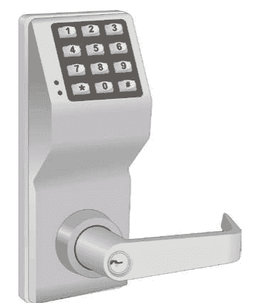

图 2.7 密码锁

虽然电子门禁键盘可能提供更安全的物理屏障，但为了长期有效，其访问代码需要定期更换。

## 访问控制门

与门类似，出入口闸门也是一种物理屏障，可通过摆动、拉动或升降来控制穿过墙体或围栏的进出。访问控制门可分为两大类：

- ► 平移门
- ► 摆动门

两种类型均可通过电机驱动装置开启或关闭。门驱动装置的尺寸取决于通道宽度和所选门的重量。

## 平移门

平移门（如图 2.8 所示）用于需要高水平操作安全和安保的场所。

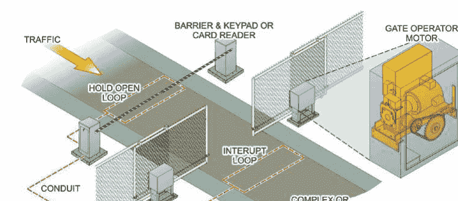

图 2.8 平移门

许多物理认证系统基于依赖于“拥有”（possession）的单因素认证，例如拥有一个打开锁的钥匙设备。根据打开物理或虚拟锁定机构的需要，钥匙可以是物理钥匙或虚拟钥匙。

更智能和有效的认证方法涉及双因素认证（一种需要两种因素才能授权的过程），基于*知识*（你知道的信息）和*拥有*（你拥有的物品）。

高级授权和认证方法包括多因素授权与认证系统。在这些系统中，信息必须提交给认证设备，认证设备再将其传递给安全控制器的认证系统。在访问控制系统中，通常会使用多种不同的认证设备。本章以下各节将介绍主要的设备类型。

## 磁条阅读器

*磁条卡*是一种类似信用卡的物理设备，其磁条上包含以磁编码点形式存在的认证信息，如图 2.12 所示。持卡人将卡上的磁条划过磁卡阅读器，即可利用卡上的信息访问物理空间或资产。

**图 2.12** 磁条卡系统

当磁条通过阅读器的磁传感器时，阅读器读取磁编码信息，并将其转换为数字数据，再传递给主机系统。主机系统的编程决定了卡上的信息是否足以授予持卡人授权和访问权限。

## 智能卡

智能卡也是类似信用卡的设备，通常与磁条卡相似，如图 2.13 所示。然而，由于包含智能电路，它们提供了更高的数据安全性；该电路可在认证过程完成前隐藏用户数据。它们通常包含其所有者的信息，例如密码、个人识别码（PIN）、网络密钥、数字证书，以及其他可用于认证过程的个人身份信息（PII）。

### 关于 PII 的说明

PII 是指任何能够识别个人身份的信息。PII 的示例包括：姓名、家庭住址、社会安全号码、出生日期、指纹，以及其他可能区分不同个体的信息。

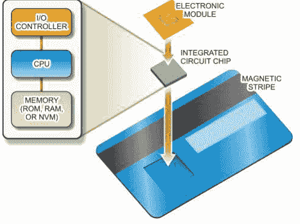

图 2.13 智能卡

从物理上看，智能卡有多种形态：智能设备、类似信用卡的设备、身份徽章，以及与智能卡读卡器通信的插入式设备。

在内部，所有智能卡设计都包含嵌入卡结构中的微处理器和存储设备。智能卡存储器

section 包含用户特定的识别信息，以及卡片与主机安全系统通信所需的所有编程。

一些使用智能卡的组织会向员工发放单张卡片，他们可以用它进入建筑物、登录计算机并访问适当的应用程序。

智能卡设计为防篡改。篡改智能卡通常会使其失效。此外，使用智能卡时也需要小心，因为即使弯曲也可能使其无法使用。

## RFID 徽章

射频识别（RFID）徽章提供免持访问控制工具，在条形码、磁条和近距离读卡器技术的基础上进行了改进。RFID 系统使用无线电信号通过 RFID 读卡器设备和 RFID 标签来识别唯一物品，如图 2.14 所示。

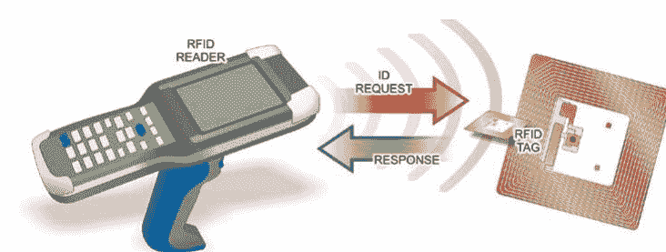

图 2.14 RFID 系统

读卡器通过无线电频率数据与 RFID 标签进行发送和接收。每个标签将发送给它的数据存储在其嵌入式集成电路（IC）设备上。虽然存储在 RFID 标签上的具体信息由 RFID 系统程序员决定，但它通常由一个识别其自身的序列号以及与该标签关联的物品的信息组成。

当系统想要了解与标签相关联的内容，例如它关联的是什么（或谁）或它在何处时，它只需发出请求，这会导致被寻址的 RFID 标签通过其内置天线辐射其信息。读卡器接收来自标签的数据并将其转发给主机计算机进行处理。这种技术最有趣的部分是，无源 RFID 标签能够在没有外部电源的情况下执行其任务。

## 生物特征扫描仪

*生物特征* 是指使用人体生理特征来验证个人身份的访问控制机制的术语。生物特征认证涉及使用独特且个人化的生理特征来验证人们的身份。

每个人的生理特征都是独一无二的，可以将其与他人区分开来。即使是同卵双胞胎也有各自不同的声音模式、指纹、眼睛特征和其他特征。生物特征认证中最常涉及的特征包括声音模式、指纹、手掌印、签名、面部特征以及视网膜和虹膜扫描，如图 2.15 所示。

在每种情况下，都需要生物特征扫描设备将生理量转换为数字表示。结果存储在数据库中，可在认证过程中使用。底层应用程序将使用数据的真正独特质量作为与未来访问请求进行比较的基础。如果来自未来认证请求的数据与存储版本的要点匹配，则将授予访问权限。

然而，并非所有生物特征扫描设备在验证用户方面的准确性都相同。在表 2.1 中，美国政府的数据显示了不同生物特征扫描设备在准确验证人员方面的能力。

### 表 2.1 生物特征设备比较

|  | 误报率 | 误拒率 |
|---|---|---|
| 手掌印 | 1.43% | 4% |
| 面部结构 | 0.1% | 0.8 – 1.6% |
| 声音模式 | 2 – 5% | 5 – 10% |
| 眼睛（视网膜或虹膜） | 0.1% | 1.1 – 1.4% |
| 签名 | 0.49% | 7.05% |
| 指纹 | 2.2% | 2.2% |

手掌印

面部结构

声音模式

眼睛（视网膜或虹膜）

签名

指纹

图 2.15 典型的生物特征认证方法

总体而言，人眼的特征——虹膜和视网膜扫描——往往是最可靠的认证来源。在列表中剩余的生物特征变量中，指纹读数往往比语音扫描更准确。然而，指纹可以存储在透明表面上并在以后使用。另一方面，疾病和用户压力水平会影响声纹。

如表 2.1 所示，存在两种基本的认证失败类型：

**类型 1 – 误拒或误拒失败** 这是一份产生对个人的错误拒绝的报告，从而将其锁定在他们本应能够访问的设施或安全区域之外。

**类型 2 – 误接受或误报失败** 这是一份错误地对个人进行认证的报告，这可能导致向此人无法访问的设备或数据提供访问权限。在两种认证失败类型中，这是最重要的一种，因为它可能授予恶意人员访问权限。

由于存在错误报告和不准确的可能性，可能需要在与生物特征设备一起使用时使用第二种访问控制方法。在需要更高安全性的区域，可能需要使用护照、额外的指纹或其他类型的验证，以确保个人没有被错误认证。

## 远程访问监控

远程监控是指从远程位置或控制室对设备进行监控或测量。在安全领域，这涉及通过通信系统对安全系统进行外部访问。

远程访问监控系统用于在未经授权的访问尝试时通知主管安全人员。在这些系统中，控制器监控基础设施传感器的开/关状态。当磁性开关或运动探测器等传感器被激活时，系统会自动将其识别为入侵并通知指定的安全人员。

通知可以以安全控制面板上的视觉通知、电话呼叫、即时通讯通知或发送到智能手机的短信的形式出现。通知还可能涉及激活频闪灯和高强度警笛以引起对入侵尝试的注意。图 2.16 显示了远程访问典型安全系统的不同选项。

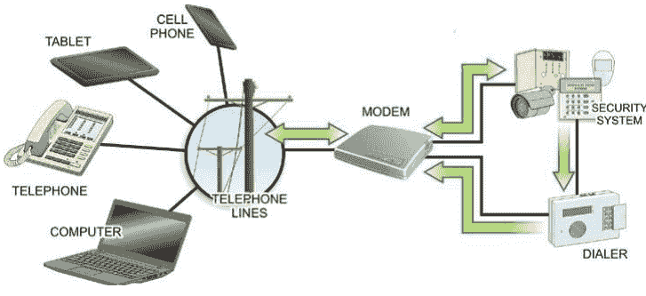

**图 2.16** 远程访问通信选项

## 开启和关闭状态监控

各种传感器可用于检测自动门或闸门的开启、关闭、锁定或未锁定状态。它们也可以配置为在指定的门或闸门处启动开启、关闭、锁定或未锁定状态。

> ### 关于传感器的说明
> 
> 因为开启和关闭状态与锁定和未锁定状态不同，单个传感器无法区分这两种状态。需要安装并监控第二种或不同类型的传感器来执行此区分。

图 2.17 显示了简单的磁性传感器和用于可移动屏障（门、闸门或窗户）的匹配触点组。当门打开时磁性开关触点断开时，传感器的发射器会向控制面板或紧急拨号器发送信号。

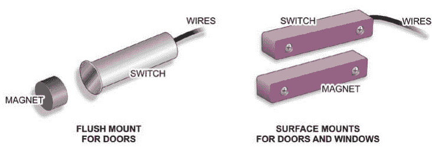

在屏障打开和关闭之间的时间段内，传感器与控制器之间的信号和报告是连续的。如果屏障在指定时间内保持打开状态，该信息也会被系统记录。状态监控系统包括事件日志，详细记录各种事件的时间和日期。例如：

**锁定状态监控** 锁定监控是一项功能，允许安全主管确认门已锁定。除了监控门或闸门的锁定状态外，状态监控系统还可以提供门或闸门保持锁定的时间和时间段的详细信息。

**未锁定状态监控** 状态监控系统可以记录并发出信号，每次特定闸门或门被解锁（授予访问权限）时以及授予了何种类型的访问权限。未锁定监控还可以识别谁被授予了访问权限。

**每日时间设置** 大多数自动访问控制系统基于预配置的每日时间设置来决定有效或无效的进入请求，也称为 *交易*。这是正常的，因为任何不符合已识别用户预定义时间配置文件或时间表的进入请求都将受到怀疑。

这种情况可能发生在日常送货比预期晚到达时。在这种情况下，用户，即被识别的送货代理，已被识别，但正在尝试在未经授权的时间进入。授权的人类主管需要介入以接受送货。

## 自动化门禁系统

自动化门禁功能为标准的安全监控和报告功能增添了另一个维度。虽然自动化门禁并不是典型入侵检测和监控系统的组成部分，但它增加了周界出入控制的安全性和便利性。自动化门禁系统有两种类型：远程访问控制系统和远程控制访问系统。

远程访问控制是一种设计功能，通过位于与访问点不同位置的身份验证系统，对进入安全区域（安全区域或计算机系统）的人员进行身份验证来管理对受保护区域的进入。

这可以通过多种方法实现，包括密码阅读器、磁性钥匙卡和秘密密码锁代码。

尽管差异很小，但远程控制访问系统的设计考虑与远程访问系统不同。远程控制访问是一种设计功能，与远程监控系统配合使用，可从远处监控、控制和监督门、闸门和运输工具。图 2.18 显示了远程访问控制系统中涉及的典型组件。

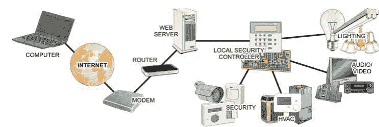

图 2.18 远程控制操作

远程控制功能使安全专家能够与远程站点建立通信，输入访问代码，获取当前状况并设置系统参数。闭路电视系统可添加到安全系统中，以为远程控制选项提供视觉识别功能。一些远程监控和控制系统，例如图 2.19 中所示的系统，还可用于获取有关任何传感器的状态消息，该传感器检测到超出程序设定值的值，例如热量、寒冷、水泄漏、噪音、报警历史记录或其他自定义功能。

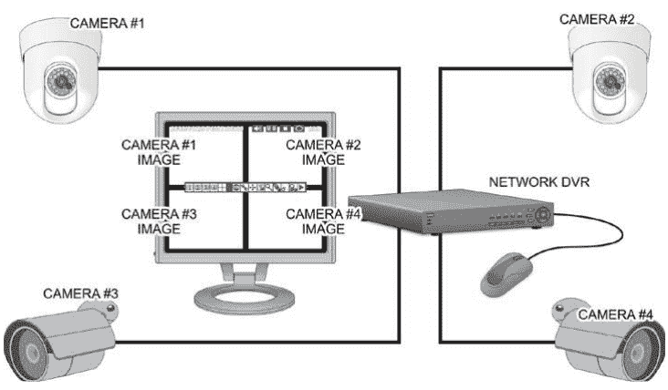

图 2.19 远程监控系统

无线通信设备通常用于连接自动化门禁系统的组件。这种连接性是一种经济的解决方案，可消除控制设备、对讲机以及电动安全门和大门之间布线的需求。

### 实践练习

在本练习中，您将学习如何保护外围区域。目标包括：

- 对于给定的设施，定义其外围、内围和内部区域，并确定与每一层相关的关键漏洞。
- 对于指定的设施及其漏洞，进行研究以确定可用于保护这些点的组件（设备和系统）有哪些，以及您找到的组件的成本选项。
- 为设施的外围设计一个访问监控和控制系统，使客户能够实施所需的安全系统来监控和控制对其设施的访问。

本练习所需的资源如下：

- 互联网访问
- 铅笔/钢笔和纸

### 讨论

图 2.20 显示了 ACME 仓库设施。该设施用于存放准备发货的 ACME 产品。其装卸码头通过三扇卷帘门处理牵引式拖车卡车以及较小的送货卡车。卡车通过围栏周围的装卸场进出仓库，装卸场位于建筑物后方，通过围栏上宽 30 英尺的开口进入。围栏在建筑物后墙的每个角落处与建筑物相连，如图所示。围栏上的卡车开口可通往仓库后面的街道。

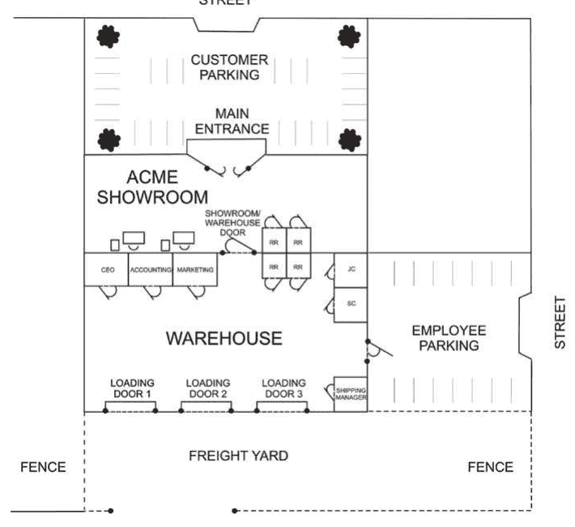

图 2.20 该设施

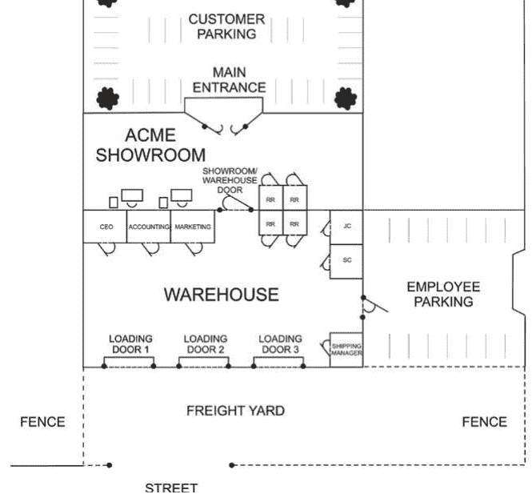

图 2.21 安全周界

**表 2.2：门禁闸门**

|  | 产品描述 | 供应商 | 所需数量 | 单价 | 总价 |
|---|---|---|---|---:|---:|---:|
| A | 滑动门操作器 | DoorKing | 1 | $889.00 | $889.00 |
| B | 滑动门操作器 | Viking | 1 | $1,048.00 | $1,048.00 |
| C | 滑动门操作器 | LiftMaster | 1 | $1,499.00 | $1,499.00 |

4. 列出您认为应推荐给 ACME 以保护卡车装卸场入口的门禁闸门/闸门的选型。

**答案：** Viking 满足长度和预期重量要求所需的规格，可为 30 英尺滑动门提供最佳价格点。供应商可通过 RFID 卡或可编程访问代码获得访问权限。

**表 2.3：门禁门**

|  | 产品描述 | 供应商 | 所需数量 | 单价 | 总价 |
|---|---|---|---|---:|---:|---:|
| A | 电子无钥匙门锁 | Gino Development | 1 | $89.99 | $89.99 |
| B | 磁门锁套件 | Entry Vision | 1 | $274.99 | $274.99 |
| C | Cobra Controls 锁套件 | Maglocks.com | 1 | $1,699.99 | $1,699.99 |

5. 列出您认为应推荐给 ACME 以控制其外围的门禁门的选型。

**仓库人行门：** ____________________

**答案：** Entry Vision 设备可使用可编程钥匙卡，允许所有员工在工作日开始时进入建筑物。手动插销锁可在夜间保护门。

**展厅入口门：** ____________________

**答案：** 仅在展厅内部操作的带手动插销锁。

**表 2.4：门/闸门执行器**

|  | 产品描述 | 供应商 | 所需数量 | 单价 | 总价 |
|---|---|---|---|---:|---:|---:|
| A | 链式驱动 | Genie | 3 | $185.88 | $557.64 |
| B | 轴驱动 | LiftMaster | 3 | $273.39 | $820.17 |
| C | 螺杆驱动 | Genie | 3 | $229.00 | $687.00 |

6. 列出您认为应推荐给 ACME 的任何门禁门/闸门执行器的选型。

**答案：** LiftMaster 型号可配置以满足业务需求，可与安全系统连接以在报警设置后或绕过时触发，并且如果连接到网络，可由管理层或首席执行官远程操作以进行下班后或周末送货。

**表 2.5：安全控制器**

|  | 产品描述 | 供应商 | 所需数量 | 单价 | 总价 |
|---|---|---|---|---:|---:|---:|
| A | HAI OmniPro II | Leviton | 1 | $1,094.90 | $1,094.90 |
| B | Honeywell Intrusion | Ademco | 1 | $345.53 | $345.53 |
| C | Mercury Security EP4502 | Mercury Security | 1 | $1,495.90 | $1,495.90 |

7. 列出您认为应推荐给 ACME 以监控和控制其外围访问点的安全控制器的选型。

**答案：** Leviton HAI OmniPro II。它在功能上提供了最佳的价格点。OmniPro II 是 Leviton 的旗舰安全和自动化控制系统。拥有最大的功能集，它可以控制最大数量的设备，并旨在为大型住宅和小型商业安装提供安全和自动化，例如餐厅、办公室和特许经营店。这允许所有安全考虑都连接到一个控制器，并具有多个区域配置以满足不同的周界要求。它可覆盖多达 176 个区域，因此您可以根据需要进行隔离或集成。

**表 2.6：安全键盘**

|  | 产品描述 | 供应商 | 所需数量 | 单价 | 总价 |
|---|---|---|---|---:|---:|---:|
| A | Omni 33A00-4 | Leviton | 1 | $192.00 | $192.00 |
| B | Honeywell Lynx 7000 | Alarm Liquidators | 1 | $204.95 | $204.95 |
| C | Interlogix Caddx Keypad | Home Security Store | 1 | $94.65 | $94.65 |

8. 列出您认为应推荐给 ACME 以启用和禁用安全系统控制器功能的选型。

**答案：** Omni 33A00-4 是最佳选择，因为它可扩展以增加对装卸湾门和货运场滑动门的控制，并且保证与所选控制器兼容。

**表 2.7：门触点/传感器**

|  | 产品描述 | 供应商 | 所需数量 | 单价 | 总价 |
|---|---|---|---|---:|---:|---:|
| A | 门传感器有线 | SensaPhone | 8 | $9.00 | $72.00 |
| B | 闸门和通信门传感器 | Gogogate | 8 | $35.00 | $280.00 |
| C | SDC MC-4 | Grainger Industrial | 8 | $53.95 | $431.60 |

9.  列出你认为应推荐给 ACME 外围出入口使用的门传感器类型。

    **答案：** 应使用配备集成室内外传感器系统的 Gogogate 传感器，采用磁性接触传感器，共八台。间隙足够宽，适用于商业和住宅应用，因此它们也适用于装卸车库门和行人门以及用于监控出入的货运门。

**表 2.8：车道传感器**

| | 产品描述 | 供应商 | 所需数量 | 单价 | 总价 |
|---|---|---|---|---|---|
| A | 车道传感器 | Mighty Mule | 1 | $180.78 | $180.78 |
| B | 直埋传感器 | CarSense | 1 | $208.46 | $208.46 |
| C | WPA 3000 磁探针 | Absolute Automation | 1 | $249.00 | $249.00 |

10. 列出你认为应推荐给 ACME 卡车门使用的车道传感器（如果有）。

    **答案：** CarSense 设备可用于自动打开装卸卡车离开时的门，并可与安全系统联动/旁路，如果在非工作时间被车辆离开激活则触发警报。

**表 2.9：身份验证设备/系统**

| | 产品描述 | 供应商 | 所需数量 | 单价 | 总价 |
|---|---|---|---|---|---|
| A | 磁门锁套件 | Entry Vision | 1 | $274.99 | $274.99 |
| B | 电子无钥匙门锁 | Gino Development | 1 | $89.99 | $89.99 |
| C | Cobra Controls 锁套件 | Maglocks.com | 1 | $1,699.99 | $1,699.99 |

11. 列出你认为应推荐给 ACME 用于控制其外围人员出入的任何身份验证设备/系统。

    **答案：** 应使用 RFID 通行卡通过仓库外的行人门进入仓库。Mag Door Lock Kit 已在其设计中集成了此功能。

    还需指定你将部署身份验证设备/系统的地点。

    **答案：** 应用于从员工停车场外进入仓库的行人门。

**表 2.10：门锁**

| | 产品描述 | 供应商 | 所需数量 | 单价 | 总价 |
|---|---|---|---|---|---|
| A | Mag Door Lock Kit | Entry Vision | 1 | $274.99 | $274.99 |
| B | Electronic Keyless Door Lock | Gino Development | 1 | $89.99 | $89.99 |
| C | Schlage B581 | Doorware.com | 2 | $52.00 | $104.00 |

12. 列出你认为应推荐给 ACME 的门禁控制门锁，并指定你将部署所推荐门锁的地点。

    **答案：** Mag Door Lock Kit 应应用于仓库外侧行人门，用于进入身份验证和控制。Electronic Keyless Door Lock 应应用于仓库与展厅之间的行人门。它可在仓库内部无需任何身份验证步骤即可操作，但从展厅内部操作门时需要钥匙或密码。Schlage B581 应用于展厅外侧和仓库行人门外侧，以在关闭期间保护外围。

13. 在图 2.22 上，记录你将推荐给 ACME 管理层以保护其新仓库设施外围的设备类型和部署位置。在提供的行上解释你的推荐理由。

    **答案：** 将 Mag Door Lock Kit 应用于仓库外侧行人门，用于进入身份验证和控制。将 Schlage B581 应用于展厅外侧和仓库外侧行人门，以在关闭期间保护外围。CarSense 设备可用于自动打开装卸卡车离开时的门，并可与安全系统联动/旁路，如果在非工作时间被车辆离开激活则触发警报。使用七个 Gogogate 传感器作为集成室内外传感器系统，采用磁性接触传感器。间隙足够宽，适用于商业和住宅应用，因此它们也适用于装卸车库门和行人门以及用于监控出入的货运门。Leviton HAI OmniPro II 在其功能方面具有最佳价格点。OmniPro II 是 Leviton 的旗舰安全和自动化控制系统。拥有最大的功能集，它可以控制最大数量的设备，并旨在为大型住宅和小型商业安装提供安全和自动化，例如餐厅、办公室和连锁店。这允许所有安全考虑都集成到一个控制器中，并具有多种区域配置以满足不同的外围要求。它可覆盖多达 176 个区域，因此可以根据需要进行隔离或集成。Liftmaster 型号可配置以满足业务需求。它可与安全系统联动以在警报设置后激活时触发，或被旁路。它可通过网络远程由管理层操作，以便在非工作时间或周末送货时使用。Viking 满足长度和预期重量要求以打开 30 英尺滑动门的所需规格，且价格最优。供应商可通过 RFID 卡或可编程访问代码获得访问权限。

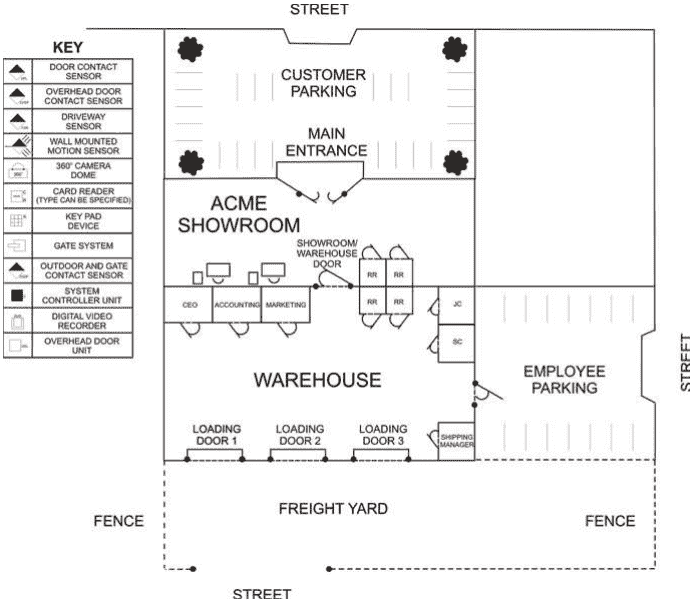

**图 2.22** 设备位置

## 复习问题

1.  **哪些出入口与设施的外围相关？**

    **答案：** 围栏中供卡车进出的街道出入口、仓库员工入口门以及展厅主入口门

2.  **展厅与仓库之间的出入口被视为哪个安全周界的一部分？**

    **答案：** 内层周界

3.  **哪些出入口与内层周界相关？**

    **答案：** 仓库与展厅之间的出入口、装卸码头门以及从员工停车场进入仓库的行人门

4.  **在本练习中，哪个结构代表内部安全区域？**

    **答案：** 仓库

5.  **在这种情况下，展厅应被视为哪个安全层的一部分？**

    **答案：** 外层周界
