## 理解视频监控系统

视频监控系统——第 2 章介绍的三种基本子系统类型中的第二种——是大多数商业安全系统的重要组成部分。许多组织在其基础设施安全系统中包含可见摄像头，以遏制非法活动并记录外围或关键内部区域发生的事件。在本章中，你将学习：

- 识别不同类型的安全和监控系统及设备的优势和劣势
- 在给定特定场景时选择合适的摄像头类型

### 视频监控系统

视频监控系统基于闭路电视系统。名称源于该系统通过“闭路”或专用传输线路传输信号，而不是通过标准电视广播系统。图 3.1 显示了基本视频监控系统的主要组件。常见组件包括：

- 一个或多个视频摄像头
- 延时录像机
- 切换器（可选）
- 视频显示监视器

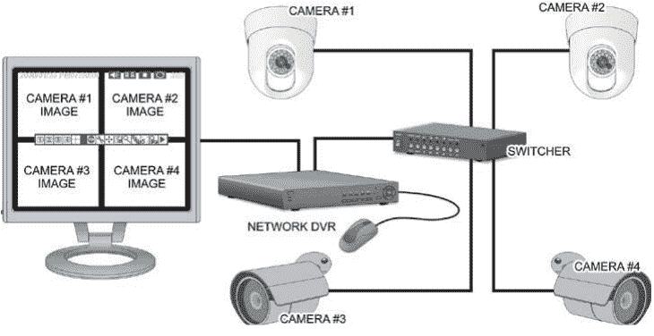

**图 3.1** 一个基本视频监控系统

在此基本系统中，摄像头监控其视野并将信息传递给视频处理设备。在大多数情况下，该设备由某种类型的数字录像机组成。

在某些情况下，摄像头视频信息的流动由被动红外探测器控制。如果 PIR 探测器视野内没有 PIR 特征（由体热产生），则视频信息不会被传输。然而，在运动检测事件期间，视频信息会从摄像头流向录像机。在此类事件中，摄像头可以被指示加快每秒记录的帧数以提供更精细的细节。

一些系统基于同轴电缆进行组件连接，而另一些则是基于 IP 的，依赖无线 Wi-Fi 通信或传统网络布线。

数字视频处理设备可以直接向视频显示器提供视频输出，或将视频输出引导至视频切换器。在某些情况下，视频处理组件可能提供自己的集成切换器。

这些组件将在以下各节中更详细地介绍。

### 摄像头

监控系统使用将观看图像转换为标准视频传输格式的视频摄像头（复合视频、分量视频、S-Video 或

HDMI 信号用于在视频输出设备上显示，例如显示器、电视显示器或个人计算设备。

最好的监控摄像机采用电荷耦合器件（CCD）技术。它们具有高分辨率、低工作光照要求、温度依赖性低以及高可靠性。视频监控系统中使用的典型 CCD 摄像机如图 3.2 所示。

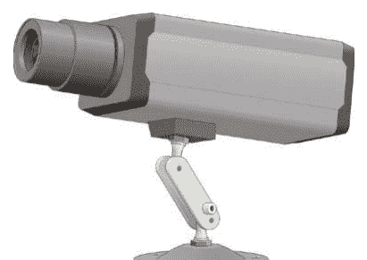

图 3.2 视频监控摄像机

监控摄像机有使用数字或模拟接口技术的。数字摄像机将检测到的图像直接转换为数字信号，这些信号可以轻松地传输到数字计算设备并由其处理。模拟摄像机基于较旧的模拟电视信号和分辨率标准。此类摄像机需要单独的同轴电缆连接到显示器或录制设备。

数字摄像机通常比模拟摄像机性能更优。模拟摄像机更容易受到传输信息质量下降的影响。

## IP 摄像机

IP 摄像机实际上是数字互联网协议（IP）设备，它们具有 IP 地址，可以直接连接到网络或互联网，而不是直接连接到主机控制器或计算机。使用 IP 摄像机的优点，如图 3.3 所示，是可以在有互联网接入的全球任何地方查看它。

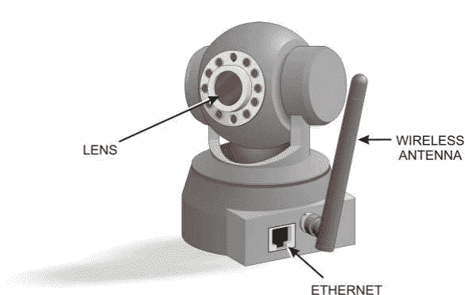

图 3.4 云台变焦摄像机

## 摄像机规格

影响摄像机成本的两个重要规格是光敏度等级和分辨率。摄像机的分辨率规格方法取决于它是模拟摄像机还是数字摄像机。

模拟摄像机的分辨率指定为其能够从显示器顶部到底部生成的水平线数。对于数字摄像机，分辨率以其产生的 X-by-Y（水平到垂直）点（图像元素或像素）矩阵格式表示。图 3.5 说明了不同摄像机分辨率规格的含义。

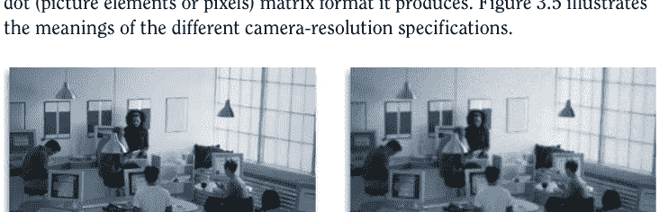

图 3.5 模拟和数字摄像机分辨率

获得合理的视频摄像机图像所需的光量称为 *lux rating*。Lux 是落在物体上的光量度。一 lux 大约是从一米外一支蜡烛照在一平方米上的光量。典型摄像机等级在 0.5 到 1.0 lux 之间。

摄像机标定的 lux 值越低，摄像机在较低光照水平下区分物体的能力越好。相反，对于给定的监控摄像机，分辨率的线数越高，或像素数越多，它显示视野精细细节的能力就越好。

## 镜头类型

监控摄像机有多种镜头规格。镜头尺寸决定了摄像机的视野和变焦能力。一般来说，镜头越大，视野越窄、越聚焦。

例如，焦距为 3.6 mm 的固定镜头设计为提供约 72 度的视野，而 6 mm 焦距的镜头应提供 44 度的视野。一般来说，镜头的焦距越短，视野越宽。

另一方面，焦距较短的镜头也会产生细节较少的图像。在 16 英尺（5 米）的距离，3.6 mm 固定镜头可能只能提供停车场内物体的一般描述，而同一台摄像机配 12 mm 镜头则可提供视野内物体的更清晰细节（如面部和车牌号码），但可能只能覆盖设施的一小部分。

您还必须确定安装监控摄像机的目的。是为了提供可见的威慑？还是用于收集法律证据？选择能够捕捉所需观看区域的镜头规格的监控摄像机始终很重要。常见的安防摄像机镜头类型包括：

- **Varifocal Lens:** 这些是包含多个可移动元件的光学组件，可改变有效焦距（EFL）。与变焦镜头不同，变焦镜头每次改变都需要重新聚焦。如果监控摄像机具有固定镜头，它只能看到一个固定位置。如果它具有变焦镜头，它可以根据用户的喜好在多个 mm 设置下聚焦。
- **Fixed Focal Length Lens:** 镜头无论与被摄体的距离如何都无法重新聚焦。
- **Wide-Angle Lens:** 镜头能够在有限空间内看到比标准镜头类型更宽的图像。
- **Telephoto Lens:** 最适合在远距离观察细节的镜头类型。
- **Fish Eye Lens:** 允许您看到整个房间的镜头类型，但图像会产生一定失真。
- **Pinhole Lens:** 用于摄像机/镜头必须隐藏的应用。镜头前端有一个小开口，允许镜头通过墙上的小孔观看整个房间。

## 黑白与彩色

一种常见的误解是彩色 CCTV 摄像机比黑白（B&W）CCTV 摄像机提供更好的图像。事实是，虽然彩色摄像机观看起来更愉悦，但两种类型的摄像机都完全能够提供高质量的图像。真正的问题是何种类型的摄像机更适合特定情况。

彩色摄像机与黑白摄像机之间最重要的实际区别是，只有彩色摄像机才能提供完整准确的衣物和车辆描述。执法部门在响应服务呼叫时很大程度上依赖于衣物和嫌疑车辆的报告颜色。能够查找指定颜色大大增加了抓获嫌疑人的可能性。

## 红外照明

带图像区域红外照明的摄像机允许在低光条件下观看。这也提供了使用超出可见光谱的照明来保持一定隐秘性的能力。

红外安防摄像机在摄像机镜头外侧安装了红外 LED 照明（来自人类无法看到的电磁波谱区域的光）。这种照明使摄像机能够在无光环境下捕捉到良好的图像。在少量光线（低光设置）下，红外摄像机可以捕捉到看起来就像白天的画面。典型的红外摄像机如图 3.6 所示。

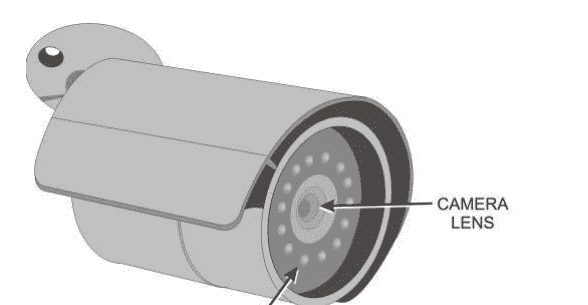

图 3.6 红外摄像机

## 摄像机应用

监控摄像机可以安装在设施外部，以提供识别想要进入安全区域的人的能力，例如前门或车道门。摄像机应位于没有盲点或不实用使用其他类型传感器的地方。只要该区域在天黑后始终有足够照明，摄像机就可以安装在设施的任何表面区域以提供覆盖。

使用视频监控摄像机涉及某些法律影响。特别是，在部署监控摄像机时必须考虑隐私问题。它们不应在个人有合理隐私期望的地方使用，例如在洗手间。这显然不适用于闯入设施的人。

其他摄像机应用在以下章节中讨论。

### 室内/室外

室内摄像机通常比室外类型便宜，因为室外摄像机必须安装在防风雨外壳中。室外摄像机的布线还必须适合温度极端和季节性天气条件。

### 日/夜

有摄像机可以在白天从彩色成像切换到夜间黑白操作，当照明不足以进行彩色成像时。这提供了白天监控良好的彩色分辨率与夜间光照不足以进行彩色成像时的黑白之间的最佳折中。

### 固定与动

安装在固定配置中的摄像机始终显示相同的区域。它们可用于监控重要区域，例如高风险区域如停车场和门入口。动画摄像机提供移动能力。它们安装在云台组件上，视野可以改变，并支持变焦、倾斜和平移。

### 录制和外部/内部触发

数字视频录像机（DVR）是监控摄像机首选的录制系统，而不是较旧的 VCR。摄像机可以配置为仅在触发器生成以启动录制时才录制。

触发器可以是内部类型，其中在场景发生变化时开始录制。外部触发器可以编程为在存在警报条件或运动探测器触发录像机开始录制时启动录制。

# 排序与多路复用

*排序*（Sequencing）允许将多台摄像机与一台监视器配合使用。可以对切换器进行编程，使其循环显示监控系统中的所有摄像机，或在每台摄像机上停留指定的时间长度，通常为1到60秒。

*多路复用器*（Multiplexers）将监控系统的图像路由到特定显示设备，并能够通过将图像在监视器上拼接显示，同时记录所有摄像机的图像。

## 摄像机部署策略

投资安防摄像机的目的是能够查看关键区域或关键资产所在位置的活动。除了确定安防摄像机在特定角色中必须具备的规格外，规划摄像机部署策略以最大化监控投资同样重要。

为实现这一目标，摄像机应被定位以捕捉所有关键安全区域中的重要事件。具体而言，它们应安装在通道中，以及其视野能够覆盖重要资产（物理设备和/或人员）的位置。

通道包括物理设施中的咽喉点，人员和/或车辆必须通过这些门户，例如大门、门口、走廊或通道/道路。安装在通道中的摄像机通常用于记录进出设施以及通过设施的移动情况，如图3.7所示。

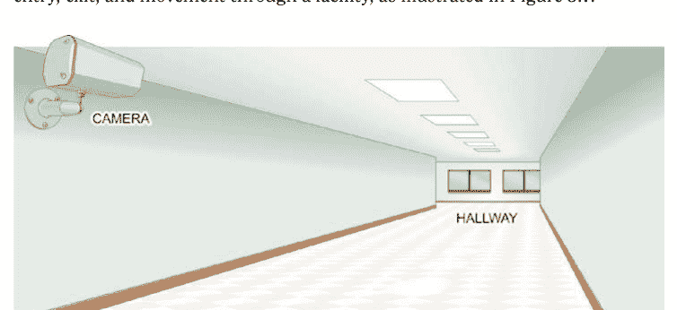

图3.7 监控通道

安防摄像机通常安装在能够覆盖设施内重要资产和活动的位置。这使得管理层能够监控与这些重要资产相关及周围的活动。

银行大厅是这两种部署策略的典型示例。摄像机被定位以记录银行停车场和外部区域的活动，以及通往金库和办公室的走廊中的活动，如图3.8所示。此外，大多数银行还布置了摄像机，以便能够聚焦于每个柜员工位，监控现金处理和交易过程。

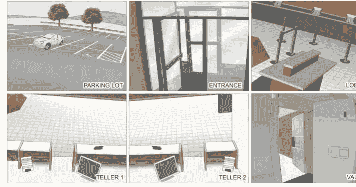

# 图3.8 资产监控

确定实际摄像机安装位置时，首先需要决定摄像机是用于提供全景视图还是细节视图。全景视图通常覆盖广阔的视野，例如停车场或仓库地面。相反，细节视图则用于聚焦相对狭窄的视野，突出特定感兴趣区域，例如前面提到的银行柜员工位。

安装涉及的摄像机数量取决于已被识别为需要查看/监控的通道和资产的数量。在某些情况下，这取决于组织的规模；在其他情况下，则取决于相关资产的价值和物理地理条件。

例如，小型业务可能只需安装一台摄像机即可对其关键资产进行监控。对于中型业务，安装涉及数十台摄像机则更为常见。在大型组织中，可能需要部署数百台摄像机以满足其安全和监控需求。目标是通过风险分析程序有效覆盖已识别的区域和资产。

确定安装点后，部署策略的下一步是确定每个安装点所用摄像机的规格。一般来说，应回答以下四个问题：

- 需要固定视野还是可移动视野？
- 需要哪种图像显示类型？
- 需要哪种显示清晰度等级？
- 哪种信号处理和传输方式最适合该安装？

## 固定或可移动视野

固定摄像机通常用于全景功能。它们提供固定的视野，因此必须进行设置以有效覆盖所需的通道或资产。因此，它们必须具备所需的焦距和角度来覆盖这些目标。

通常需要使用远程控制的PTZ摄像机来获取细节视图。然而，在某些情况下，安装多台固定摄像机于不同位置可能比安装一台需要专人操作才能有效工作的PTZ摄像机更为经济。

## 图像显示

从第2章的先前讨论中，您应该记得常见的图像显示选项包括：

**彩色** 彩色摄像机是当今视频监控应用中的默认通用摄像机。彩色摄像机落后于其他摄像机技术的一个应用场景是低光照环境。在这种情况下，通常建议使用红外或热成像摄像机。

**红外** 红外摄像机在极低光照环境下能够提供清晰的黑白图像。然而，它们通常比彩色摄像机昂贵得多。

**热成像** 热成像摄像机往往非常昂贵，且只能生成轮廓图像。然而，它们也无需光线即可工作。

## 显示清晰度等级

对于所处理的视图，标准视频显示是否足够，还是需要更高清晰度的设备？与标准清晰度系统相关的最常见抱怨之一是，它们无法提供能够使执法部门和法院在犯罪后准确识别犯罪嫌疑人的信号。

## 信号处理与传输

如本章前面所述，此处的选择包括模拟摄像机、数字摄像机和IP摄像机。IP摄像机因其能够以电子方式捕获和传输数据，而持续获得比其他类型摄像机更广泛的认可。

与传统模拟和数字摄像机相比，IP摄像机还提供更强的连接选项。它们可以直接与主机计算机配合使用，无需额外硬件。与其他摄像机技术相比，它们也更能兼容无线网络选项。

## 视频录像机

CCTV传统上使用盒式录像机（VCR）进行录像；然而，此类系统往往高度劳动密集。磁带的磨损是一个持续存在的问题，同时还需要定期进行系统维护。

数字视频录像机（DVR）的引入大大减少了对存储介质质量和操作员干预的依赖。视频录制向数字媒体的迁移使得图像可以存储到磁盘上，并提供了额外优势，例如：

- 易于使用
- 高级搜索功能
- 同时录制/播放功能
- 无图像劣化
- 改进的压缩存储技术
- 与其他数字系统的集成
- 远程系统管理能力

一些视频处理系统具有内置的网络服务器功能，可提供对实时图像或近期录制图像的远程访问。

这些网络界面能够支持从一个或多个远程位置进行观看。

具有内置网络访问能力的视频处理单元示例如图3.9所示。此类单元能够从远程位置进行互联网监控活动。

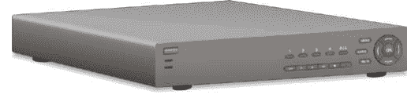

# 图3.9 视频录像机

可以使用实时视频运动检测（VMD）技术，根据日期和时间或根据活动/报警模式选项来搜索已保存的录像。还可以通过从观察位置发送电子邮件来提供主动警报。

出于安全目的录制视频时，两个最重要的考虑因素是需要存储多少视频以及存储多长时间。这些问题的答案使组织能够确定其存储容量需求。

安全视频本质上需要大量的存储空间。因此，总是需要在存储成本与组织面临的风险之间进行权衡。单个视频监控摄像机一天内就可能消耗数GB的存储容量。考虑到这一点，组织需要存储监控视频多长时间的要求成为一个主要决策点。根据组织的性质及其面临的风险类型，存储要求可能要求为其安装的每台摄像机存储数周或数月的视频。

如前所述，大多数组织不会只为监控需求使用一台摄像机——它们可能使用数十台或数百台摄像机。要存储来自如此多摄像机的视频数据，很容易需要数百TB的数据存储。

可以使用三种常见的视频存储类型来满足此类需求：

## 内部存储

视频信息可以存储在DVR的内部磁盘驱动器（或多个驱动器）上。该解决方案仅对使用少量摄像机且仅短时间存储视频信息的小型组织实用。

## 外围存储或直连存储 (DAS)

该技术采用通过 USB 或 eSATA 连接直接连接到 DVR 的额外磁盘驱动器存储设备，如图 3.10 所示。直连存储不涉及使用 IP 地址将视频卸载到外部设备。

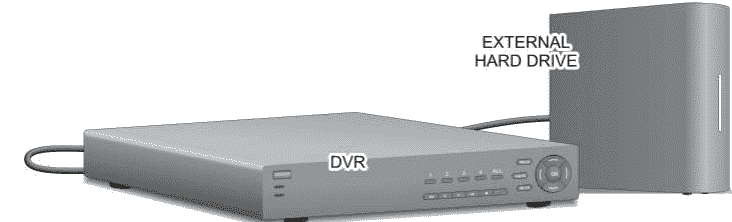

图 3.10 DAS 视频存储

## 网络存储

该存储方法使用网络技术将基于 IP 的视频存储在远程计算机或视频服务器上。执行此操作的最常见技术包括网络附加存储 (NAS) 和存储区域网络 (SAN) 技术，如图 3.11 所示。

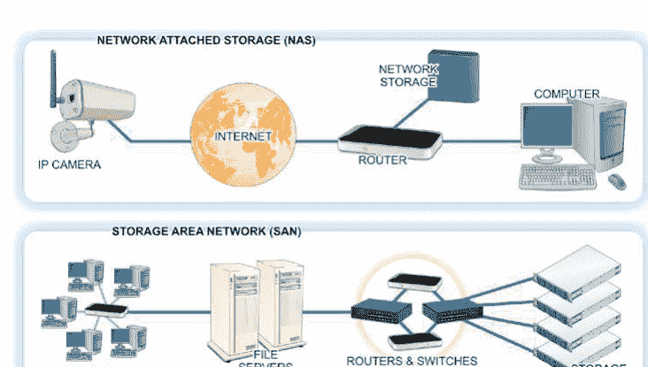

图 3.11 NAS 和 SAN 存储系统

## 切换器

*切换器* 是与多摄像机监控系统一起使用的设备。它们允许使用单个监视器使用多个摄像机。切换器可以编程为循环浏览监控系统中的所有摄像机，或在每个摄像机上停留指定的时间，通常为 1 到 60 秒。外部传感器可以检测运动并导致摄像机在视频记录仪上开始录制。

### 关于切换器的说明

“四画面”切换器可以显示四幅图像。更先进的系统通常提供同时视频录制、查看和回放功能，使用 4、9、16 或 25 个摄像机的容量。

*四画面* 是一种切换器，允许查看者在同一时间同时录制和监控四个摄像机。它通过将监视器屏幕分成四个部分来实现这一点。连接四画面切换器、传感器和视频记录仪的正常配置如图 3.12 所示，图示了四画面切换器、监视器和四个监控摄像机之间的连接。监视器可以同时查看全部四幅图像。传感器检测到运动，从而触发视频记录仪记录该事件。

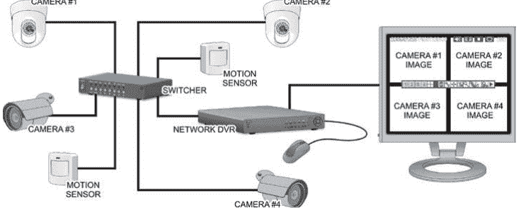

图 3.12 带传感器和视频记录仪的四画面摄像机切换器

通常，可以从一个摄像机一次观察实时图像，或同时从多个摄像机观察。安全人员可以使用界面浏览并回放来自指定摄像机的录像，使用完全可调节的内置 VMD。

## 安全监视器

监视器是类似于计算机显示器或电视的视频显示系统。它们显示从摄像机获取并由视频处理设备（如 DVR）处理的视频信息。它们也可以连接到可编程切换器，切换器接收来自多个摄像机的输入，以便在单个屏幕上显示多幅图像。

屏幕上产生的图像质量是两个因素的函数：*刷新率*（图像在屏幕上重绘的速度）和屏幕上的像素（图像元素）数量。给定屏幕尺寸上的像素越多，图像质量越高。

与摄像机一样，该数量被称为显示器的 *分辨率*，通常以 X×Y 格式表示。使用此格式，图像质量仍取决于观看区域的大小（例如，14 英寸宽显示器上的 800 × 600 分辨率产生的质量远好于将相同数量的像素分布在 27 英寸显示器上）。

CCTV 监视器可用于黑白或彩色显示，具体取决于分辨率和摄像机选择。黑白监视器的分辨率为 700 至 1,000 线。彩色监视器可提供 350 至 400 线。它们设计用于 24 小时不间断运行。

## 实践练习

在本练习中，您将学习如何保护内部周界。目标包括：

### 但首先

> 在完成本练习之前，您必须完成第 2 章中的练习。

- 对于 ACME 设施，定义其内部周界并确定与该周界相关的漏洞。
- 对于指定的周界及其漏洞，进行研究以确定可用于保护内部周界的组件或系统，以及您找到的组件的成本选项。
- 设计 ACME 可以实施的视频监控和通知系统，以最具成本效益的方式保护其设施的这一部分。
- 为设施的内部周界设计访问监控和控制系统。

本练习所需的资源如下：

- 互联网访问
- 铅笔/钢笔和纸
- 完成第 2 章中的练习

## 讨论

在建立并设计外部周界之后，多层物理安全拓扑中的下一步是定义内部周界。通常，这涉及使用视频监控设备监控外部和内部周界之间的空间。当正确设计和实施时，监控系统提供检测和通知功能，可覆盖特定通道和关键资产，以及任何需要广阔视野的区域。

保护内部周界的另一个主要组成部分是监控和控制通往内部的通道点。此过程与您在上一个程序中为外部周界执行的过程类似。

## 程序

- 1. 查看图 3.13 并识别/标记仓库设施的内部周界。提示：不要将展厅包括在内部周界内。

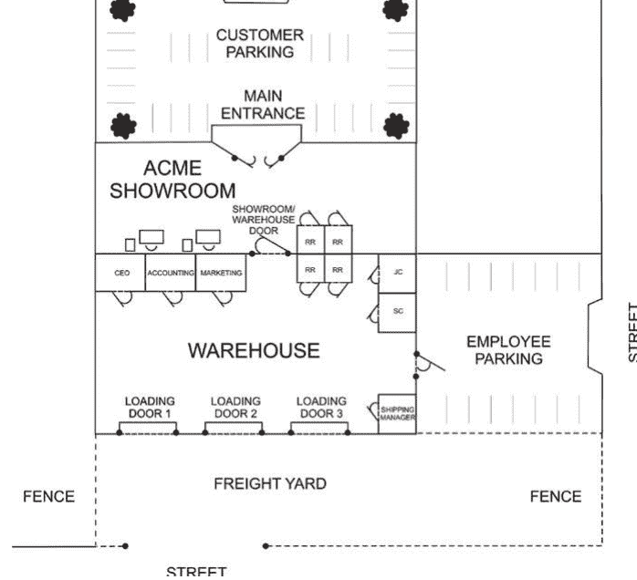

图 3.13 内部周界

2. 在检查布局后，确定外部和内部周界之间至少两个适合视频监控的安全区域。在图纸上突出显示这些区域，并在以下行中记录您选择这些区域的原因：

答案：至少有三个区域：通往仓库的装卸湾门、从室外通往仓库的行人门、展厅与仓库之间的行人门，以及任何可能的窗户。这些都是常规的进入方式，也是入侵的可能来源。

- 3. 识别并在图上标记与设施内部周界相关的物理通道点。
- 4. 在图表上识别并标记可能安装监控摄像机的位置，以便最大限度地有效监控这些周界之间的区域。

## 视频监控

- 1. 使用互联网研究可用于有效保护您在上一节中确定的区域和通道点的视频监控/监控设备和系统。使用表 3.1 至表 3.3 整理其中列出的视频监控产品指定的详细信息。对于每个项目，尝试找到至少两个供应商。

### 表 3.1 视频摄像机

|  | 产品描述 | 供应商 | 所需数量 | 单价 | 总价 |
|---|---|---|---|---|---|
| A | 360 度全景摄像机 20MP | Arecont Vision | 3 | $1,468.00 | $4,004.00 |
| B | 家用网络监控球机 360 度 | Digital Watchdog | 3 | $425.00 | $1,275.00 |
| C |  |  |  |  |  |

在选择摄像机时要谨慎。务必区分摄像机类型以及最适合您所记录的不同位置的规格。

2. 列出您认为应向 ACME 推荐的任何视频监控摄像机，以控制其内部周界的访问。

答案：Arecont Vision 用于卡车装卸场摄像机。

答案：Arecont Vision 用于展厅摄像机，也覆盖仓库/展厅行人门。

答案：Arecont Vision 用于内部仓库空间，覆盖仓库/室外行人门和装卸湾门。

3. 指定您将部署摄像机的位置。

答案：仓库内部中心，覆盖仓库/室外人行门、仓库/展厅行人门和全部三个装卸湾门。

答案：展厅内部天花板中央，覆盖仓库/展厅行人门以及展厅区域，包括前部、公共入口和展厅地面。

答案：建筑物卡车场外角，覆盖装卸湾门外侧和卡车场。

4. 指定您选择的各种摄像机类型的电源和连接要求。

**答案：** 利用全部具备 POE 功能（以太网供电）的 360 度室内/室外摄像头，托管 DVR 和摄像头的网络上需要一台供电交换机。

**答案：** （如果学生在设计中使用不同型号的摄像头，则为可选答案。）

|  | 产品描述 | 厂商 | 所需数量 | 单价 | 总价 |
|:---|:---|:---|:---:|---:|---:|
| A | 4 通道 DVR | TW Vision | 1 | $51.99 | $51.99 |
| B | 4 通道 DVR | Lorex | 1 | $89.99 | $89.99 |
| C | 4 通道高清 DVR | Samsung | 1 | $475.00 | $475.00 |

### 关于兼容性的说明

请确保您选择的视频记录仪与已指定的摄像头类型兼容。

5. 列出您会向 ACME 推荐用于记录和存储其内部周界视频监控数据的 DVR。

**答案：** 三星设备。它与 IP 摄像头兼容，其远程访问功能符合所需规格。该设备具有相当大的硬盘容量用于数据存储，并且可以使用 USB 设备刻录视频以用于取证目的。

## 第 3 章 · 了解视频监控系统

2. **哪些接入点与设施的内部周界相关？**

**答案：** 三个装卸货码头门和展厅/仓库门。

3. **哪种类型的摄像头最适合监控卡车装卸场围栏内区域和车道入口处的门禁？**

**答案：** 任何与客户所需监控系统兼容的、具有足够变焦/聚焦/帧率的室外型摄像头。

4. **哪种类型的摄像头最适合监控展厅和通往仓库的人行门？**

**答案：** 任何与客户所需监控系统兼容的、具有足够变焦/聚焦/帧率的室内型摄像头。

5. **ACME 希望包含一个硬件设备，使其所有管理人员能够同时在办公桌上的 PC 上显示视频摄像头的输出。应安装哪种类型的硬件才能提供此级别的功能？**

**答案：** 提供网络访问和用于远程访问的 Web 界面的 DVR。
