## 了解入侵检测和报告系统

防止未经授权的访问是物理安全的第一道防线，但防止入侵升级为严重事件至关重要，需要多层额外的安全措施。密切相关的第二道防线是入侵检测，它能够在入侵者造成问题之前检测并将其清除。这一安全级别涉及被监控的检测设备或能够产生警报的检测设备。本章您将学习：

- 描述典型的物理入侵检测和报告系统的组件
- 解释创建物理安全区域的目的以及定义它们的常见技术
- 识别物理入侵检测系统中使用的常见传感器类型。

### 入侵检测和报告系统

如图 4.1 所示，基本商业安全系统的组件组合在一起构成了一个功能性的入侵检测和报告系统。该系统包括一个智能控制面板，通过电线（或无线电信号）连接到设施各处的传感器。

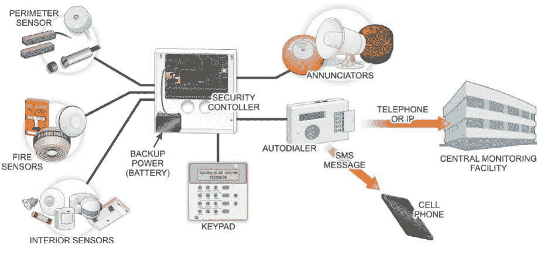

**图 4.1** 基本入侵检测和报告系统

控制面板包括电子组件和中央处理器，用于监控和控制整个系统。处理器接收来自连接到它的各种传感器的输入信息。在基本安全系统中，这些输入可分为三种不同类型：周界、内部和火灾。

周界区域输入到控制面板通常包括位于每个周界开口处的传感器，包括门、窗、车库门和窗以及爬行空间的门。额外的周界保护可能包括使用声音、振动和运动检测传感器来防止通过破碎窗户进入。

一些内部区域也可能使用各种类型的传感器进行保护，例如运动探测器和内部门传感器。大多数安全系统还包括能够处理足够的烟雾和火灾传感器的输入。

当控制器从其输入传感器之一接收到活动输入信号时，它会根据其编程（以及所需的紧急响应类型）评估所呈现的条件，并在必要时向报警器（警笛或铃）发送适当的输出信号。它还可能根据其编程与指定的安全联系人（安全主管、监控服务或执法/消防机构）进行通信。

商业安全系统可使用多种通知方法在触发警报条件时通知指定的安全人员。一些报警系统使用电话拨号器提醒远程安全联系人存在警报条件。这些系统设计为在无人值守时通过标准电话线或手机拨打电话。特殊数字代码用于告知安全联系人导致警报的条件类型。

也可以使用预先准备好的短信系统，例如 SMS，通过手机中继到指定的安全联系人。另一个选项是基于 IP 的通知，用于通过 IP 网络（例如互联网）通知监控站警报条件。

大多数安全系统通常采用某种类型的键盘，为主管提供控制界面，使用编程访问代码对系统进行布防和撤防。键盘可能设计为提供一定程度的视觉和听觉输出信号，以帮助监控系统状态。

最后，大多数安全系统都包括某种类型的应急备用电源（备用电池或不间断电源），以便在商业电源中断时为安全系统提供应急电力。

访问控制和管理系统组件和子系统的选择非常广泛。本章的以下部分将解释通常在典型基础设施安全系统的入侵检测和报告部分中发现的各种子系统。

### 安全控制器

任何智能安全系统的核心都是控制器。安全控制器如图 4.2 所示，通常安装在包含安全控制器板、所有电子组件、线端子点、备用电池组和电话端接布线的机箱中。

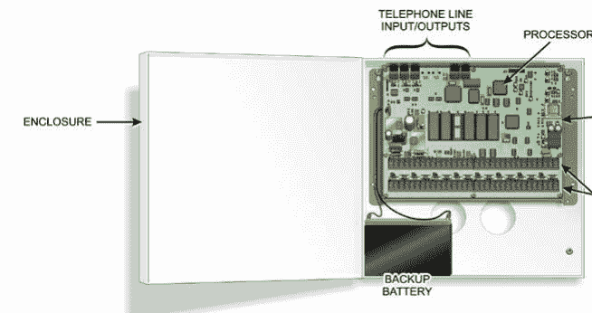

图 4.2 带面板和电池的控制箱

给定的安全控制器型号将设计为处理特定数量的可编程区域。一个区域可以是一个保护点，例如运动探测器，也可以将多个点组合成一个区域。例如，两个走廊运动探测器可以连接形成一个区域，或楼梯运动探测器可以与走廊传感器组合形成一个单一区域。

安全控制器是入侵检测和报告部分的安全系统的指挥中心和分配点，所有输入和输出设备都连接到它。每个传感器都从安全控制器接收电源并由其管理。

控制器必须具有足够的容量和功能来连接和管理将成为安全系统一部分的所有安全设备，同时还提供远程监控和控制的远程访问功能。

控制器的机箱应安装在视线之外且靠近 120 伏交流电源插座处，插头式变压器可为整个系统提供低压电源。

## 安全区域

如前所述，安全控制器拥有固定数量的探测电路，可用于创建物理安全区域。例如，典型的商用安全控制器可能最少拥有八个区域，最多可达 250 个区域或更多。通常，其中一个输入是专用于火灾探测系统。图 4.3 显示了典型的八区域安全控制器连接方案。

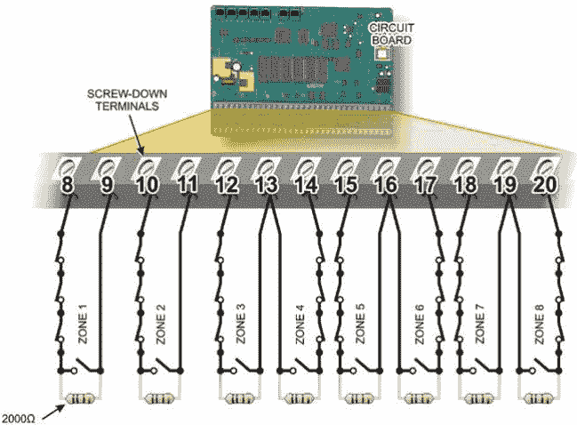

**图 4.3** 安全面板区域输入

假设您要安装安全系统的设施有十四扇窗户、两扇人员出入口门和仓库的一扇卷帘收货门。此外，它还有两条需要监控的主要走廊和一个集成火灾探测系统。

应如何物理安装和配置控制器以便为设施提供全面保护？答案是将相关的传感器逻辑分组在一起以创建安全区域。这是通过将所有相关的传感器开关（所有传感器对安全控制器来说都表现为开关）以串联格式连接在一起实现的，如图 4.4 所示。

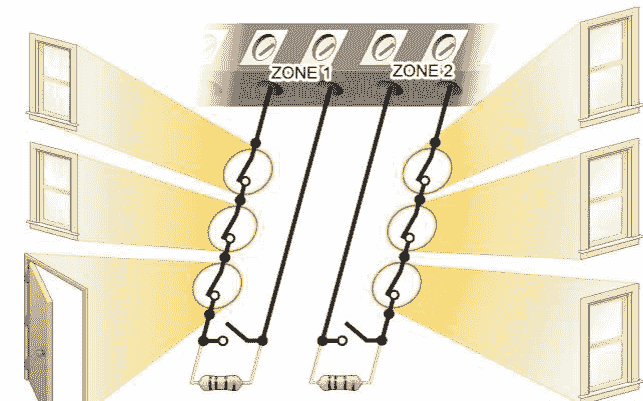

**图 4.4** 创建物理区域

控制器监控在区域的两个连接点之间流动的电流量（称为电流回路）。回路需要在回路中放置一个电阻，以将电流调节到所使用控制器的正确水平（不同控制器型号通常需要不同的电阻水平）。

如果其中一个传感器被激活，其开关会进入打开状态，回路中的电流流动停止。控制器检测到电流流动的缺乏并根据其配置编程处理输入。

必须流动一定水平的电流这一事实有助于使篡改回路变得更加困难。如果系统使用在激活时闭合的常开开关，系统可以通过简单地剪断回路中的一根电线来规避；控制器永远不会收到信号。

对于前面介绍的示例安装，将所有西侧窗户传感器接线到一个输入中并报告为西侧窗户可能是合理的。同样，两扇人员入口门可以一起配置，因为它们需要特殊设置以允许在离开或进入建筑物时设置和解除系统时的出入时间。相反，另一扇门可以连接到不同的门区域或并入其中一个窗户区域，因为它没有时间要求。

分区还使系统能够立即为特定区域的入侵探测发出警报，而特定区域（例如主前门）中的其他传感器警报可能需要在发出警报前延迟一段时间。这使得安保人员在离开设施时可以通过键盘输入秘密代码来布防系统（退出延迟）。

它还允许他们在到达设施时进入受保护区域，并在指定的进入延迟间隔内（通常为 30 至 45 秒）通过入口区域键盘解除系统。此功能允许在设施内部靠近出口门的区域安装键盘，以避免从外部区域对键盘进行破坏和篡改。

保护走廊的室内运动传感器可以集成到窗户或门区域中。然而，它们更有可能与外部传感器分开配置，以便在夜间人们可能需要在夜间移动但希望外围免受外部入侵者侵害时可以将其禁用。图 4.5 描述了此示例的可能分区解决方案。

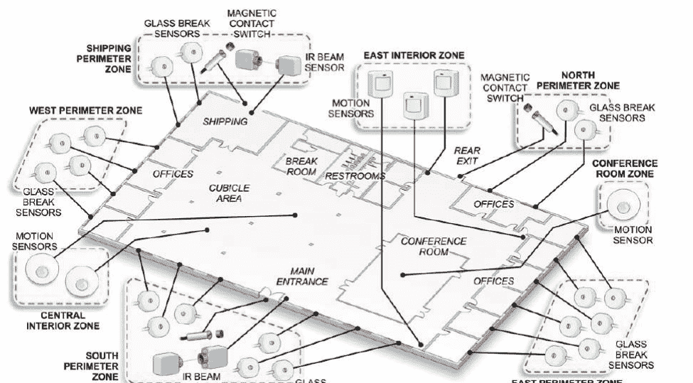

**图 4.5** 分区概念

分区的使用还使安保人员能够仅布防系统的部分区域，例如外围门窗，同时绕过特定区域内的室内运动探测器。旁路模式设置通常是通过键盘输入预定的数字代码来完成的。当人员离开设施时，可以根据需要布防包括室内探测器在内的所有区域。

分区安全系统布局也可以由外部监控服务使用，以了解哪个传感器在指定区域引起警报。如果传感器仅报告为传感器 3，区域 5，这可能意味着事件发生在几乎任何地方。如果传感器报告为传感器 3，区域 5 外围，这将通知操作员被侵犯的区域位于场所的外部。

区域还提供了故障排除的便利性。例如，如果区域 3 外围的传感器报告问题，则无需对位于系统内部的传感器进行故障排除。

## 传感器

传感器是一类输入设备，可将物理活动转换为可提供给安全控制器的信号。它们有多种配置可供选择，包括用于门窗的磁性开关、声学探测器、振动探测器、运动探测器和玻璃破碎探测器。传感器保护外围、选定的外部区域以及设施内部的开放空间。

如前所述，外围设备主要保护门窗。最常见的外围传感器是磁性门开关、窗户振动和窗户声学探测器，用于探测破碎玻璃的声音。

并打开开关，该开关被中央控制面板感知并激活警报。

这种简单的磁性开关传感器可用于保护门窗或任何其他可移动屏障。它在有人试图通过非法或未经授权的方式进入通道时提醒安全管理人员。其磁铁和簧片开关机构检测任何入侵并发出警报。

这种类型的传感器可用于指示可移动屏障的开/关状态，但无法确定屏障的锁定机构是锁定还是未锁定。如前所述，一些类型的电动门锁配备有用于确定锁定机构是否锁定或未锁定的传感器。

即使多达 70 种类型的屏障传感器可用，传感器本身除了探测和警告外无法提供真正的控制。然而，其信号可被其他门禁系统组件使用以提供自动响应。

### 玻璃破碎传感器

如前所述，外围安全系统可能包括玻璃破碎探测系统。磁性开关无法防止入侵者通过破碎的窗户进入。有两种类型的玻璃破碎探测系统可用。振动型安装在玻璃上或附近的墙上。声学或声音辨别器感应玻璃破碎的声音。

该单元可调谐为仅对玻璃破碎的特定频率做出反应，通常为 4 至 6 kHz，或对任何大声噪音做出反应。一些传感器制造商已将振动和声音探测器组合成一个单元，除非两者都被检测到否则不会激活。这些单元可用于正常条件下会导致单一技术探测器产生误报的地方。

振动探测器安装在玻璃上，而声学窗户传感器通常安装在相邻的墙上，如图 4.7 所示。

### 运动探测器

运动探测器通过探测区域内红外能量的变化来工作。因为这些设备不发射任何能量，所以它们被称为被动红外（PIR）探测器。

PIR 探测器使用传感器外壳中的透镜机构来探测传感器覆盖的水平扇区内红外能量的任何变化。这种类型的探测器对静止物体不敏感，但对视野范围内横向发生的快速变化做出反应。PIR 探测器是最常见且经济的运动探测器类型。

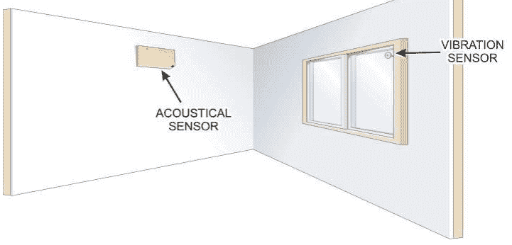

## 图 4.7 玻璃破碎传感器

运动探测器应安装在无法由窗户或门传感器保护的开放区域。图 4.8 显示了用于室内的被动红外（PIR）运动探测器的一个示例。

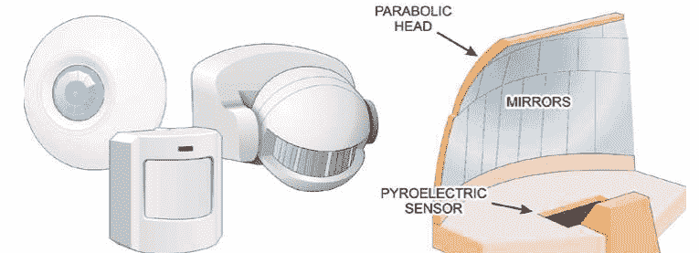

## 图 4.8 一种被动红外（PIR）运动探测器

## 运动探测器的安装位置

运动探测器通常安装在房间的角落。这样探测器可以覆盖 90 度的视野，如图 4.9 所示。运动探测器对横穿传感器视野的运动敏感。

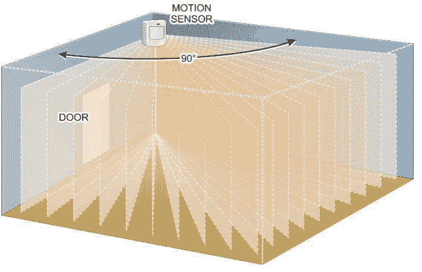

室外照明通常用于照亮黑暗区域或需要保护的区域，利用运动探测传感器启动安全照明以威慑入侵者。室外照明仅用作威慑手段和安全功能，因此通常不连接到安全控制器。

设施周围有树木或灌木的黑暗区域需要用安全照明系统照亮。在黑暗时段使用的安全照明系统可防止入侵者进入设施周围区域，也可防止其企图借夜色掩护闯入。由运动探测器激活的灯光在室外照明中也很常见。

## 车辆检测传感器

有几种方法可用于检测是否有车辆进入设施附近的区域。用于此目的最常见的传感器类型是安装在车库入口上方的运动探测器。压力传感器也可用于检测车道或车库区域的车辆。

### 光电光束装置

光电传感器是一种光学控制装置，用于检测可见或不可见的光束，并对接收到的光强度变化作出响应。光电光束装置利用这一特性，将一束狭窄的光线穿过目标区域，例如停车场入口，如图 4.10 所示。当光束被遮挡时，光电装置会发出警报；在车库门安全系统的情况下，则用于停止或反向转动自动车库门的升降电机。

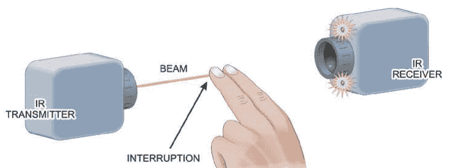

## 图 4.10 光电光束系统

## 微波光束装置

该装置从发射器发射微波，并在接收器处通过反射或光束强度减弱来检测微波。在室内应用中，发射器和接收器通常组合在同一个外壳内；在室外应用中，则使用分开的外壳。通过在电磁波谱的微波区段产生能量，该探测器可作为有源器件工作，并响应以下情况：

- 多普勒频移（频率变化）。这些装置基于多普勒效应现象，该现象观察相对听众或接收器运动的能量波（此处为微波）中的频率变化。这些探测器向特定环境发射特定频率的微波，然后分析反射回来的任何波的频率。当接收频率偏离正常频率时，传感器会发出报警信号。
- 频率相位偏移。这些装置也依赖于运动引起的反射能量波变化。与多普勒传感器类似，这些传感器向某一区域发射特定微波频率，并测量反射波的相位偏移，该偏移与移动物体的速度成正比。
- 导致接收能量减弱的运动。这些装置响应发射器与接收器之间能量水平的变化，这种变化是由部分或全部发射能量波被进入其路径的障碍物阻挡引起的。

## 压力传感器

压力垫是一种传感器，可放置在走廊的地毯下或楼梯踏板上。它们会因脚步声产生的压力而触发并报警。压力传感器通常使用常开开关触点。当压力施加到压力垫上时，开关闭合，从而向控制面板发出压力开关已被触发的警报。

## 键盘

大多数入侵检测和报警系统采用键盘设备来编程、控制和操作各种门禁控制和管理设备。

键盘是输入设备，通常配备一组数字按钮，类似于电话的按键式键盘，如图 4.11 所示。安保人员通常使用键盘发出控制指令，例如布防、撤防系统或旁路某个防区。

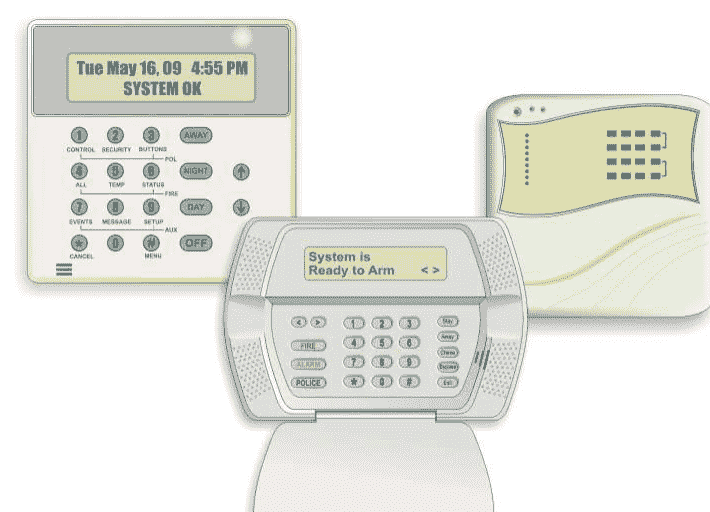

## 图 4.11 控制器键盘

键盘可放置在设施内任何方便安保人员操作外部大门和门的区域。然而，许多新的安全系统通常包含在平板电脑或智能手机应用程序上运行的软件，以便随时随地执行这些功能。

## 遥控钥匙和紧急按钮

遥控钥匙是一种无线钥匙链设备，类似于用于锁定、解锁和触发车辆警报的那类设备。方便易用的远程进入遥控钥匙使安保人员能够在设施外只需按一下按钮即可布防和撤防安全系统。遥控钥匙通常具有紧急按钮功能，允许用户在紧急情况下联系求助。图 4.12 显示了遥控钥匙的一个示例。

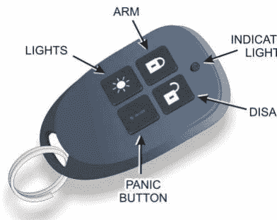

**图 4.12** 安全遥控钥匙

紧急按钮是在面临紧急情况（如发现入侵者）时能够立即触发报警系统的设备。如前一段所述，紧急按钮通常与遥控钥匙集成在一起，但也可能永久安装在设施内部的要害位置。

## 火灾探测传感器

许多入侵检测和报警系统将火灾探测和报警功能作为系统的一个组成部分。然而，对于更大或更复杂的安全系统，可以使用独立的火灾探测和报警系统。

有两种常见的火灾探测传感器：热传感器和烟雾探测器。它们通过检测设施内的热量上升或烟雾颗粒的存在来运行。

热传感器使用的技术与烟雾探测器不同。每种类型的基本设计特点将在以下段落中概述。*热传感器*检测温度的快速上升。当达到固定温度时，它们也会触发警报。另一方面，烟雾探测器（如图 4.13 所示）对热量不作出反应，而是使用两种常见传感器设计之一来检测烟雾。

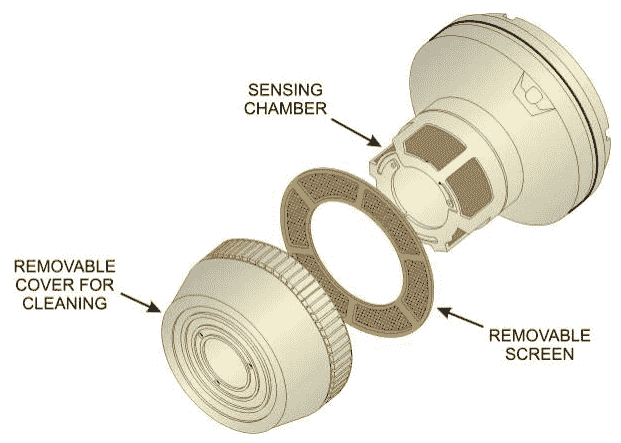

图 4.13 典型的烟雾探测器

电离探测器在一个含极少量放射性材料的小腔体内形成电路。当烟雾进入腔体时，颗粒附着在离子上并改变电流。

光电探测器利用光电管和光源工作。正常情况下，光线不会到达光电管；但当有烟雾时，光线被散射，探测器触发报警信号。

这两种探测器的主要区别在于，光电类型对大颗粒更敏感，而电离类型对小颗粒更敏感。

## 二氧化碳和一氧化碳探测器

二氧化碳（CO₂）是正常呼吸的天然副产品，不同于有毒的一氧化碳（CO）气体——危险性要小得多。室外空气通常含有约 400 ppm（百万分之一）的二氧化碳，而一氧化碳水平通常应低于 0.2 ppm。

尽管 CO 是一种由不完全燃烧产生的无色无味化合物，但高浓度时是致命的。当检测到危险水平的 CO 时，探测器会发出警报，让该区域的人员有机会安全离开住所——或立即通风。

一氧化碳是通过天然气、煤油、燃料油、煤炭或汽油的不完全燃烧产生的，而不是仅使用电力的设备产生的。如果暖炉、热水器、空间加热器、炉灶或烤箱不燃烧气体或燃料，就不会产生一氧化碳。要获得准确的一氧化碳数据，需要在进行任何读数之前先让可疑设备处于运行状态。

当 CO 警报激活时，人员需要呼叫紧急服务、消防部门或 911。他们必须立即转移到新鲜空气源，无论是在室外还是在打开的门窗处。应进行人员清点，以确保所有人员都已到齐。在紧急服务人员到达并发出解除警报信号之前，任何人都不得返回设施内或远离新鲜空气源。

## 输出设备

物理入侵检测系统通常包括三种基本类型的输出设备：视觉通知、可听式报警器和远程消息。视觉和可听式报警器为预定义的报警条件提供本地和一般的注意呼叫，而远程消息元素则用于通知特定人员或组织存在报警条件。以下各节描述了基本安防系统中采用的各种输出信号和设备。

### 警笛

控制面板为驱动外部电子警笛或频闪灯提供电压。当存在报警条件时，控制器会激活这些设备。各种类型的可听式报警器（警笛、喇叭、蜂鸣器、汽笛和铃）用于在报警条件激活时吸引注意。

这些不同的设备产生不同音量的声音以用于各种位置。可听式报警声响不仅用于吸引设施外或远离入侵区域的其他人的注意，而且还用于产生足够高的声音水平以阻止入侵者。商业安防系统通常采用如图 4.14 所示的固态电子警笛。这些警笛提供更高的声音输出水平以及多种音调和音高。

安装在设施内隐蔽区域的室内声响器设计为以最大音量运行，以吓唬入侵者快速离开。这是因为声音会掩盖外部接近的警察警笛声。室内警笛可从多家供应商处获得，其工作音量在 110 至 120 dB 范围内，接近疼痛阈值。

**图 4.14** 电子警笛

### 频闪灯

许多安防系统安装至少包括一个频闪灯以提供视觉指示。这些灯通常安装在设施外部，以吸引入侵附近的人的注意并阻止潜在入侵者。安防频闪灯由安防控制器面板提供的各种直流电压供电。

安防频闪灯，如图 4.15 所示，其光输出水平以英尺烛光或坎德拉为单位指定。英尺烛光是照明行业使用的 *照度*（或光强度）度量单位。同样，一个坎德拉等于英尺烛光乘以距离平方：

C = fc × d²

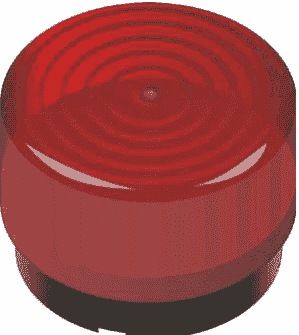

**图 4.15** 频闪灯

安防频闪灯有多种不同颜色可供选择，包括红色、蓝色、琥珀色和透明色。

### 远程通知系统

虽然频闪灯和警笛会引起局部环境中报警条件的一般注意，但通常有必要通知特定人员（如安保专家）或组织（如第三方安保公司、消防部门或警察服务）以响应不同类型的报警条件。

最常见的远程通知系统涉及安防系统控制面板使用电话线路在存在报警条件时自动呼叫远程监控设施或关键人员。当安防控制器从其区域之一接收到活动输入信号时，它会激活电话拨号器单元并导致数字数据消息传输到预定接收者。消息接收者还可以使用远程访问在远离设施时检查安防系统的状态。

一些入侵检测和报告系统采用如图 4.16 所示的独立电话拨号器或内置拨号器。然而，越来越多的系统利用内置蜂窝通信系统。此类系统提供额外的可靠性，因为即使物理电话线路受损也能发挥作用。

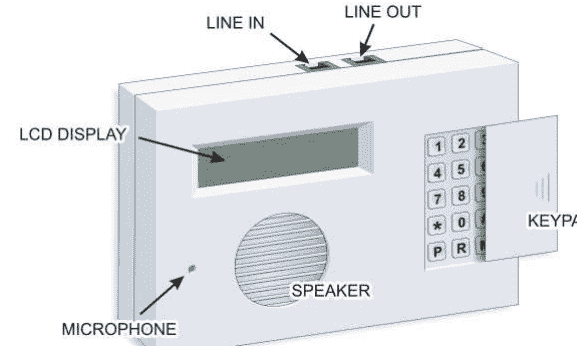

**图 4.16** 自动语音/寻呼拨号器控制台

### 第三方报警监控服务

根据组织的性质，入侵检测和报告系统可能完全基于组织员工。

然而，在许多组织中，安防系统由专业的第三方报警监控公司支持。

这些公司按月收费提供 24 小时/7 天全天候监控服务。当他们收到报警通知时，他们会根据与订阅者（客户）公司的合同协议执行响应行动。

响应的顺序通常与他们收到的报警通知的性质以及收到时间相对应。他们最初可能会尝试联系指定人员，或在未应答的报警条件发生时联系执法或消防部门机构。他们还可能派遣来自监控公司的武装或非武装安保人员调查报警。

## 动手练习

在本练习中，您将学习如何保护内部区域。目标如下：

- 对于 ACME 设施，定义其内部安全区域并确定与该周界相关的漏洞。
- 对于 ACME 内部及其漏洞，进行研究以确定可用于保护内部资产的组件或系统，以及您找到的组件的成本选项。
- 设计一个 ACME 可以实施的访问监控和控制系统，以最具成本效益的方式保护其设施的这一部分。

### 开始之前

在完成本练习之前，您必须完成第 2 章和第 3 章的练习。

本练习所需的资源如下：

- 互联网访问
- 铅笔/钢笔和纸
- 完成第 2 章和第 3 章的练习

### 讨论

再次回到之前实验程序中提出的 ACME 仓库项目，在向 ACME 管理人员提交建议之前，最后一个准备步骤是研究并设计设施内部安全区域的入侵检测计划。

在之前的程序中，您研究了通过外围和内围监控和控制访问的选项，以及使用视频监控组件监控这两个周界之间的区域。

在本程序中，您将被要求研究可用于监控和控制内部安全区域内活动的组件和策略。您还将被期望就实施最具成本效益的解决方案提出建议，该解决方案将提供必要的安保水平。

图 4.17 描绘了 ACME 仓库区域。该设施部分用于存放 ACME 产品以运送给买家和分销商。如图所示，该区域还包含公司的本地办公室，包括：

- CEO 办公室
- 运输经理办公室
- 会计办公室
- 市场营销办公室
- 办公用品储藏室
- 清洁用品清洁工储藏室

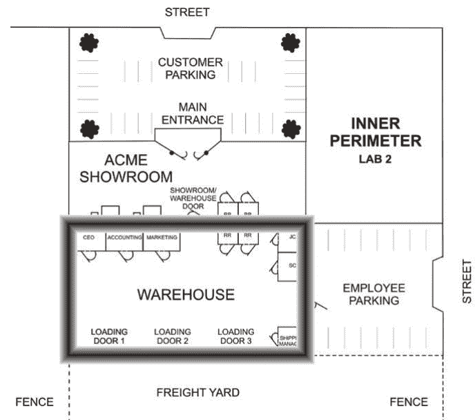

**图 4.17** 仓库区域和办公室

仓库区域的剩余部分是开放的楼层空间，里面摆放着存放 ACME 产品的货架排。

很明显，仓库内部区域需要考虑两项安全问题：

- 仓库运营期间内部安全需求是什么？
- 仓库运营在晚上和周末关闭时内部安全需求是什么？

## Procedure

- 1. 查看图 4.18 并识别/标注应被监控的仓库设施资产。

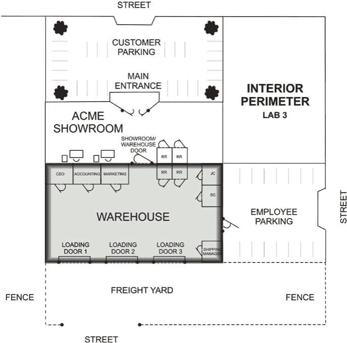

### FIGURE 4.18  The Interior Security Zone

2. 使用互联网或其他可用研究工具研究可用于保护上一步中识别的出入口的进出监控和控制设备及系统。

3. 使用表 4.1 至表 4.3 来整理你在那里找到的进出监控和控制产品的指定细节。对于每项产品，尝试找到至少两个供应商。

### TABLE 4.1 Door Locks

|   | Product Description | Vendor | Number Required | Cost Per Unit | Total Price |
|---|---|---|---|---|---|
| A | Mag Door Lock Kit | Entry Vision | 1 | $274.99 | $274.99 |
| B | Electronic Keyless Door Lock | Gino Development | 4 | $89.99 | $359.96 |
| C | Schlage B581 | Doorware.com | 1 | $52.00 | $52.00 |

### TABLE 4.2 Door Contacts/Sensors

|   | Product Description | Vendor | Number Required | Cost Per Unit | Total Price |
|---|---|---|---|---|---|
| A | Surface Mount | Seco-Larm | 4 | $1.90 | $7.60 |
| B | Wireless Surface | Insteon | 4 | $25.00 | $100.00 |
| C | Recessed Mount | Interlogix | 4 | $6.86 | $27.44 |

### TABLE 4.3 Motion Detectors

|   | Product Description | Vendor | Number Required | Cost Per Unit | Total Price |
|---|---|---|---|---|---|
| A | PIR Motion Sensor | Vedard Alarm | 2 | $8.50 | $17.00 |
| B | Pir 360 Motion Audio Sensor | Lithonia | 2 | $117.00 | $234.00 |
| C | PIR 360 Motion Sensor | Optex | 2 | $54.00 | $108.00 |

4. 列出你对 ACME 应采用的门禁门锁的建议。

Answer: Mag Door Lock Kit, Electronic Keyless Door Locks, Schlage B581 deadbolt.

5. 你将在哪里使用你推荐的门锁？

Answer: The Mag Door Lock Kit should be applied to outside warehouse pedestrian door for entry authentication and control. Electronic Keyless Door Locks should be installed for the CEO's office, the shipping manager's office, the accounting office, and the marketing office. The locks can be actuated without authentication steps from inside the offices, but require keys or passcodes to operate doors from inside of warehouse. Schlage B581 should be used for the outside showroom and the outside warehouse pedestrian door to secure the perimeter during closed hours.

6. 列出你为 ACME 的内部资产推荐的门传感器类型的选择。

Answer: The Interlogix Recessed Mount should be utilized to provide additional tracking of people's movement into sensitive offices such as the CEO's, both during operating hours and after hours of operation.

7. 列出你对 ACME 内部安全区域应使用的运动探测器的建议。

Answer: The Lithonia 360 PIR Motion and Audio Sensors will allow full coverage/cross coverage of the warehouse floor after hours to trigger the security system if any other sensor fails before an intruder actually enters the security zone.

## Review Questions

1. 哪种类型的门禁设备可能是保护 CEO 办公室门的良好建议？

Answer: A biometric ID device, a cipher lock, or a keyed lock. The information available in most executive offices typically requires some kind

of protection. The level of security depends on the organization's tolerance for risk and should be based on a risk assessment. This typically holds true for other management offices (for example, accounting and sales/marketing offices).

2. **哪种类型的门禁设备可能是保护供应室和清洁工储物间门的良好建议？**

**Answer:** Either a simple keyed lock or no lock at all. These closets do not contain valuable assets and are often shared by various levels of employees requiring access so they may not require any security beyond a door.

3. **红外运动探测器在 ACME 设施的什么位置是合适的选择？**

**Answer:** In the open floor area of the warehouse. There are no access points to monitor, so motion detectors can provide good wide-area monitoring for interior zones. Of course, these devices would only be effective during the evening and weekend time periods when the warehouse operation was closed down and unattended.
