## 安全设备

*基于第6章中的*场景，您可以看到保护独立信息技术（IT）资产存在许多挑战。本地主机（计算和智能控制设备）安全是在多个层面上实施的，包括物理使用拒绝、系统资源访问限制，以及针对意图破坏或窃取数据的个人和软件的主动保护。在本章中，您将学习如何：

- 识别与终端计算设备相关的三个安全边界
- 为终端计算设备提供物理安全
- 评估 BIOS/CMOS 安全选项

### 三层安全

如果您将独立的 IT 或 ICS 设备视为第 2 章中描述的三层安全，您可以将*外部边界*视为物理设备及其外壳外部的空间。*内部边界*应被视为设备的操作系统和应用程序。最后，设备的内部由设备中以电子方式创建、获取和存储的无形数据资产组成。图 7.1 以图形方式说明了这些层。

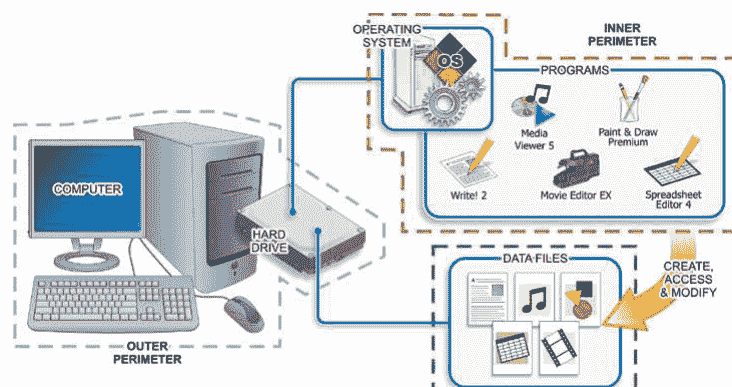

图 7.1 三层安全

保护智能设备的第一层是控制对它们的访问。再一次，入侵者无法损坏、破坏或窃取他们无法接触到的东西。这同样适用于智能计算和控制设备。因此，第一步是在切实可行的范围内控制对设备的物理访问。

自主或半自主 ICS 设备，例如可编程逻辑控制器（PLC）或独立微控制器，通常可以放置在安全、可锁定的外壳中，只有拥有钥匙的人才能访问。这些设备往往在工业控制和公用事业环境中很常见。

在本章中，我们主要处理的资产是个人计算机（PC）。在大多数情况下，将可能被不同人员使用的台式机和便携式 PC 系统锁起来是不切实际的。在许多情况下，给定计算机可能经常被不同的人员使用——例如，白班员工和夜班员工。在此类应用中，必须实施行政安全措施以保证适当的身份验证和访问控制。

### 安全主机设备

保护本地计算和控制设备首先是在可能的情况下使用锁门或外壳。然而，在企业和工业环境中，许多此类资产在相对开放的环境中使用。在这些环境中，像图 7.2 所示的锁定安全电缆可能被用来将计算设备物理连接到桌子或其他不可移动结构上，以使其更难被移除。

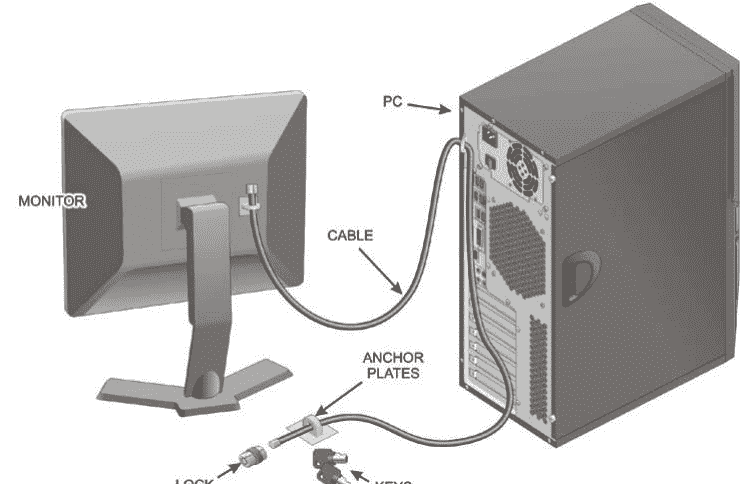

图 7.2 PC 安全电缆

像图 7.3 所示的 docking station 是为便携式计算设备设计的配件。其主要功能是使便携式用户能够随身携带便携式设备，同时在办公室环境中仍能使用全尺寸外围设备和连接设备。许多 docking station 的第二个功能是提供可锁定附件到桌面，以防止未经授权的用户在不使用时拿起便携式设备并直接带走。

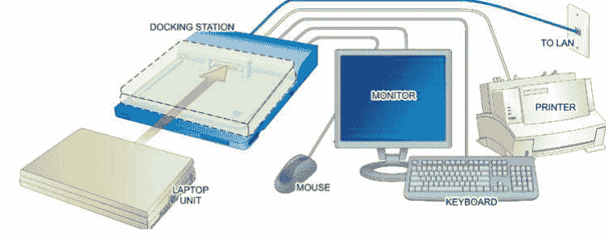

图 7.3 一个 Docking Station

在许多办公环境中，专门的工作台和橱柜可用于将设备固定在原位并限制对设备的部分访问。这通常涉及将设备固定到工作区橱柜或将其隐藏在橱柜内部，仅留出有限的开口以进行物理访问设备——可能仅足够大以打开设备并操作光盘驱动器机构。

### 保护外边界门户

在您采取措施保护物理设备免受未经授权的访问和/或移除后，对于下一个保护层，请将本地计算机或智能控制设备的物理机箱视为其外部边界。

另外，请记住恶意人员真正想要从此类设备获得什么——他们想要的是机器内部的程序和数据。那么，这些人可以在哪里访问这些项目以损坏、破坏或窃取它们？在计算和智能控制设备中，他们可以获得访问这些项目的三个一般位置：

- 在内存中时
- 在存储设备上存储时，例如硬盘驱动器和闪存驱动器
- 在从一个地方转移到另一个地方时

对于图 7.4 所示的个人计算机，您将如何穿透其机箱以到达内部的无形贵重物品？

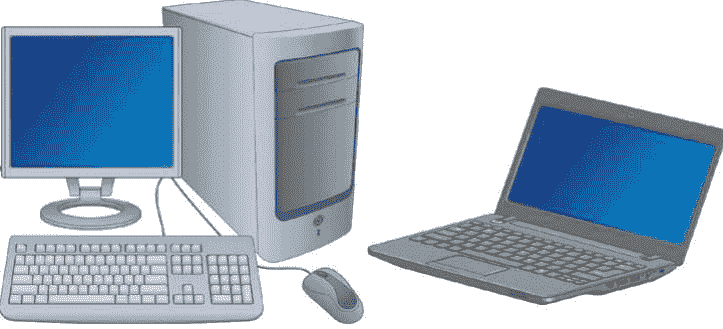

**图 7.4** 典型 PC

通过 PC 外部边界最明显的访问点是其基本输入设备：键盘和鼠标或触敏显示器。如果有人只需坐在系统前并自由使用其输入设备（键盘、鼠标、触控板或触摸屏），他们就有了访问内部信息的方法。他们只需按下开/关按钮并等待设备启动即可。

> **显示器及其输入能力**
> 
> 除非显示器具有输入能力，例如 USB 端口，否则它不被视为可被利用的访问设备。同样适用于非无线打印机或其他仅输出设备。

### BIOS 安全子系统

大多数个人计算机的硬件中内置了一种基本安全工具，在操作系统启动完成前提供一些基本保护。基本输入/输出系统（BIOS）提供了可通过其 BIOS 设置实用程序，也称为 CMOS 设置实用程序设置的硬件安全选项。图 7.5 显示了一个典型的安全配置屏幕。通常，这些选项包括设置用户密码以控制对系统的访问，以及设置主管密码以控制对 CMOS 设置实用程序的访问。

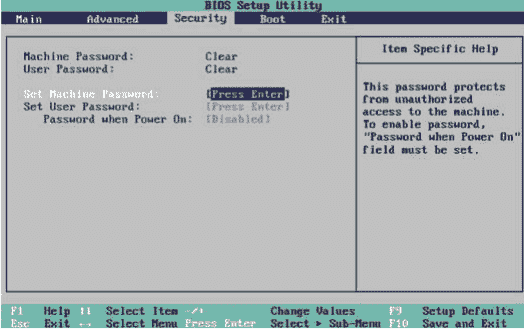

**图 7.5** CMOS 安全配置

设置用户密码选项使管理员能够建立用户在启动过程中必须输入的密码，以完成启动过程并获得对操作系统的访问权限。没有此密码，系统永远不会达到入侵者可用于访问其内部边界和信息的运行级别。

然而，此密码不提供对配置用户和主管密码选项的 CMOS 设置实用程序的访问。必须使用主管密码选项来建立可用于访问 CMOS 设置实用程序的密码。

安全配置屏幕还可能包括设置病毒检查和备份提醒的选项，这些提醒在系统启动时会定期弹出。除了启用这些设置外，管理员还可以指定通知之间的时间间隔。

CMOS 设置实用程序中的主要安全选项集之一是可以用于控制对系统内部边界和内部资产的访问的选项。在很大程度上，这些选项涵盖了限制通过资产的物理端口和可移动媒体系统允许的访问，以及对系统磁盘驱动器引导扇区的访问。

由于 CMOS 密码在启动过程发生之前控制对系统所有部分的访问，因此在出现事件时存在一些不便

用户忘记密码时就会发生这种情况。一旦发生这种情况，如果不完全重置 CMOS RAM 的内容，就无法访问系统。在某些主板上，可以通过短接板上的一对专用跳线来实现。

对于其他系统，您必须移除或短接备份电池以重置 CMOS 信息。您还必须拔掉商用电源插座的电源，以降低 CMOS 寄存器的电压。当 CMOS 内容被重置后，您必须手动恢复系统正在使用的任何非默认 CMOS 设置。

## Local System Hardening

在计算机和网络环境中，术语 *hardening* 用于指使系统更安全的过程。计算机加固工作始于硬件，但也扩展到本地主机的操作系统、其文件系统和应用程序。

在硬件层面，加固的主要领域是系统 BIOS 以及可能已引入系统的任何其他固件附加组件。因为 *firmware* 按定义是封装在硬件设备中的软件产品，所以它预装在系统或其某个设备中。

要使固件比现有状态更安全，需要进行更新。根据固件的物理结构，这些更新可能涉及物理或逻辑更新。硬件制造商提供固件更新以改进其现有已安装产品——包括升级其安全工具。他们的意图是提高产品的可靠性、安全性和吸引力。

在大多数情况下，固件更新旨在为硬件不兼容提供解决方案，或提供数据链路层驱动程序，使固件能够与特定操作系统协同工作。然而，一些产品改进可能只是扩展产品功能，而不一定使其更安全。

## Additional Inner-Perimeter Access Options

除了与个人计算机一起使用的基本输入设备外，大多数计算机系统还内置了几条其他路径，可提供对内部周界的访问。即使是非联网的独立计算机，也可能通过可移动媒体系统和物理访问端口（连接点）容易受到外部来源的利用。

## Physical Port Access

物理硬件端口使基本 PC 系统能够与可选的可移动设备交互，如图 7.6 所示。它们还提供潜在的安全威胁，因为怀有恶意意图的个人可以通过这些端口直接进入计算机内部通信和处理系统。

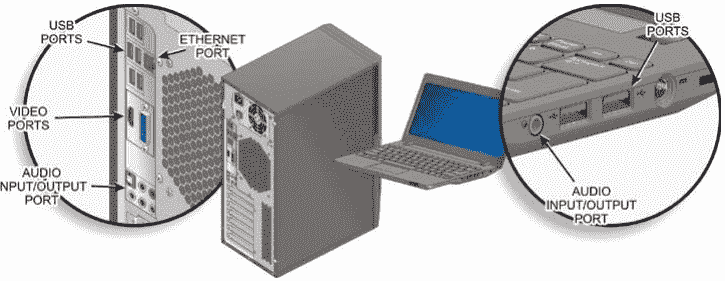

**FIGURE 7.6** Physical PC Ports

硬件端口可访问计算机的内部通信总线，连接其所有内部组件，包括其数据总线、内存和内部存储设备（用于访问程序和数据的三个区域）。图 7.7 描述了典型 PC 内部总线结构的布局。唯一站在拥有端口物理访问权限的人与系统内部结构之间的组件是计算机内部芯片组的一部分的总线控制器接口。该电路的运行由系统的 BIOS 和操作系统控制。

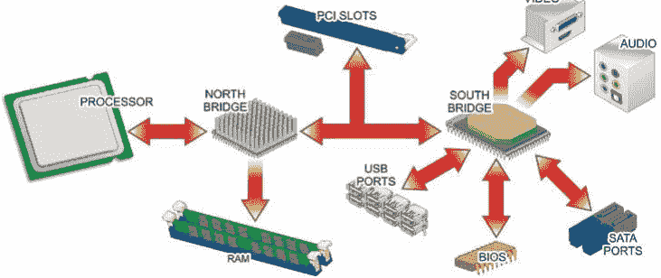

**FIGURE 7.7** Pathways to the Vital Components

## A CLARIFICATION OF THE WORD PORT

请注意，术语 port 也用于指计算机网络通信中使用的逻辑 TCP/UDP 软件端口。您将在稍后介绍防火墙时遇到该术语的这种用法。

数据可以通过这些端口下载到可移动媒体设备中并迅速带走。同样，恶意程序，例如本章后面将介绍的病毒和蠕虫，可以从可移动媒体源上传到机器中。一旦这些程序被引入主机系统，它们就会感染系统，并可能损坏或破坏其上存储的数据和程序。

## SECURING CONNECTION POINTS

一台 PC 可能拥有几种不同的硬件连接点。并非所有这些连接都构成安全威胁。只有那些直接提供对系统内部总线结构访问的连接端口才需要考虑。例如，标准 VGA 视频端口是仅输出连接，不提供对系统内部操作的访问。

较新型 PC 中使用最广泛的硬件连接端口是 USB 端口。然而，您仍可能遇到旧的传统端口，例如 IEEE 1394、RS-232 和 RS-485 串行通信端口，以及并行打印机端口和系统支持的 eSATA 端口。

## SECURING NETWORK AND WIRELESS CONNECTIONS

入侵者还可以通过网络和无线连接渗透 PC 的外围并访问其内部总线、内存和存储设备，这也是可能且常见的。这些访问途径以及如何保护它们将在第 12 章中详细讨论。

## Universal Serial Bus Ports

现代个人计算机中最流行的硬件端口是通用串行总线（USB）端口，如图 7.8 所示。这种高速串行接口旨在提供一种快速、灵活的方法，将多达 127 个外围设备连接到计算机。

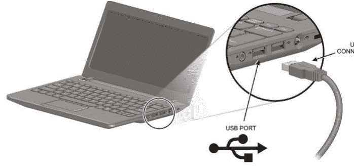

FIGURE 7.8 A USB Port

USB 外设可以通过连接集线器串联或联网，使用连接集线器使总线通过额外的端口连接分支。图 7.9 展示了一种可能的 USB 桌面连接方案。

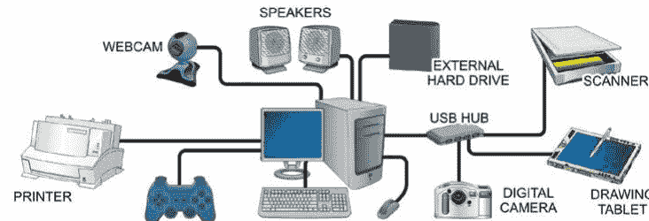

FIGURE 7.9 USB Desktop Connections

USB 设备可以在系统通电并完全运行时添加或移除。这称为热插拔或热插拔设备。系统的即插即用功能将检测到设备的存在（或不存在）并为其配置操作。

USB 规范定义了两种类型的插头：系列-A 和系列-B。

系列-A 连接器用于 USB 电缆连接通常永久连接到设备一端的设备。这些设备的例子有键盘、鼠标和集线器。

相反，系列-B 插头和插座专为需要可拆卸电缆的设备而设计（例如打印机、扫描仪和调制解调器）。两者都是四触点插头和插座，嵌入塑料连接器中，如图 7.10 所示。

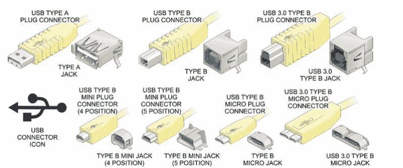

# FIGURE 7.10 USB Connectors

为 USB 2.0 和 3.0 规范开发了更小的 5 针 USB 插头和插座（称为 Mini-A 和 Mini-B），并且为 3.0 版本开发了更小的 Micro-USB 连接器版本。USB 3.0 插头通常为蓝色。这些连接器 intended 用于数字相机和手机等小型设备。这些结构旨在提供坚固的连接，不易因重复或错误使用而损坏。

两个系列的连接器均已[content]

用户忘记密码时就会发生这种情况。一旦发生这种情况，如果不完全重置 CMOS RAM 的内容，就无法访问系统。在某些主板上，可以通过短接板上的一对专用跳线来实现。

对于其他系统，您必须移除或短接备份电池以重置 CMOS 信息。您还必须拔掉商用电源插座的电源，以降低 CMOS 寄存器的电压。当 CMOS 内容被重置后，您必须手动恢复系统正在使用的任何非默认 CMOS 设置。

## Local System Hardening

在计算机和网络环境中，术语 *hardening* 用于指使系统更安全的过程。计算机加固工作始于硬件，但也扩展到本地主机的操作系统、其文件系统和应用程序。

在硬件层面，加固的主要领域是系统 BIOS 以及可能已引入系统的任何其他固件附加组件。因为 *firmware* 按定义是封装在硬件设备中的软件产品，所以它预装在系统或其某个设备中。

要使固件比现有状态更安全，需要进行更新。根据固件的物理结构，这些更新可能涉及物理或逻辑更新。硬件制造商提供固件更新以改进其现有已安装产品——包括升级其安全工具。他们的意图是提高产品的可靠性、安全性和吸引力。

在大多数情况下，固件更新旨在为硬件不兼容提供解决方案，或提供数据链路层驱动程序，使固件能够与特定操作系统协同工作。然而，一些产品改进可能只是扩展产品功能，而不一定使其更安全。

## Additional Inner-Perimeter Access Options

除了与个人计算机一起使用的基本输入设备外，大多数计算机系统还内置了几条其他路径，可提供对内部周界的访问。即使是非联网的独立计算机，也可能通过可移动媒体系统和物理访问端口（连接点）容易受到外部来源的利用。

## Physical Port Access

物理硬件端口使基本 PC 系统能够与可选的可移动设备交互，如图 7.6 所示。它们还提供潜在的安全威胁，因为怀有恶意意图的个人可以通过这些端口直接进入计算机内部通信和处理系统。

**FIGURE 7.6** Physical PC Ports

硬件端口可访问计算机的内部通信总线，连接其所有内部组件，包括其数据总线、内存和内部存储设备（用于访问程序和数据的三个区域）。图 7.7 描述了典型 PC 内部总线结构的布局。唯一站在拥有端口物理访问权限的人与系统内部结构之间的组件是计算机内部芯片组的一部分的总线控制器接口。该电路的运行由系统的 BIOS 和操作系统控制。

**FIGURE 7.7** Pathways to the Vital Components

## A CLARIFICATION OF THE WORD PORT

请注意，术语 port 也用于指计算机网络通信中使用的逻辑 TCP/UDP 软件端口。您将在稍后介绍防火墙时遇到该术语的这种用法。

数据可以通过这些端口下载到可移动媒体设备中并迅速带走。同样，恶意程序，例如本章后面将介绍的病毒和蠕虫，可以从可移动媒体源上传到机器中。一旦这些程序被引入主机系统，它们就会感染系统，并可能损坏或破坏其上存储的数据和程序。

## SECURING CONNECTION POINTS

一台 PC 可能拥有几种不同的硬件连接点。并非所有这些连接都构成安全威胁。只有那些直接提供对系统内部总线结构访问的连接端口才需要考虑。例如，标准 VGA 视频端口是仅输出连接，不提供对系统内部操作的访问。

较新型 PC 中使用最广泛的硬件连接端口是 USB 端口。然而，您仍可能遇到旧的传统端口，例如 IEEE 1394、RS-232 和 RS-485 串行通信端口，以及并行打印机端口和系统支持的 eSATA 端口。

## SECURING NETWORK AND WIRELESS CONNECTIONS

入侵者还可以通过网络和无线连接渗透 PC 的外围并访问其内部总线、内存和存储设备，这也是可能且常见的。这些访问途径以及如何保护它们将在第 12 章中详细讨论。

## Universal Serial Bus Ports

现代个人计算机中最流行的硬件端口是通用串行总线（USB）端口，如图 7.8 所示。这种高速串行接口旨在提供一种快速、灵活的方法，将多达 127 个外围设备连接到计算机。

FIGURE 7.8 A USB Port

USB 外设可以通过连接集线器串联或联网，使用连接集线器使总线通过额外的端口连接分支。图 7.9 展示了一种可能的 USB 桌面连接方案。

FIGURE 7.9 USB Desktop Connections

USB 设备可以在系统通电并完全运行时添加或移除。这称为热插拔或热插拔设备。系统的即插即用功能将检测到设备的存在（或不存在）并为其配置操作。

USB 规范定义了两种类型的插头：系列-A 和系列-B。

系列-A 连接器用于 USB 电缆连接通常永久连接到设备一端的设备。这些设备的例子有键盘、鼠标和集线器。

相反，系列-B 插头和插座专为需要可拆卸电缆的设备而设计（例如打印机、扫描仪和调制解调器）。两者都是四触点插头和插座，嵌入塑料连接器中，如图 7.10 所示。

# FIGURE 7.10 USB Connectors

为 USB 2.0 和 3.0 规范开发了更小的 5 针 USB 插头和插座（称为 Mini-A 和 Mini-B），并且为 3.0 版本开发了更小的 Micro-USB 连接器版本。USB 3.0 插头通常为蓝色。这些连接器 intended 用于数字相机和手机等小型设备。这些结构旨在提供坚固的连接，不易因重复或错误使用而损坏。

两个系列的连接器均已

port mounted on an expansion slot cover. Internally, a standard SATA cable connects the port to a SATA connector on the motherboard.

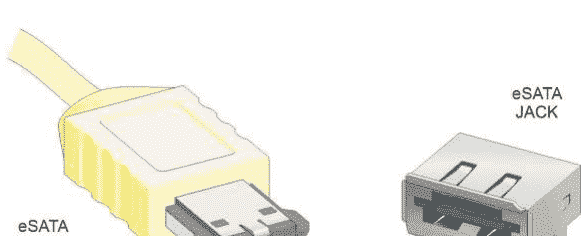

## 图 7.12 eSATA 接口连接

由于这些端口提供了磁盘驱动器与系统相连的总线的直接访问，因此它们构成了安全隐患。

## 旧式端口

有一些较旧的传统硬件端口你可能不会经常遇到。表 7.1 总结了与 PC 配合使用的物理端口类型。它们最常位于 PC 的背面，但某些型号为了方便可能在前面板上配备其中一些端口。这些端口的物理外观在图 7.13 中描述。

## 表 7.1 典型和传统 I/O 端口

| Port | Connector |
|------|-----------|
| Keyboard | PS/2 6-pin mini-DIN |
| Mouse | PS/2 6-pin mini-DIN |
| COM1 | DB-9M |
| COM2 | DB-9M |
| LPT | DB-25F |
| VGA | DE-15F (3 row) |
| Game | DE-15F (2 row) |

## 表 7.1 （续）

| Port | Connector |
|---|---|
| Modem | RJ-11 |
| LAN | BNC/RJ-45 |
| Sound | RCA 1/8“ minijacks or 3/32” sub minijacks |
| SCSI | Centronics 50-pin |
| USB | 4-pin USB Socket |

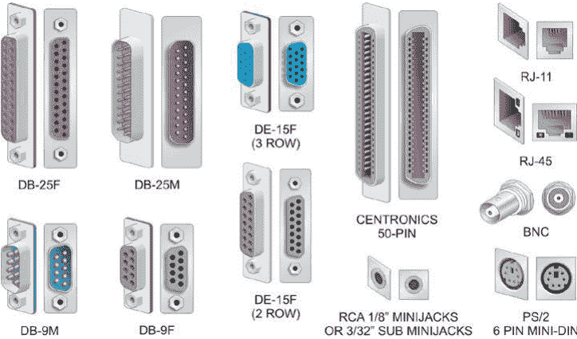

## 图 7.13 典型 IO 端口连接器

如果你遇到这些端口，其中构成安全风险的包括 RS-232/422/485 串行 COM 端口、小型计算机系统接口（SCSI）以及 LPT 并行打印机端口。这些端口都能够与系统的内部设备进行双向通信。

这三种媒体设备类型都通过其驱动器和硬件连接端口为计算机的内部系统提供访问。

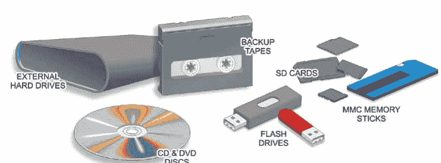

## 图 7.15 可移动媒体

## BIOS 启动设备/顺序控制

大多数 BIOS 提供了启动设备启用、禁用和排序功能，应使用这些功能来控制计算机启动运行的方式。通常，BIOS 为用户和管理员提供启用或禁用以下类型设备的选项：

- Optical disc drive(s)
- Hard disk drive(s)
- USB devices
- SD cards
- eSATA devices

除非需要常规地从其他设备启动系统，否则应禁用除主硬盘驱动器选项之外的所有启动选项，以提供最佳的安全选项。

## Microsoft Autorun 功能

同样，微软操作系统的某些版本包含一个名为 Autorun 的功能，该功能在检测到媒体在驱动器或读卡器中存在时，会自动运行可移动媒体设备上找到的可执行程序。该功能构成了非常严重的安全威胁，因为媒体上的恶意软件程序将自动运行并感染主机设备。

据称该功能导致了旧版 Windows 系统中多达 50% 的恶意软件感染。只需通过下载一个应用程序来关闭 Autorun，即可简单地在 Windows 中禁用 Autorun 功能来消除该威胁。另一种选择是修改 Windows 注册表以关闭 Autorun。

## 实践练习

在本实验中，你将检查 BIOS 中可用的设置。首先，你将找到并检查 USB 端口控制。然后你将检查管理员和用户访问的 BIOS 设置。最后，你将检查启动菜单中的各种选项，包括启动顺序和安全启动。

### 目标

- Enter the BIOS.
- Navigate the BIOS.
- Find the settings to improve system security.

### 程序

- 1. Turn off the PC workstation.

在下一步打开工作站时，注意工作站显示器的情况。当你看到主板或计算机制造商标识时，屏幕底部应该有一个选项。它会指示你如何进入 BIOS。常用的按钮包括 F2、F10 和 Delete。实际需要使用的按钮取决于主板制造商；因此，重要的是注意屏幕上的说明。

在以下行记录你需要使用的按钮：

____________________________

- 2. Turn on the PC workstation. Attempt to enter the BIOS by pressing the correct button. If you are unsuccessful, turn off the workstation and try again.

BIOS 菜单界面在各系统制造商和主板厂商之间差异很大。图 7.16 仅是一个示例。

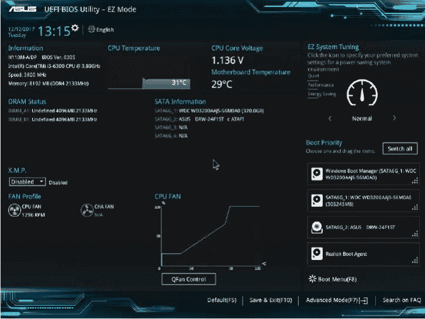

**图 7.16** 示例 BIOS 初始设置屏幕

如果你的 BIOS 设置已被系统管理员密码保护，实验可能就此结束。如果发生这种情况，实验结束，你有三种选择继续：

- a. Skip to the end of the chapter and answer the questions as best you can.
- b. Try to get the administrator password to unlock and clear this setting.
- c. If capable, you may have a jumper to reset the CMOS to factory defaults and clear the password. (Option C should be executed only by a competent technician.)

3. If your lab didn't end, use the arrow keys to navigate the menus. Press Enter to select a highlighted option. You can also use the Tab key if you are unable to highlight a desired option. Navigate to Advanced Mode or your equivalent. See Figure 7.17 and Figure 7.18.

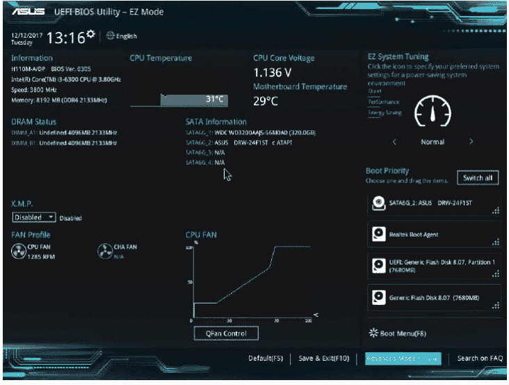

## 图 7.17 高级模式已高亮

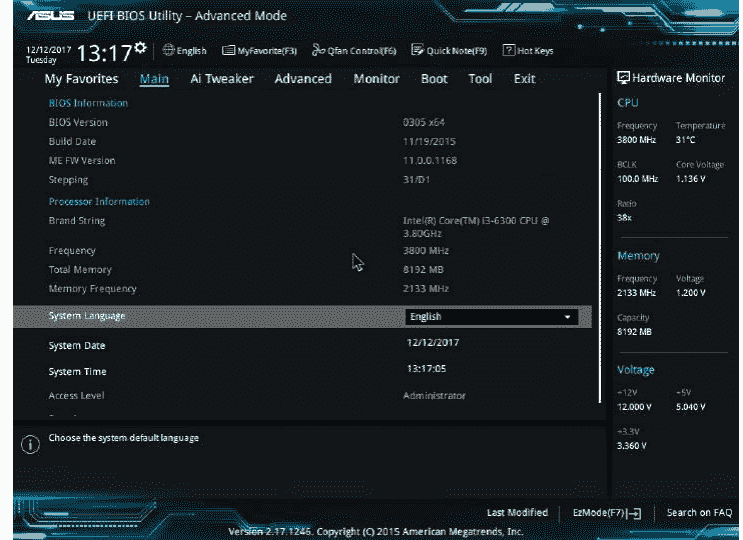

## 图 7.18 高级模式初始菜单

4. Figure 7.19 shows USB Configuration highlighted. Look for a menu or setting option like this.

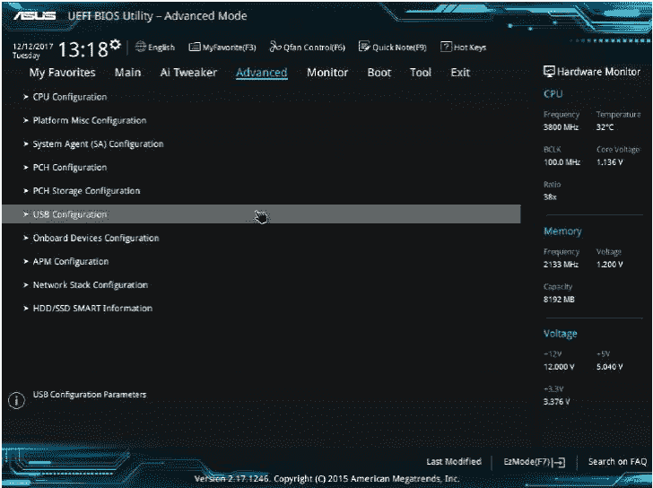

## 图 7.19 USB 配置

5. From here, there should be some options. Look for an option that most closely matches USB Single Port Control (see Figure 7.20). This option could have a different name for your BIOS settings. Figure 7.21 shows where to enable or disable the USB ports.

## 图 7.21 启用或禁用 USB 端口

## 图 7.22 安全设置

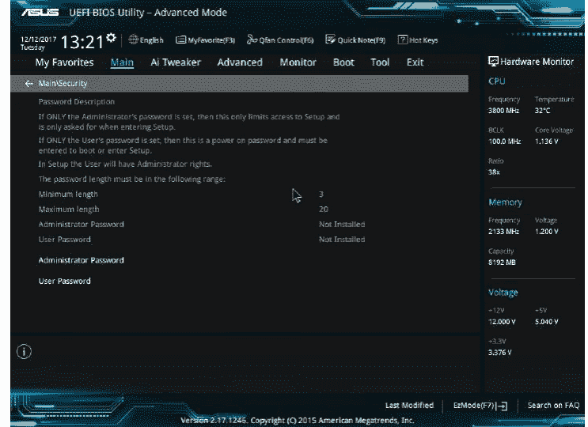

## 图 7.23 BIOS 管理员和用户密码设置

7. Navigate to the boot menu (see Figure 7.24). The boot menu lets you configure various settings related to system boot up.

8. Find the setting that controls the boot order (see Figure 7.25). For these BIOS settings, the boot order settings were about halfway down the boot menu. Each number corresponds to the order in which the motherboard will attempt to boot.

9. Find the Secure Boot option (see Figure 7.26). Secure boot is a relatively universal term, so you can look for these words, and you will most likely find the same option.

10. Choose the option that lets you interact with your keys.

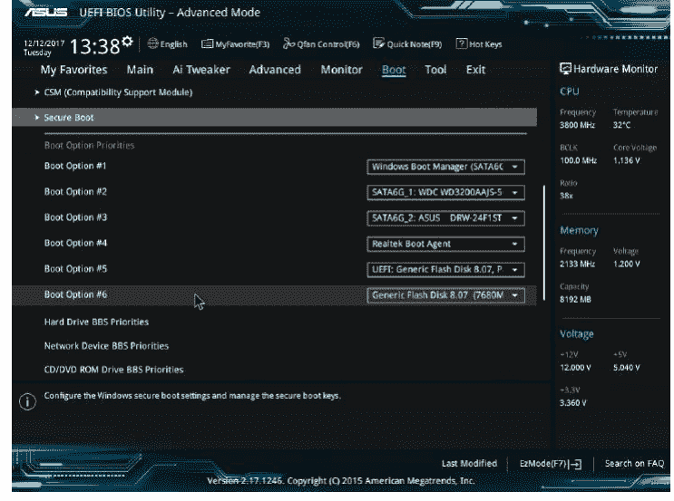

## 图 7.26 安全启动

11. If possible, read any available documentation about secure boot keys. See Figure 7.27 and Figure 7.28.

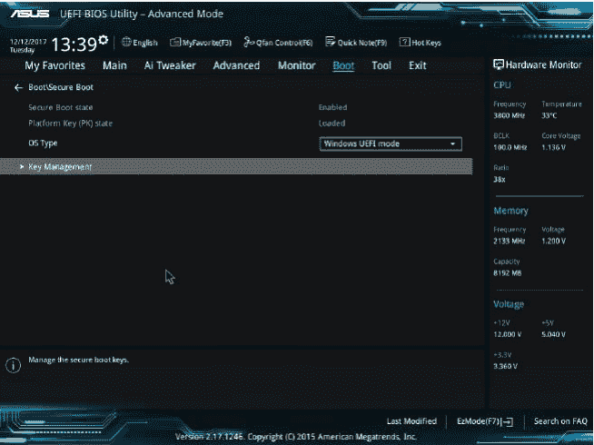

## 图 7.27 密钥管理

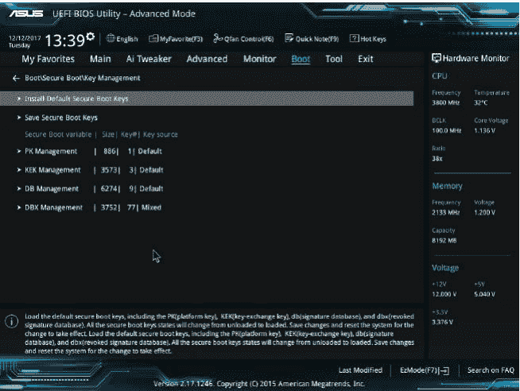

## 图 7.28 密钥管理设置

## 复习问题

如果你的实验提前结束，请回答这些问题。

- 1. Have you tried to visit the BIOS before this lab?
- 2. What was your reason for visiting the BIOS?
- 3. Why would you set an administrative password on your BIOS?

如果你完成了实验，请回答这些问题。

- 1. Which options are available for accessing the various areas of your BIOS under your BIOS advanced settings or equivalent?
- 2. Where did you find the USB port settings?
- 3. Where did you find the BIOS Administrator and User Password settings?
- 4. What is the order of your boot devices?
- 5. What did you read about Keys in the BIOS?

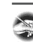

NOTE All of the answers will be specific to your particular BIOS. There are many versions and revisions of BIOS that you may be using, so simply go back through your particular BIOS and list your answers.

