## 保护内部边界

*一般来说，在*你突破了外部边界防御之后，可以将内部边界视为如图 8.1 所示的三层结构的一部分。可以将此边界视为由操作系统及其应用程序组成，它们构成了通往存储于内部区域（文件夹和文件）中数据的网关。

- 描述主机设备的本地登录和用户配置选项。
- 比较和对比常见操作系统的安全功能。
- 识别基于 Windows 和 Linux 系统的常见日志记录和审计选项。
- 解释不同操作系统环境中静态数据加密的选项。

### 内部边界

我们试图保护的有价值信息通常是以不同类型的文件形式存储在计算机硬件中的数字数据。这些文件由应用程序创建和解释。如果没有应用程序来解释数据，就很难确定数据实际含义。见图 8.1。

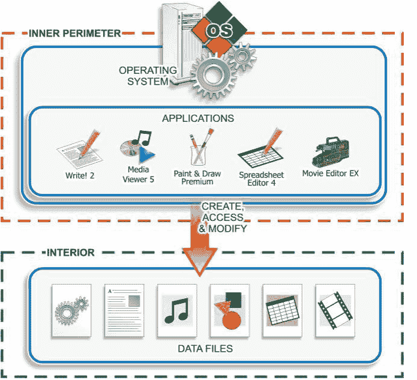

应用程序的运行和对文件的访问由操作系统（OS）控制。操作系统协调硬件系统及设备与软件应用程序的运行。应用程序是为特定操作系统设计的，因此它们依赖于这些操作系统。如果没有某种转换器的介入，它们将无法在另一个操作系统上运行。

操作系统还负责跟踪数据在系统中的存储位置以及如何定位和访问数据。如果没有操作系统的文件管理系统（FMS），就无法知道如何找到要窃取、损坏或销毁的数据。每个主要的操作系统供应商都使用不同的文件管理系统。

因此，要访问计算机上的数据，你必须访问由操作系统控制的正在运行的系统。然后你需要能够定位文件，这需要具备浏览操作系统文件系统的能力。最后，你需要打开文件，这需要应用程序软件或用于在数字代码级别检查数据的软件。

操作系统或常见应用程序本身对于盗贼来说没有太多实际价值。这类软件通常随处可见、相对便宜，并且难以在系统之间转移和使用。这些程序基本上只是用于创建和处理信息的工具。然而，它们对潜在的黑客很有吸引力，因为它们可以被访问并重新用于恶意和非法操作。

另一方面，存储在计算机上的数据文件对盗贼来说可能非常有吸引力。毫无疑问，你很清楚，关于大多数人的数字信息非常多，而且都存储在某个地方的计算机上。如果有人能够找到并访问这些数据文件，他们就能找到从中提取信息的方法。

一旦他们获得了文件（或其副本），他们既可以在自己的系统上使用最初创建该文件的同一应用程序打开它，也可以从数字代码中提取信息。后者往往更为复杂且难以完成，通常需要具备黑客技能和使用工具的人在该层面操作。

然而，并非每个恶意操作者都想窃取信息。有些人、组织和政府只是出于某种原因想要破坏或销毁数据。这类活动可能出于多种不同的动机，如本书引言中所述。

那么，如何防止不受欢迎的人访问这些程序呢？让我们首先看看不同供应商的典型操作系统，并了解它们提供了哪些安全选项。正如你将在以下部分看到的那样，操作系统往往内置了许多安全工具和选项。

## 操作系统

*操作系统*是旨在控制和协调计算机系统运行的程序。作为一个群体，它们很容易成为有史以来最复杂的程序之一。

在所有基于微处理器的环境中，操作系统接受来自程序或输入源（如计算机用户）的命令并执行它们以完成所需的操作。同样，操作系统充当几乎同样复杂的软件应用程序与其运行的计算机硬件之间的中介。

### 关于操作系统的一些澄清

除非显示器具有输入功能，否则它不被视为可利用的访问设备。打印机或其他仅输出设备也是如此。

世界上使用最广泛的操作系统与个人计算机无关。这些操作系统存在于汽车和消费电子产品中。它们从传感设备（如空气流量传感器，而不是键盘和鼠标）接收输入，根据一组指令和输入数据执行控制程序，并将输出提供给机电设备（如燃油喷射泵，而不是视频显示器和打印机）。它们与磁盘驱动器也没有太大关系。

磁盘操作系统（DOS）是一组用于控制基于磁盘的系统中整体计算机操作的程序。这些程序在后台运行，允许计算机用户从键盘输入字符、定义用于存储记录的文件结构，或将数据输出到监视器或打印机。磁盘操作系统负责在磁盘上查找和组织你的数据和应用程序。

如图 8.2 所示，磁盘操作系统可以按照四个不同的部分进行组织：

- 引导文件在启动期间从 ROM BIOS 接管系统硬件的控制。它们将操作系统内核文件加载到 RAM 内存中，以便用于控制系统操作。
- 内核文件是操作系统的基本逻辑文件，负责解释从软件程序获得的、供中央处理单元使用的命令。这些文件是为特定的硬件架构（微处理器和芯片组）而创建的。
- 文件管理文件使系统能够在自身内部管理信息。这些文件负责将数据存储、跟踪和检索到微处理器可以访问的 RAM 内存中。
- 实用程序文件是允许用户管理系统资源、排除系统故障和配置系统的程序。

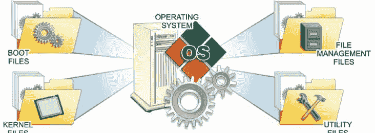

**图 8.2** 基本操作系统文件结构

操作系统充当应用程序与计算机硬件之间的桥梁，如图 8.3 所述。这些应用程序使用户能够创建与特定应用相关的数据文件，例如文字处理、多媒体传输、远程数据通信、业务处理和用户编程语言。

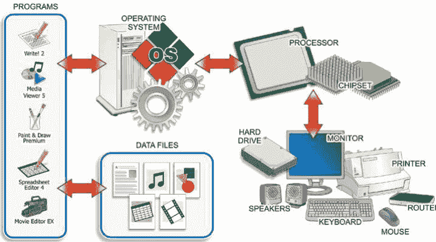

**图 8.3** 操作系统在计算机系统中的位置

由于操作系统是通往计算机应用程序和数据电子网关的主要部分，你必须了解可用的不同一般类型操作系统，以及可用于保护它们的方法和技术。为了便于讨论，让我们根据它们所扮演的角色，将用于计算和智能控制设备的计算机操作系统分为三大类：

- **独立操作系统** – 这些操作系统可以在没有外部通信或管理的情况下独立运行。此类操作系统包括在消费类计算机上发现的不同 Windows、Mac 和基于 Android 的版本。然而，这一名称也适用于工业和制造应用中使用的许多智能控制设备的操作系统。

虽然这些操作系统版本可以独立运行，但大多数现代版本都具备一定的网络功能，允许它们与其他智能设备或互联网通信。

- **客户端操作系统** – 客户端操作系统设计用于网络环境。特别是，它们被设计为利用称为*服务器*的主计算机提供的服务。虽然服务器计算机负责通过各种网络服务对客户端计算机进行监督和控制，但用户通常不在这些计算机上工作。相反，客户端计算机和设备充当工作站或自治节点。网络客户端分为三个一般子类别：

- **胖客户端** – 这些是全功能的 PC 和设备，可以在本地工作，但依赖网络服务器提供的服务。数据通常存储在胖客户端的本地。

- **瘦客户端** – 这些是全功能的 PC 和设备，但没有用于存储的硬盘驱动器。操作系统仅用于启动系统，然后将其操作交给服务器。所有数据和程序都存储在服务器上并在服务器上执行。

- **终端客户端** – 这些是依赖服务器的 PC 和设备，客户端上不存在操作系统。相反，客户端实际上启动到远程服务器，所有程序和数据都位于服务器上并在服务器上执行。


- **服务器操作系统** – 这些操作系统设计用于运行在专用服务器计算机上，后者作为客户端/服务器网络环境的中心。服务器操作系统版本通常负责：
  - 网络及其设备的 数据和资源安全
  - 集中式网络管理
  - 为企业或机构带来的成本效益
  - 服务器操作系统通过控制对以下内容的访问来为网络及其客户端提供安全保障：
    - 资源（磁盘驱动器、打印机、目录和文件）
    - 服务（电子邮件、互联网连接、即时通讯服务、数据库等）
    - 管理工具（用户账户、本地和网络实用程序、计算机管理工具）

## 网络操作系统

网络操作系统（NOS）旨在扩展磁盘操作系统的控制，以提供通过通信媒体连接的计算机之间进行通信和数据交换的功能。值得注意的网络操作系统包括 Windows Server OS 版本、Linux 服务器发行版和 Unix。

服务器操作系统是网络环境中负责安全的主要工具之一。这些操作系统及其安全工具将在第 14 章中深入探讨。本章的其余部分涉及可在本地独立或客户端计算机级别实施和可用的安全工具。

值得注意的独立或客户端磁盘操作系统包括：Microsoft Windows 版本、Apple Computer 的 MAC OS X、各种 Linux 操作系统发行版，以及 Google 的 Android 操作系统。

- 操作系统及其控制的程序和数据来自两个常见区域受到攻击：
  - 通过操纵 OS 内核的运行
  - 通过攻击其文件管理系统

以下各节针对这两个常见的攻击区域。

## OS 内核安全

图 8.4 说明了 OS 内核在系统硬件和应用程序之间的位置。由于这种定位，很明显，如果你能够访问 OS 内核中的编程代码并禁用它，你就禁用了整个计算机系统的运行。然而，如果你能够访问内核并操纵代码，你就接管了计算机的运行。

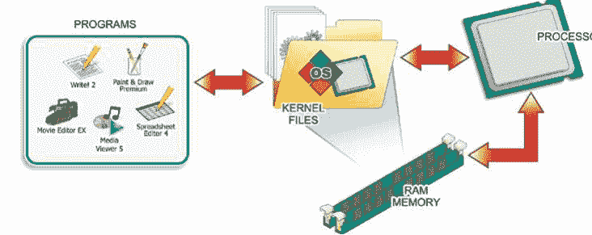

图 8.4 内核的位置

攻击者如果对给定操作系统的内存处理策略有足够的了解，可以以多种不同的方式利用 OS 内核：

- 他们可以更改内核编程中变量的值以改变其行为。
- 他们可以更改某些标准 OS 函数的返回地址，以便当 OS 试图返回到其基本指令流水线时，它被重定向到攻击者提供的代码中。
- 他们可以更改程序中的指针，该指针将指令代码的执行定向到攻击者提供的异常处理程序。
- 他们可以将恶意代码插入到已加载到 RAM 内存中以供执行的应用程序代码中。插入的代码旨在覆盖与应用程序交互的内核组件。

所有这些攻击都依赖于获得对计算机内存中 OS 内核运行的特定区域的访问权限。

大多数操作系统利用内置于微处理器硬件中的一项功能来保护包含特定指令代码块的某些内存区域。该功能被称为 *No eXecution (NX) 位*，或 eXecute Disable (XD) 位。NX 位技术用于将某些内存区域标记为仅存储。

任何标记为 NX 属性的内存部分意味着它仅用于存储数据。因此，处理器指令不能存储在那里。这是防止恶意软件通过将代码插入到另一个程序的数据存储区域然后从该区域运行该代码来接管计算机的流行技术，就像缓冲区溢出攻击一样。

一些操作系统随附内置的可执行空间保护功能，被称为数据执行 prevention（DEP）模式，以击败这些类型的攻击。操作系统通过为机器上运行的每个应用程序创建唯一的、隔离的内存区域来实现这一点。每个隔离的内存区域都成为由微处理器的虚拟内存管理模块管理的虚拟环境。

在 Unix、类 Unix 和 Linux 操作系统中，此功能作为其标准 chroot 操作的高级实现提供（其用于创建和管理操作系统的多个虚拟化副本的系统）。

## 文件系统安全

*文件管理系统* 在保护存储在硬盘或可移动存储设备上的数据的存在和完整性方面极为重要。如果文件系统被破坏或损坏，数据将无法访问并丢失。此外，如果未经授权的用户获得对文件系统及其存储数据的访问权限，他们就获得了破坏、销毁或窃取数据的机会。

保护文件系统及其数据的主要工具之一是使用访问控制列表（ACL）来提供资源访问控制。文件管理系统使用 ACL 来授予或拒绝特定用户访问其不同文件的权限，以及控制在获得访问权限后个人可以执行哪些类型的活动。例如，你可能被赋予运行文件、读取它、写入它或在文件管理系统的控制下对其执行其他操作的权限。

操作系统的 ACL 也用于控制对诸如 TCP/UDP 端口以及 I/O 设备等其他对象的访问。它们的 ACL 表维护记录，标识每个用户对特定系统对象的访问权限。

根据操作系统的不同，资源访问控制可以以强制访问控制（MAC）或基于角色的访问控制（RBAC）的形式实现。Unix 和 Linux 系统通常提供 MAC 方法，而 Microsoft 的 Windows 平台提供 RBAC 控制。

## POSIX（可移植操作系统接口）

POSIX（可移植操作系统接口）是一套互操作性标准，旨在标准化 Unix 和类 Unix 操作系统的变体。POSIX 兼容系统（Unix、Linux 和 Apple OS X 系统）支持某种类型的 ACL 来管理传统的 Unix 文件访问权限。

在 MAC 版本中，操作系统根据管理员的策略配置设置采取行动，以确定谁可以做什么以及可以做到什么程度。在 RBAC 下，系统根据用户在组织中的角色限制或允许对对象的访问。RBAC 结构通常是在大型企业中采用的访问控制方法。

在 Microsoft Windows 环境中，这些功能以权限的形式分配给文件夹和文件。权限也可以定义为执行操作的特权。在 Unix 和 Linux 系统中，用户被分配对文件的访问权限。

保护数据的另一个工具是对其进行加密，以便在没有解密密钥的情况下变得无法使用。加密/解密过程可以在数据存储和从设备检索时执行（PR.DS-1，静态数据）或在数据从一个位置移动到另一个位置时执行（PR.DS-2，传输中数据）。

## 主要网络安全指南

NIST 关键基础设施网络安全改进框架为保护“静态数据”（PR.DS-1）和保护“传输中数据”（PR.DS-2）指定了保护策略。

大多数可用的主要磁盘操作系统都通过其文件管理系统提供某种类型的数据加密功能。根据操作系统的设计，加密可以应用于设备级别、磁盘（或卷）级别或文件和文件夹级别。第三方加密应用程序也可用于许多这些操作系统。


不同操作系统可用的数据加密服务将在以下章节中讨论。本章后面将详细介绍数据加密技术。

## 文件系统攻击

对操作系统文件系统进行的典型攻击包括：

- 使用竞争条件攻击
- 使用数据流隐藏文件
- 执行目录遍历

### 使用竞争条件攻击

当攻击者在多用户/多任务环境中利用连续事件的时序，在事件之间将恶意代码插入系统时，就会存在 *竞争条件*。

例如，当操作系统创建临时文件时，就会存在时间检查到使用时间（TOCTOU）条件。在操作系统检查该文件名是否存在的文件与实际写入文件之间的时间间隔内，攻击者执行程序，使用临时文件的名称保存恶意代码包。

恶意代码可能包含更高的访问权限，以便攻击者可以读取或操作文件，或者它可能包含指向脚本文件的链接，该脚本文件可授予访问存储管理员密码的密码文件的权限。

### 使用替代数据流隐藏文件

高级黑客使用此 NTFS 操作系统兼容功能来隐藏 rootkit 或其他黑客工具，以建立匿名基地来对系统发起攻击。

ADS 功能最初内置于 NTFS 中，以提供对苹果分层文件系统（HFS）文件系统的支持，该文件系统有时会将数据“分叉”到不同的文件中。然而，这种技术已被采用用于存储文件元数据并提供临时存储。

如前所述，黑客使用 ADS 功能来隐藏他们的工具，因为使用原生用户界面几乎不可能检测到。

在隐藏的 ADS 文件嵌入到某些标准操作系统文件后，它们可以在不被检测为非法操作的情况下执行。ADS 操作的唯一迹象是文件上存在非法时间戳，该文件已被注入隐藏工具。

### 执行目录遍历

这些攻击利用安全性不佳的软件应用程序来访问本不应访问的文件，以便“遍历”到更高级别的文件夹或目录，如图 8.5 所示。此类攻击也称为 *回溯*、*目录攀爬攻击* 或 *规范化攻击*。

黑客使用这种形式的 HTTP 利用来访问 Web 服务器的目录树。在黑客获得访问权限后，他们可以导航树以查看受限文件或在服务器上执行命令。此类攻击使用常见的 Web 浏览器针对配置不佳的 Web 服务器发起。

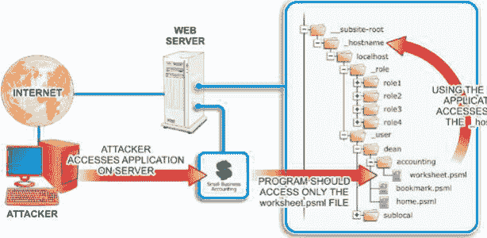

**图 8.5** 目录遍历

这些攻击可以通过仔细的 Web 服务器配置、过滤 Web 浏览器输入以及使用漏洞扫描软件来最小化。

以下部分比较并总结了最广泛使用的操作系统的关键结构和安全功能。此比较涉及操作系统的版本、内核架构、文件管理系统以及原生数据加密功能。

## Microsoft Windows

微软的 Windows 系列操作系统为个人计算机提供了最广泛使用的桌面操作系统。Windows 是一种基于图形用户界面（GUI）的操作系统，使用户能够通过一系列弹出窗口和菜单在系统中导航。

- Windows 客户端版本 – Windows XP、Windows Vista、Windows 7、Windows 8 和 Windows 10
- Windows Server 版本 – Windows Server 和小型企业服务器（SBS）版本 2003、2008、2012 和 2016

所有 Windows 操作系统都设计为可与来自 Intel、AMD 和 VIA 的 x86 32 位和 x86 64 位处理器类型一起使用。Windows XP SP2 之后和 Windows Server 2003 之后的 Windows 操作系统支持某些 32 位 x86 处理器上的 XD 位操作，以及提供 NX 位支持的 64 位 x86 处理器。

Windows 操作系统支持以下基本文件系统格式：

- FAT/FAT16/FAT32 – 文件分配表系列文件管理系统是基于集群的旧文件管理系统版本，最初开发用于管理软盘上的数据存储。由于其在 Microsoft DOS 和早期 Windows 版本中的广泛使用，它已经发展并一直使用至今。
- FAT 标题中的数字代表跟踪磁盘上数据集群位置的表项中的位数。原始 FAT 标准采用 12 位表项，可以跟踪 4096（1 × 2^12）个表项的位置。FAT 文件系统仍常见于 USB 存储设备、SD 卡和其他闪存设备，以及许多其他便携式和嵌入式设备。FAT 文件系统版本为其结构中存储的数据提供的安全工具相对较少。
- NTFS – 新技术文件系统是微软专有的、默认的文件管理系统，用于其操作系统。NTFS 带来了增强的安全功能，包括访问控制列表（ACL）和加密文件系统（EFS）。
- ISO 9660（CDFS）– 压缩光盘文件系统是光盘存储的标准文件管理系统。
- UDF – 通用磁盘格式是 CDFS 文件管理系统的继任者。特别是，它广泛用于 DVD 和先进的光学存储设备。

Windows 操作系统通过其加密文件系统（EFS）功能提供文件和文件夹级别的加密。完整磁盘级别的加密在某些高端 Windows 操作系统版本中通过名为 BitLocker 的原生实用程序提供。这些实用程序将在本章后面详细介绍。

Microsoft Windows 操作系统提供集成的 Windows 防火墙功能，使本地管理员（或所有者）能够建立和配置本地防火墙，以通过称为 *数据包过滤* 的过程控制信息从外部网络连接流入和流出本地主机计算机的流程。

## 本地和基于网络的防火墙

本地防火墙的操作将在第 9 章中介绍。网络基于防火墙旨在控制数据流入和流出网络的流程，将在第 12 章中讨论。

## Unix

Unix 系列操作系统提供模块化、多任务、多用户操作系统环境，最初开发用于在大型机和小型计算机上运行。Unix 操作系统的专有版本包括几个 BSD（伯克利软件发行版）变体，以及苹果的 OS X 和 iOS 操作系统。几个值得注意的类 Unix 操作系统已从基本 Unix 操作系统派生出来，包括多个 Linux 发行版。

不同的 Unix 操作系统版本已设计为可与多种不同的微处理器一起使用。同样，不同的 Unix 操作系统版本提供对多种不同文件系统格式的支持：

- UFS – UNIX 文件系统是为原始 UNIX 操作系统设计的第一个结构，并继续在 UNIX 及其衍生产品中使用。该文件系统标准的结构呈现出统一的树形结构，从称为根（/）的主目录开始。
- NFS – 网络文件系统由 Sun Microsystems 开发，使客户端计算机能够跨网络访问文件。由于 NFS 被开发为开放协议标准，任何公司都可以（并且已经）将其纳入其自己的受支持协议套件中。它主要用于 UNIX 操作系统版本，但也得到 Microsoft Windows 和苹果 Mac OS 的支持。


一些 Unix 操作系统内置了加密文件系统功能。Unix 操作系统中作为标准部分包含的最初加密工具是 *crypt*。然而，这个工具被认为是一种功能非常弱的加密工具，相对容易被破解。因此，它并没有被广泛使用。数据加密标准（DES）是一种更强的加密工具，用于许多 Unix 发行版。Pretty Good Privacy（PGP）是另一种广泛使用的 Unix 加密工具。该工具同时支持私钥和公钥的加密/解密，并提供了一种非常强大的数据安全方法。

基于 Free BSD 内核的 Unix 发行版通过 PEFS、GELI 和 GBDE 实用程序提供加密服务。私有加密文件系统（PEFS）是一种基于文件的加密系统。GELI 和基于 GEOM 的磁盘加密（GBDE）是磁盘级别的加密实用程序。另一个用于其他 Unix 或类 Unix 操作系统的著名加密工具是 EncFS。

FreeBSD 和 OpenBSD 发行版还提供了多种内置防火墙实用程序，用于控制数据流入本地计算机。这些选项包括 ipfirewall（ipfw）、IPFilter 和 Packet Filter（PF）。与前面提到的集成 Windows 防火墙一样，这些应用程序使本地计算机能够通过称为 *数据包过滤* 的过程来控制传入和传出数据的流动。本地防火墙和数据包过滤将在本章后面详细讨论。

> **关于加密工具的一点说明**
> 
> 许多国家已制定法律禁止使用强加密。因此，不同的操作系统可能会因销售地点不同而提供或不提供不同的加密工具。

## Linux 操作系统发行版

许多个人电脑用户运行的是一个名为 Linux 的自由分发、开源操作系统版本。Linux 是一个非常强大的命令行操作系统，可用于各种硬件平台，包括 Windows PC 和 Apple Mac 系统。

一个程序员社区与 Linux 监督委员会合作，不断升级和增强 Linux 的基本结构，使其保持领先和竞争力。此外，一些公司开发了专有的加密服务，可在单个文件或目录上应用，而无需显著的磁盘管理开销。

Linux 发行版通过一个名为 Netfilter 的内核实用程序提供内置的本地防火墙功能。除了为本地防火墙实现提供数据包过滤外，该实用程序还通过称为网络地址转换（NAT）和端口地址转换（PAT）的过程提供额外保护，用于在网络中引导数据包，同时对外部网络的主机屏蔽私有 IP 地址。

## Apple OS 版本

Apple Inc. 生产的个人电脑在本质上与 PC 不兼容。它们具有截然不同的硬件设计，并且不能直接运行为 Win/PC 环境开发的软件包。

所有较新的 Apple Mac 电脑都运行在一个名为 Apple OS X 的专有 Unix 版本上。虽然 OS X 的结构基于 Unix，但系统的用户交互部分采用了 Apple 标志性的基于 GUI 的桌面。这赋予了 Mac 一个非常强大而稳定的引擎，以及非常友好的用户界面：

- Apple 客户端版本：macOS、OS X 和 Mac OS X
- Apple 服务器版本：macOS Server、Mac OS X Server 和 OS X Server

macOS 被设计用于支持 Intel、Cyrix、VIA 和 AMD 的 x86 和 x86 64 位微处理器类型，以及 IBM 和 Motorola 的 PowerPC 处理器。这些微处理器都支持 NX-bit 功能，以保护内存的某些区域免受病毒操纵。

macOS 支持前面描述的 ISO9660、FAT、NFS、UFS 和 UDF 文件系统格式。此外，不同的 macOS 版本还提供对以下 FMS 标准的支持：

- HFS/HFS+ – 分层文件系统是 Apple 专有的文件系统，作为其使用 macOS 的 Mac 电脑系列的主要文件系统而开发。它也用于 Apple 的 iPod 音乐设备系列。对更新版 HFS+ 的支持已包含在非 Apple 操作系统中，包括 Linux 内核和 Windows（包括 Apple 的 Xbox 360 游戏机中的支持）。
- SMBFS/CIFS – 服务器消息块文件系统，也称为通用 Internet 文件系统，是为了提供对文件和设备的共享访问以及网络通信而开发的。在 Active Directory 出现之前，该 FMS 主要用于运行 Windows 的计算机。然而，对更新版 SMB 版本的支持一直延续到所有当前的 Microsoft 操作系统版本，并且还进入了多个非 Microsoft 操作系统。

Apple macOS 操作系统通过名为 FileVault 的服务提供基于磁盘级别的数据加密；FileVault2 macOS 用户还可以使用内置磁盘工具来加密其磁盘并存储其主目录的子集。

## iOS

iOS 是 Apple 专有的移动操作系统，旨在支持 Apple 的 iPhone 和 iPad 产品线。虽然 iOS 与 macOS 共享许多结构，但它与 macOS 应用程序不兼容。

iOS 被设计用于支持 Acorn RISC Machines (ARM) Ltd 公司的精简指令集计算（RISC）处理器类型。这些设备比其 x86 复杂指令集计算（CISC）竞争对手消耗的能量显著更少，产生的热量也少得多。这使得 RISC 处理器自然适用于小型电池供电设备，如手机、平板电脑和 pad。从 ARMv6 版本开始，该架构支持了 Execute Never（XN）页面保护功能。

iOS 系统包含集成的设备级文件加密，以在运行设备丢失或被盗时保护数据。它还提供了防止未经授权的用户使用或修改数据的保护。除了其硬件加密功能外，iOS 还提供了一种称为 Data Protection 的基于类别的工具。使用此保护工具，每次数据写入设备的闪存结构时都会创建基于文件的加密密钥。

## Android OS

Android 操作系统是为主要使用触摸屏手势进行操作和控制的平板电脑和智能手机设备而开发的。由于其在众多智能手机和平板设备中的使用，它目前是最流行的移动操作系统，如图 8.6 中的图表所示。

- ► JFFS2 – Android 默认日志闪存文件系统（版本 2）。此 FS 版本取代了 YAFFS2（Yet Another Flash File System）作为早期内核版本中使用的 Android 默认闪存文件系统。
- ► Ext2/Ext3/Ext4 – Linux 扩展文件系统的版本，取代了 F2FS 和 JFFS2 作为 Android 内部闪存设备的文件系统。

除了这些闪存文件系统之外，Android 设备通常还支持 Microsoft 文件分配表（FAT）文件系统（FAT12、FAT16 和 FAT32）及其 VFAT 扩展。

Android 操作系统提供基于名为 dm-crypt 的实用程序的磁盘加密，用于将数据存储在设备的闪存设备上。该实用程序是 Android Linux 内核的一个组成部分。

## 操作系统安全选择

由于其普及性，Microsoft Windows 是恶作剧和恶意软件及灰色软件（令人讨厌的不需要的软件）作者的最大目标。因此，Windows 承受了所有与病毒和间谍软件相关的攻击中无与伦比的比例。

这一事实导致一些 Windows 客户采用了其他操作系统平台，如 Linux 或 macOS，这些平台成为恶意软件目标的可能性要小得多。表 8.1 总结了与各种操作系统相关的一些常见安全功能。

表 8.1 操作系统安全比较

| 名称 | 资源访问控制 | 子系统隔离机制 | 集成防火墙 | 加密文件系统 | 禁止执行（NX） |
| Linux | POSIX、ACL、MAC | chroot、基于能力的安全、seccomp、SELinux、AppArmor | Netfilter，因发行版而异 | 是 | 硬件/模拟 |
| macOS | POSIX、ACL | chroot、使用 chflags 设置的 BSD 文件标志 | PF | 是 | 硬件/模拟 |


| 名称 | 资源访问控制 | 子系统隔离机制 | 集成防火墙 | 加密文件系统 | 不可执行 (NX) |
|---|---|---|---|---|---|
| Windows Server | ACLs, privileges, RBAC | Win32 WindowStation, desktop, job objects | Windows Firewall | Yes | Hardware/ Emulation |
| Windows | ACLs, privileges, RBAC | Win32 WindowStation, desktop, job objects | Windows Firewall | Yes | Hardware/ Emulation |

## 常见操作系统安全工具

系统启动后，可以采取措施防止未经授权的人员访问操作系统及其应用程序。这些措施包括：

- 实施本地登录要求
  - 建立用户和组账户
  - 设置密码策略
  - 建立锁定策略
- 实施额外的身份验证选项
  - 使用生物识别身份验证设备
  - 使用物理身份验证设备
- 使用本地管理工具
  - 启用系统审计和事件日志记录
  - 实施数据加密工具
  - 监督应用程序软件安全
- 提供远程访问保护
  - 建立防火墙设置
  - 配置浏览器安全选项
- 建立并实施恶意软件保护
- 应用安全更新和补丁

图 8.7 显示了 Microsoft Windows 控制面板中可用的本地安全策略/安全设置选项。第一组选项包括密码和账户锁定策略选择，用于本地控制对系统的访问。您还可以为系统审计、用户权限和安全策略实施本地管理员策略。

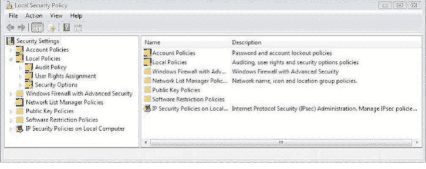

**图 8.7** 本地安全策略/安全设置

Windows 防火墙和高级安全工具使本地管理员（或所有者）能够建立和配置本地防火墙，如前所述。图 8.7 中显示的其余工具是安全工具，可用于建立本地策略，以控制本地计算机与外部网络的交互。在以下各节中，您将学习如何为最佳本地主机安全实践实施它们。

## 关于安全工具的一点说明

> 从图 8.7 中工具的快速浏览可以看出，这些策略旨在控制本地计算机与外部网络的交互。虽然这些工具是本地的，但它们也在网络环境中使用。在某些情况下，本地和网络管理策略都涵盖相同的<|message|> 元素。在这些情况下，如果它们配置冲突，网络策略将覆盖本地策略。

## 实施本地登录要求

与个人计算设备一起使用的主要用户身份验证工具是用户名和密码登录。一般来说，有三种类型的用户相关登录需要处理：

- 登录到本地机器
- 登录到特定的软件应用程序
- 网络登录

在本地计算机级别，通常需要本地登录。此级别的登录验证用户使用本地计算机资源（文件和设备）的资格。然而，在共享计算机环境中，多个用户可能被允许使用同一台计算机，本地用户和组凭据是通过存储在本地计算机上的用户账户数据库创建和配置的。

## 关于本地登录的一点说明

在网络环境中，网络登录通常取代并替代本地登录选项。此登录级别确认用户访问远程资源的凭据。

这些凭据用于获得对计算机的初始访问权限，控制对其本地资源的访问，并控制对网络资源的访问。在 Windows 环境中，这些账户是通过计算机管理下的本地用户和组实用程序创建和管理的，如图 8.8 所示。

独立系统首次启动时，管理员账户会自动在操作系统的本地账户数据库中创建。管理员拥有对系统所有硬件和软件资源的权利和权限。管理员随后创建其他用户，然后根据需要授予他们权利和对系统资源的权限。

管理员可以单独处理用户，也可以将用户聚集到可以统一管理的组中。这样，管理员可以对个人或整个组分配权限或限制。使用组的价值在于，通过能够将通用权利应用于多个用户而不是逐个应用，可以节省时间。

密码的宽度与可以包含的不同字符类型的数量有关，包括不属于字母表的字符。数字、特殊字符以及大写和小写字母的组合使密码更强，尤其是在操作系统将大写和小写字母视为完全不同字符时。

密码可以包含控制字符、替代字符，甚至在某些操作系统中包含空格。理想情况下，在要求用户创建强密码时，应从以下所有字符集中提取。

- 大写字母，如 A、B、C
- 小写字母，如 a、b、c
- 数字，如 1、2、3
- 特殊字符，如 $、?、&
- 替代字符，如 @、%

密码的深度涉及猜测其含义的难度。虽然好的密码应该易于记忆，但它仍然应该难以猜测。多年来，总体前两名的密码一直是“123456”和“password”。攻击者也知道创建密码时使用的常见术语和技术，例如附加和替换。

*附加* 是将一组字符添加到另一组字符末尾的行为（example123）。*替换* 是使用一组字符替换另一组可预测字符（ex@mple）。密码的含义不应该是可以通过简单推理轻易猜出或推断出来的。似乎效果很好的一种方法是考虑短语而不是简单单词。

助记短语经常被纳入其中，允许创建难以猜测但又无需写下来即可记住的密码。助记短语可以拼写为语音，例如使用“UraTygr!”代替“You’re a tiger!”。或者，可以将难忘短语中每个单词的首字母纳入其中，例如“I mybtf”，它缩写自“I have not yet begun to fight!”

另一种有效的方法是选择一个有意义且易于回忆的短语。然后，可以将短语中某些单词的缩写转换为替代字符。例如，数字“4”可以在使用字母“f”的地方进行替换。

## 额外的密码安全

随着诈骗者继续窃取密码变得越来越容易，对额外密码安全的需求变得更加被认可。密码最终就像简单地索取它们一样容易被收集。人员绝不应该与任何人谈论密码，无论这些对话看起来多么无害或合法。

虽然标准密码保护实践可能足以抵御一些潜在入侵者，但某些情况需要更复杂的方法。在这些情况下，可以通过使用加密技术和一次性密码（OTP）提供额外保护。

*密码加密* 是将标准密码取出来并对其应用算法的过程，使其对嗅探器、破解者或其他窃听者来说毫无意义。双因素身份验证，如一次性密码，仅对一次交易有效，但增加了另一层宝贵的安全性。

最佳密码实践包括以下内容：

- 在整个组织中使用一致的命名约定，以便用户能够理解自己的密码，而不会诉诸记录它们以便他人找到。
- 始终为账户提供密码，并在首次登录时要求用户更改它。
- 保护密码（不要在公开空间写下来）。
- 不要使用默认密码。
- 教育用户创建强密码。
- 在组织的各个层级强制执行密码策略。

## 保护密码

真正的密码安全涉及用户保护其密码不被他人获取。

## 账户锁定策略

操作系统提供密码锁定策略设置，使管理员能够实施防止攻击者反复尝试的密码策略


to access the system. This prevents the attackers from using brute force attacks to guess the account password so they can break into the system.

*Brute force attacks* involve the repeated use of login attempts to try to guess the password. As shown in Figure 8.9, typical lockout policy settings include:

- **Account Lockout Duration** – How long (in minutes) the account will be locked out before it automatically unlocks. Setting this value to 0 will prevent the account from unlocking until the administrator manually resets it.
- **Account Lockout Threshold/Max Failures** – How many times account access can be attempted before the account is locked out. The default value for this setting is 0, which disables the account lockout function.
- **Reset Account Lockout Counter After/Lockout Duration** – The amount of time that can pass before the account lockout value is returned to 0.

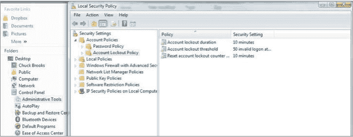

**FIGURE 8.9** Windows Lockout Options

## Computer Locking

Users should never leave their computer unattended after they have logged on. Doing so opens the door for others to access and manipulate their computer, data, and network. All users should be trained to either log off or lock their computers when they are away from them, even if only for a few minutes.

Locking the computer protects it from intruders and preserves the current system state. When the computer is unlocked, the applications and data that were active in the system are still open, making it much easier for the user to pick up where they left off.

Users should also be instructed to make sure they log off at the end of the day. This closes all applications and ensures that data files are saved.

## Implementing Additional Authentication Options

Recall from Chapter 2 that authentication is defined as the process of determining that someone is who they say they are. At the local computing or control device level, authentication can be implemented in terms of physical or biometric authentication systems to replace or augment password authentication methods.

## Physical Authentication Devices

There are hardware devices that can be used to make personal computer systems unusable by people other than authorized users. These devices include items such as smart cards and biometric devices similar to the ones described in the preceding chapter. However, unlike the devices designed to protect access to physical infrastructure, these devices are designed specifically to be used with personal computing systems.

### USING SMARTCARDS

Some organizations issue their employees smart cards that they can use to get into their buildings, log on to their PCs, and access appropriate applications with a single security device.

The card system combines the users’ secret PINs (i.e., something the users alone know) with tokens generated by the network’s Certificate Authority authentication system to generate a unique pass code. The pass code validates the user and their access to different resources.

## Biometric Scanners for Personal Computing Devices

As discussed in Chapter 2, biometric scanners are becoming significantly more sophisticated, including facial scanning devices, searchable databases, and supporting application programs.

In addition to serving as authentication devices for facility access, many biometric scanning devices have evolved for use with personal computers. However, the biometric authentication device most widely used with personal computers is the fingerprint scanner. Figure 8.10 shows different fingerprint scanner devices designed for use with PCs.


**FIGURE 8.10** Fingerprint Scanners

Some fingerprint scanner manufacturers offer miniature touchpad versions that sit on the desk and connect to the system through a cable and USB connector. Other fingerprint scanners are built into key fobs that simply plug directly into the USB port. Some manufacturers even build these devices into the top of the mouse.

Some models actually store the scanned images and account access information on the device. This allows the identification file to travel with the user if they work with different computers at different locations.

After the fingerprint scanner software has been installed and configured, the password manager will prompt you to scan in your fingerprint rather than type a password on future log-in attempts.

## Using Local Administrative Tools

All of the different operating systems discussed previously offer management tools to control who, when, and how the local computer is used. Collectively, these tools are referred to as *administrative tools* (in Microsoft Windows OS versions, the Control Panel applet where these tools are configured and launched is titled “Administrative Tools”).

These tools typically include programs designed to control the usage of the computer’s memory, administer and optimize hard-disk-drive usage, configure OS services running on the computer, control the hardware/OS handoff during startup, and troubleshoot operating system problems. However, in each case there is a subset of these management tools dedicated to security-related functions. In the following sections, we will investigate common security-related OS tools and their implementations.

## Event Logging and Auditing

*Auditing* is a security function of the operating system that enables the user and operating system activities performed on a computer to be monitored and tracked. This information can then be used to detect intruders and other undesirable activities.

These entries provide a fundamental tool for unauthorized-intrusion-detection efforts. There are two common types of audit records to consider:

- ► Native audit records – Event records generated by most modern multiuser operating systems. Because these records are already being generated by the operating system, they are always available, but they may not contain the desired events or be in a readily usable form.
- ► Detection-specific audit records – Records generated to provide specific information about desired actions or events. These actions or events can be based on operating system activities, application events, or security events.

The auditing systems available with most operating systems consists of two major components:

- ► Audit policy (or audit rules), which defines the types of events that will be monitored and added to the system’s security logs
- ► Audit entries (or audit records), which consist of the individual entries added to the security log when an audited event occurs

## Windows Auditing Tools

In a Microsoft Windows environment, audit entries are maintained in the security log file. Figure 8.11 shows a typical security log displayed in the Windows

Selecting a policy to be configured in the right pane will produce the Local Security Setting window, depicted in Figure 8.13. Place check marks beside the option or options that should be tracked and audited. You can check Success, Failure, or both.

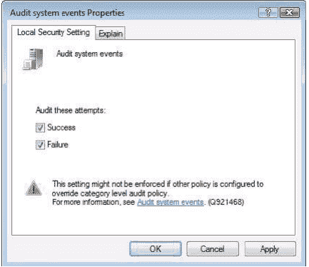

FIGURE 8.13 Establishing a Local Security Policy Setting

In Windows, auditing must be configured both as a general system policy setting and on each object (file, folder, and printer) that requires auditing. With this in mind, when you are configuring an audit policy, you must consider what effect the policy will have on the system and its performance. If you were to set up auditing on every file, folder, and printer in a system, the auditing process would place so much extra work on the system that the system could literally slow to a halt.

## Linux Auditing

Linux systems also feature security auditing capabilities for tracking specified security events. Figure 8.14 provides a generic representation of a Linux security auditing framework. As with other auditing systems, the Linux modules map computer processes to user IDs so that administrators can trace exploits to the specific user who owns the process and is performing potentially malicious activities in the system.


## 图 8.14 Linux 审计

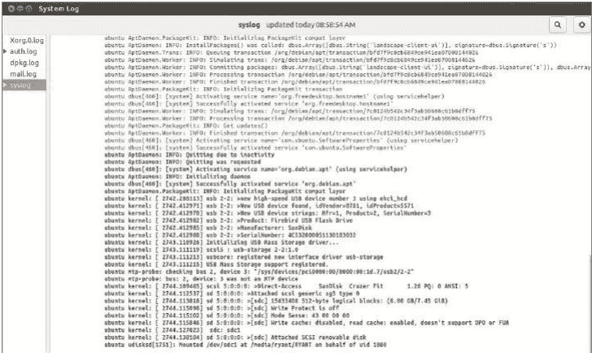

系统的核心是审计守护进程，它与 Linux 内核的审计模块协同工作，记录相关事件并将它们写入磁盘上的日志文件。审计规则配置在一个文件中，该文件在系统启动时执行。审计控制器实用程序使用这些规则中的参数来确定跟踪哪些系统事件以及如何将它们写入审计日志文件。

当应用程序遇到触发预配置审计事件的情况时，会向内核的审计接口呈现一条消息并传递给审计控制器。在审计控制器的指导下，审计守护进程将事件写入审计事件日志。

Linux 审计系统还包括一个报告生成工具，管理员可以使用它生成自定义安全报告。它还可能包含一个搜索实用程序，用于快速/具体地检查日志条目以查找特定事件。

与 Windows 组策略配置一样，您必须考虑希望 Linux 审计系统对计算机执行的审计级别及其运行后果。

个人计算机系统的磁盘加密可以在软件或硬件级别执行。在软件级别，磁盘加密技术可通过大多数主要磁盘操作系统版本以及第三方供应商获得。

磁盘加密软件运行在操作系统的设备驱动程序和更高级别的应用程序之间。对于大多数情况，计算机程序和指定用户都不知道加密/解密过程正在进行。图 8.16 说明了加密/解密过程的简化版本。

在初始磁盘加密过程中会生成加密密钥并存储在系统上。此密钥以加密格式存储，需要密码或密码短语才能解密。当用户提供密码或密码短语时，系统会将解密密钥应用于数据，将其解锁以供计算机的应用程序使用。当生成新数据时，它在存储到磁盘驱动器之前会被加密。

## 硬件级磁盘加密

许多计算机主板设计都包含一个内置微芯片，称为可信平台模块（TPM），用于存储加密信息，例如加密密钥。存储在 TPM 上的信息比外部软件攻击和物理盗窃更安全。

该技术可保护操作系统和用户数据，确保即使计算机无人看管、丢失或被盗，也不会被篡改。这些操作系统中的加密管理器通过加密整个驱动器来防止访问硬盘驱动器。

如果计算机主板配备了兼容的 TPM 芯片，磁盘操作系统会使用 TPM 来锁定保护硬盘上存储的数据的加密密钥。密钥在 TPM 验证计算机启动期间的状态之前无法访问。

在计算机启动过程中，TPM 将从重要操作系统配置值派生的哈希代码与之前拍摄的系统快照进行比较。如果代码匹配，操作系统将释放解锁加密磁盘驱动器的解密密钥。这样做可验证操作系统的启动过程的完整性，如图 8.17 所示。如果 TPM 检测到操作系统安装已被更改，则不会释放密钥。

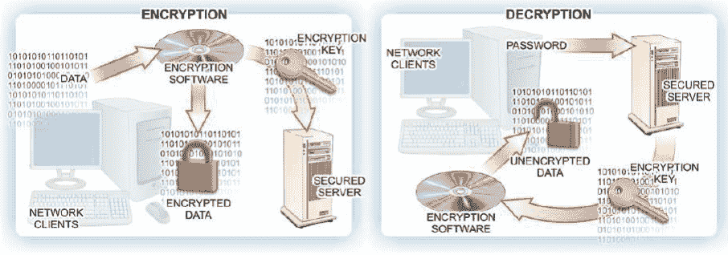

**图 8.16** 加密/解密过程

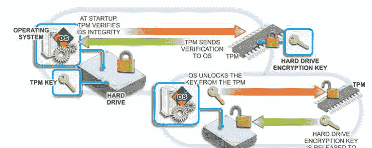

## 图 8.17 使用 TPM

理论上，如果计算机被盗，硬盘上的数据应该是安全的，因为操作系统不会允许访问硬盘。与此方法相关的一个问题是，如果主板出现故障并被更换，则需要该启动密钥的备份副本来访问硬盘上的数据。

## 移动 TPM 芯片

TPM 芯片不能从一个主板移动到另一个主板。

必须存在此驱动器才能解锁存储在卷上的数据。在这种情况下，建议您备份启动密钥。最安全的方法是要求每次启动计算机时都使用 PIN 或密码以及自动 TPM 过程。

## 备份启动密钥

请注意，如果 TPM 出现故障或所有启动密钥副本丢失或损坏，数据的恢复将变得非常困难。个人计算机用户必须确定他们的安全需求是否值得走这“额外的一步”来保护他们的个人电脑。然而，在企业环境中，这一要求通常由系统管理员决定。

## 操作系统 TPM 工具

在选定的 Microsoft Windows 操作系统中，有一个名为 BitLocker 的实用程序可用于启用主板的 TPM 模块。它与 Windows 协同工作以加密整个硬盘或硬盘驱动器（包括系统中的所有卷）。

BitLocker 实用程序有四种使用方式：
- BitLocker 与 TPM 芯片协同工作以存储 BitLocker 加密密钥。即使驱动器被移除，也能保护硬盘数据。正如所指出的，与此方法相关的一个问题是，如果系统板出现故障并被更换，则需要该 BitLocker 加密密钥的备份副本来访问硬盘上的数据。
- 如果计算机未配备 TPM 芯片，则必须在启动前将存储启动密钥的 USB 闪存驱动器插入系统。
- 启动密钥也可以用于拥有 TPM 芯片的计算机。与此方法相关的一个问题是用户倾向于将闪存驱动器留在计算机中。
- 最安全的方法是要求每次启动计算机时都使用 PIN 以及自动 TPM 过程。

Linux 操作系统也拥有工具来利用兼容主板的 TPM 加密功能。在这些系统中，有必要确认所涉及的 Linux 内核支持主板上的 TPM 版本。涉及 TPM 配置的三个内核模块是 tpm_bios、tpm 和 tpm_tis。通用的 tpm_bios 和 tpm 模块首先加载，然后使用特定参数加载 tpm_tis 模块。

有几种 Linux 软件工具可用于管理基于 Linux 的机器上的 TPM。Trousers 是一个开源守护进程，通过单个模块控制与 TPM 的所有通信。同样，TrustedGrub 模块能够检测并支持 Linux 系统中的 TPM 功能。它是 Grub 启动加载器的可下载扩展，已为此目的进行了修改。

当您初始化 TPM 时，模块会请求所有者密码和存储根密钥（SRK）密码，以便它可以生成加密密钥。所有者密码用于在系统上执行管理任务，而 SRK 则用于将密钥加载到 TPM 中。这些密钥必须维护，并且永远不能丢失，因为如果没有它们，继续访问系统几乎是不可能的。

## 文件和文件夹级加密

顾名思义，文件和文件夹级加密应用于单个文件和文件夹。文件和文件夹级加密工具使用户能够使用只有指定用户（或授权恢复代理）可以解码的密钥来加密驱动器上存储的文件。这可以防止没有密码或解码工具的人窃取数据。它大大增强了便携式计算机上文件的安全性，使用户能够指定文件和文件夹，以便它们只能使用正确的加密密钥访问。

这种类型的加密通常实现为可为指定文件或文件夹建立的属性设置，并与系统中的授权用户相关联。这些用户可以像打开任何普通文件和文件夹一样打开这些文件和文件夹。但是，如果有人未经授权访问计算机，他们将无法打开加密的文件或文件夹。

## Microsoft 文件加密工具

Windows 通过其加密文件系统（EFS）功能提供有效的本地硬盘安全性，如图 8.18 所示。

EFS 功能使用户能够使用只有指定用户（或授权恢复代理）可以解码的密钥来加密驱动器上存储的文件。这可以防止没有密码或解码工具的人窃取数据。

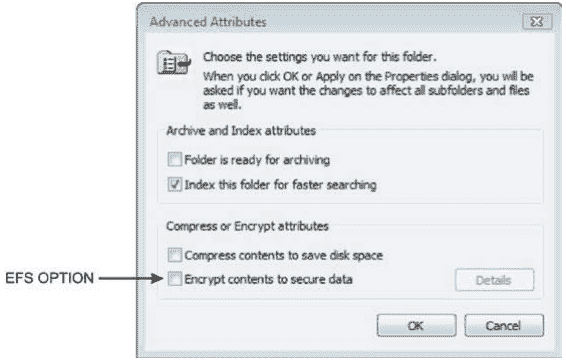

图 8.18 Windows 驱动器加密选项


Windows 用户可以实现 EFS 选项来加密 NTFS 驱动器上的文件和文件夹。为此，他们只需在文件或文件夹的“高级属性”窗口中勾选“加密内容以便保护数据”复选框。用户可以像打开任何普通文件或文件夹一样打开这些文件和文件夹。但是，如果有人未经授权访问计算机，他们将无法打开加密的文件或文件夹。EFS 使用简单，因为它实际上是可以为文件或文件夹建立的属性。

EFS 功能通过使用户能够指定文件和文件夹，使其只能使用正确的加密密钥访问，从而进一步增强了便携式计算机上文件的安全性。

> **关于 EFS 的说明**
> 
> EFS 防止文件被未经授权的用户访问，包括那些试图绕过操作系统并使用第三方实用程序访问的用户。它在保护信息时同时使用对称加密和非对称加密。

## 实践练习

## 目标

- 描述 NTFS 可用的权限。
- 设置并测试文件和文件夹权限。
- 验证用户帐户上设置的权限。
- 设置并测试文件/文件夹级别加密。

## 资源

- PC 兼容的台式机/塔式计算机系统
- 已安装 Windows 10 专业版
- 在您的 PC/工作站上设置 TestUser 帐户
  - 用户：TestUser1 密码：testuser1
- 用户：TestUser2 密码：testuser2
- 两个帐户都应设置为标准用户。
- 已安装 AxCrypt (https://www.axcrypt.net/download/)

## 讨论

新技术文件系统是 Microsoft 专有的、默认的文件管理系统，用于其操作系统。NTFS 带来了增强的安全功能，包括访问控制列表 (ACL) 和加密文件系统 (EFS)。

NTFS 权限可以在关联的访问控制列表中配置为“允许”或“拒绝”选项。这是自主访问控制列表的一个示例，其中被视为文件或文件夹所有者的用户选择 said 信息的权限。图 8.19 说明了 ACL。

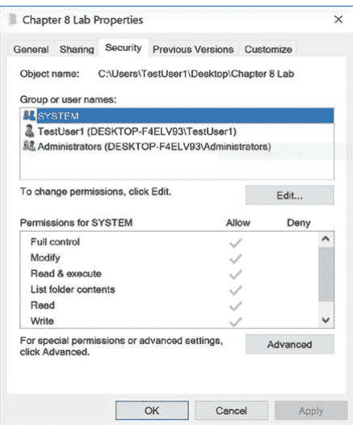

图 8.19 访问控制列表

在本实验中，您将管理和测试权限，并将使用 AxCrypt 探索文件级别的加密。请记住，这些程序提供了对权限的介绍。本实验将在本地主机计算机上探索权限管理。本实验不涉及共享权限、服务器权限、继承或 Linux 文件权限管理。您将为一组选定用户管理文件和文件夹权限。最后，您将测试各种权限设置，以更好地了解 ACL 的重要性和强大功能。

## 程序

## 设置和创建文件和文件夹

为了能够测试您将实施的 NTFS 权限，您必须首先成为文件和文件夹的所有者。文件的所有者有权允许或拒绝其他用户访问。

- 1. 打开计算机电源，如有必要选择 Windows 10 专业版登录。
- 2. 选择 TestUser1 登录，密码为 testuser1。
- 3. 登录后，右键单击 Windows 图标并选择文件资源管理器。
- 4. 在文件资源管理器窗口左侧，找到并单击 C: 驱动器。
- 5. 在中间窗格的任意空白处右键单击，然后将光标悬停在“新建”上以展开选项。单击“文件夹”选项。系统会提示您命名文件夹。输入 **Permissions Test** 作为名称并按 Enter。
- 6. 双击 Permissions Test 文件夹以访问其内容。在这里您将创建另一个特定于您的文件夹。
- 7. 右键单击空白区域并选择 新建 ➢ 文件夹。将此文件命名为 **Perm_Test_(在此处添加您的姓名缩写)**。例如：John Doe 将他的文件夹命名为 **Perm_Test_JD**。图 8.20 显示了在 Permissions Test 文件夹中准备的新文件夹。
- 8. 此文件夹应为空。右键单击任意空白区域并将光标移动到悬停在“新建”上。在这里您将选择 文本文档。将文件命名为 **test1** 并按 Enter。

9. 重复步骤 8 三次以创建文件 **test2**、**test3** 和 **test4**。

10. 这些文件中没有信息，因此通过双击打开每个 .txt 文档并在每个文件中输入 *This is a test. This is only a test.*。保存并关闭每个文本文件。

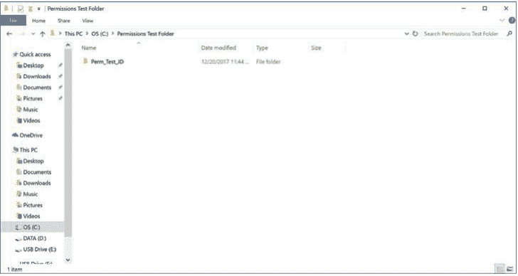

**图 8.20** Perm_Test 文件夹已创建

## 创建文件权限

在本节中，您将探索可用于限制特定用户访问您刚刚创建的文件和文件夹的选项。您可以通过 ACL 作为每个单独文件的一部分，防止特定用户或组执行、读取、写入和修改您认为重要的文件。这是通过 ACL 实现的。

- 1. 验证您是否在之前步骤中创建的 Perm_Test 文件夹内。右键单击 test1 并单击属性。这将启动 test1 属性窗口，如图 8.21 所示。属性窗口可能不包含示例中列出的所有选项卡。此时，您将使用的唯一必要选项卡是“安全”选项卡。
- 2. 单击“安全”选项卡。注意可用的权限类型并在表 8.2 中记录它们。此窗口是文件的关联访问控制列表。

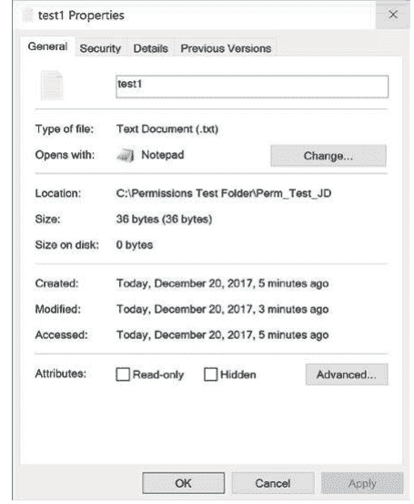

# 图 8.21 文件 test1 属性窗口

目前，对此对象授予或拒绝的唯一权限是与用户在其创建时成为成员的组关联的权限。为了限制特定用户对该文件的访问，您必须将他们添加到 ACL 并选择您希望他们拥有的权限级别。

# 表 8.2 test1 ACL 中可用的权限

|  |
|---|

- 3. 单击“编辑”以打开 test1 权限窗口。
- 4. 单击“添加”以导航到“选择用户或组”窗口。
- 5. 在“输入要选择的对象名称（示例）：”下，输入 TestUser2。单击“检查名称”以确认用户帐户。单击“确定”继续。

这是您可以在其中添加组以授予或拒绝与已知组相关联的任何人访问权限的相同窗口。组在网络环境中更好地利用；因此，您在本实验中不会设置或测试组权限。

请注意，用户 TestUser2 现在已包含在 ACL 中。在这里您可以为此用户在您创建的文件上的权限进行微调。默认授予的权限是允许“读取”和“读取和执行”。

- 6. 在“拒绝”列标题下，单击“写入”复选框。图 8.22 显示了分配给 TestUser2 的权限。

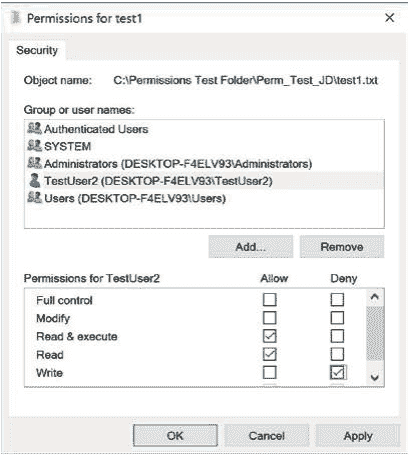

**图 8.22** 授予 TestUser2 的 Test1 权限

- 7. 单击“应用”按钮。阅读 Windows 安全提示，然后单击“是”。您将被引导返回到 test1 属性窗口。单击“确定”退出此窗口。

关于权限，有一些规则适用：

- ➤ *拒绝权限* 在大多数情况下优先于 *允许权限*。当拒绝权限应用于对象时，在本例中为 `.txt` 文档时，称为 *显式拒绝*。

- 3. 单击两个复选框以标记“记住此用于解密”和“用作加密的默认值”。窗口应与图 8.23 相同。

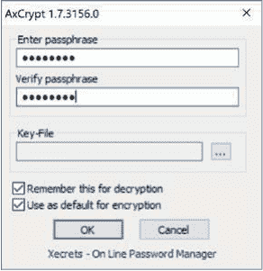

**图 8.23** 使用 AxCrypt 加密 test4 文件

- 4. 单击“确定”。您会注意到 test4 旁边的图标已更改，以及文件名和扩展名。如果您双击它，文件仍会正常在记事本中打开，内部数据相同。

## 设置文件夹权限

文件夹权限提供与文件权限相同的基本权限选择。这可能具有误导性，因为每个“允许”或“拒绝”的含义略有不同。例如，文件上的“允许 – 读取”选项允许打开并查看其内容。另一方面，文件夹上的“允许 – 读取”选项只允许指定用户列出文件夹的内容。后者可用于用户需要能够访问文件夹，但不能访问文件夹内的所有文件时。

- 1. 单击“后退”按钮，或在地址栏中单击 Permissions Test，以查看您创建的名为 Perm_Test_(您的 _姓名缩写_ here_) 的文件夹。
- 2. 右键单击该文件夹并单击属性。

注意权限选项。它们与文件权限相同，并包含一个额外选项：列出文件夹内容。

- 3. 单击“编辑”。
- 4. 单击“添加”并将 TestUser2 添加到文件夹的 ACL。此过程与您之前对单个文件执行的过程相同。返回到


如果需要复习如何创建文件权限，请参阅“创建文件权限”部分。

+   5. 该文件夹的默认权限为“允许 – 读取与执行”、“列出文件夹内容”和“读取”。在“拒绝”列标题下，点击“读取与执行”复选框。您会注意到所有“允许”权限均被移除，随后的“拒绝”权限将取代全部三项权限。

+   6. 点击复选框以选择“允许 – 写入”。

+   7. 点击“确定”，确认 Windows 安全提示，然后点击“是”。点击“确定”关闭“属性”窗口。

## 测试文件夹权限

现在是时候测试您已设置的所有选项了。您需要关闭所有打开的窗口，并登录 TestUser2。请选择“切换用户”，而不是“注销”选项。

+   1. 关闭所有打开的窗口，然后选择“切换用户”。（完全注销也能起到相同作用，但耗时更长。）

+   2. 选择“切换用户”选项后，输入用户名 TestUser2。输入密码 testuser2。

+   3. 导航到您在本次实验开始时创建的文件夹位置：Permissions Test。您的个人测试文件夹将位于此处。

+   4. 双击您的文件夹。您能访问其中的内容吗？将您的发现在表 8.3 中记录下来。

**表 8.3  TestUser2 访问级别**

| 文件/文件夹 | TestUser2 的权限 | 能否访问？ |
|---|---|---|
| Perm_Test_folder 访问权限 |  |  |
| test1 |  |  |
| test2 |  |  |
| test3 |  |  |
| test4 |  |  |

+   5. 右键单击该文件夹，点击“属性”，尝试访问 ACL。点击“安全”选项卡。结果如何？

“拒绝 – 读取与执行”、“列出文件夹内容”和“读取”权限会覆盖之前可能允许访问此内容的任何组权限。这是将某些用户排除在他们不应访问的重要信息之外的简便方法。

+   6. 保持“权限测试”窗口打开，然后切换用户。您需要再次访问 TestUser1。

+   7. 输入用户名和密码后，您应返回桌面。再次导航到“Permissions Test”文件夹。

+   8. 右键单击“Perm_Test_（您的姓名缩写）”文件夹，点击“属性”。为了授予 TestUser2 访问权限，您需要移除“拒绝”选项。

+   9. 点击“安全”选项卡。在“组或用户名”下点击 TestUser2。

当您点击该用户名时，您会注意到权限的勾选标记为黑色。如果您点击另一个用户或组，您会注意到权限的勾选标记为灰色。这意味着您无法更改它们。只有黑色的勾选标记才能被修改。

在此实验（Lab）中，您处理的是 DACL（自由访问控制列表）。这意味着当用户创建文件时，他们被视为所有者，并有权自行决定授予或拒绝权限。但是，拥有管理员权限的用户有权更改文件或文件夹的所有权和权限。

+   10. 点击“编辑”。“权限”窗口加载。点击顶部面板中的 TestUser2。通过点击“允许 – 读取与执行”权限来更改权限。这将移除之前设置的所有“拒绝”权限，并按照原始状态填入选中的三项“允许”权限。

+   11. 点击“确定”按钮保存权限。

+   12. 关闭所有窗口并切换用户。通过输入用户名和密码登录 TestUser2。

+   13. 桌面加载后，“权限测试”文件夹窗口仍然打开。尝试通过双击“Perm_Test_（您的姓名缩写）”文件夹来读取内容。这次您能访问吗？

## 测试文件权限

+   1. 在此文件夹中，您应该看到您作为 TestUser1 创建的四个文本文档。双击 test1 尝试打开它。是否被允许？
+   2. 通过删除文件中的所有文本并输入“This is no longer a test.”来调整文本。点击“文件”，然后点击“保存”。系统要求您确认文件名；点击“保存”。系统询问“确认另存为”以替换文件；点击“是”。
+   3. 出现提示。这是预期的结果吗？在表 8.3 中记录您的发现。点击“确定”接受“访问被拒绝”的提示。
+   4. 点击文件窗口右上角的“X”关闭窗口。系统询问您是否要保存更改，但您已经知道您没有适当的权限来完成此操作。点击“不保存”。您现在返回到文件夹的内容视图。
+   5. 双击 test2 尝试打开它。是否被允许？
+   6. 通过删除文件中的所有文本并输入“This is no longer a test.”来调整文本。点击“文件”，然后点击“保存”。是否因任何原因提示您？在表 8.3 中记录您的结果。

如果您还记得之前的操作，test1 被授予了“拒绝 – 写入”权限。

您之前移除了 TestUser2 对 test2 的所有权限。未授予或拒绝任何权限；但是，您仍然可以读取、修改和写入此文件。这是为什么？

TestUser2 也是“用户”（Users）组的一部分，该组默认被授予“读取与执行”、“读取”和“写入”权限。如前所述，权限是累积的，结果是“有效权限”。只有在“拒绝”的情况下，“允许”才会被覆盖。

+   7. 点击右上角的“X”关闭 test2 文件。
+   8. 双击 test3 尝试打开它。是否被允许？在表 8.3 中记录结果。

此特定文件被设置了“拒绝 – 完全控制”。因此，TestUser2 被禁止以任何方式访问它。

## 测试文件加密

您无疑已经注意到 test4 旁边有一个绿色的盾牌图标。文件名和扩展名仍处于更改后的格式。所有迹象都表明此文件已加密。您现在将尝试访问该信息。

+   1. 双击 test4 尝试打开。是否被允许？
+   2. 点击“取消”。
+   3. 您现在将尝试查看加密文本。右键单击 test4。将光标悬停在“打开方式”上。
+   4. 点击“选择默认程序”。窗口建议您使用 AxCrypt 打开该文件；但是，您无法通过这种方式访问它。在“其他程序”下，找到并选择“记事本”。
+   5. 在点击“确定”之前，请确保“始终使用选定的程序打开这种文件”未被选中。现在点击“确定”。
+   6. 测试文档打开。您能阅读它吗？它应该类似于图 8.24。
+   7. 通过删除和添加随机字符来调整文本。点击“文件”，然后点击“保存”。您能保存吗？在表 8.3 中记录您的结果。
+   8. 如果您尚未收到错误，请尝试双击文件访问 test4。此时发生了错误。

作为另一个用户，您必须提供密码才能解密文件以进行访问。假设其他用户不知道密码，这是一个很好的预防措施。

尽管加密保护了信息免受 TestUser2 的访问，但权限并未更改。这允许 TestUser2 打开文件、更改其内容，并最终保存它。结果是文件损坏，无法再读取。因此，即使加密可以隐藏内容，仍然需要设置权限才能真正保护数据。

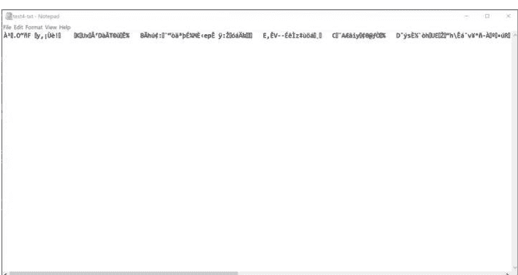

## 图 8.24 .txt 文档中的加密数据

+   9. 关闭所有窗口并注销用户 TestUser2。
+   10. 登录 TestUser1。
+   11. 导航到“Permissions Test”文件夹，并访问您的“Perm_Test_（您的姓名缩写）”文件夹。尝试打开 test4 AxCrypt 文件。您能打开它吗？
+   12. 关闭所有窗口并关闭计算机。

不幸的是，这些信息已经丢失。

## 表格

## 表 8.2 test1 ACL 中可用的权限

| 完全控制 | 修改 | 读取与执行 |
|---|---|---|
| 读取 | 写入 | 特殊权限 |

## 表 8.3 TestUser2 访问级别

| 文件/文件夹 | TestUser2 的权限 | 能否访问？ |
|---|---|---|
| Perm_Test_folder 访问权限 | 允许 – 写入<br>拒绝 – 读取与执行、列出文件夹内容、读取 | 无法访问文件夹内容或 ACL |
| test1 | 允许 – 读取与执行、读取<br>拒绝 – 写入 | 可以访问文件，但无法更改/保存文件 |
| test2 | 未给予明确权限 | 可以访问、更改和保存文件 |
| test3 | 拒绝 – 完全控制 | 拒绝任何访问 |
| test4 | 允许 – 读取与执行、读取、写入 | 可以访问、更改和保存文件 |

## 实验问题

+   1. 文件夹拥有哪些文件所没有的权限？
+   
+   答案：文件夹权限包括“列出文件夹内容”。文件权限只有“读取”和“读取与执行”。
+   
+   2. 什么是有效权限？
+   
+   答案：有效权限是所有来源授予的累积权限。个人和组来源相结合，在 ACL 内给出总体权限。
+   
+   3. 仅靠加密就能确保您的数据安全吗？
+   
+   答案：不能。正如实验所示，信息可能受到保护，但它并非不可触碰。如果没有设置适当的权限，恶意用户可能会选择破坏您的信息。更糟糕的是，其他人可能并不完全清楚自己在做什么，并意外地对数据造成不可逆转的影响。


## 第8章 · 保护内部边界

**4.** 如果一个用户尝试访问一个文件，该文件对他同时赋予了来自不同来源的允许 – 读取和执行权限以及拒绝 – 读取和执行权限，他是否能够访问该文件？

**答案：** 否。在大多数情况下，拒绝权限会覆盖允许权限。已授予的允许权限将被作废，用户将无法访问。

**5.** 如果你从特定用户移除所有权限，包括允许和拒绝，他是否能够访问文件或文件夹？

**答案：** 取决于他所属的组或组，是的。用户通常会被添加到用户组中，因此他们在大多数文件上被赋予默认的允许 – 读取和执行、读取和写入权限。

**6.** 作为普通用户，你可以更改任何文件或对象的权限吗？

**答案：** 否。没有管理属性的用户无法更改任何文件或文件夹的权限。用户仅允许更改其被视为所有者的文件的权限。

## 保护远程访问

*正如你在第二部分学到的那样*，计算机不必连接到其他计算机就会面临风险。尽管许多计算机可能不属于企业网络，但几乎所有现代个人计算机至少偶尔会连接到世界上最大的数据网络：互联网。因此，这些独立的计算和控制设备会暴露于来自远程源的破坏和利用。

- 分析并区分防病毒/反恶意软件产品。
- 保护独立计算设备的网络浏览器。
- 配置并测试本地防火墙安装。
- 解释应用程序安全的重要性。
- 审计本地操作系统服务和事件。
- 在独立主机设备上建立本地安全策略。
- 描述进行本地更新和补丁维护活动的重要性。

### 保护本地计算设备

保护本地计算设备免受基于互联网的威胁有九个基本步骤：

- 1. 使用安全连接。
- 2. 建立并配置防火墙以控制计算设备与互联网之间信息流。
- 3. 在本地计算机上安装并使用反恶意软件。
- 4. 从计算机中删除不必要的软件。
- 5. 禁用计算机上运行的任何非必要服务。
- 6. 禁用不必要的操作系统默认功能。
- 7. 保护网络浏览器。
- 8. 应用操作系统和应用程序软件更新和补丁。
- 9. 要求使用强密码。

### 使用安全连接

保护互联网连接的第一步之一是在本地路由器上实施安全选项。如果特定连接不包含路由器，你可能还应考虑安装一个，因为配置良好的路由器提供了最好的初始防线之一。路由器和其他网络连接设备将在第三部分详细介绍。

配置路由器安全功能时需要考虑的一些基本项目包括：

- 更改登录用户名和默认密码。 （默认值发布在用户的设置说明中，因此人人都知道。）
- 对于无线网络连接，更改默认 SSID 设置。
- 使用最高级别的加密配置无线网络——最好是 WPA2-AES 以实现最大数据保密性。
- 通过进行 MAC 地址过滤来识别受信任的无线连接。

### 建立和使用防火墙

你应始终建立并配置防火墙以控制计算设备与互联网之间信息流。对于独立或本地计算机，这可以通过操作系统提供的本地软件防火墙和/或保护路由器来解决。本章后面将讨论本地防火墙配置。

### 安装和使用反恶意软件

反恶意软件可以通过使用包含式恶意软件预防产品安装，也可以通过结合不同类型的特定预防程序来安装，例如来自不同厂商的防病毒和反间谍软件产品。本章末尾将详细介绍不同类型的恶意软件和预防方法。

### 删除不必要的软件

在计算机上保留未使用的软件产品会提供额外的攻击和利用途径。如果你不知道某个疑似软件程序的作用，请研究它，如果它对该系统的运行不重要就将其删除。

### 禁用非必要服务

某些病毒旨在利用非必要服务以便在设备之间迁移。特别是，除非它们以某种方式对系统的正常运行至关重要，否则应断开任何正在运行的文件共享或设备共享服务（在非消费者使用中几乎从不如此）。

照片共享和音乐共享服务应始终禁用，而文件和打印机应禁用，除非需要从一个设备向另一个设备传递信息以执行工作任务。 （这适用于网络计算机，将在第四部分详细介绍。）

### 禁用不必要的操作系统默认功能

如前所述，Autorun 是微软操作系统系列中高度可被利用的功能。当此功能启用时，操作系统将检测到可移动媒体的存在并执行其内容。如果 SD 卡或 CD/DVD 包含病毒，它将被自动执行并感染主机计算机。

### 保护网络浏览器

网络浏览类应用程序软件吸引了越来越多的攻击。初始浏览器配置可能在安全方面提供的保护不多。因此，通常有必要配置新浏览器的安全选项以保护系统免受通过此入口的攻击。本章后面将讨论保护不同网络浏览器的步骤。

## 基于软件的本地防火墙

直接连接到互联网的计算机容易受到外部攻击。保护独立计算机免受外部攻击的一种方法是安装本地防火墙。防火墙是放置在本地设备和外部网络（如互联网）之间的一种设备或程序。

本地基于软件的防火墙可以安装在单台计算机上，以保护其免受通过互联网连接引入的恶意活动。在某些情况下，操作系统提供内置防火墙选项，可用于保护本地计算机。

### 关于防火墙的一点说明

> 本地软件防火墙旨在通过阻止来自互联网设备的 unwanted 连接来提供对外部攻击的保护。基于软件的防火墙服务旨在保护直接通过拨号、局域网或高速互联网连接连接到互联网的单台计算机。

防火墙检查所有进出外部连接的流量，可以根据期望的属性配置为控制互联网与本地设备之间的流量，如图 9.1 所示。防火墙配置为仅将数据传递到和来自指定的 IP 地址和 TCP/UDP 端口。

通常，防火墙过滤器围绕 TCP 和 UDP 网络协议识别的服务进行配置。这些协议使用端口号来标识特定进程，例如 HTTP 或 FTP，并用于将传入数据包引用到将处理它们的软件应用程序。许多端口号是标准化的，被称为众所周知的端口。同样，其相关应用程序被称为众所周知的服务。

表 9.1 列出了几个众所周知的端口号及其相关服务。互联网号码分配机构（IANA）已将 0 到 1023 范围的标准端口号分配给特定服务。1024 至 49151 号端口称为注册端口，用于厂商应用程序。49152 至 65535 号端口是动态或临时端口，由计算机应用程序用于与其他应用程序通信。


## 图 9.1 防火墙操作

## 表 9.1 典型 I/O 端口

| 服务 | 知名端口号 |
|---|---|
| FTP | 20, 21 |
| Telnet | 23 |
| SMTP 邮件 | 25 |
| HTTP（WWW） | 80 |
| POP3（邮件） | 110 |
| 新闻组 | 144 |
| HTTPS | 443 |
| PPTP | 1723 |
| IRC | 6667 |

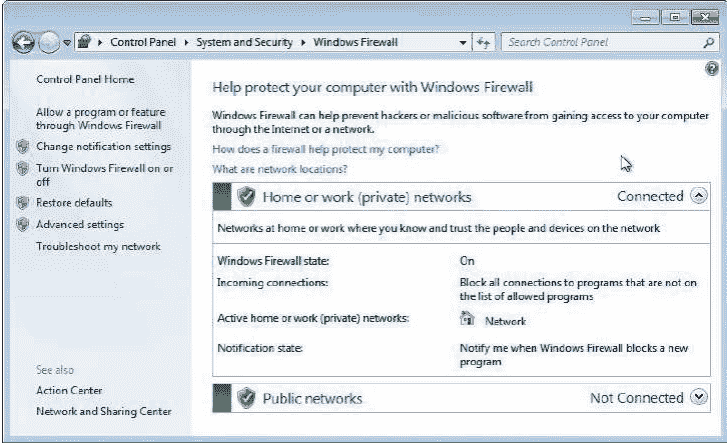

防火墙检查传入的数据包时，可以读取数据包的源 IP 地址和目的 IP 地址以及任何 TCP/UDP 端口号，如图 9.2 所示。它将使用数据包头中的 IP 地址和端口信息来确定传入的数据包是否应被路由到内部网络。

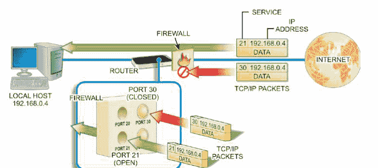

图 9.2 防火墙功能

如果你已将防火墙配置为指向提供 FTP 服务的内部计算机的 IP 地址，并开放了端口 20 和 21，防火墙将识别传入包头中的 IP 地址和端口号有效，并将数据包路由到该计算机。但所有其他传入请求仍将被阻止。

## 使用本地入侵检测工具

与物理安全防护一样，防止未经授权的访问是本地计算和控制设备级别的第一道安全防线。然而，在这一级别上，能够检测到入侵的发生并通知相应人员其性质同样重要。

基于计算机的入侵检测系统（IDS）可以通过两种方式实现：基于网络的 IDS（NIDS）或基于主机的 IDS（HIDS）。无论哪种方式，系统的主要设计目标都是监控系统（本地计算机或网络环境）、记录关键事件和策略违规行为，并按指示报告这些情况。

入侵防御系统（IPS），也称为入侵检测与防御系统（IDPS），提供了额外的保护层级，旨在阻止已检测到的威胁得逞。

正如其定义所示，HIDS 和 NIDS 在计算机/网络环境的不同区域运行。现在，我们暂不讨论 NIDS，而是聚焦于运行在单个主机或设备上的 HIDS 工具。

所有 IDS 设备都基于以下两种策略之一：

- 签名分析——将传入和传出流量与存储的特定代码模式数据库进行比较，这些模式已被识别为恶意威胁。
- 异常分析——将传入和传出流量与系统已建立的正常流量基线进行比较。

基线是通过对系统从流量中获得的数据应用数学算法来“学习”（生成）的。

基于签名的 IDS/IDPS 产品通常通过查找内容中的特定模式（称为*签名*）来工作。如果检测到“已知恶意”的模式，就可以采取适当措施保护主机。然而，由于编程语言的动态特性，网页中的脚本可用于绕过此类防护系统。

基于签名的 IDS 数据库通常由厂商根据观察到的恶意签名生成并分发。因此，在识别出签名并将其添加到数据库以供采取行动之前，恶意代码就已存在。恶意代码发布与其签名发布之间的时间延迟本身就构成了一个安全问题。

基于异常的 IDS/IDPS 系统对数据流应用统计分析技术，以确定其在任何给定时间点是“正常”还是“异常”。实现统计异常检测有两种常见方法：

- 基于轮廓的异常检测系统
- 基于阈值的异常检测系统

## 基于轮廓的异常检测系统

这类系统使用数学算法监控正常数据流量，并制定一个描述该系统正常流量样貌的规则“轮廓”。所制定的轮廓反映了对用户过去行为的评估，并被配置为当这些行为的偏差达到一定程度（即*阈值*）时发出信号。

- 基于规则的异常检测——该检测方法分析审计记录，基于过去的使用模式生成“规则”集。系统随后监控流量，寻找与规则不匹配的模式。
- 渗透检测——这类系统根据已知的渗透事件、系统弱点或行为模式生成规则。因此，它们通常针对特定主机系统。它们通常还包含安全专家根据当前安全活动生成的规则。

## 基于阈值的异常检测系统

这类 IDS 系统旨在跟踪特定事件在一段时间内的发生次数，如果事件次数超过预定值，则生成入侵警告。

大多数常见的 IDS 系统是为本地主机系统使用而设计的。然而，人们日益致力于开发基于网络的 IDS 系统，以提供更有效的入侵检测与防御手段。基于网络的分布式入侵系统将在第四部分中介绍。

| IDS 通知 | 在所有类型的 IDS 中，当检测到潜在攻击时，管理员都会收到通知。 |

## 配置浏览器安全选项

Web 浏览器在设计上高度灵活，旨在为用户提供尽可能多的使用选项。它们的设计也着眼于吸引绝大多数非技术用户。再加上大量上网者将其网络访问用于不良目的，你的本地系统便出现了一个巨大的安全缺口。

例如，图 9.3 显示了 Windows Internet Explorer（IE）浏览器可用的部分 Internet 选项。如你所见，其中一些选项属于个人偏好，例如颜色、字体和工具栏。然而，还有多种涉及浏览器和互联网搜索的安全相关活动。

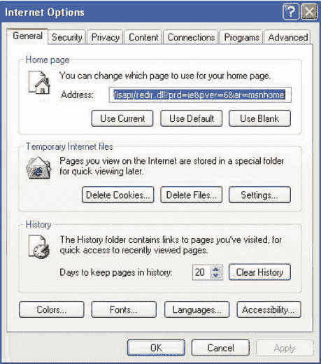

**图 9.3** Internet 选项

如图所示，Web 浏览器通常会提供多种用户可选择的安全选项，可用来弥补互联网浏览和搜索给系统带来的额外脆弱性。这些选项包括：

- 配置安全级别
- 配置脚本
- 配置代理服务器
- 控制 Cookie

尽管每个浏览器的设计不同，但它们往往都提供类似的 Web 安全选项。用户可能需要寻找特定工具来将浏览器配置为安全运行，但相同的基本配置技术适用于所有浏览器。

## 配置安全级别

由于浏览器是通往更广阔外部世界的门户，其安全设置非常重要。此外，机器上的其他互联网工具可能依赖浏览器的组件来执行其功能。这些应用程序可能带来增强功能，从而造成额外的漏洞。如果这些功能对系统运行没有帮助，就应对其进行评估并关闭。

与其他应用程序一样，浏览器附带一组预配置的安全级别。在 Microsoft IE 中，这些功能位于图 9.4 所示的安全选项卡上。

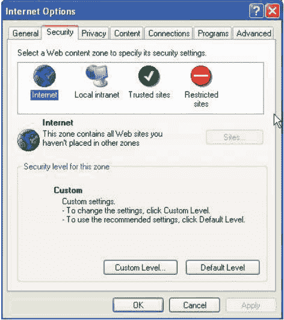

图 9.4 IE 安全选项卡

在此浏览器示例中，Internet 站点可归入不同的 Internet 安全区域，使每个区域中的站点受适用于该组的安全限制约束（Internet、本地 Intranet、受信任的站点和受限制的站点）。

这样，不同的网站就可以在不同的安全限制下被访问。可以建立受信任的站点以减少安全开销，而为受限制的站点分配更高的安全设置。Internet 区域选项是未分配到其他区域选项的所有站点的默认区域。

配置安全级别的最佳做法是尽可能将其设置得高，同时不要将浏览器限制到网站无法加载或无法正常工作的程度。

## 配置脚本支持

*脚本*是可执行应用程序，用于在网站上提供交互式内容。它们也能够根据用户的选择检索信息。然而，用户可能无需执行任何操作即可运行脚本程序；这些脚本只是嵌入在被访问的网站中。

应控制网站上遇到的脚本，因为它们是病毒感染的主要来源之一。攻击者会重新配置脚本，使其包含客户端可能在不知情的情况下下载的病毒。它们还会促成自动弹出窗口，在客户端浏览器上毫无预兆地出现。这些窗口通常包含未经请求的广告，往往令用户厌烦。

在浏览器中加载和运行脚本的能力可以通过浏览器的“安全”功能进行控制。你可以控制的各个网页组件列表包括不同的脚本类型，如 ActiveX 和 JavaScript。

ActiveX 是 Microsoft 的一种实用工具，使 Web 应用程序能够借助浏览器中的 ActiveX 框架构建扩展的交互特性和功能。当启用了 ActiveX 的浏览器遇到调用 ActiveX 控件功能的网页时，它会自动下载，而无需用户参与。当然，这会造成潜在的安全漏洞，破解者可利用它在被入侵的网站中嵌入恶意代码。

一种类似的脚本语言 JavaScript 常被用于 Web 浏览器，使网站更具交互性。它尤其适合开发游戏和其他富含音频/视频内容的网页中的交互式内容。然而，它也被广泛用于传输远程活动的信息，例如浏览和阅读习惯，以供广告跟踪和分析使用。它无需重新加载收集信息的页面，也无需通知读者即可做到这一点。这再次为恶意（或至少不受欢迎的）活动创造了潜在入口。


## 关于 VBScript 的说明

VBScript 是另一种仅适用于 Microsoft Windows Internet Explorer 的脚本语言。VBScript 与 JavaScript 相似，但由于与其他浏览器的兼容性有限，因此在网站中并不广泛使用。

网站与浏览器交互的另一个关注领域是使用插件为现有软件应用程序添加新功能，例如搜索引擎和防病毒功能。这些脚本控件类似于 ActiveX 控件，但不能在 Web 浏览器之外执行。Adobe Flash 和 QuickTime Player 是 Web 浏览器插件最广为人知的例子。

大多数浏览器默认支持各种插件，并依赖它们进行部分操作。伴随着这些组件的自动特性而来的是日益增加的脆弱性，无论是在设计缺陷方面还是作为潜在的黑客攻击目标。从历史上看，ActiveX 控件、Adobe 的 PDF Reader 和 Flash 产品以及苹果的 QuickTime 产品在脚本产品中代表了记录在案的漏洞数量最多。

与其它安全对象一样，浏览器通常可以配置为在遇到页面上的这些脚本项目时启用、禁用或提示用户。经验法则是，除非你知道它们可以被信任，否则应禁用所有附加组件（包括 Java、JavaScript、Flash 和 ActiveX）上的网站。

## 控制 Cookie

*Cookies* 是 Web 服务器在访问其页面时发送给 Web 浏览器的微小文件。这些文件的合法用途是使服务器能够在客户端浏览器每次连接到服务器时自动识别客户端浏览器。基本的 HTTP 页面传输过程在图 9.5 中描述。

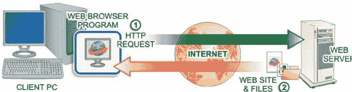

Web 页面传输在客户端通过本地 Web 浏览器启动。浏览器向指定的 Web 服务器发送 HTTP 请求，服务器随后返回请求的页面以及 HTTP 响应消息。消息中的一个信息可能是要求浏览器设置（接受并存储）cookie，以便可以进行更高效、自动化的页面传输过程。

Cookie 还可能包含称为 *cookie attributes* 的多个配置信息。其中一个关键的安全相关属性是 Cookie 过期的设置。基本上，有两种需要关注的 Cookie：session cookies 和 *persistent cookies*。*Session cookies* 在浏览器关闭时会被清除，而 *persistent cookies* 将保留在计算机上，直到指定的到期日期为止。与会话 Cookie 相比，持久 Cookie 风险更高，因为它们在客户端计算机上保留的时间更长。

Cookie 最初是为在用户在页面之间移动并将商品放入在线购物篮时保持用户登录在线购物环境而开发的。然而，Cookie 的使用已扩展到远不止购物篮。它们可以设计为收集并跟踪网站设计放置在其中的任何信息——例如，它们可能跟踪用户访问的网站信息或用于访问该网站的凭据。设计用于执行这些类型功能的 Cookie 称为 *tracking cookies*。

这正是使 Cookie 对黑客具有吸引力的信息。如果网站使用 Cookie 进行身份验证，那么攻击者可能通过获取 Cookie 而未经授权访问该网站。这被称为 *cookie theft*。

攻击者只需使用数据包嗅探实用程序来监控网络流量并捕获 Cookie 即可获得其凭据（用户名、密码、网络地址等）的访问权限。掌握这些信息后，攻击者就有能力在访问其他网站时冒充原始用户。

攻击者还可以使用一种称为 *cross-site scripting*，或 XSS 的技术，导致返回的 Cookie 被重定向到攻击者运营的第三方服务器。攻击者随后可以使用被盗的 Cookie 冒充原始站点，假装成原始用户。重定向通常是通过简单地在站点上隐藏脚本并使用社会工程技术诱骗用户点击代码来实现的。当他们这样做时，他们的 Cookie 会被传输到攻击者指定的第三方位置。

此外，攻击者可能只是更改被盗 Cookie 的内容以对原始 Web 服务器发动攻击。例如，如果 Cookie 是电子商务销售网站的产物，它可能包含有关购物车中产品定价的信息。攻击者可以更改该信息并将其发送回原始服务器，导致其以更低的价格向客户收取商品费用。这种类型的攻击，如图 9.6 所示，是一种中间人（MITM）攻击的形式，称为 *cookie poisoning*。

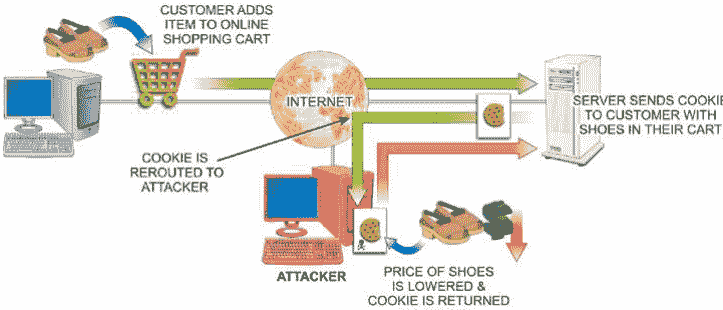

**FIGURE 9.6** Cookie Poisoning

几乎所有浏览器默认都支持 Cookie。有些提供用户完全启用或完全禁用 Cookie 的选项，而其他浏览器则提供更强大的 Cookie 管理器，使用户能够查看并选择要从系统中删除的单个 Cookie。

出于安全目的，处理 Cookie 的最佳建议是禁用始终设置 Cookie 的选项。此外，使用传输加密以防止第三方在途中拦截时能够读取 Cookie。这在使用 Wi-Fi 通信时尤其重要。如果无线链路未加密，攻击者可以轻松拦截然后读取数据，包括发送的 Cookie。

使用安全套接层（SSL）链接为传输数据（包括 Cookie）提供数据加密安全，并防止在通信链路上传输时未经授权访问数据。SSL 链接始终标识为 HTTPS:// 站点，而不是简单的 HTTP://。

Rootkits 被设计为在操作系统根级别运行，并在该级别表现为良性实体。在 rootkit 安装到系统后，它将采取措施隐藏自己以避免被检测。它们通过更改驱动程序或内核模块来修改操作系统的核心组件的行为。这些程序具有窃取 PIN、账户密码、信用卡和其他敏感信息的能力。它们可以感染几乎任何类型的操作系统。

Ransomware 是旨在阻止用户访问其数据并将其作为付款人质的软件。垃圾邮件是最常见的传播恶意软件的载体。然后通过用户点击电子邮件中的附件或链接来激活它。它随后会禁用基本系统服务，甚至锁定计算机，以便用户无法访问它。

黑客可以加密计算机上的个人文件，使用户无法访问其数据。黑客通常会提示用户输入只能通过比特币加密货币等神秘方式汇款后才能获得的代码。他们通常还会试图让用户购买合法的解密或移除工具。作者（黑客）是唯一知道所需私有解密密钥的人。

间谍软件通常通过看似有用的程序的 Internet 下载引入系统。与病毒和特洛伊木马不同，间谍软件通常不会自我复制。一旦间谍软件安装在系统上，它就会监控系统的运行并收集用户名、密码、信用卡号码和其他 PII 等信息。

广告软件会向 Web 浏览器引入不需要的、未经请求的广告显示。它们还可以设计为从浏览器收集用户选择信息，构建更个性化的广告方案。广告软件通常通过下载免费软件（免费软件）等引入系统。

逻辑炸弹是一种通常用于删除数据的恶意软件类型。逻辑炸弹是计算机代码，与其他恶意软件一样，附加到合法程序上。代码保持空闲，直到特定逻辑事件结束。这包括经过一定天数、打开一定数量的程序或执行程序


specific manner. Logic bombs are hard to detect because they are often included in large programs with thousands of lines of code.

► *Zombies* are infected computers that can be placed under the remote control of a malicious user. Zombies can be used to create Denial of Service (DoS) attacks that flood targeted networks to slow down and sometimes stop servers completely. Computers are often infected and become zombies by way of viruses, worms, and Trojans.

► *Botnets* are a large collection of zombies, or bots, controlled by a bot herder. This type of network can consist of literally millions of unsuspecting computers. Botnets can be used to send out spam (usually through email lists) originating from unsuspecting users’ computers. It is estimated that 50 to 80 percent of spam worldwide is created by zombie computers.

It is common to install a number of different defensive products to protect PCs and their data from unauthorized access and malicious interference. Most products these days include protections against multiple fronts. The products most widely used for these purposes include:

+   ► Antivirus programs
+   ► Antispyware programs
+   ► Spam blockers
+   ► Pop-up blockers

## Using Antivirus Programs

Every computer should have some means of protecting itself against computer viruses. The most common means of virus protection involve installing a virus-scanning (antivirus) program that checks disks and files before using them in the computer. Several companies offer third-party virus-protection software that can be configured to operate in various ways.

If the computer is a standalone unit, it might be nonproductive to have the antivirus software run each time the system is booted up. It would be much more practical to have the program check any removable media attached to the system, only because this is the only possible non-network entryway into the computer.

All computers with connections to the Internet should be protected by an antivirus solution before they are ever attached to the Internet. In these cases, setting the software to run at each bootup is more desirable. In addition, most antivirus software includes utilities to check email and files downloaded to the computer through network or Internet connections.

As indicated earlier, when an antivirus application is installed on the system, it can be configured to provide different levels of virus protection. You will need to configure when and under what circumstances you want the virus software to run.

## Using Antispyware

As shown in Figure 9.7, there are basically two types of antispyware products available: those that find and remove spyware after it has been installed and those that block spyware when it is trying to install itself. Both of these methods stand a better chance of keeping computers free from spyware when they are combined with user information about how to avoid spyware.

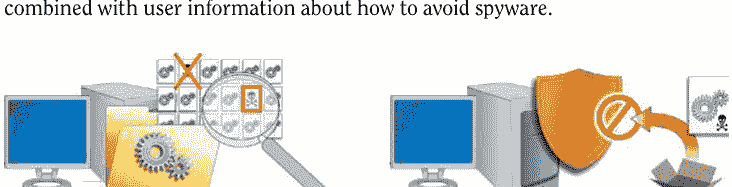

FIGURE 9.7 Antispyware Product Types

The detect-and-remove method is by far the simpler type of antispyware product to write. Therefore, there are several commercially available products that use this method. Like antivirus software packages, this type of antispyware product relies on databases of existing definitions to recognize spyware threats. These databases must be updated frequently to recognize new spyware versions that have been identified.

The real-time-prevention type of antispyware product does not rely on historical data to identify spyware. Instead, it monitors certain configuration parameters and notifies the user when suspicious installation activity occurs. The user

then has the option to allow or block the installation effort. Some antispyware products incorporate both methods of dealing with spyware.

In addition to installing antispyware applications, users can fight spyware in a number of other ways:

+   - Install a web browser other than Internet Explorer (for example, Chrome or Firefox).
+   - Download the newest browser version that offers better security features.
+   - Work with an ISP that uses their firewalls and proxies to block sites that are known to distribute spyware.
+   - Download only software from reputable sites to prevent spyware that comes attached to other programs.

## Hardening Operating Systems

As noted earlier, the second level of hardening local computer systems against attacks is to secure their operating systems. This involves updating vulnerable code segments of the OS as they become known. OS hardening occurs through the application of new programming in the form of:

+   - Service packs
+   - Patches
+   - Updates

### Service Packs

After an operating system has been in the field for some time, vendors may combine several product improvements and distribute a numbered service pack for the specific operating system being upgraded. Critical files should always be backed up in the event that the service pack or OS fails to work after installing the service pack.

### Patches

Patches are general improvements to a given operating system that have been released for distribution. Many patches and updates are purely cosmetic and

Software programmers are asked to meet both of these objectives in the same product.

In some cases, the programmers may be trying to create a truly open product without concerns about how it might be exploited by malicious people. In other cases, they may not be experienced enough to envision how their product might be exploited. With the worldwide pool of programmers continuously growing, there are many individuals with a significant knowledge base of how to test, manipulate, and modify programming. This includes black hat hackers.

## A Word About Black Hat Hackers

A *black hat hacker* is an individual who possesses extensive programming skills and uses them to breach or bypass network security structures for malicious or criminal purposes. People in this category of hacker are also known as *crackers* or *dark-side hackers*.

There are also *white hat* and *gray hat hackers* who also seek to exploit Internet security vulnerabilities and weaknesses, but not for malicious reasons (for example, to perform security system analysis checks).

Modern operating system and application programming is very complex. When programmers initially develop a product, they may make coding mistakes or create portions of a product that do not work well with elements created by other programmers in the development team. Attackers will often use software vulnerabilities to insert and hide malicious code that can be used to disrupt services or operations.

In particular, the attacker may alter the existing code to create a condition in the computer’s memory known as a *buffer overflow*, which results in erratic behavior, memory access errors, and/or system crashes. The system is effectively disabled to the point where the user cannot use it. This kind of attack is a type of Denial of Service (DOS) attack.

## Applying Software Updates and Patches

From the previous section, you can see that due to the nature of product development and the pressures on software producers to bring new products to the market, new software releases never seem to be complete or perfect. As security issues are revealed with software products, their producers are forced to issue security patches for their product that correct the weakness.

*Security patches* are updates issued for the specific purpose of correcting an observed weakness to prevent exploitation of the vulnerability. Microsoft issues security patches for its products once a month. Other software developers use dedicated security teams to develop and issue security patches as soon as possible after a vulnerability has been discovered.

For security and stability reasons, you should always patch operating systems on computing devices that are connected to the Internet. However, this is not the case with all PCs. Stable PC systems that are not connected to the Internet should not be patched unless doing so resolves some sort of existing problem.

## Hands-On Exercises

### Objectives

+   - Manage the local firewall configuration.
+   - Explore Windows Firewall with Advanced Security.
+   - Recognize the need for outbound filtering.
+   - Create a port filtering rule.
+   - Create an ICMP filtering rule.

### Resources

+   - PC-compatible desktop/tower computer system
+   - Windows 10 Professional installed
+   - User account with Administrative access
+   - Internet access from a network connection

### Discussion

Computers connected directly to the Internet are vulnerable to attacks from outsiders. One way to protect standalone computers from outside attacks is to install a local firewall.

Local software-based firewalls can be installed on an individual computer to protect it from malicious activities introduced through their Internet connection.


在某些情况下，操作系统提供了一个内置的防火墙选项，可用于保护本地计算机。
在本实验中，您将探索与 Windows 防火墙相关的选项，以应用本地（软件）防火墙。您还将认识到需要入站和出站过滤以及测试各种安全选项的需求。在某些场景中，您可能希望下载基于软件的防火墙，但 Microsoft 已在其操作系统中包含 Windows 防火墙以及具有高级安全性的 Windows 防火墙。

## 程序

### 访问 Windows 防火墙基本设置

要访问基本的 Windows 防火墙设置，请按照以下步骤操作：

- 1. 打开计算机电源，如果有选择，请选择 Windows 10 Professional。
- 2. 登录到您的管理员帐户。
- 3. 单击任务栏上的嵌入式搜索栏，输入 Control Panel，然后在显示的菜单中单击 Control Panel。
- 4. 如有必要，切换到以 查看方式：小图标 查看控制面板，定位并单击 Windows 防火墙。图 9.8 显示了基本的 Windows 防火墙设置。

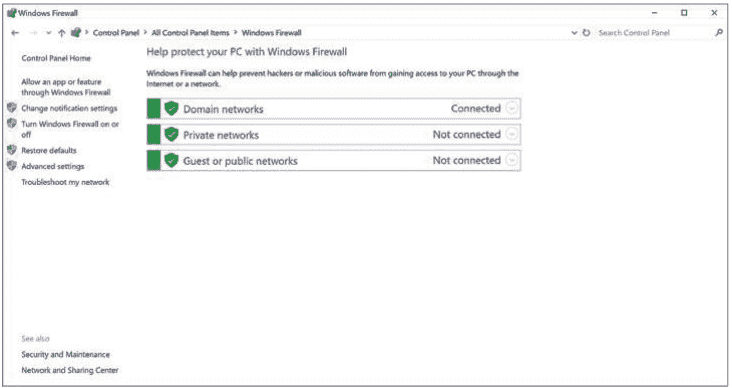

图 9.8 基本 Windows 防火墙设置

在此窗口中，您可以看到每种类型网络的当前防火墙状态。

- 5. 通过单击每个网络右上角的向下箭头展开每种网络类型。检查当前状态和与每个网络关联的规则。将三种网络类型列在表 9.2 中。
- 6. 在左侧窗格中，单击 打开或关闭 Windows 防火墙，位于需要管理员访问权限的 Windows Defender Shield 旁边。

在左侧窗格中，打开或关闭 Windows 防火墙 和更改通知 均通向同一个窗口。图 9.9 描述了自定义设置窗口。

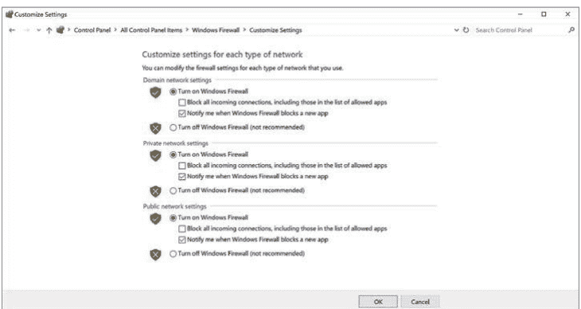

图 9.9 Windows 防火墙自定义设置窗口

此窗口显示与每种网络类型相关的基本选项。您可以打开或关闭防火墙。如果防火墙已打开（推荐），您可以决定是否要阻止所有传入流量，以及是否要在程序被阻止时收到通知。

防火墙检查所有进出外部连接的流量，可以根据期望的属性配置为控制 Internet 与本地设备之间的流量。防火墙配置为仅将数据传递到和来自指定的 IP 地址和 TCP/UDP 端口。

几乎没有理由关闭 Windows 防火墙（不推荐）。

- 7. 如果任何网络类型已选择 关闭 Windows 防火墙，请单击 打开 Windows 防火墙。单击 确定 以退出 Windows 防火墙自定义设置。

### 检查具有高级安全性的 Windows 防火墙

要检查具有高级安全性的 Windows 防火墙，请按照以下步骤操作：

- 1. 在左侧窗格中，单击 高级设置，位于 Windows Defender Shield 旁边，以启动具有高级安全性的 Windows 防火墙控制台。 （见图 9.10。）

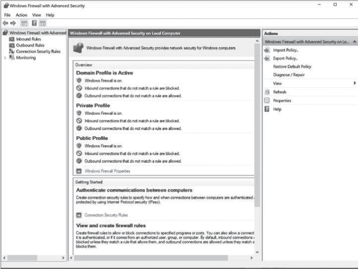

图 9.10 具有高级安全性的 Windows 防火墙控制台

控制台中的此初始视图显示了防火墙当前状态的概述，以及包含以下内容的入门教程：

- 在计算机之间验证通信
- 查看和创建防火墙规则
- 查看当前防火墙和 IPsec 策略和活动

- 2. 在“概述”部分底部，选择 Windows 防火墙属性 以启动本地计算机上的具有高级安全性的 Windows 防火墙属性窗口，如图 9.11 所示。

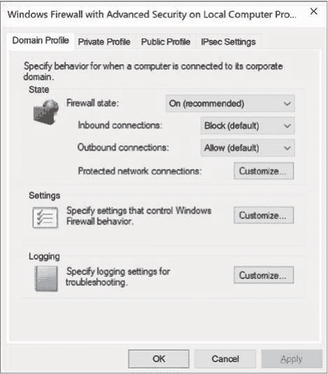

图 9.11 本地计算机上的具有高级安全性的 Windows 防火墙属性

此窗口为您提供了控制三种网络类型各自设置的另一个选项。您还可以自定义各种设置并设置日志记录规则。

3. 在不更改配置的情况下探索选项卡，然后单击 取消 关闭此窗口。

4. 在左侧窗格中，选择 出站规则。中央和右侧窗格将类似于图 9.12。

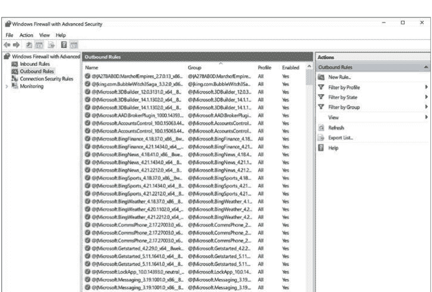

图 9.12 具有高级安全性的 Windows 防火墙中的出站规则

### 创建 TCP 出站规则

要创建 TCP 出站规则，请按照以下步骤操作：

- 1. 在右侧窗格中，单击 新建规则。 新建出站规则向导 将出现，如图 9.13 所示。

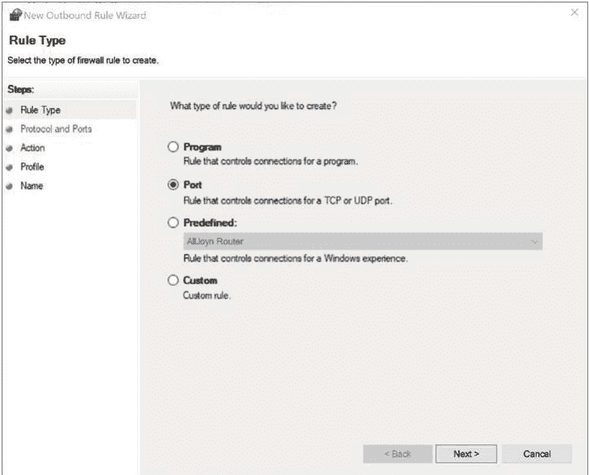

图 9.13 新建出站规则向导

在 新建出站规则向导 中的任何页面上，您都可以通过选择每页底部附近的 了解更多关于（主题） 链接来了解有关选项的更多信息。

- 2. 选择 端口 单选按钮，然后单击 下一步 按钮继续左侧窗格中的步骤，如图 9.14 所示。
- 3. 在出现的协议和端口窗口中，确保已选择 TCP 单选按钮以及 特定远程端口 单选按钮。将 135 输入到文本字段中。

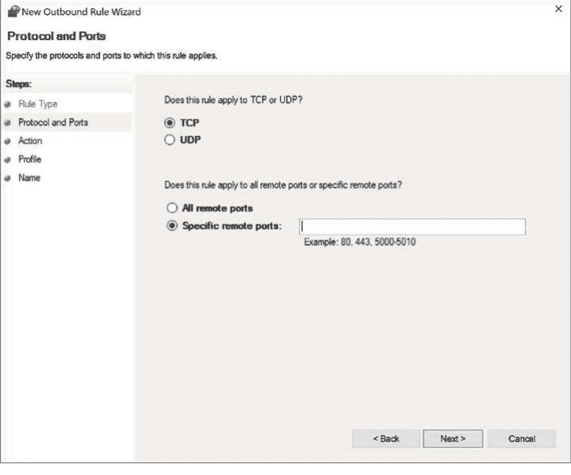

图 9.14 新建出站规则向导步骤：协议和端口

TCP 端口 135 是恶意软件经常尝试通过 NetBIOS/SMB/RPC 发起网络请求的众多端口之一。创建出站阻止规则将防止您的系统连接到恶意外部主机。

- 4. 单击 下一步 按钮继续到步骤：操作 页面。
- 5. 查看选项，但保留 阻止连接 单选按钮处于选中状态。单击 下一步 按钮继续到步骤：配置文件 页面。

6. 在这里您将决定规则应适用的网络类型。保留全部三个复选框标记以将规则应用于所有网络。单击 下一步 继续到步骤：名称 页面。

7. 在名称页面上，在名称 文本框中输入 My First TCP Rule。在 描述（可选）： 字段框中输入 This is my first TCP outbound rule。图 9.15 显示了输入信息后的步骤：名称页面。

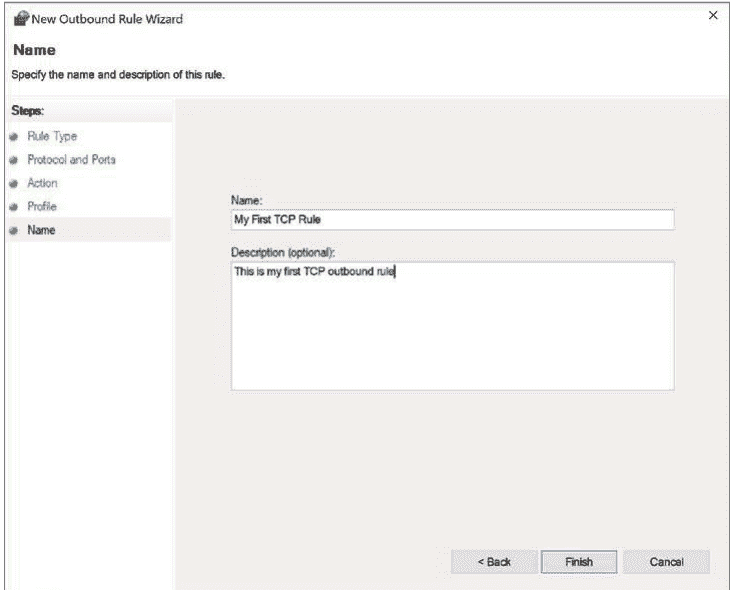

图 9.15 新建出站规则向导步骤：名称页面

8. 单击 完成。您应该在中央窗格的规则列表中看到您的规则，如图 9.16 所示。

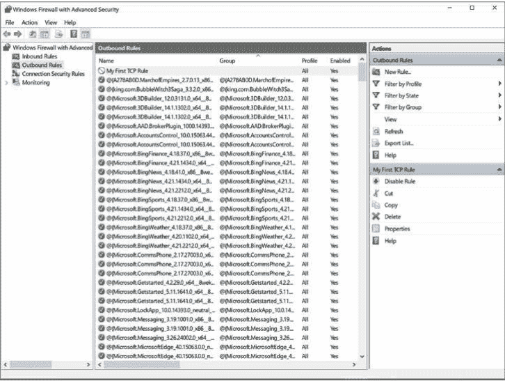

图 9.16 具有高级安全性的 Windows 防火墙新建出站规则

### 创建 ICMP 出站规则

出站通信可以采用 ICMP 类型或代码的形式，而不仅仅是 TCP/UDP 端口。以下步骤将向您展示如何阻止传出 ICMP 通信。

- 1. 在右侧窗格中单击 新建规则。 新建出站规则向导 将出现。
- 2. 选择 自定义 单选按钮。请注意，左侧窗格中的步骤数量已增加。单击 下一步 继续。

3. 保留 所有程序 单选按钮处于选中状态，如图 9.17 所示。

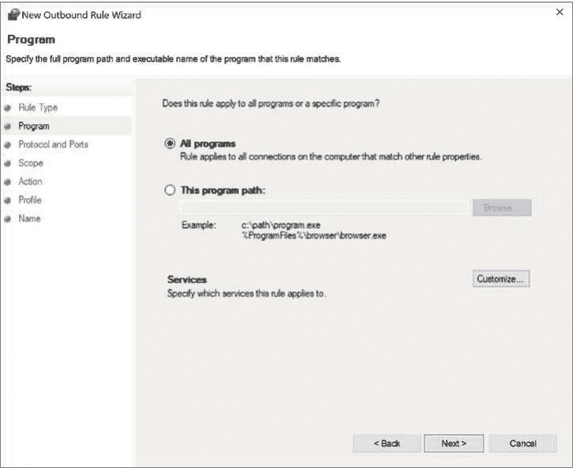

4. 单击 下一步 继续到步骤：协议和端口 页面。

5. 从协议类型 下拉菜单中选择 ICMPv4。单击 自定义 按钮以访问自定义 ICMP 设置，如图 9.18 所示。

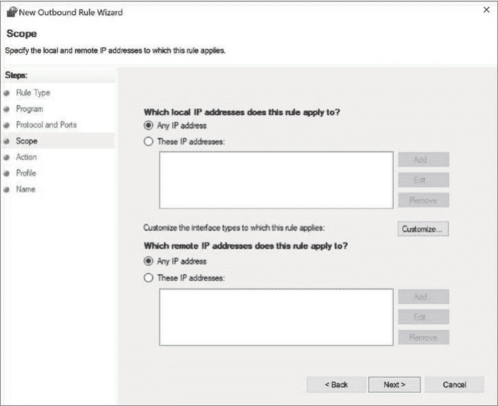

图 9.19 新建出站规则步骤：范围页面

- 10. 保留 阻止连接 单选按钮处于选中状态，然后单击 下一步 继续到步骤：配置文件 页面。
- 11. 保留所有配置文件复选框标记，然后单击 下一步 继续到步骤：名称 页面。
- 12. 在出现的名称 文本框中，输入 My First ICMP Rule。在 描述（可选） 文本框中输入 ICMP Echo Requests。图 9.20 显示了完成的步骤：名称页面。
- 13. 单击 完成 以完成并退出新建出站规则向导。

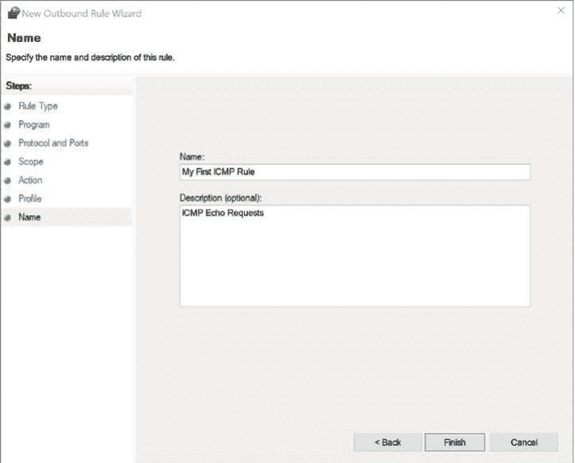

图 9.20 新建出站规则向导步骤：名称页面

您应该在中央窗格的规则列表中看到您的规则，如图 9.21 所示。

### 测试 ICMP 出站规则

现在是时候测试之前创建的 ICMP Echo Requests 规则了。这是在涉及 PING 实用程序的命令行操作中完成的。

- 1. 保持具有高级安全性的 Windows 防火墙控制台打开。
- 2. 单击任务栏上的嵌入式搜索栏并输入 cmd。这是访问命令行的快速方法。按 Enter 启动命令行。
- 3. 要测试 ICMP 规则，请 ping Google 的知名服务器。在命令行中输入 `ping 8.8.8.8`，然后按 Enter。

请注意，存在一般的失败。出站规则已有效地阻止了 ICMP 回显请求。图 9.22 显示了 ping 失败（100% 丢失）。


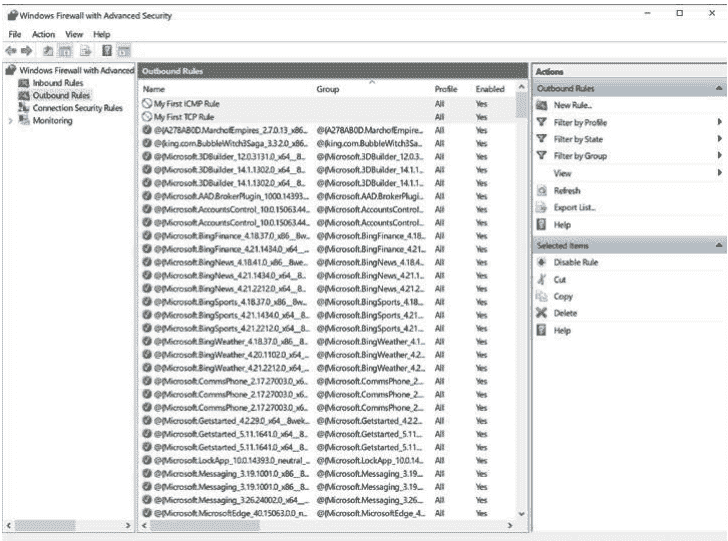

图 9.21 Windows 高级安全 Windows 防火墙中的新建出站规则

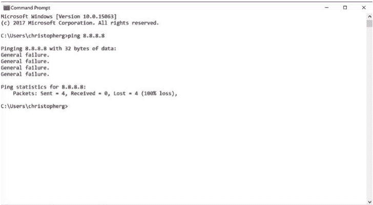

图 9.22 Ping 失败

+   4. 保持命令行终端打开并选择 Windows 高级安全 Windows 防火墙控制台。
+   5. 找到 My First ICMP Rule 并右键单击它以获取更多选项。选择顶部选项以禁用规则。
+   6. 返回命令行终端。按下键盘上的上箭头键一次将把最后输入的行插入到终端中，即 ping 8.8.8.8。
+   7. 按 Enter 查看禁用的规则是否允许 ping 到达 Google 服务器。图 9.23 显示 ping 成功（0% 丢失）。

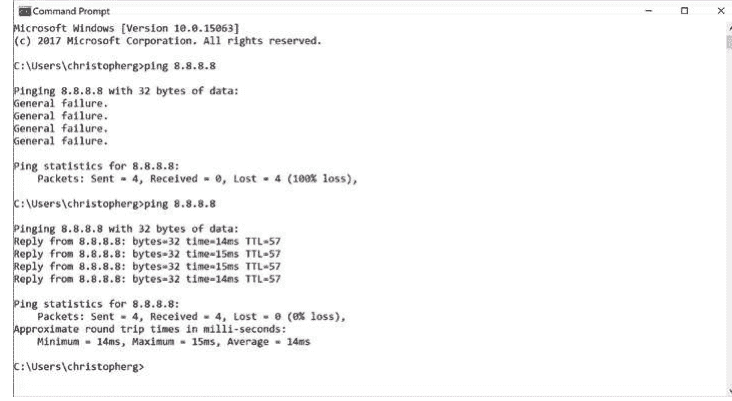

## 图 9.23 Ping 成功

+   8. 通过单击窗口右上角的红色 X 关闭命令行终端。
+   9. 返回 Windows 高级安全 Windows 防火墙控制台，通过右键单击每个规则并选择删除来删除您创建的两个规则。系统提示您确认删除功能时，选择是。
+   10. 通过单击窗口右上角的红色 X 关闭 Windows 高级安全 Windows 防火墙控制台。
+   11. 关闭计算机。

请参阅练习末尾的表 9.3 和表 9.4，了解为遵循最佳实践而需要关闭的端口、ICMP 类型和代码列表。

## 表格

**表 9.2 网络类型**

| 域网络 | 家用或工作（专用）网络 | 公共网络 |
|---|---|---|

**表 9.3 建议关闭的端口**

| 端口名称 | TCP 或 UDP | 端口号 | 关闭原因 |
|---|---|---|---|
| MS RPC | 两者 | 135 | Windows 系统使用这些端口发送查询。这可能会泄露信息或被另一网络视为攻击。 |
| NetBIOS/IP | 两者 | 137–139 | Windows 系统使用这些端口发送查询。这可能会泄露信息或被另一网络视为攻击。 |
| SMB/IP | TCP | 445 | Windows 系统使用这些端口发送查询。这可能会泄露信息或被另一网络视为攻击。 |
| 简单文件传输协议 | UDP | 69 | 关闭此项可防止黑客将其工具包移动到您的系统上。 |
| Syslog | UDP | 514 | 这两者都会发送有关网络拓扑的信息，这是不应避免的。 |
| 简单网络管理协议 | UDP | 161–162 | 这两者都会发送有关网络拓扑的信息，这是不应避免的。 |
| SMTP（除您的邮件服务器外） | TCP | 25 | 这可防止您的网络基础设施被变成垃圾邮件中继，从而可能使您的网络被列入一个或多个黑名单。 |
| Internet Relay Chat | TCP | 6660–6669 | 这些由黑客用于向他们感染的系统发送和接收通信。 |

## 表 9.4 建议关闭的 ICMP 类型和代码

| ICMP 名称 | 类型 | 代码 | 关闭原因 |
|---|---|---|---|
| 回显 – 回复 | 0 | 0 | 这些用于秘密通信。 |
| 主机不可达 | 3 | 1 | 主机不可达由黑客用于绘制网络地图并识别哪些主机在线和离线。 |
| 传输中超时 | 11 | 0 | 关闭这些可防止某些网络映射工具发挥作用。 |

## 实验问题

+   1. Windows 防火墙处理的三种主要网络类型是什么？
+   回答：三种网络类型包括：域网络、家庭或工作（专用）网络以及公共网络。
+   2. 关闭 Windows 防火墙很重要。正确还是错误？
+   回答：错误。只有少数正当理由需要关闭 Windows 防火墙。总的来说，它是 Windows 环境中必不可少的<|message|> 安全工具。
+   3. 使用新建出站规则向导可以创建哪四种规则类型？
+   回答：新建出站规则向导中列出的四种可供选择的规则类型包括：程序、端口、预定义和自定义。
+   4. 测试 ICMP 回显请求的一种简单方法是什么？
+   回答：测试 ICMP 回显请求的一种简单方法是使用命令行终端中的 ping 功能——例如，ping 8.8.8.8。
+   5. 您有阻止所有传入流量的选项。正确还是错误？
+   回答：正确。如果防火墙已打开（推荐），您可以决定是否要阻止所有传入流量以及是否要在程序被阻止时收到通知。

- 在计算机和网络环境中，术语 *加固* 指的是使系统更安全的过程。计算机加固工作始于硬件，但也扩展到本地主机的操作系统、其文件系统和应用程序。
- 物理硬件端口使基本 PC 系统能够与可选的、可移动设备交互。它们还提供潜在的安全威胁，因为怀有恶意的个人可以通过这些端口直接进入计算机内部通信和处理系统。
- 系统的 BIOS 通常提供设备控制选项，可控制计算机的外部硬件连接端口。通过禁用这些端口，用户和管理员可以帮助确保未经授权的用户无法使用端口获得对系统的未经授权访问、将信息从系统传输出去或将恶意程序下载到系统。
- 可移动计算机介质存在多重安全风险。这些风险包括由于介质的可移植性而导致数据被盗而丢失，以及将破坏性恶意软件引入主机系统的潜在风险。
- *内部边界* 可被视为由操作系统及其应用程序组成。
- 保护文件系统及其数据的主要工具之一是使用访问控制列表（ACL）。文件管理系统使用 ACL 来授予或拒绝用户访问其不同文件，以及控制在获得访问权限后个人可以执行哪些类型的活动。
- 在 Microsoft Windows 环境中，这些功能以 *权限* 的形式分配给文件夹和文件。在 Unix 和 Linux 系统中，用户会被分配 *访问权限* 来访问文件。
- 用于个人计算设备的主要用户身份验证工具是用户名和密码登录。一般来说，有三种类型的用户相关登录需要处理：登录到本地机器、登录到特定软件应用程序以及网络登录。
- 在共享计算机环境中，多个用户可能被允许使用同一台计算机，本地用户和组凭据

是通过存储在本地计算机上的用户帐户数据库创建和配置的。

- 为了使密码有效，它必须具有一定的复杂性。它的长度、宽度和深度必须足以挫败前面提到的密码破解技术的努力。
- *密码加密* 是将标准密码进行算法处理，使其对嗅探器、破解者或其他窃听者毫无意义的过程。
- 操作系统提供密码锁定策略设置，使管理员能够实施防止攻击者反复尝试访问系统的密码策略。这可防止攻击者使用 *暴力攻击* 来猜测帐户密码以便入侵系统。
- *身份验证* 定义为确定某人就是他所声称的那个人。在本地计算或控制设备级别，身份验证可以通过物理或生物识别身份验证系统来实现，以取代或增强密码身份验证方法。
- 有硬件设备可用于使个人计算机系统对除授权用户以外的人无法使用。这些设备包括智能卡和生物识别设备等物品。
- *审计* 是操作系统的安全功能，使用户和操作系统在计算机上执行的操作能够被监控和跟踪。这些信息随后可用于检测入侵者和其他不良活动。
- 大多数操作系统中可用的审计系统主要由两个组件组成：*审计策略*（或审计规则），它定义将要被监控并添加到系统安全日志中的事件类型，以及 *审计条目*（或审计记录），它由在审计事件发生时添加到安全日志中的单个条目组成。
- Linux 审计系统的核心是审计守护进程，它与 Linux 内核的审计模块协同工作以记录相关事件并将它们写入磁盘上的日志文件。审计规则配置在系统启动时执行的文件中。审计控制器


该实用程序使用这些规则中的参数来确定哪些系统事件被跟踪，以及它们如何被写入审计事件日志文件。

-   *密码学*一词用来定义保护通信免受非预期观看者干扰的艺术。
-   在众目睽睽之下隐藏数据的最古老方法之一是开发一种用于更改消息的代码（算法），以便未经授权的人无法阅读该消息。执行此操作的过程称为*加密*。
-   *磁盘级加密*涉及使用技术对整个磁盘结构进行加密。该技术的价值在于保护磁盘上的所有内容（包括操作系统文件和结构）免受未经授权的访问。
-   许多计算机主板设计包含一个名为“可信平台模块”（TPM）的内置微芯片，用于存储加密信息，例如*加密密钥*（也称为启动密钥）。
-   文件级和文件夹级加密应用于单个文件和文件夹。文件级和文件夹级加密工具使用户能够使用仅指定用户（或授权恢复代理）才能解密的密钥来加密其驱动器上存储的文件。这样可以防止没有密码或解码工具的人窃取数据。
-   基于软件的本地*防火墙*可以安装在单个计算机上，以保护其免受通过互联网连接引入的恶意活动的影响。
-   防火墙经过配置，只允许数据通过指定的 IP 地址和 TCP/UDP 端口进行传输。
-   基于计算机的入侵检测系统（IDS）可以通过两种方式实现：基于网络的 IDS（NIDS）或基于主机的 IDS（HIDS）。在两种情况下，该系统主要设计用于监控系统（本地计算机或网络环境），记录关键事件和策略违规行为，并按指示报告这些事件。
-   入侵防御系统（IPS），也称为入侵检测与防御系统（IDPS），提供了额外的保护级别，旨在阻止已检测到的威胁得逞。
-   基于签名的 IDS/IDPS 产品通常通过查找内容中的特定模式（称为*签名*）来工作。
-   基于异常的 IDS/IDPS 系统将统计分析技术应用于数据流，以确定它在任何给定时间是“正常”还是“异常”。
-   互联网站点可能被归类到不同的安全“区域”下，使每个区域中列出的站点受适用于该组（Internet、本地 Intranet、受信任站点和受限制站点）的安全限制的管辖。
-   *脚本*是可执行应用程序，可在网站上提供交互式内容。它们还能够响应用户的选择来检索信息。但是，用户可能无需执行任何操作即可运行脚本程序——它们只是嵌入在被访问的网站中。
-   *Cookie* 是网页服务器在页面被访问时发送到网页浏览器的小文件。这些文件的合法用途是使服务器能够在客户端浏览器每次连接到服务器时自动识别它。
-   *恶意软件*是用于描述本质为恶意的程序的术语。
-   *灰色软件*一词描述具有未公开或不良行为的程序。
-   所有连接互联网的计算机在连接到互联网之前都应受防病毒解决方案的保护。
-   基本上有两种类型的反间谍软件产品可用：一种是在间谍软件安装后查找并删除它，另一种是在间谍软件尝试自行安装时阻止它。
-   加强本地计算机系统对抗攻击的第二层是保护其操作系统。这涉及在操作系统已知的易受攻击代码段更新时进行更新。操作系统加固通过以服务包、补丁和更新的形式应用新编程来实现。

*软件漏洞利用*一词用于描述利用软件产品、操作系统和应用程序中的漏洞或弱点的网络攻击。

## 安全挑战场景

现在你已经完成了本章的复习章节，请再次使用你的作品集记录你在本章开头呈现的安全挑战场景的新观察结果。之后，将你最初的评估与通过本章及其相关实验程序获得的信息进行简要比较。

### 计算设备安全场景 1

-   识别：________________________________
-   保护：_________________________________
-   检测：__________________________________
-   响应：________________________________
-   恢复：________________________________

### 计算设备安全场景 2

-   识别：________________________________
-   保护：_________________________________
-   检测：__________________________________
-   响应：________________________________
-   恢复：________________________________

### 专业反馈

在本节中，你将把你的观察与在职安全专家——这里指 Philip Craig，BlackByte Cyber Security 的创始人——的观察进行比较，以提高你对网络安全的理解。

系统。但是，他们可能安装了不同类型的特定岗位公司软件。这些计算机配备以下设备：

-   可拆卸键盘和鼠标
-   六个内置 USB 连接端口
-   单独的显示器
-   UTP 局域网连接端口
-   Microsoft Windows 10 专业版操作系统
-   Microsoft Office 2016 软件
-   双内置 DVD 光盘驱动器

虽然这些建议没有细化到 NIST 级别，但它们可以作为选择的基础。根据损失风险，选择低风险=低实施、中风险=中实施，当然还有高风险=高实施的所选安全控制措施是合适的。例如，图 10.1 中所示的简单 USB 锁定设备是可用的。当然，它们可以被破解，但要破解它们，再加上在固件中禁用端口，此时你面对的就是一个相当邪恶的内部威胁——或者，你可能只是遇到一个愤怒的员工。无论哪种情况，当你发现系统受到入侵时，你的公司很可能会采取行动。

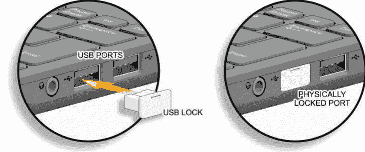

图 10.1 USB 端口锁

首先，你需要通过简单的图表来量化可能遇到的问题，如图 10.2 所示。

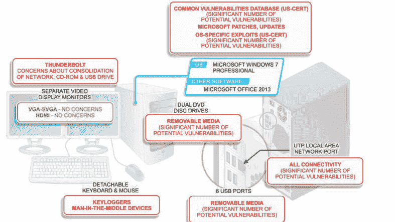

图 10.2 已知漏洞

解决图中红色部分识别的问题需要一种重要的程序化方法。你所采取的任何方法都无法完全消除漏洞，也无法解决所有现有（或零日）攻击向量。作为专业人士，你应该利用 NIST 特别出版物 800 系列指导文件来定义所需的安全态势。

这些指南总结为以下步骤。

## 创建评估策略。

-   定义环境。
-   确定保护公司财产和材料的组织优先级。
-   确保高级管理层支持。
-   程序性地定义流程和尽职调查，以形成信息丰富的评估结果。

## 制定风险管理计划。

-   确定失去主机控制的风险。
-   识别可能针对你所在域体的潜在敌对活动（例如，他们是否针对知识产权？）。
-   提交一份风险知情报报告，确保组织认识到风险并提供支持/认同，以解决、减少或防止损失风险。

## 使用 NIST 安全控制。

-   创建个人问题和相关攻击向量的矩阵。
-   为每个问题提供一种或多种缓解方法。
-   选择需要实施的适当 NIST 安全控制系列（管理、操作、技术）（参考 NIST SP 800-53、表格、电子表格、工具）。
-   确保选择这些控制措施的理由与风险相称。应在指导中描述低、中、高三种实施级别的选择，并帮助确保具有成本效益的解决方案。不要过度指定控制措施！


## 部署安全硬件和软件。

+   选择、配置并部署商业解决方案，或确定有效的开源安全解决方案。在许多情况下，开源社区已经提供了非常有效的工具，应评估是否采用。

## 创建有效的审计计划。

+   提供有效性测试，以挑战你的安全态势。（例如，使用开源或商业密码破解工具来挑战你的域或本地密码存储库。）如果用户使用了不符合组织安全策略的简单密码，测试将对用户产生冲击和警示作用。

+   执行物理巡查（实际检查键盘和鼠标是否存在键盘记录器）。例如，你可以实施图 10.3 中列出的程序。

物理巡查可分为以下关注领域：

### 可拆卸键盘和鼠标

+   不允许使用个人所有的键盘和鼠标。
+   实际检查鼠标是否存在中间人攻击设备。

### 六个内置 USB 连接端口

+   禁用 USB 端口，如有必要，为其提供物理锁。
+   鼓励或要求所有与公司相关的业务使用网络存储。

### 独立显示器（Thunderbolt 端口）

+   不鼓励或禁用对外部端口的连接。
+   提供对外部连接设备的检测/审计。禁用端口。

### UTP 本地局域网连接端口

+   提供网络访问控制，例如二层保护机制（ACL、端口授权等）。

+   - 将未经授权的连接路由到本地蜜罐进行捕获和分析。
+   - 实际检查是否存在中间人攻击设备。

### Microsoft Windows 7 专业版操作系统和 Office 2013 软件

+   - 升级和补丁管理策略。
+   - 需要严格的处理流程。
+   - 监控 US-CERT。
+   - 维护已批准应用程序的列表。
+   - 强制执行用户策略，未经系统管理员批准和 IT 支持，禁止安装任何软件。
+   - 提供强有力的安全意识培训，并将安全原则延伸到你的组织和员工队伍中。

### 双内置 DVD 光盘驱动器

+   - 移除 DVD 光盘驱动器或其他媒体控制器。
+   - 提供采购流程或程序，要求对此类设备进行书面论证和批准。
+   - 提供独立工作站，在主机上使用媒体之前先对其进行扫描。

## 计算设备安全场景 2

由于你在为公司的台式计算机创建安全策略和配置方面表现出色，你已被指派为组织销售人员使用的笔记本电脑制作同类材料。

显然，这些计算机是便携式 PC，既可在办公室使用，也可在旅途中的不同地点使用。这些计算机配备以下设备：

+   - 内置键盘和显示器
+   - 两个内置 USB 连接端口
+   - UTP 本地局域网连接端口
+   - Microsoft Windows 10 专业版操作系统
+   - Microsoft Office 2016 软件
+   - 双 SD 卡读卡器插槽
+   - 内置无线网络功能
+   - 外部 VGA 显示连接端口
+   - 内置 DVD 光盘驱动器

在不完全重复前一场景的情况下，我们可以说处理同一个问题有许多不同的方法。专注于移动计算机（笔记本电脑、平板电脑、iPad 等）会更加困难，这取决于用户从业务角度需要用它做什么，以及你能通过电子策略和书面策略控制什么。可移动设备很可能被频繁使用。远程连接、酒店/自助终端连接以及对设备本身的物理控制可能会带来独特的挑战。在这种情况下，许多公司干脆利用虚拟化（有时也称为业务沙箱）来隔离用户及其与业务的交互。对于笔记本电脑，你至少应确保以下事项：

**使用强大的防病毒保护。**

+   - 检查应用程序、加密文件和可移动媒体。

**使用强身份验证方法以确保适当的访问权限。**

+   - 至少使用多因素认证，并利用硬件令牌。

**当设备连接到本地业务网络以及从远程网络连接时，部署严格的审计流程。**

+   - 即使在本地方办公环境中，也建议使用 VPN 隧道连接到代理和 DMZ 环境。
+   - 审查日志，以了解有多少以及何种类型的连接、媒体或用户已访问或试图访问该设备。

**制定设备管理的电子策略。**

+   - 有时需要按角色、用户和应用程序强制实施访问控制。

## 关于电子设备的说明

确保设备仅用于业务目的。大多数人随身携带多种电子设备，因此限制员工仅将公司设备用于业务访问，而不是在旅行时观看电影和浏览网页，并不会带来太大不便。

## 复习题

以下问题测试你对第二部分内容的掌握情况。

+   1. 保护便携式 PC 与保护机柜安装的台式计算机有何不同？

答案：在大多数情况下，将可能由不同用户使用且在许多情况下是便携式的台式机和便携式个人计算机（PC）系统锁起来并不现实。在许多情况下，给定的计算机工作站可能经常由不同人员使用——例如白班员工和夜班员工。在这种应用中，必须采取行政安全措施来保证适当的身份验证和访问控制。扩展坞的主要功能之一是提供可锁定到桌面的附件，以防止未经授权的用户在便携式设备未使用时将其拿起并直接带走。

+   2. 列出恶意个人通常获取程序和数据的三个位置，以进行损坏、销毁或窃取。

答案：在计算设备和智能控制设备中，个人通常获取程序和数据的三个一般位置是：当数据在内存中时、当数据存储在设备（如硬盘驱动器和闪存驱动器）上时，以及当数据从一个地方传输到另一个地方时。

+   3. 必须使用 __________ 选项来设置可用于访问 CMOS 设置实用程序的密码。

答案：用户密码（User Password）

4. 哪种微处理器/操作系统功能旨在保护内存的某些区域，以防止恶意软件通过将其代码插入另一个程序的数据区来接管计算设备？
答案：不可执行（NX）位或执行禁用（XD）位功能。

5. 描述操作系统用于保护其文件系统和存储数据的主要工具之一。
答案：访问控制列表（ACL）

6. 哪种工具被认为是与计算机和网络设备一起使用的主要用户身份验证工具？
答案：用户名和密码

7. 本地用户和组凭据在本地主机计算机中创建并存储在哪里？
答案：存储在本地计算机上的用户帐户数据库

8. 哪种管理工具使管理员能够创建密码策略，以防止攻击者使用暴力攻击获取帐户密码，从而利用这些密码闯入系统？
答案：密码锁定策略设置

9. 在 Linux 系统中，哪种工具与 Linux 内核的审计模块配合，将相关事件记录到磁盘上？
答案：审计守护进程（audit daemon）

10. 描述与数据加密过程相关的步骤。
答案：加密数据涉及获取数据，并使用密钥代码（或加密密钥）对其进行处理，该密钥代码定义了原始数据版本是如何被操纵的。任何获得加密密钥的人都可以通过使用解密算法（或解密密钥）的解密过程来解码消息。

11. 如果你配置了本地防火墙，然后发现本地主机没有收到任何电子邮件，应检查哪个逻辑 TCP 端口以查看它是否被阻止？
答案：端口 110 – POP3

12. 使用 Web 浏览器时，如何知道正在使用 SSL 链接来提供加密服务，以防止数据在互联网传输过程中被未经授权访问？
答案：SSL 链接始终标识为 HTTPS:// 站点，而不是简单的 HTTP://。

## 图 10.3 实施

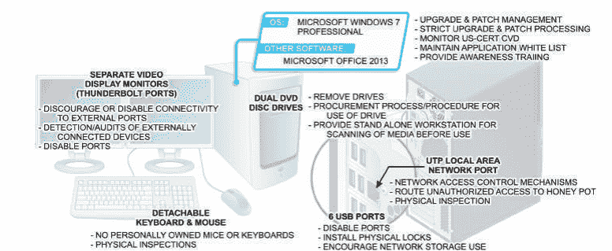


2. 没有此密码，系统将永远无法达到入侵者可用于访问其内部周界和内部信息的运行级别。
    A. 管理员
    B. 监督
    C. 用户
    D. 超级用户
    答案：C

3. 在本地主机系统中，以下哪个区域是加固系统的首要位置？
    A. 硬件
    B. 文件系统
    C. 操作系统
    D. 应用程序
    答案：B

4. 哪种类型的物理访问端口最有可能被用来将恶意软件注入计算和智能控制设备，而这些设备可能受到很好的网络访问保护？
    A. IEEE-1394 火线端口
    B. HDMI 连接器
    C. USB 端口
    D. 并行端口
    答案：C

5. 从以下选项中，选择与操作系统文件系统无关的攻击类型。
    A. 缓冲区溢出攻击
    B. 竞争条件攻击
    C. 备用数据流
    D. 目录遍历
    答案：A

6. 通常需要什么类型的登录来验证用户并提供对本地主机资源的访问？
    A. 管理员登录
    B. 网络登录

## 保护本地网络

- 第11章 现实世界中的本地网络安全
- 第12章 网络基础知识
- 第13章 理解网络协议
- 第14章 理解网络服务器
- 第15章 理解网络连接设备
- 第16章 理解网络传输介质安全
- 第17章 本地网络安全：复习题

## 现实世界中的本地网络安全

以下挑战将为你提供第三部分中将要学习的概念的上下文参考点。由于你尚未阅读第三部分的章节，本章中的挑战旨在向你介绍在现实世界中将要面对的本地主机场景。在本章中，你将学习：

- 将 NIST 网络安全框架“识别”功能的适用类别和子类别应用于特定场景，以记录网络资产及其可能存在的漏洞。
- 使用“保护”功能的适用类别和子类别，生成可用于保护指定场景中网络资产的具体策略和行动。
- 应用“检测”功能的适用类别和子类别，识别可用于监控场景中网络的技术、策略、实践和战略，以确定是否正在发生安全事件。
- 应用“响应”功能的适用类别和子类别，创建事件响应计划，以覆盖与所呈现场景相关的特定安全事件。
- 将 NIST 网络安全框架“恢复”功能的适用类别和子类别应用于该场景，以实施从特定网络事件中恢复的解决方案。

### 安全挑战

本章将启动你即将在第三部分中学习内容的思考过程。与其简单地尝试吸收这些章节中将要学习的所有信息，不如从这里开始，更好地理解这些信息在现实世界中的相关性。

在第19章中，你将返回这些场景，并应用你在第12至18章中学到的知识。你还将把你的观察结果与为这些场景提供了观察结果和解决方案的专业安全专家的观察结果进行比较。

#### 本地网络安全场景1

你的任务是为一家人数不到20人的小型教育内容开发公司配备新数据网络提供建议。这家新公司的规模已经超出了其原有网络和计算设备的承受能力，希望在新设施中从一个能够满足其当前需求的网络开始。

由于其业务基于在一个竞争激烈的市场中创造IP（知识产权），他们要求提供设备和配置建议，以建立他们能负担得起的最安全的物理网络环境。

具体而言，客户要求你为实施其服务器相关的安全策略和标准提供全面建议。图11.1提供了公司电子工作流程结构的概览。

公司的主要职能可以组织如下：

- **高管团队** – 高管团队进行以下电子活动：
  - 通过互联网进行电子银行业务
- **行政人员** – 行政人员参与以下电子职能：
  - 管理基于服务器的会计、仓储和库存程序
  - 管理电子员工薪资和工时记录

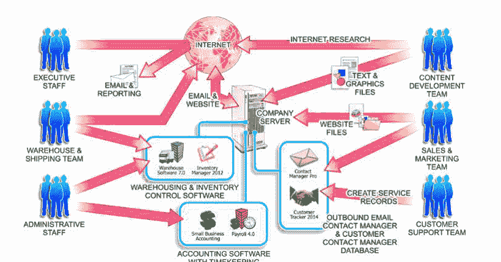

**图 11.1 公司布局**

- **销售与市场团队** – 销售和市场人员，他们在公司内部工作，并根据需要出差以寻找客户、与外部销售代表互动以及进行客户拜访和演示。他们参与以下电子活动：
  - 处理收到的电子邮件和客户销售电话
  - 操作外发电子邮件联系人管理器
  - 使用基于服务器的客户管理数据库程序跟踪客户互动
  - 出差时与总公司互动，以检索文档、产品更新、电子邮件和其他通信
  - 与他们的互联网ISP和内部内容开发团队互动，以管理和更新公司网站
- **内容开发团队** – 作家、编辑和艺术家。其中一些工作人员在公司设施内工作，一些人在远程生活和工作，从不物理访问设施，还有一些人将内部工作与远程办公相结合，因此每周在办公室工作一两天。他们的电子活动包括以下内容：
  - 在本地机器上创建文本和图形内容，但需要尽可能自由地在团队成员之间共享这些信息
  - 在实验室环境中对技术产品进行基于网络的和动手研究
- **客户支持团队** – 专门处理客户技术支持电话、测试失败报告以及为IP中的任何错误或遗漏创建新的或更新内容的技术人员。他们还安排和跟踪必须交付给客户的替换和更新产品。他们的活动包括：
  - 与客户管理程序互动，以查看过去的客户互动并创建问题电话和解决方案的服务记录
  - 与内容开发团队互动，以共享客户报告的内容问题，并根据需要提供粗略的修订材料
- **仓库和运输团队** – 参与产品接收、存储、库存跟踪和运输的工人。这些员工有以下与其工作相关的电子活动：
  - 与公司会计软件的仓库和库存部分互动，以更新和跟踪产品接收和运输以及当前库存水平
  - 通过互联网与联邦快递、联合包裹服务公司和公路运输公司互动，以安排和跟踪运输

请注意，该组织的许多软件包可能不是最新版本。虽然IT界希望我们相信每个人都在运行每个软件包的最新版本，但事实并非如此，即使对于较大的组织也是如此。在本场景中的这样的组织中，仍然有许多服务器和计算机运行Windows 2003 Small Business Server和Windows XP/Vista——即使这些版本的支持已经停止。


考虑到此场景，请提供有关如何实现其服务器功能的建议，以及应采取哪些安全措施来保护其企业资源。建议应包括但不限于物理保护服务器和服务器机房、建立保护公司知识产权和个人信息的政策，以及建立维护公司服务器的程序。

## 风险评估 1

根据本场景提供的信息，考虑以下 NIST 功能并对每个功能列出的类别和子类别生成想法。在这些考虑的基础上，您将随后被介绍如何实施所要求的功能的具体信息。

## 识别

创建与服务器系统相关的物理资产清单（NIST ID.AM-1）。列出执行公司网络操作所需的软件平台和应用程序（NIST ID.AM-2）。识别与所呈现场景的服务器相关的可能资产漏洞（NIST ID.RA-1）。确定与公司服务器相关的信息安全角色和职责（ID.GV-2）。

## 保护

一般描述您如何保护前一点中确定的物理资产（NIST PR.AC-2）。身份和凭证将如何为授权服务器用户进行管理（NIST PR.AC-1）？远程访问服务器将如何管理（NIST PR.AC-3）。记录服务器访问权限将如何管理（NIST PR.AC-4）。记录保护存储在服务器上的数据的保密性、完整性和可用性的策略（NIST PR.DS-1, NIST PR.IP-4, NIST PR.PT-1）。

## 检测

您将如何知道有人或某物正在尝试访问、禁用或破坏与服务器机房相关的设备和/或系统？您如何检测可能影响服务器运行的异常和事件（NIST DE.CM-2, 8）？

- 需要部署哪些类型的系统来监控人员活动以检测与服务器相关的潜在网络安全威胁（NIST DE.CM-1, 3）？

## 响应

当服务器或服务器机房的物理安全遭到破坏时，可能需要哪种类型的响应计划（NIST RS.AN-1, 2, 3）？

- 考虑到公司服务器上保存的信息，当服务器机房的物理安全遭到破坏时，可能需要哪种类型的响应计划（NIST RS.CO-4, 5）？

## 恢复

当设施中的一个工位发生一般物理安全漏洞时，可能需要哪种类型的恢复计划（NIST RC.RP-1）？

- 如果公司服务器安全遭到破坏，恢复计划可能包括哪些项目（NIST RC.CO-1, 2）？

使用您的作品集记录此挑战的观察结果。在本章结束时，您将被要求再次访问此信息，以评估您对该场景的原始知识，并将其与您在本章及其相关实验程序中获得的信息进行比较。您还将能够将您的观察结果与在职安全专家的观察结果进行比较，以提高您对该主题的理解。

## 本地网络安全场景 2

您的服务器咨询任务已扩展到包括为组织的通信媒体和网络连接设备提供建议，以及实施物理网络架构的技术。

根据之前提供的信息，设计一个网络以安全地连接公司的用户，同时注意考虑哪些类型的信息和服务需要不同级别的安全性。图 11.2 提供了公司网络结构的概览。

## 风险评估 2

根据本挑战提供的信息，考虑以下 NIST 功能并对每个功能列出的类别和子类别生成想法。在这些考虑的基础上，您将随后被介绍如何实施所要求的功能的具体信息。

## 识别

创建公司网络架构中涉及的物理资产（设备和系统）的清单（NIST ID.AM-1, PR.PT-3, 4）。创建地图

## 响应

您需要如何响应通过您在前一点中实施的设备、系统和步骤识别出的异常和事件（NIST RS.AN-1, 2, 3）？

## 恢复

您可以采取哪些步骤来从旨在访问、损坏或破坏您上面确定的资产的行动中恢复（NIST RC.RP-1）？

再次使用您的作品集记录此挑战的观察结果。在本章结束时，您将比较您最初的想法和观察结果与您在完成材料后产生的想法和观察结果。

## 总结

记录本章中呈现的风险评估的观察结果。在第 19 章中，您将比较这些最初的想法和观察结果与您在阅读第 12 章至第 18 章后产生的想法和观察结果。您还将能够将您的答案与专业安全专家的答案进行比较。

## 网络基础

*当只有两个智能* 设备连接时，可以使用电缆、光信号或无线电波进行简单的直接连接。互连的设备只需使用相同的数字语言并使用商定的通信控制方法来管理它们之间信息流即可。然而，当多于两个智能数字设备链接在一起时，就会形成网络。当第三个设备添加到系统中时，必须实施额外的控制方法，不仅控制设备之间的对话，还要确保网络上的正确方接收到信息，并且不打算发送给其他方的信息保持私密。在本章中，您将学习：

- 识别常见网络类型的特征
- 描述 OSI 网络模型不同层的主要功能
- 讨论 OSI 模型层如何对应于网络数据传输数据包的生成
- 解释不同 OSI 模型层如何适用于网络安全问题
- 描述标准网络拓扑

## 理解网络基础

在信息技术（IT）领域，存在两种基本类型的网络：

- 存在于相对有限的地理区域的网络被称为局域网（LAN）。
- 分布在更广地理区域的网络被称为广域网（WAN）。

## OSI 网络模型

网络是复杂、多方面的结构，需要计算机设计师、网络设备设计师、操作系统制造商和网络应用程序提供商之间进行大量交互。已经提出了多个倡议，为这些团体在设计产品时提供模型作为蓝图。虽然您应该知道存在不同的分层网络模型，但最广泛讨论的倡议是由国际标准化组织提出的开放系统互连（OSI）模型。

OSI 模型帮助我们概念化两个联网系统之间数据的处理方式。为此，OSI 模型将数据的工作流程划分为抽象层。虽然这些层在任何意义上都不是字面上的，也不会为产品设计提供任何实际屏障，但这些层确实有助于人们尊重和理解数据管理的流程。

OSI 模型的层如图 12.1 所示。在图中，左侧的每一层都与右侧在其内部运行的一组协议相匹配。如您所见，许多协议在网络架构中发挥作用。

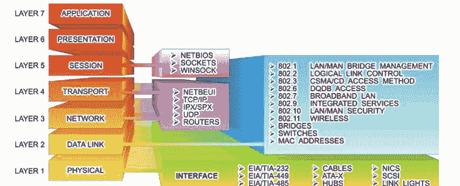

图 12.1 OSI 网络模型

各层的主要功能在以下各节中进行了总结。


## Layer 1: Physical

这一层关注用于传输数据的传输介质。与该层相关的功能包括将数据移至传输介质、提供电信号或光信号、通信端口与介质之间的机械兼容性，以及物理连接的激活和停用。

## Layer 2: Data Link

这一层涉及控制数据如何在通信点之间打包和移动。在这一层，数据被格式化为适合传输的帧。该层级的组件还为帧添加错误检测和纠正功能，以及媒体访问协议和关于向同一网络段上的特定节点传输的特定信息。

## Layer 3: Network

网络层元素负责控制数据包在不同通信节点、网络段或介质类型之间的路由。这包括信号在从一种介质类型传递到另一种介质类型时的复用和解复用、组装和拆卸消息数据包，以及建立、维护和终止连接。

## Layer 4: Transport

传输层组件负责提供有序的端到端数据流，其中包括数据包的排序以及提供基本错误恢复功能和流量控制。

## Layer 5: Session

模型这一层专门用于在应用程序之间设置和管理会话，以及提供诸如安全等参数。该层组件进行的活动包括停止和启动数据传输、控制应用程序之间的数据流，以及提供网络故障恢复选项。这一层处理传输安全选项的管理，例如身份验证和隧道协议。

## Layer 6: Presentation

这一层级元素负责控制数据在目的端对用户的外观。该层组件提供的功能包括视觉格式化和呈现数据、处理数据压缩和加密功能，以及会话的启动/停止控制。

## Layer 7: Application

OSI 模型的最高抽象层关注网络对终端用户应用程序数据的处理。电子邮件和网络浏览器等服务是应用层发挥作用的应用示例。在模型这一层，用户 ID 和密码经过身份验证，并提供用户服务。

## Data Transmission Packets

当数据从一个通信节点移动到另一个通信节点时，与 OSI 模型每个层相关联的元素都会在消息中添加一个头部，其中包含执行传输所需的信息。技术上，在某些 OSI 层，还会添加一个小尾部以创建信封。但为了讨论方便，我们将重点关注头部。数据可以是数字化文本、数字、语音、视频或任何其他类型的数字化信息。当在发送节点发出移动数据的命令时（例如，通过按电子邮件消息上的发送），打包过程按图 12.2 所描述的方式进行。

随着数据包离开应用程序，在其通过不同的 OSI 层前往传输介质的途中，会在消息中添加额外的头部（信息块）。在接收端，整个消息被带入指定的接收节点，其中每个层的头部被检查，适当的头部被移除，并由其对应的层对消息进行处理。

通信过程中涉及的步骤通常在发送消息的用户无需干预的情况下完成。不同的头部和活动是应用程序、物理网络适配器以及中间所有“层”的功能。

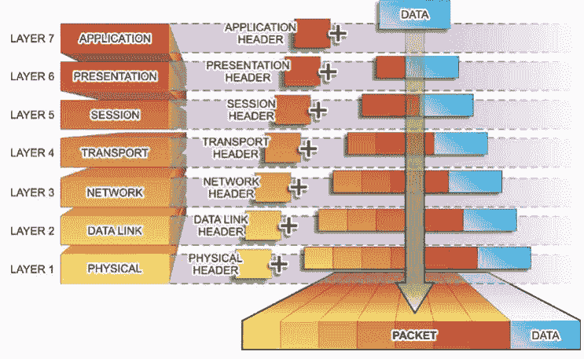

FIGURE 12.2 Building Transmission Packets

## OSI Layer Security

每门网络课程都会从设备、协议和功能在每一层存在的角度来研究 OSI 模型。然而，不同的网络安全挑战可能存在于每一层。表 12.1 列出了与每一层相关的安全重点。

TABLE 12.1 OSI Layer Security

| OSI LAYER | Network Security Model | Exploit Type | Security Focus |
|---|---|---|---|
| 1) Physical Layer | 7) Physical Level | Physical Tampering/ Break-in | Physical Security |
| 2) Data Link Layer | 6) VLAN Level | Network Scanning Local/Internal | Access Security |
| 3) Network Layer | 5) ACL Level | Network Scanning Complete/Internal | Domain Security |
| 4) Transport Layer | 4) Software Level | Software Specific Exploits | Port Security |
| 5) Session Layer | 3) User Level | Social Engineering – Users | Authentication/Encryption |
| 6) Presentation Layer | 2) Administrative Level | Social Engineering – Administrators | Authentication |
| 7) Application Layer | 1) IT Department Level | Social Engineering – IT Staff | ID/Authentication |

你也可以将前几章中开发的三层安全环应用于 OSI 模型的层。事实上，三层环实际上存在于两个地方——发送设备和接收设备。因此，外围边界在每个设备的物理终止或连接点处建立。设备之间的电缆或无线电波连接它们的外部边界。

外部边界对应于 OSI 模型的第 1 层组件。保护网络中的物理层涉及保护物理介质，以及网络和通信设备。

同样，内部边界与模型第 2 层组件相关。在此层工作的组件代表第一层逻辑防御。在此层，数据可以根据其身份被接受、丢弃或转发。

最后，内部环可以被视为包括第 3 层到第 7 层。这些层中的每一层都提供了防止未经授权移动到更高层的选项。例如，与防火墙相关的端口阻止机制在第 4 层工作。

然而，第 7 层组件代表网络攻击最期望的目标。针对这一层的攻击旨在控制物理资产或破坏软件应用程序的运行。

在第三部分中，你将了解不同网络组件的运行、它们在 OSI 架构中的位置，以及它们相关的安全漏洞和补救措施。

## Network Topologies

网络拓扑是第 1 层物理（或逻辑）连接策略，分为四种基本配置，如图 12.3 所示。

- Bus
- Ring
- Star
- Mesh

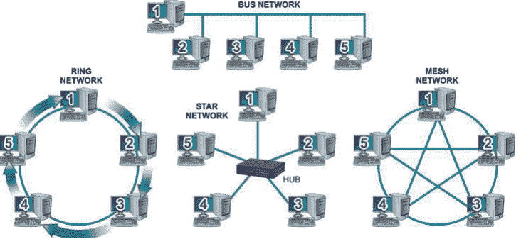

### Bus Topology

在总线拓扑中，网络的*节点*或站点连接到中央通信链路。每个节点在总线上有唯一的地址，使其与其他网络用户区分开来。任何节点都可以将信息放置在总线上。信息必须包含信息所针对的节点或节点的网络地址。连接到总线的其他节点将忽略该信息。

### Ring Topology

在环形网络配置中，通信总线形成闭合环路。每个节点检查网络上经过的信息。

内置于每个节点网络适配器中的中继器将再生每个未发往自己的消息并将其发送到下一个指定节点。源节点最终会收到消息并将其从环中移除。

环形拓扑往往提供非常高的数据传输速率，但需要额外的管理开销。需要额外的管理来确保可靠性。如果环形网络中的一个节点失效，整个网络就会失效。为克服这一点，环形设计者开发了具有主次数据路径的环，如图 12.4 所示。如果主链路发生中断，网络控制器可以将数据重新路由到次级链路以避免中断。

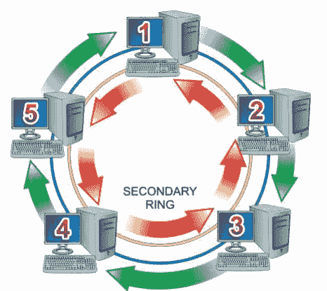

FIGURE 12.4 Primary/Secondary Ring Topologies

### Star Topology

在星型拓扑中，网络的逻辑布局类似于树的分支。所有节点都通过分支连接到中央单元，分支最终通向中央单元。节点通过中央单元相互通信。

中央站通过轮询节点一个接一个来协调网络的活动，以确定它们是否有信息要传输。如果有，中央站会给该节点一个预定的时间片进行传输。如果消息传输时间超过分配的时间，消息将被切成小的信息包，在几次轮询周期中传输。


## 网状拓扑

网状网络设计提供了最基本的网络连接方案和最广泛的管理方案。在这种拓扑中，每个节点都与网络中的所有其他节点有直接的物理连接。网状拓扑被用于两个非常大的网络环境——公共电话系统和互联网，以及小型无线微微网通信网络，其中包括蓝牙和 ZigBee 网络。

微微网是为在同一信道上通信而分组在一起的设备的小型、短距离网络。其中一个设备作为主设备或协调器运行，而其他设备作为从设备运行。主设备的角色可以在网络中循环，不同的设备在该角色可用时承担该角色。

## 逻辑拓扑

如果节点只是简单地相互连接，那么可视化前面描述的物理拓扑的连接就很容易了。然而，在大多数网络配置中通常并非如此。这是因为大多数网络采用了集线器、交换机和路由器等连接设备，这些设备改变了实际连接方案的外观。因此，逻辑拓扑不会与物理拓扑的外观相匹配——连接方案的细节隐藏在连接设备内部。

作为说明，图 12.5 显示了使用连接设备将连接集中在单个位置的典型网络连接方案。物理拓扑看起来像星型。然而，连接路由器的内部布线提供了逻辑总线拓扑。以物理星型拓扑实现逻辑环形或网状拓扑的情况并不少见。

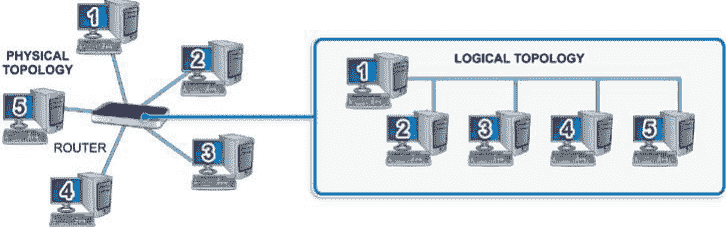

**图 12.5** 逻辑拓扑

与 SSL 不同，IPsec 在 OSI 模型中运行于第 3 层并保护网络中的所有内容。IPsec 与 SSL 的不同之处还在于它是在客户端系统上实现的，而 SSL 则内置于浏览器中。所有这些结合起来为传输数据提供了更安全的环境，通常速度更快。IPsec 有两种模式：

- ► 传输模式 – 仅封装 IP 有效载荷。
- ► 隧道模式 – 整个 IP 数据包都被封装。

连接安全包括在通信前对两台计算机进行身份验证，然后确保它们之间的保密性。Windows 采用 IPsec 来实现连接安全。

## 步骤

在本步骤中，您将发现 IPsec 的配置位置和方式。您将创建一个新的连接安全规则，并探索与 IPsec 相关的选项。本步骤旨在指导您如何创建 IPsec 通信；但是，在此环境中您将无法对其进行测试。

## 访问 IPsec

IPsec 位于 Windows 防火墙高级安全中。它已被重命名为连接安全；然而，通常认为连接安全是通过使用 IPsec 规则实现的。

- 1. 打开您的机器。
- 2. 使用您的管理员账户登录 Windows。
- 3. 在桌面上，在任务栏中嵌入的搜索栏中，输入 wf.msc 并按 Enter。
- 4. 这应该启动 Windows 防火墙高级安全。
- 5. 单击连接安全规则条目，如图 12.6 所示。中间窗格应没有当前建立的规则。
- 6. 展开监控，然后通过选择每个旁边的箭头展开安全关联，如图 12.7 所示。

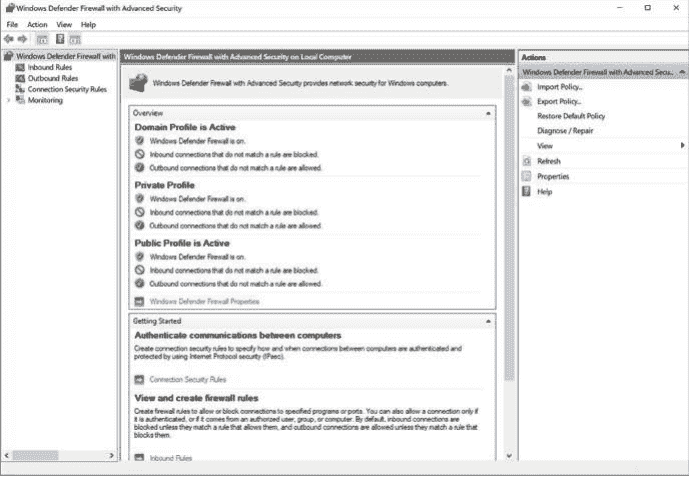

**图 12.6** Windows 防火墙高级安全


**图 12.7** 展开的监控和安全关联项

5. 阅读每个的定义并选择请求对入站和出站连接进行身份验证，如图 12.9 所示。


图 12.9 新建连接安全规则向导 – 要求窗口

6. 单击下一步以查看身份验证方法窗口。
尽管列出了四个选项，但涉及 Kerberos V5 的两个选项仅限于在 Active Directory 森林内进行的连接。

7. 选择旁边的高级单选按钮以使自定义按钮可用，如图 12.10 所示。

8. 单击自定义按钮以启动单独的自定义高级身份验证方法窗口，如图 12.11 所示。


图 12.10 自定义按钮处于活动状态。

在此窗口中，您可以自定义身份验证方法列表以满足您的需求。仔细探索该窗口。

9. 单击第一个身份验证方法下的添加按钮：添加第一个身份验证方法窗口将出现，如图 12.12 所示。

# 图 12.11 自定义高级身份验证方法窗口

# 图 12.12 添加第一个身份验证方法窗口

此添加第一个身份验证方法窗口提供四个可供选择的身份验证方法：

- - Kerberos V5
- - NTLMv2
- - 证书
- - 预共享密钥（不推荐）

10. 探索选项后，单击取消退出窗口。同样在自定义高级身份验证方法窗口中单击取消。

11. 您应该返回到新建连接安全规则向导 – 身份验证方法窗口。选择默认旁边的单选按钮，然后单击下一步。您将被引导至配置文件窗口。

这些选择与计算机上存在的网络连接有关。虽然网络办公室中的独立计算机可能不需要担心使用公共网络，但旅行用的笔记本电脑需要确保通过互联网的完整性和保密性。

12. 保持全部三个复选框选中，如图 12.13 所示，然后单击下一步移动到名称窗口。

13. 在名称下输入 Request IPsec Rule。保持描述（可选）：空白，如图 12.14 所示。

14. 单击完成以保存规则。您将被带回 Windows 防火墙高级安全窗口。新的规则现在位于中间窗格中，如图 12.15 所示。

注意右侧窗格。操作面板已更改，可用选项更多。

要创建 IPsec 连接，另一台计算机将使用相同流程配置连接安全规则。只要计算机想要传输信息，就需要完成 IPsec 连接。

# 图 12.13 新建连接安全规则向导 – 配置文件窗口

请记住，您选择了请求身份验证，不需要选项。因此，您仍然可以连接到其他任何人而无需安全连接。

- 15. 选择中间窗格中的规则以突出显示它。在右侧窗格中，单击属性条目，如图 12.16 所示。

每个选项卡都允许您调整在新建连接安全规则向导中选择的设置。

- 16. 探索每个选项卡，然后单击取消按钮退出属性窗口。


- - 封装安全有效载荷（ESP）提供源身份验证以及加密。ESP 将整个 TCP/UDP 数据报加密并封装在不包含任何端口信息的 ESP 头中。这意味着 ESP 将无法通过任何使用端口地址转换（PAT）的设备。
- - 安全关联（SAs）提供用于身份验证和密钥交换的多种算法和框架。
- - 互联网密钥交换（IKE）是用于在 IPsec 中设置安全关联的协议。

- 2. 与 SSL 不同，IPsec 在 OSI 模型中运行于第 3 层并保护网络中的所有内容。IPsec 与 SSL 的不同之处还在于它是在客户端系统上实现的，而 SSL 则内置于浏览器中。所有这些结合起来为传输数据提供了更安全的环境——通常速度更快。选项包括：
  - 请求身份验证，但不要求。
  - 要求对入站和出站进行身份验证。
  - 要求入站，请求出站。这是前面选项的混合。

- 3. IPsec 标准使用一套协议来实现其保护数据的目标。AH 提供完整性，而 ESP 同时提供完整性和保密性。
  - 完整性 – 确认数据包未被篡改。防止中间人攻击。
  - 保密性 – 确认数据包无法被恶意用户查看。
  - 防止网络嗅探器查看数据。

4. 连接安全在通信前对两台计算机进行身份验证，然后确保它们之间的保密性。Windows 采用 IPsec 来实现连接安全。


## 理解网络协议

*当通信路径中涉及*两个以上的计算机时，就会形成网络，并且必须采取额外的控制措施，以确保信息被发送到网络的正确成员。这是在控制网络连接上的信息流之外进行的。这些控制被实现为一组称为*协议*的规则。在本章中，你将学习如何：

- 讨论基本的网络协议
- 识别与不同 IP 地址标准相关联的组件
- 讨论与 MAC 地址相关的安全问题
- 识别 TCP/IP 协议套件的组件和操作，并识别其漏洞
- 提供网络子网划分的示例及其用途
- 描述以太网网络标准的函数和结构
- 对比点对点和客户端/服务器网络访问控制方法

## 网络协议的基础

*网络协议*是一组规则，规定网络中如何进行通信。为了使设备能够在网络上相互通信，它们必须全部使用相同的网络协议。

在复杂的网络中，例如互联网，为了处理由托管如此多不同类型的设备和应用程序而产生的复杂层级，会采用多层协议。参考第 12 章中的图 12.1，你可以看到不同类型的协议驻留在 OSI 模型从第 1 层到第 5 层的每个层级中。

例如，在第 1 层和第 2 层中，不同类型的通信介质（有线网络、无线网络、光纤网络）有不同的协议。第 1 层组件提供物理介质标准，而第 2 层提供逻辑传输标准化。第 3 层和第 4 层包含不同的网络路由方案（以确保一切到达应去的地方）、电子邮件处理应用程序、Web 应用程序和安全传输。

## MAC 地址

所有网络操作都依赖于地址层次结构，以便使网络的设备能够交换信息。网络操作中最基本的地址是媒体访问控制地址（MAC 地址），它作为连接到网络的每个设备的唯一标识符。这些地址通常由设备制造商分配并存储在其固件中。

生成 MAC 地址的标准 48 位格式指定六对十六进制数字。出于显示目的，该数字写成六个数对，用连字符（-）或冒号（:）分隔——例如，

```
13:A2:00:40:6B:8E:66
```

在 IEEE 术语中，这种原始的 48 位格式称为 EUI-48（扩展唯一标识符）。该格式对应于网络的原始以太网 IPv4 地址方案，并用于无线 802.11 和蓝牙网络技术。

MAC 地址代码的 EUI-64 位版本将代码扩大到八对十六进制数字。例如，一个给定设备可以被分配 MAC 地址 = 00:13:A2:00:40:6B:8E:66。该格式对应于 IPv6 地址方案，并包含在 Firewire、ZigBee 和 802.15 技术中。

正如你从第 12 章中的表 12.1 回忆的那样，MAC 地址与 OSI 第 2 层操作相关联。请记住，该层负责建立到每个网络端口的逻辑访问和连接。不同的网络连接设备，例如交换机和路由器，依赖于 MAC 地址作为构建和使用内部内容可寻址内存（CAM）表的基础。设备使用这些表来路由它们从一个网络段接收到的消息，将其路由到另一个网络段上的位置，具体取决于预期接收方连接到的硬件端口。

许多连接设备通过 MAC 学习和发现过程构建和维护其 CAM 表。当它们与连接到其物理端口的设备交互时，它们读取消息头以获取发送和接收设备的 MAC 地址，并连同其端口信息一起记录在 CAM 中。

## TCP/IP

虽然世界各地使用着许多不同类型的网络协议，但 TCP/IP（传输控制协议/互联网协议）协议套件构成了目前使用最广泛的网络协议。虽然这部分是由于互联网基于它，但 TCP/IP 因大多数操作系统都支持该协议而巩固了其作为企业网络首选协议的地位。它也可以用于任何拓扑结构（例如，以太网、令牌环等）。

当你尝试将不同类型的系统相互联网时（例如，Microsoft Windows 计算机和设备、Apple 计算机和设备以及 Linux 计算机和设备），这一事实变得非常有用。此外，TCP/IP 是一种可路由协议，因此其数据包可以在到达最终目的地之前在许多不同类型的网络上传输。

美国国防部最初开发 TCP/IP 协议作为一种抗黑客、防篡改且安全的跨网络传输数据的协议。它被认为是最安全的网络协议之一。此外，由于美国政府开发了它，因此没有人真正拥有 TCP/IP 协议，因此它被采纳为互联网的传输标准。

无论使用何种类型的计算机平台或软件，信息都必须以 TCP/IP 数据包的形式在互联网上传输。该协议要求将数据分组为称为*网络数据包*的捆绑包。TCP/IP 数据包主要设计用于允许消息分片和重组。它通过两个头部字段存在，即 IP 头部和 TCP 头部，其后是数据字段，如图 13.1 所示。


# 图 13.1 TCP/IP 数据包

TCP/IP 协议的主要部分建立在赋予其名称的两个核心协议之上：TCP 和 IP。TCP/IP 协议的 IP 部分在 OSI 模型的第 3 层运行，而组合协议标准的 TCP 部分在第 4 层运行。因此，IP 部分负责数据包及其实际交付，而 TCP 负责跟踪消息被分割成的各个段。

层之间的概念划分不应被视为精确。例如，协议互联网控制消息协议（ICMP）驻留在第 3 层，尽管它不提供数据包路由或寻址信息，因为它有助于第 3 层 IP 完成其工作。另一方面，作为另一个例子，桥接控制协议（BCP）是一种路由协议，但由第 4 层的 TCP 承载。

另一个需要了解的重要元素是 TCP/IP 协议如何建立连接。这是通过三向握手安排完成的，首先客户端向服务器发送一个同步（SYN）数据包。作为响应，服务器向客户端发送回一个同步/确认（SYN/ACK）数据包。在收到 SYN/ACK 数据包后，客户端向服务器返回一个确认（ACK）数据包，然后它们之间的对话就可以开始。图 13.2 说明了 SYN/ACK 序列。


图 13.2 SYN/ACK 序列

## TCP/IP 漏洞

由于 TCP/IP 数据包由许多不同的部分和字段组成，攻击者经常利用数据包的构成。借助适当的工具，操纵 TCP/IP 数据包的 IP 头部以伪造地址来隐藏攻击者身份是相当容易的。在操纵源和/或目标网络地址的情况下，这种操纵过程被称为 IP 欺骗，是许多类型网络和互连网络攻击的基础。IP 欺骗背后的想法类似于 MAC 欺骗，后者在本书本章的前一节中进行了讨论。

针对 TCP/IP 数据包的另一种常见攻击方法是 SYN 洪水攻击，它利用了 TCP/IP 用于在网络节点之间建立连接的三向握手。在这种类型的攻击中，攻击者向服务器发送 SYN 请求，但操纵握手以在 SYN 数据包中伪造不同的 IP 地址，或简单地扣留 ACK 数据包不发给服务器。

在第一种情况下，服务器会向被伪造的地址发送 SYN/ACK 数据包，该地址不会响应，因为它没有发送原始 SYN 数据包。在这两种情况下，服务器未收到 ACK 数据包这一事实导致其


等待一段时间。攻击者通常会向服务器发送一波 SYN 请求，使其填满半开连接，从而占用其资源。

当服务器处理这些请求的能力达到上限时，由于资源不足以处理该流量，它将停止提供服务。这被称为 *拒绝服务攻击 (DoS attack)*。

与 TCP/IP 操作相关的工具、攻击和预防方法将在本章后面结合服务 OSI 模型第 2、3 和 4 层的网络服务器和连接设备进行详细讨论。

## IP 地址

互联网服务提供商 (ISPs) 向其客户提供的互联网访问地址块称为互联网协议地址，或 *IP 地址*。IP 地址使每个系统成为网络中可达的成员。这就是识别单个用户以接收文件传输、电子邮件和文件请求的方式。目前使用两种版本的 IP 地址：IPv4 和 IPv6。IPv4 是通常被引用的互联网协议版本，因为其使用广泛。

### IPv4 地址

IPv4 地址以 XXX.YYY.ZZZ.AAA 的数字格式存在。每个地址由四个 8 位字段组成，用点分隔 (.)。这种指定地址的格式称为点分十进制表示法。十进制数字源自硬件所理解的二进制地址。例如，二进制网络地址为：

```
10000111.10001011.01001001.00110110 (binary)
```

对应于：

```
135.139.073.054 (dotted decimal)
```

你还会发现 IP 地址以 *八位组* 的形式提及。*八位组* 只是八个连续位的分组。在刚才给出的二进制示例中，最重要的八位组为 10000111 (或 135)。最不重要的八位组为 00110110 (或 054)。整个地址出现在四个八位组字段中，如前例所示。

在四个八位组内，每个 IP 地址由两部分组成：网络地址和主机地址。网络地址标识整个网络；主机地址标识网络内的单个成员。用于局域网的三种标准 IP 地址类别为：A 类、B 类和 C 类：

- A 类地址保留给大型网络，使用地址的最后 24 位（最后三个八位组或字段）作为主机地址。第一个八位组始终以 0 开头，后跟 7 位数字。因此，有效的 A 类地址范围在 `001.x.x.x` 到 `126.x.x.x` 之间。这允许一个 A 类网络支持 126 个不同的网络，每个网络近 1700 万个主机（节点）。
- B 类地址分配给中型网络。前两个八位组可在 `128.x.x.x` 到 `191.255.0.0` 之间变化。最后两个八位组包含主机地址。这使得 B 类网络可包含多达 16,384 个不同的网络，每个网络约有 65,534 个主机。
- C 类地址通常用于较小的局域网。在 C 类地址中，仅最后一个八位组用于主机地址。前三个八位组可在 `192.x.x.x` 到 `223.255.255.0` 之间变化。因此，C 类地址可支持约两百万个网络，每个网络 254 个主机。

### 子网

网络的各部分可以分组为子网，这些子网共享一个 IP 地址范围。会部署一个保护网关作为分段子网的入口和出口点。这些组被称为 *内联网*。内联网要求每个段都必须有一个保护网关作为该段的入口和出口点。在大多数情况下，网关是称为 *路由器* 或 *交换机* 的设备。路由器是一种智能设备，接收数据并将其定向到指定的 IP 地址。第 2 层交换机也是一种智能设备，但它将数据定向到指定的 MAC 地址。

一些网络采用防火墙作为对外网关。防火墙是硬件和软件组件的组合，为不同安全级别的网络之间提供保护屏障。管理员配置防火墙，使其仅将数据传递到和来自指定的 IP 地址和 TCP/IP 端口。

子网是通过 *屏蔽*（隐藏）子网内各单元的 IP 地址的网络地址部分而创建的。这实际上限制了数据的移动性，仅限于子网内的节点，因为它们只能识别其屏蔽范围内的地址。该概念在图 13.3 中有所说明。创建子网的三个常见原因如下：

- 将网络的一个段与所有其他段隔离。

  例如，假设一个大型组织有 1,000 台计算机，所有计算机都连接到网络。没有分段，来自全部 1,000 台设备的数据将流经每个其他网络节点。其效果是网络中的每个人都可以访问网络上的所有数据，并且网络运行会因不受控制的流量而显著变慢。

- 高效使用 IP 地址。

  由于 IP 地址方案定义为 32 位代码，因此只有一定数量的可能地址。虽然 126 个网络、每个网络 1700 万客户似乎很多，但在全球网络系统的范围内，这并不是很多地址。

- 在物理分隔的位置利用单个 IP 地址。

  例如，在校园的远程区域之间对 C 类地址进行子网划分，将允许将 253 个可能地址的一半分配给一个校园位置，另一半分配给第二个位置的主机。这样，两个位置都可以使用单个 C 类地址运行。

子网是通过输入数字来阻止每个 IP 地址八位组相关的任何或全部地址而建立的。例如，子网掩码值为 255 会阻止整个八位组，而值为 254 则会阻止该八位组中除一个之外的所有地址。

A 类 IP 地址的默认子网掩码为 255.0.0.0，而 B 类 IP 地址通常使用 255.255.0.0 的子网掩码。对于通常在小型组织和住宅网络中使用的 C 类地址，通常使用 255.255.255.0 的子网掩码。这会阻止前三个八位组（地址的网络部分），并将最后一个八位组的地址留给主机使用。当你在 Windows 中输入 IP 地址时，该类 IP 地址的默认子网掩码值会自动填入。

### IPv6 地址

IPv6 是一种较新的 IP 地址协议，旨在应对可用 IPv4 地址不足以容纳当今可联网设备的状况。在 IPv6 下，IP 地址已扩展到 128 位，以容纳庞大的 IP 地址数量。IPv6 还提供了对数据包发送者的身份验证以及对数据包内容加密。自 Windows Vista、Windows 7 以及更早的 Linux 发行版以来，操作系统中已包含对 IPv6 的支持多年。业界预计新版 IP 将支持手机、汽车电脑以及各种其他基于 IP 的个人设备。

128 位的 IPv6 地址方案将可用 IP 地址总数从 2³²（4,294,967,296）个 IPv4 地址提升到 2¹²⁸ 或 3.4 × 10³⁸ 个 IPv6 地址。当然，128 位对应于十六个八位组或八个十六进制（基数 16）字段。IPv6 地址通常以十六进制数字书写，用冒号分隔，如图所示：

```
2001:0db8:00a7:0051:4dc1:635b:0000:2ffe
```

由四个零组成的组可以用双冒号 (::) 表示。然而，一个地址中不允许出现多个双冒号。

```
2001:0db8:00a7:0051:4dc1:635b::2ffe
```

此外，通常会删除数字中的前导或最高有效零，以使地址更易管理：

```
2001:db8:a7:51:4dc1:635b:0:2ffe
```

在 URL 中使用时，IPv6 地址必须用方括号括起来：

```
http://[2001:0db8:00a7:0051:4dc1:635b:0000:2ffe]
```

与 IPv4 一样，IPv6 地址包含两条信息：网络数量和这些网络内可用的主机地址数量。IPv6 中地址网络部分的等价物称为路由前缀或简单地称为网络地址，而主机部分则称为接口标识符。

地址的路由部分通常被视为外部管理的变量，而地址的主机段则在路由地址范围内使用地址空间进行本地管理。在 IPv6 下，接口标识符的最小大小为 64 位。


因此，在提及 IPv6 地址的网络部分时，连续地址块中的第一个地址将以地址的网络部分开头，后跟一串全零：

```
2001: db8: a7:0000:0000:0000:0000:0000
```

并以网络地址加上一串“f”（代表 1111₂ 或 15₁₀）结尾：

```
2001: db8: a7: ffff:ffff:ffff:ffff:ffff
```

同样常见的是看到以 CIDR 表示法书写的 IPv6 地址范围。在 IPv6 下，该系统使用地址的路由前缀部分，后跟斜杠（/）字符和一个十进制数字，该数字表示前缀保留的位数。将此规则应用于刚才描述的地址块，可产生以下表示法：

```
2001:0db8:00a7::/48
```

/48 的值是通过取路由前缀占用的位数（12）并乘以每个十六进制位所需的 4 个二进制位计算得出的。

## 关于前导零的说明

在此示例中恢复了前导零以便于计算。在真实的 CIDR 地址中通常不会保留这些零。

IPv6 传输数据包格式与 IPv4 数据包不同。因此，两者不可互换（IPv4 设备与 IPv6 设备不直接兼容）。较新的计算设备和网络设备具备 IPv6 就绪检测和连接能力。

虽然 IPv4 和 IPv6 网络都可以划分为子网，但 IPv6 中没有与子网掩码等效的术语。

## 私有 IP 类别

由于互联网本质上是一个巨大的 TCP/IP 网络，其中连接到它的任何两台设备都不能拥有相同的地址，如果公司为每台系统都使用互联网可路由地址，那么世界早在很多年前就会耗尽 IP 地址方案。

相反，只要私有网络不需要在互联网上可路由，它就可以使用特殊的 IP 寻址方案。这被称为私有网络。在配置私有网络时，你必须设计一个在整个网络中使用的 IP 寻址方案。虽然从技术上讲，你可以在私有网络中使用任何你想要的 IP 寻址方案而无需咨询 ISP，但仍然存在这样的风险：任何意外的互联网连接都会让私有网络流量继续向外传播到互联网上。

为了解决这个问题，每个 IP 类别中都保留了一些特殊的网络地址范围，用于私有网络。这是根据 RFC 1918 规定的。这些保留地址未在互联网上注册给任何人，更重要的是，使用这些私有范围的流量无法公开路由。这意味着所有管理互联网流量的路由器都会拒绝转发使用这些私有寻址的网络流量。

如果你正在配置私有网络，应使用这些地址选项之一，而不是随意创建寻址方案。网络上的客户端总数通常决定了应使用哪个 IP 寻址类别。以下私有网络 IP 地址列表可供使用：

-   一个 `10.0.0.0` 的 IP 地址，子网掩码为 `255.0.0.0`
-   一个 `169.254.0.0` 的 IP 地址，子网掩码为 `255.255.255.0`（Microsoft AIPA 默认值）
-   一个 `172.(16-32).0.0` 的 IP 地址，子网掩码为 `255.240.0.0`
-   一个 `192.168.0.0` 的 IP 地址，子网掩码为 `255.255.0.0`

## 关于地址范围的说明

> 在 IPv4 下，`127.x.x.x` 地址范围是保留用于测试网络系统的特殊地址块。美国政府拥有其中一些地址用于测试互联网骨干网。`127.0.0.1` 地址保留用于测试本地系统上的总线。

此外，请记住，当你建立私有 IP 寻址方案时，所有主机必须具有相同的网络 ID 和子网掩码，并且网络上的任何两台计算机都不能具有相同的 IP 地址。

## 以太网

虽然 TCP/IP 协议已成为主导的数据封装和传输方法，但以太网标准系列已成为硬件和电气信号接口以及提供介质访问控制的主导力量。最初的以太网标准规范由施乐公司于 1976 年开发，并由国际电气和电子协会（IEEE）作为 IEEE-802.3 以太网协议发布。

局域网的设计使得整个网络在一个频率上同步运行。因此，在任一时刻只能有一组电子信号放在网络上。然而，数据可以在网络位置之间双向移动。根据定义，这使得局域网操作本质上是半双工的（也就是说，信息可以双向传输，但不能同时进行）。

在这样的网络中，必须使用某种方法来确定哪个节点可以使用网络的通信路径，以及可以使用多长时间。网络的访问协议处理这些功能，并且必须防止多个用户在任何给定时间访问总线。如果两组数据同时放在网络上，就会发生数据冲突，数据就会丢失。

以太网访问控制方法被称为带冲突检测的载波侦听多址访问（CSMA/CD）。使用该协议，想要通过网络传输数据的节点首先侦听局域网以确定其是否正在使用。如果局域网未被使用，该节点开始传输其数据。如果网络繁忙，该节点等待预定的时间让局域网空闲，然后接管网络介质。

如果两个节点都在等待使用局域网，它们会周期性地同时尝试访问局域网。发生这种情况时，会产生数据冲突，两个节点的数据都会变得无用。以太网控制器的接收部分监视传输以检测冲突。当它感知到数据位重叠时，它会像另一个节点一样停止传输。发送控制器生成一个中止模式代码，该代码被传输到局域网上的所有节点，告知它们发生了冲突。这会提醒任何可能正在等待访问局域网的节点存在问题。

接收节点（或多个节点）会丢弃在冲突发生前接收到的任何数据。其他等待发送数据的节点会生成一个随机定时数字并进入等待模式。定时数字是节点在尝试传输之前等待的时间。由于该数字是随机生成的，因此两个节点同时再次尝试传输的可能性非常低。

第一个超时的节点侦听网络以确定是否仍有活动在进行。由于它几乎总是发现局域网空闲，它便开始传输。如果两个节点确实同时超时，则会发生另一次冲突，中止模式/数字生成/超时序列将重新开始。最终，其中一个节点将获得网络的明确访问权并成功传输其数据。

虽然以太网策略允许多达 1024 个用户共享局域网，但从其冲突恢复技术的描述中可以看出，以太网局域网上的用户越多，发生冲突的可能性就越大，完成实际数据传输的平均时间也会更长。

### 以太网帧

在以太网标准下，信息被收集到一个称为*帧*的数据包中。图 13.4 描绘了一个典型的以太网帧。该帧携带以下六个信息部分：

-   前导码
-   目标地址
-   源地址
-   类型字段
-   数据字段
-   帧校验错误检测与纠正信息


**图 13.4** 典型以太网帧

从图中可以看出，以太网帧将许多可能需要在网络中导航的信息汇集在一起。特别是，它将源和目标 MAC 地址（本章前面已讨论）以及 IP 数据包头和数据处理在一起。


此外，以太网帧还增加了一个错误检测和纠正部分，使目的地的接收方能够检查所接收内容的正确性。如果不正确，通信系统将向原始地址生成一条消息，以重新发送损坏的帧。

## 以太网拓扑

以太网协议被归类为总线拓扑，已在多种不同的网络介质上实现，包括：

- 同轴电缆（IEEE 802.3 – 10BASE-2 或 -5）
- 双绞铜缆（IEEE 802.3 – 10/100/1000BASE-T）
- 光缆（IEEE 802.3 – 10/100/1000BASE-Fx、Lx 或 Sx）
- 无线射频（IEEE 802.11a-h）

在给定的公用事业发电和配电网络中，所有这些拓扑都可能出现。因此，电力技术人员需要熟悉有线和无线 IP 网络设备与策略，以及光纤和无线电通信系统。

## 网络控制策略

当你开始将计算机和设备连接在一起，以便它们能够共享资源和数据时，谁将控制网络（以及如何控制）的问题很快就会浮现。在某些应用中，例如编写这样一本书，作者、美术人员和排版人员能够共享文本和图形文件的访问权限，以及打印机等设备的访问权限，是很有好处的。然而，在商业网络中，公司必须控制谁能访问敏感信息和公司资源，以及他们应该在何时拥有多少访问权限。

网络的控制可以通过两种方式实现：

- 作为对等网络，其中每台计算机以环形或总线方式连接到网络，并与网络上的其他单元平等。
- 作为客户端/服务器网络，其中被称为客户端的依赖工作站与称为服务器的专用主计算机协同运行。

图 13.5 展示了典型的对等网络布局。在这种布局中，连接到网络的用户可以共享对不同网络资源（如硬盘和打印机）的访问。在对等网络中，本地单元的控制是相当自主的。这种网络配置中的节点通常包含本地硬盘和打印机，由本地计算机控制。这些资源可以由各个用户自行决定是否共享。对等网络的一个常见定义是：所有节点在不同条件下既可以充当其他节点的客户端，也可以充当其他节点的服务器。


## 图 13.5 对等网络

图 13.6 描绘了典型的客户端/服务器局域网配置。在这类局域网中，控制往往非常集中。服务器通常保存其客户端计算机的程序和数据。它还提供安全性和网络策略执行。

客户端/服务器网络布局的主要优点包括：

- 集中管理
- 数据和资源安全
- 网络服务

完成后，IPCONFIG /all 命令将列出所有当前网络参数。

ARP 命令会将网络主机的 IP 地址映射到 NIC 的 MAC 地址。

接下来，NETSTAT 命令将用于识别当前网络连接，NBTSTAT 命令将有助于解析网络上连接的其他节点的 Windows 计算机名称。

NET VIEW 命令将列出局域网上的节点。

TRACERT 命令将用于测试到远程主机的数据包路由，并检查数据包在各跃点之间传输所需的时间。

最后，PING 命令将用于测试网络节点的响应能力。

请记住，这些实用程序运行时实际显示的信息会因特定的网络配置而大不相同。此处提供的示例不会与真实结果完全一致。

## 操作步骤

## 修改命令提示符窗口

修改命令提示符窗口以提高可见性。

- 1. 将电脑启动到 Windows 10 桌面。
- 2. 在任务栏上的搜索框中，输入单词 command，如图 13.7 所示。
- 3. 右键单击“命令提示符”选项，然后选择“固定到任务栏”，以便直接在任务栏上为其创建快捷方式。
- 4. 单击刚创建的“命令提示符”快捷方式，打开“命令提示符”窗口。
- 5. 在“命令提示符”窗口顶部的空白区域中，右键单击，然后从出现的菜单中选择“属性”。

您要更改的第一个选项是字体大小。具体而言，您需要将字体大小更改为观看舒适且不超过电脑所使用显示器能力的尺寸。

- 6. 选择“字体”选项卡，并将字体类型更改为 Lucidia Console。
- 7. 单击“粗体字体”复选框，在“字体”列表下方的框中创建复选标记。您的“字体”选项卡应类似于图 13.8。


## 图 13.7 访问命令提示符


## 图 13.8 更改命令提示符字体类型和大小

## 更改颜色选项

更改颜色选项，使命令提示符文本更加突出。

- 1. 在“属性”窗口中，选择“颜色”选项卡。
- 2. 单击“屏幕文字”旁边的单选按钮，然后移至颜色选项，选择颜色图表末尾附近较亮的颜色之一。您应该选择一种易于看清的亮色，如图 13.9 所示。


图 13.9 更改命令提示符颜色

- 3. 单击该颜色，即可在“命令提示符”窗口的黑色背景下预览该颜色。
- 4. 完成字体和颜色调整后，单击“确定”。
- 5. 您所做的更改应立即生效。关闭“命令提示符”窗口。

## 使用 IPCONFIG 实用程序

使用 IPCONFIG 实用程序获取网络配置信息。IPCONFIG 实用程序允许查看本地计算机当前 IP 地址和其他有用的网络配置信息。

`IPCONFIG /all` 命令将显示所用计算机的完整网络信息。如图 13.10 所示，该实用程序将识别当前网络配置，包括 IP 地址和物理 MAC 地址。

当使用 DHCP 提供 IP 地址时，可以使用 `ipconfig /release` 和 `ipconfig /renew` 开关强制 DHCP 服务器撤销当前的 IP 地址租约并获取新的租约。


- 1. 单击先前固定到任务栏的“命令提示符”快捷方式，打开“命令提示符”窗口。
- 2. 在命令提示符下，键入 `ipconfig ?`，然后按 Enter 查看 IPCONFIG 选项。您可以向上滚动查看可能已滚出屏幕的缓冲文本部分。
- 3. 在命令提示符下，键入 `ipconfig /all` 并按 Enter。
- 4. 在表 13.1 的指定区域中，记录结果中与您的电脑相关的所需信息。

**表 13.1 局域网信息**

|  |  |
|  |  |
|  |  |

## 使用 ARP 实用程序

地址解析协议（ARP）实用程序可用于通过检查客户端或服务器上的 ARP 缓存内容来识别寻址信息。它主要用于将 IP 地址映射到属于活动网络连接的物理 MAC 地址。

- 1. 在命令提示符下，键入 arp，然后按 Enter。查看 ARP 实用程序的使用说明。
- 2. 在命令提示符下，键入 arp -a，然后按 Enter。这将显示类似于图 13.11 的信息。


图 13.11 将 IP 地址映射到 MAC 地址

- 3. 在以下行中记录主机计算机的 IP 地址，如“接口”行所示：
- 4. 查看网络连接的 IP 地址和物理 MAC 地址。

## 使用 NETSTAT 实用程序

netstat -e 命令将用于显示发送和接收的数据包数量，以及数据传输期间产生的错误数量。netstat -r 命令将显示所有当前连接的列表，并指示哪些连接处于活动状态。

- 1. 在命令提示符下，键入 netstat ? 并按 Enter。查看 NETSTAT 实用程序的使用说明。


2. 回到命令提示符，输入 netstat -e 并按 Enter 键，显示数据包统计信息，类似于图 13.12 所示。


## 图 13.12 观察数据包统计信息

3. 在命令提示符下输入 netstat -r 并按 Enter 键，显示已连接节点的路由表，如图 13.13 所示。


## 图 13.13 显示路由表

4. 在命令提示符下，输入 **netstat -n** 并按 Enter 键，以数字形式显示地址和端口号，如图 13.14 所示。


**图 13.14** 数字地址和端口连接

## 使用 NBSTAT 实用程序

NetBIOS over TCP 统计（NBSTAT）实用程序显示已连接计算机的 Windows NetBIOS 名称，列出它们的 IP 地址，并报告所有连接的状态。

`nbtstat -c` 命令将显示所有已连接主机的 NetBIOS 名称及其映射的 IP 地址。您可以使用 NBSTAT 实用程序解析当前网络连接。

- 1. 在命令提示符下，输入 **nbtstat** 并按 Enter 键。查看 NBSTAT 的使用说明。
- 2. 在命令提示符下，输入 **nbtstat -c** 并按 Enter 键。查看显示的远程主机标识信息，类似于图 13.15 所示。此信息是从 Student PC1x 机器上获取的。

## 使用 NET VIEW 实用程序

NET VIEW 实用程序列出当前连接到 LAN 的所有计算机。它还可以显示与特定网络主机关联的所有共享设备。

显示共享设备的格式是 `net view \\your server name`，其中服务器名是执行命令的工作站或服务器的实际 NetBIOS 名称。例如，`net view \\accounting` 将显示名为 accounting 的服务器支持的所有共享设备列表。

- 1. 在命令提示符下，输入 **net view ?** 并按 Enter 键。查看 NET VIEW 的使用说明。

2. 在命令提示符下，输入 net view 并按 Enter 键，列出连接到本地 LAN 的所有节点。结果应该是一个类似于图 13.16 所示的列表。


图 13.15 识别远程主机连接


图 13.16 创建局域网节点列表

3. 在以下行中记录 NET VIEW 列出的主机名：

4. 在命令提示符下，输入 net view \\host name（将 host name 替换为步骤 3 中列出的某个主机的 NetBIOS 名称）。

## 运行 *PING*

PING 命令是 TCP/IP 故障排除的关键工具之一。它使数据包发送到指定的 IP 地址，然后返回到发起机器。如果 IP 地址当前不活动，则会出现一条消息，说明事务已超时。

当连接到网络出现问题时，可以使用 PING 测试尝试连接的机器上的 TCP/IP 功能。如果在 *环回地址* (127.0.0.1) 和发起设备自身的网络 IP 地址之间成功执行 PING，则基本可以确定主机设备上的 TCP/IP 工作正常。

下一步是测试网络服务器和/或默认网关的 IP 地址。

作为最终测试，PING 远程主机服务器的 IP 地址。

> **注意** 对于发起计算机的 IP 地址或本地服务器的 IP 地址，请运行 IPCONFIG 或查阅表 13.1 中的数据。

- 1. 在命令提示符下，输入 **ping** 并按 Enter 键。查看 PING 的使用说明。
- 2. 在命令提示符下，输入 **ping 127.0.0.1** 并按 Enter 键，测试本地主机上的 TCP/IP。
- 3. 在命令提示符下，输入 **ping xxx.xxx.xxx.xxx**（其中 xxx.xxx.xxx.xxx 是表 13.1 中列出的主机 IP 地址）。
- 4. 按 Enter 键测试本地 TCP/IP 连接。应出现类似于图 13.19 的屏幕。


**图 13.19** 测试本地主机和 TCP/IP

5. 在命令提示符下，输入 ping 8.8.8.8 并按 Enter 键，测试与 www.google.com 的连接。

6. 应出现类似于图 13.20 所示的屏幕。


图 13.20 Ping 远程 Google 服务器集群

注意：此示例显示了 ping 8.8.8.8 Google 属性和 www.google.com 域名的结果，以便您可以同时看到这两个结果。

7. 关闭所有打开的窗口并关闭两台学生 PC。

## 实验问题

- 1. 哪个命令行实用程序用于查找计算机的主 DNS 后缀、IPv4 和 IPv6 地址？
- 2. ______________ 命令使数据包发送到特定 IP 地址，然后返回到发起机器。
- 3. 哪个命令检测通信路径上的路由器是否正常工作？
- 4. 哪个实用程序用于检查当前网络连接？
- 5. ______________ 实用程序用于将 IP 地址映射到 MAC 地址。

6. 哪个实用程序命令用于检查 LAN 上所有共享设备的列表？

## 实验答案

- 1. ipconfig
- 2. ping
- 3. tracert
- 4. netstat
- 5. ARP
- 6. net view
