## 第 14 章

## 理解
## 网络服务器

*网络服务器是专用* 计算机，设计用于在多用户、多处理器、多任务环境中高效运行。它们通常基于与普通消费计算设备截然不同的物理配置。通常，它们采用多个处理器，使用大型磁盘驱动器阵列，并安装在机架式或底座式机箱中。这些特性对于提供支持业务网络所需的扩展计算能力至关重要。在本章中，您将学习：

- 了解服务器安全性
- 了解网络管理员的作用
- 了解服务器软件安全的重要性
- 了解网络中的两类用户
- 了解网络身份验证选项
- 了解如何建立资源控制
- 了解如何维护服务器安全
- 了解如何扫描漏洞

### 网络服务器基础

服务器通常安装在特殊的机架式机柜中，如图 14.1 所示。这些机架主要设计用于让维修人员轻松访问以排除故障、维修或更换服务器组件。抽出式导轨和易于检修的面板是便于维护的机架式功能。这些功能对于业务客户端/服务器应用非常重要。

- FTP（文件传输协议）服务器通过 FTP 客户端软件在 Internet、外联网或内联网上传输文件。
- NAS（网络附加存储）服务器将存储从文件服务器后面移到传输网络上，允许任何具有访问权限的网络用户直接访问存储的 NAS 数据。
- SAN（存储区域网络）服务器在带有磁盘阵列控制器和磁带库的企业存储环境中运行。它们能够提供大规模的数据保护和检索。
- RAS（远程访问系统）服务器允许客户端从远程站点拨入计算机，即使它们未连接到 LAN。
- 打印服务器通过简化本地和远程打印机控制，帮助减少行政管理工作量。
- DHCP（动态主机配置协议）服务器用于临时向网络工作站和 Internet 客户端分配动态 IP 地址。

## 服务器安全

服务器需要特殊的安全考虑和在网络内的放置。如前面的列表所示，组织的网络中可能运行着多个不同的服务器，向用户提供各种服务。在大多数情况下，这涉及向多个用户提供至少一项关键服务。因此，组织的用户依赖于这些服务器来完成工作。

网络中的某些服务器（如数据库服务器）可能负责存储大量数据。其中部分或全部数据可能包含关键或机密信息，例如机密的用户信息，包括医疗、财务或人事记录。网络服务器也可能用于处理和存储专有组织信息，例如商业秘密、专利、发明或生产信息。

出于这些原因，网络服务器是攻击者最感兴趣的目标。虽然攻击者的部分工作涉及绕过网络中的所有防护设备，但其操作目标是访问或破坏对服务器上数据的访问。因此，服务器需要在网络安全结构中给予特别考虑和放置：


- 对服务器共享资源的访问应仅限于既有需求又有适当授权以获得此类访问的用户。必须建立控制措施，以确保未经授权的员工无法访问机密材料。
- 对某些类型服务器的网络访问通常应由一个或多个防火墙保护，以限制流向服务器的流量。
- 应使用子网或路由器为不同类型的服务器创建安全的网络段或区域。例如，某个部门（如会计部门）可在其自己的安全子网内受到保护，并拥有自己的部门服务器资源。
- 由于服务器经常用于用户身份验证，服务器的密码应进行哈希处理（加密）作为预防措施。
- 关键的服务器资源应定期进行审计，以在问题升级为实际问题之前识别潜在问题。

## 网络管理员

网络上的警长是网络管理员。在网络环境中，管理员负责实施组织的<|message|>安全策略。这些策略应设计为反映与信息安全经典模型相关的三个目标——保密性、完整性和可用性（CIA）。

网络管理员还使用另一种实现方式来保持信息安全——身份验证、授权和记账（AAA）。*身份验证*是确保个人就是他们所声称的人。*授权*是在个人身份验证后，对信息访问进行批准。最后，*记账*通过日志或其他方式提供事件跟踪。

在某些组织中，网络管理员可能还负责制定公司的安全策略——包括物理和逻辑访问控制。正如你在所有前几章中所看到的，所有安全工作都始于物理访问级别。如果未经授权的人员可以获得对网络服务器、媒体或连接设备的物理访问权限，那么就没有任何安全可言。

在大型组织中，通常会创建专门的行政角色来处理网络运营的不同方面。这可能包括分别设立服务器和网络管理员。服务器管理员负责服务器计算机的设计、实施和维护，而网络管理员则为网络及其媒体和连接设备提供相同的功能。

行政职责的划分还可能涉及专门的安全管理员，负责为网络中的服务器、主机和连接设备执行信息安全任务。在这些环境中，行政职责的分离应尽可能明确、定义清晰并受控。

系统管理员通常负责与服务器相关的以下活动：

- 安装、配置和维护服务器和网络组件，以符合组织的安全策略
- 根据需要建立和维护用户和组账户
- 实施身份验证选项
- 以安全的方式执行系统维护活动
- 进行及时的系统备份和软件更新操作
- 启用系统审计和事件日志记录
- 使用入侵检测和审计工具监控网络完整性、保护级别和与安全相关的事件
- 建立防火墙设置
- 建立和实施恶意软件保护策略
- 跟进与信息系统资源相关的检测到的安全异常
- 使用漏洞扫描和渗透测试工具根据需要对网络及其组件进行安全测试

## 物理服务器访问控制

在最基本的层面上，网络管理员必须对其物理服务器环境进行控制，以提供全面的安全设置。这是通过严格限制对服务器的物理访问来实现的。这通常是通过将它们放置在受保护的服务器机房中来实现的，机房的门上有自动锁和计算机机架。

根据网络的管理结构，服务器（或网络）管理员通常负责确定哪些人员可以访问服务器机房，并可能记录任何在服务器机房内工作的人员的访问情况。未经授权的个人出现在服务器机房应立即向管理员报告。任何服务器机房安全措施的违规行为都应报告给相应的管理员以采取纠正措施。

## 单独或集中式服务器机房的替代方案

单独或集中式服务器机房的合理替代方案包括使用上锁的机柜，甚至使用安全的机架。

为了提供硬件安全，公司和公用事业公司通常在服务器机房及其服务器和机架上放置物理入侵检测系统，例如运动传感器、读卡器、摄像头和警报器。他们还在服务器机房的门以及每个单独的服务器机架上安装锁。他们还可能锁定每个服务器机箱或服务器机架。图 14.2 说明了典型的服务器安全措施。

## 服务器机房门锁

服务器机房出入口门应安装物理锁。服务器机房的门应为实心门，以防止任何人进入房间。如果门上有用于查看目的的窗户，它们应由安全玻璃制成，玻璃中嵌入金属丝网，以防止个人通过打破玻璃获得访问权限。

理想的服务器机房门锁需要钥匙才能进入，并且在关闭时应自动锁定。服务器机房锁不应在内部有按钮机构，可用于使门保持解锁状态。

## 服务器机架锁

服务器硬件也应安装防盗装置。这从服务器机架和服务器机箱开始。通常，良好做法是使用包含传感器的服务器机架机柜，当机柜被打开时会发送警报。系统还可以使用这些传感器的输入来记录机柜打开的时间和持续时间。此外，服务器的安全系统可以配置为将这些警报通过寻呼或电子邮件发送给网络管理员或技术人员。

需要。关闭网络上不需要或未使用的服务。

- 3. 将组织用户的<|message|>安全需求与所使用的操作系统的功能进行比较。
- 确保网络的操作系统运行的是最新可用的更新和支持。
  - 防病毒软件
  - 反恶意软件产品
  - 反间谍软件
- 禁用任何服务器上安装的访客账户（除非有正当理由在特定服务器上启用该账户）。
- 配置管理员和用户身份验证系统。
  - 重命名默认管理员账户。
  - 删除或禁用任何未使用的默认或用户账户，以及它们现有的身份验证设置（用户名和密码）。

## 在禁用任何默认服务之前请注意

在禁用服务器上的任何默认服务之前，请验证该服务及其相关的任何依赖项是否不被不同的网络用户所必需。

- 根据需要配置资源控制。

- 4. 采用最小权限原则为网络用户提供服务和访问权限。该过程涉及的典型步骤包括：
- 从服务器中删除任何不必要的软件包或实用程序，包括远程访问程序、语言编译器和开发工具，以及任何系统和网络开发工具。


+   - 删除或停止不必要的服务、应用程序和协议。
+     - 文件和打印共享服务功能
+     - 无线网络服务
+     - 目录服务
+     - 电子邮件服务
+   - 关闭任何开放的 TCP/UDP 网络端口。

每一步都需要管理员在安全需求与用户需求之间取得平衡。理想情况下，服务器应被严格锁定并仅执行单一功能。然而，随着安全性提高，功能性会下降。

## 逻辑服务器访问控制

网络管理员还负责确定谁可以访问网络服务器、网络连接设备和数据的操作。在大多数组织中，他们通过网络操作系统管理工具实施组织的策略声明，这些工具控制“谁”可以访问网络及其资源以及他们可以做什么。

管理员可用的三种标准网络访问控制策略如下：

**强制访问控制 (MAC)** 系统确定哪些用户或组可以访问文件、文件夹和其他资源。

**自主访问控制 (DAC)** 用户有权决定谁可以访问其对象以及访问的程度。

**非自主、基于角色的访问控制 (RBAC)** 控制由组织内每个用户的职位角色决定。

MAC 策略为网络对象（如文件和文件夹）分配敏感性标签，并根据其权限级别授予用户访问权限，如图 14.4 所示。

正如图所示，每个用户的访问范围取决于管理员授予其的安全许可级别。具有绝密许可级别的人员可以访问所有被指定为绝密标签的对象。此外，他们还可以访问带有较低标签的对象，例如机密和保密对象。

组织。每个网络用户或组会被分配一个或多个角色，如图 14.5 所示。


管理员

# 图 14.5 基于角色的访问控制

每个角色都被分配特定的权限，例如读取或写入文档文件，或对特定对象执行、完全控制或无访问。服务器负责维护访问控制列表 (ACL) 数据库，该数据库跟踪每个用户账户，包括他们可能被分配到的组账户，以及他们对不同对象的权限和许可，如表 14.1、表 14.2 和表 14.3 所示。

## 表 14.1 RBAC 权限和许可

| 个人权限 |  |  | 组成员身份 |  |  | 其他/非成员 |  |  |
|---|---|---|---|---|---|---|---|---|
| 读取 | 写入 | 执行 | 读取 | 写入 | 执行 | 读取 | 写入 | 执行 |
| 0 | 0 | 0 | 0 | 0 | 0 | 0 | 0 | 0 |
| 0 | 0 | 1 | 0 | 0 | 1 | 0 | 0 | 1 |
| 0 | 1 | 0 | 0 | 1 | 0 | 0 | 1 | 0 |
| 0 | 1 | 1 | 0 | 1 | 1 | 0 | 1 | 1 |

在以下示例（文件 A）中：

+   - 个人所有者可以读取、写入和执行该文件。
+   - 组成员可以读取和写入该文件。
+   - 其他所有人只能读取该文件。

## 表 14.2 文件 A

| 个人权限 |  |  | 组成员身份 |  |  | 其他/非成员 |  |  |
|---|---|---|---|---|---|---|---|---|
| 读取 | 写入 | 执行 | 读取 | 写入 | 执行 | 读取 | 写入 | 执行 |
| 1 | 1 | 1 | 1 | 1 | 0 | 1 | 0 | 0 |

在以下示例（文件夹 B）中：

+   - 个人所有者可以读取和写入该文件夹。
+   - 组成员只能读取文件夹内容。
+   - 其他所有人均被拒绝访问该文件夹。

## 表 14.3 文件夹 B

| 个人权限 |  |  | 组成员身份 |  |  | 其他/非成员 |  |  |
|---|---|---|---|---|---|---|---|---|
| 读取 | 写入 | 执行 | 读取 | 写入 | 执行 | 读取 | 写入 | 执行 |
| 1 | 1 | 0 | 1 | 0 | 0 | 0 | 0 | 0 |

在每种策略类型中，在通过权限和许可分配向用户提供对象访问时，应实施最小权限原则。根据最小权限规则，每个用户仅被授予执行其工作角色所需的访问级别。 consistently 坚持这一原则可将安全漏洞造成的损害限制在初始任务、进程或用户范围内。

## 用户账户

基本上，网络中有两类用户：管理员和用户。这些类别也可能存在于两个不同的级别：

+   - 在本地账户中，数据库位于单个客户端设备上
+   - 在网络账户中，数据库位于网络服务器上

请记住，网络账户设置通常优先于本地设置。

在 Microsoft Windows 环境中，安装后有几个默认用户账户。这些账户包括以下内容：

**管理员**  这是主要的管理账户，具有对系统及其所有管理工具的完全访问权限。

**访客账户**  这是一个通用账户，用于为没有计算机用户账户的用户提供访问权限。建立用户账户后应禁用此账户。

**HelpAssistant**  这是与远程协助实用程序一起使用的特殊 Windows 账户，用于验证通过其连接的用户。此账户在创建远程协助邀请时启用，并在所有邀请过期后自动禁用。

**SUPPORT_XXXXX**  这是 Microsoft 用于通过其帮助和支持服务实用程序提供远程支持的特殊账户。

这些默认用户账户可以重命名但不能删除。初始 Windows 管理员账户密码在安装过程中设置。

与基于 Microsoft 的网络环境一样，Linux 系统采用“用户和组”结构来控制对本地和网络资源（文件、目录和外围设备）的访问。每个被授权访问 Linux 系统的人员都必须分配一个用户名。除了 root 超级用户外，用户名由管理员用户在需要时创建。

用户通过 useradd 命令行工具添加到 Linux 系统中，而现有用户账户信息可以通过 usermod 命令进行修改。passwd 命令结合 useradd 创建的用户名（passwd username）将使您能够为作为新用户访问系统建立密码要求。

## 关于 Root 账户的一点说明

root 账户可以无限制地访问 Linux 操作系统及其配置参数，并用于管理目的。出于安全目的，在创建用户和组后，您可能希望锁定 root 用户账户，以防止其他人使用默认用户而无需用户名和密码。

给定的网络可能采用单一管理员，该管理员对系统各个方面拥有全面控制权，包括服务器、网络媒体和

**访客**  此默认组对系统的访问权限最小，所有成员共享相同的用户配置文件。访客用户账户自动成为该组的成员。

**高级用户**  高级用户是一个特殊组，具有执行系统上许多管理任务的权限，但不具有管理员账户的完全管理权限。高级用户可以创建和管理他们创建的用户和组。此外，除非通过其他来源授予他们权限，否则他们无法访问 NTFS 卷上的文件和文件夹。创建时该组中没有成员。

**备份操作员**  顾名思义，该组成员可以备份和恢复计算机上的所有文件。通过备份实用程序，该组成员可以访问系统的整个文件系统。创建时该组中没有成员。

**网络配置操作员**  该组成员可以管理系统的网络配置的各个方面。特别是，他们可以修改 TCP/IP 属性、启用、禁用和重命名连接，并执行 IPCONFIG 操作。创建时该组为空。

**用户**  这是一个具有有限默认权限的通用组。除了访客账户外，系统上创建的所有用户账户，包括管理员账户，默认情况下都是该组的成员。

**远程桌面用户**  该 Windows 组成员有权远程登录系统以执行远程桌面活动。该组默认没有成员。

## Windows 域账户

Windows 服务器系统在域环境中使用时还支持域用户和组账户。在域环境中，网络的所有成员共享一个公共目录数据库并被组织成各个级别。域由唯一名称标识，并作为具有共同规则和程序的单一单元进行管理。

域账户通过其 Active Directory 用户和计算机实用程序在 Windows 域控制器上创建，并存储在 Active Directory 数据库中。当 Windows 客户端设备置于域环境中时，一些组成员身份会自动更改以反映这一点：


**守护进程**  这是一个标准的默认用户/组，拥有执行*守护程序*（后台进程）的特权，这些程序在无需用户指导的情况下运行。在微软领域，这类程序被称为终止并驻留程序，与 Windows 环境中运行的服务非常相似。

**Bin**  这是一个标准的默认 Linux 组，历史上用于提供可执行文件。bin 的引用基于存储在那里的二进制（可执行）文件类型。该文件夹包含可以执行以完成任务脚本和命令。此目录中的命令可以被所有用户运行。

**邮件**  该组拥有特殊的邮件特权。

**Root**  Root 管理组是一个标准的默认 Linux 组，拥有对系统的完全管理控制权。

**Nobody**  这是一个无特权的组。

**Disk**  该组提供对“块设备”的访问权限，例如磁盘驱动器和光驱。

此列表仅展示了可能已安装或添加到特定 Linux 安装中的少数常见组。在 Linux 中，添加组的工具是 groupadd。组信息通过 groupmod 命令修改，用户通过 usermod 命令添加到组中。

## 组账户安全

处理组账户时，应牢记几个与安全相关的操作：

- 删除或禁用未使用的默认账户，例如来宾账户。如果无人管理，这些账户可能被黑客利用。如果必须保留默认账户，应更改其名称，因为其标准身份验证凭据对潜在攻击者而言是众所周知的。同时，严格限制对这些账户的访问及其可用的权利和权限。

- 创建包含具有共同需求的不同类型用户相关功能的用户组，然后根据组的功能需求为每个组分配权利和权限。

- 根据用户在组织中的工作职能创建用户账户并将其分配到相应的组中。使用这种方法可以防止

通常，网络管理员可以为网络用户配置以下与密码相关的设置：

**强制密码历史**  此选项用于指定为每个用户跟踪的密码数量。当用户尝试更改密码时，不允许他们重复使用任何被跟踪的密码。

**密码最长使用期限/密码最短使用期限**  这两个设置使管理员能够设置密码在指定天数后过期；它们还可以防止用户在特定天数内更改密码。当密码过期时，系统会提示用户更改密码，从而确保即使密码被公开，也会在短时间内更改，以弥补安全漏洞。

**最短密码长度**  此选项用于指定密码可包含的最少字符数。这使管理员能够强制用户使用更长且更难猜测的密码。对于安全系统，建议密码至少为八个字符。

**密码必须满足复杂性要求**  管理员可以使用此选项强制用户使用更安全、更复杂的密码，这些密码包含小写字母、数字、符号和大写字母的某种组合。管理员通过在域控制器级别建立密码筛选器来设置复杂性级别。

## 建立资源控制

服务器操作系统提供了为文件、文件夹/目录和其他系统资源指定单独访问权限的能力。管理员的工作是仔细设置访问控制，以便允许授权用户访问和使用指定的系统资源，并拒绝未授权用户的访问以防止安全漏洞。通过将最小权限原则应用于这些配置（如前所述），管理员可以减少恶意和意外安全漏洞发生的机会。

例如，拒绝对文件和目录的读取访问有助于保护信息的机密性，而拒绝不必要的写入（修改）访问有助于维护信息的完整性。将大多数系统相关工具的执行权限限制为授权的系统管理员，可以防止用户进行可能降低安全性的配置更改。这还可以限制攻击者使用这些工具攻击服务器或网络上其他主机的的能力。

## NTFS 权限

Windows 环境中使用的 NTFS 文件管理系统包含安全功能，可以为磁盘上的文件和/或文件夹分配权限级别。NTFS 权限为用户可以对指定文件或文件夹执行的操作设置参数。这些权限可以由管理员直接分配，也可以通过组设置（例如默认的“Everyone”组）继承。

NTFS 权限可以配置为“允许”或“拒绝”选项。如果用户对某个特定文件夹或文件只有读取权限，但被分配到一个对该文件夹或文件拥有更广泛权限的组中，则该用户将通过该组获得这些额外权限。另一方面，如果用户被分配了针对某个给定权限级别的“拒绝”选项，那么即使该用户所属的另一个组授予了该权限级别，该用户也仍将被拒绝该权限级别。在服务器环境中，文件的默认权限设置为“无访问”。

标准 NTFS 文件夹权限包括以下内容：

**读取**  此权限允许用户或组查看文件、文件夹或父文件夹的子文件夹及其属性和权限。

**写入**  此权限允许用户或组添加新文件或子文件夹，更改文件和文件夹属性，向现有文件添加数据，以及更改父文件夹中的显示属性。

**读取和执行**  “读取和执行”权限允许用户或组更改子文件夹、显示属性和权限，并运行可执行文件类型。

**修改**  “修改”权限允许用户删除文件夹，并使用户能够执行与“写入”及“读取和执行”权限相关的所有活动。

**列出文件夹内容**  此权限允许用户或组查看文件夹中的文件和子文件夹。

**完全控制**  “完全控制”权限允许用户或组取得文件夹的所有权并更改其权限，同时还能执行所有其他权限所允许的其它所有活动。

标准 NTFS 文件权限包括以下内容：

**读取**  此权限允许用户或组查看文件及其属性和权限。

在此示例中，出现的权限类型将表明所有三个组都启用了所有权限。当某个用户的某项权限被禁用时，其对应位置会包含一个简单的短横线字符：

```
drwxr-w-r- user group filesize Jan 01 08:00 filename
```

在此示例中，所有者用户仍然拥有所有权限，但所属组的权限已缩减为“读取”和“写入”，而其他用户的权限则缩减为仅“读取”。

在 Linux 系统中创建目录或文件时，它与其创建者关联，创建者默认成为其所有者。通常，Linux 用户会为其不可执行文件分配 -rw-r--r-- 权限。此设置将允许其他人读取他们的文件，但他们无法对其进行更改。类似地，目录通常被分配 -rwxr-xr-x 权限。这使其他人可以浏览目录并执行操作，但无法向其中写入新文件或删除其中已有文件。

## 关于 Linux 权限的一点说明

Linux 中文件的权限分配受其父目录权限的制约。即使某个文件可能被分配了 -rwxrwxrwx 权限，除非用户对该文件上层的目录拥有读取、写入和执行权限，否则用户将无法访问该文件。

## 文件系统加固

虽然文件系统是操作系统的一部分，但有一些特定于文件系统的技术可用于改进或加固文件系统安全性：

- 如果可能，第一步是在整个组织中采用标准化的文件系统。

- 考虑将引导/系统文件与共享目录和数据分开，将它们放在每台服务器和用户计算设备的不同分区中。

对于 Windows 系统，将引导文件和系统文件放在 C:\ 驱动器中，将共享文件放在其他驱动器（如 D:\ 或 E:\）中。对于 Linux 系统，更改 /etc/fstab 中的挂载选项以限制用户访问。此外，诸如 /home、/var 和 /temp 等用户可写目录应挂载在其他分区中。


- 从启动/系统分区以及任何包含不应共享的信息的其他分区中移除任何隐藏的共享功能。
- 对于关键文件夹和文件权限，使用单独分配的权限，而不是基于角色的访问控制选项。仅对真正需要在组之间共享的信息使用 RBAC 选项。RBAC 和其他逻辑访问控制策略已在本部分前面讨论过。
- 在可用时采用文件和文件夹加密选项。
- 为组织运营中最关键的文件夹和文件建立定期审计和报告。

## 维护服务器安全

在操作系统已安全安装到服务器上、所选应用程序已安装并且服务器软件已加固之后，维护服务器安全涉及多项管理职责。与服务器持续运行相关的主要职责包括：

- 记录和审计服务器活动
- 进行定期的服务器数据备份操作
- 执行服务器安全测试程序以验证服务器的安全性未受损害。这些程序包括：
  - 维护入侵检测系统
  - 执行例行漏洞测试
  - 执行渗透测试

## 网络级审计和事件日志记录

会计是管理员任务和整体网络安全计划的重要组成部分。审计是一种会计形式。*审计*是一种预先计划的监控方法，用于评估或确定被评估或审计区域是否存在问题。几乎所有服务器软件都内置了监控和审计工具，用于评估该软件及其支持的硬件平台的性能。

然而，超出为性能维护所需的正常硬件和系统监控的审计步骤通常

审计用户权限是识别用户计算机是否感染了提升用户权限的病毒的有用技术。权限提升是指用户在登录服务器后能够执行包含嵌入代码的程序，从而获得管理权限。

许多防火墙配置为审计哪些内部用户正在访问不合适的网站。同一防火墙也可以配置为识别来自互联网的用户正在访问的文件、文件夹和服务。这些审计的结果被放置在审计日志中，提供审计跟踪。未能遵守公司政策的用户可以接受辅导，在某些情况下会被解雇。如果需要采取法律行动，可能需要审计结果。

审计在服务器级别建立，而事件日志记录可以在本地计算机级别设置。审计功能使计算机上的用户和操作系统活动能够被监控和跟踪。这些信息随后可用于检测入侵者和其他不良活动。

审计系统由两个主要组件组成：审计策略，定义将要监控并添加到系统安全日志中的事件类型；以及审计条目，由在发生受审计事件时添加到安全日志中的各个条目组成。系统管理员实施审计策略。

审计条目保存在安全日志中，管理员可以查看该日志。图 14.8 显示了一个典型的安全日志。为了使审计成为有效的<|message|> 安全工具，应定期审查和归档安全日志。

## 进行备份

网络管理员的关键安全角色之一是应急规划。在此角色中，管理员负责实施恢复计划，以确保在发生灾难时网络（以及组织）的运行能够恢复。任何灾难恢复计划的第一步必须包括制定和实施有效的备份策略。

如果没有备份数据，就无法为高效恢复（或任何恢复）制定应急计划。备份实用程序使管理员能够创建文件的扩展副本、文件组或整个磁盘驱动器，以在服务器磁盘驱动器崩溃或其内容损坏时使用。

通常，只有管理员或备份操作员组的特别指定成员才会被授予适当的权限来备份和恢复服务器上的所有数据，而不管其权限级别如何。然而，任何用户都可以备份他们至少具有读取权限的任何本地文件。同样，他们也可以恢复他们至少具有写入权限的任何内容。用户通常对其自己的文件拥有这些权限，因此可以根据需要对其数据执行备份和恢复。

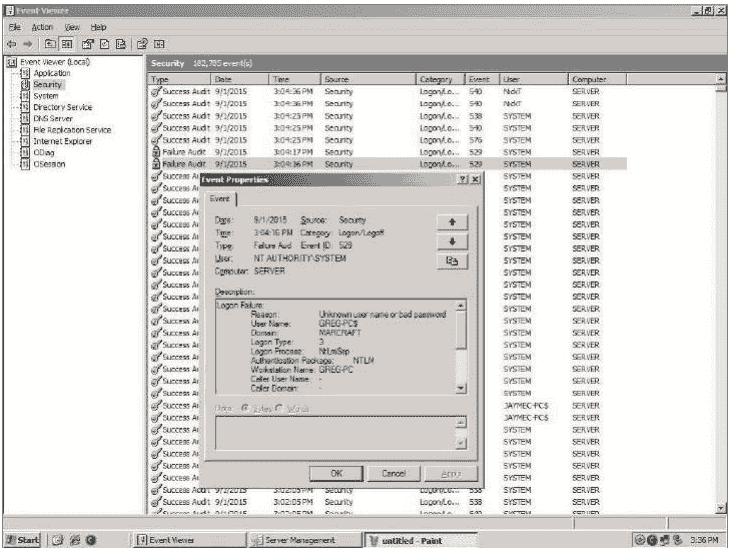

图 14.8 查看安全审计日志

与实施灾难恢复计划相关的管理职责包括：

- 建立要执行的备份类型。这包括配置备份实用程序以进行完全、差异、增量、复制或每日备份选项。
- 定义如何备份。这包括配置用于验证备份和启用压缩（如果备份设备支持）的选项。验证备份涉及将存储的数据版本与指定要备份的数据进行比较（以确保备份过程中所有信息都已正确复制）。
- 指定是否替换备份介质上的现有数据或将新数据附加到介质末尾。
- 建立备份标签，以便可以轻松识别和区分备份介质上存在的不同备份副本。通常，这涉及用执行备份的日期和时间对备份进行标签。
- 确定何时备份。此选择涉及安排不同类型备份的发生时间，以便对网络运行的负面影响最小——例如在深夜或周末，当较少用户可能使用网络资源时。

### 确保安全存储备份

请记住，其他人可能可以访问被盗备份中的数据并在他们拥有管理员权限的另一系统上恢复它。请确保备份副本安全存储。

### 保护备份介质

另一个重要的网络安全问题是备份介质的维护和保护。因为备份介质包含公司所有宝贵的专有数据，如果有人获得访问权限，他们可以检索公司的特权信息并对其进行滥用。不仅备份介质存储的房间应有带钥匙锁的门，还应有出入登记表以跟踪进入和离开房间的人员。

备份介质包含公司的专有信息，因此应保存在安全位置，并存放在防火保险箱中。理想情况下，应保留两套备份介质，一套在现场，一套在异地。对于现场和异地位置，防火保险箱是备份介质最安全的容器。

出于安全目的，只有少数人应知道备份存储位置以及拥有保险箱钥匙或密码的访问权限。

## 分布式入侵检测架构

在第二部分中，您已了解本地主机级别的入侵检测和预防系统。历史上，本地主机入侵检测系统一直是主要的实现选择。然而，类似的系统也可用于网络范围内的实施。最终，最有效的 IDS/IDPS 防御是两种系统协同工作，被称为分布式 IDS 系统的组合。

图 14.9 显示了分布式 IDS 实现的示例。在此网络架构示例中，连接到网络的每个本地主机都安装了自己的 IDS 模块。网络服务器中还安装了 IDS 管理模块，用于协调向各个本地 IDS 模块传输和接收信息。

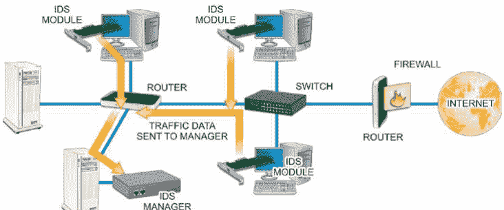

图 14.9 分布式 IDS

本地 IDS 模块将本地审计信息传递给 IDS 管理器，后者过滤传入信息以构建签名数据库。该数据库可以基于检测到的异常构建，也可以基于已知的误用模式构建，或同时基于两种类型的数据。当某个操作与数据库中存储的签名之一匹配时，IDS 将在配置管理器的指导下生成入侵警报。

在 IDPS 系统的情况下，管理模块将攻击信号转发给单独的对策模块，该模块根据检测到的入侵签名的性质执行适当的响应活动。


# 关于入侵检测系统性能因素的说明

在部署分布式入侵检测系统时，有两个主要的性能因素需要考虑：安全与效率。同样，与部署 IDS/IPS 系统相关的主要 *管理* 问题涉及误报和漏报警报的产生——尤其是在系统首次安装时。然而，随着时间的推移，通过调整 IDS/IPS 以提供最佳的安全级别并将误报降至最低，这些情况可以得到缓解。

## 漏洞扫描

有多种漏洞扫描器可用于测试系统并识别网络环境中计算设备的漏洞和配置错误，如图 14.10 所示。它们在识别以下类型的漏洞方面特别有价值：

- 网络上的活动主机（包括可能隐藏在网络上的主机）
- 易受攻击的活动端口和服务
- 与操作系统服务器应用程序相关的漏洞

所有漏洞扫描器都是基于数据库的工具，旨在搜索计算机中已识别并添加到数据库中的已知漏洞。因此，它们的好坏仅取决于最后一次更新。出于这个原因，在使用漏洞扫描器之前对其进行更新至关重要。扫描结果会显示给用户进行审查。

尽管使用漏洞扫描器会消耗时间和资源，但这却是持续安全流程的重要组成部分。它允许在漏洞被他人发现并利用之前尽快解决漏洞。

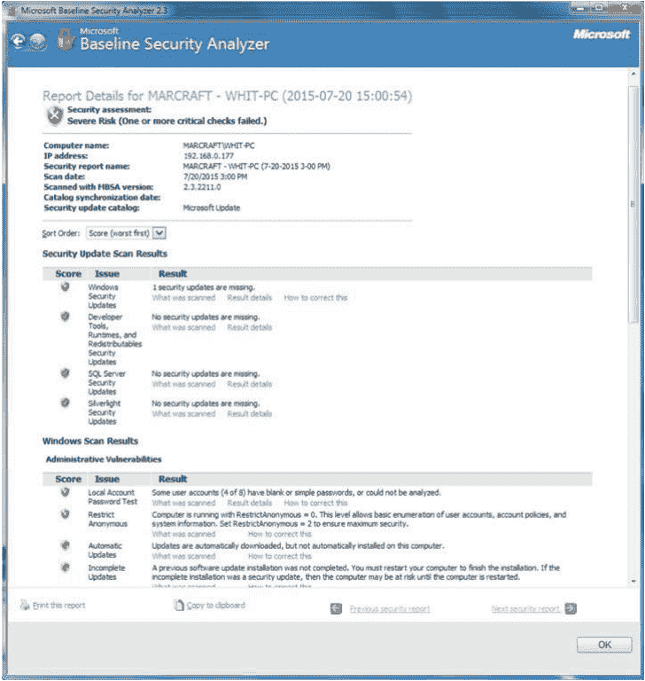

**图 14.10 典型的漏洞扫描器**

## 远程监控

服务器软件管理组件旨在实现完整的服务器监控解决方案。如图 14.11 所示，以下组件

协议（SNMP）实用程序在已安装的操作系统下运行，并在整个网络范围内提供系统管理和报告功能。

管理员使用 SNMP 检查服务器特征和网络活动，而无需实际通过主网络操作系统。这样，管理员的管理活动就可以在不锁定服务器操作系统 的情况下执行。

很明显，使用 SNMP 进行远程监控比让服务器技术人员 24/7 值班更具成本效益。尽管每日审查系统事件日志可能会事后揭示问题的存在，但仅使用这种方法在问题对系统产生不利影响之前不会提供任何预警。

系统监控器应能够在参数开始下滑时向管理员提供主动通知。如果不能，管理员有责任对其进行升级。在服务器出现问题时，SNMP 会向管理员发送有关情况的警报消息。SNMP 的一个缺点是，在处理器锁定事件中，SNMP 软件也会锁定。

## 动手练习

### 目标

- 描述网络入侵检测系统。
- 使用 NIDS 执行扫描操作。
- 检查从 NIDS 收集的信息。
- 探索日志文件的结果。

### 资源

- 客户提供的台式机/笔记本电脑硬件系统
- 已安装 Windows 10 专业版
- 具有管理员访问权限的账户
- 已安装 Snort（https://www.snort.org/downloads）
- 已安装 7-Zip（http://www.7-zip.org/download.htm）

### 讨论

与物理安全工作一样，防止未经授权的访问是本地计算和控制设备级别的第一道安全防线。然而，在这一级别能够检测入侵的发生并通知相关部门其性质同样重要。

基于计算机的入侵检测系统（IDS）可以以两种方式实现：基于网络的 IDS（NIDS）或基于主机的 IDS（HIDS）。在两种情况下，系统主要设计用于监控系统（本地计算机或网络环境）、记录关键事件和策略违规，并按指示报告。

一些被称为入侵检测和预防系统（IDPS）的系统提供了额外的活动级别，旨在主动防止检测到的威胁得逞。这些系统被归类为反应式 IDS 系统，而简单的 IDS 则被称为被动 IDS 系统。

所有 IDS 设备都基于以下两种策略之一：

- 签名分析：进出流量与存储的特定代码模式数据库进行比较，这些模式已被识别为恶意威胁。
- 异常分析：进出流量与系统正常流量的既定基线进行比较。基线是通过将数学算法应用于系统从流量中获得的数据来“学习”（生成）的。

### 程序

在本程序中，您将使用 Snort，这是有争议的 最受欢迎的开源网络 IDS。它使用基于签名和基于异常的分析，并且拥有一个强大的用户社区，不断创建新的规则以供使用。

### 调整 Snort 配置文件

尽管 Snort 非常有效且被广泛使用，但它不包含 GUI 以便于易于管理。这既是优点也是缺点。好处是管理员拥有完全控制权，甚至可以创建自己的规则。然而，Snort 的缺点之一是学习曲线陡峭，需要强大的命令行理解。在本节中，您将在使用程序之前将信息插入配置文件中。这是运行 IDS 所必需的。

- 1. 打开您的 Windows 10 Pro 机器。
- 2. 使用您的管理员账户登录。
- 3. 在任务栏中嵌入的搜索栏中，输入 **cmd** 然后按 Enter 启动命令提示符。
- 4. 在命令提示符下，输入 **ipconfig** 并按 Enter。图 14.12 显示了 IPCONFIG 的示例结果。您的结果会有所不同。
- 5. 记录您的 IPv4 地址和子网掩码。在图 14.12 中，适用的 IPv4 地址和子网掩码包括：

IPv4 地址 – 192.168.0.182

子网掩码 – 255.255.255.0

IPv4 地址：____________________

子网掩码：____________________

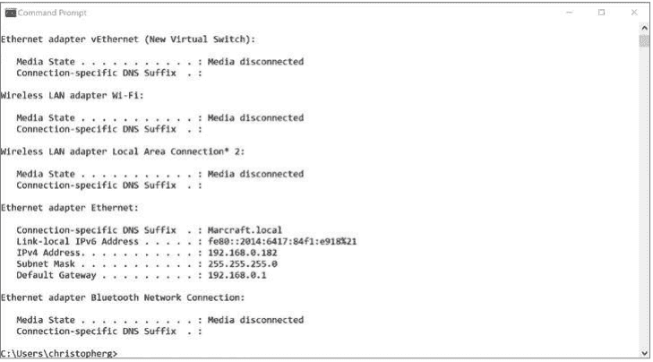

**图 14.12** IPCONFIG

- 6. 通过输入 **exit** 并按 Enter 退出命令提示符。
- 7. 使用 Windows 资源管理器，导航到 计算机 ➢ C: ➢ Snort。双击 Etc 文件夹以查看其内容，如图 14.13 所示。

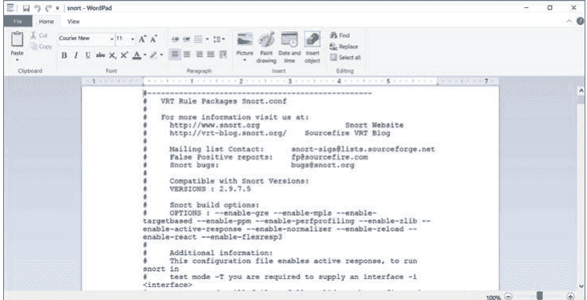

# 图 14.14 Snort 配置文件

> 注意 如果 snort.conf 文件已被更改，则以下步骤需要相应确认和调整。

11. 在 snort.conf 步骤 # 1 下，定位：

```
# Setup the network addresses you are protecting
ipvar HOME_NET any
```

如图所示 14.15，将关键字 any 替换为您在步骤 5 中记录的 IPv4 地址和子网掩码的 CIDR 表示法。例如：

```
ipvar HOME_NET 192.168.0.182/24
```

提供您的 IP 地址可使 Snort 正确引用以检查进出数据包。

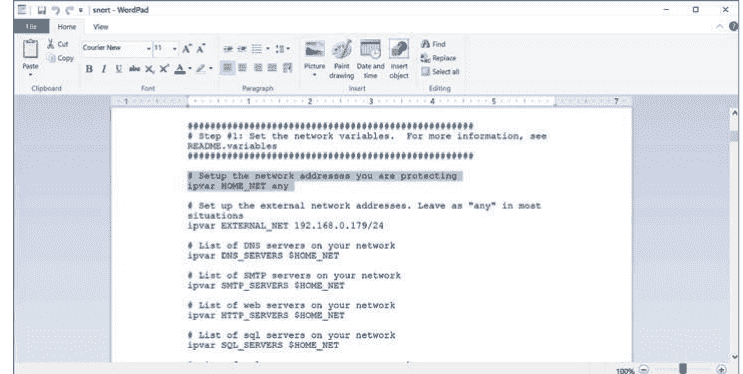

# 图 14.15 网络地址更改

> 注意
> 255.255.255.0 = /24
> 255.255.0.0 = /16
> 255.0.0.0 = /8

如果您的子网掩码与这些不同，请参考子网计算器。

- 12. 在 snort.conf 步骤 # 1 下继续向下滚动并定位：

```
# such as: c:\snort\rules
var RULE_PATH ..\rules
var SO_RULE_PATH ..\so_rules
var PREPROC_RULE_PATH ..\preproc_rules
```

如图所示 14.16，将每个 ../ 替换为 c:\snort\。同时在 var SO_RULE_PATH 前放置一个井号（#）。此更改是为了在配置文件内部将来使用时定义变量路径位置。


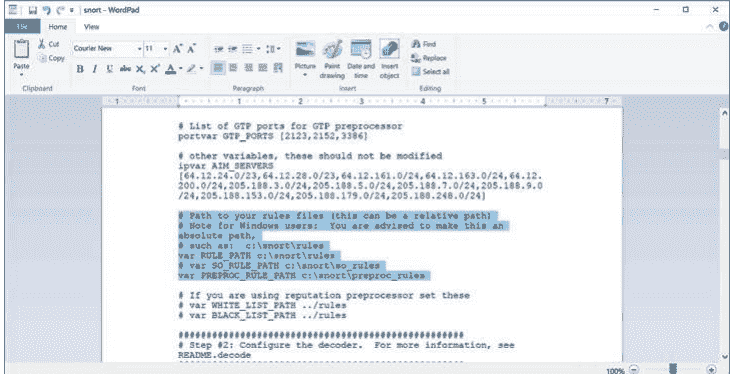

# FIGURE 14.16 Rule Paths Changed

13. 最后，在步骤 # 1 下，定位：

```
# if you are using reputation preprocessor set these
var WHITE_LIST_PATH ../rules
var BLACK_LIST_PATH ../rules
```

如 Figure 14.17 所示，在两个变量前插入井号（#）。你将不会发布任何站点白名单或黑名单。通过包含井号（#），你告诉 Snort 忽略整行；这通常被称为“注释掉该行”。

14. 在步骤 # 2 的最后，定位：

```
# config logdir:
```

删除井号（#）并在行尾插入 c:\snort\log，如 Figure 14.18 所示。删除井号（#）并添加路径可确认日志目录的创建，这对于审计日志是必需的。

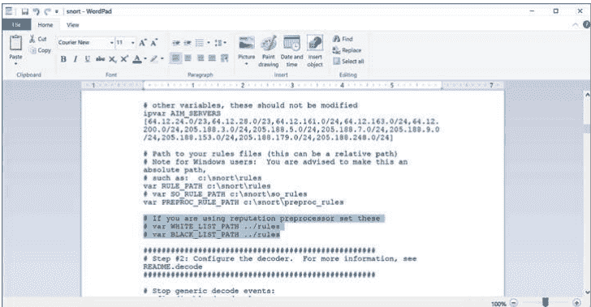

FIGURE 14.17 Whitelist and Blacklist Changed

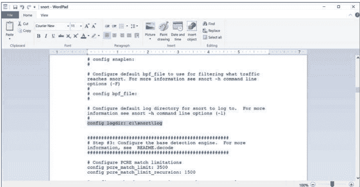

FIGURE 14.18 Configuring Log Directory

15. 跳过步骤 # 3 并继续步骤 # 4。定位：

```
# path to dynamic preprocessor libraries
dynamicpreprocessor directory
/usr/local/lib/snort_dynamicpreprocessor/
```

替换以下内容：

/usr/local/lib/snort_dynamicpreprocessor/ 替换为以下内容：
C:\Snort\lib\snort_dynamicpreprocessor

如 Figure 14.19 所示，这定义了定位 snort_dynamicpreprocessor 所需的路径。

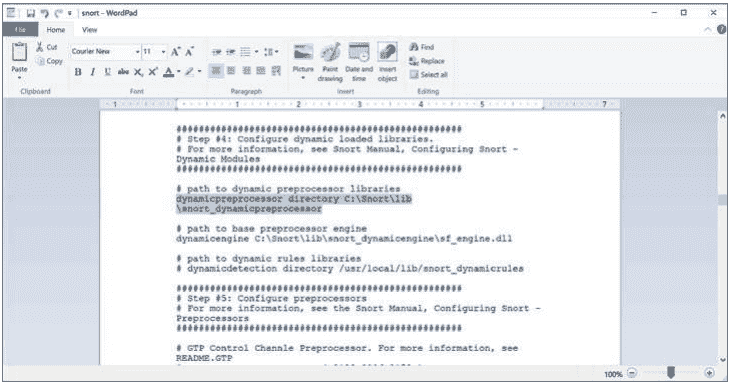

# FIGURE 14.19 Dynamic Preprocessor Path

16. 定位以下内容：

```
# path to base preprocessor engine
dynamicengine /usr/local/lib/snort_dynamicengine/libsf_engine.so
```

替换以下内容：

/usr/local/lib/snort_dynamicengine/libsf_engine.so

替换为以下内容： C:\Snort\lib\snort_dynamicengine\sf_engine.dll

如 Figure 14.20 所示，这定义了 snort_dynamicengine 文件的路径，并在 Windows 中更改了所使用的文件名（与 Linux 相反）。

# FIGURE 14.20 Dynamic Engine Path Changed

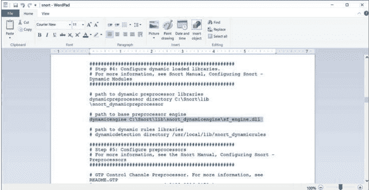

17. 定位以下内容：

```
# path to dynamic rules libraries
Dynamicdetection directory /usr/local/lib/snort_dynamicrules
```

如 Figure 14.21 所示，在底部行前插入井号（#）。在行前插入井号（#）可移除 snort_dynamicrules 的使用。

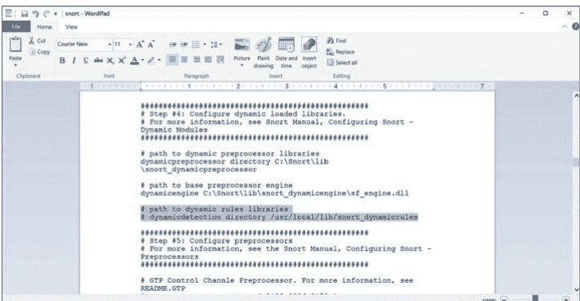

# FIGURE 14.21 Dynamic Rules Excluded

18. 在步骤 # 5 中，定位以下内容：

```
# Does nothing in IDS mode
preprocessor normalize_ip4
preprocessor normalize_tcp: block, rsv, pad, urp, req_urg,
req_pay, req_urp, ips, ecn, stream
preprocessor normalize_icmp4
preprocessor normalize_ip6
preprocessor normalize_icmp6
```

如 Figure 14.22 所示，在每个 preprocessor 前插入井号（#）。Windows 在本节的预处理器功能上存在问题，因此在每行前插入井号（#）可将其从等式中移除。

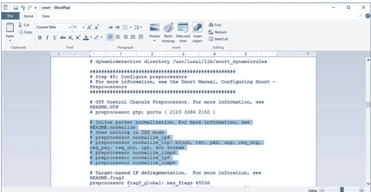

FIGURE 14.22 Inline Packet Normalization Excluded

19. 在步骤 # 5 中，定位以下内容：

```
README.sfportscan
# preprocessor sfportscan: proto { all } memcap { 1000000
} sense_level { low }
```

删除井号（#）以启用端口扫描检测，如 Figure 14.23 所示。

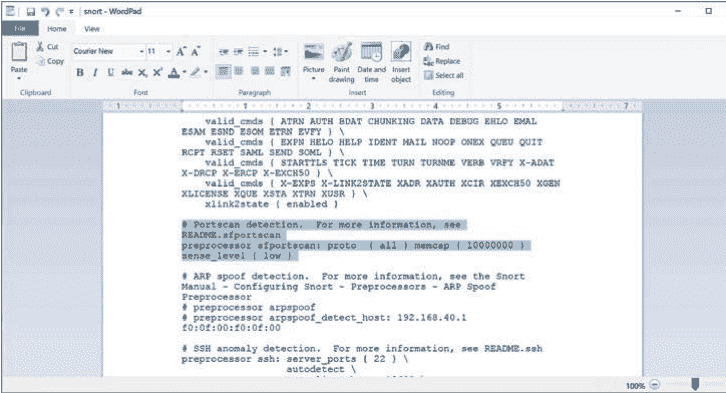

# **FIGURE 14.23** Enable Portscan

+   20. 在步骤 # 5 底部，定位以下内容：
+   
+   ```text
+   whitelist $WHITE_LIST_PATH/white_list.rules,  \\
+   blacklist $BLACK_LIST_PATH/black_list.rules
+   ```
+   
+   如 Figure 14.24 所示，在每行前插入井号（#）。井号禁用与白名单和黑名单关联的路径。

+   21. 在步骤 # 6 中，定位以下内容：
+   
+   ```text
+   # pcap
+   # output log_tcpdump: tcpdump.log
+   ```
+   
+   如 Figure 14.25 所示，在下方插入 `output alert_fast: alerts.ids`。插入此行将在入侵检测模式下报警时创建日志。

+   22. 你需要创建此文件。在不关闭 `snort.conf` 文件的情况下，点击开始图标并在搜索栏中输入 Word。Microsoft Word 或 WordPad 将出现。按下 Enter 键。

+   23. 选择 文件 > 另存为。你需要导航到 `C: > Snort > Log`。输入 `alert.ids` 作为名称并选择 保存。如果出现警告提示，选择 是。

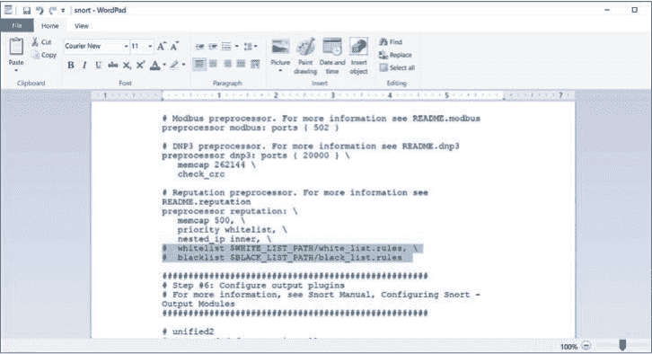

# FIGURE 14.24 Whitelist and Blacklist Excluded

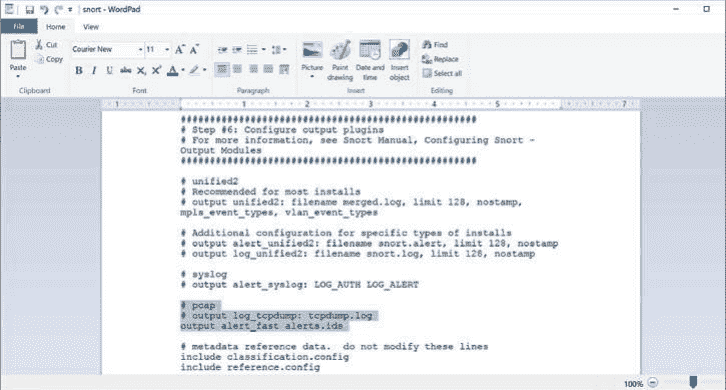

# FIGURE 14.25 Output Alert

+   24. 关闭 `alert.ids` 文档。返回到 `snort.conf` 文件。
+   25. 在步骤 # 7 中，在 `# site specific rules` 下，插入以下内容：

```
Include $RULE_PATH\community.rules.
```

在步骤 # 7 的每行前放置井号（#）。Figure 14.26 显示了它应有的样子。这将指示 Snort 使用 community.rules 文件，并在比较定义规则时忽略所有其他路径。

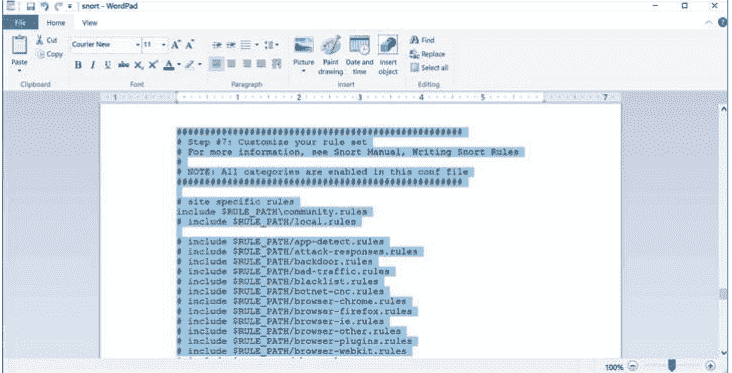

# FIGURE 14.26 Setting Rules

+   26. 在步骤 # 8 中，删除每个 include $PREPROC_RULE_PATH 前的井号（#）。将每个实例中的 / 更改为 \。两个更改均显示在 Figure 14.27 中。这将启用预定义的预处理器规则路径。

+   27. 选择 文件 > 保存。通过点击窗口右上角的红色 X 退出 snort.conf 文件。

大部分配置更改要么启用要么禁用了特定功能。Snort 提供了许多 Windows 不能正确使用的功能。如果不通过配置文件，你将无法运行 Snort。

# Adding the Rules

Snort 需要规则来进行比较。有三种级别的规则：社区版、注册版和订阅版。就本实验而言，你

将加载社区规则。它们可能略显过时，但它们是有用且必要的。

+   1. 前往：https://www.snort.org/downloads 下载 `community-rules.tar.gz`。

+   2. 前往你的下载文件位置并选择 `community-rules.tar` 文件并右键单击。选择 7-Zip → 提取文件 以启动提取窗口，如 Figure 14.28 所示。

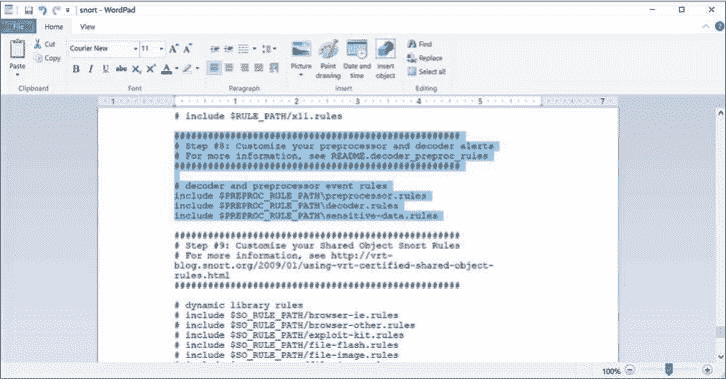

**FIGURE 14.27** Step #8 Changes

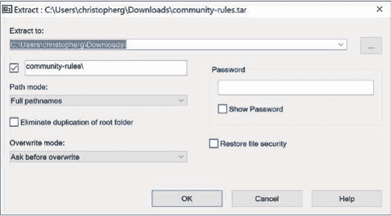

**FIGURE 14.28** Extract Window

3. 点击 确定。会出现一个新文件夹。双击 community-rules.tar 文件夹以查看其内容，如 Figure 14.29 所示。

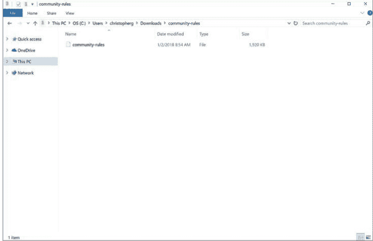

FIGURE 14.29 Community-Rules

4. 右键单击新的 community-rules.tar 文件，选择 7-Zip > 提取文件 以启动另一个提取窗口。

5. 点击 确定。会出现另一个文件夹。双击 Community-Rules 文件夹。双击下一个 Community-Rules 文件夹以查看少量项目列表。Figure 14.30 显示了 C: > “你的下载文件夹路径” > community-rules.tar > community-rules > community-rules 的内容。

6. 保持此窗口打开。点击 Windows 图标并选择 文件资源管理器。

7. 在文件资源管理器中，导航到 本地磁盘 (C:) > Snort > Rules。将 Community-Rules 文件夹中下载文件夹中的 community 文件复制并粘贴到 Snort > Rules 文件夹中，如 Figure 14.31 所示。

8. 通过点击窗口右上角的红色 X 关闭所有窗口。

# FIGURE 14.30 Community-Rules Folder

# FIGURE 14.31 Community File Moved to Rules Folder

# Running Snort for Network Intrusion Detection

Snort 可以配置为在三种主要模式下运行，并具有多种复杂选项。三种主要模式包括嗅探、数据包记录和网络入侵检测。了解如何实现这三种模式至少是基本的方法很重要。

+   1. 通过在搜索栏中输入 cmd 打开命令提示符。不要按 Enter。在程序下，右键单击 cmd 并选择 以管理员身份运行。UAC 提示时选择 是。

+   2. 你首先需要更改目录。在命令提示符下，输入 cd C:\Snort\bin 并按 Enter，如 Figure 14.32 所示。

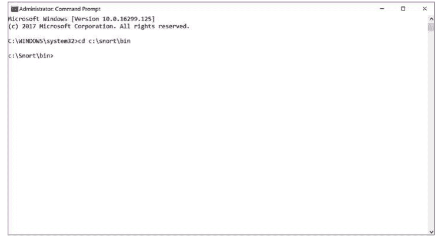

FIGURE 14.32 cd c:\snort\bin

+   3. 第一个命令将是发现机器上的接口。输入 snort -W 并按 Enter。接口列表将出现，如 Figure 14.33 所示。


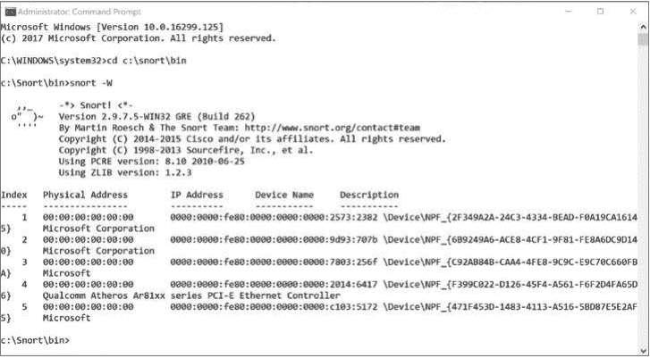

**图 14.33** Snort 接口列表

**注意** 你可能有更多接口。在指示 Snort 在哪里进行检测时，选择正确的接口非常重要。

- 4. 现在，你将测试先前编辑的配置文件。
- 输入以下命令：

```
snort -i 1 -c c:\snort\etc\snort.conf -T
```

此命令告诉 Snort（snort）使用 1 号接口（-i 1），使用位于此处（c:\snort\etc\snort.conf）的配置文件（-c），并且仅对其进行测试（-T）。*重要提示：*你可能需要使用其他接口编号（本例中使用了接口 4）。

完成后，将显示成功验证消息，如图 14.34 所示。现在，你将以 IDS 模式运行 Snort，同时将其记录到文件并显示在屏幕上。

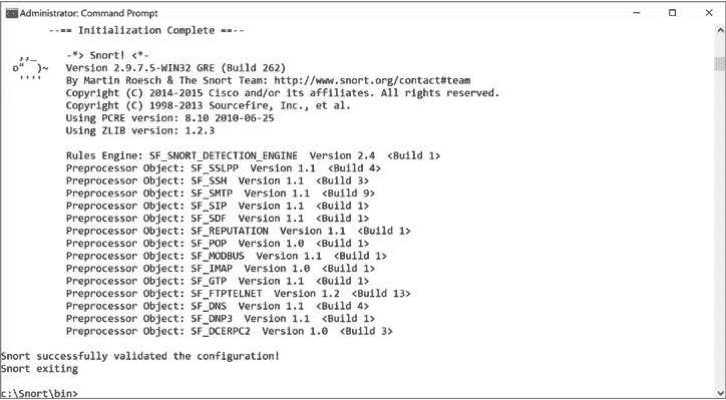

**图 14.34** Snort 验证成功

- 5. 输入 `snort -A console -i 1 -c c:\snort\etc\snort.conf -l c:\snort\log`（-l 是小写的 L）并按 Enter（请记住，-i 1 对你来说可能是一个不同的编号）。

此时，正在比对规则。如果发生任何违规行为，它们将显示在屏幕上并记录到日志中。

- 6. 随时按 Ctrl+C 退出 Snort 的 IDS 模式。

- 7. 向上滚动以查看有关会话的信息。你可以看到协议分类统计、数据包输入/输出总数以及其他信息，如图 14.35 所示。

> **注意** 你的屏幕可能看起来不同。

在当前网络环境中，你极不可能收到任何入侵通知。为了证明 Snort 提供了 IDS 功能并可应用于其他目的，你需要*嗅探*网络。

- 8. 在命令提示符下，输入 `snort -dev -i 1 -c c:\snort\etc\snort.conf`（请记住，-i 1 在你的环境中可能不同）并按 Enter。

数据包处理开始后，你会看到各个数据包及其关联信息。

图 14.36 显示了嗅探模式下的几个数据包。

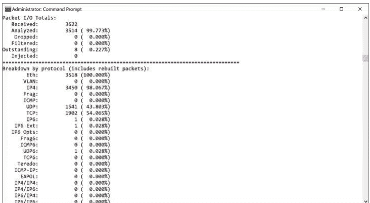

# 图 14.35 Snort IDS 模式细分

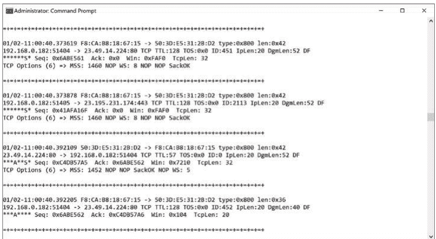

# 图 14.36 嗅探模式下的 Snort

如图 14.36 所示，你可以看到 IP 地址、MAC 地址、数据包详细信息、协议等。

- 9. 要停止 Snort，请按 Ctrl+C。在命令提示符下，输入 `exit` 并按 Enter。
- 10. 关闭所有剩余打开的窗口。关闭机器。

# 实验问题

- 1. IDS 所依据的两种策略（即两种规则类型）是什么？
- 2. Snort 可以实现哪三种主要模式？
- 3. 调整配置文件的目的是什么？
- 4. 使用 Snort 有哪些优缺点？

# 实验答案

1. IDS 所依据的两种策略（即两种规则类型）是什么？

所有 IDS 设备都基于以下两种策略之一：

- ▶ 特征分析：将传入和传出的流量与一个存储了已被识别为恶意威胁的特定代码模式的数据库进行比较。
- ▶ 异常分析：将传入和传出的流量与系统正常流量的既定基线进行比较。基线是通过将数学算法应用于系统从流量中获得的数据而“学习”（生成）出来的。

2. Snort 可以实现哪三种主要模式？

Snort 可以被配置为以三种主要模式运行，并支持各种复杂选项。这三种主要模式包括嗅探、数据包日志记录和网络入侵检测。

3. 调整配置文件的目的是什么？

配置的大部分内容都是为了启用或禁用某些功能而进行的。Snort 提供了许多 Windows 无法很好利用的功能。如果不检查配置文件，你将无法运行 Snort。

4. 使用 Snort 有哪些优缺点？

尽管 Snort 非常有效且被广泛使用，但它不包含便于管理的 GUI。这既是优点也是缺点。好处是管理员拥有完全控制权，甚至可以创建自己的规则。然而，Snort 的缺点之一是其学习曲线陡峭，并且要求用户具备较强的命令行理解能力。

# 理解网络连接设备

*所有连接到网络上的智能设备*都必须具备能够将设备物理连接到网络传输介质的网络接口适配器。这些网络连接设备提供物理连接方案（如插头和插孔），以及设备与传输介质（电缆或无线电波）上传输的信号之间的电气兼容性。网络通常还包含其他连接设备，用于将不同部分连接在一起并执行不同的网络管理功能。这些连接设备通常是交换机或路由器。在大型或复杂网络中，你还会发现称为*网桥*的设备，用于互连网络的不同部分。尽管每种设备都提供物理连接，但每种设备也有特定的操作方法，使其适用于特定的网络应用。在某些情况下，功能更多的设备可用于执行功能较少的设备的功能。在本章中，你将学习：

- ► 了解网络交换机
- ► 了解路由器
- ► 了解网关
- ► 了解网络桥接设备
- ► 了解网络连接

# 网络交换机

*网络交换机*是工作在 OSI 模型第 2 层（参见下面的说明）的连接设备。它们旨在将网络设备连接在一起，以形成局域网。企业网络（旨在支持中等和大量用户开展业务活动的公司网络）通常组合使用交换机来划分网络并建立高效的数据流量。它们可以与其他网络连接设备组合使用，也可以通过主干布线方案直接连接到服务器机房。

# 关于网络交换机

> 通常，交换机是工作在 OSI 数据链路层的第 2 层设备。不过，也存在第 3 层交换机，其行为类似于桥路器（同时具有路由器和网桥功能的设备，将在后续章节介绍）；第 4 层交换机，包含网络地址转换（NAT）功能；以及第 7 层（内容）交换机，根据服务器负载因素分发内容。

例如，一家公司的办公地点分布在写字楼的多个楼层，可能会在每层使用一台独立的交换机，为该层的所有设备提供连接。各楼层的交换机还会通过一台交换机或路由器相互连接。图 15.1 显示了一个典型的网络交换机连接方案。

交换机会收集 MAC 地址信息，以跟踪连接到其上的设备。在与这些设备交互时，它们会将 MAC 信息记录在称为*MAC 地址表*的板载内存结构中。

当交换机在其某个端口接收到网络信息数据包时，只要接收方地址已知，它就可以将信息发送到预期的接收方。如果地址未知，交换机将向所有端口广播该信息。由于通过交换机传输的信息通常只发送到预期端口，整个网络的性能得到了极大提升。

交换机还可用于创建逻辑上安全的虚拟局域网（VLAN）。VLAN 是一种安全拓扑，通过限制网络数据包的移动，使其仅在指定端口之间传输，从而限制网络流量的可见性。

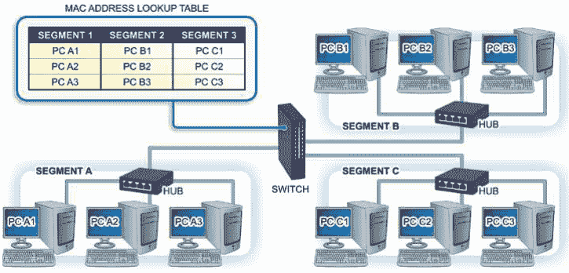

**图 15.1** 网络交换机连接

网络交换机通常根据其配置选项分为两类。非管理型交换机是即插即用（PnP）设备，不包含任何用户配置选项。它们通常是低价设备，面向家庭和小型办公环境使用，因此在商业和企业网络中很少见。

另一类交换机称为*管理型交换机*。这些设备内置可编程管理功能，使管理员能够针对其将要使用的特定网络环境进行配置。因此，它们提供了某种管理控制台，管理员可用其设置参数。常见的管理接口包括：

**命令行编程** 这种格式提供了一种非常高效、直接的基于文本的交换机设置编程方法。命令行编程要求管理员熟悉可用于设置不同参数的指令集和参数变量。

**基于 Web 浏览器的接口** 这些接口提供了更具图形化、菜单驱动的工具，用于设置关键交换机参数。使用简单网络管理协议（SNMP）工具，允许管理员通过远程客户端的 Web 浏览器访问交换机参数。


## 路由器

*路由器*是网络连接设备，其转发网络信息的方式与交换机类似。然而，与交换机不同，路由器可以在不同的网络段之间转发信息，如图 15.2 所示。这使路由器能够通过一种称为*路由*的过程将不同的网络连接在一起。例如，路由器通常用于将小型住宅网络连接到世界上最大的网络：互联网。

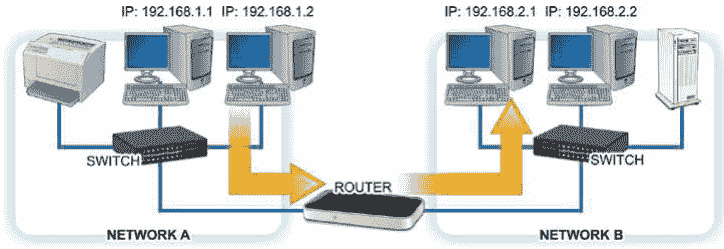

**图 15.2** 网络路由器

典型路由器的内部结构如图 15.3 所示。*路由器*是基于微处理器的智能设备，控制数据在网络之间的流动。*微处理器*是一种专门的设备，优化为路由处理器运行。

与其他基于微处理器的设备一样，路由器包含用于启动的 ROM BIOS、用于保存操作配置参数的 NVRAM CMOS 配置区，以及存储在闪存单元中的板载操作系统。

### 关于路由器的说明

路由器运行自己的操作系统。最广为人知的路由器/交换机操作系统是思科系统的互联网操作系统（IOS）。然而，还有许多其他基于 Linux/Unix 的路由器操作系统发行版可供使用。

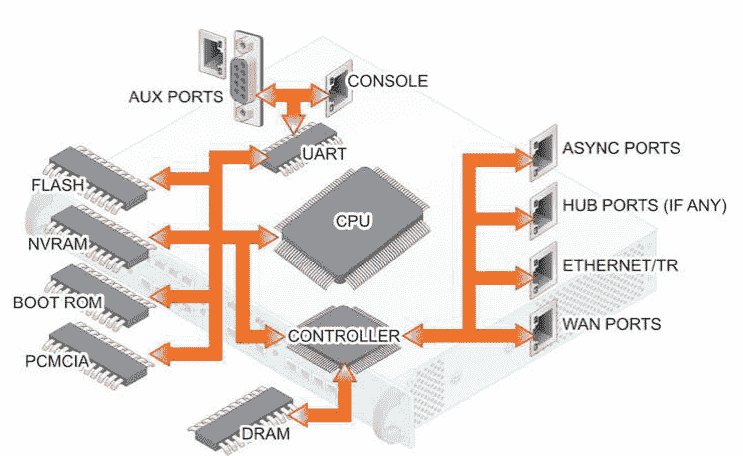

### 图 15.3 网络路由器的内部结构

路由器还包含不同部分的 DRAM 内存，用于保存消息路由信息并在端口之间缓冲数据流。路由信息存储并更新在称为路由表的逻辑内存表中。

每个网络段都通过其物理端口接口连接到路由器。这些接口可以实现为不同类型的物理/逻辑接口规范，例如 8P8C 以太网连接端口。

在大型网络中，路由器使用路由协议相互通信，以构建和维护其路由表。这些表用于记录不同网络位置之间的最佳路由。与交换机中使用的 MAC 表不同，路由表存储设备之间路径的地址和跳数信息。

几乎所有路由器都具有可用于连接外部控制台以进行配置目的的物理接口。它们还可能包含异步 RS-232 串行硬件端口，可供管理员用于执行远程路由器管理功能。

### 澄清连接设备混淆

由于营销方式，连接设备经常引起混淆。例如，交换机和路由器的功能有时构建在同一设备中并作为多端口路由器进行营销。路由器可能根据其执行的功能进行标记。例如，将网络连接到互联网的路由器可能被称为边缘路由器，而仅仅连接两个网络段的一对路由器则称为核心路由器。

## 网关

在通信和数字网络中，网关被定义为将网络与采用不同协议的另一个网络连接的设备。请回忆，协议是一组用于在不同设备或系统之间进行通信的定义规则。

协议可能旨在匹配物理连接的差异（硬件协议），或匹配不同的信号逻辑电平、消息格式或信息交换速度（软件协议）。一些网关设备设计为执行两种功能，如图 15.4 所示。图中的网关将有线以太网/TCP/IP 协议格式转换为无线/ZigBee 协议格式。


图 15.4 网关操作

为了使通信成功，双方必须同意使用相同的协议。例如，为了两个人进行口头交流，他们必须能够使用共同的语言。如果不能，你就有了一个老中国谚语的例子：鸡对鸭说话。

当路由器用于将网络连接到始终在线的宽带互联网连接时，它被称为互联网网关。除了执行路由功能外，互联网网关路由器通常还提供许多其他互联网相关服务，例如自动地址分配和防火墙服务。你也可能遇到具有内置路由功能的路由交换机（称为 LAN 交换机）。

## 网络桥接

网络桥接器（有时称为网络交换机）将网络段桥接在一起并将流量从一个网络转发到另一个网络。与交换机一样，桥接器使用 MAC 地址引导信息到正确的端口。然而，它也会将广播信息传递到其所有端口。因此，桥接器将网络连接汇集到一个公共段，而路由器则将它们分隔成不同的段。图 15.5 说明了网络桥接器的操作。

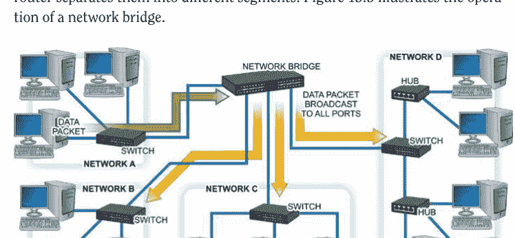

图 15.5 网络桥接器布置

## 无线网络连接

在无线网络或无线网络段中，网络设备通过一种称为无线接入点（WAP）的设备连接到网络。无线接入点充当桥接设备，将无线网络设备与有线网络连接起来，如图 15.6 所示。

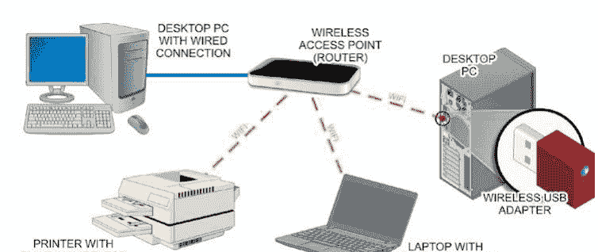

图 15.6 无线接入点

在局域网中常用的无线接入点采用天线和无线电接收/发射器，使用未授权的 2.4 GHz 或 5 GHz 无线电频段的射频信号与其它网络设备通信。相反，WAP 通过物理接口（如交换机或路由器上的以太网连接）与有线网络通信。

无线网络客户端设备必须具有由无线电发射器、接收器和天线组成的无线网络接口才能与 WAP 通信。这种能力可以以平方厘米大小的技术集成到设备中，因此任何智能设备都可以用很少的额外空间制成无线。

每个具有无线网络接口的设备都可以直接与其他无线设备通信，或与接入点通信。无线网络设备还能够通过接入点与以太网上的有线网络设备通信。

## 网络连接设备漏洞

由于其在网络中的位置和功能，连接设备容易受到多种类型的利用。如果网络连接设备被成功攻击，后果可能包括从网络流量减慢到整个网络关闭的各种问题。因此，这些设备需要与服务器相同类型和级别的安全考虑。保护交换机、路由器和其他网络连接设备的一般考虑包括：

- 将连接设备放置在安全的墙壁机柜中或位于服务器机房的安全范围内以提供物理保护。
- 配置设备管理设置，使所需功能尽可能安全，以提供所需的性能水平。禁用不需要的任何管理功能。
- 通过 MAC 地址过滤建立端口安全（手动将静态 MAC 地址输入 CAM），或通过指定端口允许的最大设备数量。 通过输入静态 ARP 条目，这消除了攻击者能够用伪造的 ARP 回复替换它们的可能性。

## 网络连接设备攻击

针对网络连接设备的典型攻击包括：

- 未经授权的访问
- 数据包嗅探攻击

### 未经授权的访问

大多数网络连接设备都具有某种程度的配置可能性。因此，如果可以访问其配置参数，其操作就可以被操纵。与其他类型的网络和计算设备一样，应尽可能使用密码来控制对连接设备配置数据的访问。

由于大多数网络管理员通过远程管理接口配置连接设备，使用 Telnet 或 HTTP Web 服务，这些通信应放置在防火墙后面以提供保护。此外，可以使用加密传输协议（如安全外壳 SSH）来保护配置数据在从管理员设备到交换机的传输过程中。或者，可以使用直接连接的控制台来配置交换机接口。数据和配置信息绝不应以明文模式在网络上传输。


## 数据包嗅探攻击

数据包嗅探是指在数据包通过网络传输时监听这些数据包。此活动通常使用一种称为*数据包嗅探器*的网络分析工具进行。攻击者使用这些工具监听网络流量，寻找诸如以明文模式在网络上传输的密码和用户名以及信用卡或其他可被劫持的财务敏感信息等项目。本节详细介绍了典型的数据包嗅探攻击。

## 地址解析协议 ARP 欺骗攻击

在地址解析协议 ARP 欺骗攻击中，攻击者发送伪造的 ARP 消息，将其 MAC 地址与另一用户的 IP 地址关联。一旦建立关联，发送到该地址的消息将被转移到攻击者处。然后攻击者可以利用从截获的消息中获取的信息发动其他类型的攻击，例如 DoS 或中间人攻击（本节后面讨论）。

## MAC 泛洪

MAC 广播泛洪攻击可以针对连接到其端口之一的设备上的第 2 层设备，例如网络交换机发起。受控设备上的攻击软件旨在向交换机的 CAM 表中泛洪大量不同的 MAC 地址，导致其填满。当达到此状态时，交换机将没有空间将新的 MAC 地址映射到其端口。由于 CAM 中的所有 MAC 地址现在都是尚未映射的新地址，交换机将被迫将收到的所有帧广播到其所有端口。

## 路由器泛洪攻击

与与交换机相关的 MAC 广播泛洪攻击类似，路由器容易受到旨在消耗其所有或大部分资源的泛洪攻击，从而使其无法正常运行。常见的目标路由器资源包括板载内存、处理器操作和内部总线带宽。

## MAC 复制（或克隆）攻击

在 MAC 复制或 MAC 克隆攻击中，攻击者将其自己的 MAC 地址更新为目标的 MAC 地址。这将导致交换机将流量转发到两个位置。

## 交换机端口窃取

交换机端口窃取攻击旨在用更改的响应数据包泛洪交换机。这将导致交换机将通过交换机传输的所有流量转发到攻击者的位置。

## 拒绝服务 DoS 攻击

DoS 攻击（见图 15.7）旨在过度使用主机、服务器或网络资源，以至于其功能上停止提供服务。根据攻击的确切性质，故障可能是暂时的或无限期的。分布式拒绝服务 DDoS 攻击涉及多个远程系统被用来同时对目标资源发动攻击。

## 欺骗攻击

欺骗攻击基于更改设备的 MAC 或 IP 地址以改变其表观身份。由于 TCP/IP 数据包包含许多不同的头部，攻击者可以创建 TCP/IP 数据包并使用虚假源 IP 地址发送其内容。当被寻址的接收方收到消息时，生成的响应将被发送到被欺骗的地址。

这种形式的欺骗被称为*IP 地址欺骗*，或简称为 IP 欺骗，通常用于创建 DDoS 攻击。这些攻击通过向多个目标发送伪造的数据包进行，使得它们的响应消息淹没目标受害者并造成设计的 DoS 条件。

## 中间人 MITM 攻击

中间人攻击涉及攻击者创建与两个或多个受害者的链接，以便他们可以拦截在它们之间传输的消息并在转发之前插入新信息，如图 15.8 所示。这是在任一受害者都未意识到攻击者正在控制通信的情况下完成的。

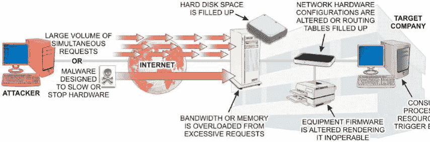

FIGURE 15.7  A Denial of Service Attack

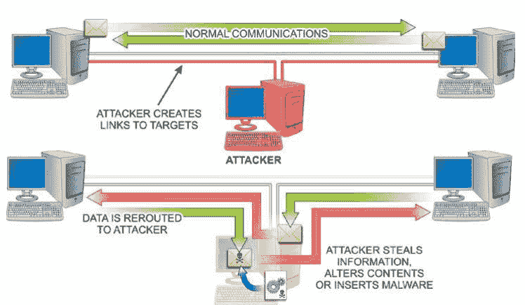

# FIGURE 15.8 A Man-in-the-Middle Attack

## 会话重放攻击

在会话重放攻击中，攻击者记录一系列 IP 数据包或路由器命令，操纵其中的数据，然后将其重新引入路由器以获得访问权限或导致执行不期望的操作。

## 重定向攻击

重定向攻击是通过攻击者获得对网络路由器中路由表的访问权限并重新配置它以将 IP 数据包重定向到替代位置而实现的。这些类型的攻击可通过使用需要路由身份验证的传输协议来防止。也可以通过使用静态路由器来阻止它们。

## 冒充攻击

冒充攻击涉及攻击者操纵 IP 数据包以创建虚假 IP 地址，以便他们可以访问网络或向其中注入虚假数据。

## 网络连接防御

网络交换机和路由器通常具有数据速率限制、延迟绑定、虚假 IP 地址过滤和访问控制列表功能，这些功能旨在在配置为执行此操作时检测并击败 DoS 和 DDoS 攻击。

它们还可能包括深度数据包检测功能，该功能检查 TCP/IP 数据包中的信息，寻找病毒、垃圾邮件和其他定义威胁的迹象，以确定数据包是否应转发。在某些情况下，可疑数据包可能会被转发到替代位置，以便由高级网络管理工具进行进一步检查。

防御 IP 欺骗攻击的主要手段是数据包过滤设备。数据包过滤是基于其源/目标地址、逻辑端口或协议来通过或阻止网络数据包的过程。托管交换机通常为所有这些元素提供过滤配置选项。

托管交换机通常提供 DHCP 嗅探和动态 ARP 检查 DAI 配置选项，这些选项旨在挫败 MITM 攻击。DHCP 嗅探用于过滤和阻止入站 DHCP 服务器消息并构建 IP 到 MAC 地址数据库。DAI 使用 DHCP 嗅探数据库来检查和验证 ARP 请求以防止 ARP 欺骗攻击。

## 网络加固

在操作系统及其文件系统加固之后，管理员必须采取措施加固网络的其余部分，包括网络保护和连接设备。此系统加固过程的这一部分涉及的典型步骤包括：

- 根据组织的安全策略要求，对系统的服务器进行安全保护。如果可能，将它们放置在受监控的中央服务器机房中，该机房具有双重锁门。
- 检查是否存在任何网络设备的规格未能满足当前安全目标，因此代表网络的易于访问的入口点。
- 验证网络是否配置为执行其通信功能，同时仍提供组织安全策略要求的保护级别。确保诸如交换机、防火墙和路由器等设备未仍设置为其默认配置设置。
- 评估网络安全计划，以确保诸如生产服务器等关键设备安装在正确的网络段、安全区域或子网中。
- 按住路由器的复位按钮 10 秒钟然后松开。请注意，重置路由器的配置将擦除所有现有设置，并且需要创建全新的配置。
- 确保您的计算机已物理连接到路由器。
- 按住 Windows 键并按 **r** 打开运行对话框（见图 15.9）。然后键入 **cmd** 并按 Enter（或单击确定）。

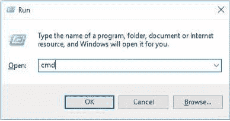

**FIGURE 15.9** Run Dialog

- 在命令提示符处（见图 15.10），键入 **ipconfig**。图 15.11 显示了输出。

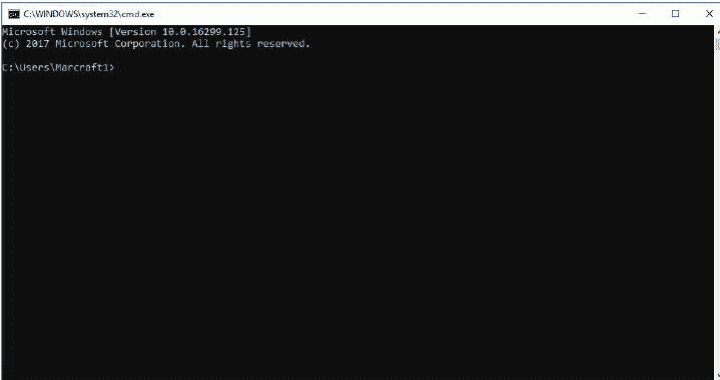

**FIGURE 15.10** Command Prompt


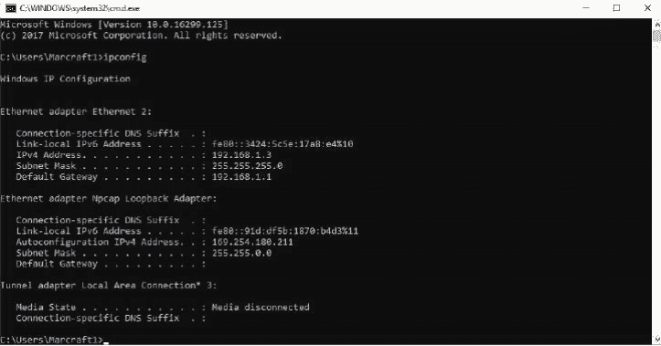

**图 15.11 IPCONFIG 输出**

+   10. 查找你的默认网关条目。图 15.11 中显示的默认网关为 `192.168.1.1`。
+   
+   11. 在命令提示符下输入 exit 并按 Enter 关闭命令提示符窗口。
+   
+   12. 打开 Microsoft Edge 并在地址栏中输入你的默认网关 IP 地址。
+   
+   13. 应该会出现一个对话框，要求输入用户名和密码。路由器已恢复为出厂默认设置。然而，并非所有路由器的默认用户名和密码组合都相同。
+   
+   14. 如果你有 Internet 访问权限，www.defaultpassword.com 可能能够为你提供帮助。一些常见的用户名和密码组合是 *admin/admin* 或 *admin/password*。有时用户名为空而密码为 *admin*。有时用户名为 *admin* 而密码为空。用户名和密码可能在路由器上的标签上。最后，你可以在线搜索你特定路由器的文档或手册。当你获得对路由器的访问权限后，请继续执行步骤 15。

> > **注意** 路由器制造商设有默认用户名和密码以减少故障排除和制造难度。

15. 你的路由器可能提供一个“向导”来帮助你进行路由器的首次设置。忽略这些消息。

**注意** 记住，如果出现问题，你可以对路由器进行恢复出厂设置。

16. 由于路由器具有默认用户名和密码，因此很容易被猜到且不安全。更改默认用户名和密码是首要任务。

17. 查找涉及管理或管理的设置。用于生成图 15.12 所示内容的步骤为 高级 ➤ 管理 ➤ 设置密码。

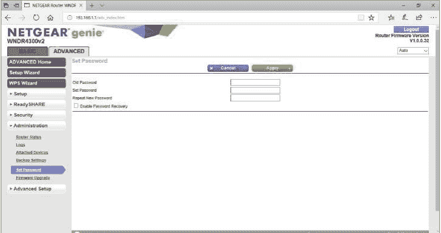

**图 15.12** 设置密码

18. 更改密码。你应选择一个相对安全且易于记忆的密码。

19. 如果可能，请单击 应用 或其等效项，例如 确定。

+   20. 如果可能，请更改默认用户名。这是最佳实践，但并非所有路由器都提供此选项。
+   
+   21. 一个有用的功能是禁用远程管理。

> **注意** 远程管理对于授权远程访问非常有用。然而，允许远程访问也会让恶意行为者获得访问权限。

+   22. 搜索类似 高级设置、高级设置 或 更多首选项 的菜单。
+   
+   23. 确保远程管理已关闭（参见图 15.13）。此路由器的远程管理默认关闭，但你的可能不是。

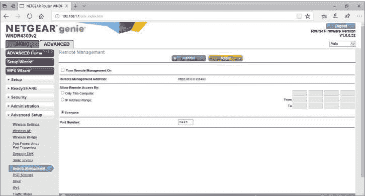

# 图 15.13 关闭远程管理

+   24. 许多路由器已启用访客网络。就像操作系统上的访客账户一样，访客网络通过允许任何人访问来削弱 Wi-Fi 安全。
+   
+   25. 此路由器的访客网络设置位于 高级 ➢ 设置 ➢ 访客网络。下。参见图 15.14。

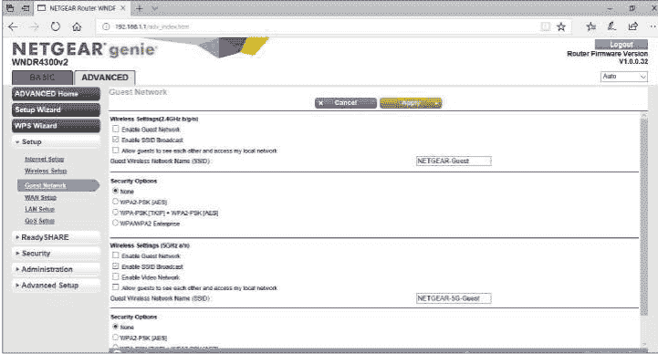

# 图 15.14 关闭访客网络

# 实验问题

+   1. 你的默认网关是什么？

+   2. 为什么一家公司生产的数百万台路由器都使用相同的用户名和密码？

+   3. 为什么你应该更改默认用户名和密码？

+   4. 禁用远程管理如何提高安全性？

+   5. 禁用访客网络如何提高安全性？

# 实验答案

+   1. 你的默认网关是什么？

行业标准默认是 192.168.1.1。如果你的默认网关不同，请在此处填入：________________。

+   2. 为什么一家公司生产的数百万台路由器都使用相同的用户名和密码？

这使得故障排除变得更加容易。

+   3. 为什么你应该更改默认用户名和密码？
+      更改用户名和密码是路由器初始设置的一部分。
+   4. 禁用远程管理如何提高安全性？
+      它有助于防止恶意行为者获得访问权限。
+   5. 禁用访客网络如何提高安全性？
+      访客网络允许任何人访问你的网络。
