# 了解网络传输介质安全

*数字数据* 在网络通信介质上从一个网络设备传输到另一个网络设备。用于在联网设备之间传输数据的三种通用传输介质是铜线、光波和无线射频（RF）信号。在本章中，你将学习：

+   - 了解双绞线电缆和同轴电缆
+   - 了解光纤电缆
+   - 了解蓝牙和 WiMAX
+   - 了解传输介质漏洞
+   - 了解无线网络漏洞

# 网络传输介质的基础知识

数字数据使用三种类型的传输介质进行传输：

+   - 铜线（双绞铜缆或同轴电缆）
+   - 光波（光纤电缆或红外光）
+   - 无线射频（RF）信号（Wi-Fi、WiMAX、蓝牙、ZigBee 或 Z-Wave）

每种介质类型都提供使其在特定条件下用于网络有用的优势。主要介质相关考虑包括其实施成本、最大数据传输速率和抗噪特性。同样，每种介质类型在其传输信息的能力上都有一些限制。

这一因素也包含在两个考虑中：其带宽和其衰减。*带宽* 是介质承载数据的能力。*衰减* 是信息在介质中移动时信号损失量的度量。正如你将在以下各节中看到的那样，一些介质类型可以 literally 将信号传输数英里并仍以可识别的信息形式交付，而另一种类型在房屋范围内就会失去强度。所有单个介质类型在其他介质之上都有优点和缺点。

最终的介质相关考虑是其抗噪能力。 stray 电气能量（称为 *噪声*）作为自然过程通过大气移动。电气机器和设备也会产生电子噪声。这些 stray 信号会干扰有组织的 数据信号并使其无法识别。因此，用于传输数据的电缆预计对这些 stray 信号具有一定的抵抗力。

## 铜线

在铜缆的范畴下，基本上要考虑两类：双绞线电缆和同轴电缆。

### 双绞线电缆

双绞线电缆由两根或多根成对的线绞合在一起以提供抗噪性。线中的扭转使感应噪声信号相互抵消。在这种类型的电缆中，每英尺线中的扭转数表示其相对抗噪水平。

在讨论数据网络的双绞线电缆时，有两种基本类型需要考虑：非屏蔽双绞线（UTP）和屏蔽双绞线（STP）。UTP 网络电缆包含四对单独绝缘的线，如图 16.1 所示。

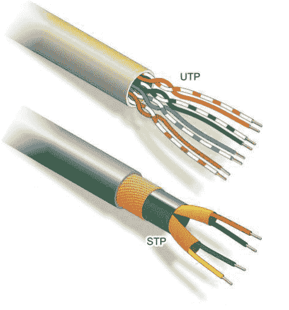

**图 16.1** UTP 和 STP 电缆

STP 电缆与此类似，唯一的区别是它包含一个额外的箔屏蔽，围绕四对线束。屏蔽通过提供接地路径来带走电缆中导体上的感应电信号，从而提供对感应电噪声和串扰的扩展保护。

# 同轴电缆

同轴电缆（通常简称为“同轴”）人们最熟悉的是将有线电视引入家庭的导体。*同轴电缆* 由绝缘的实心或绞合线芯构成，周围环绕着介电绝缘层和实心或编织金属屏蔽。线和屏蔽都包裹在外部保护绝缘护套中，如图 16.2 所示。

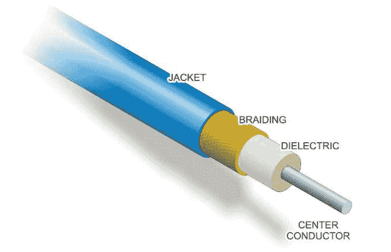

# 图 16.2 同轴电缆

过去，同轴电缆曾被广泛用于以太网局域网介质。然而，由于同轴电缆的厚度和刚性使其安装困难且耗时，网络行业和网络标准开发组织已放弃同轴电缆，转而采用非屏蔽双绞线电缆。

同轴电缆继续用于某些应用，例如通过商业有线电视（CATV）系统向住宅环境交付的 Internet 服务。此外，有多种同轴电缆可用于传输视频和高速数字信息。这在计算机、音视频设备以及具有住宅网络的智能家居产品中发挥作用。

# 光波

光纤电缆是塑料或玻璃电缆，设计用于以光脉冲的形式承载数字数据。信号由激光二极管引入电缆，并在其内部弹跳，直到到达电缆末端，如图 16.3 所示。在末端，光检测电路接收光信号并

将信息转换回电信号。这种布线提供了巨大的容量，提供超过 200,000 Mbps 的潜在信号速率。然而，当前的接入协议仍将光纤局域网速度限制在 100 Mbps。

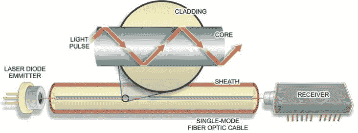

**图 16.3** 通过光纤电缆传输

光在光纤电缆中传播时不会像沿铜导体传输的电信号那样迅速*衰减*（损失能量）。因此，使用光纤布线时，发射器和接收器之间的段长度可以更长。在某些光纤应用中，最大电缆长度可达 2 公里。

## 光纤世界速度纪录

来自美国和荷兰的研究人员通过使用一根单根多芯玻璃光纤打破了世界速度纪录。他们能够推动 255 太比特每秒，约相当于 32 太字节每秒。

由于不能在不物理破坏导体的情况下进行窃听，光纤电缆也比铜缆提供了更安全的数据传输介质。基本上，引入电缆一端的光不会离开电缆，除非通过另一端。此外，光纤电缆在电气上隔离了发射器和接收器，因此信号电平匹配通常需要在两端之间进行。

## 表 16.1 蓝牙参数

| Class | Maximum Power | Operating Range |
|---|---|---|
| Class 1 | 100 mW (20 dBm) | 100 meters |
| Class 2 | 2.5 mW (4 dBm) | 10 meters |
| Class 3 | 1 mW (0 dBm) | 1 meter |

蓝牙规范在免许可的 2.4GHz 范围内实现了自适应频率跳频扩频（AFHSS），以提供安全性和避免拥挤的频率范围。蓝牙协议将 2.4 GHz 频率范围划分为 79 个不同的 1 MHz 通信信道。频率跳频机制每秒最多可更改 1,600 次信道。最后，频率在六种预定义模式之一中跳频信道。所有这些频率跳频都是为了降低其他电子干扰的影响。

蓝牙版本 1.1 和 1.2 设备的 数据传输速率为 723.1 Kbps，而蓝牙 2.0 设备则大幅提升至 2.1 Mbps。

蓝牙设备一次只能连接到一个设备；连接后将阻止它们连接到其他设备并在查询中显示，直到它们与该设备断开连接。但是，标准还提供了使用蓝牙技术构建多点无线网络的功能。

根据蓝牙规范，最多可将八个设备组合在一起形成微微网。任何设备都可以成为主设备并通过发出请求广播来控制网络。其他七个设备成为从设备，直到主设备释放其位置。

主设备使用时分多路复用快速在网络中的一个从设备到另一个从设备之间切换。以这种方式，蓝牙网络就像无线 USB 网络一样运行。网络中的任何设备在可用时都可以承担主设备角色。

在计算机网络环境中，蓝牙规范使多个蓝牙外围设备能够同时与主机设备通信。特别是，蓝牙与本地主机计算机一起使用，与无线输入和输出设备（如鼠标、键盘和打印机）通信。

与蓝牙类似，ZigBee（IEEE 802.15.4）标准是一种无线、网状网络 PAN 协议，可提供 10 米通信范围，数据传输速率为 250 Kbps，如图 16.5 所示。ZigBee 标准已被智能家居自动化和工业控制社区以及智能电网联盟的多个领域所接受。它还被考虑用于与个人生物医学传感器一起使用，以提供安全、远程医疗数据采集。

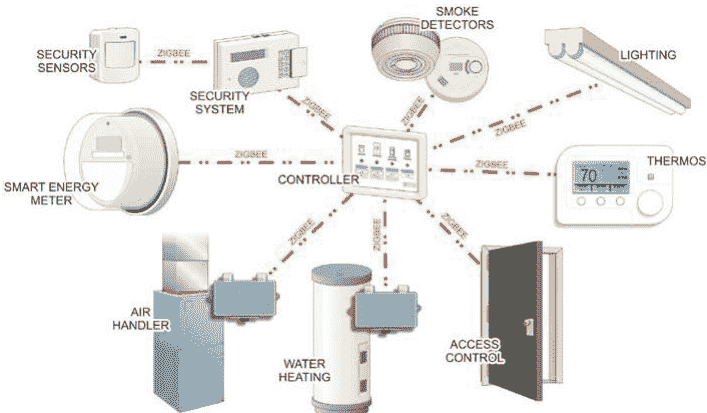

图 16.5 ZigBee PAN

IEEE 802.16 – WiMAX 规范建立是为了提供更广区域无线网络能力的指南。WiMAX 是一种宽带无线接入标准，旨在为城市、县以及在某些情况下的国家等大地理区域提供互联网接入，如图 16.6 所示。它还旨在与 802.11 Wi-Fi 标准互操作。

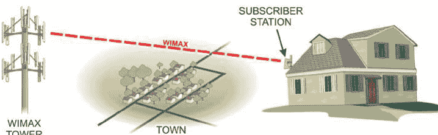

图 16.6 WiMAX

## 传输介质漏洞

与网络的其他组件一样，传输介质安全必须在两个层面上考虑：物理安全和逻辑安全。*物理安全*涉及保护物理介质，以及互连网络设备的通信设备和物理端口。如果攻击者可以不间断地访问传输介质，他们可以找到一种方式来利用它。

当传输介质离开私人设施的可控区域时，保护物理介质变得具有挑战性。在设施内部，光学和金属通信介质相对安全，因为需要物理窃听介质才能从中提取信息。对于无线通信则不能这样说，因为它们可以通过简单的天线从空气中提取。

然而，当物理介质离开私人设施的范围时，它们所携带的信息就会在其路线上或消息的接收端口处容易被拦截和捕获。

### 保护无线网络

虽然无线网络因其易于安装而非常受欢迎，但使用它们来通信个人或其他敏感信息存在许多安全问题。无线网络设备的传输不能简单地限制在住宅或企业的本地环境中。

尽管大多数无线网络设备的范围通常仅限于几百英尺，但射频信号很容易在声明的安全边界之外被截获。任何未经授权的移动终端都可以使用 802.11 接收器完成此操作。任何被截获的传输，如果未加密，则很容易被读取。

为了最大限度地降低无线局域网安全受损的风险，IEEE-802.11 无线标准提供了几种加密选项。一种早期的安全功能称为有线等效隐私（WEP），它提供 128 位数学密钥加密方案，用于加密数据传输并验证网络上的每台计算机。启用 WEP 功能为传输的数据增加了一些安全性。然而，在此时，WEP 不再提供它多年前所具有的保证。

您还需要输入 WEP 密钥值（密码），以十六进制数字字符串或 ASCII 字符字符串的形式输入。对于大多数人来说，使用 ASCII 选项更容易。记录此字符串以供网络的客户端计算机使用。每台客户端计算机都需要拥有该密钥

## 实践练习

### 目标

本实验的目的是检查路由器更高级的安全配置设置。日志将被检查并打开。SSID 广播将被禁用。接下来，天线的功率将被降低并完全关闭。最后，将禁用通用即插即用。

### 资源

- 物理连接到 SOHO 路由器的装有 Windows 10 的 PC
- SOHO 路由器

### 程序

- 1. 打开 Microsoft Edge 浏览器。
- 2. 在浏览器地址栏中输入网关的 IP 地址。记住，您可以通过进入命令行并发出 IPCONFIG 来找到它。 （有关更多帮助，请参阅第 15 章实践练习中的步骤 7 到 12。）
- 3. 在登录屏幕（见图 16.7）上，提供您的管理员凭据。

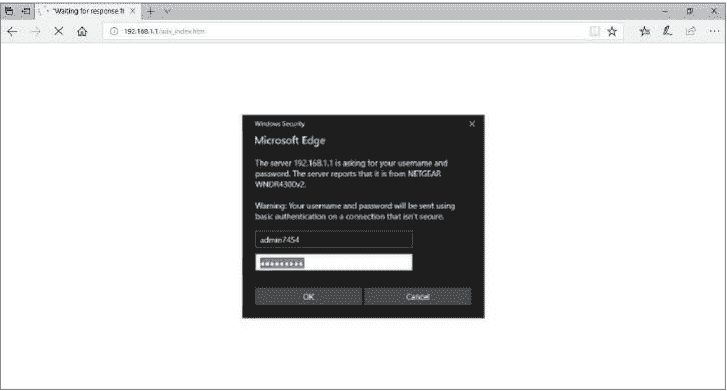

**图 16.7** 输入您的凭据。

- 9. 将名称更改为易于记忆的名称。或者，将 SSID 写在安全的地方。

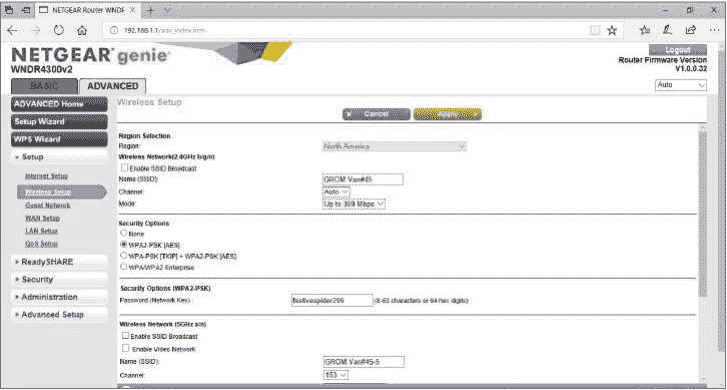

**图 16.9** 关闭所有 SSID 广播并更改默认名称。

- 10. 确保点击 Apply 或 Enable 以保存您的更改。

- 11. 关闭 SSID 广播的另一种更有效的<|message|>安全版本是完全关闭天线。我们将只关闭 5 GHz 天线；2.4 GHz 天线将保持开启。

> **注意** 仍需要一定的无线功能；如今几乎所有网络都至少连接有一个无线设备。某些路由器可能只有一个频段天线；为演示目的可以将其关闭，但如果需要，请记得将天线重新打开。

- 12. 找到禁用无线天线的设置。它可能称为 *Disable Wireless Router Radio* 或 *Disable Wireless Antenna*。在本示例中，该设置位于 Advanced → Advanced Setup → Wireless Settings 下。参见图 16.10。

关闭所有天线将完全移除路由器的无线功能。

- 4. 为什么要降低天线的功率？

降低天线功率是在关闭无线信号和仍保持无线连接之间的一种折中措施。此外，这迫使入侵者必须更接近您的路由器物理位置。

- 5. 你认为禁用 UPnP 如何提高安全性？

一旦威胁主体进入您的网络，UPnP 就会允许威胁主体轻松访问网络的其余部分。将其关闭可降低此威胁。

为了在网络上相互通信，它们必须都使用相同的网络协议。

- 网络操作中最基本的地址是媒体访问控制地址（*MAC address*），它作为连接到网络的每个设备的唯一标识符。这些地址通常由设备制造商分配并存储在其固件中。
- 通常针对网络的 MAC 层发起的两种常见攻击是 MAC 欺骗和 MAC 广播泛洪。
- *MAC spoofing* 涉及更改设备的 MAC 地址以更改其身份。
- *MAC broadcast flood attack* 可以从连接到其端口之一的设备对 Layer 2 设备，例如网络交换机发起。受控设备上的攻击软件旨在向交换机的 CAM 表中泛洪大量不同的 MAC 地址，导致其填满。当达到此状态时，交换机将没有空间将新的 MAC 地址映射到其端口。由于 CAM 中的所有 MAC 地址现在都是尚未映射的新地址，交换机将被迫将收到的所有帧广播到其所有端口。
- TCP/IP（传输控制协议/互联网协议）协议套件构成了目前使用最广泛的网络协议。
- 使用适当的工具，相对容易操纵 TCP/IP 数据包的 IP 头以伪造地址来隐藏攻击者的身份。此操纵过程称为 *IP spoofing*，是许多类型网络和互联网络攻击的基础。
- *SYN flood* 利用 TCP/IP 用于在网络节点之间建立连接的三次握手。在这种攻击中，攻击者向服务器发送 SYN 请求，但操纵握手以在 SYN 数据包中伪造不同的 IP 地址，或简单地 withholding ACK 数据包不发给服务器。
- IP 地址是使设备成为互联网有效成员所必需的。这是识别单个用户以接收文件传输、电子邮件和文件请求的方式。目前使用两种版本的 IP 地址：IPv4 和 IPv6。IPv4 是通常被引用的互联网协议版本，因为它存在时间更长且更容易理解。
- 网络的各个部分可以分组为共享一系列 IP 地址的子网。会采用保护性 *gateway* 作为分段子网的入口和出口点。这些组被称为 *intranets*。内联网要求每个段都有一个保护性网关作为该段的入口和出口点。在大多数情况下，网关是称为 *router* 或 *switch* 的设备。
- 除了 TCP/IP 是主导的数据打包和传输协议套件外，以太网标准家族也成为硬件和电气信号接口以及提供媒体访问控制的主导力量。
- 在以太网标准下，信息被收集到称为帧的包中。以太网 *frame* 将导航网络所需的大量信息汇集在一起：源和目标 MAC 地址，以及 IP 数据包头和数据。此外，以太网帧还添加了错误检查和纠正部分，使目的地的接收方能够检查收到的内容是否正确。
- 以太网协议被归类为总线拓扑，已在多种不同的网络介质上实现，包括：
  - 同轴电缆（IEEE 802.3 – 10BASE-2 或 -5）
  - 双绞铜缆（IEEE 802.3 – 10/100/1000BASE-T）
  - 光纤电缆（IEEE 802.3 – 10/100/1000BASE-Fx, Lx 或 Sx）
  - 无线 RF（IEEE 802.11a-h）
- *Network servers* 是专门设计用于在多用户、多处理器、多任务环境中高效运行的计算机。
- 虽然所有服务器都执行到目前为止描述的基本功能，但在实践中，服务器在为网络客户端设计的首要应用方面可能存在显著差异。
- 在自主访问控制（DAC）策略和配置中，用户有权决定谁可以访问其对象以及访问程度。
- *Nondiscretionary, Role-Based Access Control (RBAC)* 基于组织中每个用户的职位角色。
- 域的服务器负责维护 *access control list (ACL)* 数据库，跟踪每个用户账户，包括他们可能被分配到的组账户，以及他们对不同对象的权利和权限。
- 在每种策略类型中，在通过权利和权限分配向用户提供对象访问时，都应实施 *principle of least privilege*。根据此规则，每个用户仅被授予执行其工作角色所需的访问级别。此原则将安全漏洞可能造成的损害限制在初始任务、进程或用户范围内。
- 网络中有两类用户：管理员和用户。这些类别也可能存在于两个不同的级别：位于单个客户端设备上的本地账户数据库中，以及位于网络服务器上的网络账户数据库中。
- 管理员为网络客户端创建用户和组账户，其中包括对网络资源的特定访问权限和权限。网络用户根据为他们作为个人或按其在不同网络组中的位置所建立的访问控制策略，被允许或拒绝读取、修改和检查文件和文件夹的访问。
- 管理员的任务和整体网络安全计划的重要组成部分是审计。*Auditing* 是一种预先计划的监控方法，用于评估或确定被评估或审计区域是否存在问题。
- 一些防火墙、入侵检测系统和审计软件可以配置为在识别到异常模式或事件时立即向管理员提供警报或通知。
- 审计用户权限是识别用户计算机是否感染了提升用户权限的病毒的有用技术。

- *特权提升*是指用户在登录服务器后，能够执行包含嵌入代码的程序，从而获得管理权限。
- 主机入侵检测系统一直是主流的实现选择。然而，类似的系统也可用于网络范围内的部署。最终，最有效的 IDS/IDPS 防御是两种系统协同工作，称为 *分布式 IDS 系统*。
- 有多种漏洞扫描器可用于测试系统并识别网络环境中计算设备的漏洞和配置错误。
- 当物理介质离开私人设施的范围时，它们所携带的信息在传输途中或消息接收端口处容易被截获和捕获。
- 光纤电缆比铜缆提供更安全的数据传输介质，因为它无法在不物理破坏导体的情况下被窃听。
- IEEE 802.11x 无线标准（也称为无线保真或 Wi-Fi）已在企业和家庭网络应用中得到广泛接受，成为首选的无线网络技术。
- 有线等效保密 Wired Equivalent Privacy (WEP) 为加密数据传输和通过 128 位数学密钥对网络上的每台计算机进行身份验证提供了一种基本加密方案。
- Wi-Fi Protected Access (WPA) 标准增加了改进的数据加密，使用临时密钥完整性协议 Temporary Key Integrity Protocol (TKIP) 和 IEEE 802.1X 可扩展认证协议 Extensible Authentication Protocol (EAP) 用户认证协议以提供更高的安全性。这种组合要求用户使用用户名和密码访问网络。
- 连接到网络的所有智能设备都必须具有网络接口适配器，能够将设备物理连接到网络传输介质。
- 交换机收集 MAC 地址信息以跟踪连接到它们的设备。随着它们与这些设备的交互，它们会将其 MAC 信息记录在称为 *MAC 地址表* 的板载内存结构中。

- 交换机还可用于创建逻辑上安全的虚拟局域网 Virtual Local Area Networks (VLANs)——一种通过限制网络数据包的移动，使其仅在指定端口之间传递，从而限制网络流量可见性的安全拓扑。
- *非管理型交换机* 是即插即用 Plug and Play (PnP) 设备，不包含任何用户配置选项。
- *管理型交换机* 是具有内置可编程管理功能的连接设备，使管理员能够根据其将使用的特定网络环境对其进行配置。因此，它们提供某种类型的管理控制台，供管理员设置参数。
- *路由器* 是网络连接设备，以类似于交换机的方式转发网络信息。然而，与交换机不同，路由器可以在不同的网络段之间转发信息。这使路由器能够通过称为 *路由* 的过程将不同的网络连接在一起。
- 路由器包含不同部分的 DRAM 内存，用于保存消息路由信息并在端口之间缓冲数据流。路由信息存储并更新在称为 *路由表* 的逻辑内存表中。
- 路由器使用路由协议与其他路由器通信，以构建和维护其路由表。这些表用于记录不同网络位置之间的最佳路由。
- *网关* 定义为将网络与采用不同协议的另一网络连接的设备。回想一下，*协议* 是在不同设备或系统之间进行通信的一套定义规则。
- *网络桥*（或网络交换机）将网络段桥接在一起并将流量从一个网络转发到另一个网络。像交换机一样，网桥使用 MAC 地址来引导信息到正确的端口。
- 大多数网络连接设备都具有某种程度的配置可能性。因此，如果可以访问其配置参数，其操作可能会被操纵。与其他类型的网络和计算设备一样，应尽可能使用密码来控制对连接设备配置数据的访问。

- *数据包嗅探* 是在数据包通过网络移动时监听数据包的行为。这种活动通常使用称为 *数据包嗅探器* 的网络分析工具进行。攻击者使用这些工具监听网络流量，寻找通过网络以明文模式发送的项目，例如密码和用户名；他们还监听信用卡或其他财务信息等敏感信息，以便劫持。

- *地址解析协议 Address Resolution Protocol (ARP) 欺骗* 攻击发送虚假 ARP 消息，将其 MAC 地址与另一用户的 IP 地址关联。一旦关联建立，发送到该地址的消息将被转移到攻击者。攻击者随后可以使用从被拦截消息中获得的信息发动其他类型的攻击，例如 DoS 或中间人攻击。

- *MAC 广播泛洪攻击* 可以从连接到其端口之一的设备对第二层设备，例如网络交换机发起。受控设备上的攻击软件旨在向交换机的 CAM 表中泛洪大量不同的 MAC 地址，使其填满。当达到此状态时，交换机将没有空间将新的 MAC 地址映射到其端口。由于 CAM 中的所有 MAC 地址现在都是尚未映射的新地址，交换机将被迫将收到的所有帧广播到其所有端口。

- *路由器泛洪攻击* 旨在消耗路由器所有或大部分资源，从而使其无法正常运行。常见的目标路由器资源包括板载内存、处理器操作和内部总线带宽。

- 在 *MAC 地址复制攻击* 中，也称为 MAC 克隆攻击，攻击者将其自己的 MAC 地址更新为目标的 MAC 地址。这将导致交换机将流量转发到两个位置。

- *交换机端口窃取攻击* 旨在用更改的响应数据包泛洪交换机。这将导致交换机将所有流量通过交换机转发到攻击者的位置。

- *拒绝服务 Denial of Service (DoS) 攻击* 旨在过度使用主机、服务器或网络资源，以至于其功能上停止提供服务。根据攻击的性质，故障可能是暂时的或无限期的。*分布式拒绝服务 Distributed Denial of Service (DDoS)* 攻击涉及多个远程系统被用来同时对目标资源发动攻击。
- *欺骗攻击* 基于更改设备的 MAC 或 IP 地址以改变其表观身份。由于 TCP/IP 数据包包含许多不同的头部，攻击者可以创建一个 TCP/IP 数据包并使用虚假源 IP 地址发送其内容。当被寻址的接收方收到消息时，生成的响应将被发送到被欺骗的地址。
- *中间人攻击* 涉及攻击者创建与两个或多个受害者的链接，以便他们可以拦截在它们之间移动的消息，并在转发之前向其中插入新信息。这是在任一受害者都未意识到攻击者正在控制通信的情况下完成的。
- *会话重放攻击* 涉及攻击者记录一系列 IP 数据包或路由器命令，操纵其中的数据，然后将其重新引入路由器以获得访问权限或导致执行不期望的操作。
- *重路由攻击* 是由攻击者获得对网络路由器中路由表的访问权限并重新配置它以将 IP 数据包重定向到替代位置而实现的。这类攻击可通过使用需要路由认证的传输协议来防止。它们也可以通过使用静态路由器来挫败。
- *冒充攻击* 涉及攻击者操纵 IP 数据包以创建虚假 IP 地址，以便他们可以访问网络或向其中注入虚假数据。
- 抵御 IP 欺骗攻击的主要防御手段是数据包过滤设备。*数据包过滤* 是根据其源/目标地址、逻辑端口或协议来通过或阻止网络数据包的过程。管理型交换机通常为所有这些元素提供过滤配置选项。

这包括在核能、电力和水等各类关键基础设施中开发复杂的系统和政策解决方案。他为电力和核能行业开发和部署了战略性和战术性的网络安全防御解决方案。

## 实践专家的见解

有机会设计一个完整的计算环境可能是你职业生涯中最具挑战性、最令人沮丧但也最有收获的努力之一。它将考验你的技术能力和人际交往能力，让你陷入一个又一个细节之中，最重要的是，迫使你从头到尾学习大量关于整个流程的知识。无论环境如何，请记住几个关键点：

- 功能而非特性
- 安全优先于便利
- 业务需求先于个人愿望

## 构建核心系统

在设计新环境时，始终通过定义功能、安全和业务流程来构建核心系统。不要被一长串想要的功能所诱惑，不要听信安全会拖慢进度的抱怨，也不要被组织中各行其是的各种愿望所左右。如果你这样做了，那还不如骑上马，扔掉缰绳，在鞍座上转过身来，开始抽打马屁股，然后拼命抓住——因为你肯定无法掌控自己的命运。

## 本地网络安全场景 1

你的任务是为一家小型教育内容开发公司（员工不足20人）配备新数据网络提出建议。这家新公司已经超出了其原有网络和计算设备的承载能力，并希望在新设施中建立一个满足当前需求的网络。

由于他们的业务基于在一个竞争激烈的市场中创造知识产权（IP），他们要求提供设备和配置建议，以建立他们能负担得起的最安全的物理网络环境。

特别地，客户要求你提供全面的建议，以实施其与服务器相关的安全策略和标准。图17.1展示了公司电子工作流程的概览。

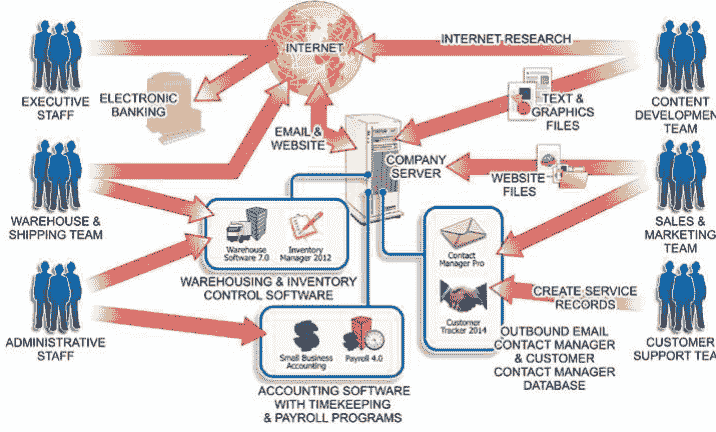

**图 17.1** 公司布局

公司的主要职能可以组织如下：

- **高管人员：** 高管人员执行以下电子活动：
    - 通过互联网进行电子银行活动
- **行政人员：** 行政人员参与以下电子职能：
    - 管理基于服务器的会计、仓储和库存程序
    - 管理员工电子薪资和考勤记录
    - 与内容开发团队互动，分享客户报告的内容问题，并根据需要提供粗略的修订材料
- **仓库与运输团队：** 这些员工负责产品的接收、库存跟踪、存储和运输。他们的工作涉及以下电子活动：
    - 与公司会计软件的仓库和库存模块交互，以更新和跟踪产品的接收和运输以及当前库存水平
    - 通过互联网与联邦快递、联合包裹服务公司以及公路货运公司交互，以安排和跟踪货物运输

考虑到这一场景，请提出如何实现其服务器功能的建议，以及应采取哪些安全措施来保护其企业资源。建议应包括但不限于：物理上保护服务器和服务器机房，制定保护公司知识产权和个人信息的策略，以及建立维护公司服务器的程序。

## 功能优先

将初始网络和平台选择建立在每个人可能需要的功能之上。然后确定哪些组织功能可以按角色选择。

组织内有六个主要部门。最初将它们映射到一个可以由多个域控制器（Microsoft、Linux 等）实现的基本角色配置文件非常重要。

- 高管
- 行政
- 销售/市场
- 内容开发
- 客户支持
- 仓库

场景中已初步提供了现有功能，因此基于角色的访问程序将为其提供足够的操作（和安全）访问控制：

- 电子银行（A）
- 会计（B）
- 仓库库存（C）
- 薪资和考勤（D）
- 客户联系管理系统（E）
- 公司网站管理（F）
- 内容创建/管理（G）
- 功能测试实验室（H）
- 网站访问（研究、电子邮件等）（I）

构建基于角色的访问控制是一个两步过程。域控制器可以允许/禁止对应用程序的访问，而应用程序本身可以对用户和权限进行区分。这种多身份验证方法是一个好主意。然而，对于这样一家小公司，可能没有域控制器，因此你必须考虑到这一点。

公司大约有20人，一台中央服务器（最好有异地备份）就能提供良好的功能。你最初的基于角色的架构可能如图17.2所示（大写字母代表应用程序功能）。

通常，公司里几乎每个人都需要访问互联网。实际上，允许访问在线电子邮件、银行服务以及一些上网自由不会给网络或计算平台带来负担。然而，它可能会影响生产力！为了帮助防止员工偷懒，应禁止过度的内容流媒体（音乐服务、Amazon Prime 视频等），因为它们可能扰乱你的业务。

既然你已经制定了基于角色的电子用户策略，你就可以确定应用程序本身如何提供必要的角色和职责分离，以维护所部署软件系统的操作完整性。例如，考勤系统中的每个人都需要输入自己的时间，但不能访问或报告其他人的时间。然而，“计时员”则需要访问薪资软件的更高级功能。你要避免的是仓库部门能够访问客户联系数据库。

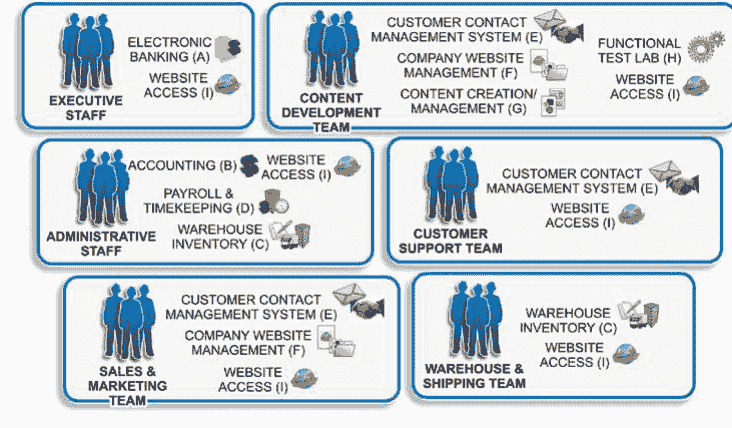

**图 17.2** 基于角色的架构

专有信息和知识产权是本场景中的主要关注点。基于角色的访问控制方法将延伸至这些关注点。目标是限制对信息的访问，防止其离开公司，并确保你的员工明白，如果他们自己泄露信息，将面临严重后果。良好的文档管理计划、策略和程序将为保护这些信息提供坚实基础。一些基本原则包括将公司的专有和知识产权信息保存在系统内部。不要让员工用U盘带回家，不要通过公司内部电子邮件到处发送，也不要让任何人随意访问。请考虑图17.3所示的松散管理环境。

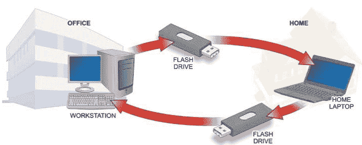

**图 17.3** 松散管理环境

仅仅一句“我今晚会完成这个！”就足以严重危及你的文件或数据。在最坏的情况下，数据从工作电脑复制到可移动设备，再到笔记本电脑，再到家庭网络（或者如果那里有你想用的大屏幕，就直接到家庭电脑），再回到笔记本电脑，最后回到办公室电脑。从安全角度看，这是一场噩梦！从文件或数据的角度看，羊已经跑出了圈！请记住，这是最坏的情况；也许可以说员工有恶意软件/防病毒保护，文件在所有设备上都被删除（甚至擦除），而且在重新放回网络之前还进行了检查。但真的每个人都会花时间做所有这些事情吗？即使有了这些保护，你的文件已经离开了公司场所。这不是你希望发生的事。

潜在的解决方案要安全得多。例如，你可以实施这里讨论的简单、经济高效的解决方案：

假设员工出于某种原因需要在异地工作。你希望实现以下目标：

1. 将文件保留在场所内。
2. 将开发/工作环境保留在场所内。
3. 在工作完成期间，对两者保持积极控制。

这意味着你需要以安全的方式扩展桌面。如图17.4所示，我们通常通过建立回办公环境的简单 VPN 连接，并将远程桌面（RDP）会话扩展到员工的

工作站。这种方法并不能提供绝对的安全保障。不过，它比原始方法要强大得多，并且还能提供问责（日志记录）能力。远程访问是当前商业实践中一种非常高效且富有成效的方法，而且它也可以非常安全。

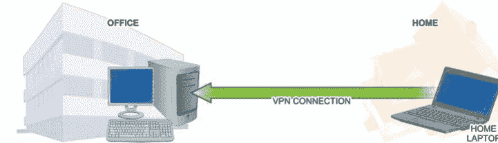

**图17.4 保持控制**

还有其他远程操作的方式。从GoToMyPC软件到全功能的Citrix桌面虚拟化，人们正在广泛地进行远程工作。对于一家20人的公司来说，一些简单的解决方案，例如配置得当的VPN和RDP连接，就能提供远程高效工作的途径。

随着远程连接——或者说任何连接——的需求，以及保护文件和数据（尤其是专有数据）安全的需求，我们有必要讨论如何为电子文件和电子数据构建一个安全可靠的环境。将公司的所有业务活动都限制在公司的物理围墙（甚至虚拟围墙）之内，对于保护这些数据大有裨益。为此，你可以制定一项简单的通信策略，禁止在非必要情况下通过电子邮件发送文件和数据，尤其是在公司内部。电子邮件已经成为事实上的文件存储库。

将电子邮件用作文件柜很方便，因为附件被包含附件的邮件上下文所包围。但现在它却永远地留在了邮件服务器上！与其让它留在那里，你不如将文件共享到网络文件服务器上的某个个人目录中，然后通过电子邮件将文件链接发送给对方，并附上“跟踪修订”或“使用你的姓名缩写保存修订版”的说明。这样，文件服务器上就有了访问记录，数据将继续保留在服务器上。你可以允许在本地控制的办公电脑上设置工作目录，但根据惯例和政策，你应该始终要求员工将文件放回服务器，并删除任何本地副本。

大多数像我们讨论的这种规模的小型网络，都允许直接从文件服务器打开和操作文件，因此没有必要保留本地副本。加密技术非常广泛！在这里一一讨论会占用大量篇幅，所以我们只做简单介绍。在合理的情况下使用加密。如果你有高度专有的文档，那么请对它们进行加密，并且只将公钥添加到那些绝对需要的文档上。除了个人密钥之外，请始终使用一个主公共密钥，如图17.5所示。这将确保公司所有者始终能够访问任何加密信息。你可以实施简单的电子审计技术，来收集哪些文件关联了哪些密钥的信息。

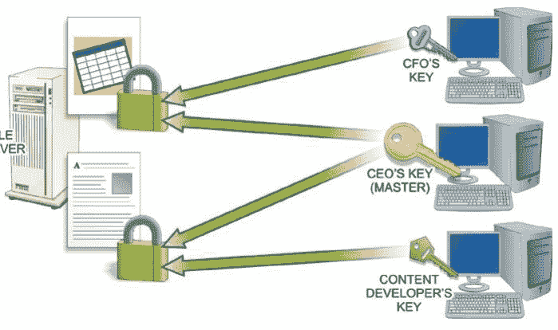

现在你已经了解了基本架构，可以开始关注部署的不同要求了。在部署你的资源（即硬件、网络、监控器、存储阵列等）时，如今有许多新颖的方法可供选择。让我们采用一种分级的方法。这意味着仓库不会配备30英寸的显示器，行政人员也不会获得双屏幕。正如老话所说，“干什么活，用什么工具”。

## 更小的硬件占用面积

将所有电子媒体都保存在公司内部的系统意味着更小的硬件占用面积。这意味着使用文件服务器来存储和分发所有电子内容。不使用可移动驱动器、U盘、光盘等。除非你有正当理由需要高性能，否则为什么要为此花钱呢？

在个人电脑和服务器方面，有一些非常简单的原则可以控制成本并保持性能。只购买工作所需的东西。作为一家小公司，你当然不想用廉价或性能不足的设备来妨碍员工的工作表现。对于非常大的公司来说也是如此。你能想象购买六千台全都带有光驱的电脑吗？你实际需要用到光驱的次数有多少次？也许买一两个USB外接光盘刻录机就够了，需要时再从柜子里拿出来用。其他外设也是如此。一些公司丢弃的成堆设备，其中不少几乎没怎么用过，简直令人惊叹。

让我们看看图17.6中所示的小型、经济高效的系统。它应该能够满足该场景中列出的所有需求，但你可以考虑根据预算进行调整，仅仅因为你可能更喜欢商业化的方案。实际的网络设备未在图中显示，但隐含了至少有一个面向外部的防火墙、一个可管理交换机、若干不可管理交换机，以及内部和外部访问所需的路由器。

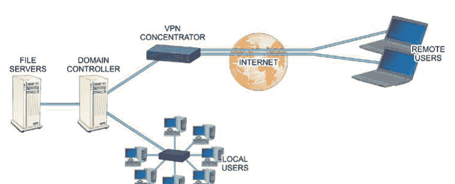

**图17.6 建议的网络拓扑**

毫无疑问，这看起来几乎和世界上任何其他计算机网络一样。毕竟，你能利用现有的东西做的事情也就那么多。区别在于你将实施以下内容：

1. 实施严格的基于角色的权限和身份验证策略及执行机制。
2. 实施严格的“留存在本地”策略，以保护公司敏感信息。毕竟，这正是你工作的意义所在。
3. 设计一个文档管理系统（包括策略），鼓励充分利用文件服务器，包括文件/数据访问权限、加密、审计以及良好的工作流程，以保持公司信息的整洁来源。
4. 在设备采购和使用方面做出明智的选择。如果不需要，就不购买。如果确实需要，能否共享某项资源？

### 记住！

功能而非特性。安全高于便利。业务先于欲望。

## 复习题

以下问题测试你对第三部分内容的掌握情况。

1. ______________ 是一套规则，用于管理网络通信的进行方式。为了在网络中设备之间相互通信，它们必须使用相同的网络协议。
2. 在OSI网络模型的哪一层，MAC地址起作用？
3. ______________ 涉及向服务器或网络连接设备发送大量请求，以至于其处理这些请求的能力达到极限，由于缺乏处理该流量所需的资源而导致其停止提供服务。
4. 操作系统安装、更新和打补丁后，应执行哪三个步骤？
5. 在哪种访问控制策略下，系统确定哪些用户或组可以访问文件、文件夹和其他资源？
6. 管理员使用 ________________ 来统一处理具有共同需求的用户帐户。
7. 描述审计系统的两个主要组成部分。
8. ________________ 是数据库驱动的工具，旨在搜索计算机中已被识别并添加到数据库中的已知漏洞。
9. 与铜缆传输介质相比，光纤电缆在安全性方面有什么优势？
10. 网络交换机主要在OSI模型的哪一层工作？
11. 在哪种类型的攻击中，攻击者发送伪造的ARP消息，将其MAC地址与另一用户的IP地址相关联？
12. SYN洪水攻击是如何工作的？
13. 哪种设备通常标志着内网网段的边界？
14. ________________ 是根据数据包的源/目标地址、逻辑端口或协议来放行或阻止网络数据包的过程。
15. 哪种类型的设备被认为是抵御IP欺骗攻击的主要防线？

## 试题

1. 哪个OSI模型层负责控制数据如何在通信点之间进行封装和移动？
   A. 数据链路层
   B. 网络层
   C. 传输层
   D. 应用层

答案：A

数据链路层涉及控制数据如何在通信点之间进行封装和移动。在这一层，数据被格式化为适合传输的帧。该层的组件还向帧添加错误检测和纠正功能，以及介质访问协议和关于传输到同一网段上特定节点的具体信息。

# 复习问题

+   2. **以下哪一项是有效的 IPv6 地址？**
+   
+   A. `10000111.10001011.01001001.00110110`
+   
+   B. `191.254.0.0`
+   
+   C. `2001:0db8:00a7:0051:4dc1:635b:0000:2ffe:`
+   
+   D. `13:A2:00:40:6B:8E:66`

**答案：C**

IPv6 地址通常以十六进制数字的形式书写，以冒号分隔（`2001: 0db8:00a7:0051:4dc1:635b:0000:2ffe`）。

+   3. **哪种类型的服务器充当网络计算机与互联网之间的中介？**
+   
+   A. 网关服务器
+   
+   B. 路由器服务器
+   
+   C. Web 服务器
+   
+   D. 代理服务器

**答案：D**

代理服务器充当网络计算机与互联网之间的中介。

+   4. **_____ 服务器允许客户端从远程站点拨号连接到计算机，即使它们未连接到局域网。**
+   
+   A. SAN
+   
+   B. NAS
+   
+   C. RAS
+   
+   D. FTP

**答案：C**

**RAS（远程访问系统）服务器**允许客户端从远程站点拨号连接到计算机，即使它们未连接到局域网。

5. **在以下哪种类型的网络攻击中，攻击者使用网络分析器监听网络流量，寻找以明文模式在网络上传输的密码和用户名等项目，或寻找信用卡或其他财务信息等敏感信息以便劫持？**

+   A. 数据包嗅探攻击
+   B. ARP 欺骗攻击
+   C. MAC 劫持攻击
+   D. DoS 攻击

**答案：A**

数据包嗅探攻击通常使用一种称为数据包嗅探器的网络分析工具进行，以监听网络流量，寻找以明文模式在网络上传输的密码和用户名，或可以劫持的信用卡或其他财务信息等敏感信息。

## 6. 在以下哪种类型的网络攻击中，攻击者用目标的 MAC 地址更新自己的 MAC 地址，从而导致交换机将流量转发到两个位置？

+   A. MAC 泛洪攻击
+   B. MAC 复制攻击
+   C. 重定向攻击
+   D. 中间人攻击

**答案：B**

在 *MAC 复制* 或 *MAC 克隆* 攻击中，攻击者用目标的 MAC 地址更新自己的 MAC 地址。这将导致交换机将流量转发到两个位置。

## 7. 哪种无线安全功能为无线网络提供最佳防御？

+   A. Bluetooth
+   B. WEP
+   C. WPA
+   D. WiMax

**答案：C**

尽管 WEP 是一种强大的加密方法，但严重的攻击者可以破解它。这促使无线行业创建了更强的 Wi-Fi Protected Access（WPA）标准。WPA 增加了改进的数据加密，使用临时密钥完整性协议（TKIP）和 IEEE 802.1X 可扩展认证协议（EAP）用户认证协议以提供更高的安全性。

## 8. 哪个 Linux 组拥有执行在用户无需干预下运行的后台进程的特权？

+   A. Users
+   B. Wheel
+   C. Root
+   D. Daemon

Answer: D

Daemon 是一个标准、默认的用户/组，拥有执行守护进程程序（后台进程）的特权，这些进程在用户无需干预下运行。

## 9. 受管交换机提供哪些可配置功能来防止中间人攻击？（多选。）

+   A. 数据包过滤
+   B. DHCP 嗅探
+   C. 深度数据包检测
+   D. 动态 ARP 检查

Answer: B, D

受管交换机通常提供 DHCP 嗅探和动态 ARP 检查（DAI）配置选项，这些选项旨在挫败 MITM 攻击。DHCP 嗅探用于过滤和阻止入站 DHCP 服务器消息并构建 IP 到 MAC 地址数据库。DAI 使用 DHCP 嗅探数据库来检查和验证 ARP 请求以防止 ARP 欺骗攻击。

## 10. 以下哪一项是为网络连接设备提供安全性的最基本步骤？

+   A. 将连接设备放置在安全的墙壁机柜中或将其放置在服务器室的安全范围内以提供物理保护
+   B. 配置设备管理设置，使所需功能尽可能安全，以提供所需的性能水平
+   C. 禁用不需要的任何管理功能

Answer: A

所有安全工作都始于物理访问级别。如果未经授权的人员可以获得对网络服务器、媒体或连接设备的物理访问权限，则没有安全性。
