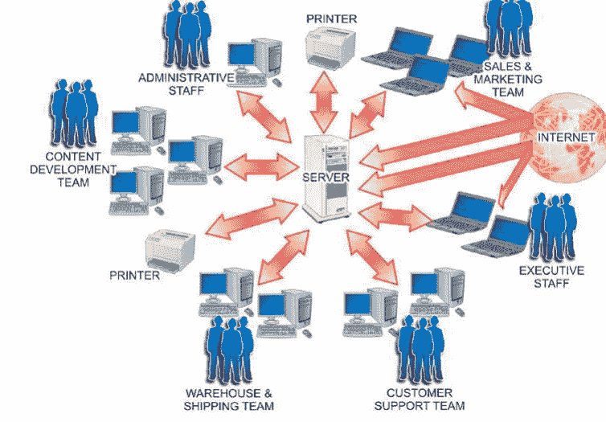

## 保护外围

- Chapter 18    Perimeter Security in the Real World
- Chapter 19    Understanding the Environment
- Chapter 20    Hiding the Private Network
- Chapter 21    Protecting the Perimeter
- Chapter 22    Protecting Data Moving Through the Internet
- Chapter 23    Using Tools and Utilities
- Chapter 24    Identifying and Defending Against Vulnerabilities
- Chapter 25    Perimeter Security: Review Questions & Hands-On Exercises

## 实际世界的外围安全

*以下挑战为* 您提供了您将在第四部分学习的概念的上下文参考点。由于您尚未阅读第四部分的章节，本章中的挑战旨在让您熟悉您将在现实世界中面临的本地主机场景。在本章中，您将学习：

- 了解互联网外围安全的相关性
- 使用 NIST 网络安全框架为所呈现的安全场景制定具体解决方案

### 安全挑战

本章将启动您对即将学习的内容的思考过程。与其简单地尝试吸收您即将学习的所有信息，您将在此开始，通过更好地了解这些信息在现实世界中的相关性。

在第 25 章中，您将回到这些场景并应用您在第 19 章至第 24 章中学到的知识。您还将把您的观察与提供其观察和解决方案的专业安全专家进行比较。

### 互联网安全场景 1

由于贵公司在上一章中为组织设计服务器和局域网系统方面表现出色，其与该组织的合同已扩展以涵盖其互联网安全需求。您已被委托负责研究、设计和实施公司的网络安全政策。

图 18.1 显示了公司当前网络结构的安排。利用此信息来确定如何最好地保护它免受与连接到互联网相关的攻击和利用。

FIGURE 18.1 The Company Network Layout

### 风险评估 1

根据本场景提供的信息，考虑以下国家标准与技术研究所（NIST）功能并就每个功能所列的选定类别和子类别形成您的想法。您可能还希望参考附录 C 中提供的 NIST 网络安全框架副本，以及它为每个子类别引用的支持文档，以帮助制定所要求响应的制定。
在这些考虑到位后，您将被介绍到如何在后续章节中实施所要求的功能的特定信息。最后，您还将在第 25 章中获得机会，用从该材料中得出的新选项更新这些原始想法，并将其与工作网络安全专家制定的解决方案进行比较。

## 识别

确定公司私有网络与将从互联网访问网络的客户以及将从公司网络访问互联网的员工之间的通信流。识别与公司网络连接到互联网相关的任何潜在威胁和攻击，以及此类攻击相关的潜在影响。（参见 NIST ID.AM-3, ID.RA-3, 4。）

## 保护

描述管理从互联网进行连接的授权客户以及需要远程访问公司网络的员工的身份和凭证的潜在系统和政策。也建议保护网络完整性的方式。

确定保护机密信息在从、到或通过互联网传输时通过的最佳选项。最后，建议可以采用的方法、设备和结构来保护公司的网络免受互联网利用。（参见 NIST PR.AC-1, 3, 4, 5, PR.DS -2, PR.PT- 4。）

## 检测

提出您的建议，用于系统和技术，以便在有人或某物尝试访问网络时提醒网络管理员。

您如何检测可能影响网络操作而未经适当授权的异常和事件？此外，描述组织在为客户提供互联网访问相关的漏洞评估中应包含的项目。（参见 NIST DE.CM-1, 8。）

## 响应

提出一份政策声明建议，说明应如何调查检测系统通知。也包括关于如何遏制入侵事件的选项的建议。（参见 NIST RS.AN-1, RS.MI-1, RS.RP1。）

## 恢复

由于公司现在处理公共信息，请讨论在发生网络事件后可能需要采取哪些行动来维护其在公众中的声誉。（参见 NIST RC.CO-2。）

使用您的投资组合记录此挑战的观察结果。在本章结束时，您将被要求再次访问此信息，以评估您对该场景的原始知识，并将其与您通过本章及其相关内容获得的信息进行比较

实验室操作规程。你还将能够将你的观察结果与在职安全专家的观察结果进行比较，以提高你对该主题的理解。

## 互联网安全场景 2

从客户组织运营的描述中，应该可以明显看出，他们的几个员工群体有正当需求需要从远程位置访问公司的内部资源。因此，你还需制定一项策略和架构，以实现他们所需的远程访问能力。

## 风险评估 2

根据本挑战中提供的信息，考虑以下 NIST 功能，并针对每项功能列出的类别和子类别提出你的想法。在考虑这些问题之后，你将被介绍有关如何实施所请求功能的具体信息。

### 识别

确定公司专用网络与其远程员工之间的通信流。此外，为从远程位置访问公司网络资产的员工制定策略建议。（参见 NIST ID.AM-3, 4, 6。）

### 保护

描述用于管理需要远程访问公司网络的授权员工的身份和凭据的潜在系统和策略。还要建议在实施此通信选项后保护网络完整性的方法。

确定哪些选项最适合保护公司的机密信息，因为这些信息通过这些通信渠道从互联网传出、传入或穿越互联网。最后，建议可用于保护公司远程访问连接的方法、设备和结构。（参见 NIST PR.AC-1, 3, 4, PR.DS-2, PR.PT-1, 4, PR.MA-2。）

### 检测

提出你的建议：如果未经授权的用户尝试通过远程访问渠道访问网络，可使用哪些系统和技术来提醒网络管理员。

你如何检测可能与远程访问系统相关、并可能影响网络运行的异常和事件？此外，描述在向员工提供远程访问能力方面，组织的漏洞评估中应包含哪些项目。（参见 NIST DE.CM-1, 3, 8。）

### 响应

提出一份建议的策略声明，说明应如何调查涉及远程访问事件的检测系统通知。还要包括关于如何遏制入侵事件选项的建议。（参见 NIST RS.AN-1, RS.MI-2。）

### 恢复

由于公司现在可能通过网络外部传输专有公司信息，请提出一项建议，以便从与公司数据通过远程访问系统被利用相关的漏洞中恢复。（参见 NIST RC.RP-1。）

### 总结

记录你在本章中提出的风险评估的观察结果。在第 25 章中，你将把这些原始想法和观察结果与阅读第 19 至 24 章后所产生的结果进行比较。你还将能够将你的答案与专业安全专家的答案进行比较。
