## 了解环境

*在本书的这个阶段*，你已经了解了三个一般层面的安全漏洞和解决方案：物理安全、本地主机安全和本地网络安全。这三个层面适用于计算设备、网络连接设备、网络服务器以及由所有者控制的网络介质。本章是本书中最后一个一般性安全章节，讨论的是互联网安全。在本章中，你将学习：

- 识别与不受控的互联网环境相关的参与者类型
- 识别与不同 IP 寻址技术相关的组件
- 将基本端口号与网络安全联系起来
- 识别关键的互联网安全组织和标准

### 互联网安全基础

在互联网早期，安全主要与密码有关。在许多情况下，密码是生日或宠物名，并使用了几种不同的技术。我们对所生活的这个奇妙的互联世界印象深刻。然而，也有一些人蓄意制造麻烦或入侵网络，但在当时，这大多是恶作剧而非恶意行为。

### 本地网络安全与互联网安全的重叠

当你学习第四部分时，你会注意到本地网络和互联网安全之间存在大量重叠，因为互联网仅仅是互联网络的集合。实际上，适用于网络的每一个安全概念也应适用于这些互联网络。不过，在本章中，我们将较少关注物理层或数据链路层技术，而主要关注互联网连接特有的概念。

黑客行为大多只是破解，即利用软件不断循环并猜测密码，直到获得访问权限。少数真正的黑客行为涉及直接访问或将恶意代码放在软盘上。

互联网的使用以惊人的速度增长。在短短几年内，几乎每家企业都在使用互联网，甚至有很大比例的家庭用户每天都在发送电子邮件、购物或只是探索知识。访问速度和协作软件改进如此之大，以至于整体体验对几乎所有人来说都变得极具吸引力。随着网络的发展并成为常态，用于互动的功能也成为了常态。

网络专业人员必须处理一些安全问题以及一些更重大的安全挑战，这催生了网络安全行业。黑客可以获取电子邮件地址列表，甚至猜测地址，然后发送精心制作的软件，给毫无戒心的收件人带来烦恼和不便。我们信任大部分电子邮件，盲目点击附件，基本上很容易成为猎物。

安全意识的真正转变始于第一批计算机病毒开始传播之时。单个用户运行一段恶意代码就可能影响整个公司网络。受害者可能在不知情的情况下，将该病毒分享给其所有联系人，从而成为病毒进一步传播的共谋。

微软希望拥有市场上最强大的网络浏览器，一个能够彻底改变我们交流方式的浏览器。他们将这些能力构建到操作系统中，并让我们对他们所能实现的技术感到惊叹。

没过多久，黑客就将目光投向了这种新能力，并针对这些功能创造了一个又一个漏洞利用。随着企业争相采用更新的技术，几乎立刻，要抵御恶意利用已经太迟了。世界已经依赖于互动和交流。当微软和其他公司争相修补几乎每天都被发现的新漏洞时，有一点变得非常清楚：互联网安全是件大事！

如今，有如此多不同的软件和硬件技术使用互联网，安全需要成为每个人关心的问题。我们不能仅仅依靠操作系统供应商或应用程序供应商来保护我们的安全。我们都必须保持警惕，确保安全措施到位。即使是只通过电子邮件与孙辈交流的家庭用户，也必须具备一定的安全意识。

在本地主机和局域网得到保护之后，还必须保护与互联网的连接。考虑到这一点，互联网安全涉及四个主要目标，以及需要考虑的这些主要形式的互联网安全：

- 了解本地内部网络与互联网环境之间的边界。连接和使用互联网的方式有很多种。目标是理解其工作原理，以便保护数据，防止恶意互联网用户访问本地计算机上的数据，或防止其在数据通过互联网传输时被访问。
- 保护本地硬件。物理安全仅涉及保护对本地网络硬件的物理访问。
- 保护网络。网络安全包括保护控制数据传输的硬件，以及提供身份验证、授权和保护。
- 保护数据。数据安全包括保护存储在网络中或通过网络传输的数据。

网络安全既是一门学科，也是一套技能。有一点安全多疑可能是好事；但与其让安全担忧影响你的健康，不如制定一个强大的备份计划，这样即使在最坏的情况下，网络资源也能得到保护，并能合理地重新部署。

第四部分将涵盖此处列出的互联网安全基本概念，并将其应用于多种协议和服务，以帮助你在面对新的或横向技术时也能懂得如何应对互联网安全。

## 理解环境

网络是由可以自由交换信息的设备组成的集合，而互联网本质上也不过是能够交换信息的网络的集合。信息交换的自由程度各不相同，但信息能够轻松交换正是互联网如此吸引人的原因。这也是互联网如此危险的原因。

互联网以某种形式已经存在数十年，从政府和大学的概念演变而来，随着网络变得更主流、更实用，它已成为信息交换的全球标准。直到万维网和网页浏览器的出现，这一概念才进入家庭，成为年轻人、老年人都渴望并最终几乎必不可少的东西。

要充分理解互联网环境，你必须了解居住在互联网中的各类参与者。个人用户通常会遇到五种参与互联网活动的参与者：

- 服务提供商
- 想要做广告和销售的企业
- 想要交换信息的人和企业
- 想要访问互联网上的信息或使用服务的用户
- 想要访问计算机窃取信息、监视他人或破坏其通信的坏人

另一方面，对于大多数企业而言，通常需要考虑互联网上的五种参与者（如下图 19.1 所示）：

- 可以浏览其网站并可能通过互联网订购产品的潜在客户
- 需要通过互联网访问其内部网络的远程员工
- 可以高效地利用互联网交换信息的受信任企业
- 想要访问互联网上的信息或使用服务的内部用户
- 想要访问其网络窃取资金、破坏其运营或破坏其通信的坏人

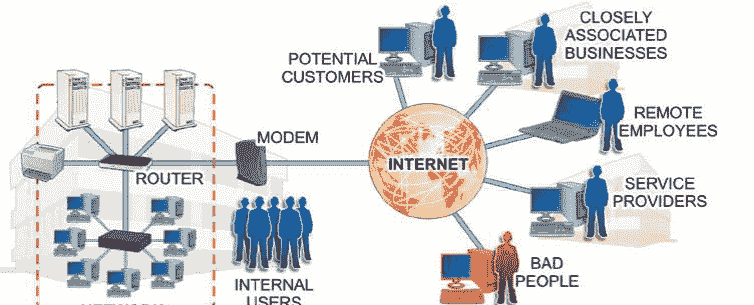

图 19.1 互联网参与者

## 基本互联网概念

许多人认为互联网不过是电子邮件和网络。一直以来还有许多其他协议，而且每天都在创建更多协议。

在第三部分中，你已了解 OSI 网络模型，其中系统有七层，每层仅与上下层交互。我们在网络管理中并不太关注这些层，但它们是理解网络中存在不同方式来处理不同协议的互联的关键。

典型的互联网活动中涉及许多不同的协议。但核心协议套件（也是最重要需要理解的）是通常称为 TCP/IP 的互联网协议套件。顾名思义，TCP/IP 包括两个协议：传输控制协议（TCP）和互联网协议（IP），它们是互联网模型中最重要的协议。

我们知道数据在任何网络上传输时都是以数据块的形式传输的，具体称为数据报、数据包或段，这取决于数据正在通过哪一层。TCP/IP 划分为四个层，并规定数据应如何打包（链路层）、寻址（互联网层）、传输（传输层）以及接收和处理（应用层）。

协议（SMTP），而超文本传输协议（HTTP）是主要的网页协议。

当 TCP 协议接收数据时，它将其分成块并为每个块添加 TCP 头部，形成 TCP 段，如图 19.2 所示。该段随后由互联网协议（IP）封装成通常称为 TCP 数据包的数据报。TCP 头部包含 10 个必填字段和一个可选扩展字段。这些字段共同提供了确保头部后数据的正确可靠交付所需的信息。

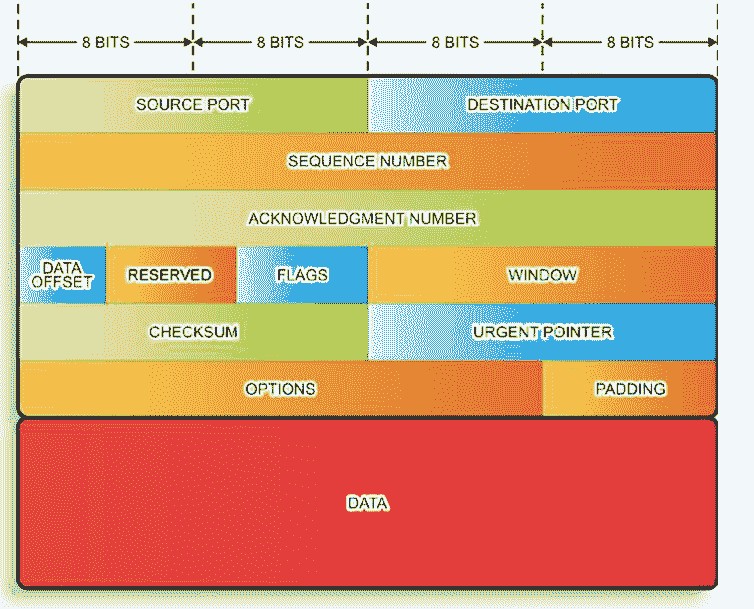

图 19.2 TCP 段结构

## TCP/IP 数据包的缺点

TCP/IP 数据包构成了互联网通信的骨干（以及大多数局域网策略）。反过来，它也为大多数类型的网络攻击提供了载体。这些攻击以不同方式操纵源地址和目标地址，以更改或隐藏消息的来源或目的地。

TCP 协议严格跟踪所有数据，以便任何混乱或丢失的数据包都可以重新传输甚至重新排序以保持可靠性。接收这些数据包的网络设备必须在能够处理之前缓冲这些数据。因此，协议必须促进主机之间达成协议，以限制一次可以传输的未确认数据的大小。这就是所谓的 TCP 窗口大小，位于 TCP 头部中。

为优化此过程，TCP 使用流量控制协议，接收主机在接收数据时可能会更改该窗口大小以补偿更高的负载。如果接收主机不再有任何缓冲区空间来处理数据，它会将该窗口大小设置为零。当这种情况发生时，发送方将停止传输并启动持久计时器。当计时器到期时，发送方将发送另一个小数据包以期获得新的窗口大小。

另一方面，UDP 只是简单地发送数据包而没有大部分复杂性和开销。这导致延迟（延迟）更低。然而，这意味着数据包可能会丢失甚至乱序接收。UDP 提供了端口号和可选的校验和以验证完整性，因此应用程序可以配置为使用 UDP 以比 TCP 更快的速度进行无损数据传输。UDP 与许多其他协议一起使用，例如：

- 域名系统（DNS）查询
- 实时流传输协议（RTSP）
- 简单文件传输协议（TFTP）

## 单播、广播和多播

单播消息是指向单个网络地址发送消息。广播消息是指向所有可能的目的地发送消息。多播消息使用特殊地址分配向特定地址组发送消息。单播、广播和多播之间的差异如图 19.3 所示。

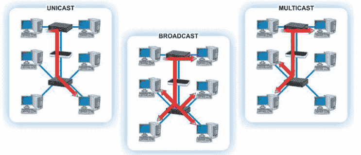

在多播中，无论有多少地址会接收，源只需发送一次数据包。网络节点然后根据需要复制数据包以到达多个地址。多播用于多媒体和内容分发网络。经常使用 UDP 进行多播，因此提供商必须添加错误检测和重传机制以使多播可靠。

## 端口

除了网络地址之外，许多协议还可能指定端口或端口号。协议或应用程序可能以不同方式响应特定端口。例如，Web 服务器通常通过端口 80 响应 HTTP 请求，但通过端口 443 响应 HTTPS 请求。

端口似乎是任意的约定，大范围的端口号通常与任何特定服务无关，因此可用于特定应用程序。如果在 Web 浏览器中将端口号添加到主机名或 IP 地址，例如，你可以创建一个访问特定应用程序或服务甚至只是常规网页内容的方式。

端口号是一个 16 位数字。前 1,024 个端口号按惯例保留用于标识特定服务。TCP 和 UDP 协议都使用端口。一些常见端口及其描述在表 19.1 中给出。

### 表 19.1 一些常见端口及其用途

| 端口 | 协议 | 描述 |
|---|---|---|
| 20 | TCP/UDP | FTP |
| 22 | TCP/UDP | SSH |
| 23 | TCP/UDP | Telnet |
| 25 | TCP/UDP | SMTP（简单邮件传输协议） |
| 80 | TCP/UDP | HTTP（超文本传输协议） |
| 88 | TCP/UDP | Kerberos 认证系统 |
| 110 | TCP | POP3（邮局协议 v3） |
| 118 | TCP/UDP | SQL（结构化查询语言）服务 |
| 143 | TCP | IMAP（互联网消息访问协议） |
| 443 | TCP/UDP | HTTPS（通过 TLS/SSL 的超文本传输协议） |
| 631 | TCP/UDP | 互联网打印协议（IPP） |

端口号从 1024 到 49151 是由互联网号码分配机构（IANA）分配的注册端口。例如，Microsoft SQL Server 使用端口 1433 和 1434。Microsoft Windows 互联网名称服务（WINS）使用端口 1512 等。私有端口是 49152 到 65535 之间的端口。

理解端口对于管理网络安全至关重要。最小化不需要的扫描或限制访问的最简单方法是监控特定端口和端口阻塞。例如，如果你运营的服务器仅是 Web 服务器，你可以限制外部网络访问，使其只能通过端口 80 也许端口 443 进行。这样，如果有人从网络外部尝试访问端口 22 或 23 试图入侵，该请求将被阻止。

## 路由

*路由* 只是选择在网络或网络之间传输数据的最佳路径的过程，如图 19.4 所示。路由器是一种复杂的设备，可在网络之间路由数据；路由器可以是硬件、软件或两者结合。路由器主要处理 IP 地址，这可以是

用作限制访问的另一种方式。很多时候，用户并不知道他们想访问的服务器的IP地址，而是知道主机名和域名。

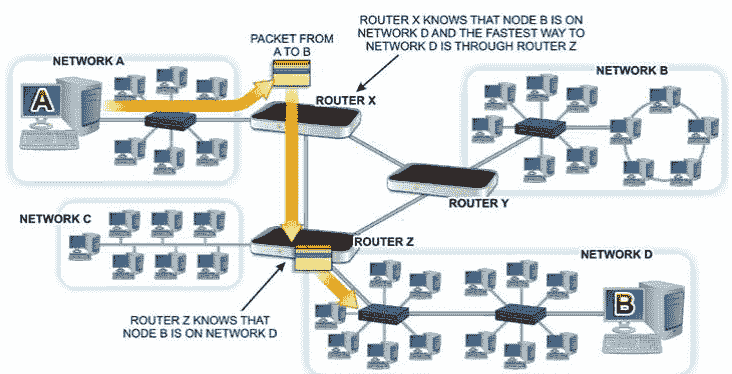

*图19.4 路由操作*

## 域

域是由称为注册商的代理机构分配的唯一领域，该代理机构已获得互联网名称与数字地址分配机构（ICANN）的授权。一些较大的注册商包括 Network Solutions、GoDaddy 和 eNom。

域的注册有一定的可续期时限，可以查询根权威机构，以便了解负责路由该域的名称服务器。这些名称服务器将使用与各种协议关联的IP来响应查询，并且你可以通过特定类型的查询了解与某个域关联的大多数协议。

顶级域（TLD）本质上就是域扩展名，如图19.5所示。TLD 为国家（例如 .us）、描述性群体（.people、.rocks、.attorney 等）和通用 TLD（如 .com、.net、.edu 和 .gov）而设立。每个 TLD 可能有不同的要求，甚至可能要求你必须使用特定的注册商来注册域。.edu 域和一些国家代码域在注册该 TLD 下的域之前通常有特定要求，例如必须是实际的教育机构或位于该国。然而，大多数域都可以随时注册。

一次只能在一个方向上传输数据。这些服务差异与安全措施无关，但在处理许多安全问题时，了解这些差异以及你所拥有的连接类型非常重要。

除了控制可通过互联网连接传输的数据量并为客户分配IP地址外，ISP 还可能提供一些你应该了解的更透明的服务。许多 ISP 会通过缓存服务器或缓存设备代理你的网络连接，以最大限度减少带宽占用。一些 ISP 还会错误地阻止某些端口，试图最大限度地减少恶意软件、病毒和蠕虫的影响。

例如，许多有线电视和 DSL 提供商阻止端口25，除非请求指向他们的邮件服务器。如果受感染的用户成为分布式垃圾邮件僵尸网络的一部分并开始大量发送垃圾邮件，他们的邮件将被阻止使用第三方邮件服务器。这使得 ISP 无需任何复杂的扫描技术就能防止大规模垃圾邮件爆发。这也迫使该 ISP 的用户如果想使用第三方邮件提供商，就必须将邮件软件设置为使用替代端口。

ISP 还可能为客户提供某些网络硬件。你必须准确了解这些硬件的功能。一些 ISP 为客户提供同时也充当路由器的调制解调器，它成为互联网与本地网络之间的边界。在某些情况下，该路由器可能已预先配置了某些设置，这些设置可能与局域网管理员试图进行的设置冲突。这些问题都可以解决，但你必须了解自己的连接是如何设置的，以便正确配置网络。

ISP 为调制解调器分配一个公共IP地址，该地址可以使用动态主机配置协议（DHCP）动态分配。使用 DHCP 并不一定意味着每次访问网络时都会获得不同的IP地址，甚至网络网关设备重启时也不一定。但也不能保证调制解调器的IP地址是固定的，就像分配静态IP地址时那样。

DHCP 服务器从可用地址池中分配一个IP地址。该IP与调制解调器的 MAC 地址关联，并持续指定的一段时间。DHCP 也可用于在内部网络中分配地址，我们稍后将讨论。

互联网服务通过多种技术提供，每种技术都可能影响你的安全方法。拨号连接和较慢的 ISDN 或蜂窝连接不太可能有人仅凭其速度入侵你的网络。入侵者必须确实想要进入该特定网络，才有耐心以这种方式渗透。

## 标准与 RFC

如果没有一些规则来规定一切应如何运作，互联网就会像美国旧西部的蛮荒之地。与其他事物一样，有各种标准组织负责监督某些协议。但另一种不太正式的工具也有助于指导这些协议应如何运作。

*RFC*（即请求意见稿）是提交给互联网工程任务组（IETF）的说明文件，IETF 是互联网的主要标准组织。任何人都可以提交 RFC。如果 IETF 认为该说明有价值，就会为 RFC 分配一个唯一编号，一旦发布，在没有获得新编号的情况下就不会再修订。如果这份 RFC 吸引了足够的兴趣并形成共识，它可能会演变成互联网标准；然而，许多 RFC 实际上是大多数互联网协议的事实标准。这个名称可能暗示它是一项正在进行的工作——在某种程度上确实如此——但当你需要理解某个协议时，这些 RFC 往往与技术手册一样重要。

## 安全组织与标准

许多组织参与维护网络漏洞资源，这与病毒和恶意软件资源类似。各种商业实体已经发展起来以满足这一重要需求，但也有许多公共资源和标准值得你了解：

- 安全内容自动化协议（SCAP）是一种使用各种开放标准来评估漏洞并衡量这些漏洞潜在影响的方法。你可以在 `scap.nist.gov` 了解更多信息。
- 常见漏洞与暴露（CVE）是一个用于引用公开已知漏洞的系统。CVE 由 MITRE 公司维护，并得到美国国土安全部的支持，SCAP 使用 CVE。你可以在 `cve.mitre.org` 更详细地探索 CVE。
- 通用漏洞评分系统（CVSS）是一个为 CVE 中的漏洞评分的系统，便于你理解风险。你可以在 `www.first.org/cvss` 更详细地探索 CVSS。
- 通用平台枚举（CPE）是一种描述和识别操作系统、硬件设备和

## 资源

- 兼容 PC 的台式机/塔式计算机系统
- 已安装 Windows 10 专业版
- 通过网络连接访问互联网

## 讨论

由于浏览器是通往更广阔外部世界的门户，其安全设置是保护本地主机安全非常重要的一部分。如果物理设备已在内部和外部边界得到保护，浏览器就会成为攻击者的主要访问点之一。

此外，机器上的其他互联网工具可能依赖浏览器组件来执行其功能。这些应用程序可能带来增强功能，从而产生额外的漏洞。如果这些功能对系统的运行没有贡献，就应进行评估并关闭。

## 操作步骤

Windows 10 专业版的 Internet Explorer 安全设置可以通过多种方式进行管理。在本实验中，你将了解这些设置的位置，以及如何根据你的具体需求进行调整。你还将学习如何控制隐私设置，以进一步控制那些经常被忽视的安全问题。

注意：在本练习中，你将使用 Internet Explorer（IE）。大多数浏览器都有类似的安全和隐私选项，或者依赖于为 IE 选择的选项。

### 访问 Internet Explorer 中的安全设置

1. 启动你的计算机。
2. 使用你的管理员账户登录。
3. 在任务栏中嵌入的搜索字段中，输入 Internet Explorer，如图19.7所示。

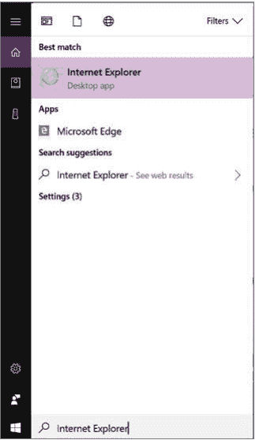

# 图19.7 定位Internet Explorer

+   4. 左键单击Internet Explorer以打开浏览器。
+   5. 右上角有一个小齿轮图标；点击它以打开一个小的选项列表。
+   6. 突出显示Internet选项，并单击以启动Internet选项窗口，如图19.8所示。

“常规”选项卡允许您更改影响主页、浏览历史、搜索默认值、选项卡显示以及各种显示的网页外观的设置。浏览历史包括Cookie、缓存的网页以及您访问过的网站历史记录，前提是“退出时删除浏览历史记录”复选框未选中。请记住，与Internet安全选项相关的选项卡标记为“常规”、“安全”和“隐私”。

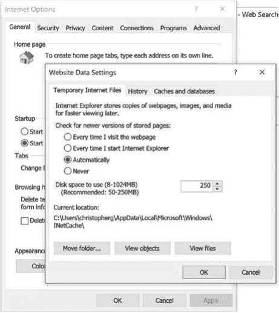

**图19.9** 网站数据设置

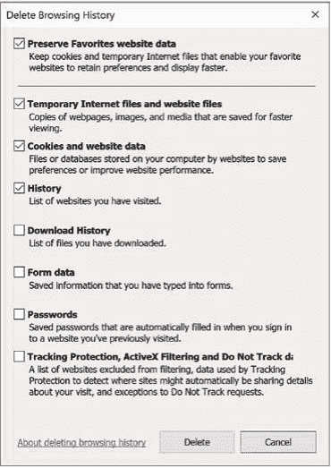

**图19.10** 删除浏览历史记录窗口

此部分的功能远不止删除浏览历史记录。在此窗口中，用于删除与Internet相关内容的选项包括：Internet临时文件、Cookie、下载历史和密码。请注意，某些内容类别默认处于选中状态。所有这些信息对于试图收集用户数据的入侵者都可能有用。例如，如果恶意用户能够访问Internet Explorer中存储的表单数据或密码信息，就可能开始窃取您的身份以访问网络资源的过程。

+   4. 阅读并理解每个选项提供的功能，然后在表19.2中记录每个选项的简短描述。

# 表19.2 删除浏览历史记录选项

| 选项 | 功能 |
|---|---|

+   5. 单击“取消”退出此窗口，而不删除任何浏览历史记录选项。

# 比较安全区域

+   1. 选择“安全”选项卡。图19.11显示了Internet选项窗口中“安全”选项卡下的选项。

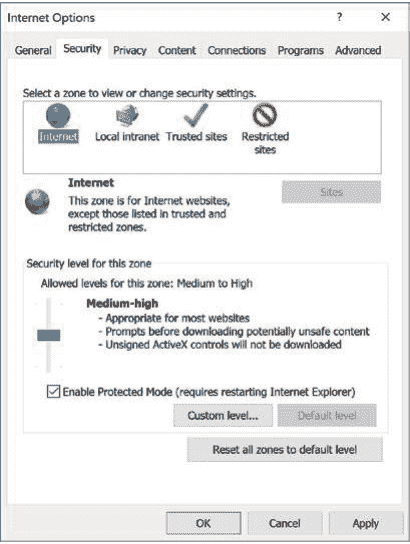

# 图19.11 Internet选项的“安全”选项卡

此窗口允许您将网站分配到不同的安全区域。

+   - Internet区域包含所有未分配到其他区域的网站。
+   - 本地Intranet区域包含与本地网络相关的所有网站（例如内部网页）。
+   - 受信任的站点区域将包含用户认为安全且不太可能损害系统的所有网站。
+   - 受限制的站点区域将标识已知包含潜在危险内容的网站。

除了为Internet保留的区域外，您可以使用“站点”按钮包含您选择的网站。

+   2. 在“安全”选项卡下选择Internet区域后，将安全级别滑块移动到“中”设置。检查Internet区域提供的描述、调整后的级别以及每个级别提供的描述。将此信息记录在表19.3中。

# 表19.3 Internet Explorer安全区域

| 区域 | 描述 | 级别 | 详细信息 |
|---|---|---|---|
| Internet |  |  |  |
| 本地Intranet |  |  |  |
| 受信任的站点 |  |  |  |
| 受限制的站点 |  |  |  |

+   3. 选择“本地Intranet”区域，并将安全级别滑块调整为“低”设置。如果已有自定义级别，请单击“默认级别”按钮以恢复滑块。检查本地Intranet区域提供的描述、调整后的级别以及每个级别提供的描述。将此信息记录在表19.3的指定位置。
+   4. 选择“受信任的站点”区域，并将安全级别滑块调整为“中低”设置。检查受信任的站点区域提供的描述、调整后的级别以及每个级别提供的描述。将此信息记录在表19.3的指定位置。
+   5. 最后，选择“受限制的站点”区域，并尝试将滑块调整到更低的设置。

您能够调整它吗？

+   6. 检查受限制的站点区域提供的描述、调整后的级别以及该级别提供的描述。将此信息记录在表19.3的指定位置。

请记住，将站点添加到受限制的站点区域并不会阻止它们。但是，它会阻止它们运行程序或任何活动内容。可以为Internet和受限制的站点区域启用保护模式，但这样做需要重新启动浏览器。

如果您选择启用保护模式，则在您的计算机上安装恶意软件将变得更加困难。如果恶意程序试图在保护模式之外安装或运行，Internet Explorer将向您发出警告。

7. 单击“将所有区域重置为默认级别”按钮，将安全级别恢复为其原始设置。

8. 单击“取消”退出Internet选项窗口。

# 将安全区域应用于站点

安全区域是一种快速有效的方法，可以广泛定义浏览器对各种站点、加载项、程序和下载的反应方式。但是，您有机会在具体选择上做出决定。现在，您将通过将网站添加到受限制的站点区域并查看结果来测试这一点。

+   1. 您应该位于Internet Explorer浏览器的主页。导航至www.msn.com。

+   2. 注意页面、图片、视频、广告以及任何其他吸引您眼球的内容。

+   3. 通过选择右上角的齿轮图标，然后选择“Internet选项”，返回Internet选项页面。

+   4. 选择“安全”选项卡以返回安全区域页面。选择“受限制的站点”。

+   5. 在“受限制的站点”徽标下方是一个标记为“站点”的按钮。单击“站点”。

您现在位于“受限制的站点”的“添加网站”窗口，如图19.12所示。

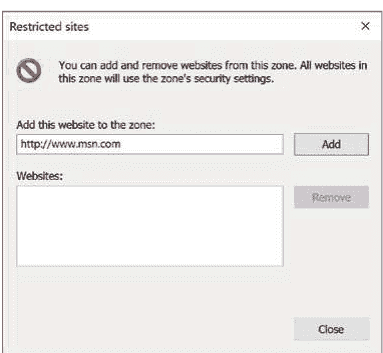

图19.12 受限制的站点窗口

+   6. 您可以输入任何您选择的网站地址，或者直接使用“添加”按钮添加当前网站。单击“添加”。

+   7. 网站被移动到下面，现在位于受限制的站点区域。单击“关闭”，然后点击“取消”退出Internet选项窗口。

同样的方法也可以用于将站点添加到任何其他类型的区域。

+   8. 注意当前网站msn.com并没有改变。单击URL右侧的“刷新”按钮或按F5键。

该网站看起来是否不同？

图19.13说明了msn.com作为受限制站点时的外观。

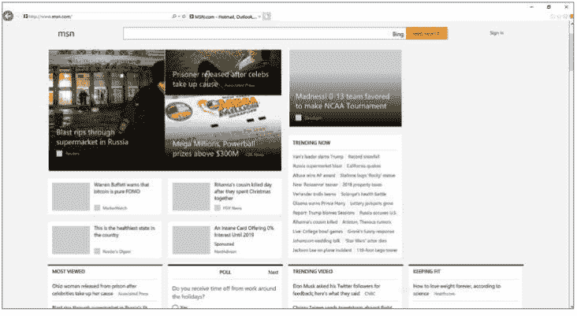

# 图19.13 作为受限制站点的msn.com网站

+   9. 单击浏览器窗口右上角的齿轮图标，然后选择“Internet选项”以返回Internet选项窗口。

+   10. 选择“安全”选项卡，然后选择“受限制的站点”。单击“站点”按钮。

+   11. 现在您可以从受限制的站点区域中移除msn.com。选择msn.com，然后点击“删除”。单击“关闭”。

+   12. 回到Internet选项的“安全”选项卡，单击“自定义级别”以探索您可以在安全区域内选择的特定选项。

这些设置控制Internet Explorer如何处理与网页相关的各种对象，例如ActiveX控件和Java脚本。请记住，网页可能包含旨在损害您系统的恶意对象。限制这些对象与系统交互的方式，有助于防止病毒、特洛伊木马或恶意脚本在您不知情的情况下下载到您的系统。

+   13. 浏览可用的选项，但不要更改任何选项。图19.14显示了“安全设置 - 受限制的站点区域”窗口。

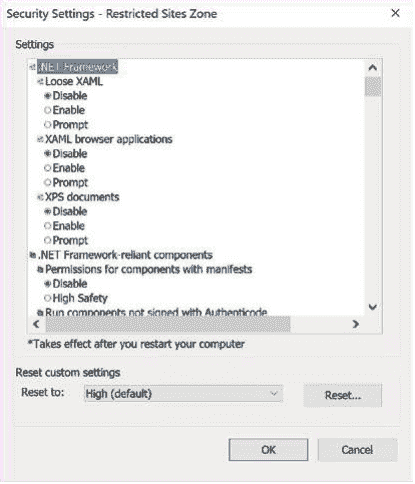

**图19.14**  安全设置 - 受限制的站点区域窗口

+   14. 单击“取消”退出“安全设置 - 受限制的站点区域”窗口。再次单击“取消”退出Internet选项窗口。

+   15. 通过单击URL右侧的“刷新”按钮来刷新网页。

msn.com网站是否恢复正常？

## 应用隐私控制

Internet Explorer 的隐私控制可帮助你管理网站如何监控你的在线活动。你可以选择阻止所有监控；但这样做会使你的在线资源变得有限。除了恶意软件之外，营销公司和在线购物网站也会使用监控来让你的体验更轻松、更快捷。

1. 单击右上角的齿轮图标并选择“Internet 选项”，返回 Internet 选项窗口。
2. 选择“隐私”选项卡，即可显示如图 19.15 所示的窗口。

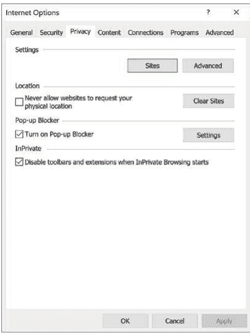

图 19.15 Internet 选项中的“隐私”选项卡

攻击者只需要使用数据包嗅探工具来监视网络流量并捕获 Cookie，即可获取你的凭据（用户名、密码、网络地址等）。有了这些信息，攻击者就可以在访问其他网站时冒充你。

攻击者还可以使用一种名为*跨站点脚本*的技术，使返回的 Cookie 被重定向到攻击者运营的第三方服务器。然后，攻击者可以使用窃取的 Cookie 冒充原始用户，伪造原始网站。这种重定向通常只需将脚本隐藏在网站上，并利用社会工程学技巧诱骗你点击该代码即可实现。一旦你点击，你的 Cookie 就会被发送到攻击者指定的第三方位置。

3. 单击“安全”选项卡，你会注意到左下角有一个滚动条。该级别对阻止和拒绝 Cookie 有不同程度的设置。逐个滚动浏览并评估各项信息。完成后，将其恢复为“中”级别。

4. 再次单击“隐私”选项卡，你会发现同样可以选择允许或拒绝某些网站。如果选择“站点”按钮，你将被重定向到另一个窗口，在那里你必须指定一个网站。在 Internet 选项窗口的“隐私”选项卡中，还有一个“高级”按钮。单击“高级”按钮以指定你是否希望允许或拒绝来自这些网站的 Cookie。

5. 默认情况下，Internet Explorer 设置为接受所有 Cookie，以便允许经常访问的网页记住你上次的访问。

6. 对于“第一方 Cookie”和“第三方 Cookie”，均选择“提示”单选按钮。

选择“阻止”将阻止所有网站在计算机上放置 Cookie。但是，这可能会导致某些需要启用 Cookie 才能正常运行的网站出现问题。选择“提示”将使 Internet Explorer 在允许任何 Cookie 被放入系统之前请求许可。

请记住，会话 Cookie 会在浏览器关闭时被清除，而持久 Cookie 会一直保留在计算机上，直到达到指定的过期日期。你也可以选择“始终允许会话 Cookie”。

7. 单击“确定”保存对 Cookie 的更改。再次单击“确定”退出 Internet 选项窗口。

8. 通过单击 URL 右侧的“刷新”图标刷新 msn.com。

系统是否提示你允许或阻止 Cookie？
是否有任何 Cookie 来自非 msn.com 的源？
你可以自行决定允许或阻止这些 Cookie。

请注意，即使这一个网站也使用了多个 Cookie。如果持续弹出提示，它们可能难以管理、跟踪，甚至会让人感到烦恼。因此，它们通常会被允许。攻击者知道这一点，这使得 Cookie 成为收集信息的绝佳目标。

9. 单击 Web 浏览器右上角的齿轮图标。选择“Internet 选项”。

10. 返回“隐私”选项卡。单击“默认”按钮，将 Cookie 设置重置为默认设置。

11. 在“位置”下，选中“从不允许网站请求你的物理位置”旁边的复选框。

网站通常会请求此信息来跟踪您的物理位置，以便为本地服务或搜索提供自定义结果。不幸的是，它们会获得你的 IP 地址或 MAC 地址，以及如果你在移动设备上时的信号强度。

12. 选择“清除站点”以删除任何已包含此信息的 Cookie。此后该选项将变为灰色。

13. 默认情况下，“启用弹出窗口阻止程序”选项已启用。单击“设置”以查看有关选项的更多信息，如图 19.16 所示。

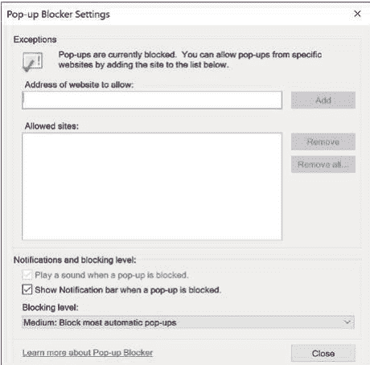

图 19.16 弹出窗口阻止程序设置

14. 查看设置后，单击“关闭”退出该窗口。

最后一个复选框是在 InPrivate 浏览开始时禁用工具栏和扩展程序。InPrivate 浏览可防止 Internet Explorer 留下他人可见的痕迹。这意味着 Cookie、临时 Internet 文件和历史记录等项目不会被保存。保持选中此复选框可消除工具栏和扩展程序带来的潜在漏洞。

## 探索安全设置

1. 在 Internet 选项窗口中选择“高级”选项卡。
2. 向下滚动“设置”选项，直到到达“安全”目录。查看此列表中的选项。

此列表需要对 Internet 如何作为网络运作有更深入的了解。在完成本书的学习并继续了解网络知识的过程中，请回到这些高级安全设置中，查看每个设置的功能。

3. 单击“确定”保存默认 Cookie 设置。
4. 单击浏览器窗口右上角的齿轮图标，并将光标悬停在“安全”上。

该选项区域为你提供了一个常用的快速访问列表，用于启用或禁用某些功能。

5. 在表 19.4 中，列出可用的选项。

表 19.4 选项

| 选项 |
|------|

6. 关闭 Internet Explorer。

## 实验问题

1. 列出网站必须归类到的四种区域类型。
2. 哪种安全区域只允许一个级别，该级别是什么？
3. 默认情况下，Internet Explorer 设置为接受 _____________ Cookie。
4. InPrivate 浏览有什么作用？
5. 当网站请求你的物理位置时，会收集哪些信息？

## 实验答案

1. Internet、本地 Intranet、受信任的站点、受限站点
2. 受限站点，高
3. 所有
4. Cookie、临时 Internet 文件和历史记录等项目不会被保存。
5. 它们会获得你的 IP 地址或 MAC 地址，以及如果你在移动设备上时的信号强度。
