## 隐藏专用网络

*在前面的每一章中，安全规划都被描述为一个三层计划，每一层都包含不同类型和级别的安全设备、技术和策略。Internet 安全也不例外。在这种环境中，内部是本地用户系统或组织的局域网。在本文中，我们将这些结构称为专用网络。*在本章中，你将学习：

- 讨论实施网络地址转换（NAT）和端口地址转换（PAT）以增强网络安全的优缺点。
- 定义并描述网络分段和安全区域
- 使用 NAT 在网络中创建安全分段
- 使用 VLAN 实现安全分区

### 了解专用网络

在使用前三章所述的适当设备、技术和策略保护内部安全之后，有必要保护*内部边界*，即个人或组织的专用网络与 Internet 之间的连接点。

Internet 是你边界之外的一切。问题是，Internet 不受单一组织管理，也没有一个组织可以为我们保护它。相反，使用 Internet 意味着你的数据正在穿越由许多组织管理（并可能保护）的网络设备。

如前所述，Internet 上有我们希望通过更高效地使用 Internet 来与之互动的客户、员工和企业。然而，也有各种各样我们不想与之互动的坏人。


要处理的第一个安全层是内部网络。除了实施前面章节中描述的设备、技术和实践外，许多网络安全设计者还会采取措施，将专用网络隐藏或伪装起来，使其不被互联网发现。以下各节将介绍为此目的常用的不同技术和设备。

## 网络地址转换

*路由*简单来说就是将某个网络中使用的 IP 地址转换为另一个网络中的 IP 地址。网络地址转换（NAT）类似于简单路由，但适用于一个网络使用专用寻址的情况，如图 20.1 所示。通常，NAT 用于将公共 IP 地址（例如来自互联网的地址）映射到网络内部的某个地址。

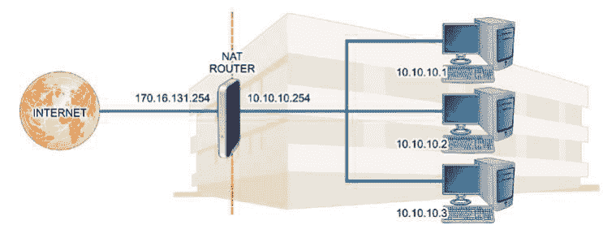

图 20.1 NAT 配置

在进行此转换时，执行转换的网络设备（通常是路由器或防火墙）还可以对请求进行身份验证或阻止它。这种映射可以由指定具体转换的 NAT 表引导，也可以通过使用从可用地址池中分配转换后 IP 地址的动态方案来引导。

NAT 可以结合基于策略的路由（PBR）来执行，其中映射决策由任意数量的规则决定，这些规则可以基于多种不同的标准。如果需要从外部访问网络，这些规则对安全性至关重要。

动态主机配置协议（DHCP）通常用于定义一段 IP 范围，这些 IP 可以按预配置的时长动态租用给请求系统。处理这种分配的设备称为 DHCP 服务器，它会跟踪所有地址分配，以避免重复分配同一个 IP。DHCP 服务器还支持静态分配，即可以为特定 MAC 地址预留一个 IP 地址。

## 端口地址转换

NAT 的一种扩展称为端口地址转换（PAT），它支持将多个或私有 IP 映射到单个或公共 IP 地址的概念，如图 20.2 所述。路由器分配一个附加到 IP 地址的端口号，有效地使每个地址成为唯一地址，即使它们共享同一个 IP 地址。

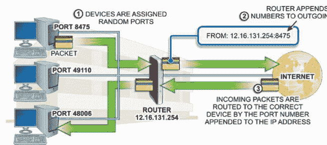

图 20.2 PAT 配置

由于 IPv4 IP 地址非常紧缺，这个概念目前几乎无处不在。虽然节省 IP 地址无疑是 NAT 和 PAT 的主要原因，但这些概念还可以通过允许网络只暴露绝对必要的部分来帮助提高网络安全。大多数人认为 NAT 和 PAT 是一回事。尽管这两种技术之间有区别，但以下讨论也将其视为相同。

一旦连接通过身份验证并完成所有转换，就可以检查每个数据包以确保会话有效。如果内部客户端向外部设备请求某些内容，我们必须知道该数据包是否应被允许通过。传统静态数据包过滤仅查看数据包头，但这种技术很容易被攻击者利用，攻击者会在包头中标明该数据包是一个应答，从而获准进入。

现代防火墙设备使用状态数据包检测或动态数据包过滤来进一步分析数据包——查看 IP 地址、端口号等。它们跟踪这些信息，以便控制自己的端口，仅在内部请求需要时才允许打开。这种做法用于阻止一种称为端口扫描的常见黑客技术。当黑客知道哪些端口在使用时，他们可以将攻击集中在通常与这些端口相关联的服务上。

大多数家庭网络仅将 NAT 作为其唯一的安全机制。虽然 NAT 可能不是真正的安全设备，但它确实基本上关闭了从外部对内部网络的访问，除非管理员有意打开外部访问，而且即便如此，也只为少量端口打开访问。有些人可能会争辩说，对于小型办公室/家庭办公室（SOHO）网络来说，这确实足够了——对某些人来说也许如此。但随着黑客工具日益自动化，SOHO 网络成为任意攻击目标的可能性越来越大。

虽然 NAT 相对简单，至少为家庭用户提供了一定的安全性和控制力，但网络专业人员绝不会仅仅依靠 NAT 作为唯一的防御手段。如果黑客以某个网络为目标，那么 NAT 只不过是一种混淆机制。传统的防火墙路由将更容易排除故障，并提供更好的安全级别。一旦世界全面过渡到 IPv6，我们对 NAT 的讨论可能会少得多；但在那之前，NAT 在网络中仍将占有一席之地，用于分隔公共和私有 IP 空间。

许多加密方法不会在加密中包含端口信息。因此，人们创建了一种称为网络地址转换遍历（NAT-T）的方法，以解决使用 NAT 或 PAT 的设备上遇到的转换问题。

## 端口转发或映射

NAT/PAT 最强的特性是，默认情况下，没有任何内容会通过设备进行转换或转发。要让数据包通过设备，必须在该设备上明确创建一条规则，将所需协议端口转发（或映射）到局域网中的私有 IP 地址和端口，如图 20.3 所示。此转换过程是透明的，因为外部客户端并不知道这种转发。

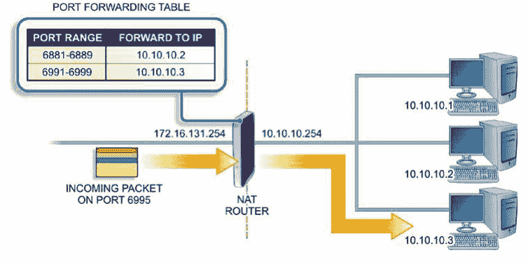

图 20.3 端口转发

例如，可以创建一种不常见的端口映射，要求 Web 客户端使用端口 4444 而不是通常的端口 80 进行连接。然后，该端口可以被映射到私有网络中某个私有 IP 上的端口 80。这听起来可能像是一种巧妙的混淆手段，网络管理员也经常这样做。然而，这样的方案实际上并不能提供多少安全性。黑客可以轻松地对网络进行端口扫描，从而知道哪些端口是开放的。

许多应用程序可以配置为使用任意端口，从而允许多个不同的应用程序位于单个公共 IP 地址之后。其中许多应用程序可能提供 Web 界面，但其他应用程序则需要特定的客户端软件才能访问。无论哪种方式，都必须配置客户端或浏览器软件，使其访问公共 IP 地址并提供正在映射的外部端口。

> **通过隐藏实现安全**
> 
> 大多数端口扫描都是常规扫描，会检查每一个可能的端口——总共 65,535 个——但黑客可能会在频闪扫描中寻找特定的开放端口。因此，通过将不常见的端口映射到这些服务，你或许可以让这些攻击者知难而退，但客户端随后需要在其请求中附加一个非标准端口。通过隐藏来实现安全并不能提供一个成功的安全方案。

端口可能位于单独的字段中，也可能附加到 IP 地址后面，并以冒号（:）分隔。因此，对于 Web 浏览器，可能类似于：

```
http://203.0.113.86:4444
```

这可能会映射到专用网络上的 192.168.0.4:8888，这意味着在使用 192.168.0.4 的设备上，所访问的应用程序设置在端口 8888 上。

> **关于端口转发的提示**
> 
> 前面讨论了一些标准端口号，每个黑客都非常了解这些常见端口。只要能够轻松地映射非标准端口，就应该这样做，而不是使用常见端口。然而，技术水平高的黑客仍然会找到这些开放端口，因此不能将端口转发单独视为一种安全技术。

通过安全外壳（SSH）进行端口转发被称为*SSH 隧道*。SSH 隧道在远程主机与本地设备或计算机之间建立连接，通过该连接可以中继服务。这是对通常不加密的协议进行加密的一种很好的方式。SSH 隧道可能相当复杂，并且可能成为绕过常规过滤或阻止的一种方式。

## 网络分段

网络分段，也称为*分区*，是一个出于多种原因而有用的概念。它本质上是将网络划分为多个子网，每个子网成为一个网段，如图 20.4 所示。

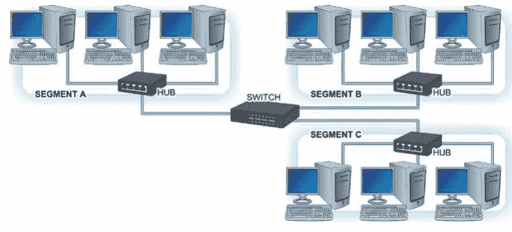

图 20.4 一个分段网络

通常在跨不同地理区域连接网络、互连不同网络拓扑（如以太网和 FDDI），或扩展已达到节点数量或电缆长度限制的网络时，会考虑对网络进行分段。

虽然便利性和组织简单性可以使分段成为一个合理的解决方案，但安全考虑应推动有关网络分段的决策。从安全角度来看，部署网络分段的主要原因是限制入侵者的访问能力。每个网段还将受益于拥塞和广播流量的减少，此外还能将网络问题限制在单个网段内。

这些安全考虑也可能受到外部实体要求的推动。例如，信用卡供应商要求任何接受信用卡的企业遵守支付卡行业数据安全


标准（PCI-DSS）。该标准要求使用防火墙和其他安全概念，例如网络分段，以确保所有存储的信用卡信息在物理和电子上都得到安全存储。即使是那些不存储信用卡数据但使用销售点设备接受信用卡的企业，也会受到此要求的影响。

要实现 PCI-DSS 合规性，所有销售点（POS）终端和所有存储的持卡人数据必须位于一个完全与任何第三方可能访问的网络区域隔离的网络上。某些用户可能需要访问部分网络，但 certainly 不需要访问每个段。

在医疗领域，分段至关重要，网络管理员必须处理《健康保险流通与责任法案》（HIPAA）合规性，以确保患者医疗信息的保密性。

对网络段的访问通常通过访问控制列表提供，只有符合某些条件或通过身份验证的用户才允许访问。这被称为白名单。相反，当仅拒绝符合给定条件的用户访问时，这被称为黑名单。后一种方案安全性远不及前者，你应始终尝试对 ACL 进行白名单设置，而不是黑名单。

分段也可以用于限制内部用户在区域之间的访问。销售人员可能不需要访问会计部门使用的服务器。然而，会计人员可能需要访问销售服务器上的销售数据。这些区域需要相互连接，但可以通过实施分段来控制区域之间的访问。

在允许外部用户进入网络时，始终使用“最小权限”和“需知”原则来建立访问级别。给予每个用户尽可能少的访问权限，并且仅限于他们必须访问的网络区域。

网络分段看起来像是“设置后就不用管”的举措之一，但实际上需要持续的管理和执行。在大型企业中，由于涉及众多不同的策略和规则，分段可能是一项重大挑战。

本章中我们不会深入探讨管理段和处理内部应用需求的细微差别。

正如你将看到的，分段是许多不同网络环境中整体互联网安全方案的关键组成部分。如果没有其他原因，分段被广泛采用，是因为它能够最大限度地减少入侵者在通过互联网进入网络后可能获得的渗透深度。

## 软件定义网络

网络虚拟化改变了我们看待网络分段的方式。一种相对较新的软件定义网络（SDN）概念正在出现，它本质上分析任意两个节点之间的连接，并可以根据定义的策略过滤该连接。这种微分段将在普及后使安全性更加强大，但肯定会使某些管理方面变得更加复杂。

## 网络虚拟化

计算机平台已经发展到足以让我们使用软件模拟服务器、路由器以及几乎任何其他网络资源等硬件平台。通过软件，一台硬件可以支持多个虚拟实例，如图 20.5 所示。每个实例都能够像原始主机硬件一样运行。虚拟实例可以根据需要启用，以处理需求和可扩展性，或提供极大的可移植性。

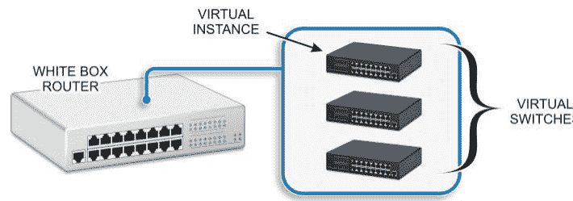

图 20.5 虚拟实例

网络虚拟化也是通过创建覆盖网络来分段网络的一种方式（本质上是在另一个物理或底层网络之上构建的网络）。在这些覆盖网络中可以使用白盒交换机（通用路由和交换硬件）。

网络虚拟化可以提供一个完全独立于其他网络资源的虚拟网络，创建一个区域，就像使用传统网络硬件一样。网络虚拟化也可以用于实现软件驱动的虚拟网络存储单元。这在存储区域网络（SAN）部署中可见。

## VLAN

VLAN，即虚拟局域网，仅仅是一个软件配置的网络，其中主机表现得好像它们都连接到同一个物理网络，即使它们并非如此。这允许多个网络或广播域在虚拟上作为单个 LAN 和广播域工作，如图 20.6 所示。这降低了延迟，并且通常使网络分段更容易理解和维护。然而，你现在必须处理额外的安全问题，例如病毒和恶意软件在新的逻辑网络中传播，而不是在单个物理网络内。

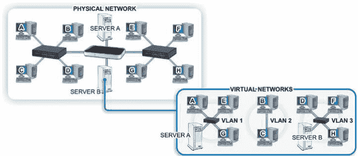

图 20.6 一个 VLAN

VLAN 通常在路由器或交换机上设置；但要将流量从一个 VLAN 传递到另一个 VLAN，你必须拥有支持 VLAN 或 VLAN 标记的硬件。VLAN 可以基于端口或标记/未标记。Ethernet 帧头包含 VLAN ID，其中一部分是标签协议标识符（TPID）。

如果数据包包含 VLAN 信息，则被视为标记数据包，如果不包含则为未标记数据包。基于端口的 VLAN 可能仅仅是 Ethernet 交换机上的端口组形成一个段，或跨多个交换机。

受管理的第 2 层交换机可以配置为转发或阻止到或来自特定 VLAN 的流量，并且可以向头添加 VLAN 标签或将帧封装在另一种传输帧内，如果你正在与不同的网络技术交换数据。交换机甚至可能支持交换机之间的中继线路，而中继端口将承载该交换机可访问的所有流量。支持 VLAN 标记的第 3 层交换机（或路由器）也可以支持 VLAN 之间的数据路由和阻止。

## 实践练习

## 目标

- 检查系统是否与 Hyper V 兼容。
- 在 Windows 10 Professional 计算机上启用 Hyper V。
- 安装并探索虚拟交换机 Hyper-V Manager。
- 安装虚拟机。

## 资源

- 客户提供的台式机/笔记本硬件系统
- 已安装 Windows 10 Professional（家庭版无法运行 Hyper-V）
- 下载的 Linux 发行版以安装
- 具有管理权限的账户

> 注意 对于本实验，我们建议在 https://www.ubuntu.com/download 下载 Ubuntu 发行版。

## 讨论

计算机平台已经发展到足以让我们使用软件模拟服务器、路由器以及几乎任何其他网络资源等硬件平台。通过软件，一台硬件可以支持多个虚拟实例。每个实例都能够像原始主机硬件一样运行。虚拟实例可以根据需要启用，以处理需求和可扩展性，或提供极大的可移植性。

网络虚拟化也是通过创建覆盖网络来分段网络的一种方式（本质上是在另一个物理或底层网络之上构建的网络）。在这些覆盖网络中可以使用白盒交换机（通用路由和交换硬件）。

## 程序

在本程序中，你将学习如何在 Windows 10 Professional 计算机上启用虚拟化技术、配置虚拟交换机并安装虚拟机（VM）。

## 检查 Hyper-V 兼容性

检查你的 Windows 10 Professional 计算机是否与 Hyper-V 兼容。

- 1. 打开你的计算机。
- 2. 使用具有管理权限的账户登录。
- 3. 在桌面任务栏的内置搜索栏中，输入 cmd 并按 Enter 打开命令提示符窗口。
- 4. 在命令提示符窗口中，输入 systeminfo.exe 并按 Enter。
- 5. 经过几秒钟后，你的系统信息应列在命令提示符窗口中，如图 20.7 所示。

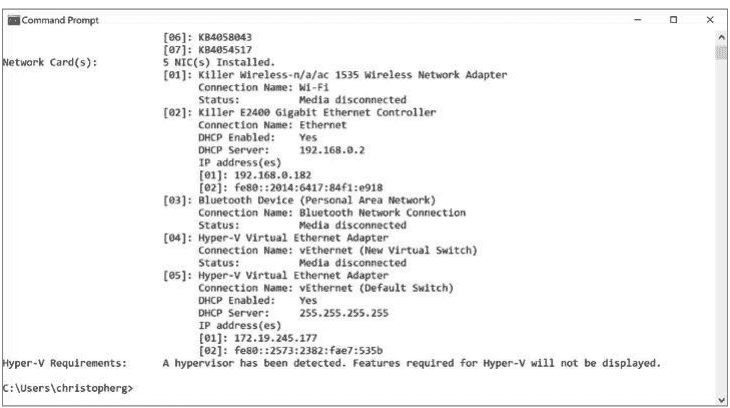

图 20.7 Systeminfo 命令输出

注意 该系统已安装 Hyper-V，因此在输出字段中没有提供信息。


6. 在 Hyper-V 要求下，如果结果显示为“是”，则可直接启用 Hyper-V，无需额外步骤。如果结果显示为“否”，则可能需要进入 BIOS 启用硬件功能，或者你的硬件可能与 Hyper-V 不兼容。

## 在 Windows 10 专业版中启用 Hyper-V

完成兼容性验证并在 BIOS 中进行任何必要的调整后，请按照以下步骤在 Windows 10 专业版计算机上启用 Hyper-V。

- 1. 如果尚未完成，请启动计算机并使用具有管理员权限的账户登录。
- 2. 在桌面任务栏的搜索框中，键入“打开或关闭 Windows 功能”，然后按 Enter 键。
- 3. 应出现“Windows 功能”窗口，其外观应类似于图 20.8 所示。

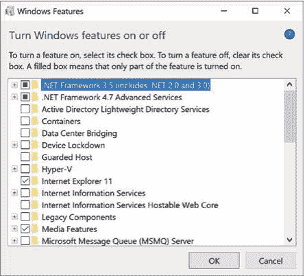

**图 20.8** Windows 功能

- 4. 找到并单击 Hyper-V 旁边的复选框，以告知 Windows 启用此功能，如图 20.9 所示。
- 5. 单击“确定”。

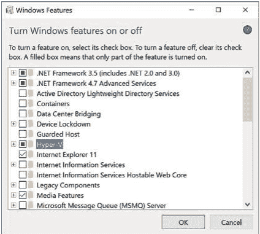

### 图 20.9 启用 Hyper-V

6. Windows 将处理更改，并显示提示，指示你需要重新启动以完成所请求功能的安装，如图 20.10 所示。单击“立即重新启动”按钮。

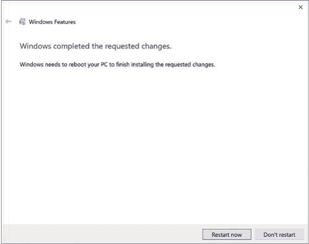

### 图 20.10 准备重新启动

恭喜你在计算机上启用了虚拟化技术。

## 将 Hyper-V 管理器固定到任务栏

- 1. 如果尚未完成，请使用具有管理员权限的账户登录你的计算机。
- 2. 在搜索栏中，键入 **Hyper-V 管理器**。
- 3. 在显示的菜单选项中，右键单击 Hyper-V 管理器，然后选择“固定到任务栏”，如图 20.11 所示。

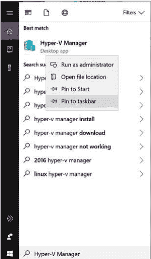

**图 20.11** 将 Hyper-V 固定到任务栏

- 4. 单击现在已固定到任务栏的 Hyper-V 管理器图标以将其打开。

## 安装和配置虚拟交换机

你可以花时间在闲暇时探索 Hyper-V 管理器的许多选项和配置功能。但是，在本练习中，我们将直接进入虚拟交换机的配置，以便用于虚拟机的安装。

- 1. 在 Hyper-V 管理器窗口右侧的“操作”窗格中，单击“虚拟交换机管理器”。

应出现一个标题为“虚拟交换机管理器（用于‘你的计算机名’）”的新窗口，如图 20.12 所示。

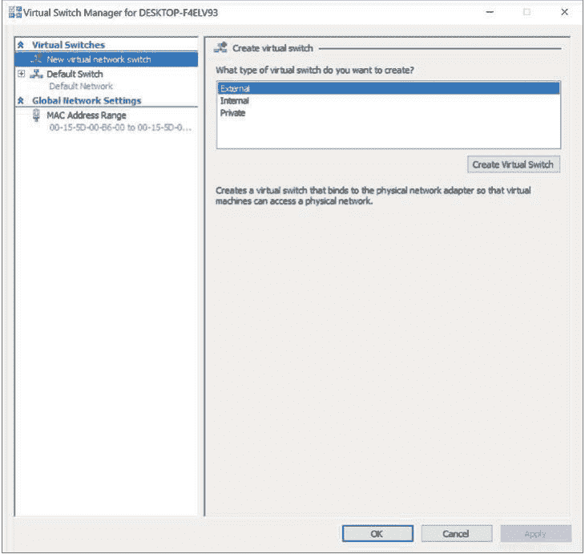

图 20.12 虚拟交换机管理器

2. 默认情况下会安装一个虚拟交换机，并与你的活动网卡关联。但是，让我们检查一下为虚拟机设置交换机时提供的选项。

3. 如果尚未选中，请在窗口左窗格的“交换机”下单击“新建虚拟网络交换机”。

创建虚拟交换机时，你应看到三个选项：

- 外部：创建一个绑定到物理网络适配器的虚拟交换机，以便虚拟机可以访问物理网络。

- 内部：创建一个仅可由此物理计算机上运行的虚拟机使用，以及用于虚拟机和物理计算机之间的虚拟交换机。这不提供与物理网络连接的连接。

- 专用：创建一个仅可由此物理计算机上运行的虚拟机使用的虚拟交换机。

- 4. 突出显示“外部”，并单击“创建虚拟交换机”按钮。这应带你进入一组新选项。

### 如何配置虚拟交换机。

- 5. 在“名称”字段中，键入 Test Switch。
- 6. 在“连接类型”下，确保选中“外部”旁边的单选按钮。
- 7. 如果你的计算机有多个网卡，你可以选择你用来连接互联网的任何网卡，但交换机管理器默认情况下应已选择该网卡。

> 注意 当试图向外部网络隐藏虚拟机时，请根据你的应用程序选择“内部”或“专用”任一合适的选项。

- 8. 确认“允许管理操作系统共享此网络适配器”旁边的复选框已选中。如果未选中，则单击它以在框中打勾。
- 9. 单击此窗口底部的“应用”按钮。这将出现一个警告，如图 20.13 所示。单击“是”按钮。

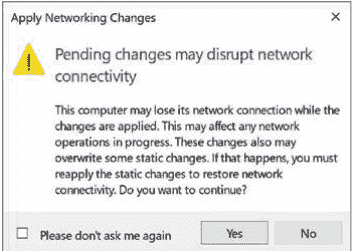

图 20.13 应用网络更改警告

10. 在“虚拟交换机管理器”窗口底部，单击“确定”按钮。这应带你返回 Hyper-V 管理器窗口。

## 在 Hyper-V 中安装 Linux 发行版

- 1. 下载一个 Ubuntu 发行版并将其保存到你能找到的位置。在此示例中，我们使用 Ubuntu 16.04.3。
- 2. 如果 Hyper-V 未打开，请单击任务栏上的 Hyper-V 管理器图标以将其打开。
- 3. 在右侧窗格中的“操作”下，找到并单击“新建”。这应显示一个侧边菜单，用于创建新的虚拟机、硬盘或软盘。
- 4. 单击“虚拟机”以打开“新建虚拟机向导”，如图 20.14 所示。

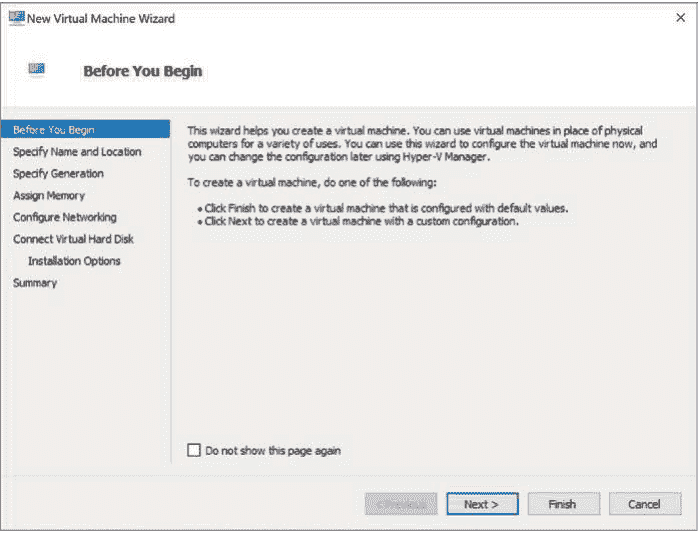

**图 20.14** 新建虚拟机向导 – “开始之前”窗口

5. 单击“下一步”。这应带你到“指定名称和位置”窗口，如图 20.15 所示。

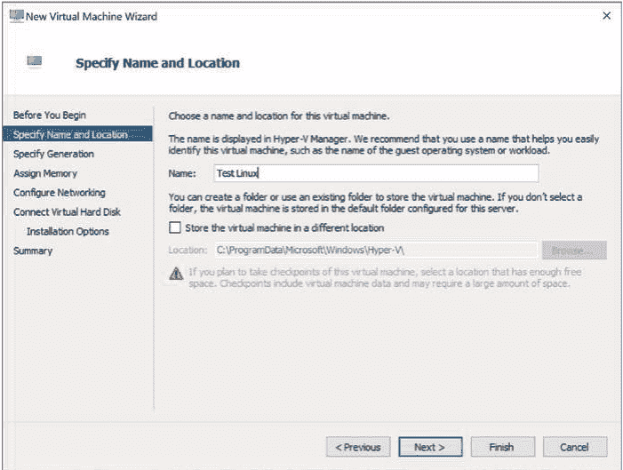

图 20.15 指定名称和位置

6. 在“名称”字段中输入 Test Linux，并单击“下一步”。

7. 你应该处于“指定代数”窗口。保持默认的“第 1 代”单选按钮选中，并单击“下一步”。

注意 一旦创建了虚拟机，就无法更改其代数。

8. 应出现“分配内存”窗口。同样，出于本实验的目的，保留默认分配并单击“下一步”。

13. 浏览到下载的 Linux ISO 所在位置，单击该文件以选择它，然后单击“打开”按钮，如图 20.17 所示。

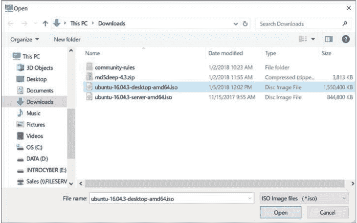

图 20.17 选择 ISO

14. .iso 文件路径应填充到“映像文件”字段中。单击“下一步”。

15. 这将带你进入一个摘要页面，显示你为安装选择的设置。单击“完成”以完成虚拟机的安装。

16. 你的新 Linux 虚拟机现在应出现在 Hyper-V 管理器中，如图 20.18 所示。

17. 你仍然需要从映像文件将操作系统安装到此虚拟机上，使其可用，但你现在已经在 Windows 10 计算机上启用并应用了虚拟机。

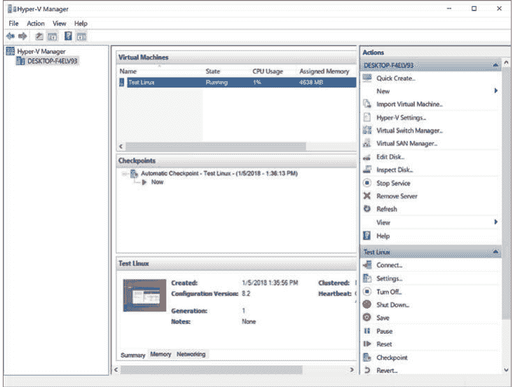

### 图 20.18 已在 Hyper-V 中安装虚拟机

如果启动虚拟机，系统将提示你在虚拟机上安装 Linux 发行版。完成后，它应类似于图 20.19。

你也可以使用 Hyper-V 管理器导入和导出现有虚拟机。这对于保存现有虚拟机安装的未损坏备份以及排查企业结构中现有 VM 上的问题非常有用。

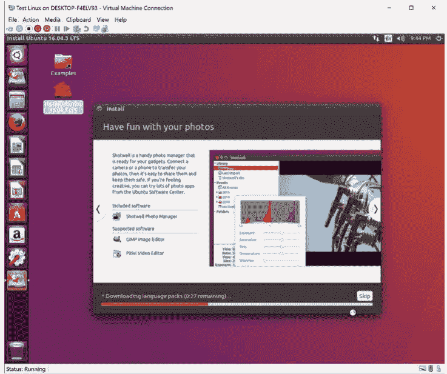

图 20.19 Ubuntu Linux 16.04.3 LTS 作为 VM 运行

## 实验问题

- 1. 使用什么命令提示符实用程序来验证 Windows 计算机与 Hyper-Visor 的兼容性？
- 2. 由于 Windows 10 专业版没有 Hyper-Visor 的安装文件，你可以在该操作系统的哪里启用 Hyper-V？
- 3. 在 Hyper-V 中创建虚拟交换机时，有哪些可用配置选项？
- 4. 一旦创建了虚拟机，你能更改其代数吗？

## 实验答案

1. 使用什么命令提示符实用程序来验证 Windows 计算机与 Hyper-Visor 的兼容性？

```
systeminfo.exe
```

2. 由于 Windows 10 专业版没有 Hyper-Visor 的安装文件，你可以在该操作系统的哪里启用 Hyper-V？

打开或关闭 Windows 功能。

3. 在 Hyper-V 中创建虚拟交换机时，有哪些可用配置选项？

外部、内部和专用。

4. 一旦创建了虚拟机，你能更改其代数吗？

不能。


