## 保护边界

*你需要保护的第二层*是内部边界，即专用网络与互联网交汇之处。定义边界的，是你拥有控制权与不拥有控制权之间的分界线。边界是你的专用网络与你希望交互的个人和公司产生连接的地方。在本章中，你将学习到：

- 实施防火墙和其他入侵防御设备与结构
- 描述常见的企业网络结构，包括内联网、外联网、DMZ 和蜜罐
- 描述防火墙的用途和局限性
- 描述使用蜜罐作为入侵防御技术
- 理解 DMZ（非军事区）在网络安全拓扑中的作用
- 解释非军事区（DMZ）主机的配置与操作，包括该区域内所包含的关键服务

## 理解边界

内部边界是我们想要阻止互联网上的恶意人员访问专用网络的关键点，如图 21.1 所示。

普通家庭或小型办公用户。如今，ISP 提供的典型调制解调器也兼具路由器和数据包级防火墙的功能。然而，如果你的调制解调器不具备路由器功能，你将需要运行安全软件，在计算机上创建软件防火墙。Mac 和 Windows 系统都内置了基本的防火墙功能，此外也有许多专用的软件防火墙产品，或随杀毒软件捆绑提供的防火墙功能，可帮助这些用户。

每台连接到互联网的独立计算机或局域网，都会通过某种类型的网关设备进行连接，如图 21.3 所示。该网关设备通常是路由器，但也可能是带有某种协议转换或转换器功能的交换机，使你的以太网或无线客户端能够访问 ISP 在你所在位置提供的技术。该网关设备也可以是调制解调器、接入点，甚至是 IP 语音（VoIP）适配器。

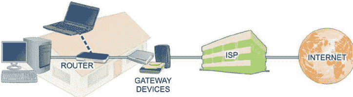

**图 21.3** 网关连接选项

如果网关不兼作路由器（或至少是交换机），通常你需要在网关后面运行一台路由器。如果网关不具备路由器功能，它很可能连接到一个提供路由服务的网络，因此接下来我们将假设所有网络都通过路由器或路由设备连接互联网。

你必须准确了解路由器和 ISP 之间的任何网络硬件所执行的功能。安全不仅仅是单个设备的问题；你可能需要处理许多设备来进一步保护环境。例如，许多网络都有连接到路由器上的关键网络组件。这些设备可能充当防火墙，也可能是为用户提供某些特定功能的网络设备。

在许多网络环境中，通常会创建一些面向外部的网络服务，为外部用户提供可访问性。这些服务可能包括用户可以轻松访问的 Web 服务器或邮件服务器，而组织则保持对内容的控制。如图 21.4 所示，这种与专用网络隔离、但可从互联网看到的网络被称为*公共网络*。大多数组织通过在专用网络和互联网之间创建一个受管理的、可从外部访问的网络（称为*非军事区*（DMZ））来实现这一点。本章稍后将更详细地讨论 DMZ。

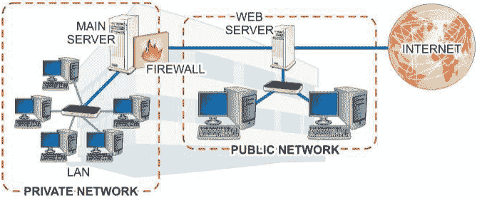

为连接到互联网的网络维护安全可能是一项巨大的挑战。这里介绍的大多数概念适用于任何网络环境，但每个网络都可能因自身所承载的服务和应用程序而面临不同的挑战。

接下来，我们将重点放在必须驻留在公共网络上的设备的安全性上，而不是过多关注保护专用网络免受源自互联网的威胁，尽管其中许多概念是相同的。与任何其他类型的安全一样，对互联网安全的重视程度应与可能失去的东西相关。要得出令人满意的解决方案，必须回答的重要问题包括：

- 你正在保护的东西有多重要？
- 最坏的情况是什么？
- 如果网络被入侵，你或你的公司会受到多大损害？
- 你是否拥有必须受保护的私有数据，或者如果数据被外部用户获取，是否存在任何责任问题？
- 是否有要求你保护数据的法规或法律？

每个人都应参与一定程度的互联网安全，但在回答这些问题后，你应该意识到还需要多少额外的安全措施。

## 防火墙

在连接到互联网的网络中，最常见的第一道防线是*防火墙*。这些设备通常由硬件和软件的某种组合构成，用于保护专用网络免受通过互联网进行的未授权访问。实现方式是限制安全暴露面、执行组织的安全策略，有时还记录或监控互联网活动。

防火墙可以在不同的网络布局中以多种方式实现。防火墙可能是执行特定任务的硬件设备，也可能是路由器或交换机内置的功能，还可能是在一台具有多个以太网接口的计算机上实现。它甚至可以像其他应用程序一样安装在主机上的纯软件防火墙。市面上有许多网络设备在提供其他网络功能的同时，也提供防火墙和安全能力。

在企业或工业网络环境中，管理员控制防火墙的安装和配置。网络防火墙的优势在于，它使管理员能够控制流向其网络上所有设备的信息流，如图 21.5 所示。

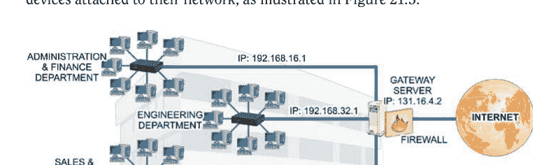

图 21.5 网络防火墙

防火墙必须充当网关设备，授权并允许访问网络应用程序和协议。它们还可能充当代理服务器，提供网络地址转换，并充当 DHCP 服务器。防火墙通常还会过滤入站和出站流量。

良好的防火墙会使用定义的规则提供数据包过滤，以拒绝或接受入站和出站数据包。这可能更难配置，但有效的防火墙规则对安全确实至关重要。

可以通过在路由器上配置数据包过滤规则来建立数据包过滤防火墙，这些规则根据客户端的源地址、目标地址或端口号等因素允许或拒绝客户端访问。通常需要考虑两种数据包过滤防火墙：静态数据包过滤和有状态数据包过滤。

静态（或无状态）数据包过滤防火墙不会跟踪两台计算机之间连接的状态。它们实际上与任何 ACL 的运作方式非常相似。这使得这类防火墙比其他防火墙选项相对更快。它们也往往相对便宜且易于维护。相反，静态数据包过滤防火墙提供的安全功能比其他防火墙选项更少。

有状态数据包过滤防火墙会跟踪实体之间的连接状态。这些防火墙收集网络连接信息，并维护用于后续连接的动态状态表。如图 21.6 所示，这使端口能够根据需要打开和关闭。一旦客户端完成通信会话，有状态数据包过滤防火墙就会关闭所使用的特定端口，直到再次请求该端口为止。

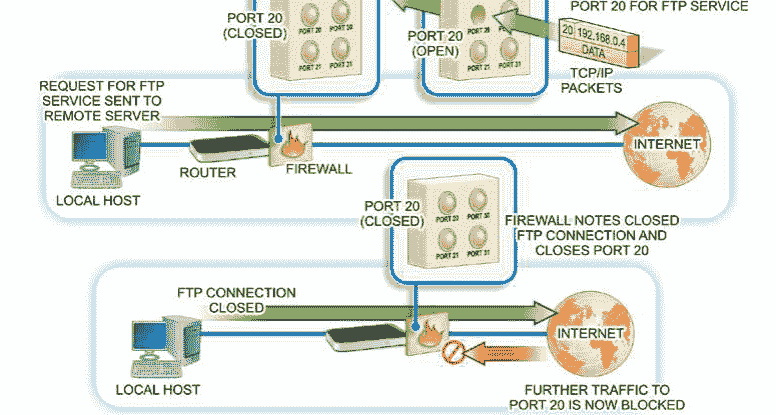

# 图 21.6 有状态防火墙操作

然而，在最高安全级别下，这种防火墙配置可能会激怒网络用户，因为他们通常希望启用即插即用（UPnP）等零配置协议。与业务的其他方面一样，安全控制的使用由用户和业务的需求所决定。

在配置网络或网络设备之前，你必须评估自身需求，同时考虑可接受使用策略，并在所有这些因素与可用网络资源之间取得平衡。未能考虑所有这些因素的网络管理员很快就会在管理层和员工中失去人心。采用合理且有组织的网络设计和安全方法，对于高效、有效地管理网络至关重要。在正确创建和组织网络之前，必须先回答许多问题：

- **资源：**
  - 可用的网络资源有哪些？
  - 有多少用户将共享这些资源？
  - 如果可用带宽有限，你需要考虑流量管理和服务质量（QoS）功能。
- 哪些是最关键的网络服务？
  - 配置 QoS 以优先处理这些服务。
- 管理层认为哪些使用方式是可接受的？

要过滤用户可访问的所有类型内容可能很困难。当然，你可以阻止访问 Facebook，但流媒体视频呢？Netflix？体育赛事？你可以花时间确定带宽的使用去向，并添加新的阻止规则，防止用户访问带宽密集型应用程序。另一方面，你也可以简单地设置 QoS 策略来公平分配带宽，这样在需求高峰期，每个人都能公平地获得其应得的那部分资源。如果这种公平分配仍能支持流媒体播放，那么也许就没问题。

管理层通常希望确保用户除了工作之外什么都做不了。因此，可接受使用策略很简单：网络上只允许与工作相关的活动。你能在多大程度上阻止所有与工作无关的访问，很大程度上取决于可用的网络硬件。硬件采购是根据业务需求（按策略）进行的。

- 需要支持哪些远程访问？
  - VPN 支持将取决于网络硬件。
- 你是否需要在防火墙后面运行一台电子邮件服务器，并让未通过 VPN 连接的网络用户也能访问它？
- 你将如何对网络进行分段以最大程度降低风险？

## 网络设备

路由器与交换机正越来越多地被集成到智能交换机中，甚至与传统操作系统相结合，从而打造出智能网络设备。这些设备中的每一款在多大程度上发挥路由器功能各不相同，但它们通常提供大量路由器功能，并配有可简化网络管理的软件。

一般来说，网络设备提供强大的防火墙功能，但许多设备是专门化的，专注于单一任务，例如电子邮件、垃圾邮件或防病毒和恶意软件检测。这些设备可以提供强大的工具库来抵御攻击，并减轻管理访问和网络安全的工作负担。

安全设备也称为统一威胁管理（UTM）设备，在一个产品中集成了网关、防病毒、防火墙、入侵防御与检测等功能，甚至更多功能，如图 21.7 所示。这不仅在统一平台上提供了众多安全功能，而且解决方案经过简化和优化，最大程度地减少了对广泛培训或安全知识的需求。企业越来越依赖这些设备，并期望其 IT 人员能够有效地管理它们。

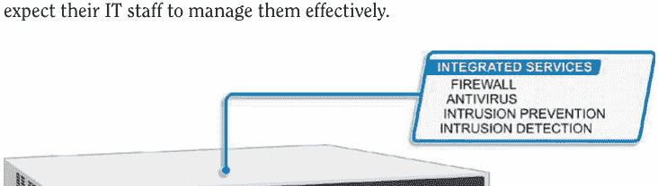

图 21.7 UTM 设备

网络设备中可能比较复杂的方面之一就是如何选择设备。业界有许多知名品牌——例如 Cisco、Barracuda 和 Juniper——它们很受中型公司欢迎。然而，许多其他公司——例如 WatchGuard、Cyberroam 和 Check Point——则为规模较小的组织提供解决方案。

除了购买价格之外，重要的是通过仔细考察所需培训量、对网络所需所有功能的支持，以及远程访问和持续支持与订阅成本来评估潜在的设备。

尽管 UTM 设备似乎是解决互联网安全问题的绝佳方案，但它们也代表了网络上的单点故障，并且自身也可能存在漏洞。该设备还必须能够处理所有网络流量，否则它将成为网络瓶颈。

选择适合你网络需求的设备至关重要，你必须考虑许多因素，以确保产品能够满足你网络的需求，而不是仅仅关注安全功能。

## 代理服务器

代理服务器是一道屏障，可阻止外部人员进入局域网，并阻止内部人员直接连接外部资源，如图 21.8 所示。相反，它允许客户端通过经由代理服务器路由的方式建立间接网络连接。客户端连接到代理服务器（无论是否有明确的身份验证），并向另一台服务器请求资源。代理服务器将处理该请求，要么从其自身缓存副本中返回所请求的资源，要么将请求转发给另一台服务器（可能在转发前修改请求）。

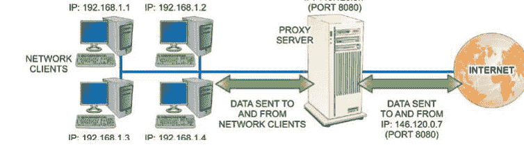

图 21.8 代理服务器的运作方式

发送到互联网的所有寻址信息都将使用代理服务器的 IP 地址。由于不使用请求资源的客户端的 IP 地址，外部入侵者无法访问本地主机。

配置完成后，代理服务器将向客户端提供可用的互联网服务（HTTP、FTP 等）的地址和端口号。客户端访问是通过本地 Web 浏览器配置的。大多数操作系统和 Web 浏览器都支持代理配置。

这一概念最常见的用途可能就是缓存 Web 代理，即本地服务器缓存 Web 资源，然后智能地使其过期。Web 代理有助于节省互联网带宽并加快连接速度，但它们也可用于过滤内容，甚至重新格式化内容。

代理服务器可能是匿名代理，通过隐藏客户端的原始 IP 地址来提供匿名性。

透明代理会提供原始 IP 地址，但仅限于 HTTP 标头中。通常情况下，用户甚至不会意识到自己正在使用透明代理。许多互联网服务提供商（ISP）会对连接进行透明代理处理，以便提供自定义的“404 页面”或搜索结果过滤器。

失真代理的工作方式与透明代理非常相似，但它在 HTTP 标头中包含错误的 IP 信息。

通过代理进行的数据通信通常未加密，可能被黑客攻击。因此，使用非本地代理服务时你需要格外小心。

恶意代理服务器已被用于多种目的，包括传播恶意软件、注入广告以及简单的信息收集。虽然这些代理服务器可能不会传递你的 IP 地址，但它们会知道你的 IP 地址，并可能将此信息用于其他目的。

互联网上有大量开放代理，以隐私等名义在你浏览网页时提供隐藏 IP 地址的服务。在考虑使用此类服务之前，请充分研究它们，并且只使用已知且可信的代理服务器。

通常会将一组 Web 服务器放在反向代理服务器后面，由反向代理处理对 Web 资源的公开请求，然后将请求转发给其中一台或多台服务器，如图 21.9 所示。对于请求者而言，这个过程看起来就像是在直接访问这些 Web 服务器。这种安排有利于负载均衡，可以有效地将单个站点的请求分散到多台服务器上。

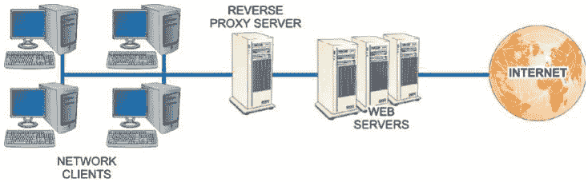

**图 21.9** 反向代理操作

反向代理还可以用于提供 SSL 连接，使 Web 服务器集群能够共享单个安全证书。它们还可以用于缓存静态内容、数据压缩、过滤等。它们还为服务器提供额外的安全保护，并可帮助抵御某些类型的攻击。

## 非军事区（DMZ）

除了创建与其他受信任企业的安全链接外，其他组织还希望将其业务直接扩展到客户，以进行企业对客户（B2C）运营。这通常涉及托管网页，通过互联网向公众宣传产品和服务。虽然组织希望这些客户能够访问其网站，但他们不希望客户能够访问其受保护的内部网区域。因此，托管服务的对外 Web 服务器或计算机不能直接与这些区域相连。

一些组织在其网络中专门划出一部分作为一种称为非军事区的安全结构。DMZ 是一个独立的外围网络，它将安全内部网与外部世界隔离开来，同时允许公众访问对外专用资源。图 21.10 显示了典型的 DMZ 部署。

如图所示，专门用于客户流量的选定服务器和其他资源位于 DMZ 中。这些资源被称为 *堡垒主机*。堡垒主机可能是防火墙、路由器、服务器或一组计算机，它们未被另一台防火墙保护在后面，但可以直接访问互联网。

DMZ 中最常见的堡垒主机是提供公共访问服务的服务器，例如：

- Web 服务器
- 邮件服务器
- FTP 服务器
- VoIP 服务器

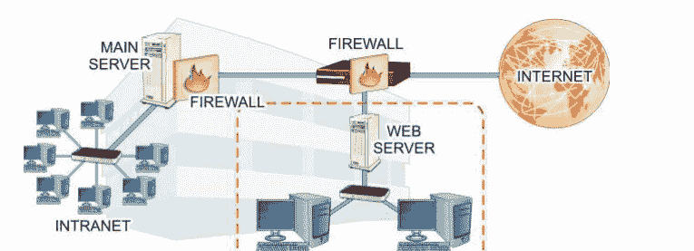

图 21.10 一个 DMZ

## 单防火墙 DMZ

对 DMZ 的访问由一个或多个防火墙控制。在单防火墙 DMZ 中，如图 21.11 所示，防火墙必须是多宿主设备，能够提供三个独立的网络接口：

- 一个用于互联网的接口（外部、非受控网络）
- 一个用于内部网的接口（内部、受控网络）
- 一个用于 DMZ 网络的接口（外部、受控网络）

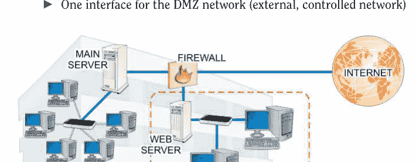

图 21.11 一个单防火墙 DMZ

在此配置中，防火墙检查所有传入流量以确定是否应将其路由到 DMZ 或传递到内部网。同样，DMZ 检查来自内部网的所有传出流量以确定是否应：

- 从内部网传递到 DMZ 网络以提供对 Web 和邮件服务的内部请求
- 从 DMZ 网络传递到内部网作为来自那里的请求的响应
- 传递到互联网

多宿主单防火墙 DMZ 通常被选为其他安全结构，因为它们实施成本相对较低。然而，在此配置中，防火墙成为整个网络的单点故障。如果防火墙被攻破，攻击者就获得了对整个网络的访问权限。只需要一个配置不当的防火墙留下开放的攻击端口。

## 双防火墙 DMZ

在双防火墙 DMZ 中，如图 21.12 所示，防火墙位于 DMZ 的两侧，用于过滤在内部网和 DMZ 之间以及 DMZ 和互联网之间移动的流量。这些防火墙用于将公共流量路由到 DMZ，并将内部网络流量路由到内部网。

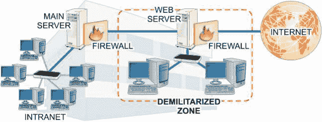

图 21.12 一个双防火墙 DMZ

双防火墙 DMZ 配置提供了更高级别的安全性，因为攻击者必须入侵多个设备才能破坏内部网。如果他们成功破坏了第一个防火墙，他们只能获得对 DMZ 中面向公众的资源的访问权限。

## 蜜罐

*蜜罐* 是另一种外围网络安全结构，用于诱使攻击者远离获取对合法内部网资源的访问权限。蜜罐是一个诱饵服务器、网络设备或网络段，旨在吸引攻击者远离真实网络。这是通过为攻击者提供相对容易访问网络上的诱饵系统并隐藏真正关键系统来实现的。

通常，蜜罐服务器被设计为配置不佳的生产服务器，使其看起来像是容易的高价值目标。这些服务器通常放置在 DMZ 中以将其与其他内部网部分隔开。图 21.13 描述了通用的蜜罐部署。

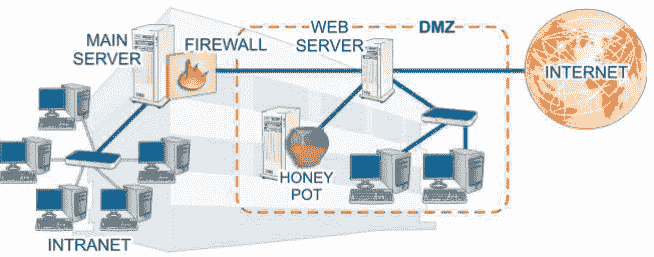

**图 21.13** 蜜罐部署

蜜罐通常包括监控软件，当攻击发生时配置为向网络管理员发出警报。它们还包括某种类型的被动入侵检测系统（IDS）以收集取证信息。此信息通常包括攻击者签名数据、攻击方法和可用于追究非法破解活动法律责任的法律支持信息。

蜜罐可作为培训或研究工具很有价值。然而，鉴于其脆弱的性质，必须时刻警惕监控蜜罐。否则，被入侵的蜜罐可能被转变为黑客平台，从中发起更多攻击，甚至可能是内部攻击。蜜罐被用于攻击您和其他人的网络的风险要求持续监控。

一种称为 *蜜网* 的安全结构扩展了蜜罐的概念，建立了一个小型诱饵生产网络以吸引潜在攻击者。此结构用于一些具有极其关键资源的大型网络中。然而，实施和管理此类安全系统的成本在中型和小型网络中变得难以承受。

## 专用网

虽然内部网旨在为组织内部的授权成员提供安全网络结构，但许多企业在其网络中增加一个或多个企业对企业（B2B）渠道，用于与其他受信任组织进行安全交易。

术语 *专用网* 用于描述一种内部网结构，授予授权外部用户（如企业商业伙伴）有限访问权限。换句话说，一种部分私有、部分公共的网络结构，如图 21.14 所示。建立这种网络结构的主要原因是 B2B 关系。

在图中给出的示例中，面向客户的 Web 服务器放置在组织的内部网和互联网之间，以服务于受信任的外部用户。服务器必须在用户能够访问服务器内容之前对来自这些用户的请求进行身份验证。防火墙通常放置在 Web 服务器和内部网之间，以阻止外部用户访问组织的内部网络结构。

专用网创建了一个特殊的区域，将网络扩展到其他受信任组织。此区域还可采用 VPN 或隧道等安全通信技术在两个组织之间进行。

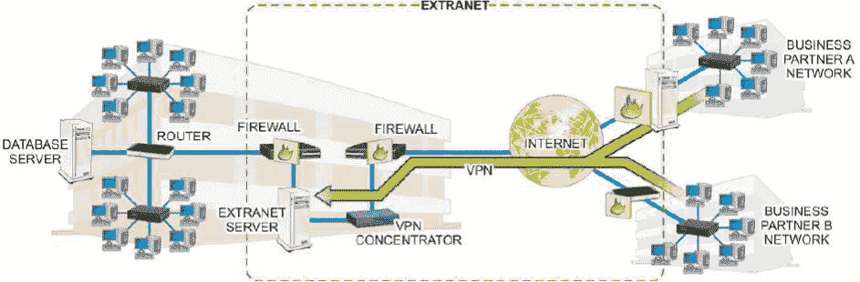

图 21.14 一个专用网

## 实践练习

### 目标

本实验的目的是设置 VPN 并确认 VPN 正在工作。您将下载并安装软件，配置软件，并检查使用 VPN 之前和之后的区别。

### 资源

- 安装 Windows 10 的 PC
- 互联网连接
- 至少 200 MB 的驱动器空间

### 步骤

1. 打开 Microsoft Edge，在地址栏中输入 www.opera.com，然后按 Enter。结果如图 21.15 所示。

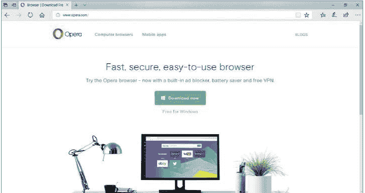

图 21.15 查看 www.opera.com

2. 单击下载。

+   3. 在对话框中单击运行。

+   4. 当安装程序出现时，单击接受并安装，如图 21.16 所示。如有必要，请允许软件进行更改。

FIGURE 21.16 Using the Installer

+   5. 如果出现关闭 Edge 的消息，如图 21.17 所示，单击跳过导入。

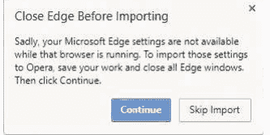

FIGURE 21.17 Skipping the Import

+   6. 通过按 Ctrl+T 打开新标签页。

+   7. 通过单击要关闭的标签页上的 X 来关闭另外两个标签页。
+   8. 你的 Opera 浏览器应与图 21.18 相似。

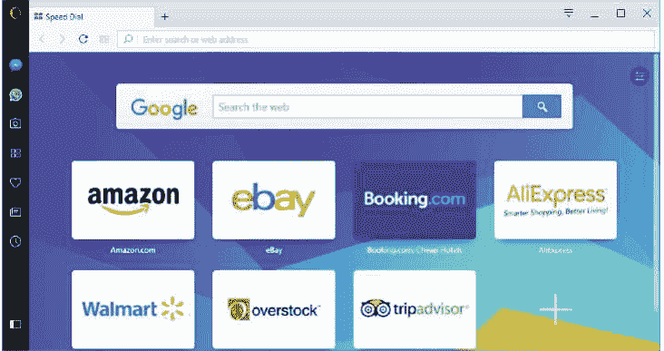

# FIGURE 21.18 Opera Browser

+   9. 单击右上角的设置图标。该图标看起来像一组三个滑块。
+   10. 滚动到底部并选择转到浏览器设置。这应会打开一个与图 21.19 所示类似的窗口。
+   11. 在设置窗口中单击隐私和安全。
+   12. 滚动到 VPN 部分，如图 21.20 所示。
+   13. 单击启用 VPN 复选框。你可能会注意到地址栏中出现了一个蓝色的 VPN 图标。
+   14. 在地址栏中输入 https://www.askapache.com/online-tools/whoami。

你的互联网连接可能会变慢。使用 VPN 时这是正常的。VPN 会创建更多的路由和封装，需要更多的时间和带宽来促进通信。如果此网站无法工作，你可以尝试在互联网搜索引擎中使用关键词“whoami”。

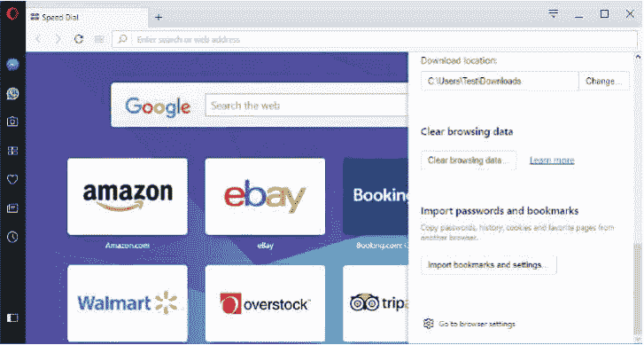

**FIGURE 21.19**  The Browser Settings Gear

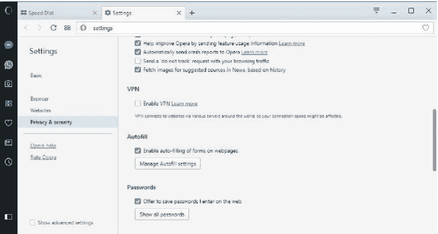

**FIGURE 21.20**  The VPN Settings

+   15. 检查显示的信息；图 21.21 显示了一个示例。  
+       `REVERSE_DNS` 列表是最重要的信息。

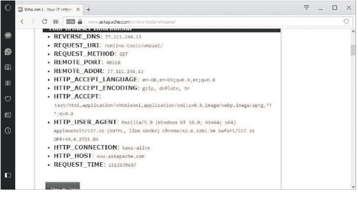

**FIGURE 21.21** The Results of Apache “Whoami”

+   16. 向下滚动并单击显示我的信息。

单击后，你应该会看到一张地图和对你位置的猜测。

+   17. 为验证第二来源提供的信息，导航到 www.google.com 并在查询框中输入 where am i。你应该会看到与图 21.22 所示类似的结果。注意，如果你允许 Google 使用地理位置服务，此步骤可能确实会显示你的真实位置。

+   18. 也许这个位置确实在你附近。单击地址栏左侧的 VPN 图标。单击“Optimal Location”文字以更改互联网网站认为你的位置。选择一个远离你的位置。（我们选择了亚洲的一个位置，如图 21.23 所示。）

+   19. 单击搜索栏并按 Enter 请求“where am i”。

你现在在哪里？你的报告位置应该不同，尽管它可能在附近。

+   20. 关闭浏览器。
