## Protecting Data Moving Through the Internet

如前所述，大多数用户和组织希望使用互联网与不同类型的人进行交互。这些交互可能涉及通过电子邮件、社交媒体、FTP 传输和其他传输机制交换信息等活动。它们还可能涉及发送敏感的个人信息、进行金融活动或传输通常需要加强安全措施的医疗信息等活动。在本章中，你将学习：

- 描述典型的互联网访问控制策略，包括身份验证方法和协议
- 定义用于保护传输中数据的加密实现，包括加密、数字签名、证书管理、PKI、公钥与私钥、哈希和密钥管理
- 描述创建虚拟专用网络（VPN）所涉及的两个主要组件

## Securing Data in Motion

由于互联网是公共的并且基于 TCP/IP，陌生人和坏人有可能检查这些交互。因此，必须为这些消息添加传输特定的安全功能，以保护数据在发送方的安全环境和预期接收方的安全环境之间传输时的安全。

NIST 网络安全框架标准明确要求为传输中的数据（与存储在可能更受保护的设备中的静态数据相对）建立安全保障。本章的以下部分涉及保护数据在互联网上传输时所涉及的设备、工具、协议和策略。

通常，安全是在我们最初配置服务时实现的。有时我们甚至不将其视为安全本身，而只是简单的配置。在配置过程中始终考虑安全非常重要，因为这通常是启用许多安全功能的地方。为了正确实施安全概念，了解身份验证和加密的基本知识非常重要。

## Authentication

如前几章所述，各个层面的安全始终涉及某种类型的身份验证过程。请记住，身份验证只是一种通过某种方式了解用户身份的方法。你肯定希望对想要访问你的网络的外部用户进行身份验证，并且通常也希望对内部用户在互联网上前往未知位置时进行身份验证。

用户可以通过要求他们提供用户名和密码、检查其 MAC 地址或如果他们分配了静态 IP 地址则通过其网络地址进行身份验证。可以使用多种因素的组合，并且在身份验证方案中涉及与网络无关的其他因素变得越来越普遍。如果允许未经身份验证的用户进入网络，你将无法追踪他们的活动。

在用户经过身份验证后，你通常希望确定其授权，这本质上涉及经过身份验证的用户有权访问的资源，以及他们可以执行的操作。通常，这些凭据和权限存储在某种数据库中，但有时身份验证存储在简单的文本文件中。这些文件和数据库的安全性是网络安全的关键方面。

在用户经过身份验证和授权后，他们的活动需要通过某种类型的日志记录过程进行核算。这是与身份验证相关的经常被忽视的概念。然而，日志记录是安全过程中的关键组成部分，因为安全永远不是纯粹的预防性活动。管理员必须不时地梳理日志，以评估在他们的网络中发生了什么事件、可能发生过什么事件或可能还会发生什么事件，以及发生了什么事。

## Single-Factor Authentication

从前三章中，你应该知道最著名的身份验证方法是密码身份验证。它可以简单到提示用户输入密码，仅此而已。当无线用户连接到接入点时，经常可以看到这种情况。用户能够浏览周围可用的接入点，然后只需提供密码或身份验证密钥即可连接。这是单因素身份验证，代表了可用的最低安全级别。

单因素身份验证可能足以限制对资源的访问，但会使验证实际用户身份变得更加困难。它可能足以用于住宅网络中的访客访问，但这对那些用户寄予了一定的信任，因为他们现在可以像所有者一样访问网络及其互联网连接。

你可以配置限制，但到某个时候用户将拥有增加你责任的能力。当该责任过大时，你必须找到另一种身份验证方式。如果密码是你的安全计划的一部分，你还必须考虑与这些密码相关的策略。糟糕的密码可能足以用于家庭网络，但每个企业都应有严格的密码质量政策，甚至可能还有密码历史政策。

## Multifactor Authentication

双因素身份验证涉及使用第二种不同的方法进行身份验证。例如，一个因素是用户拥有的物理物品或物体，例如：

- 一个 RFID 钥匙
- 一个 USB 密钥加密狗
- 一张刷卡

另一个因素是某种身体特征，例如：

- 指纹或虹膜扫描
- 语音分析的口语短语

所使用的不同因素可以分为以下几类：

- 你知道的东西（密码或 PIN）
- 你拥有的东西（物理令牌或卡）
- 你本身就是（指纹等身体特征）

拥有银行卡并知道你的 PIN 码就是双因素认证的一个例子。如果无法实现使用某种物理属性的认证，可以使用不易猜测的标识符作为第二因素。如果两个组件都难以猜测，暴力攻击成功的可能性就会比单因素认证或电子邮件-密码组合低得多。

可以在登录序列中添加额外的认证因素来提高安全性，使攻击成功的可能性越来越小。然而，随着登录序列变得更具挑战性，用户会变得不满并诉诸于在便利贴和桌面日历上潦草写下凭证，或干脆不使用该服务。这对于任何网站设计师或安全工程师来说都是一个巨大的挑战，尤其是当用户满意度是一个问题时。当用户感到不便时，他们会找到绕过安全措施的方法。

## 关于凭证系统公开访问的说明

如果凭证系统可以被公众轻松访问，提供某种测试来确定用户确实是人类也是一个好主意。经常出现但令人讨厌的 CAPTCHA 提示就是此类测试之一。

## 密码管理

密码对用户来说是一个巨大的麻烦。大多数用户只能记住一两个密码，如果每次登录都需要独特的方案或认证因素，他们可能会放弃而不参与。

管理员必须在他们对安全的需求与用户遵守强密码要求的意愿之间取得平衡。几乎总会有抱怨，但这种平衡必须建立并执行——如果用户的账户被入侵，抱怨会更多。

可以采用密码管理器应用程序来缓解用户的密码困扰。这些应用程序运行在计算机和移动设备上，会记住用户的认证参数，这样用户就不必记住它们。虽然使用此类应用程序会将用户的所有密码置于一种认证方案之下，但该方案存储在用户可以控制访问的更个人化的设备上。

这种单一凭证系统可以通过使用具有挑战性的密码来变得更安全；幸运的是，大多数用户可以学习一个安全的密码。密码管理器通常会建议长且安全的密码，你可以使用但不可能记住。这可以是一个很好的解决方案，只要密码管理器始终有效，尽管并非每个应用程序或网关都能方便地与这些系统配合使用。

## IP 和 MAC 认证

访问控制列表通常由服务器和路由器使用，以授予一定程度的访问权限。当只需要确保对系统的访问仅授予来自特定网络（或通过特定硬件）的用户时，IP地址认证或 MAC 地址认证可能是有效的。

然而，请注意 IP 地址欺骗，即 IP 数据包被创建并带有包含伪造源 IP 地址的头部。通常，这是为了隐藏拒绝服务或其他攻击的来源，但这也可以成为击败 IP 地址认证的一种方式。

IP 欺骗在所有认证方案中都不会奏效，因为通常必须向用户发送回某些信息，而该信息会被发送到被欺骗的 IP 而不是连接的实际来源。只有在“欺骗者”位于同一广播网络上的情况下，欺骗者才能窃听回复。

IP 认证应仅与其他认证方法结合使用，或尽可能仅允许连接有机会与协议或设备通信，而不用于任何特定的访问权限。这通常最好在局域网环境中使用，在这种环境中欺骗应该不太令人担忧。

正如你在第一部分学到的那样，MAC 地址也可以被欺骗。虽然该地址嵌入在硬件设备网络控制器中，但计算机可以伪装该地址来冒充不同的设备。这比 IP 欺骗更有效，因为它发生在 IP 连接建立之前。MAC 地址认证可以与其他认证方案结合使用，但不应单独用于任何严肃的认证。

## 认证协议

互联网上使用多种协议来验证访问并促进客户端与基于服务器的系统之间的安全通信。这些方案基于使用认证协议。以下部分讨论了使用中的几种常见认证协议。

密码认证协议（PAP）是一种标准的用户名和密码组合方案，可在有或没有加密密码的情况下运行。两个参数都设置并且很少更改，如果用户名很容易获得，如电子邮件地址和顺序 ID 用户名的情况，这会使系统容易受到简单猜测的攻击。

挑战握手认证协议（CHAP）创建一个随机字符串、挑战短语或密钥。然后将其与用户名或主机名等其他内容组合，并将组合信息发送到请求系统。请求方随后对字符串进行哈希处理并返回结果。服务器然后检查哈希结果是否正确并对请求方进行认证或拒绝。

使用 CHAP，服务器可能会定期提出此请求并使用不同的挑战短语来重新验证连接。因为密钥必须为双方所知并且从未通过连接发送，所以这种方法更安全。每个可能的密钥必须在每一端以明文形式维护，因此该协议确实存在其局限性。

Kerberos 认证以神话中的三头犬命名。Kerberos 涉及依赖受信任的第三方票证授予服务器（TGS）来认证客户端/服务器交互。具体过程因实现而异，但本质上客户端与认证服务器（AS）交换明文信息，然后 AS 使用与客户端共享的密钥加密消息，这些消息包括 AS 与 TGS 之间共享的密钥，如图 22.1 所示。

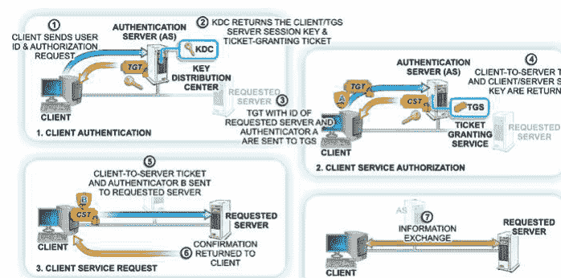

图 22.1 Kerberos 认证

客户端随后验证这些消息并使用共享密钥解密它们，并使用客户端与 TGS 之间共享的密钥加密包含 TGS 密钥的消息。TGS 然后使用这些共享密钥解密消息，这使得 TGS 可以访问来自 AS 的消息，然后它可以使用 TGS 与 AS 之间共享的密钥解密该消息。

然后一个类似的过程会反向进行，其中加密的认证信息被发送回客户端，在那里它被部分解密并发送回 AS 进行最终认证。

这已被过度简化，但你可以看到 TGS 或 Kerberos 服务器在过程中的作用。由于该 Kerberos 服务器将代表单点故障，因此也可以拥有多个 Kerberos 服务器。这些消息都带时间戳并被赋予严格的过期时间，在拥塞的网络上可能会有问题。这种类型的认证还需要大量的密钥管理，对管理员来说可能是一场噩梦。

远程认证拨入用户服务（RADIUS）是在互联网拨号调制解调器时代的常用协议，但它也用作 Wi-Fi 和其他现代网络上用户认证和计费的简单方法。RADIUS 使用 AAA 协议（认证、授权和计费），可以使用不同的链路层协议，但通常使用 PPP 并使用 PAP 或 CHAP 进行认证，但 RADIUS 服务器可以使用 Kerberos 或其他协议。

### 关于 RADIUS 的说明

这里提到 RADIUS 是为了完整性。从安全角度来看，RADIUS 的问题与所使用的认证方案有关。

密码认证密钥协商（PAKE）本质上是使用共享密钥的加密认证。密钥可以由多个服务器共享，允许用户使用相同的认证访问其他服务器。

安全远程密码（SRP）协议是 PAKE 的增强形式，使用由随机数派生的大私有共享密钥。随机数部分由客户端生成，部分由服务器生成，这使得该数字对每次登录尝试都是唯一的。这可以防止攻击者即使服务器被黑客攻击也简单地暴力猜测密码。

一些电子邮件认证方案使用基于 MD5 消息摘要算法的挑战响应认证机制（CRAM）。MD5 使用 128 位哈希值，表示为 32 位十六进制数字。CRAM-MD5 大多已不受欢迎，因为密码以明文形式存储在服务器上，使其容易受到字典攻击和生日攻击。

轻量目录访问协议（LDAP）是一种流行的协议，常用于企业网络中的身份验证。LDAP 提供单一登录系统，可让你访问许多服务。还有一种非标准的 Secure LDAP 版本，提供基于 SSL 的 LDAP。

## 加密

*加密*只不过是将电子数据转换为称为*密文*的形式。这涉及向数据应用一种称为加密算法的秘密代码，以生成一条无法被理解的乱码消息，除非知道用于创建它的加密算法。如果第三方可以轻松地以电子方式捕获密码，那么密码再安全也无济于事。

在互联网上，数据会经过许多你无法控制的系统和线路。因此，任何以明文形式通过外部网络的凭据，如果坏人在数据包通过特定节点时检查它们，就可能落入错误的人手中。这种做法被称为*数据包嗅探*，如图 22.2 所示。在任何网络安全方案中，向凭据系统添加加密都至关重要。

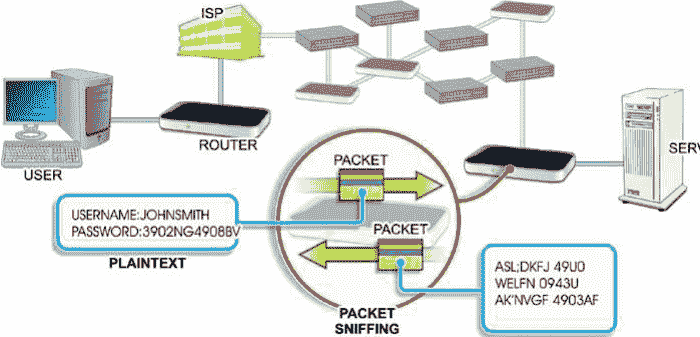

**图 22.2** 查看凭据

任何密码机制都可以采用良好的安全技术。如果满足以下三个条件，那么该系统可以在一定程度上被认为是安全的：

-   至少部分凭据在存储时始终经过加密，
-   加密密钥或秘密信息不存储在任何地方。
-   客户端与服务器之间的连接是安全且加密的。

通过加入更多因素和物理因素，例如指纹扫描或其他生物特征认证系统（如第 1 章和第 2 章所述），可以进一步提高该系统的安全性。然而，尽管业界多年来一直在推出设备解决方案，但用户的广泛接受还需要更长的时间。

如果你使用的基于凭据的访问系统没有采用良好的安全技术，那么你必须了解该行为所伴随的风险。如果风险很低，那么仅使用良好的密码策略或许就能提供足够的安全性。

## 密码学

*密码学*是用于描述保护信息的概念和方法的术语。许多研究者的职业生涯都建立在单一的密码算法之上。其中一些方法在历史上很有趣，读起来可能引人入胜，但我们只会涉及密码学的少数现代领域。

许多密码技术都涉及密钥的使用。*密钥*只是一个用于加密或解密信息的数据字符串。密钥的使用方式以及字符串的长度确实会影响加密的强度。

加密密钥可以基于仅由加密和解密数据的软件知道的“秘密”字符串，也可以是随机生成的。它还可以由已知因素和随机因素组合而成。

执行加密或解密的算法称为*加密算法*。加密算法可能是每次处理一个字符的流加密算法，也可能是同时处理输入字符串多个块的分组加密算法。

如果加密和解密使用相同的密钥，那么它就是*对称*密钥。如果加密和解密使用的密钥不同，那么这些密钥被称为*非对称*密钥，即使这些密钥是基于彼此生成的。图 22.3 显示了这种差异。

公钥密码学使用包含公钥和私钥（或秘密密钥）的非对称密钥。公钥和私钥是不同的。一个人的公钥被广泛共享，而他们的私钥必须仅对他们保密。非对称密钥密码学如果使用正确，可以提供两种服务：加密和*身份验证*（证明某人确实是他所声称的身份）。

它们的加密（例如 256 位加密）。原始明文输入必须进行填充，以使其长度是块大小的整数倍。

对称密钥加密算法主要容易受到暴力破解攻击，攻击者会根据已知列表或可预测的数学方案系统性地猜测密钥，因此身份验证方案应尝试识别这些活动并自动采取适当措施加以阻止。这通常意味着限制在一段时间内的身份验证尝试次数，这可能会给用户带来不便，但仍然是必要的功能。

基于密钥的安全方案的强度的另一个组成部分是密钥生成中使用的随机性程度。随机化密钥可以通过称为*伪随机密钥生成器*的应用程序以算法方式生成。随机化器使用某种熵源（或一定程度的不确定性）作为随机化的种子。熵的程度通常以比特为单位进行度量，有时会在加密方案强度分析中提到。

理想情况下，熵的大小与密钥相同。熵源通常是系统可随时获得的数据的组合，可能通过某个乘数或代数方程进行转换。例如，随机化器可能会将距过去某个时间点的毫秒数除以进程 ID，然后填充到指定长度。

如果时间是以某种随机方式计算的（例如，随机选择在 1,001 到 4,017 秒之前的某个时间），并且进程 ID 任何人都难以预测，那么你就有了一个易于生成的随机密钥。一些密钥生成算法使用复杂的数学运算来转换密钥，但熵的核心是某种伪随机数据源。

最终，理想的做法是使用由高熵随机化器生成的密钥，并采用 256 位分组加密算法的非对称密钥。如今，你不太可能经常看到这种情况。对于大规模系统，处理此类计算可能需要大量处理器资源，而且此类方案的管理可能非常困难。

## 数字证书

*数字证书*，也称为公钥证书，是一种数字验证，用于确认加密消息的发送者确实是其所声称的身份。要获得数字证书，你必须向受信任的证书颁发机构（CA）申请。申请人必须创建私钥，并向 CA 提供证书签名请求（CSR）。

根据所涉及证书的类型，CA 会以某种方式验证你的身份，这可能简单到验证该域名上的电子邮件账户，也可能涉及验证上市公司文件，甚至进行个人面谈。

然后，CA 会颁发一个加密的数字证书，其中包含申请人的公钥、CA 的数字签名和到期日期。当申请人收到加密消息时，他们必须使用 CA 的公钥来解密附加到消息上的数字证书，并验证该证书确实由 CA 颁发。

接下来，申请人使用 CA 的公钥和标识信息加密一个回复，表明他们对此加密的信任。最后，服务器使用其私钥解密响应，以获取将用于数据交换的对称公钥。图 22.4 说明了这一过程。

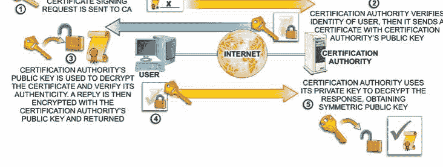

# 图 22.4 数字证书

公钥基础设施（PKI）支持这些公钥和证书的分发，以便基于 CA 签署者的信息实现受信任的连接和安全的数据交换。CA 必须从更高级别的 CA 获取自己的证书。在此层级结构的顶端，必须有一个根证书或自签名证书来标识根证书颁发机构。

## 关于吊销证书

诸如 Heartbleed OpenSSL 漏洞之类的安全问题使得吊销证书成为必要，因为受影响服务器上的私钥已被泄露。

诸如网页浏览器之类的软件可能包含 CA 密钥，以便处理证书。然而，它们还应引用证书吊销列表（CRL）或使用在线证书状态协议（OCSP）来查询已吊销的证书。越来越多的浏览器采用 OCSP，但仍有一些提供商只是在每次更新浏览器软件时附上 CRL。

证书链是以根证书开头的一系列证书，之后每个证书的签发者或签名者都是下一个证书的主体。虽然一个证书只能有一个签发 CA 的签名，但某些证书可能存在不同的证书链，因为可以使用同一公钥创建多个证书。

安全证书应仅从知名且信誉良好的 CA 获取，否则您将面临证书被吊销的风险。CA 越来越多地推行扩展验证（EV）证书，这种证书对实体身份的验证要彻底得多。EV 证书并不比其他类型的证书更强，结构上也没有区别，但它们意味着更高的信任度，因为所访问的站点归证书持有者所有。

Web 浏览器通常会有某种视觉指示，表明 SSL/TLS 连接正在使用 EV 证书。这通常涉及使用绿色显示信息。EV 证书通常仅用于接受信用卡或其他私人数据的站点（而不是处理电子邮件或其他服务的站点）。

可以生成并使用自签名证书进行加密。这可用于测试。但是，客户端软件会告知用户该证书不受信任。

## 安全套接层（SSL）

安全套接层（SSL）是一种协议，用于使用公钥和私钥管理客户端与服务器之间的身份验证和通信。SSL 使用套接字方法在客户端和服务器程序之间交换数据。套接字绑定到特定端口号，一旦创建便会监听连接请求。使用 SSL 的 Web 请求使用 HTTPS 协议标识，而不是 HTTP。

2014 年，由于一种可重复的中间人攻击方法 Padding Oracle on Downgraded Legacy Encryption（POODLE），SSL 3.0 被认为存在漏洞。因此，SSL v3.0 现在已被视为过时。

## 传输层安全（TLS）

传输层安全（TLS）是 SSL 的继任者，尽管两者经常互换使用，甚至合称为 SSL/TLS。然而，它们并不互通。TLS 握手协议允许客户端和服务器在任何数据交换之前交换密钥并处理加密算法。

## 哈希表

*哈希表* 只是一个查找表，它使用哈希函数将键映射到值，该哈希函数将键转换为哈希值。与其顺序搜索数据表以查找特定值，不如对查找键执行哈希函数，该函数将返回所搜索哈希值的索引。这样可以节省大量搜索数据的时间。

分布式哈希表（DHT）是类似类型的函数，但键到值的映射分布在网络中的不同节点之间。可以通过对该键进行哈希运算来找到存储此映射的节点。

## Cookie

*Cookie* 是在访问特定网站后存储在系统上的一小段文本。由于 Web 协议在很大程度上是“无状态的”，保存的 cookie 文本允许保留一些信息（例如密码或偏好设置），以便将来访问该网站。

在许多情况下，用户听说隐私问题后认定 cookie 是不好的东西，干脆在浏览器中阻止它们。这很可能会导致一些网站出现许多问题，包括无法登录私人区域，甚至需要不断重新输入简单的身份数据。大多数 cookie 并非恶意，应该接受。

浏览器提供了阻止来自用户未访问站点的 cookie 的功能。虽然这可以部分解决跟踪 cookie 问题，但较旧的浏览器可能仍允许某些脚本绕过此隐私功能。

通常，某个网站上的诱人优惠会从另一个域（您当前正在访问的域）弹出窗口，并以这种方式加载 cookie。虽然阻止弹出窗口会有所帮助，但教育用户避免不加思索地贸然点击是防止这些问题的更有效方法。

最近，*超级 cookie* 又成为一种隐私困扰。超级 cookie 只是比其他类型 cookie 更难删除的第三方 cookie。其中许多不使用传统的 cookie 存储方法，而是使用本地浏览器 HTML5 数据库存储，甚至 Adobe Flash 数据存储。

这些 Flash cookie 和超级 cookie 加剧了 cookie 本已不佳的声誉，但浏览器厂商已做出良好回应，现代浏览器现在可以控制这些存储选项。从概念上讲，这与传统 cookie 的做法相同，提供了一种阻止来自第三方站点的 cookie 的方法。

## CAPTCHA

每个人都应该意识到，几乎任何公开可用的东西都可能以某种方式被利用。虽然这种利用可能来自真实的人，但更大的威胁来自可用于实施攻击的自动化工具。通常，利用的目的只是通过表单向消息中注入未经请求的商业广告。

然而，这也可能是一种实施暴力破解密码攻击的方式，自动化设备可能会反复尝试不同的凭据以获取访问权限。这在许多 Web 表单中很常见，网站所有者只是试图尽量减少垃圾邮件。然而，类似的概念也可用于身份验证表单，以阻止自动化攻击。

CAPTCHA 是 Completely Automated Public Turing test to tell Computers and Humans Apart（完全自动化公共图灵测试，用于区分计算机和人类）的缩写。这些通常是通过表单输入请求输入单词、短语甚至随机字符和数字，但也可能是要求执行一些不易自动化的简单测试，例如按名称识别颜色。这些 CAPTCHA 通常具有模糊文本，使自动化工具难以解释，如图 22.5 所示。

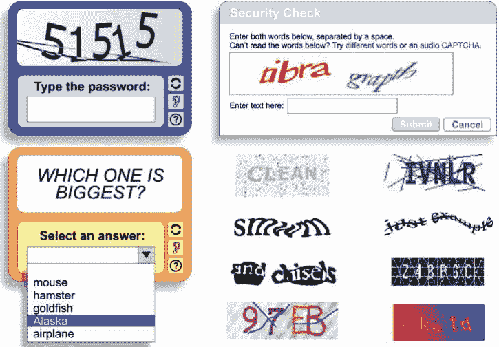

**图 22.5** CAPTCHA 示例

将 CAPTCHA 添加到传统身份验证方案中可以潜在地消除任何类型的自动化密码攻击。虽然这些测试往往会让用户感到烦恼，但通常非常有效。然而，它们也会给某些残障用户造成障碍，除非包含针对这些用户的替代机制。

身份验证是任何安全讨论的关键部分，可以通过多种不同方式实现。网络管理员必须为其特定网络或应用程序找到访问安全性与用户易用性之间的适当平衡。风险越大，就应部署更多安全措施。至少，最好找到多种用户身份验证方式。

## 虚拟专用网络

一个重要的网络概念是虚拟专用网络（VPN）。远程用户可以通过公共网络（如互联网）连接到专用网络，然后像直接连接一样在专用网络上进行身份验证并执行任务，如图 22.6 所示。

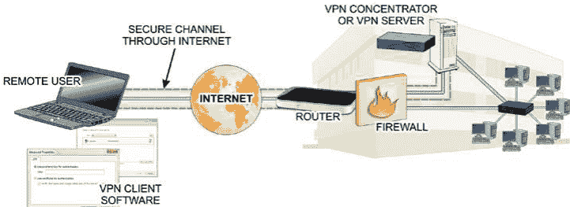

**图 22.6** VPN 连接

基本上，虚拟专用网络由两个组件组成：在发送方和接收方之间建立的点对点通信隧道，以及用于对数据进行编码的加密方案，使数据即使被截获也无法被理解。因此，VPN 通常涉及使用两种不同的协议：隧道协议和加密协议。

VPNs may be established using a variety of protocols and encryption, and can be one of the more complex things with which a network administrator has to deal. Many VPNs are simply point-to-point connections over IP or MPLS and do not support Layer 2 protocols such as Ethernet. Therefore, most networking is limited to TCP/IP, but newer VPN variants like Virtual Private LAN Service (VPLS) or Layer 2 Tunneling Protocol (L2TP) can provide Ethernet-based communication.

VPNs may be either trusted VPNs or secure VPNs. Trusted VPNs do not use cryptographic tunneling but rather trust the underlying network to handle security beyond authentication. Secure VPNs handle the encryption of the connection.

Many different types of VPNs are available, but the most widely used protocol is the Point-to-Point Tunneling Protocol (PPTP). PPTP does not provide any encryption and uses the simple password authentication taken from the Point-to-Point Protocol (PPP).

Layer 2 Tunneling Protocol (L2TP) also uses PPP and is unencrypted but can pass another encryption protocol in the tunnel. Often, the underlying protocol will be combined with L2TP as with L2TP/IPsec.

Internet Protocol Security (IPsec) is an open standard commonly used in VPNs that actually employs a suite of protocols for encrypting and authenticating IP communications. Protocols in this suite include:

- Authentication Headers (AH) provides data integrity and origin authentication to protect against *replay attacks* (attacks where a recorded transmission is replayed by an attacker to gain access).
- Encapsulating Security Payloads (ESP) offers origin authentication as well as encryption. ESP encrypts and encapsulates the entire TCP/UDP datagram within an ESP header that does not include any port information. This means that ESP won’t pass through any device using port address translation.
- Security Associations (SAs) offer a number of algorithms and frameworks for authentication and key exchange.
- Internet Key Exchange (IKE) is the protocol used to set up a security association in IPsec.

## Hands-On Exercises

## Objectives

The purpose of this lab is to implement file hashes, compare file hashes, describe the usage and importance of file hashing, and define file integrity.

## Resources

- 1. Customer-supplied desktop/laptop hardware system
- 2. Windows 10 Professional installed
- 3. MD5deep installed

MD5deep may be obtained from https://sourceforge.net/projects/md5deep/files/md5deep/md5deep-4.3/md5deep-4.3.zip/download. Download, extract, and move the MD5deep folder to your desktop.

## Discussion

*Hashing* is a basic type of cryptography. It employs a one-way algorithm that creates a unique hash (also known as a *message digest*). The purpose of a hash is not to create a cryptographic message to be decrypted later; instead, it is used to compare a file before and after a certain set of circumstances has arisen.

Hashing does not ensure confidentiality, rather it confirms file integrity. File integrity proves the file has not been altered in any way while the file or message was in transit.

A common use of file hashing is used with downloads from the Internet. Perhaps a freeware item is available, but you are worried that a malicious user has tampered with the file on the site. The owner of the site, however, has provided a hash of the original file in case you want to compare it once downloaded. Examining the string of characters on the site, you create a hash of the downloaded file and compare. If they are exactly the same, you have confirmed file integrity.

## Procedures

In this procedure, you will create and compare hashes. You will also tamper with the file to witness the differences in hashing so you'll better understand what ensuring file integrity really means.

## Locating MD5deep

MD5deep is a command-line tool that supplies hashing algorithms that include MD5, Whirlpool, and Sha-1. The noticeable differences in the hashing algorithms occur in the padding and length (in bits) of the digest.

- 1. Power on your machine.
- 2. Log on to your computer using your administrative account.
- 3. Double-click the md5deep-4.3 folder, located on the desktop.

To help navigate which files are which, you will change the view option to show the file extensions of each file.

- 4. Click the View tab near the top left of the window and place a check in the box next to File Name Extensions; this will add the extensions to each file to help you navigate which files are which, as shown in Figure 22.7.

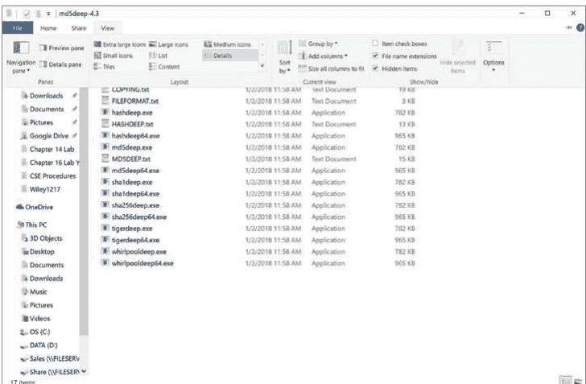

FIGURE 22.7 Show File Extensions

- 5. Locate md5deep.exe, sha1deep.exe, and whirlpooldeep.exe, as depicted in Figure 22.8. These will be the hash algorithms you will test.

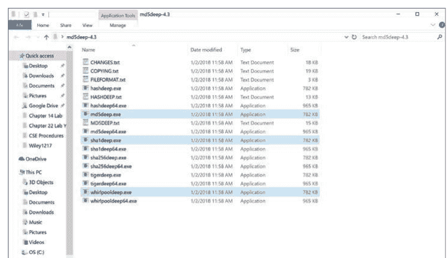

FIGURE 22.8 The Hash Algorithms

## Creating a Test File

For ease of use, you will create a test file in the same folder as the hash algorithms. Using the command line can be difficult if you are not familiar with it, so keeping the file in the same folder will create an easier environment to navigate.

- 1. Right-click any empty white space in the right pane.
- 2. Navigate to and select New > Text Document.
- 3. You will be prompted to create a name for the new text document. Type HashTest as the name. Notice the file is given a .txt extension, as depicted in Figure 22.9. Press Enter to confirm.
- 4. Double-click the HashTest.txt file to open it in Notepad.
- 5. Type This is my Hash Test!, as shown in Figure 22.10.

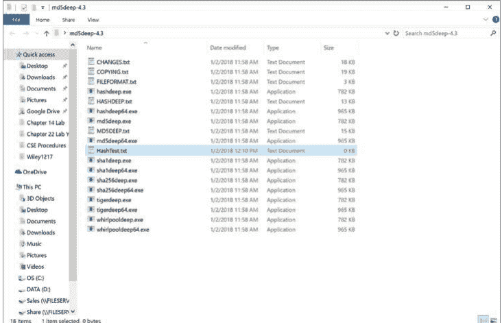

# FIGURE 22.9 Creating the HashTest.txt File

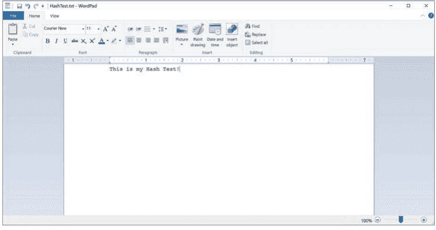

# FIGURE 22.10 Contents of HashTest File

6. Click File, and then select Save to save the contents. Exit Notepad by clicking on the red X in the top-right corner of the window.

There are GUI-based hash outputs; however, you will use the command line to discover the digests for the file.

## Creating Multiple Hashes

A hash is similar to a digital fingerprint. It is considered secure if it includes a fixed size, is unique, and cannot be reversed to reveal the original plaintext.

- 1. Leave the md5deep-4.3 folder open.
- 2. To locate the command prompt, type cmd in the embedded search bar and press Enter. The Command Prompt window will be launched.
- 3. You will need to change directories to be inside the md5deep-4.3 folder. Type cd C:\users\your account name\desktop\md5deep-4.3 and press Enter. You will be redirected to the folder, as shown in Figure 22.11.

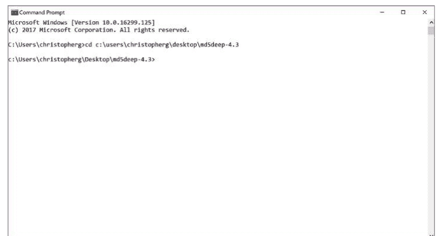

FIGURE 22.11 The Md5deep Folder

- 4. Now that the command prompt is located in the folder, you can view the contents by typing dir and pressing Enter. The contents of the folder will be displayed, as shown in Figure 22.12.

Here you can see the same contents as within the Windows Explorer. Locate the hash algorithms you will be using, along with the HashTest.txt file. Understand that to use these command-line tools you will need to type the entire filename with its associated extension.

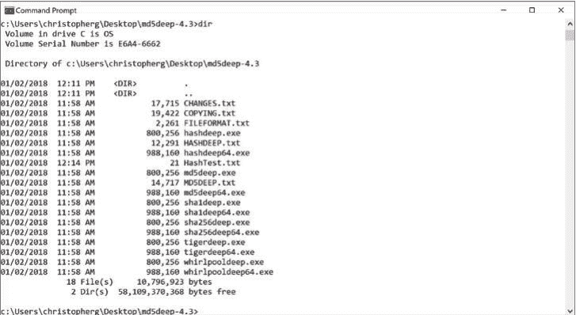

**FIGURE 22.12** Md5deep Contents in the Command Prompt

- 5. To create your first hash, type `md5deep.exe HashTest.txt`. This tells the computer to use MD5 to create a hash of HashTest.txt. Press Enter to create the hash, as shown in Figure 22.13.

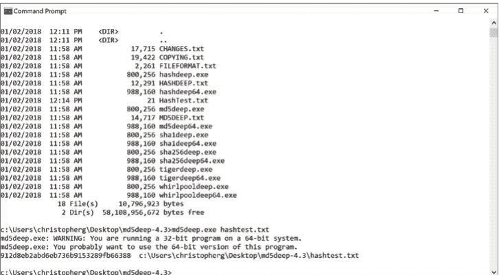

**FIGURE 22.13** MD5 Hash Output

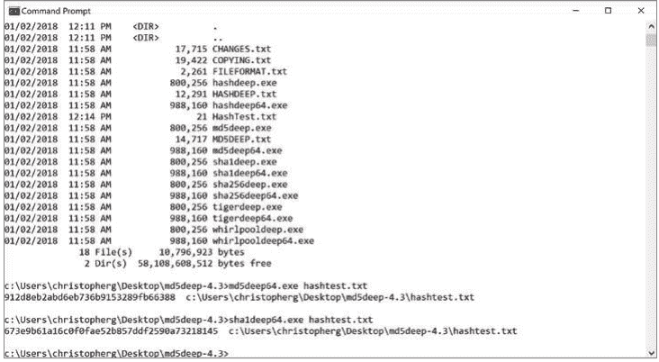

# FIGURE 22.15 Sha-1 Hash Output

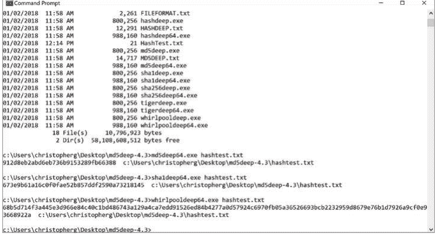

# FIGURE 22.16 Whirlpool Hash Output

The Whirlpool hash algorithm employs an astounding 512-bit digest to the file, much larger than the previous two hashing algorithms.

## Tampering with a File

The purpose of the hash is verify file integrity. Now let’s tamper with the file in a minimal way so you can later attempt to discern the subtle difference.

- 1. Leave the Command Prompt window open and return to the Windows Explorer window with the md5deep-4.3 folder open.
- 2. Double-click the HashTest.txt file to open it. Notepad will launch.
- 3. Delete the exclamation point and insert a period. The contents should now read, *This is my Hash Test.*, as shown in Figure 22.17.

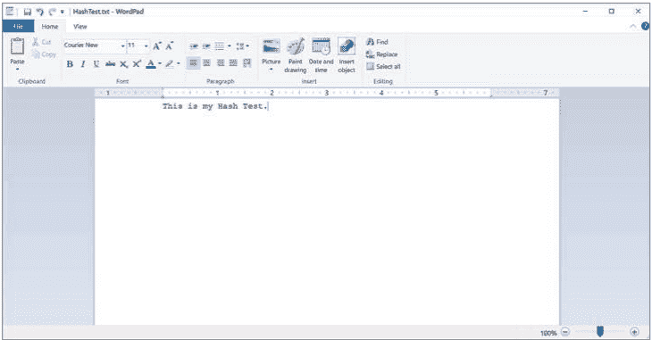

FIGURE 22.17 New Contents of HashTest File

- 4. Click File and select Save to save the file. Exit Notepad by clicking on the red X in the top-right corner of the window.
- 5. Exit the Windows Explorer window by clicking on the red X in the top-right corner of the window.

## Comparing Hash Values

You might think with such a subtle change to the contents of the file that a hash output might be similar. You will now discover the importance of hash output by comparing the before and after of the file hashes.

- 1. Return to the command prompt. You should be able to view the three previous hashes.

2. 在提示符下，输入 md5deep.exe HashTest.txt。这将为刚刚被篡改的 HashTest 文件创建一个哈希。按 Enter 键。

你的新哈希和之前的哈希之间有差异吗？

如图 22.18 所示，将此哈希与第一个哈希进行比较，会得到一组完全不同的字符。这验证了文件的完整性。

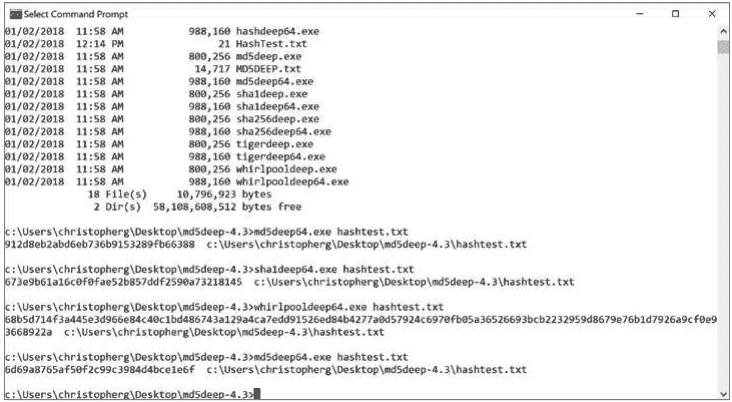

## 图 22.18 比较 MD5 哈希输出

3. 输入 sha1deep.exe HashTest.txt 并按 Enter 键。将显示生成的哈希，它应该与之前的哈希不同，如图 22.19 所示。

当你比较 Sha-1 输出时，有差异吗？

4. 最后，输入 whirlpooldeep.exe HashTest.txt 并按 Enter 键。如图 22.20 所示，之前的哈希和新哈希之间应该有差异。

你的哈希之间有差异吗？

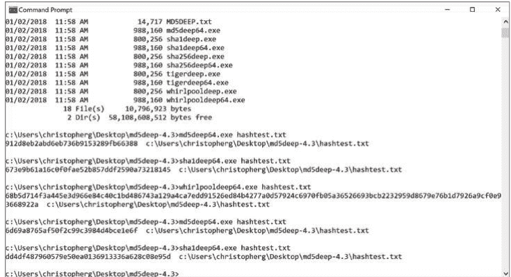

## 图 22.19 比较 Sha-1 哈希输出

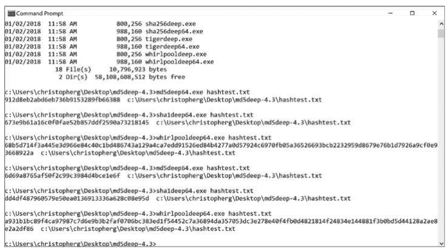

## 图 22.20 比较 Whirlpool 哈希输出

- 5. 输入 exit 并按 Enter 键退出命令提示符。
- 6. 关闭计算机。

重要的是要记住，文件哈希只能验证完整性。它不提供机密性、可用性、真实性或不可否认性。因此，它只是安全方案中的一部分。

## 实验问题

- 1. 文件哈希的目的是什么？
- 2. 哈希提供机密性。对还是错？
- 3. 如果文件只发生一点变化，哈希是否也只发生一点变化？
- 4. 在使用的三种哈希算法中，哪一种的摘要最长？

## 实验答案

- 1. 哈希的目的是能够验证文件完整性。
- 2. 错误。
- 3. 不是，即使文件中的数据发生很小的变化，哈希也会完全改变。
- 4. Whirlpool 哈希。
