## 工具和实用程序

*网络管理员必须*配备各种各样的软件工具来监控、诊断和控制他们周围的网络。在本章中，你将学习这一武器库中的基本工具。某些工具在不同的操作系统中名称略有不同，但本质上完成相同的任务。在本章中，你将学习：

- 将不同的工具和实用程序应用于各种网络安全场景
- 识别常用的网络监控工具
- 使用软件数据包嗅探器检查不同类型的网络流量

## 使用基本工具

每个网络安全专家的工具箱中都应备有一些基本的行政管理、故障排除和监控工具及实用程序。以下各节介绍所需基本工具的一些主要版本。有些是已安装操作系统中自带的工具，而另一些则是可供下载或购买的第三方工具。

## Ifconfig/IPconfig

你需要熟悉的第一个工具是 *ifconfig* 或 *ipconfig*，具体取决于你的操作系统。前者用于 Unix/Linux 系统，而 *ipconfig* 在 Windows 系统上完成相同的功能。该工具在命令行中使用，向你显示本地系统的 IP 地址和其他基本网络配置信息。当你想知道网关的 IP 地址、系统向何处发送 DNS 查询、系统是通过 DHCP 获得 IP 地址还是静态分配的，以及其他有用信息时，这个工具是你的第一站。

## Whois

通常，你需要了解某个域的一些信息。如图 23.1 所示，你可以访问几乎任何域名注册商的网站，并使用他们的 Whois 搜索工具来查找有关所有权、行政和技术责任以及负责提供主机信息的服务器名称的信息。Whois 在某些操作系统中也是一个命令行实用程序。

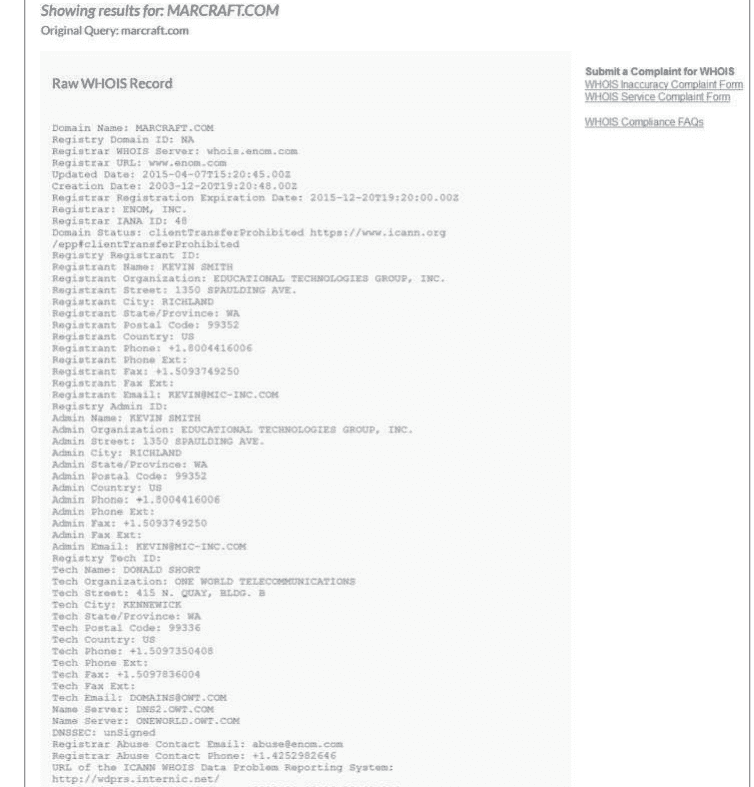

图 23.1 Whois 工具

如今许多注册都是私密的，这意味着你无法了解所有权、行政或技术联系人的任何信息；你只能获得有关名称服务器的信息。这些信息受 ICANN 规则约束，但可能并不总是准确的。尽管如此，这里仍然是了解某个域的好地方。

许多网站提供这项服务，所有类 Unix 操作系统都提供这个命令行工具。然而，并非所有 Whois 工具都能访问每个顶级域的信息。在某些情况下，你可能需要前往特定的注册商才能完整查询某个顶级域。

## Nslookup

nslookup 命令是一个命令行 DNS 查询工具，通常是用来获取网站 DNS 信息的第一个工具。基本的 nslookup 命令返回与指定域名关联的 IP 地址信息。

可以通过添加特定参数来修改基本命令，以获取其他类型的信息，例如名称服务器或邮件交换记录。

虽然 nslookup 是排查 DNS 主机名解析问题的绝佳工具，但它也是网络攻击枚举阶段信息收集过程中最常用的工具之一。

## PING

PING 是一种用于评估能否到达任何其他 IP 主机的软件实用程序。PING 命令将测量从源主机发送到目标主机的数据包的往返时间。PING 实用程序会向目标主机发送 Internet 控制消息协议（ICMP）请求数据包，并等待响应，同时测量往返时间和任何数据包丢失情况。

PING 和用于 IPv6 主机的 ping6 在许多操作系统中都作为命令行工具提供，而且各种软件产品也通常会提供此功能，并常与 traceroute 功能捆绑在一起。

PING 命令是判断主机是否在线以及你的网络与主机之间连接质量的绝佳方法。然而，ICMP 流量通常被视为低优先级流量；因此，繁忙的网络可能会忽略它。此外，由于可以用 PING 请求淹没网络（称为 ping 洪泛），ICMP 流量经常被阻止。大多数防火墙设备都可以用来完全阻止 ICMP 流量。

PING 实用程序提供的一些选项，例如调整数据包大小或不等待回复就发送，可用于制造 ping 洪泛，从而导致拒绝服务（DoS）攻击。这样的 ping 洪泛肯定会消耗入站带宽。但是，如果网络回复 ICMP 请求，那么出站带宽也将被消耗。

遗憾的是，恶意发送格式错误的 PING 数据包也是可能的。例如，较旧的系统无法处理大于 65,535 字节的数据包，任何大于该值的数据包都会导致计算机崩溃。现代路由器应该检查这些数据包的大小和分片情况，并执行规则以防止“ping of death”造成任何问题。

虽然出于各种原因，在公共网络上允许 ICMP 流量通常是一种好的做法，但关键的是你的防火墙要阻止 ICMP 流量，而且对于大多数网络，你甚至可能希望将防火墙设置为不回复这些请求本身。PING 请求应该类似于图 23.2 所示的样子：

```
ping www.google.com
```

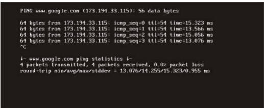

## 图 23.2 PING

## Traceroute

TRACEROUTE 实用程序将显示数据包从一个 IP 到另一个 IP 所经过的*路由*（路径）。与 PING 一样，它会测量 ICMP 数据包的往返时间（也称为*延迟*）；不过，使用 traceroute 时，测量的是路由中每个相邻主机之间的时间。

路由的每一段称为一个*跃点*。Traceroute 将发送三个数据包，并测量完成每个跃点所需的时间。每个跃点的累计延迟通常以毫秒为单位记录，同时还会记录每个节点的 IP 和主机名（通过反向查找获得）。

这是查看主机之间延迟问题并评估连接以确定何处存在过大延迟或路由失败的好方法。

Traceroute 在大多数操作系统命令行界面中都可使用。Windows 使用 TRACERT 实用程序。某些实用程序（如 tcptraceroute）可能使用 TCP 数据包。


## 关于 TCP 数据包的一点说明

PathPing 实用程序可在许多 Windows 系统上找到，它结合了 ping 和 traceroute。使用 TCP 数据包在路由中的路由器阻止 ICMP 流量时可能很有用。

典型的 traceroute 操作应类似于图 23.3 所示。

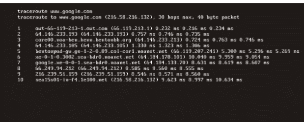

图 23.3 Traceroute 操作

## Telnet

Telnet 是一种应用客户端-服务器协议，可使用 Telnet 客户端软件在计算机（或设备）与通常监听在端口 23 上的任何远程 Telnet 服务器之间建立连接。这非常像基于文本的命令行界面，允许远程用户像本地登录服务器一样执行操作，如图 23.4 所示。

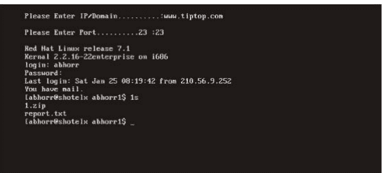

图 23.4 Telnet 操作

通过自定义客户端软件可获得多种类型的 Telnet 仿真，但大多数都没有加密可用；因此，不能保证你的通信在传输过程中不会被截获。一些较旧的网络设备可能仅支持 Telnet，但只要有可能，你应改用 SSH。

## 安全 Shell

安全 Shell（SSH）是一种用于安全客户端-服务器连接的加密网络协议。旨在取代不安全的 shell 协议（如 Telnet），SSH 采用公钥加密认证。用户可以像使用 Telnet 一样使用密码进行身份验证，或使用密钥对，或两者兼用。负责 SSH 连接的管理员应精通 SSH 密钥管理。

还可以使用关联的 SSH 文件传输协议（SFTP）或安全复制协议（SCP）进行文件传输。SSH 支持隧道和端口转发，因此在某些网络安全方案中可成为重要工具。SSH 包含在所有类 Unix 发行版中，但不包含在 Windows 中，尽管你可以为大多数 Windows 版本获取版本。

即使你不是在管理 SSH 服务器，你也最有可能在某个时候使用 SSH 客户端。尽管有关于 NSA 破译 SSH 连接的传言以及一些过去的漏洞，但 SSH 被认为是一种安全可靠的协议，几乎消除了网络流量被窃听的可能性。

## 监控工具和软件

要真正保护网络，你必须有某种方式对其进行监控和测试。随着时间的推移，越来越强大的网络监控工具和服务变得可用。这些工具可用于确保服务器（或服务器上的特定服务）正常运行，也可用于简单地监控数据流。

通常，服务器或服务监控产品会向该服务发送请求（例如向 Web 服务器发送 HTTP 请求）并测量响应。如果请求没有回复或回复太慢，则可能会通过电子邮件、短信或其他警报方法向网络管理员发送消息。重要的是至少有一个独立于被监控网络的监控器，以确保在网络中断时仍能生成警报。

其中很大一部分监控只需要筛选日志以查找错误或其他问题，这对网络管理员来说可能是一项令人望而生畏的任务。能够汇总甚至绘制日志数据的软件工具可以成为巨大的生产力辅助。

以下各节讨论了供你考虑的其中一些产品。使用这些和其他网络测试工具将使你更容易审计网络，以便了解其资源、评估其风险、评估其漏洞，并制定减轻这些风险和漏洞的计划。

### Nagios

Nagios 可能是最知名的仍有免费版本的网络监控工具；然而，它已经发展并提供了一个功能齐全的商业企业版本。该项目的分支 Icinga 是一个有趣的开源替代方案，其功能比 Nagios 的免费版本更全面。两种产品都有大量监控、报告和通知选项，最适合正常运行时间监控，但也可以监控性能。

### SolarWinds

SolarWinds 提供了一个功能强大的商业网络性能监控产品。虽然该产品价格有点贵，但功能非常强大，可以监控正常运行时间、性能、流量和利用率。它还提供大量报告、图表和通知选项。

### Microsoft Network Monitor

Microsoft Network Monitor 是一款数据包分析器，可帮助你查看流量并排除网络问题。正如你所期望的，该产品与专有的 Microsoft 协议交互做得非常好，但大多数常见的公共协议也得到支持。

### Wireshark

Wireshark 是一款成熟的开源跨平台网络协议分析器。它可能是最知名的协议分析器，支持几乎所有协议并可在几乎任何平台上运行。有关 Wireshark 的更多信息，请访问 www.wireshark.org。

如图 23.6 所示的 Wireshark，是捕获并随后分析流量以发现以及排除网络问题的宝贵工具。它可用于了解给定网络上使用的协议。此工具易于使用，但需要经验和练习才能准确分析其产生的结果。然而，每个网络管理员都应该在他们的工具库中拥有此产品。

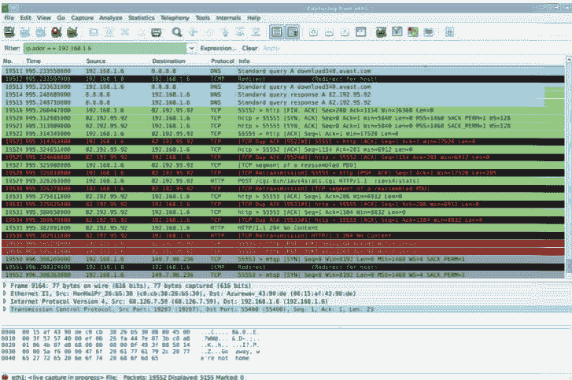

图 23.6 Wireshark

### Snort

Snort 是一款开源跨平台入侵检测系统，提供实时流量分析、数据包记录、协议分析以及对蠕虫、端口扫描和漏洞利用尝试的主动检测。这当然有助于实时监控网络。它非常适合识别探测和攻击，但也可以作为网络嗅探器使用。如图 23.7 所示的 Snort，是具有公共服务的网络的优秀产品。有关 Snort 的更多信息，请访问 www.snort.org。

也许在列出的所有工具中，Snort 有许多互补产品可以与其一起使用以扩展其检测和报告能力。

与任何入侵检测/预防系统一样，Snort 只有在正确“调优”到其所使用的网络时才有效。如果没有在 IDS/IPS 上进行调优的尽职调查，管理员将同时面临太多误报（错误指控的警报）和太多漏报（错过的真正问题）。

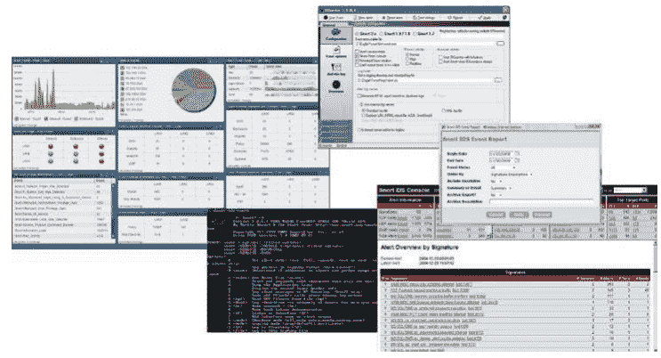

图 23.7 Snort

### Nmap

如图 23.8 所示的 Nmap，是一款开源跨平台网络映射实用程序，用于发现和安全审计执行网络清单，以及监控和升级调度。这是一款高度灵活的工具，用于检查、分析任何网络中的系统。它特别适用于发现端口和服务版本。有关 Nmap 的更多信息，请访问 www.nmap.org。

如图 23.8 所示，Nmap 既可使用命令行界面，也可使用 GUI 界面。

### Nikto

Nikto 是一款开源 Web 服务器扫描程序，可识别 Web 服务器上的问题。有关 Nikto 的更多信息，请访问 cirt.net/nikto2。

### OpenVAS

OpenVAS 是 Linux 和 Windows 的开源漏洞扫描程序，是现在商业化的 Nessus 最后一个免费版本的分支。作为一个完整的漏洞管理解决方案构建，该工具使用 SCAP 并可执行多种网络漏洞测试（NVT）；它可以查找常见漏洞和暴露（CVE）。该产品学习曲线有点陡峭，但它是一款备受推崇且功能强大的工具，值得考虑。有关 OpenVAS 的更多信息，请访问 openvas.org。

### Metasploit

Metasploit 是最受欢迎的开源渗透测试框架之一。它适用于 Windows 和 Linux 环境。它通常用于识别和验证网络漏洞，包括模拟利用人类漏洞的攻击，如图 23.9 所示。Metasploit 还可用于优先处理发现的任何网络漏洞的响应。有关 Metasploit 的更多信息，请访问 www.metasploit.com。


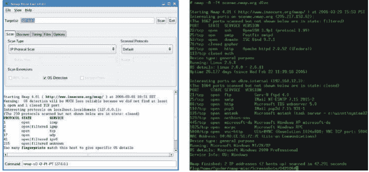

**图 23.8 Nmap 实用程序**

Metasploit 通常是一种基于命令行的工具。然而，如图 23.9 所示，也有一些商业工具提供 GUI 前端。

## 浏览器利用框架（BeEF）

浏览器利用框架（BeEF）是另一个著名的开源渗透测试工具，但它专注于通过网页浏览器进行的基于 Web 的攻击。BeEF 可用于 macOS、Windows 和 Linux。有关 BeEF 的更多信息，请访问 www.beefproject.com。

## 其他产品

其他值得评估的安全产品包括 Nessus、Core Impact 和 Nexpose。还有一些专用的硬件解决方案，例如来自 nGenius 的 Netscout，它们为监控网络服务和性能提供了可靠的解决方案。每个网络都应该始终启用某种监控，并且每个网络管理员还应该能够使用可靠的数据包嗅探工具。

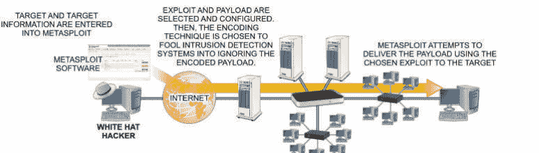

**图 23.9 Metasploit 操作**

## 动手练习

### 目标

- 在有线以太网接口上启动 Wireshark 捕获应用程序。
- 检查各种协议和流量。
- 捕获并分析 PING 序列。
- 描述分析数据包有助于检测恶意活动的方式。

### 资源

- 客户提供的台式机/笔记本电脑硬件系统
- 已安装 Windows 10 专业版
- 已安装 Wireshark 数据包分析器
- 具有管理访问权限的帐户

**注意：** 可从 https://www.wireshark.org/download.html 获取 Wireshark 的最新副本。

### 讨论

数据包分析器是能够在数据通过数字网络传输时捕获（拦截并记录）数据的设备或软件工具。这些工具也称为数据包嗅探器、网络分析器和协议分析器。当分析器检查通过它的流量时，它会将流量解包为数据包（例如通过以太网网络传输的 TCP/IP 数据包），以便对其进行分析。这些工具在网络环境中具有广泛的应用。它们通常用于诊断网络问题、识别配置问题和解决网络瓶颈。安全专家还可以使用数据包分析器来监控网络的漏洞、误用和网络攻击企图。渗透测试人员（合法或白帽黑客）和黑客（非法或黑帽黑客）也使用数据包分析器来嗅探网络，试图窃取通过网络传输的未加密数据，例如登录凭据、财务信息或电子邮件消息。他们还可能使用这些工具进行侦察，为未来攻击做准备。Wireshark 是一种网络数据包分析工具，通常用于捕获网络中传输的数据包，并尽可能详细地显示它们。Wireshark 是一个免费的开源程序，用于故障排除、分析、调试协议实现以及检查安全问题。

### 操作步骤

在本操作步骤中，你将探索 Wireshark 在网络安全中的应用。分析流量可以让你深入了解网络上的活动。Wireshark 是你应该用来保护网络的众多工具之一。

### 启动 Wireshark

你将从启动 Wireshark 并熟悉界面开始。

1. 启动你的计算机。
2. 使用具有管理权限的帐户登录。
3. 找到桌面上的 Wireshark 快捷方式图标。右键单击该图标，然后选择“以管理员身份运行”。Wireshark 将启动，如图 23.10 所示。

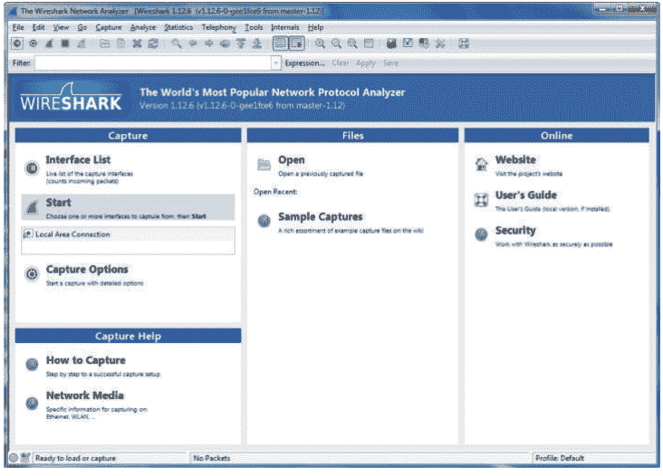

**图 23.10 Wireshark 界面**

**注意：** 如果你收到错误“The NPF driver isn’t running”，请按照以下说明操作：

1. 单击“开始”图标并选择搜索栏。
2. 输入 **cmd**，*不要*按 Enter。
3. 右键单击“程序”下的 **cmd.exe**，然后选择“以管理员身份运行”。
4. 当提示提升权限时，选择“是”。
5. 在命令提示符下，输入 **net start npf** 并按 Enter。

你应该看到 NetGroup Packet Filter Driver 服务已成功启动。你将需要重新启动 Wireshark。

通常，你不应使用管理帐户运行 Wireshark。但在这种情况下没问题；但在正常环境中，你应该使用权限较低的帐户运行它，并在提示时提升权限。

4. 通过阅读每个标题和副标题来探索你的选项。有许多可用的配置选项。

5. 要开始捕获实时数据包，请单击适合你特定网络配置的网络设备。你选择的设备很可能是以太网或 Wi-Fi，具体取决于你如何将计算机连接到互联网，如图 23.11 所示。

**注意：** 你捕获的数据看起来应与图 23.12 类似。但是，根据你的网络流量和网络结构，你可能会看到也可能不会看到大量数据包流量。

6. 单击窗口左上角的红色方形图标，以停止正在运行的实时捕获。

**注意：** 根据需要调整三个窗格以查看数据。

捕获窗口分为三个主要部分。最上面的部分按顺序列出捕获的数据包，左侧列中显示与数据包关联的捕获编号和时间。此部分称为“数据包列表”窗格。

中间部分（也称为“数据包详细信息”窗格）显示突出显示的数据包的分析。

底部部分（称为“数据包字节”窗格）以传输的十六进制形式提供数据包。

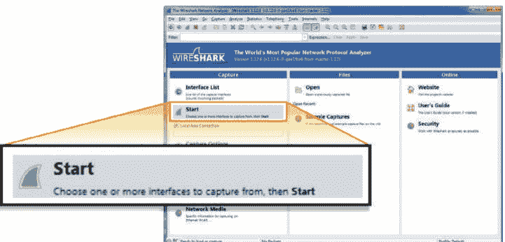

**图 23.11 开始捕获数据包流量**

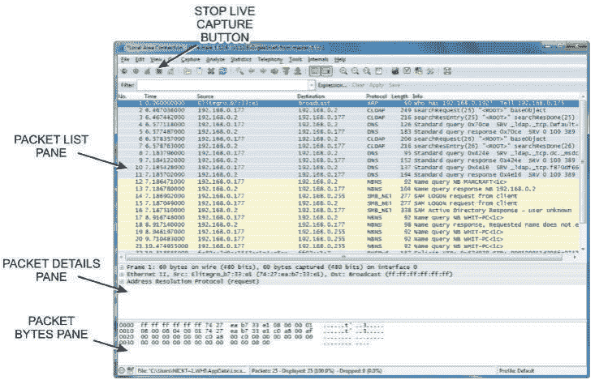

**图 23.12 Wireshark 捕获窗口**

7. 检查界面，看看你是否能解读屏幕上的信息。在顶部的“数据包列表”窗格中选择各种数据包；并在“数据包详细信息”和“数据包字节”窗格中检查与这些数据包关联的信息。

8. 在表 23.1 中，记录顶部“数据包列表”窗格中的定义列。

**表 23.1 定义列**

| 编号 | 时间 | 源 | 目标 | 协议 | 长度 | 信息 |
|-----|------|--------|-------------|----------|--------|------|
|     |      |        |             |          |        |      |

通过定位“协议”列，你可以大致了解数据包包含的内容。通过查看图 23.12，你可以确定协议包括：

- ARP：地址解析协议
- CLDAP：无连接轻量级目录协议
- DNS：域名系统
- NBNS：NetBIOS 名称服务

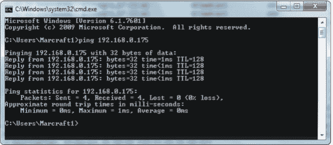

**图 23.14 Ping**

7. 当 PING 过程完成后，返回 Wireshark 并单击窗口左上角附近的红色方形图标停止实时捕获。

你会注意到列表中至少出现一个新协议。应该会列出 ICMP 协议，如图 23.15 所示。（根据你的网络正在推送的流量大小，你可能需要向上滚动。）

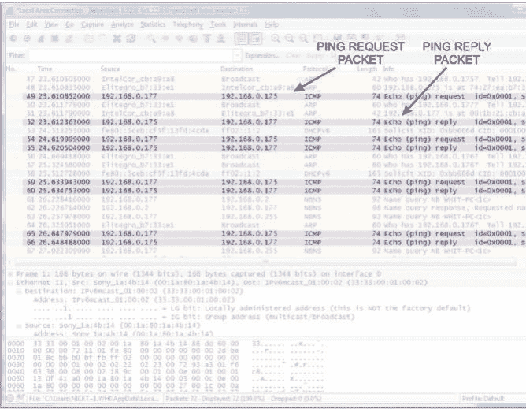

**图 23.15 带有 ICMP 数据包的 Wireshark 捕获窗口**

**注意：** 对于每次 PING，你都会看到两个与 ICMP 相关的数据包：回显（PING）请求和回显（PING）应答。

8. 选择“过滤器：”字段框。输入 icmp 并按 Enter。

这会将所有流量过滤为仅 ICMP 协议。在这里，你可以更轻松地查看 PING，如图 23.16 所示。

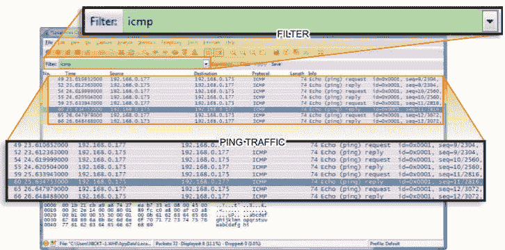

**图 23.16 查看 PING**

### 在 Wireshark 中探索攻击

仅仅为了在 Wireshark 中查看流量而发起攻击是不明智的。在此阶段执行攻击可能会使你的本地计算机无法使用。因此，你将需要检查先前捕获的、代表不同攻击的流量。

你可以从以下位置下载一些示例攻击：https://wiki.wireshark.org/SampleCaptures。将它们存储在桌面上的 Wireshark 示例文件夹中。

为了本次实验，请找到并下载以下内容：

- arp-storm.pcap (https://wiki.wireshark.org/SampleCaptures#ARP.2FFRARP)
- teardrop.cap (https://wiki.wireshark.org/SampleCaptures#Crack_Traces)


1. 在桌面上找到标有 Wireshark Examples 的文件夹。双击打开文件夹并查看其内容，如图 23.17 所示。

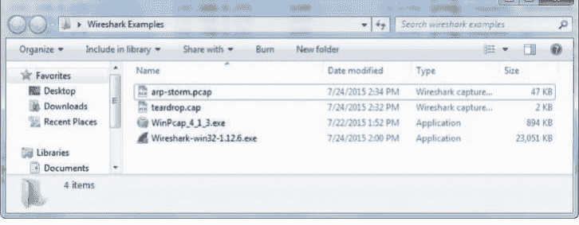

图 23.17 Wireshark Examples 文件夹内容

2. 双击 arp-storm.pcap。如果提示请选择并选择 Wireshark 打开此文件。图 23.18 显示了打开的文件。

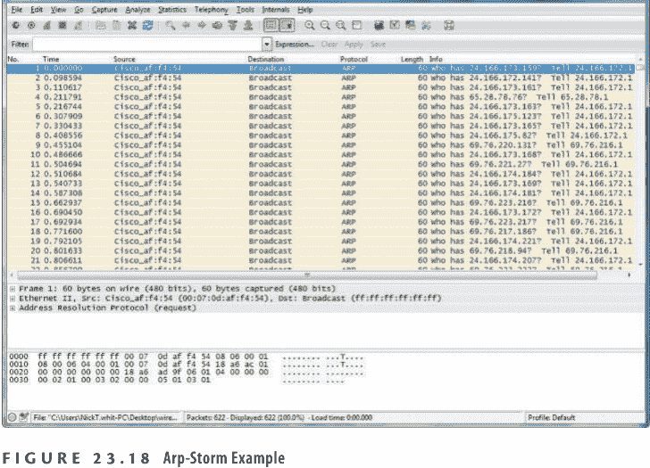

图 23.18 Arp-Storm 示例

当广播或多播流量压垮网络时，就被称为 *广播风暴* 或 *网络风暴*。由于广播流量会被每个网络设备重新广播，如果交换机和路由器不胜任，持续的流量会迅速使其过载。

与 DoS 攻击一样，监控网络中的广播风暴非常重要。然而，确保网络配置正确，并且拥有足够强大的硬件来快速传输数据并足够快地学习路由以满足组织需求也很重要。

- 3. 通过滚动 Packets List 面板来检查流量。看看是否能发现任何重要信息。
- 4. 完成对 arp-storm 示例的检查后，通过单击窗口右上角的 X 关闭 Wireshark 窗口。
- 5. 返回 Wireshark Examples 文件夹并双击 teardrop.cap。

*Teardrop 攻击* 是另一种类型的 DoS 攻击，涉及向目标机器发送分片数据包。目标机器将无法重新组装此类数据包。这会导致数据包相互重叠并最终导致目标网络设备崩溃。

- 6. 检查流量，特别是数据包 8 和 9，如图 23.19 所示，使用中间窗格（Packet Details）。数据包 8 被认为是设置，而数据包 9 是重叠攻击。在此示例中，差异很微妙；然而，数据包 8 为 36 字节，而数据包 9 从偏移量 24 开始，从而导致攻击。
- 7. 关闭所有剩余的 Wireshark 窗口。如果提示保存再退出，请选择 Quit Without Saving。
- 8. 关闭命令提示符窗口以及 Wireshark Examples 文件夹。
- 9. 关闭计算机。

Wireshark 是一款功能强大且流行的流量分析工具。本练习只是对其基础知识的介绍；它还有更多选项，包括 I/O 图表、高级过滤以及分析其他地方捕获的流量的能力。如需了解更多信息，请访问 wireshark.org。

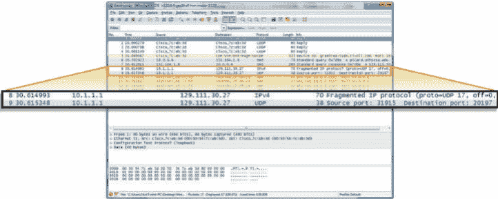

**图 23.19** Teardrop 攻击示例

## Lab Questions

- 1. Wireshark Capture 窗口中有哪三个窗格？
- 2. 一个 PING 涉及多少个数据包？
- 3. 你应该使用管理员账户运行 Wireshark 吗？

## Lab Answers

- 1. Wireshark Capture 窗口中有哪三个窗格？

  Packet List 面板、Packet Details 面板和 Packet Bytes 面板。

- 2. 一个 PING 涉及多少个数据包？

  对于每个 PING，你会看到两个与 ICMP 相关的包：Echo（PING）请求和 Echo（PING）回复。

- 3. 你应该使用管理员账户运行 Wireshark 吗？

  通常不建议这样做。相反，使用权限较低的账户运行 Wireshark，并在提示时提升权限。
