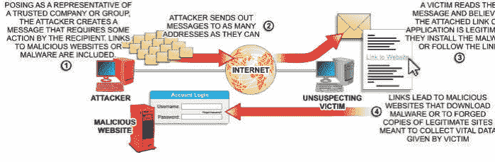
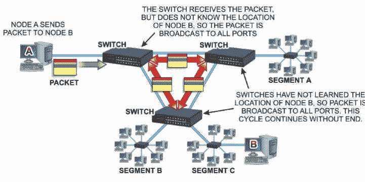
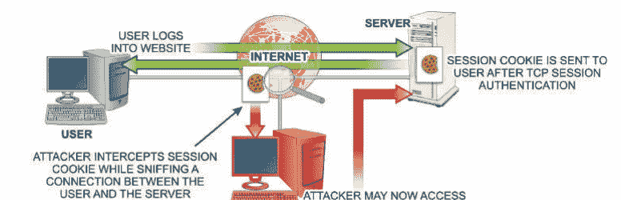
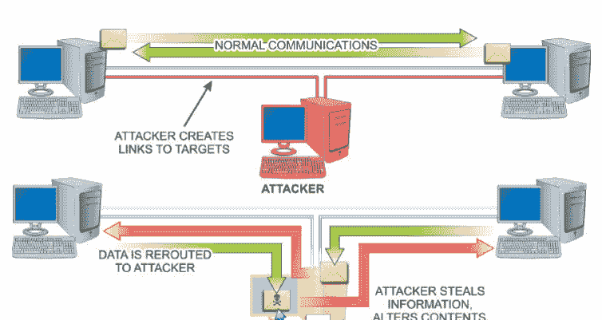
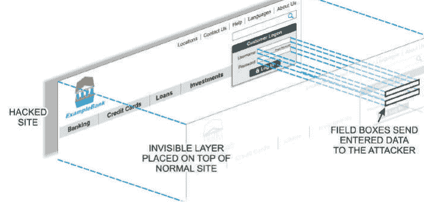
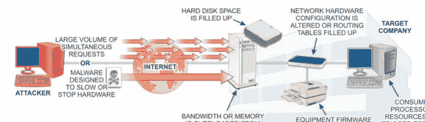
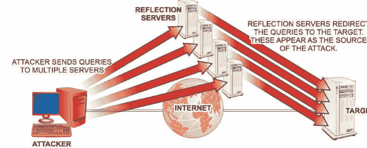
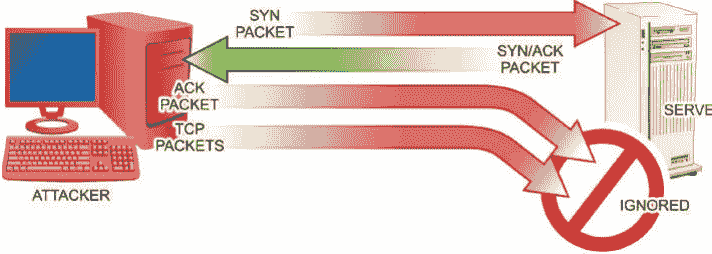

# 社会工程学攻击利用

当我们想到网络漏洞时，我们最初并不会想到人的漏洞，但它们是许多网络安全攻击的目标。*社会工程学*本质上利用人际互动来规避正常的防护。随着传统安全措施的不断完善和网络攻击手段越来越难以实施，黑客正转向心理操纵来实现其目标。

我们往往会轻视这一概念，并且常常觉得用户能被这样欺骗实在令人惊讶，但社会工程学出奇地有效，而无需过于详细或复杂。问题的关键在于，人们倾向于过度友好和信任。当某人遇到精心设计的攻击时，如果缺乏适当的意识培训，人们很容易上当。

一些社会工程学欺骗手段如此逼真，只有经过极其严格的审查才能被识别。用户无法提供这种程度的审查或具体理解，因此对其进行一般概念的教育是打击这些活动的最佳方式。

## 钓鱼攻击

*钓鱼*是一种社会工程学技术，试图通过冒充值得信赖的组织来获取敏感信息，通常是登录凭证或信用卡数据。这些攻击通常涉及电子邮件，将用户引导至一个看似真实的虚假网站，如图 24.3 所示。

此类网站会提示用户输入其凭证或其他敏感信息，以便收集信息并用于身份盗窃。

我们常常认为这些东西明显荒谬到没人会上当受骗。然而，总有人会上当，这也是它们如此流行的原因。

打击钓鱼的第一步也是最好的方法就是对用户进行教育。与其羞辱他们是容易上当的新手，不如更好地提供简单的方法来识别真实邮件或网站与虚假邮件或网站之间的区别，包括：

- ► 电子邮件或网站的外观可能具有欺骗性。标志、官方免责声明和法律术语并不能提供任何合法性，因为它们可以很容易地被伪造或复制。

**图 24.3** 钓鱼攻击示例

- ▶ 要理解，正规公司很少发送会链接到要求提供敏感信息的任何内容的电子邮件。这些组织可能会鼓励你登录账户以享受某些新功能或利用某些促销活动。如果是这样，请以正常方式进行，而不是通过电子邮件中的链接。正规组织在多年的经验中已经学到，他们不会做任何会让你更不信任他们的事。
- ▶ 电子邮件上的“发件人”地址可以非常容易地被伪造，任何人都可以做到这一点。
- ▶ 电子邮件中的超链接可能很危险。如果你不认识发送电子邮件的人或组织，根本不要点击链接。
- ▶ 如果你认识电子邮件的发件人或组织，请意识到电子邮件中的超链接可能带你到任何地方。教用户如何检查这些链接的网址，并寻找合法组织的 URL，而不是仅仅将组织名称作为 URL 的一部分。

例如，指向你的银行“我的超安全银行”的链接是 https://myreallysecurebank.com。在钓鱼邮件中，该链接可能显示为：https://bogus.somewhere.ru/myreallysecurebank，其中 *bogus* 和 *somewhere* 是黑客试图将你引导到的地方，以便让你透露他们随后将用于窃取你的身份或访问你的账户的信息。最好始终直接通过书签或输入 URL 的方式访问网站。

- ▶ 教用户如何检查电子邮件头。这对许多人来说可能有点困难。然而，向用户展示如何查看电子邮件头并展示他们如何查看消息经过的每个邮件服务器的服务器主机名。通过这样做，你通常可以看出电子邮件是否合法。

虽然一些公司会使用外部组织进行营销甚至支持邮件，但任何链接到需要输入敏感信息的网站的合法邮件都应始终来自组织本身。如果不是，就不要信任它。

钓鱼攻击也可以更具针对性。* spear phishing* 可能会针对组织中的单个用户，并伪装成该组织中另一位请求敏感信息的人。解决这种攻击的最佳方法是制定公司政策，禁止用户之间发送敏感信息。然而，教育在这里也是一个强大的工具。

回复此类电子邮件将比将其发送到其地址簿中的地址更成问题。如果用户不仅了解风险，而且还知道几种简单的避免欺骗的方法，网络将更加安全。

钓鱼攻击有多种不同的变体，包括 pharming、spear-phishing、whaling 等。你可以通过在线搜索这些术语来了解更多关于这些变体的信息。

## 网络威胁和攻击

第三部分介绍了几种不同类型的网络漏洞以及与之相关的攻击类型，它们适用于局域网连接设备。在本章中，这些漏洞和攻击类型将作为它们适用于互联网相关活动的方式重新审视。

### 广播风暴

在第三部分中，你了解到当广播流量被每个网络设备重新广播时，持续的广播或多播流量会迅速使交换机和路由器过载并压垮网络。这种活动被称为 *广播风暴* 或网络风暴，如图 24.4 所示。

**图 24.4** 广播风暴

监控网络是否存在广播风暴很重要。然而，确保网络配置正确也很重要。如果网络节点直接与多个交换机通信，查找表可能会混淆，导致数据包在各段之间泛洪。这可能代表网络实施中的一个主要弱点。

同时拥有足够强大的硬件也很重要，以便快速移动数据并足够快地学习路由以满足组织的需求。随着网络速度提升至千兆及更快，所有网络硬件都必须适合该数据速率变得越来越重要。

虽然可以通过某种方式对网络进行分段以最大程度地降低广播风暴的风险，但生成树协议（STP）正是为处理此问题而创建的。STP 采用生成树算法（STA）来理解交换机可能有多种方式与网络节点通信，并管理最佳路径，同时仍能够回退到次要路径。关键任务网络必须使用 STP 以最大程度地减少广播风暴。

STP 将通过操纵其优先级级别在多路径网络中建立一个交换机作为其 *根桥*。它通过在所有网络交换机之间交换第 2 层桥接协议数据单元（BPDU）来实现这一点，直到选出获胜者。一旦建立，所有其他网络交换机都将受根桥交换机的管辖，所有网络流量都将通过它传递。每个非根桥交换机都连接到根桥交换机上的自己的根端口。

许多网络漏洞都集中在以某种方式获取有效凭证上。欺骗之前已经讨论过，因此显而易见，攻击者伪造或欺骗网络身份并不太困难。冒充攻击可能来自被盗凭证、伪造的 IP 或电子邮件地址，或两者兼有。如果攻击者能骗用户交出其凭证，他们就可以获得该用户的网络状态。多因素身份验证工作（你不仅仅查看输入的凭证）可以最大程度地降低冒充攻击的效率，但这些解决方案可能并不总是实用。

## 会话劫持攻击

在 TCP 会话中，身份验证通常只在会话开始时进行。登录网站时，通常会向用户提供会话 cookie 以便后续识别。如果攻击者能够嗅探此连接并获取会话 cookie，他们就可以访问该网站，如图 24.5 所示。这种类型的攻击被称为 *会话劫持*。

## 中间人（MITM）攻击

在第三部分中，你还被介绍到中间人（MITM）攻击或消防队攻击。这些攻击是一种会话劫持类型，涉及拦截或嗅探并修改用户之间的通信，如图所示

Figure 24.6. You can think of them as a form of network eavesdropping. As such, the attacker is usually on the same network or broadcast domain as the other two parties and will proxy communications between the parties, inserting or altering data in the process. In an SSL connection, the attacker might use ARP spoofing to divert traffic though the attacker rather than the normal network router.

## FIGURE 24.5 Session Hijacking

## FIGURE 24.6 MITM Attack

## Clickjacking Attacks

A clickjacking attack employs deceptive frame techniques to trick the user into clicking on their content rather than the intended content. This is a popular

trick deployed on hacked websites because it is easy to do and can yield high rewards, as shown in Figure 24.7. The attacker mostly conceals the legitimate frame so the user clicks on the attacker's frame. This is often done to social media frames. It is possible for the web page developer to add a little frame-busting code to their web documents, but that can be defeated as well.

FIGURE 24.7 Clickjacking

## Dictionary Attacks

A dictionary attack is simply a systematic, brute-force attack using every word in a dictionary as a password. This type of attack is simple to eliminate by limiting the number of login attempts that can be performed in a given period of time. In addition, the IP of any user exceeding a certain number of attempts over that period of time could be banned until they are cleared by an administrator. Another solution for defeating dictionary attacks is to enforce a strict password methodology that requires something more than a dictionary word for access. This type of attack is commonly used by spammers who guess at passwords of email accounts in order to gain access to an account and then use it for their spam distribution.

## Denial of Service (DoS) Attacks

Probably nothing disrupts a network administrator's dreams more than the DoS attacks (see Figure 24.8) you were introduced to in Part III. They are disruptive

not simply because these attacks often occur in the middle of the night, but because there is really no way to be completely immune to them. As you are aware from those previous DoS discussions, there are many ways to flood a network or a service with requests that can ultimately bring down even the most robust network hardware. The best that can be hoped for is to minimize their impact and have a plan to deal with them.

## Would You Like Fries with That DoS Attack?

DoS attacks are now available as services known as booter services, which charge customers for providing a distributed Denial of Service attack on demand.

A distributed DoS (DDoS) attack uses multiple compromised systems on many different networks (referred to as botnets) to provide the attack. The botnet systems are typically infected with a Trojan, but there are many ways to get malware into a computer these days.

Because the attack could come from hundreds or even thousands of computers, a distributed attack is much more difficult to stop, as it’s not as simple as just blocking a single IP. In addition, DDoS attacks are so easy to perform that even an unsophisticated attacker, commonly called a script kiddie, can launch an attack that will wreak havoc on a network. The botnet-for-rent service is a real concern for network administrators as well.

Many incorrectly think they are unlikely targets for a DoS attack of any kind. Security through obscurity is no longer a rational approach to network protection. There is some degree of randomness to DoS attacks these days, so every network will be affected eventually.

Networks normally rely on firewalls to defend their resources. Some firewalls offer protection against DoS attacks, but a better approach is to employ a specialized device that examines all incoming traffic before it gets to the firewall. These specialized network appliances offer better DDoS mitigation and monitoring and perform much better than normal firewalls because of their singular focus. These products are very expensive and probably not practical for smaller organizations.

Monitoring for any kind of DoS attack is critical, and having a plan to deal with this sort of thing is important because the network will be down before administrators can even start to deal with it. Because a DoS can be initiated in so many different ways, simply monitoring for slow network performance is the first place to start. Usage spikes or even a large jump in email volume should get an administrator’s attention.

## FIGURE 24.8 A Typical DoS Attack

If the network has a public web server, ensure that it is patched with the latest security and software updates. Also consider implementing transaction limits and monitoring so that any surges in activity can be reacted to in a rapid manner as well. Ensure the network's authentication schemes are strong and web servers ideally should be protected with firewall software that incorporates some level of IP filtering and automatically block excessive activity.

For Linux/Apache systems, a product such as Fail2ban can be used to reject IP addresses and services for a specified time to help thwart basic attacks. Nondistributed attacks are easier and, therefore, more common, making this type of protection from brute-force attacks very helpful.

A new DDoS protection and mitigation service industry is on the rise, offering more affordable solutions for organizations. These are not on-premise solutions and they are not for everyone. However, this type of solution is certainly something to consider when running mission-critical Internet applications. While CloudFlare (cloudflare.com) offers a free plan that may help many organizations, the monthly costs associated with most plans make them very attractive as well.

Often a DoS attack may be a diversion for some other criminal activity and should always be considered as a possibility when investigating an attack. If no sort of DDoS mitigation process is in place, you may simply have to endure the attack. When these attacks occur, some administrators pointlessly attempt to block IP after IP.

Once such an attack has been initiated, the remaining option is to simply shut down the network. The attacker might proclaim victory and move on if you are very lucky. Also consider blocking every incoming port that you possibly can. If the attack targets a particular port, it may be possible to move this service to a different port.

A newer DoS attack scheme, known as a Distributed Reflection and Amplification Denial of Service (DRDoS) attack, is becoming more common. Attackers are able to use a relatively small botnet in a distributed attack on reflection servers that redirect the queries they receive, making it appear as though the reflection server is the actual source. This type of attack is illustrated in Figure 24.9.

The reflection server is then overwhelmed by the combination of incoming queries and resulting responses. Often this sort of attack targets DNS services as the attacker forges a DNS request and the server responds to the spoofed IP that is the actual target of the attack. This means that the reflection servers may not even be part of a botnet or be compromised at all.

## FIGURE 24.9 A DRDoS Attack

The impact of this DNS amplification attack is much stronger when the DNS server is authoritative for the domain being queried where the attacker will make a DNS ANY request, which will return all known information about that DNS zone. A name server is authoritative if it provides definitive answers to DNS queries rather than from a cache or by requesting that information from another name server. By leveraging a botnet of DNS servers configured to allow unrestricted recursive resolution for any client, known as open DNS resolvers, a small number of servers can amplify the DDoS attack.

The Open DNS Resolver Project (openresolverproject.org) has a compilation of DNS servers that are known to serve as globally accessible resolvers so you can block them. However, you should also make sure that the network’s DNS servers are not open recursive resolvers. Some free tools are available to test DNS servers (dns.measurement-factory.com, dnsinspect.com and others).

Make sure that all caching name servers respond only to local queries and any authoritative DNS servers do not offer recursion and instead use DNS RRL (DNS Response Rate Limiting), which limits the rate at which authoritative servers respond to queries.

Most DDoS attacks target the transport and network layers. Layer 7 attacks focus on the application layer and generally target specific areas of a website in hopes of exhausting resources. This type of attack can be difficult to recognize because it appears as normal network traffic up to a point. The attacker will find a form or a feature of the website that might employ more resources and target that feature from a botnet.

Popular content management systems such as WordPress are targeted with this sort of application layer attack, often exploiting the search function of the site that appears to be normal requests. The sheer volume of these requests will bring the site down. DDoS mitigation services will help with this, and you could also consider using proxy servers that can provide some sort of rate limiting.

Ultimately, the battle to block IP addresses is rarely won, as these attacks typically come from thousands of IP addresses, depending on the size of the botnet. If a dynamic IP blocking system, such as Fail2ban, is in place some progress might be made. However, a large botnet will probably prevail. IP blocking is a fundamental mitigation concept, but the more distributed the attack the less likely this single tactic will help.

## Tarpitting

Another possible solution to this sort of attack is known as *tarpitting*, sometimes known as a *sticky honeypot*. To mitigate an HTTP attack, the concept here is to initially respond to a connection as normal but with a very small TCP window size. The host replies to a SYN packet with a SYN/ACK, but ignores the sender’s ACK, as shown in Figure 24.10. The sender starts to send data, but the host will never receive it, or the host might just set their TCP window size to zero, effectively stopping incoming traffic.

**FIGURE 24.10** Tarpitting

Clearly, you can’t do this for all connections, so the challenge is to identify the attackers and only tarpit those connections. This is far better than simply dropping packets because the sender will just send again rather than wait.

To thwart bulk email attacks, the concept is to deliberately slow down bulk-delivered emails compared to normal traffic. This may have some impact but typically will just force the spammer to send smaller batches with a longer delay between batches.

More sophisticated tarpitting software is used to monitor ARP requests looking for consecutive requests spaced several seconds apart without any ARP replies. When such requests are discovered, the software creates an ARP reply, using a bogus MAC address, on an unused IP address on the network.

The software then creates a virtual machine that watches for SYN packets for that bogus MAC address and replies with a SYN/ACK that tarpits the connection. This virtual machine might even respond to pings to further the charade.

Sophisticated tarpitting software packages are created to thwart specific worm attacks, but it is an ongoing battle. Sadly, you can’t just enable tarpitting and be fully protected—but this type of software is a great addition to the arsenal.

## Spam

Spammers are generally considered the lowest form of hacker and often perform directory harvest attacks (DHAs), where they simply guess email addresses at a domain and then connect to the email server of that domain. Any addresses that are not rejected are considered valid and can be added to a list of real email addresses the attacker can sell.

Most methods designed to thwart a DHA will result in slower service for legitimate mail. Some of the best solutions involve intelligently monitoring the early stages of mail delivery and denying access for a time to connections that have generated too many invalid recipient errors. Once the spammer’s efforts are blocked, they will probably move on to some other target.

Spammers represent a huge threat today because they have commercial motivation as a startling number of users will actually respond to spam. The spammers don’t have to necessarily breach a network but rather can simply exploit a single user to serve their purposes.

Using social engineering, deceptive emails, clickjacking, or whatever means they can, spammers gather credentials for one of the network user’s email accounts. Even if there is no public webmail server on the network, it isn’t difficult for spammers to figure out server settings for most networks and send email through the mail server as if they were the compromised user.

## Protecting Against Spam Exploits

Strong passwords and education can provide only so much protection. Once exploited, the spammer can send spam freely through the network and worse yet could even send out false or misleading information that could create liability (or at least embarrassment) for an organization. This type of *repudiation attack* is becoming more and more common. It is far from trivial to limit this sort of attack, but there are some things you can do.

### Require Authentication for the Outgoing Mail Server

Make sure the outgoing mail server requires some sort of authentication. If you don’t allow users to send from outside your network, this is simple. You can constrain sending to a subnet, but most organizations don’t do this. If the outgoing password is different than the incoming mail password, the user base will scream—but it will make it less likely for spammers to achieve this goal. If you require outside users to log in through a VPN to be able to send email, that can help as well provided the VPN is secure.

### Limit Outgoing Email Recipients

You should limit the number of recipients for any outgoing email to a reasonable number. Spammers will want to send large batches of emails as quickly as they can before spam-detection blocks your mail server. If a single email can be sent to only 20 users at a time, this will slow down their progress. If possible, do this per user and accomplish even more while still allowing internal mailing lists and services to function normally.

### Configure Notifications for Email Volumes

You should trigger notification of an administrator when an unusual volume of email is sent by a single user or overall. Generally, when administrators review the logs, they can tell by the email subjects that the message is spam. If you can quarantine bulk email until it can be reviewed, you are in the best position to stop this sort of thing.

### Restrict Webmail Servers

When a public-facing webmail system is used, you should restrict that server more than a normal outgoing mail server because these servers are the favorite targets of spammers. By restricting bulk email sending to traditional email client software rather than webmail systems, you can remove one variable from the equation.

### Pay Close Attention to Email Blacklists

You should monitor email blacklists carefully and respond to complaints immediately. The sooner a rogue account is discovered and disabled, the better. Blacklist-monitoring services that can really help are available. Even though it is too late to prevent a release of spam and subsequent blacklisting by the time the alerts come in, you will at least be in a better position to deal with the issue.

Many email providers and administrators fail to check these lists, assuming they should be above reproach. Blacklisting is a mostly automated activity and what isn’t automated is not governed particularly well.

Spam-weary users may report the mail server and some systems can trigger a blacklisting with very few complaints. Utilize services such as mxtoolbox.com, blacklistmonitoring.com, debouncer.com, and others to assist with blacklisting.

## Other Exploits

There are many other types of attacks and hackers are busy dreaming up new ones every day. Some attacks are just malicious to be malicious, and there is no real commercial gain for the attacker, but others may have commercial motives. With any attack you should look for what possible commercial gain could be available as it may not be immediately obvious.

### Transport Layer Security (TLS) Exploits

As encrypted communication using Transport Layer Security (TLS) is becoming more the rule rather than the exception, it should come as no surprise that more security attacks are focusing on it.

After a secure connection has been negotiated and keys exchanged, there isn’t much that can be exploited, so these attacks focus on this key exchange.

Often, these vulnerabilities exploit weaknesses in both the browser and server that can lead to a connection with weakened encryption. Patching both the client browser and the server SSL/TLS libraries was necessary after an OpenSSL bug was discovered in early 2015 that would allow a man-in-the-middle attack to downgrade connections from strong RSA encryption to an “export-grade” 512-bit RSA encryption.

Export-grade encryption was created to be good enough but still allow the National Security Agency to decrypt communication outside the United States. The NSA lifted this export requirement in the late 1990s, but those cipher suites have remained in both client and server libraries.

## FREAK Exploits

More than 15 years later, when a vulnerability known as *FREAK* (Factoring attack on RSA-EXPORT Keys) was discovered, it became clear that this export-grade feature was still available in many web clients, as well as in OpenSSL. This led to a scramble to patch the product.

While this still means an attacker would have to crack a 512-bit encryption, it is well known that this can be done in a matter of hours. However, 1024-bit encryption would take an impractically long time, and today encrypted services are often using 2048-bit encryption, which, for now anyway, seems uncrackable using contemporary technologies.

Because the FREAK flaw required a susceptible browser and server, its discovery also exposed another area of concern when it was learned just how many mobile browsers were susceptible. Many mobile platforms are simply not frequently updated, leading Microsoft, Apple, and Google to scramble and make software solutions available soon after the issue was discovered.

However, not all devices have upgrades available. Many older devices never had or no longer have software upgrade paths, so those browsers remain susceptible. The same can be said for the many painfully old desktop computers that are running obsolete operating systems, which will not support modern browsers. It is not that uncommon for employees to use personal mobile devices or laptops on their work networks, and these devices could create some risk for their organization.

## Logjam Exploits

Another popular cryptographic algorithm used in many Internet protocols rather than an RSA key exchange is the Diffie-Hellman key exchange (DHE). *A logjam attack* is similar to the FREAK attack but instead targets this Diffie-Hellman key exchange, convincing the connection to use DHE Export ciphers.

This attack exploits the *prime number sieve* (algorithm for determining all prime numbers up to a specified limit) used in the key-generation process, forcing it to use a 512-bit prime. Similar to FREAK, upgrade patches have been made available for modern browsers and software suites leaving obsolete systems vulnerable.
