# 科技创新驱动发展

在当今全球化竞争日益激烈的背景下，科技创新已成为推动经济社会发展的重要引擎。企业作为技术创新的主体，不断提升自主创新能力，以应对市场变化和产业升级的双重挑战。

- 创新驱动是推动产业升级的核心动力
- 数字化与智能化转型成为企业发展的必由之路
- 产学研深度融合促进科技成果转化
- 人才战略是实现技术突破的关键支撑

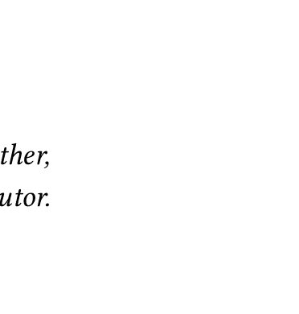

| 年份 | 研发投入（亿元） | 增长率 |
|------|----------------|--------|
| 2020 | 120 | 11.2% |
| 2021 | 145 | 14.5% |
| 2022 | 172 | 16.3% |
| 2023 | 205 | 18.9% |
| 2024 | 248 | 21.0% |

> “创新是一个民族进步的灵魂，是一个国家兴旺发达的不竭动力。”

未来，我们将继续加大在人工智能、大数据、云计算等前沿领域的技术布局，构建开放协同的创新生态体系，打造具有全球竞争力的科技产品和服务，为实现高质量发展贡献力量。

# 贡献者

# 关于作者

**Robert S. Sutor** 在 IT 行业担任技术领导者和高管已有 35 多年，其中超过 20 年是在纽约的 IBM 研究院度过的。在那里，他从事并领导了符号数学计算、数学编程语言、优化、人工智能、区块链和量子计算等领域的工作。他是 *Dancing with Qubits: How quantum computing works and how it can change the world* 一书的作者，该书同样由 Packt 出版。他还与已故的 Richard D. Jenks 合著了多篇已发表的研究论文以及《Axiom: The Scientific Computation System》一书。

Sutor 曾担任 IBM 软件业务部门的高管，负责的领域包括 Java Web 应用服务器、新兴行业标准、Linux 软件、移动技术和开源软件。他受过理论数学专业训练，拥有普林斯顿大学博士学位和哈佛学院本科学位。他 15 岁开始编程，并使用过后来出现的大多数编程语言。

*我想感谢我的妻子 Judith Hunter 以及孩子 Katie 和 William。在本书写作期间，感谢他们给予我的爱、耐心和幽默。*

*我还要感谢以下人士，感谢他们围绕编码、Python、计算机科学和量子计算与我进行交流，给予我洞见和启发：Abe Asfaw、Andrew Wack、Aparna Prabhakar、Barry Trager、Blake Johnson、Chris Nay、Christine Vu、Christopher Schnabel、David Bryant、Fran Cabrera、Hanhee Paik、Heather Higgins、Ismael Faro、James Weaver、James Wooten、Jay Gambetta、Jeanette Garcia、Jenn Glick、Jerry Chow、Joseph Broz、Julianna Murphy、Julien Gacon、Katie Pizzolato、Luciano Bello、Matthew B. Treinish、Mark Mattingley-Scott、Matthias Steffen、Michael Houston、Paul Nation、Rajeev Malik、Robert Loredo、Ryan Mandelbaum、Samantha Davis、Sarah Sheldon、Sean Dague、Stefan Woerner 和 Zaira Nazario。*

# 关于审阅者

Martin Renou 是 QuantStack（法国巴黎）的一名科学软件工程师。在加入 QuantStack 之前，Martin 还曾在 Enthought（英国剑桥）担任软件开发人员。他就读于法国航空航天工程学校 ISAE-Supaero，主修自主系统与编程。作为一名开源开发者，Martin 曾参与多个项目，主要围绕 Jupyter 项目生态系统展开。

- 图 3.6：吉他品牌、型号和推出年份表 ...... 111
- 图 5.1：从 4 个项目中每次取 2 个的排列 ...... 147
- 图 5.2：round 和 trunc 函数绘图 ...... 160
- 图 5.3：floor 和 ceil 函数绘图 ...... 160
- 图 5.4：正弦和反正弦函数绘图 ...... 162
- 图 5.5：正切和反正切函数绘图 ...... 163
- 图 5.6：神秘图形：这是哪个函数的绘图？ ...... 164
- 图 5.7：三个指数函数绘图 ...... 167
- 图 5.8：三个对数函数绘图 ...... 168
- 图 5.9：矩形坐标和极坐标下的复数 ...... 176
- 图 5.10：三次多项式 x³ − 2x² − 5x + 6 的绘图 ...... 178
- 图 5.11：均匀分布中的一百万个伪随机数 ...... 181
- 图 5.12：高斯分布中的一百万个伪随机数 ...... 182
- 图 6.1：全局变量和局部变量的作用域 ...... 207
- 图 6.2：在全局作用域中使用变量 ...... 208
- 图 6.3：在嵌套函数中使用“global” ...... 210
- 图 6.4：在嵌套函数中使用“nonlocal” ...... 211
- 图 6.5：斐波那契双重递归函数调用 ...... 224
- 图 7.1：一元多项式 x³ − 5x² + 7x + 1 的绘图 ...... 231
- 图 7.2：包含 Guitar 的 MusicalInstrument 类层次结构 ...... 283
- 图 7.3：包含 Guitar 和 Clarinet 的 MusicalInstrument 类层次结构 ...... 284
- 图 7.4：添加 ElectricGuitar 后的 MusicalInstrument 类层次结构 ...... 286
- 图 7.5：作为抽象基类的 MusicalInstrument ...... 288
- 图 7.6：一把原声吉他 ...... 289
- 图 7.7：使用多重继承的 AcousticGuitar ...... 290
- 图 7.8：菱形多重继承 ...... 291
- 图 8.1：包含文件夹和文件的目录树 ...... 306
- 图 8.2：Windows 资源管理器文件信息 ...... 308
- 图 8.3：显示当前目录的目录树 ...... 310
- 图 8.4：显示新当前目录的目录树 ...... 311
- 图 8.5：Unicode 文本示例 ...... 323
- 图 9.1：经典与量子软件栈 ...... 332
- 图 9.2：1 位逻辑“id”和“not”门 ...... 334
- 图 9.3：2 位逻辑“and”门 ...... 336
- 图 13.9：带有黑色楔形轮廓的饼图 ...... 510
- 图 13.10：突出显示“Monday”楔形的饼图 ...... 510
- 图 13.11：旋转后的饼图 ...... 511
- 图 13.12：每个城市使用不同大小圆圈的散点图 ...... 513
- 图 13.13：每个城市使用不同颜色的散点图 ...... 514
- 图 13.14：每个城市使用不同标记的散点图 ...... 515
- 图 13.15：调整刻度标记后的散点图 ...... 515
- 图 13.16：带有水平网格线的散点图 ...... 516
- 图 13.17：网格中的九个点 ...... 522
- 图 13.18：绘制余弦曲面图 ...... 524
- 图 14.1：数字 1 到 99 的两种分布的箱线图 ...... 534
- 图 14.2：1995 年年龄与参加音乐会次数的散点图 ...... 536
- 图 14.3：协方差和相关系数的公式 ...... 537
- 图 14.4：包含由“to_excel”生成的电子表格的 Microsoft Excel ...... 555
- 图 14.5：每个地区的雌性和雄性猫数量 ...... 568
- 图 15.1：棒球场照片 ...... 591
- 图 15.2：对两个特征进行数据聚类 ...... 591
- 图 15.3：另外两种聚类形式 ...... 594
- 图 15.4：左外野手和右外野手的位置 ...... 596
- 图 15.5：分隔点簇的直线 ...... 596
- 图 15.6：一维线性支持向量分类 ...... 597
- 图 15.7：二维线性支持向量分类 ...... 598
- 图 15.8：使用两个特征而非一个特征以实现可分离性 ...... 599
- 图 15.9：纽约棒球迷在派对上的位置 ...... 601
- 图 15.10：三位朋友在派对上的位置 ...... 602
- 图 15.11：基于两个点的简单线性回归 ...... 606
- 图 15.12：基于三个点的简单线性回归 ...... 606
- 图 15.13：基于 100 个点的简单线性回归 ...... 610
- 图 15.14：具有输入和输出的线性回归模型 ...... 611
- 图 15.15：具有 3 个输入、4 个隐藏节点和 2 个输出的神经网络 ...... 611
- 图 15.16：二进制阶跃和 ReLU 激活函数 ...... 613
- 图 15.17：sigmoid 和 tanh 激活函数 ...... 614
- 图 15.18：区分披萨店和杂货店的神经网络 ...... 614
- 图 15.19：具有 4 个输入、3 个隐藏层和 3 个输出的深度神经网络 ...... 616
- 图 A.1：Python 解释器 ...... 630
- 图 A.2：Python IDLE ...... 632
- 图 A.3：Python IDLE 的 Windows 开始菜单 ...... 632
- 图 A.4：调试模式下的 Python IDLE ...... 633
- 图 A.5：Visual Studio Code ...... 634
- 图 A.6：新的 Jupyter 会话 ...... 636
- 图 A.7：带有 matplotlib 输出的 Jupyter 会话 ...... 637
- 图 A.8：IBM Quantum API 令牌 ...... 638
- 图 A.9：IBM Quantum Composer ...... 639
- 图 A.10：IBM Quantum Lab ...... 640
- 图 A.11：Visual Studio Code 代码检查示例 ...... 643
- 图 A.12：Visual Studio Code 代码检查设置 ...... 643


然而，还有一种计算机，自 2016 年起才面向普通用户提供云端服务，那就是*量子计算机*。对量子计算机进行编程，在接近硬件的层次上与经典设备编程截然不同。然而，如果你已经掌握或能够学会 Python——根据估计，全球有超过 800 万软件开发者正在使用它，并且许多大学都在教授它——那么你就拥有一个巨大的优势：你可以同时进行经典计算和量子计算。

经典硬件和软件在过去七十年中已经证明了自身价值，而量子计算则是新生事物。它有望帮助解决某些类型的问题，这些问题即使对于经典超级计算机来说，也需要耗费过多的时间、过多的处理能力或过多的内存。专家预计，量子计算未来将在金融服务、物流、化学、材料科学、药物发现、物理系统科学模拟、优化和人工智能等领域发挥作用。

如果你计划成为一名专业软件开发人员，或者你是需要高性能计算进行研究的人，你就应该学习量子计算系统以及如何为其编写代码。

## 我为什么写这本书？

在这个同时涉及经典硬件和量子硬件的新世界中，你该如何学习编程？

一种方法是先单独学习经典计算。这是传统的做法，使用诸如 C、C++、JavaScript、Java、Go 或 Python 之类的语言。在此过程中，你会学习如何使用代码库中的额外功能，这些功能可能来自编程工具本身，也可能来自第三方提供商。例如 C++ 标准库、Java 平台企业版、Python 标准库，以及 Python 包索引中列出的数千个 Python 包。[PYPI]

一旦你理解了经典编程语言的哲学、语法、结构和惯用法，就可以在此之上学习量子计算。例如，你可以将 Qiskit 开源量子计算软件开发工具包（SDK）与 Python 一起使用。[QIS] 它们能很好地融合在一起，运行效果极佳。已经有成千上万的人在用 Qiskit 编写代码。如果你懂 Python，这是一个很好的方法。

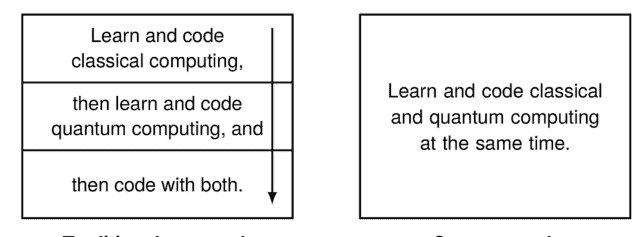

图 0.1：我们的学习策略

但如果你正在学习编程，或者只有很少的经验呢？如果我能为你提供一个以统一方式学习经典计算和量子计算的机会呢？如果我能够帮助你理解两者的概念，使你不会将它们视为不同的学科，这对你有用吗？这就是本书要做的。

## 我为谁写这本书？

如果你符合以下一条或多条描述，我相信本书会对你有用，并能吸引你：

-   你正在通过课堂或课程学习编程。
-   你想通过自学，学会像软件开发者一样思考。
-   你想理解并运用现代 Python 编程的基础知识。
-   你认识到量子计算将成为本世纪最重要的技术之一，并且你想学习如何为其编写代码的基础知识。
-   你认为通过软件解决问题意味着要使用所有可用的工具，并且你想同时运用经典的和更新的量子编程技术。

## 对读者的前提要求

我不要求你具备任何编程或使用 Python 的经验。第 11 章“寻找量子改进”中的部分讨论和实现，需要你熟悉一些数学知识，但这些知识都不会超出微积分课程之前通常涵盖的范围，包括代数、几何、三角学和对数。

## 本书使用哪些约定？

本书使用 Python 3.9 或更高版本。大多数特性在早期版本的 Python 3 中也可用，但我们不会展示或再提及已不再受支持的 Python 2。

可执行的 Python 代码及其产生的结果以等宽字体显示，并在正文中按如下方式标出：

```
2**50
```

1125899906842624

第二个表达式是缩进的，是运行代码的结果。

代码也可以跨越多行，例如下面的示例，我们创建并显示一个不包含重复数字的集合：

```
print({1, 2, 3, 2, 4,
    1, 5, 3, 6, 7,
    1, 3, 8, 2})
```

{1, 2, 3, 4, 5, 6, 7, 8}

对于较长的函数、方法和类定义，我会给行编号，以便在正文中更容易引用它们。这些编号不属于 Python 输入的一部分，如果你自行输入代码，不应输入这些编号。

```
1 def display_string(the_string, put_in_uppercase=False):
2     if put_in_uppercase:
3         print(the_string.upper())
4     else:
5         print(the_string)
```

当我在正文中提及 Python 函数、方法和属性名时，它们会像这样显示：print、__add__ 和 left。正文中 Python 类型和类名示例为 int、Fraction 和 Guitar。Python 模块和包名则显示为 math、os.path 和 qiskit。

本书在正文中穿插了练习。请在继续之前，遇到它们时就动手解决。

练习 0.1
这是一个示例练习吗？

当我们把字符依次排列在一起时，就得到了*字符串*。因此，"abcd" 就是一个长度为四的字符串。我用双引号来限定字符串的开始和结束。它们本身并不属于字符串的一部分。有些语言将字符视为独立存在的特殊对象，而另一些语言则将它们视为长度为 1 的字符串。

对于我们的编程需求来说，这是一个很好的开端：我们有了比特和布尔值、数字、字符，以及由多个字符组成的字符串来构成文本。现在，我们需要用这些类型的数据来做一些事情。

## 1.2 表达式

*表达式*是数据与要对这些数据执行的操作的书面组合。这听起来相当正式，那么想象一个数学公式：

15 × 6² + 3 × 6 − 4 .

这个表达式包含六项数据：15、6、2、3、6 和 4。有五个运算：乘法、乘方、加法、乘法和减法。如果我使用编程语言中常用的符号重写它，就是：

```
15 * 6**2 + 3 * 6 - 4
```

看到那个重复出现的 6 了吗？假设我想用不同的数字来代替它。我可以把公式写成：

15 × x² + 3 × x − 4

以及相应的代码表达式：

```
15 * x**2 + 3 * x - 4
```

如果我给 x 赋值为 6，就得到原来的表达式。如果给它赋值为 11，我可以计算：

```
15 * 11**2 + 3 * 11 - 4
```

我们称 x 为*变量*，而给它赋值的过程称为*赋值*。表达式

x = 11

的意思是“将值 11 赋给 x，并在任何看到 x 的地方用 11 来替换。”x 并没有什么特殊之处。我本可以使用 y 或像*千克*这样具有描述性的名称。

一个表达式可以包含多个变量。

## 1.4 库

虽然现在许多书都是数字化的，可以在线获取，但实体图书馆在城镇中仍然很常见。你可以利用图书馆来避免亲自做某件事，那就是买书。你可以借书来读。如果它是一本烹饪书，你可以使用其中的食谱来烹饪食物。

编程语言及其环境也存在类似的思想。我可以将可复用的数据和函数打包在一起，然后放到一个库中。通过下载或其他共享方式，程序员可以使用我的库来节省时间。例如，如果我构建了一个数学库，它可以包含像*最大值*、*最小值*、*绝对值*和*是否为素数*这样的函数。它还可以包含 π 等特殊值的近似值。

一旦你通过将库安装到系统上从而得以使用它，你需要告诉你的编程环境你想利用它。不同语言对库内容的称呼以及如何使它们可用，使用了不同的术语。

-   Python 导入模块和包。
-   Go 导入包。
-   JavaScript 从模块导入绑定。
-   Ruby 需要 gem。
-   C 和 C++ 包含与运行时编译库对应的源头文件。

在像 Python 和 Java 这样的语言中，你可以从包中导入特定的构造（如类），也可以导入其中的所有内容。通过所有这些例子，目的是让你的环境拥有一套丰富且可扩展的预构建功能，你可以在代码中使用它们。有些库随核心环境一同提供。你也可以选择安装第三方库。本书的第三部分将介绍一系列常用的 Python 库。

如果你导入两个库，而它们各自有一个同名函数，会发生什么？如果发生这种情况，我们就遇到了*命名冲突*和歧义。避免这一问题的解决方案是在函数名上再附加一些内容，例如库名。这样，你就可以明确地说：“从这里使用这个函数，从那边使用另一个函数。”例如，Python 中的 math.sin 表示“使用 math 模块中的 sin 函数。”这就是*命名空间*的概念。


计算机科学教材的作者通常会在数据结构中包含集合。凭借上面提到的这三种集合，你可以完成惊人的编码量。有时你需要专门的功能，例如一个不包含重复项的有序列表。大多数编程库都会为你提供广泛的此类结构，并允许你创建自己的结构。

C. S. Lewis 写了许多其他书籍和小说。我们可以创建的另一个字典可能会使用“1930s”、“1940s”、“1950s”和“1960s”作为键。值可以是按时间顺序排列的每个十年跨度内出版的标题列表。

集合可以是其他集合的一部分。例如，我可以将公司收益表表示为数字和字符串的列表的列表。然而，一些语言要求所包含的对象全部是同一类型。例如，也许一个列表需要全部是整数或全部是字符串。其他语言，包括 Python，允许你存储不同种类的对象。

## Exercise 1.4

在关于函数的部分，我们研究了有两个参数的**maximum**。思考并用文字描述一个类似的函数如何工作，该函数只接受一个参数，即数字列表。

我们可以更改的对象称为*mutable*。书籍列表在作者写作和出版时是可变的。一旦作者去世，我们可能会锁定集合并将其声明为*immutable*。没有人可以再做任何更改。对于字典，键通常需要是不可变的，并且经常是文本字符串或数字。

## Exercise 1.5

字符串是一个集合吗？如果是的话，它应该是可变的还是不可变的？

## 1.6 Conditional processing

当你编写代码时，你为计算机创建指令，说明计算机必须采取哪些步骤来完成某项任务。从这个意义上说，你是在指定一个配方。根据某些条件，例如银行余额为正或汽车速度超过规定限制，步骤的顺序可能会有所不同。我们称你的代码如何从一个步骤移动到另一个步骤为其*flow*。

- 5. 盖上碗盖，让它在温暖的地方静置 1 小时。
- 6. 压下面团并揉面 5 分钟。放在抹了黄油的烤盘中 30 分钟。
- 7. 在预热至 375° F（190° C，瓦斯标记 5）的烤箱中烘烤 45 分钟。
- 8. 取出面包并让其冷却。

# Problems

我称之为“直通”配方，因为你从头到尾按顺序做一个步骤接一个步骤。流程直线进行，没有任何岔路。然而，配方太简单了，因为它没有包含在进入后续步骤之前必须满足的条件。

- - 在步骤 1 中，如果酵母已死，你的面包就不会发酵。我们必须确保混合物活跃且起泡。
- - 在步骤 2 中，我们需要分少量添加更多面粉，直到搅拌好的面团从碗中脱落。
- - 在步骤 3 中，如果面团变得太粘，我们需要添加更多面粉。
- - 在步骤 5 中，一个小时只是面团变大一倍所需时间的估计。它可能需要更长或更短的时间。
- - 在步骤 6 中，我们希望面团在烤盘中变大一倍。
- - 在步骤 7 中，45 分钟是面包顶部变成金黄色的烘烤时间的估计。

# Conditional recipe

- 1. 在一个大碗中混合糖、水和酵母。静置 10 分钟。如果混合物起泡，则继续下一步。否则，丢弃混合物，并在大碗中混合糖、水和新鲜酵母。静置 10 分钟。
- 2. 拌入盐、牛奶、黄油和面粉。用刮刀或木勺搅拌 5 分钟。如果混合物没有从碗壁脱落，则添加 1 汤匙面粉并再搅拌 1 分钟。否则，继续下一步。

这些说明更好。我们测试几个条件以确定下一步行动。我们仍然没有检查重复步骤多次后是否满足条件。

## 1.7 Loops

如果我要求你闭上眼睛，数到 10，然后睁开眼睛，步骤如下：

- 1. 闭上眼睛
- 2. 将计数设为 1
- 3. 当计数不等于 10 时，将计数递增 1
- 4. 睁开眼睛

步骤 2 和 3 一起构成了一个循环。在此循环中，我们在满足条件时重复做某事。我们在测试返回 true 时不会从步骤 3 移动到步骤 4。

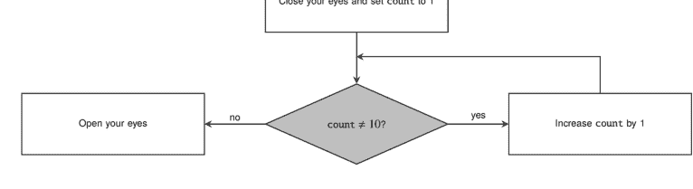

Figure 1.3: A while-loop flowchart

将图 1.3 的简单性与以下内容进行比较：

- 1. 闭上眼睛
- 2. 将计数设为 1
- 3. 将计数递增到 2
- 4. 将计数递增到 3
- 5. ...
- 6. 将计数递增到 10
- 7. 睁开眼睛

如果这还不足以说服你，想象一下如果我要求你数到 200。以下是我们在 C++ 中的做法：

```
int n = 1;

while( n < 201 ) {
    n++;
}
```

## Exercise 1.6

为从 100 倒数到 1 创建一个类似的 while-loop 流程图。

那个循环是一个 while-loop，但这是一个 until-loop：

- 1. 闭上眼睛
- 2. 将计数设为 1
- 3. 将计数递增 1 直到计数等于 10
- 4. 睁开眼睛

许多语言没有 until-loop，但 VBA 有：

```
n = 1
Do Until n>200
    n = n + 1
Loop
```

我们之前看到，函数定义中的代码是其主体。循环中重复的代码也称为其主体。

## Exercise 1.7

关于何时测试条件，while-loop 和 until-loop 有什么不同？将此 until-loop 流程图与之前的 while-loop 示例进行比较。

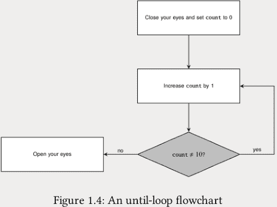

我们的下一个例子是 *for-loop*，因此得名是因为许多编程语言使用的关键字。for-loop 在你想要重复某事指定次数时非常有用。此示例使用 Go 语言：

```
```go
sum := 0
for n := 1; n <= 50; n++ {
    sum += n
}
```
```

它将 1 到 50 之间的所有数字相加，结果存储在 sum 中。这里，:= 是赋值，n++ 表示“用其先前值加 1 替换 n 的值”，sum += n 表示“用其先前值加上 n 的值替换 sum 的值”。

这种特定语法 for-loop 有四个部分：

- - 初始化：n := 1
- - 条件：n <= 50
- - 主体后处理代码：n++
- - 主体：sum += n

顺序是：执行一次初始化；测试条件，如果为真则执行主体；执行主体后代码；再次测试条件并重复。如果条件在任何时候为假，循环停止，我们转到循环后跟随的代码。

## Exercise 1.8

“数到 10”示例用 for-loop 重写时的初始化、条件、主体后处理代码和主体是什么？

## Exercise 1.9

绘制一个 for-loop 的流程图，包括初始化、条件、主体后处理代码和主体。使用图 1.5 中的模板。

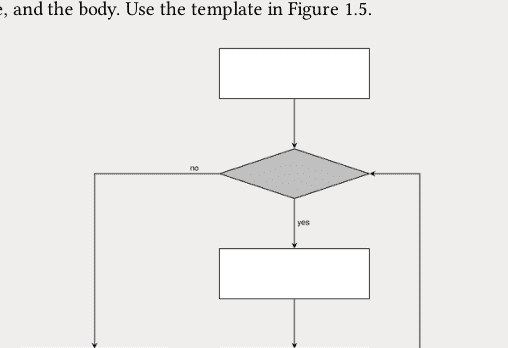

Figure 1.5: A for-loop flowchart

## 1.8 Exceptions

在许多科幻故事、小说、电影和电视剧中，角色使用“传送”将人和物体从一个地方移动到另一个地方。例如，主角可以瞬间从多伦多传送到东京，而无需经历耗时的航空旅行。

它也在此类情节中用于让角色从危险和意外的情况下逃脱。也许一只怪物可能把团队困在山洞的后面，没有办法为安全而战。领导者通过通信设备匆忙呼叫可能会要求“把我们带离这里！”或“现在把我们传上来！” STAR TREK® 系列和电影经常出现后者感叹。

因此，角色使用传送进行常规运输，也用于通常危及生命的特殊情况。许多编程语言也有异常的概念和机制。

在一个循环或一个写得很好的函数中，你可以看到你的代码的执行如何从一个步骤移动到另一个步骤。有了异常，你会说，“试试这个，如果不行，就回到这里。”或者，你可能在想，“我做我的事，但可能会不时发生一些事情，我需要处理它如果发生的话。”你处理异常的代码位置称为其捕获点。

假设你想删除一个文件。你有它的名字，并调用一个函数来删除该文件。唯一的问题是该文件不存在。你如何处理这个问题？一种方法是使用条件：如果文件存在，则删除它。另一种方法是使用异常：尝试删除文件，如果出现问题（例如它不存在），则引发异常，并返回并决定你应该如何处理它。

另一个可能引发异常的好例子是除以零。如果你的代码尝试这样做，你的代码中肯定存在严重错误，并且解决方案可能对你来说并不明显。使用异常可以帮助你找到处理或代码设计错误。

异常通常包含解释其被引发原因的信息。也许我们无法删除文件，因为它不存在。或者，也许我们没有权限删除它。当我们捕获异常时，我们可以看到发生了什么并相应地继续。


一个异常可以在单个函数内部被引发并捕获。或者，它可能起源于距离捕获点数百步之外的位置。函数经常调用其他函数，而这些函数又调用其他函数。异常可能来自于这些深度嵌套的函数执行之一。

使用异常的哲学和被接受的惯例因编程语言而异。像软件开发中的许多主题一样，异常可以成为热情和激烈辩论的焦点。

## 1.9 记录

考虑这个包含粗体和斜体格式文本的一句话段落：

Some words are **bold**, some are *italic*, and some are ***both***.

你如何在文字处理器、电子表格或演示应用程序中将此表示为数据？

让我们从段落本身的文本开始。也许我们只使用一个字符串。

```
"Some words are bold, some are italic, and some are both."
```

单词都在那里，但我们丢失了格式。让我们将句子分解为格式化和未格式化的部分列表。我用方括号 “[ ]” 包围列表，用逗号分隔各部分。

```
[ "Some words are ",
"bold",
",some are ",
"italic",
", and some are ",
"both",
"." ]
```

现在我们可以专注于如何为每个部分添加格式。有四个选项：

- 1. 文本没有格式，
- 2. 文本仅为粗体，
- 3. 文本仅为斜体，以及
- 4. 文本同时为粗体和斜体。

每个部分需要三条信息：保存文本的字符串、一个指示其是否为粗体的布尔值，以及另一个指示其是否为斜体的布尔值。

在这个涉及月桂叶的例子中，方法返回了信息。如果我为多项式创建一个类，所有多项式都使用相同的变量，那么我可能会为加法、减法、取负、乘法、商和余数、次数、首项系数等定义方法。

在本节中，我讨论了我们所称的面向对象编程（OOP），它在 Python、C++、Java 和 Swift 等语言中的实现。术语 *superclass* 和 *subclass* 通常分别取代父类和子类。一旦你熟悉了 Python 的 OOP 风格，我鼓励你查看替代方法，例如 JavaScript 是如何做的。

## 1.11 量子位

本章的第一部分，我们研究了数据。从比特 **0** 和 **1** 开始，我们构建了整数，我还指出我们可以表示浮点数。让我们从数字的算术和代数转向几何。

一个点是 0 维的。两个点只是两个 0 维对象。让我们将这些点标记为 0 和 1。当我们通过这两个点画一条无限直线并考虑直线上所有的点时，我们得到一个 1 维对象。我们可以将每个这样的点表示为 *(x)*，或只是 *x*，其中 *x* 是一个实数。如果我们再画一条垂直于第一条的直线，我们就得到一个平面。平面是 2 维的，我们可以用坐标 *(x, y)* 表示其中的每一点。点 (0, 0) 是 *origin*。

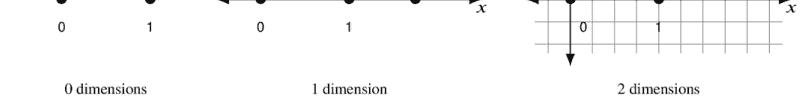

图 1.7：0、1 和 2 维中的点

这是你在学校学过的笛卡尔几何。随着我们从图 1.7 中的零维到二维，我们可以表示更多信息。以不精确的意义上说，我们有更多的工作空间。我们甚至可以将平面的几何与 *complex numbers* 联系起来，*complex numbers* 扩展了实数。我们在第 5.5 节看到它们。

现在我想让你思考将标准二维平面完全包裹在一个球体周围。如果这个要求让你觉得很奇怪，请考虑这一点：从一个球体开始，将平面平衡在上面。使平面的原点正好位于球体的北极。现在从原点开始，将平面均匀地弯曲到球体上，随着向外移动而压缩它。

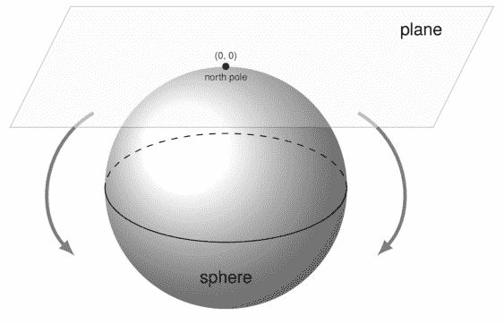

图 1.8：平衡在球体上的平面

将此进行到底，平面上的“无穷大” ∞ 位于南极。在数学术语中，这是平面对球体的立体投影。

这既令人思维变形，也令人平面变形！球体位于三维中，但我们可以将它的表面视为二维。

## 练习 1.12

我们使用以度为单位测量的经度和纬度来定位地球上的任何位置。这些是地球表面“维度”的两个坐标。看一张画有经度线的行星图像，看看它们如何随着接近两极而变近。这与通常的 xy 平面非常不同，在 xy 平面中线条保持等距。

为了固定术语，我们可以称之为函数应用电路。当我们像这样绘制它时，我们调用 **maximum**、**round** 和 “+” 函数、操作或门。

**maximum** 和 “+” 门各有两个输入和一个输出。**round** 门有一个输入和一个输出。一般来说，**round** 是不可逆的：你无法从它产生的输出答案回到其输入。

在最低层，经典计算机处理器使用逻辑运算符操纵位。这些也称为逻辑门。

最简单的逻辑门是 **not**。它将 **0** 变成 **1**，将 **1** 变成 **0**。如果你想的是布尔值而不是位，**not** 交换 false 和 true。**not** 是一个可逆门。**not**(x) 表示“**not** 应用于布尔值 x。”

## 练习 1.13

当 x 等于 **0** 和 **1** 中的每一个时，**not(not(x))** 的值是多少？

**and** 门接收两个位，如果它们都相同则返回 **1**，否则返回 **0**。

## 练习 1.14

以下每个值的取值是多少？

**and(0, 0)**
**and(0, 1)**
**and(1, 0)**
**and(1, 1)**

**or** 门接收两个位，如果其中任一为 **1** 则返回 **1**，否则返回 **0**。**xor** 门接收两个位，如果且仅有一个位为 **1** 则返回 **1**，否则返回 **0**。**xor** 是“exclusive-or”的缩写。

## 练习 1.15

以下每个值的取值是多少？

**xor(0, 0)**
**xor(0, 1)**
**xor(1, 0)**
**xor(1, 1)**

图 1.11 是一个包含两个逻辑门的逻辑电路图，用于执行简单的加法。

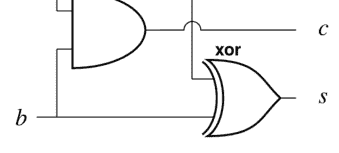

图 1.11：逻辑加法电路

用 a 和 b 的不同位值试试。确认和 s 和进位位 c 是否正确。

通过类比函数应用和逻辑情况，我们也有量子门和电路。这些操作并包括一个或多个量子位。

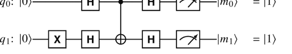

图 1.12：量子反向 CNOT 电路

这是一个包含一个量子 X 门和四个量子 H 门的 2 量子位电路。X 和 H 都是可逆门。我们稍后会介绍它们的定义和用途，但请注意 X 在我们的量子位球体模型中交换北极和南极。H 门将极点移动到球体赤道上的位置。

做过经典编程的编码者知道算术和代数是相关的。当我们引入量子计算时，几何也变得有用！

量子电路右侧看起来像拨盘的门执行量子测量。这些产生最终的位值。

电路中还有一个门，那就是 CNOT。它是量子计算中必不可少的核心门。它看起来像 q0 水平线上的一个 •，q1 线上的一个 ⊕，以及它们之间的线段。它有两个输入和两个输出。与逻辑门 and、or 和 xor 不同，它是一个可逆门。

## 练习 1.16

以函数形式书写，**CNOT** 具有以下行为。

```
CNOT(|0⟩, |0⟩) = |0⟩, |0⟩
CNOT(|0⟩, |1⟩) = |0⟩, |1⟩
CNOT(|1⟩, |0⟩) = |1⟩, |1⟩
CNOT(|1⟩, |1⟩) = |1⟩, |0⟩
```

该门有两个输出，我用逗号分隔。第一个量子位输入称为 *control*，第二个称为 *target*。

**CNOT** 在何种程度上是可逆的 xor？

量子门和电路是低级构建块，将使我们能够看到比仅靠经典方法更大的优势。随着本书的进展，你将看到量子位、量子门和量子电路。在 *第 11 章，寻找量子改进* 中，我们重点关注量子算法及其如何获得加速。

## 1.13 总结

在我的编程生涯中，我使用过数十种编程语言并创建了几种。[AXM] 当我有新的问题需要解决或正在考虑新项目时，我会研究语言如何演进和改进。对于我研究的每种语言，我都会问自己，

- • “这种语言能做我想做的事情吗？”，
- • “这种语言能比其他语言更好地做我想做的事情吗？” ，以及
- • “语言中的特殊特性和惯用法如何使我能够产生优雅的结果？”。

本章介绍了今天在编码语言中广泛使用的许多思想。它表明你可以将特性和功能与特定语言提供的功能分开思考。在下一章中，我们将具体说明 Python 如何实现这些和其他概念。


## PART I
## 认识 Python

## 2.1 数字

Python 中最常用的两种数字形式是整数和浮点数。整数不包含小数点，可以为负数、零或正数。

```python
-4
```

```text
-4
```

```python
0
```

```text
0
```

```python
837375400388826538847463290993837000004846673
```

```text
837375400388826538847463290993837000004846673
```

正如你所见，整数可以非常大。Python 使用类型 int 表示整数。我们稍后会了解更多，但通常会说“-17 是一个 int”。

浮点数，也称为 float，包含小数点，但有时系统在保留你输入的内容或计算结果时会有信息上的限制。

```python
-3.6836
```

```text
-3.6836
```

```python
17.9817359935767429962445362777253636
```

```text
17.98173599357674
```

这里当小数点右侧的位数太多，Python 无法存储时，我们丢失了精度。如果左侧位数太多，Python 会使用指数形式。

```python
100000000000000000000000000000000000000000000000000000000000.1
```

```text
1e+52
```

该结果表示 1 × 10⁵²。“.1”丢失了。

Python 允许你在数字中插入下划线以使其更易读。

```python
1_000_000_000
```

```text
1000000000
```

## 2.2 字符串

我们使用字符串表示文本。它们是字符序列。

```python
'Better a witty fool, than a foolish wit.'
```

```text
'Better a witty fool, than a foolish wit.'
```

如果我要处理《无事生非》的文本，我可以这样表示它。我用单引号在其开头和结尾分隔字符串。注意 Python 在输出中显示了单引号。你可以使用单引号或双引号作为分隔符；它们不是表示字符串及其包含字符的数据的一部分。

```python
"Some are born great, others achieve greatness."
```

```text
'Some are born great, others achieve greatness.'
```

如果你想创建一个包含单引号的字符串，请使用双引号作为分隔符。如果你的字符串包含双引号则反之。如果我两者都可以使用，我的惯例是对于长度为一的字符串使用单引号（例如 'Z'），否则使用双引号（例如 "hola" 或 ""）。

```python
"I use single quotes around single characters like 'Z'."
```

```text
"I use single quotes around single characters like 'Z'."
```

最后，你始终可以在字符串中的单引号或双引号前加上反斜杠。然后你就不必担心使用哪种分隔符了。我们称这种使用反斜杠的方式为“转义字符”。

```python
'I\'ll use a backslash in front of my single quote.'
```

```text
"I'll use a backslash in front of my single quote."
```

字符串的类型是 **str**。我们将在第 4.1 节和第 7.8 节中看到有关引号的更多使用规则，分别用于字符串和你添加到代码中的描述。

## 2.3 列表

如果我们只能写下数字和字符串，Python 就不会是一个实用的编程环境。当然，我们希望对数字执行加法、乘法等操作，并用它们来计数。对于字符串，我们希望搜索并构建向用户显示的文本。

更重要的是，我们需要一种方法将数据集合在一起。如果我有三个孩子，我可以将他们的年龄作为一个列表保存在一起：

```python
[12, 16, 19]
```

```text
[12, 16, 19]
```

并用另一个列表保存他们的名字：

```python
["Robin", "Robert", "Roberta"]
```

```text
['Robin', 'Robert', 'Roberta']
```

我可以将名字和年龄放在同一个列表中：

```python
["Robin", 12, "Robert", 16, "Roberta", 19]
```

```text
['Robin', 12, 'Robert', 16, 'Roberta', 19]
```

方括号 “[” 和 “]” 分隔列表中的项目。Python 使用类型 **list** 表示列表。

这样不断重复数据很笨拙。使用变量是引用和使用信息更好的方式。

## 2.4 变量

### 2.4.1 命名规则

标识符和命名变量的规则很简单：

- 1. 你可以在名称的任何部分使用大写字母 A-Z。
- 2. 你可以在名称的任何部分使用小写字母 a-z。
- 3. 你可以在名称的任何部分使用下划线 "_"。
- 4. 你可以在名称的任何部分使用数字 0-9，但不能在第一位。

名称 revenue_2021 是有效的，但 2021_revenue 不是。Python 对变量名 "_" 以及以或以下划线结尾的名称有约定。我们将在第 6.3 节讨论函数参数时以及第 7.2 节讨论类中的方法时看到它们。

### 2.4.2 列表解包

让我们看一种表达式，其中你拆分一个列表并将各部分分配给变量。赋值

```python
robins_age, roberts_age, robertas_age = ages
```

将第一个值赋给 robins_age

```python
robins_age
```

```text
12
```

并将其他值赋给 roberts_age 和 robertas_age。

```python
roberts_age
```

```text
16
```

```python
robertas_age
```

```text
19
```

这个例子展示了列表解包，我们将在第 3.2.9 节详细讨论它。

### 2.4.3 多重赋值

我们可以将多个赋值合并为单个语句。

```python
a = b = 10
a
```

```text
10
```

```python
b
```

```text
10
```

这将相同的值赋给变量 a 和 b。我们也可以将多个值赋给多个变量。

```python
m, n = 17, 6
```

### 练习 2.1

运行以下代码后，m 和 n 的值是多少？

```python
m, n = 17, 6
m, n = n, m
```

这是同时赋值。

### 练习 2.2

以下是否与上一个示例的工作方式相同？为什么？

```python
m, n = 17, 6
m = n
n = m
```

这是顺序赋值。

## 2.5 真与假

在第 1.1 节中，我们看到如何将位 0 和 1 视为布尔值 false 和 true。在 Python 中，我们将它们表示为 False 和 True。

not 运算符会反转它们。

```python
not True
```

```text
False
```

```python
not False
```

```text
True
```

| `and` | boolean_2 = `False` | boolean_2 = `True` |
|---|---|---|
| boolean_1 = `False` | `False` | `False` |
| boolean_1 = `True` | `False` | `True` |

图 2.1：“and”的布尔真值表

选择第二列中的 boolean_1 的一个值，第二行中的 boolean_2 的一个值，然后找到列与行相交处的结果。

对于 or，

```python
boolean_1 or boolean_2
```

如果 boolean_1 或 boolean_2 中任一为 True，则返回 True，否则返回 False。

### 练习 2.3

完成图 2.2 中 or 的真值表。

| `or` | boolean_2 = `False` | boolean_2 = `True` |
|---|---|---|
| boolean_1 = `False` |  |  |
| boolean_1 = `True` |  |  |

图 2.2：“or”不完整的布尔真值表

Python 使用 “^” 符号表示“异或”。

```python
boolean_1 ^ boolean_2
```

如果恰好 boolean_1 和 boolean_2 中有一个为 True，则返回 True，否则返回 False。（在我美国英语键盘上，“^” 是 Shift-6。）

### 练习 2.4

完成图 2.3 中异或 “^” 的真值表。

| `^` | boolean_2 = `False` | boolean_2 = `True` |
|---|---|---|
| boolean_1 = `False` |  |  |
| boolean_1 = `True` |  |  |

图 2.3：“xor”不完整的布尔真值表

数值比较是用于条件语句中布尔结果的常见来源。

```python
3 < 4
```

```text
True
```

```python
-3 <= -4
```

```text
False
```

```python
20 > -6
```

```text
True
```

```python
0 >= 0.01
```

```text
False
```

这些示例展示了“小于”、“小于或等于”、“大于”和“大于或等于”。

## 2.6 算术

如果我们要把 Python 视为超级计算器，我们必须执行基本的算术运算。我们用通常的方式用 “+”、“-” 和 “-” 分别写加法、取负和减法。

```python
m, n = 17, 6
```

```python
m + n
```

```text
23
```

```python
-n
```

```text
-6
```

```python
n - m
```

```text
-11
```

键盘上没有乘法符号 “×”，所以我们使用星号 “*”。

```python
m * n
```

```text
102
```

浮点数具有传染性。一旦你使用小数点，后续的算术运算通常会作为 float 进行。

```python
5 * 3.4
```

```text
17.0
```

```python
5 * 3.0
```

```text
15.0
```

Python 在比较 int 和 float 数字时会尽力做正确的事情。我们使用 “==” 运算符测试相等性。

```python
a = 10000000000000000000
```

```python
b = 10000000000000000000.
```

```python
a == b
```

```text
True
```


## 使用表达式

处理 **float** 时要当心舍入误差。

```
10000000000000000000 == 10000000000000000000.1
```

True

Python 文档描述并解释了这种行为。 [PYD] [PYT] 在可能的情况下坚持使用整数，因为它们可以任意大。使用任何编程语言，你都需要理解处理浮点数的规则。这在 Microsoft Excel® 等应用程序中也是如此。

### 2.6.1 除法和幂运算

在上述前提下，除法的工作方式与你预期的相同，使用两个浮点数，或一个 **float** 和一个 **int**。

```
2.75/4.0
```

0.6875

```
2.75/4
```

0.6875

除两个整数时要小心。如果使用“/”，你会得到一个 **float**。

```
11/4
```

2.75

```
-13/5
```

-2.6

如果想要整数商怎么办？由于 11 除以 4 不是整数，我们有一个余数。具体来说，11 除以 4 是 2 余 3：2 * 4 + 3。我们使用两个斜杠的除法运算符“//”表示整数商，使用百分号“%”表示余数。

```
11 // 4
```

2

```
11 % 4
```

3

如果需要商和余数两个值，同时计算效率低下。使用 divmod 函数来同时获取两者。

```
quotient, remainder = divmod(-13, 5)
```

```
quotient
```

-3

```
remainder
```

2

```
quotient * 5 + remainder
```

-13

我们使用 "**" 进行幂运算。代码 b**n 是 bⁿ。bⁿ 在 n 为负数时等于 1/(b⁻ⁿ)。

```
4**3
```

64

```
4**-3
```

0.015625

```
1/(4**3)
```

0.015625

### 2.6.2 内置函数

我们定义 int 或 float x 的绝对值 |x| 为非负数

-  x 为零时为 0，
-  x 为正时为 x，或
-  x 为负时为 −x。

*abs* 函数在 Python 中实现了这一点。

```
abs(78.3)
```

78.3

```
abs(0)
```

0

```
abs(-3)
```

3

绝对值的图像在图 2.4 中。

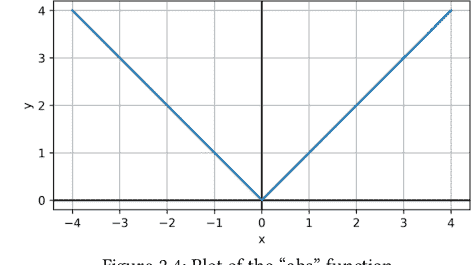

图 2.4： “abs” 函数的图像

大多数数学函数都在 Python 模块中，你必须将它们导入到你的环境中。我们在第 5.1 节讨论模块。

*abs* 和少数其他函数是内置的，你可以直接使用它们。*round* 函数有两种形式。第一种形式将其四舍五入到最接近的 *int*。

```
round(2.7)
```

3

```
round(-7.51)
```

-8

# 练习 2.5

*round* 对恰好介于两个整数之间的值会做什么？round(7.5) 和 round(-67.5) 的结果是什么？round 的规则是什么？

在第二种形式中，round 接受第二个参数，一个 int，表示应四舍五入到的位数。

```
round(2.71828, 2)
```

2.72

当第二个参数不为负时，int 仍会四舍五入到自身。

```
round(714, 0)
```

714

```
round(714, 2)
```

714

你可能会惊讶地发现第二个参数可以为负。

```
round(714, -2)
```

700

```
round(83567356.3846, -5)
```

83600000.0

# 练习 2.6

解释最后两个示例中发生了什么。

如果你尝试对第二个参数使用非 int 数字，Python 会停止计算并显示错误消息。

```
round(3.73, 2.1)

Traceback (most recent call last):
    File "<stdin>", line 1, in <module>
TypeError: 'float' object cannot be interpreted as an integer
```

回溯是显示导致错误发生的嵌套函数调用序列。Python 正在读取“标准输入”，也称为“stdin”，以查看你输入的内容。最后，错误消息会显示，并提供问题的详细信息。从这一点开始，我通常只显示回溯中的错误消息。

## 使用表达式

# 练习 2.7

当你输入 `1/0` 时会看到什么错误？

在第 1.3 节中，我介绍了一个接受两个数字的 **maximum** 函数。Python 将其实现为 *max*。要获取最小值，请使用 *min*。

```
```python
max(0, 19.7)
```
```

19.7

```
```python
min(0, 19.7)
```
```

0

你不限于两个数字。

```
```python
max(0, 19.7, -8, 33.2)
```
```

33.2

```
```python
min(0, 19.7, -8, 33.2)
```
```

-8

你也可以使用列表作为这些函数的唯一参数。

```
```python
max([0, 19.7, -8, 33.2])
```
```

33.2

```
```python
min([0, 19.7, -8, 33.2])
```
```

-8

# 练习 2.8

展示 *sum* 如何使用我们为 *max* 和 *min* 编码的相同形式的自变量。为什么 `max([])` 会出错而 `sum([])` 不会？

我在 *第 5 章 计算与计算* 中详细介绍了数字和数学函数。

### 2.6.3 运算赋值

Python 提供了一种将赋值与加法等运算结合起来的简写方式。假设我们将 count 初始化为零：

```
count = 0
count
```

0

而不是先加法再赋值，

```
count = count + 1
count
```

1

你可以同时进行：

```
count = 0
count += 1
count
```

1

这种简写适用于许多 Python 运算符，包括我们迄今为止看到的算术运算符：“+”、“-”、“*”、“/”、“//”和“**”。我们称这种简洁方便的表达式写法为“语法糖”。

# 练习 2.9

在这个表达式序列中，count 的最终值是多少？在运算赋值后中间值是多少？

```
count = 1
count += 3
count *= 7
count -= 5
count //= 4
count **= 2
```

从 count = -2 开始时，count 的中间值和最终值是多少？

### 2.7 字符串操作

在本节中，我们使用莎士比亚《哈姆雷特》中的这一行片段：

```
quote = "perchance to dream"
quote
```

'perchance to dream'

由于我们需要多次使用它，让我们保存 **str** 中的字符数。

```
quote_length = len(quote)
quote_length
```

18

### 2.7.1 访问字符

第一个字符的索引为 0，最后一个为 quote_length - 1。

```
quote[0]
```

'p'

```
quote[quote_length - 1]
```

'm'

如果你尝试访问超出此最终有效索引的字符，Python 会引发错误。

```
quote[quote_length]
```

IndexError: string index out of range

# 练习 2.10

如果你尝试在空字符串中访问索引 0 的字符会发生什么？

如果使用负整数作为索引，Python 会做一些有趣的事情。

```
quote[-1]
```

'm'

使用索引 -1 是访问字符串中最后一个字符的简写。它从末尾向后计数。这向后计数到第一个位置：

```
quote[-quote_length]
```

'p'

不过，你不能走得太远，否则就会超出有效索引范围。

```
quote[-quote_length - 1]
```

IndexError: string index out of range

图 2.5 显示了引语中字符的有效索引。

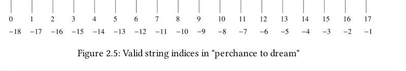

# 练习 2.11

设 string_index 为一个变量，保存你希望在像 quote[string_index] 这样的表达式中访问的索引。x 和 y 在

x ≤ string_index ≤ y

中是什么，如果 string_index 是有效索引？

### 2.7.2 搜索子字符串

使用 find 在 str 中定位特定文本。

```
quote

'perchance to dream'
```

```
quote.find("dream")

13
```

该结果表示 "dream" 在索引 13 处。我们说 "dream" 是 "perchance to dream" 的子字符串。它还说明了一种我们尚未见过的函数应用形式。在这种情况下，find 是类 str 中的方法，因此对该类的对象操作。格式为

```
object.method_name(argument₁, argument₂, ...)
```

你可以有零个或多个参数，但必须有括号。在我们的示例中，

- object 是 quote，
- method_name 是 find，且
- argument₁ 是 "dream"。

由于 "dream" 存在于 quote 中，我们说 "dream" 是 quote 的子字符串。如果 find 的参数不在字符串中，该方法返回 -1。

```
quote.find("snooze")
```

-1

字符串上的 find 方法在 Python 中定义为有三个参数，最后两个有默认值。

```
string_to_be_searched.find(string_to_be_found, start_index, end_index)
```

start_index 的默认值是 0：如果你不包含它，Python 假定它是 0。如果你为 start_index 提供显式值，你也可以为 end_index 提供值。否则其默认值是 len(string_to_be_searched)。我们从索引 start_index 搜索到但不包括 end_index。

```
quote
```

'perchance to dream'

```
quote.find('a', 7)
```

16

```
quote.find('a', 3, 8)
```

5

```
quote.find('a', 0, 4)
```

-1


如果你只想知道一个**字符串**是否包含在另一个字符串中，请使用 **in**。

```
"dream" in quote
```

True

```
"nightmare" in quote
```

False

要测试一个字符串是否不包含在另一个字符串中，请使用 **not in**。

```
"Hamlet" not in quote
```

True

## 2.7.3 切片和提取子字符串

我们刚刚看到了如何访问单个字符以及如何在**字符串**中查找子字符串的位置。我们使用 *切片表示法* 来提取字符串的一部分，并将其作为新字符串返回。

以我们的 quote 为例：

```
quote
```

'perchance to dream'

我们执行以下操作来提取从索引 3 开始、长度为 6 的子字符串：

```
quote[3:9]
```

'chance'

冒号前面的数字是起始索引，冒号后面的数字是起始索引加上子字符串长度。表达式 **quote[3:9]** 的意思是：

> 从索引 3 开始，收集 quote 中
> 该索引以及所有小于 9 的有效索引处的字符。


与加法类似，我们可以使用乘法来重复字符串多次。

```
3 * text
```

'la la la '

```
10 * text
```

'la la la la la la la la la la '

```
0 * text
```

''

Python 提供了多种将数据和文本格式化为字符串的方式。最新的一种称为格式化字符串字面量，或者更简单地说，称为 f-string。

要创建 f-string，请在起始引号定界符前加上 f 或 F。在字符串内部，花括号“{”和“}”中的任何表达式都会被求值，结果会被粘贴回字符串的相应位置。

```
a = 2
b = 5
f"The sum of a and b is {a + b}"
```

'The sum of a and b is 7'

如果你不在 f-string 中求值表达式，就不要使用它们，因为 Python 会浪费时间扫描花括号。我经常将 f-string 与 print 函数一起使用，来格式化显示给用户的信息。

我将在第 4 章“字符串伴你同行”中更详细地介绍字符串及其操作。

## 2.8 列表操作

你可以在列表上执行许多与字符串相同的操作，包括切片。

```
years = [2021, 1983, 1976, 1997, 1990]
years
```

[2021, 1983, 1976, 1997, 1990]

```
len(years)
```

5

```
years[0]
```

2021

```
years[-2]
```

1997

```
years[1:3]
```

[1983, 1976]

字符串和列表之间的一个主要区别是，你可以更改列表中的元素：列表是可变的。

```
years[0] = 2000
years
```

[2000, 1983, 1976, 1997, 1990]

对于字符串，任何修改都必须构造一个新的、不同的字符串。字符串是不可变的，这意味着你不能更改它们的结构或内容。我可以让一个变量指向新字符串，但我不能更改字符串对象本身。

```
letters = "abcd"
letters
```

'abcd'

```
letters[0] = "A"
```

TypeError: 'str' object does not support item assignment

```
letters = "A" + letters[1:]
letters
```

'Abcd'

既然我们知道可以更改列表，我们就可以看看一些原地修改列表的操作和方法。

```
years = [2021, 1983, 1976, 1997, 1990]
years
```

[2021, 1983, 1976, 1997, 1990]

“+” 运算符将两个列表拼接成一个新列表。

```
years + [1961, 1980]
```

[2021, 1983, 1976, 1997, 1990, 1961, 1980]

```
years
```

[2021, 1983, 1976, 1997, 1990]

*扩展* 方法将第二个列表中的元素追加到第一个列表元素的后面。

```
years.extend([1961, 1980])
years
```

[2021, 1983, 1976, 1997, 1990, 1961, 1980]

使用 *追加* 方法将新元素放置在**列表**的末尾。

```
years.append(2012)
years
```

[2021, 1983, 1976, 1997, 1990, 1961, 1980, 2012]

程序员在处理信息和构建数据列表时经常这样做。例如，他们可能以编程方式扫描收入报告，并列出所有收入超过 100 万美元的年份。

*插入* 方法将新元素放置在指定索引处。该索引及更高索引处的所有元素都会向右移动一位。此示例将数字 100 插入到第二个位置。请记住：第二个位置的索引是 1。

```
years.insert(1, 1812)
years
```

[2021, 1812, 1983, 1976, 1997, 1990, 1961, 1980, 2012]

我们可以使用 *弹出* 方法再将其取出。

```
years.pop(1)
```

1812

```
years
```

[2021, 1983, 1976, 1997, 1990, 1961, 1980, 2012]

如果你不带参数使用 *弹出*，它会移除并返回列表中的最后一个元素。从这个意义上说，它与 *追加* 相反。

```
years.pop()
```

2012

```
years
```

[2021, 1983, 1976, 1997, 1990, 1961, 1980]

我将在 3.2 节中详细介绍列表及其操作。

## 2.9 打印

到目前为止，我们只看到了 Python 显示对象或表达式求值后的值。

```
"This is a sample string"
```

'This is a sample string'

如果你是向代码的使用者显示信息，则需要更复杂的工具来从数据生成文本。*打印* 函数是一种将字符串和对象组合成可读形式的通用方法。

在最简单的形式中，*打印* 接受一个**字符串**，或一个可以转换为**字符串**的对象，并将其显示在控制台上。Python 不会显示定界引号。

```
print("This is a sample string")
```

This is a sample string

```
print(17 + 4)
```

21

你可以一次打印多个对象，Python 会用空格分隔它们。

```
print(57, 99, -4.3)
```

57 99 -4.3

### 2.9.1 拼接字符串

你可以在 print 中使用 “+” 拼接字符串。以这种方式连接字符串时，请对任何非字符串对象使用 str。

```
print("Last year's revenue was " + "3" + " million euros")
```

Last year's revenue was 3 million euros

```
print("Last year's revenue was " + 3 + " million euros")
```

TypeError: can only concatenate str (not "int") to str

```
print("Last year's revenue was " + str(3) + " million euros")
```

Last year's revenue was 3 million euros

### 2.9.2 f-字符串

更好的是，使用 f-string。

```
print(f"Last year's revenue was {3} million euros")
```

Last year's revenue was 3 million euros

在这种情况下，我们可以在花括号内编写表达式或函数调用。

```
print(f"Last year's revenue was {revenue(2020)} million euros")
```

Last year's revenue was 3 million euros

我在这里没有定义 revenue，但你可以假设它能访问数据库，或者从列表或其他数据结构中获取结果。

我们在 2.2 节中看到，可以在字符串中使用与定界符相同类型的引号：

```
"Don't use \"odd\" quoted words in your prose."
```

'Don\'t use "odd" quoted words in your prose.'

Python 在输出中插入了一个反斜杠来转义单引号。

### 2.9.3 换行符

这就是通过在字符前插入反斜杠来*转义*字符。另一个例子是在**字符串**中放置换行符：使用 '\n' 插入换行。

```
"See how I broke\nthis line?"
```

```
'See how I broke\nthis line?'
```

当你打印这个字符串时，换行是显而易见的。

```
print("See how I broke\nthis line?")
```

```
See how I broke
this line?
```

空格和换行是字符串中*空白字符*的示例。

默认情况下，*打印* 在显示输出后会插入一个换行符。你可以使用可选的*关键字参数* end 来将其改为其他内容。end 最常见的值是空格 ' ' 和空字符串 ""。

```
print("First string")
print("Second string")
```

```
First string
Second string
```

```
print("First string", end=' ')
print("Second string")
```

```
First string Second string
```

默认行为使用换行符 '\n' 作为 end。我们将在 6.5 节中学习更多关于关键字参数的内容。

## 2.10 条件语句

条件语句是这样一种语句：“如果这是真的，就做那件事，否则就做另一件事。” 我们需要自己决定“这”、“那件事”和“另一件事”的含义。

条件语句会改变执行流程。条件语句不是按顺序逐个求值表达式，而是允许我们根据某个条件是否为真来分支执行不同操作。


虽然在这个示例中我们需要 else 子句，但如果你不需要，也可以不包含它。你可能只想在条件为真时做某事，然后继续执行。

```
if number_of_shortbread_cookies == 0:
    print("Shortbread cookies are out of stock.")

if number_of_sugar_cookies == 0:
    print("Sugar cookies are out of stock.")
```

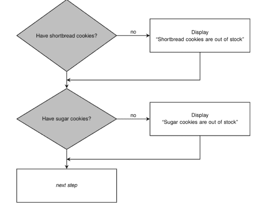

图 2.8：酥饼和砂糖饼干流程图

### 2.10.2 “elif”

一个或多个 elif 子句也是可选的。elif 是“else if”的缩写。

```
if number_of_shortbread_cookies > 0:
    print("Here is a shortbread cookie.")
elif number_of_sugar_cookies > 0:
    print("Here is a sugar cookie.")
else:
    print("Sorry, I have no cookies to give you.")
```

### 练习 2.15

为这个 `elif` 示例绘制流程图。

你可以随意使用任意数量的 `elif` 子句，但在超过三四个之后，可能有更高效的方式来编写代码。

Python 在条件中判断真假时非常灵活，除了字面量或计算出的布尔值 `True` 和 `False` 之外。

- 数字 0（或 0.0）为假，所有其他数字为真。
- 空列表为假，但包含任意元素的列表为真。
- 空字符串 `""` 为假，所有其他字符串为真。

假设 `cookies_in_stock` 是我们可以购买到的饼干种类列表。

```
cookies_in_stock = ["shortbread", "sugar", "oatmeal"]

if not cookies_in_stock:
    print("We are out of cookies.")
```

该条件不为真，因此 Python 不会显示这条消息。你应该总是使用这种形式来测试列表是否为空，而不是计算其长度并与 0 比较。

## 2.11 循环

当条件为真时，我们使用循环来重复执行某个动作或一组动作。

### 2.11.1 while

假设我们想要知道小于或等于 5 的正整数之和。直接输入并计算对你来说并不难。

```
1 + 2 + 3 + 4 + 5

15
```

我使用了一个 f-string，在花括号内放置了一种新的表达式。如果你在变量后面加上等号“=”，Python 会同时打印出变量的名称和值。“=”两边的空格是可选的，但为了可读性我加上了。

### 练习 2.17

重写对 print 的调用，以获得等效的输出，但只使用 {count} 和 {sum}。

### 2.11.2 break

break 关键字允许你立即退出循环。

```
sum, count = 0, 1

while True:
    sum += count
    count += 1
    if count > 500:
        break

sum
```

```
125250
```

代码 `while True` 表示：“以下代码应无限重复，直到发生某些事情来停止重复。”而 break 就是那个“某些事情”。

### 练习 2.18

在这个 while 循环中，我们执行了多少次加法运算？

我觉得带有终止条件和 break 埋在代码中的 while 循环，比上面第一个版本更难阅读和调试。你的目标应该是让任何看一眼你代码的人都能尽快看出它在做什么。

### 2.11.3 continue

continue 关键字告诉 Python：“停止你正在做的事情，立即返回到循环顶部，即测试条件之前的位置。”下面的代码将小于或等于 500 的奇数相加：

```
sum, count = 0, 1

while count <= 500:
    if count % 2 == 0:
        count += 1
        continue

    sum += count
    count += 1

sum
```

```
62500
```

请注意我是如何用取余运算符 % 来判断 count 是否为偶数的。

### 练习 2.19

你会如何测试 count 是否为奇数？你会如何测试 count 是否能被 5 整除？

### 2.11.4 for 循环

如果要在值序列上迭代，for 循环通常比 while 循环简洁得多。我们经常使用 range 函数来生成一个整数序列，该序列从第一个参数开始，到第二个参数之前结束（不包括第二个参数）。

```
sum = 0

for count in range(1, 501):
    sum += count

sum
```

```
125250
```

我们将 sum 初始化为零，并将 count 从值 1 开始。这是 range 的第一个参数。当 count 小于 501（range 的第二个参数）时，我们重复 for 循环的主体。

我们可以给 range 提供第三个参数，即步长。如果只提供一个参数，起始 int 默认为 0，步长默认为 1，给定的数字是结束值。提供两个参数时，步长默认为 1。

```
sum = 0

for count in range(1, 501, 2):
    sum += count

sum
```

```
62500
```

这里我们遍历了大于或等于 1 且小于 501 的奇数。

### 练习 2.20

range 的第一个参数不必小于第二个参数，参数可以是任意整数，包括负数。编写一个 for 循环，在一行中打印 5, 4, 3, 2, 1。首先按指定顺序打印这些数字，然后试验一下 print。

使用 for 来遍历列表中的元素或字符串中的字符。

```
for year in [2020, 2022, 2025, 2026]:
    print(year)
```

```
2020
2022
2025
2026
```

```
for character in "abc":
    print(character)
```

```
a
b
c
```

表达式 range(0, x) 等价于 range(x)。这里我们展示一个给定字符串从第一个字符开始的子串：

```
string = "Zdrasti"

for index in range(len(string)):
    print(string[0:index + 1])
```

```
Z
Zd
Zdr
Zdra
Zdras
Zdrast
Zdrasti
```

请仔细研究这个示例，因为它汇集了 Python 的几个非常有用的特性和函数。

### 练习 2.21

修改这个示例，使其展示以最后一个字符结尾的字符串子串。

Python 最让我喜欢的地方之一是可以用 for 循环来构建列表。下面的示例是一个列表推导式，它创建了前五个平方数的列表：

```
[x*x for x in range(1, 6)]
```

```
[1, 4, 9, 16, 25]
```

我们将在 3.5 节再次讨论这些内容。

## 2.12 函数

在本节中，我们将本章的许多技术组合成函数的示例。

### 2.12.1 一个简单的函数

下面的 Python 代码是一个 *identity*（恒等）函数的定义：

```
def identity(x):
    return x
```

*identity* 接受一个参数 x，不对它做任何操作，直接返回它。

函数定义以 def 开头，后跟函数名。之后，我们在括号中列出零个或多个命名参数。我们以冒号结尾。函数体从下一行开始，并缩进。

由于我编写 *identity* 的方式，它不关心 x 的类型。它是重载的，可以处理任何类型的输入。

```
identity(7)
```

```
7
```

```
identity("just a string")
```

```
'just a string'
```

```
identity(["one", 2, 3.0])
```

```
['one', 2, 3.0]
```

*identity* 的定义定义了 *参数* x。参数是在函数调用时被赋值为 *实参* 值的变量。在 identity(7) 中，参数 x 被赋值为实参 7。

一个更有趣的函数是“加倍”其输入的函数。

```
def double(x):
    return 2 * x
```

```
double(7)
```

```
14
```

为明确思路，让我们先考虑一个数字列表。我们要操作这个列表，将其中最小的数字移动到索引 0 处。在编写函数之前，先编写一些测试代码。这是列表：

```
numbers = [3, 2, 1, 4]
```

下面是将最小数字渗透到第一个位置的代码。注意循环、条件语句和同时赋值。

```
for index in range(1, 4):
    if numbers[0] > numbers[index]:
        numbers[0], numbers[index] = numbers[index], numbers[0]

numbers
```

```
[1, 3, 2, 4]
```

### 练习 2.23

在 range 函数调用中，1 和 4 是什么？

结果符合预期。图 2.9 展示了代码是如何转换这个列表的。你可以看到最小的数字 1 是如何被移到列表开头的。只需要两次交换，我用末端带有圆圈的线段表示这些交换，

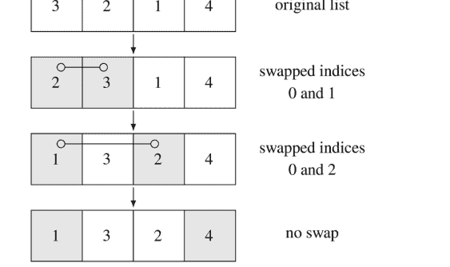

图 2.9：排序时列表项的移动


现在，我们将这段代码封装到一个函数中，并允许传入参数。

```
```python
def least_first(items):
    for index in range(1, len(items)):
        if items[0] > items[index]:
            items[0], items[index] = items[index], items[0]
    return items

least_first([3, 2, 1, 4])
```
```

```
```text
[1, 3, 2, 4]
```
```

```
```python
least_first([5, -1, 8, -3, 0])
```
```

```
```text
[-3, 5, 8, -1, 0]
```
```

这种技术效果不错，但如果列表只有一个项或为空呢？我们会不会遇到错误？

```
```python
least_first([10])
```
```

```
```text
[10]
```
```

```
```python
least_first([])
```
```

```
```text
[]
```
```

这些*边界情况*之所以有效，是因为 *range* 的工作方式，以及我们没有对空列表访问 `items[0]`。

变量 `items` 和 `index` 都*局部于* `least_first`。我没有在 Python 环境中定义它们，因此在那里它们是未知的。

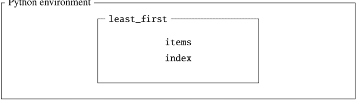

图 2.10：“least_first”函数中的局部变量

```
```text
items
```
```

```
```text
NameError: name 'items' is not defined
```
```

虽然你应该尽量为变量使用描述性名称，但程序员通常使用 i、j、k 作为索引，我在这个函数定义中也是如此。

# 练习 2.24

请记住，`range` 可以返回一个 `int`，其范围直到第二个参数（但不包括它）。为什么这个第二个参数对于 i 是 `len(items) - 1`，而对于 j 是 `len(items)`？

# 练习 2.25

如果要按降序对列表排序，你会更改什么？请向 `selection_sort` 添加一个布尔值参数，以允许用户选择排序顺序。

# 练习 2.26

对于我们最初的 `selection_sort`，计算它对以下每个列表进行的比较次数和项目交换次数。

```
[]
[5]
[5, 4]
[5, 4, 3]
[5, 4, 3, 2]
[5, 4, 3, 2, 1]
```

在函数中加入 `print` 调用来显示这些计数。你能看出一种模式吗？

为什么你会认为这些是给定长度的数字列表排序的“最坏情况”？

# 2.12.4 嵌套函数定义

你可以在一个函数内部定义另一个函数。这里我在 `nested_selection_sort` 中定义了嵌套函数 `test_and_swap`。

```
def nested_selection_sort(items):
    def test_and_swap(first_index, second_index):
        if items[first_index] > items[second_index]:
```

```
```python
recursive_selection_sort([3, 2, 1, 4])

[1, 2, 3, 4]
```
```

如果你只用一个参数（数字列表）调用 *recursive_selection_sort*，Python 会给第二个参数 *first_index* 赋值 0。按照惯例，我们省略等号“=”两侧的空格。我们将在 6.12 节重新回到递归。

虽然我一直在展示我们函数的代码，但我也应该插入注释。这些注释可以让其他程序员理解代码的作用、改进代码，甚至修复它。在 7.7 节中，我讨论了注释 Python 代码所用的惯例。任何以井号“#”开头的行都是注释，Python 不会执行它。

```
```python
def do_nothing():
    # do_nothing does nothing whatsoever
    pass
```
```

当语法要求必须有表达式，但我们又不想求值任何内容时，请使用 *pass* 关键字。它的存在通常本身就有说明作用。

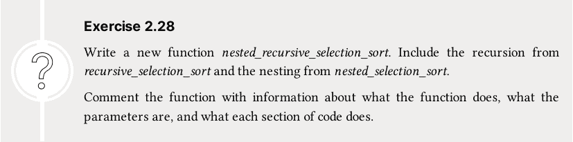

# 2.13 小结

在本章中，我们考察了*第 1 章：做程序员该做的事*中提到的编程语言的许多通用特性，并看到了 Python 如何实现它们。我在这里的讲解是对 Python 部分核心功能的概览。本部分的其余章节将进行更深入、更广泛的探讨。第 II 部分和第 III 部分会介绍许多高阶特性和库，正是这些让 Python 在编码环境中独占鳌头。

这些不同的方案会影响从收藏中检索特定吉他的难易程度。在第一种和第三种情况下，你可能需要查看每一把吉他才能找到你需要的那把。在第二种情况下，你只需要从左边开始向右移动，直到找到那把吉他，或者看到某个型号名称按字母顺序排在你所寻找的吉他之后。

你还可以更聪明，直接看收藏中间的那把吉他。如果这正是你要找的吉他，那就完成了。如果你的型号在它之前，只需要搜索吉他的前半部分；如果在它之后，就搜索后半部分。在你选定的那一半中重复这种搜索。

与吉他一样，Python 中的集合有不同的存储和检索方案。对于给定的用途，它们的效率各有高低。在本章中，我们研究 Python 中的三种核心集合类型：列表、字典和集合。在此过程中，我们会遇到*元组*，在 2.4 节进行多重赋值时我们已经见过了。

# 本章涵盖的主题

+   3.1 三大集合 ......................................................... 78
+   3.2 列表 ......................................................... 80
+   3.3 O(1) 的乐趣 ......................................................... 99
+   3.4 元组 ......................................................... 100
+   3.5 推导式 ......................................................... 104
+   3.6 “Pythonic”是什么意思？ ......................................................... 106
+   3.7 嵌套推导式 ......................................................... 107
+   3.8 并行遍历 ......................................................... 109
+   3.9 字典 ......................................................... 110
+   3.10 集合 ......................................................... 119
+   3.11 小结 ......................................................... 126

# 3.1 三大集合

在 2.3 节中，我非正式地介绍了列表。这些是类型为 `list` 的对象，可以包含任何类型的项。我们通过 `int` 索引访问它们。它们是可变的，并且按定义的顺序排列。在图 3.1 中，左侧的列表包含六个项，其中两个是重复的。

```
try_try(20)
```

Whoops, something went wrong.
We can finalize processing here.
1

这里的 `except`：捕获被求值代码中引发的任何类型的异常。在指定要捕获的异常时，你应该尽可能具体。除了几十个内置的 Python 异常之外，你还可以定义自己的异常。让我们编写一个带有几个 except 子句的简单函数。

```
def error_tester(index, divisor):
    try:
        print(brands[index // divisor])
    except IndexError as error:
        print(f"Index problem:\n'{error}'")
    except ZeroDivisionError:
        print("Did you mean to divide by 0?")
    except:
        print("Something unexpected happened.")
```

```
error_tester(6, 1)
```

Index problem:
'list index out of range'

```
error_tester(2, 0)
```

Did you mean to divide by 0?

```
error_tester(4, "hello")
```

Something unexpected happened.

# 练习 3.1

计算 brands[2/1]。会引发什么类型的错误？

Python 标准库列出了完整的內置异常集。[PYL] 注意我是如何使用 `as error` 来存储 Python 随异常提供的信息的。`error` 的值可以帮助你判断异常被引发的原因。

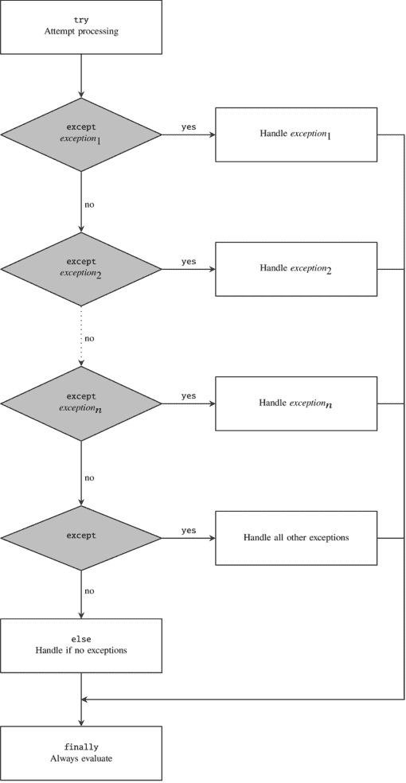

图 3.2：Python 异常处理通用形式的流程图

图 3.2 展示了 Python 异常处理的一般流程。正如我们将在下一节看到的，除了捕获不良行为之外，你还可以将异常作为一种编码风格来使用。

# 3.2.4 删除列表项

让我们回想一下电吉他品牌名称列表，并复制一份，以便以后使用原列表：

```
brands = [
    "Fender",
    "Gibson",
    "Ibanez"
]
brands_2 = brands

print(f"{brands = }")
print(f"{brands_2 = }")
```

brands = ['Fender', 'Gibson', 'Ibanez']
brands_2 = ['Fender', 'Gibson', 'Ibanez']

我还把 brands 赋值给了 brands_2，我们很快就会明白为什么。

让我们删除列表项 “Ibanez”。通过检查可以看出它位于索引 2。Python 使用 del 删除列表项。

```
del brands[2]
print(f"{brands = }")
print(f"{brands_2 = }")
```

brands = ['Fender', 'Gibson']
brands_2 = ['Fender', 'Gibson']

brands 改变了，brands_2 也随之改变！当我执行赋值 brands_2 = brands 时，我不是在创建两个列表，而是给同一个列表起了两个名字。因此，当我修改底层列表时，无论我们用 brands 还是 brands_2 引用它，我们都能看到变化。

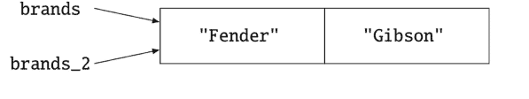

图 3.3：两个变量引用同一个列表对象


作为 `del` 的替代方法，使用 pop 列表方法。

```
brands.pop(0)
```

'Fender'

```
brands
```

['Gibson']

```
brands.pop()
```

'Gibson'

pop 返回被移除的项，而 del 不会。如果使用 pop 且不带参数，它会返回列表非空时的最后一项。

由于我将展示几种移除项的技术，让我们创建两个具有相同吉他品牌的列表。

```
brands = [
    "Fender",
    "Gibson",
    "Ibanez"
]

original_brands = brands.copy()
```

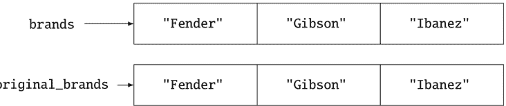

图 3.4：引用列表两个副本的变量

如果我们不知道 "Ibanez" 是否在列表中或其位置，可以使用 *index* 方法来定位第一次出现的位置。

```
```python
brands.index("Ibanez")
```

2
```

如果该项不在列表中，*index* 会引发异常：

```
```python
brands.index("Gretsch")
```

ValueError: 'Gretsch' is not in list
```

一种从列表中移除 "Ibanez" 的方法是捕获异常：

```
```python
try:
    del brands[brands.index("Ibanez")]
    print("'Ibanez' was present and was removed")
except ValueError:
    print("'Ibanez' was not present and so not removed")

brands
```

'Ibanez' was present and was removed
['Fender', 'Gibson']
```

```
```python
brands = original_brands.copy()

try:
    del brands[brands.index("Gretsch")]
    print("'Gretsch' was present and was removed")
except ValueError:
    print("'Gretsch' was not present and so not removed")

brands
```

'Gretsch' was not present and so not removed
['Fender', 'Gibson', 'Ibanez']
```

## 练习 3.4

clear 函数会从列表中移除所有项。解释以下行为之间的差异

```
a = [1, 2, 3]
b = a
a = []
print(f"{a = }")
print(f"{b = }")
```

a = []
b = [1, 2, 3]

和

```
a = [1, 2, 3]
b = a
a.clear()
print(f"{a = }")
print(f"{b = }")
```

a = []
b = []

这如何展示列表的可变性？

## 3.2.5 更改列表项

我们可以更改列表，这就是“可变”的含义。我们用来引用列表项的相同语法也可以用在赋值的左侧。

```
brands = original_brands.copy()

brands[2] = "Gretsch"
brands
```

['Fender', 'Gibson', 'Gretsch']

## 3.2.6 切片：引用子列表

切片记法是一种方便的方式来指定列表中零个或多个项。当你第一次开始切片时，它可能看起来既强大又神秘。随着时间的推移，你会欣赏其优雅性，你的舒适度会提高。

我们首先看看如何使用切片从原始列表中提取子列表。项在原始列表中可能并不相邻，但它们是从通常的或反向的项序列中挑选出来的。对于名为 the_list 的列表，切片看起来像

```
the_list[start=0 : end=len(the_list)] : step=1
```

有三个参数由冒号分隔，它们各自都有默认值。

## 练习 3.7

对于以下每个示例，遮住图 3.5 中类似的图示中的项框，以显示切片中的列表项。

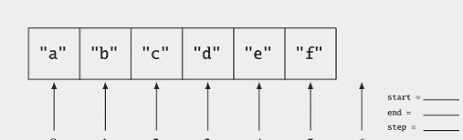

图 3.5：列表、索引和切片示例

填入 start、end 和 step 的值。

我现在展示几种切片列表的方法。

```
the_list = ["a", "b", "c", "d", "e", "f"]
the_list
```

['a', 'b', 'c', 'd', 'e', 'f']

- the_list[0:] 和 the_list[:] 返回 the_list 的副本。

```
the_list[0:]
```

['a', 'b', 'c', 'd', 'e', 'f']

```
the_list[:]
['a', 'b', 'c', 'd', 'e', 'f']
```

- the_list[the_index:] 返回一个新列表，其中包含 the_list 从位置 the_index 到末尾的项。如果 the_index 为正且 ≥ len(the_list)，我们得到一个空列表。

```
the_list[2:]
['c', 'd', 'e', 'f']
```

```
the_list[10:]
[]
```

- the_list[:the_index] 返回一个新列表，其中包含原始列表中到但不包括 the_index 处项的项。

```
the_list[:2]
['a', 'b']
```

- the_list[the_first_index:the_second_index] 返回一个新列表，其中包含原始列表中从位置 the_first_index 处项开始到但不包括位置 the_second_index 处项的项。

```
the_list[1:3]
['b', 'c']
```

- the_list[::2] 返回一个新列表，其中包含原始列表中从第一个开始，然后每隔一个项的项。

```
the_list[::2]
['a', 'c', 'e']
```

- the_list[1::3] 返回一个新列表，其中包含原始列表中从第二个开始，然后每隔三个项的项。

```
the_list[1::3]
['b', 'e']
```

- the_list[::-1] 返回 the_list 的反向副本。

```
the_list[::-1]
['f', 'e', 'd', 'c', 'b', 'a']
```

我认为反转列表的技术很精彩。

**练习 3.8**

编写一个 Python 函数来生成本书所有可能的问题，其中 `start`、`end` 和 `step` 的取值为负、零和正整数。只是开玩笑，但请多做实验。

**练习 3.9**

为切片与 `start`、`end` 和 `step` 的允许取值如何工作制定正式规则。

## 3.2.7 切片：更改子列表

正如我们看到的，我们可以 **更改** 和 **移除** 列表项，我们可以使用切片记法与赋值一起更改列表的结构。

思路是我们创建一个切片表达式来指定列表的一部分，然后使用赋值用另一个列表替换切片。

```
the_list = ["a", "b", "c", "d", "e", "f"]
```

```
the_list[:1] = [1, 2, 3]
the_list
```

```
[1, 2, 3, 'b', 'c', 'd', 'e', 'f']
```

```
the_list[6:] = [7, 8, 9]
the_list
```

```
[1, 2, 3, 'b', 'c', 'd', 7, 8, 9]
```

```
the_list[4:6] = ["alpha", "beta", "gamma"]
the_list
```

```
[1, 2, 3, 'b', 'alpha', 'beta', 'gamma', 7, 8, 9]
```

**练习 3.10**

虽然这些示例工作正常，但 Python 要求当你使用除一以外的步长时，切片和赋值右侧的列表长度必须相同。尝试正步长和负步长，看看什么有效什么无效。

## 3.2.8 扩展列表

我们如何向现有列表添加项？有几种我们可能想要做的事情：

- 1. 在列表末尾追加一项。
- 2. 在列表开头前置一项。
- 3. 在列表的特定索引处插入一项。
- 4. 用另一个列表的项在末尾扩展我们的列表。
- 5. 在列表开头添加另一个列表的项。
- 6. 在列表的特定索引处添加另一个列表的项。

前四种很容易，但最后两种需要你多做一些工作。我们再次使用吉他品牌。

```
brands = [
    "Fender",
    "Gibson",
    "Ibanez"
]

original_brands = brands.copy()
```

要在列表末尾添加一项，使用 *append*。

```
brands.append("Gretsch")
brands
```

['Fender', 'Gibson', 'Ibanez', 'Gretsch']

要在列表开头添加一项，使用索引 0 的 *insert*。

```
brands = original_brands.copy()
brands.insert(0, "Gretsch")
brands
```

['Gretsch', 'Fender', 'Gibson', 'Ibanez']

更一般地，使用 *insert* 并指定你想要放置新项的索引。

```
brands = original_brands.copy()
brands.insert(1, "Gretsch")
brands
```

['Fender', 'Gretsch', 'Gibson', 'Ibanez']

## 练习 3.11

假设你想在空列表开头放置一项。你应该使用 *append* 还是 *insert*？尝试两种方法。

## 练习 3.12

当你对原始列表使用无效索引时，*insert* 的行为如何？

*extend* 方法类似于 *append*，但它取给定列表的所有项并将它们放在我们的列表末尾。

```
brands = original_brands.copy()
brands.extend(["Epiphone", "Paul Reed Smith"])
brands
```

['Fender', 'Gibson', 'Ibanez', 'Epiphone', 'Paul Reed Smith']

它与此循环做同样的事情：

```
brands = original_brands.copy()

for brand in ["Epiphone", "Paul Reed Smith"]:
    brands.append(brand)

brands
```

['Fender', 'Gibson', 'Ibanez', 'Epiphone', 'Paul Reed Smith']

这种技术为我们在开头插入项提供了提示。让我们试试这个：

```
brands = original_brands.copy()

for brand in ["Epiphone", "Paul Reed Smith"]:
    brands.insert(0, brand)

brands
```

['Paul Reed Smith', 'Epiphone', 'Fender', 'Gibson', 'Ibanez']


# 将事物收集在一起

哎呀，它们的顺序错了！有几种方法可以解决这个问题，但下面这种方式可行：

```python
brands = original_brands.copy()
index = 0

for brand in ["Epiphone", "Paul Reed Smith"]:
    brands.insert(index, brand)
    index += 1

brands
```

`['Epiphone', 'Paul Reed Smith', 'Fender', 'Gibson', 'Ibanez']`


**练习 3.13**

编写代码，使用我们的吉他品牌列表来执行本节开始处的第六项活动：“从另一个列表中将项目添加到我们列表的特定索引处。”

# 3.2.9 解包列表

我们已经看到了如何访问列表中的单个项目和子列表。通过赋值，我们可以将列表解包为其各个部分。给定这个列表：

```python
models = [
    "Stratocaster",
    "Telecaster",
    "Les Paul",
    "Flying V",
    "RG"
]
```

我们提取第一个和剩余的项目：

```python
first_model, *remaining_models = models
```

```python
first_model
```

`'Stratocaster'`

```python
remaining_models
```

`['Telecaster', 'Les Paul', 'Flying V', 'RG']`

# 练习 3.15

**可选：** 如果你了解 Lisp 或 Scheme 编程语言，你会如何定义 *car* 或 *cdr*？请分别使用列表解包和切片各写一个版本。

我认为列表解包是 Python 中被低估的功能。

# 3.2.10 反转和排序列表

让我们创建一个吉他型号推出年份的列表。

```
years = [1954, 1950, 1952, 1958, 1987]
years
```

[1954, 1950, 1952, 1958, 1987]

*reverse* 方法翻转**列表**中项目的顺序。它改变列表本身，而不是复制一份。

```
years.reverse()
years
```

[1987, 1958, 1952, 1950, 1954]

默认情况下，*sort* 将列表元素按升序排列。

```
years.sort()
years
```

[1950, 1952, 1954, 1958, 1987]

通过可选的第二个关键字参数，你可以按降序排序。

```
years.sort(reverse=True)
years
```

[1987, 1958, 1954, 1952, 1950]

虽然我展示了一些会实际改变**列表**及其所含项目的方法和操作，但一些类似的函数会保持原列表不变。

无论列表很小还是很大，获取长度所需的时间都是相同的。仍然有一些依赖于系统和实现的额外开销，但现在计算长度的时间 ≤ C × 1 = C。这个方法是 O(1) 的。太棒了！

# 练习 3.16

列表算法为 O(n²) 意味着什么？我们称该算法是二次的，或具有二次复杂度。

证明 2.12.3 节中的选择排序是 O(n²)。

除了分析算法使用了多少时间，我们还可以询问它需要多少内存，并用大 O 表示法来表示。我们分析执行时间和内存使用的最佳情况、最坏情况和平均情况。

像 O(2ⁿ) 这样的算法是指数级的，应该避免使用，除非 n 很小且你没有其他选择。这里的“2”也可以是另一个大于 1 的数字。

我在《与量子比特共舞》的 2.8 节中介绍了复杂度和 Big O 表示法。[D.W.Q]

# 练习 3.17

我给你一个 O(3ⁿ) 算法，并告诉你 C = 17.4。对于 n = 1、n = 10 和 n = 100，该算法实现运行时间的上界是多少？

# 3.4 元组

元组与列表类似，除了：

+   - 你使用圆括号而不是方括号，而且圆括号通常可以省略。
+   - 你不能更改元组的结构：它们是不可变的。

我们在进行多重赋值时见过元组。那时我们不需要圆括号，但如果愿意，也可以加上。

```
a, b = 3, -2
print(f"{a = }    {b = }")

a, b = (9, 0.3)
print(f"{a = }    {b = }")

(a, b) = ("a", "b")
print(f"{a = }    {b = }")
```

a = 3    b = -2
a = 9    b = 0.3
a = 'a'  b = 'b'

# 练习 3.18

如果你尝试通过索引给元组中的项目赋值，Python 会引发什么异常？

使用 *tuple* 将列表转换为元组，使用 *list* 将元组转换为列表。

```
t = 2, -4, 9
t
list(t)
tuple([-16, 25, -36])
```

(-16, 25, -36)

# 练习 3.19

创建空元组的三种方法是什么？

如果你试图创建只有一个元素的元组，语法会变得令人困惑。

```
(3.14)
```

3.14

这些圆括号分组了一个简单表达式。相反，添加一个尾随逗号来构成元组。

```
(3.14,)
```

(3.14,)

元组在 Python 编程中以多种方式出现，你可能并不总是意识到自己在使用它们。程序员经常通过元组从函数返回多个值。在下一个示例中，我定义了 quo_rem 来计算两个整数的商和余数。第二个整数不能为零。

```
def quo_rem(dividend, divisor):
    if not isinstance(dividend, int):
        raise TypeError("dividend must be an integer")
    if not isinstance(divisor, int):
        raise TypeError("divisor must be an integer")

    if divisor == 0:
        raise ZeroDivisionError("divisor is 0")

    return dividend // divisor, dividend % divisor
```

```
quo_rem(11, 4)
```

(2, 3)

虽然我本可以只编写包含 return 的最后一行，但我添加了三个条件表达式来确保参数有效。在第 2 行和第 4 行的前两个条件中，我使用了 isinstance 来确保参数是整数。也就是说，我检查了它们是否是 int 类型的实例。具有错误类型的值应该引发 TypeError 异常，这不应该让你感到惊讶。

如果我试图除以零，Python 本身会引发 ZeroDivisionError。我想在我的函数中显式处理，所以我在第 7 行添加了测试。

# 练习 3.20

在 quo_rem 中，第二个和第三个条件是否应该使用 elif？

> 如果实现难以解释，那这是个坏主意。
> 如果实现容易解释，那这可能是个好主意。
> 命名空间是一个绝妙的主意——让我们多多使用吧！

* Python 的创造者 Guido van Rossum 是荷兰人。[PEP020] [ZEN]

# 3.7 嵌套推导式

你可以嵌套推导式来创建列表中的列表。本节的任务是探索生成这个包含四个列表的列表的几种方法，每个列表有四个数字：

[ [1, 0, 0, 0], [0, 1, 0, 0], [0, 0, 1, 0], [0, 0, 0, 1] ]
[1 0 0 0]
[0 1 0 0]
[0 0 1 0]
[0 0 0 1]

左边是列表的列表，右边是一个矩阵。具体来说，它是一个 4×4 的单位矩阵，正如你在线性代数中所见。该矩阵是对角矩阵：唯一的非零项位于主对角线上。程序员经常使用列表的列表在 Python 中实现矩阵。

线性代数是量子计算和许多其他学科的核心。现在，我们来看如何构建这个列表。

在这种情况下，手动输入这个列表并不困难，但在量子计算中，我们使用 2ⁿ×2ⁿ 的矩阵。例如，当 n 为 15 时，我们得到一个 32768×32768 的矩阵。

让我们首先创建一个 4×4 的、用零填充的列表的列表。

```
m = [[0 for i in range(4)] for j in range(4)]
m
[[0, 0, 0, 0], [0, 0, 0, 0], [0, 0, 0, 0], [0, 0, 0, 0]]
```

注意这里有两个 for 循环，一个作用于外层列表，另一个作用于四个内层列表。这就是嵌套推导式的特点。现在设置对角线元素。

```
for i in range(4): m[i][i] = 1
m
[[1, 0, 0, 0], [0, 1, 0, 0], [0, 0, 1, 0], [0, 0, 0, 1]]
```

由于循环和操作都很简短，我把它们放在了同一行。我可以定义一个函数，并在嵌套列表推导式中完成所有操作。

```
def one_or_zero(x, y):
    if x == y:
        return 1
    return 0

[[one_or_zero(i, j) for i in range(4)] for j in range(4)]
```

[[1, 0, 0, 0], [0, 1, 0, 0], [0, 0, 1, 0], [0, 0, 0, 1]]

我可以更 Pythonic 地改进这个函数：

```
def one_or_zero(x, y): return 1 if x == y else 0

[[one_or_zero(i, j) for i in range(4)] for j in range(4)]
```

[[1, 0, 0, 0], [0, 1, 0, 0], [0, 0, 1, 0], [0, 0, 0, 1]]

这是我们之前没见过的！Python 允许你在表达式中间放置条件语句。最后，我完全跳过函数。

```
[[1 if i == j else 0 for i in range(4)] for j in range(4)]
```

[[1, 0, 0, 0], [0, 1, 0, 0], [0, 0, 1, 0], [0, 0, 0, 1]]

以这种方式使用条件语句是一种额外的技巧，可以让你编写简洁且可读的代码。

# 练习 3.23

下面的推导式中发生了什么？

```
[f"i + j = {i+j} for {i = } and {j =}"
    for i in range(2) for j in range(3)]
```

['i + j = 0 for i = 0 and j =0',
'i + j = 1 for i = 0 and j =1',
'i + j = 2 for i = 0 and j =2',
'i + j = 1 for i = 1 and j =0',
'i + j = 2 for i = 1 and j =1',
'i + j = 3 for i = 1 and j =2']

这是嵌套的，还是 for 循环并行运行？


## 3.8 并行遍历

考虑本章开头给出的关于吉他的数据：

```python
brands = ["Fender", "Fender", "Gibson", "Gibson", "Ibanez"]
models = ["Stratocaster", "Telecaster", "Les Paul", "Flying V", "RG"]
years = [1954, 1950, 1952, 1958, 1987]
```

我们如何为每个型号打印出像下面这样的句子：

Fender Stratocaster 于 1954 年首次推出。

我们可以通过 `range` 使用索引，并用四个嵌套的 for 循环来完成，但这非常缓慢且效率低下。

### 练习 3.24

编写代码，通过 `range` 使用索引并用四个嵌套的 for 循环来完成此任务。为什么它缓慢且效率低下？

相反，我们使用 `zip` 同时遍历这四个列表：

```python
for brand, model, year in zip(brands, models, years):
    print(f"The {brand} {model} was first introduced in {year}.")
```

Fender Stratocaster 于 1954 年首次推出。
Fender Telecaster 于 1950 年首次推出。
Gibson Les Paul 于 1952 年首次推出。
Gibson Flying V 于 1958 年首次推出。
Ibanez RG 于 1987 年首次推出。

我将这些列表“zip”在一起，以便可以并行遍历它们。如果列表长度不同，则 zip 会在到达最短列表末尾时停止。

### 将内容聚合在一起

你可以将 `zip` 与 `range` 一起使用。

```python
for number, brand, model, year in \
    zip(range(len(brands)), brands, models, years):
        print(f"{number + 1}. The {brand} {model} "
              + f"was first introduced in {year}.")
```

1. Fender Stratocaster 于 1954 年首次推出。
2. Fender Telecaster 于 1950 年首次推出。
3. Gibson Les Paul 于 1952 年首次推出。
4. Gibson Flying V 于 1958 年首次推出。
5. Ibanez RG 于 1987 年首次推出。

### 练习 3.25

在这个示例中，我编写了两种换行续接形式，并连接了两个字符串。请指出我在哪里使用了这些方式。为什么两个字符串都是 f-string？

## 3.9 字典

我详细介绍了列表，以说明你需要知道的主要集合操作：

- 创建集合
- 测试集合中的成员资格
- 访问集合中的项目
- 向集合中添加项目（如果是可变的）
- 从集合中删除项目（如果是可变的）
- 迭代集合中的项目
- 提取子集合
- 通过对从现有集合过滤出的项目调用函数来构建新集合

对于字典和集合，我会更快地介绍这些核心操作，并重点关注这些集合类型的显著特征。

### 3.9.1 什么是字典？

首先，我们将关于吉他的信息放入图 3.6 的表格中。

| 品牌 | 型号 | 推出年份 |
|---|---|---|
| Fender | Stratocaster | 1954 |
|  | Telecaster | 1950 |
| Gibson | Les Paul | 1952 |
|  | Flying V | 1958 |
| Ibanez | RG | 1987 |

*图 3.6：吉他品牌、型号和推出年份表*

Python 字典是键值对的集合。例如，我可以有这些键：

```python
"Fender Stratocaster", "Fender Telecaster",
"Gibson Les Paul", "Gibson Flying V",
"Ibanez RG"
```

并将它们与这些值关联：

```python
1954, 1950, 1952, 1958, 1987,
```

分别对应。这里的键是 Python 字符串，值是整数。字典中不存在的键是无效的。

在给定字典中，键是唯一的，并且必须是不可变类型。特别是，键不能是列表或集合，但如果元组不包含可变对象，则键可以是元组。

### 练习 3.26

以下哪些是 Python 字典的有效键？

```python
2023
"GPA"
(2, 3)
[2, 3]
[2, (3, 4)]
{2, 3}
[{2, 3}]
(2, [3])
(2, (3,))
```

键不要求全部是相同类型，例如 `str` 或 `int`。如果你要混合键类型，请仔细考虑你的数据设计，以及这是否是你应该做的事情。

字典中的值可以是任何类型；常见的字典值本身也是字典。字典的类型是 `dict`。

### 3.9.2 创建字典

使用大括号或 `dict` 创建空字典。

```python
{}
```

```python
dict()
```

使用大括号时，用冒号分隔键和值，用逗号分隔每一对。

```python
{"Fender Stratocaster": 1954, "Fender Telecaster": 1950}
```

请记住：**字典使用冒号。**

### 3.9.3 测试字典中的成员资格

让我们创建包含所有吉他及其推出年份的完整字典。

```python
guitars = {
    "Fender Stratocaster": 1954,
    "Fender Telecaster": 1950,
    "Gibson Les Paul": 1952,
    "Gibson Flying V": 1958,
    "Ibanez RG": 1987
}
```

在测试字典是否为空时，单独使用字典名是符合 Python 风格的：

```python
if guitars:
    print("Our guitar dictionary is not empty.")
```

我们的吉他字典不为空。

你可以使用 `len` 获取键值对的数量。

```python
len(guitars)
```

5

使用 `in` 和 `not in` 检查键是否在字典中。

```python
"Fender Stratocaster" in guitars
```

True

```python
"Martin BC-16E" not in guitars
```

True

### 3.9.4 访问字典中的项目

对于列表 `my_list`，我通过 `my_list[my_index]` 访问索引 `my_index` 处的项目。类似地，对于字典 `my_dictionary`，我通过 `my_dictionary[my_key]` 访问 `my_key` 处的值。

```python
guitars["Gibson Les Paul"]
```

1952

如果该键不在字典中，Python 会引发 **KeyError** 异常。

```python
guitars["Martin BC-16E"]
```

KeyError: 'Martin BC-16E'

还有另一种尝试检索值的方法，但首先我们必须了解一个之前没见过的新类型。

### 3.9.5 None

你是否曾经问别人在想什么，结果他们回答“没什么”？嗯，类型为 `NoneType` 的 `None` 就是 Python 中明确的“无”。以下是两个你可能使用它的编程场景示例：

- 你在编写一个函数来搜索新的集合类型。当用户查找不存在的项目时，你不想抛出异常。搜索可以返回 `None`。但要确保用户不能查找 `None`！
- 你在编写格式化文本的代码，用 `True` 或 `False` 来表示文本是否应为斜体。但是，你想保留周围段落对斜体的处理方式。使用 `None` 来表示“不要打开或关闭斜体，保持原样。”

### 练习 3.27

在条件语句中尝试使用 `None`。它的行为是像 `True` 还是 `False`？

空字符串、列表、元组、字典和集合的行为都类似于 `False`。

我们使用 `is` 或 `is not` 来测试与 `None` 的相等或不相等。不要使用“==”或“!=”来测试。

```python
3 is None
```

False

```python
"None" is not None
```

True

```python
None is None
```

True

唯一等于 `None` 的就是 `None` 本身。

### 3.9.6 再次访问字典中的项目

字典的 `get` 方法返回键对应的值，如果键无效则返回 `None`。

```python
guitars.get("Gibson Les Paul")
```

1952

```python
guitars.get("Martin BC-16E") is None
```

True

你可以通过 `get` 的第二个参数指定对无效键应返回的内容。`None` 是这个参数的默认值。在我们的示例字典中，值是吉他型号推出的年份。

```python
guitars.get("Martin BC-16E", "Sometime in the 20th century")
```

'20世纪的某个时候'

### 3.9.7 遍历字典中的项目

如果使用 `for` 循环遍历字典，你会得到键。在我们的示例中，使用 `guitars` 或 `guitars.keys()` 都可以。

```python
for model in guitars: print(model)
```

Fender Stratocaster
Fender Telecaster
Gibson Les Paul
Gibson Flying V
Ibanez RG

你也可以获取值：

```python
for year in guitars.values(): print(year)
```

1954
1950
1952
1958
1987

要获得键值对作为元组，请使用 `items`。

```python
for model, year in guitars.items():
    print(f"The {model} was introduced in {year}")
```

Fender Stratocaster 于 1954 年推出
Fender Telecaster 于 1950 年推出
Gibson Les Paul 于 1952 年推出
Gibson Flying V 于 1958 年推出
Ibanez RG 于 1987 年推出

字典及其键按键值对添加的顺序排列。这与之前顺序随机且未指定的行为不同。如果你编写的代码可能在旧版 Python 上运行，则不应依赖顺序的一致性。

我发现 `sorted` 和 `reversed` 是处理字典的有用函数。这里我同时使用它们：

```python
for model in reversed(sorted(guitars)): print(model)
```

Ibanez RG
Gibson Les Paul
Gibson Flying V
Fender Telecaster
Fender Stratocaster

### 3.9.8 向字典添加项目

在赋值的左侧使用字典方括号语法来添加键值对。

```python
numbers = {1: "one", 2: "two"}

numbers[3] = "three"

numbers
```

{1: 'one', 2: 'two', 3: 'three'}


如果使用相同的键再次赋值，先前的值将被替换。

```
numbers[3] = "THREE"
```

```
numbers
```

{1: 'one', 2: 'two', 3: 'THREE'}

如果 other_numbers 是另一个字典，我们可以使用双星号 "**" 创建一个新字典，将它与 numbers 合并。

```
other_numbers = {4: "four", 5: "five"}
```

```
{**numbers, **other_numbers}
```

{1: 'one', 2: 'two', 3: 'THREE', 4: 'four', 5: 'five'}

这里的 "**" 表示“将所有内容展开为一个键值对集合”。

### 练习 3.28

从一个空字典开始，遍历 numbers 和 other_numbers，创建一个包含两者所有键值对的字典。

一般来说，合并两个字典时顺序重要吗？为什么重要或不重要？

### 3.9.9 从字典中删除项

我们使用 del 从字典中删除一个键值对。

```
numbers
```

{1: 'one', 2: 'two', 3: 'THREE'}

```
del numbers[2]
numbers
```

{1: 'one', 3: 'THREE'}

### 练习 3.29

如果你尝试使用无效键从字典中删除键值对，Python 会引发什么异常？先使用 in 测试键是否有效更好，还是出现问题时捕获异常更好？

使用 clear 清空字典。

```
numbers.clear()
numbers
```

{}

### 3.9.10 字典推导式

在列表推导式中，我们在方括号表达式中使用 for 循环来构造列表。我们对字典也做同样的事情，但使用花括号。请记住，我们需要同时包含新的键和新的值。

```
{model : year for model, year
    in guitars.items() if 1950 < year and year < 1958}
```

{'Fender Stratocaster': 1954, 'Gibson Les Paul': 1952}

### 练习 3.30

这段代码中发生了什么？

```
{year : model.upper() for model, year
    in guitars.items() if 1955 < year}
```

{1958: 'GIBSON FLYING V', 1987: 'IBANEZ RG'}

如果在同一年推出了两种不同的吉他型号，会发生什么？

我的朋友决定专注于班卓琴演奏，于是以 750 欧元把他们的吉他卖给了我。我 *更新* 我的集合以反映这一变化。

```
my_brands.update(their_brands)
my_brands
```

{'Fender', 'Gibson', 'Gretsch', 'Ibanez', 'Ovation'}

### 3.10.4 从集合中删除项

为了完成与朋友的交易，我必须 *清空* 他们的集合。

```
their_brands.clear()
their_brands
```

set()

我妹妹对我很恼火，把 Ibanez 拿了回去。我把它从我的集合中 *丢弃*。

```
my_brands.discard("Ibanez")
my_brands
```

{'Fender', 'Gibson', 'Gretsch', 'Ovation'}

### 练习 3.33

如果项不在集合中，*丢弃* 会做什么？你也可以使用 *移除*。描述当你试图移除一个不是集合成员的项目时，它的行为。

假设 *my_set* 是一个集合。要理解 *my_set.clear()* 和 *my_set = set()* 之间的区别，考虑这个类比。假设你有一盒苹果。*清空* 会把盒子里所有的苹果都移除，但你保留同一个盒子。赋值会拿走你的盒子，给你一个新的空盒子。

### 3.10.5 访问集合成员

对于列表，你可以说“给我这个索引处的项。”对于字典，你可以请求“给我这个键对应的值。”对于集合，什么样的类似问题是有意义的？你如何访问成员？

首先，你可以遍历集合成员。

```
for brand in my_brands: print(brand)
```

Gretsch
Gibson
Fender
Ovation

其次，你可以弹出、移除并返回一个随机成员。

```
my_brands
my_brands.pop()
```

'Gretsch'

```
my_brands
```

{'Fender', 'Gibson', 'Ovation'}

### 练习 3.34

如果你尝试从空集合中弹出，会引发什么类型的异常？

### 3.10.6 子集和超集

让我们恢复原来的吉他收藏。

```
my_brands = my_original_brands.copy()
my_brands
```

{'Fender', 'Gibson', 'Ovation'}

```
their_brands = their_original_brands.copy()
their_brands
```

{'Fender', 'Gibson', 'Gretsch'}

你可以使用 “|” 来代替并集。这种形式的好处是你可以进行运算赋值。

```
guitars = my_brands.copy()
guitars | {"Martin", "Taylor"}
```

{'Fender', 'Gibson', 'Martin', 'Ovation', 'Taylor'}

```
guitars |= {"Martin", "Taylor"}
guitars
```

{'Fender', 'Gibson', 'Martin', 'Ovation', 'Taylor'}

交集 S₁ ∩ S₂ 是同时属于 S₁ 和 S₂ 的所有项的集合。你可以使用交集或 “&”。

```
my_brands.intersection(their_brands)
```

{'Fender', 'Gibson'}

```
my_brands & their_brands
```

{'Fender', 'Gibson'}

差集 S₁ − S₂ 是 S₁ 中不在 S₂ 中的所有项的集合。你可以使用差集或 “-”。

```
my_brands.difference(their_brands)
```

{'Ovation'}

```
my_brands - their_brands
```

{'Ovation'}

### 练习 3.35

S₁ 和 S₂ 的对称差集是 S₁ 和 S₂ 中不同时属于两者的所有项的集合。你可以使用对称差集或 “^”。

仿照上面的例子，给出对称差集的示例。如果 Python 没有提供 symmetric_difference，你会如何使用交集和差集来定义它？
