## 4 与字符串同行

> *世界尽是门，尽是机会，是等待拨动的弦。*
> 
> —拉尔夫·沃尔多·爱默生

本章建立在我们在 2.2 节中关于字符串的讨论之上。如果你思考项目列表与字符串之间的相似之处，可能会有所帮助，但你必须记住 **字符串是不可变的**。

### 本章涵盖的主题

| 主题 | 页码 |
| --- | --- |
| 4.1 单引号、双引号和三引号 | 128 |
| 4.2 测试子字符串 | 129 |
| 4.3 访问字符 | 130 |
| 4.4 创建字符串 | 131 |
| 4.5 字符串与迭代 | 134 |
| 4.6 字符串与切片 | 135 |
| 4.7 字符串测试 | 136 |
| 4.8 拆分与去除 | 138 |
| 4.9 总结 | 139 |

### 4.1 单引号、双引号和三引号

你可以使用单引号或双引号来界定字符串字面量。Python 通常用单引号打印字符串。

```
"Franz"
```

'Franz'

```
'Ferdinand'
```

'Ferdinand'

如果你的字符串包含一种引号，请使用另一种引号作为分隔符，或者转义该引号。

```
"That is Franz's cat toy."
```

"That is Franz's cat toy."

```
'The ball is Ferdinand\'s.'
```

"The ball is Ferdinand's."

使用 `\n` 字符在字符串中嵌入换行。

```
"You can see the\nnewline character here."
```

'You can see the\nnewline character here.'

```
print("But 'print' breaks\nthe line at the character.")
```

But 'print' breaks
the line at the character.

对于非常长的字符串，你可以将它们连接在一起，或者使用三引号。你可以使用三个单引号或三个双引号，但 Python 代码风格指南推荐使用后者。[PEP 8]

```
"""
I've broken
this string
over several lines.
"""
```

"\nI've broken\nthis string\nover several lines.\n"

注意我不必显式使用换行符。我还无意中在开头和结尾包含了额外的换行。

```
fix = """This fixes my
    problem with extra newlines."""

fix
```

'This fixes my\n    problem with extra newlines.'

```
print(fix)
```

This fixes my
    problem with extra newlines.

Python 保留了我插入到第二行开头的额外空格。

当使用三引号分隔时，我们不需要转义字符串中的单引号或双引号。在编写代码文档时，我们会使用三引号，正如我们将在 7.8 节中看到的那样。

```
"""A single quote (') and a double quote (")."""
```

'A single quote (\') and a double quote (").'

如果要在字符串中包含反斜杠，可以用另一个反斜杠来转义它。

```
"C:\\src\\code\\chapter-01"
```

'C:\\src\\code\\chapter-01'

或者，在第一个引号前加上一个 r 来使用原始字符串。

```
r"C:\src\code\chapter-01"
```

'C:\\src\\code\\chapter-01'

```
print(r"There is no newline \n in this string.")
```

There is no newline \n in this string.

### 4.2 测试子字符串

使用 in 和 not in 来检查一个字符串的内容是否位于另一个字符串内。

```
"Quantum" in "Quantum computing"
```

True


guitars[-5]

'a'

使用 find 在字符串的索引范围内定位子字符串。如果 my_string 是一个字符串，则 find 可以有一个到三个参数。

```
my_string.find(substring, start_index=0, end_index=len(my_string))
```

此表示法意味着需要一个参数，即要查找的子字符串。如果没有给出其他参数，find 将从索引 0 开始查找。如果不给出第三个参数，则默认为字符串的长度。

```
guitars.find("o")
```

11

```
guitars.find("o", 12)
```

18

```
guitars.find("o", 2, 9)
```

-1

如果 Python 无法定位子字符串，find 返回 -1。

你也可以使用 index，但如果子字符串不存在则会引发异常。

## 4.4 创建字符串

我们已经看到许多将字面字符串放在单引号、双引号或三引号之间的示例。让我们看看构造字符串的额外方法。你总是创建新的字符串，并且不能修改原始字符串。

```
letters = "abcd"
letters + "efg"
```

'abcdefg'

```
letters
```

'abcd'

```
letters += "efg"
letters
```

'abcdefg'

“+” 运算符连接两个字符串。“Concatenate” 是一个花哨的词，意思是“把它们粘在一起，一个接一个”。你可以将新值赋给变量或使用运算符赋值，就像我在这里做的那样。

字符串连接非常强大，允许你将文本与其他字符串和其他数据类型混合。

```
brands = [
    "Fender",
    "Gibson",
    "Ibanez"
]
```

```
"I own " + str(len(brands)) + " brands of guitars"
```

```
'I own 3 brands of guitars'
```

### 4.4.1 f-string

通常使用 f-string 更简单、更清晰。

```
f"I own {len(brands)} brands of guitars"
```

```
'I own 3 brands of guitars'
```

有时你需要格式化数据，尤其是数字。你可以在大括号内包含格式细节。 [PYF]

```
f"This is 1/7 to 3 decimal places: {(1/7):.3f}"
```

```
'This is 1/7 to 3 decimal places: 0.143'
```

```
f"This is 1/7 to 6 decimal places: {(1/7):.6f}"
```

```
'This is 1/7 to 6 decimal places: 0.142857'
```

对于浮点科学计数法，请在大括号内使用 e 或 E 而不是 f。

```
f"{(1/7000):.5E}"
```

```
'1.42857E-04'
```

如果你要在表格中呈现数字，可能希望指定字段宽度并在左侧用空格或零填充。

```
for j in [1, 141, 1441, 14441]:
    print(f"| {j:5} | {j*j:010} |")
```

|     1 | 0000000001 |
|   141 | 0000019881 |
|  1441 | 0002076481 |
| 14441 | 0208542481 |

j:5 表示“将 j 的值右对齐在宽度为 5 个字符的字段中，并用空格填充。” j*j:010 表示“将 j*j 的值右对齐在宽度为 10 个字符的字段中，并用零填充。”

### 4.4.2 从字符串列表到字符串

如果您有一个字符串列表，可以使用 join 将它们与它们之间的文本连接起来。

```
words = ['If', 'you', 'have', 'a', 'list']

print("".join(words))
```

Ifyouhavealist

```
print(' '.join(words))
```

If you have a list

```
print('\n'.join(words))
```

If
you
have
a
list

我一直很喜欢 join 以及它是一个字符串的方法而不是列表的方法。

另一种创建字符串的方法是替换子字符串中的内容。

```
"My favorite guitar is a Fender.".replace("Fender", "Gibson")
```

'My favorite guitar is a Gibson.'

默认情况下，此方法替换所有出现的位置。您可以通过使用第三个参数来限制更改的数量。

```
"My favorite guitar is a Fender.".replace("e", "E")
```

'My favoritE guitar is a FEndEr.'

```
"My favorite guitar is a Fender.".replace("e", "E", 1)
```

'My favoritE guitar is a Fender.'

replace 的另一种用途是删除子字符串。只需用空字符串 "" 替换子字符串即可。

```
"My favorite guitar is a Fender.".replace(" guitar", "")
```

'My favorite is a Fender.'


# 练习 4.1

使用 find 定位 " guitar"，然后切片并连接，重新做最后一个示例。

## 4.5 字符串和迭代

访问字符串中字符的另一种方法是使用 for 循环迭代它。

```
characters = []

for c in "Fender":
    characters.append(c)

characters
```

['F', 'e', 'n', 'd', 'e', 'r']

```
guitars
```

'Fender Gibson Taylor'

```
for c in guitars:
    if c.isupper():
        print(c)
```

F
G
T

虽然我们不能在 Python 中进行字符串推导，但我们可以创建一个字符串列表并将它们连接起来。

```
"".join([c for c
in "0X63 5WC - SL46 3AP - BN96 ØVU"
if c.isdigit()])
```

'635463960'

字符串可以通过 zip 与列表和其他支持迭代的集合并行遍历。

```
for a, b in zip("123", [1, 2, 3]):
    print(f"{a = }    {b = }")
```

a = '1'    b = 1
a = '2'    b = 2
a = '3'    b = 3

## 4.6 字符串和切片

我们在第 3.2.6 节中看到的列表切片规则也适用于字符串，只是你不能将字符串切片放在赋值语句的左侧。

```
word = "sesquipedalianism"
len(word)
```

17

```
print(word[3:9])
print(word[:7])
print(word[7:])
```

quiped
sesquip
edalianism

```
print(word[::-3])
print(word[::-1])
```

sqpaas
msinailadepiuqses

```
word[0] = 'S'
```

TypeError: 'str' object does not support item assignment

# 练习 4.2

查找“sesquipedalianism”的英文定义。

## 4.7 字符串测试

这个函数做什么？

```
def validate(name):
    if name:
        if name[0] != '_' and not name[0].isalpha():
            return False
        for character in name[1:]:
            if character != '_' and not character.isalnum():
                return False
        return True
    return False
```

空名称不好。

```
validate("")
```

False

名称中只有一个下划线是可以的。

```
validate("_")
```

True

名称可以是数字和字母。这些是“字母数字”。

```
validate("income2021")
```

True

## Stringing You Along

```
"##hashtaghashtag".startswith("##H")
```

False


**练习 4.4**

编写一个使用切片实现 *startswith* 的函数。当然，不要使用 *startswith* 本身！


**练习 4.5**

*endswith* 做什么？编写一个模仿其功能的函数。

## 4.8 分割和剥离

假设你有文本

```
text = "  SPECIAL  #  SALE  #  TODAY  "
```

你想将其拆分为包含三个单词的列表。首先，使用 *split* 在哈希标记处拆分字符串。

```
text.split('#')
```

```
['  SPECIAL  ', '  SALE  ', '  TODAY  ']
```

其次，使用 *strip* 从每个单词的左侧和右侧删除空白。在一行中：

```
[word.strip() for word in text.split('#')]
```

```
['SPECIAL', 'SALE', 'TODAY']
```


**练习 4.6**

尝试使用 *replace* 重写 *strip*。对于嵌入空格的情况，例如 "How are you " 是否有效？

## 5

# 计算与计算

> 我们的伟大力量不在于数字，而在于统一……
> —托马斯·潘恩，《常识》

编程语言在对不同类型数字和数学结构的不同支持方面有所不同。看到浮点数和整数受硬件限制的大小并不罕见。对于科学和工程中的许多计算，我们需要比固定大小所能容纳的更大的数字。

在本章中，我介绍了许多可以在 Python 中进行计算的数字和其他对象形式。我们将研究整数、分数、浮点数、随机数、复数、量子位（量子位）和像多项式这样的符号对象。

# 本章涵盖的主题

+ 5.1 使用 Python 模块 ......................................................... 142
+ 5.2 整数 ......................................................... 145
+ 5.3 浮点数 ......................................................... 156
+ 5.4 有理数 ......................................................... 169
+ 5.5 复数 ......................................................... 172
+ 5.6 符号计算 ......................................................... 177


## 5.1 使用 Python 模块

到目前为止，我们看到或使用的所有代码，要么是 Python 内置的，要么是我们自己编写的。Python 使用*模块*将函数、类和常量定义集中在一起，这样你就可以有选择地将它们引入环境中并重复使用。我们可以将模块组织成分层的树状结构，从而创建*包*。这些模块和包共同提供了我们在第 1.4 节中看到的库的功能。

### 5.1.1 如何获取模块？

Python 标准库中包含 200 多个模块。[PSL] 除了通过 `import` 将它们加载到环境中之外，你不需要安装任何额外内容即可使用它们。本章中使用的 `math`、`fractions`、`random` 和 `cmath` 模块都属于标准库。

这并不是你可以使用的预先编写代码的全部范围。Python 包索引中提供了超过 200,000 个模块。[PYPI]

在附录 A.3 节中，我会介绍 `pip` 应用程序，以及如何安装所需的模块和包。在我写下这些内容时，我的电脑上已经安装了 140 多个 Python 包。包可能依赖其他包，因此安装一个包时，可能会触发其他几个包的安装。

本章介绍的 `sympy` 包来自 Python 包索引。

### 5.1.2 如何导入和使用模块？

`math` 模块包含 5 个常量定义和大约 50 个函数。模块中的一个常量示例是欧拉数 e，其近似值为 2.718281828459045。`factorial` 是其中一个函数，它计算 n! = 1 × 2 × ⋯ × n，其中 n ≥ 0。

`import` 语句会引入这些常量和函数定义，并允许你在名称前加上“math.”来使用它们。`math` 是一个命名空间，你通过它限定了常量或函数的名称。

```
import math

math.e
```

2.718281828459045

```
math.factorial(10)
```

3628800

完成导入后，你就可以用这种方式使用模块中的任何常量或函数。如果我定义自己的 `factorial` 版本：

```
def factorial(n):
    print("Using my factorial")

    if n < 2:
        return 1

    return n * factorial(n - 1)
```

现在，我可以使用这两个函数：

```
factorial(5)
```

Using my factorial
Using my factorial
Using my factorial
Using my factorial
Using my factorial
120

```
math.factorial(5)
```

120

这样一来，我避免了一个名称覆盖另一个名称。我们也可以说，没有发生命名空间冲突。这是一种良好的实践：使用你需要的内容，并且知道它的来源。我在自己的函数中加入了 `print` 调用，这样我们就能知道 Python 何时运行的是这段特定代码。

### 5.2.1 排列与组合

假设我的女儿种植传家宝番茄，并送给我四株她用种子培育的植株。它们分别属于品种 V₁、V₂、V₃ 和 V₄。

我的花园中只有四个植株的位置，我将可以种植它们的位置编号为 L₁、L₂、L₃ 和 L₄。把这四株植物种到地里，有多少种不同的方式？

我们从 L₁ 开始。由于这是第一个位置，我可以从四个品种中的任意一个进行选择。选定之后，还剩下三个品种可以放到 L₂。对于 L₃，我有两个选择，最后 L₄ 只有一个选择。

种植这些番茄的排列数为：

4 × 3 × 2 × 1 = 4! = 24。

```
import math

math.factorial(4)
```

24

如果我只有两个可用位置 L₁ 和 L₂ 呢？那么，种植位置的排列数为 4 × 3 = 4! / (4 − 2)!。我们使用 `perm` 来计算答案。

```
math.perm(4, 2)
```

12

图 5.1 展示了这 12 种排列。


图 5.1：从 4 个项目中每次取 2 个的排列

# 练习 5.2

验证当有四株植物以及一个和三个位置时，该方法仍然有效。

一般来说，如果我有*n*个互不重复的对象，并考察由*k*个对象组成的有序子集合，那么排列数为*n! / k!*。

对于*组合*，顺序并不重要。如果我有*n*个互不重复的对象，并希望考察由*k*个对象组成的无序子集合，那么组合数为*n! / (n − k)! k!*。

对于四株植物和四个位置，只有一种组合。我把四株植物全部种到地里，并不在意它们的排列顺序。

```
math.comb(4, 4)
```

1

# 练习 5.3

如果我有五个互不相同的品种和三个种植位置，会有多少种组合？

# 练习 5.4

展开多项式 $(x + 1)^5$ 并观察其系数。这些数字与第一个参数为 5 时 *comb* 返回的值有什么关系？

### 5.2.2 因式分解

如果整数*n > 0*的整数因子只有 1 和它本身，那么它就是*素数*。因此，11 是素数，但

48 = 2 × 2 × 2 × 2 × 3 = 2⁴ 3

不是素数。对于 48，它的素因子是 2 和 3，其中 2 出现了 4 次，即其*重数*为 4。

一般来说，任何非零整数都可以唯一分解为 ± 1 与零个或多个素数的乘积。± 1 被称为*单位*，因为它们的绝对值为 1。0 的因式分解就是 0。

# 练习 5.5

分解以下各数：
-111；10,000,000；1,024；以及 -210。

Python 没有提供用于整数因式分解的内置函数。整数因式分解可能非常困难，这种困难正是包括 RSA 在内的多种加密协议的基础。Peter Shor 于 1997 年发表的关于利用量子计算机显著提高因式分解效率的论文，多年来一直是人们关注、担忧和困惑的话题。如果最终有人使用 Shor 算法来分解大整数，我们确实知道，它将需要一个拥有数十万、甚至数百万量子比特的量子系统。[P.TA]

尽管如此，我们还是可以使用一些工具，它们或许能帮助我们分解特定整数，或判断它们是否为素数。我展示的方法比较基础，通常不适用于大整数。

我们第一个、也可能是最重要的工具，是取余运算符“%”。如果 n 和 m 是整数，那么当 n% m = 0 时，n 能被 m 整除。

```
for m in (2, 3, 5, 7):
    if 14 % m == 0:
        print(f"14 is divisible by {m}")
    else:
        print(f"14 is not divisible by {m}")
```

14 is divisible by 2
14 is not divisible by 3
14 is not divisible by 5
14 is divisible by 7

如果我们想执行这些余数为零的检查，就需要一个素数列表。这个函数使用古老的埃拉托斯特尼筛法算法，创建一个小于或等于某个正整数的所有素数列表。

```
def sieve_of_eratosthenes(n):
    # Return a list of the primes less than or equal to n.
    # First check that n is an integer greater than 1.

    if not isinstance(n, int) or not n > 1:
        print(
            "The argument to sieve_of_eratosthenes "
            "must be an integer greater than 1.")
        return []

    # Make a list holding the integers from 0 to n.

    potential_primes = list(range(n + 1))
```

Python 以为我们想通过“+”将一个整数追加到字符串中！使用 `0b` 前缀可以直接输入二进制数。

```
0b1001000
```

72

Python 及其库在许多地方使用 `int` 函数，尝试将对象转换为整数。使用一个参数时，`int` 假定你提供的是一个以 10 为基数的表达式。

```
int("-32856")
```

-32856

你可以在第二个参数中指定基数。如果 b 用二进制表示：

```
b = bin(100)
b
```

'0b1100100'

然后，我们在第二个参数中将基数告知 `int`：

```
int(b, base=2)
```

100

除了二进制（基数 2）和十进制（基数 10）之外，程序员还经常使用十六进制（基数 16）。二进制使用 0 和 1，十进制使用 0 到 9，而十六进制使用 0 到 F（或 f）。下表展示了数字 0 到 15 的十六进制、十进制和二进制表示形式。

```
for n in range(8):
    m = n + 8
    print(f"{n:01x}    {n:2}    {n:04b}    "
          f"{m:01x}    {m:2}    {m:04b}")
```

0   0   0000    8   8   1000
1   1   0001    9   9   1001
2   2   0010    a   10  1010
3   3   0011    b   11  1011
4   4   0100    c   12  1100
5   5   0101    d   13  1101
6   6   0110    e   14  1110
7   7   0111    f   15  1111


hex 函数返回一个表示整数的十六进制字符串。

```
hex(100)
```

```
'0x64'
```

```
hex(252)
```

```
'0xfc'
```

## 练习 5.12

根据前面的代码，描述如何使用 f-string 以二进制和十六进制打印数字。

程序员通常把“hexadecimal”（十六进制）简称为“hex”。Hex 常用于网页 HTML 和 CSS 中的 RGB 颜色定义。例如，#fff68f 是一种浅黄色。前两个“十六进制数字”是红色分量，第3和第4个是绿色分量，第5和第6个是蓝色分量。#000000 是黑色，#ffffff 是白色，而灰色调的三部分相等。在十六进制中，你可以使用小写或大写字母。

## 5.2.5 Unicode

本节讨论字符串中的字符，但我直到我们了解了十六进制之后才介绍这个主题。

一个字节是8位，即两个十六进制数字。一个字节能容纳的最大整数是十进制255或十六进制FF，因此如果你在字符串中用单字节表示字符，你最多只能有256个字符。最初的字符编码是ASCII，它使用7位表示128个字符。

由于英语有52个大小写字母、10个数字和不到20个标点符号，256似乎绰绰有余。然而，世界上还有许多语言、数学符号和表情符号。Unicode 标准表示所有这些字符。截至2021年5月，草案版本14.0中已有144,697个字符。[UNI]

从字符到字节序列的映射称为编码。最常见的编码，也是大多数网站使用的编码，是 UTF-8。它使用1到4个字节。其规范在第一个字节中包含了 ASCII 字符。字节序列表示整数，我们称之为码点。

## 练习 5.13

当 "e" 或 "E" 后面的整数为负数时（如 `2.8e-3`），这表示什么？

由于硬件截断，Python 无法用浮点数表示具有无限小数展开式的有理数。一般来说，Python 会截断位数过多的数字。

$\frac{1}{7}=0.142857142857142857142857\ldots=0.\overline{142857}$

```python
1/7
```

```text
0.14285714285714285
```

```python
0.101010101010101010101010101010101
```

```text
0.101010101010101
```

**math** 模块除了包含我们在*第5.2节*中看到的用于整数的函数外，还包含许多用于浮点数的函数。除了下面要介绍的函数外，**math** 还提供了双曲函数（*sinh*、*cosh* 和 *tanh*）和特殊函数（*erf*、*gamma* 和 *lgamma*）以及其他一些函数。

> 我在*《与量子比特共舞》*第3.5节中介绍了实数，包括浮点数。[D.W.Q.]

## 5.3.1 inf 和 nan

现在让我们创建一个非常大的 **float**。

```python
1e1000000000000000000000000
```

```text
inf
```

图5.4展示了正弦函数 *sin* 和反正弦函数 *asin* 的图像。

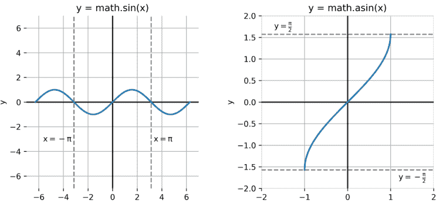

图5.4：正弦函数和反正弦函数的图像

有三个要点需要注意：

- 1. *sin* 可以将任意由 **float** 表示的实数作为参数，但只会产生 −1.0 到 1.0（含）之间的值。换句话说，*sin* 的*定义域*是实数集，其*值域*是满足 −1 ≤ *y* ≤ 1 的实数 *y* 的集合。
- 2. 正弦函数是周期函数：对于任意实数 *x* 和任意整数 *k*，*sin*(*x*) = *sin*(*x* + 2*k*π)。这就是为什么当你在图像中从一端移到另一端时，*sin* 会重复出现。我们说正弦函数的周期为 2π。
- 3. 反函数 *asin* 对于任意实数 *x* 的定义域为 −1 ≤ *x* ≤ 1，但我们将值域限制在 −π/2 ≤ *y* ≤ π/2。

```
math.asin(-1.0)
```

-1.5707963267948966

```
math.asin(-1.5)
```

ValueError: math domain error

## 练习 5.18

*cos* 函数的周期也是 2π。它的定义域和值域是什么？*acos* 的定义域和值域又是什么？

这个结果表明，`math.cos(math.pi/2)` 和 `0.0` 在小数点后约15位内是相同的。你为绝对容差 `abs_tol` 使用的确切值取决于你的应用。并不存在一个在所有情况下都有意义的一般默认值。[PEP485]

**math** 模块不直接支持正割、余割和余切函数。你可以自己实现它们，但必须考虑它们在哪些地方没有定义。

## 练习 5.19

图5.6中的图像是哪个三角函数？

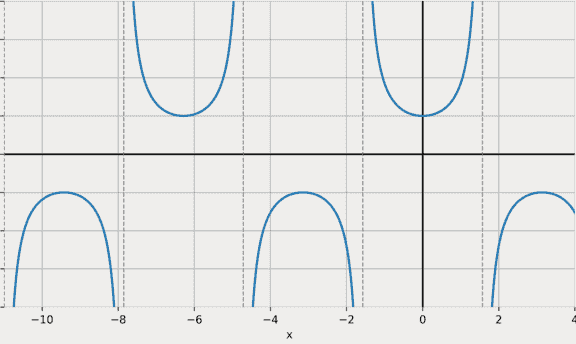

图5.6：神秘图像：这是哪个函数的图像？

该函数在何处未定义？为什么？

我在*《与量子比特共舞》*第4.3节中介绍了三角学。[DWQ]

## 5.3.4 指数和对数

指数函数具有如下形式

c a^x

其中 a > 0，a ≠ 1，c ≠ 0。我们经常用 e 表示 a，e 是欧拉数。Python 中计算 e^x 的函数是 exp。

```
math.e

2.718281828459045
```

```
math.exp(0.0)

1.0
```

```
math.exp(1.0)

2.718281828459045
```

```
math.exp(4.5)

90.01713130052181
```

假设你有一个连续复利的银行账户。如果你开始时本金为 principal、年利率为 annual_rate，这个函数计算 years 年后你拥有的金额。

```
def compound_continuously(principal, annual_rate, years):
    return principal * math.exp(annual_rate * years)
```

```
compound_continuously(100, 0.02, 1)

102.02013400267558
```

```
compound_continuously(100, 0.02, 35)

201.37527074704767
```

在这些示例中，我们使用了2%的利率，并以100单位货币起步。35年后你的钱翻了一番。这并不太令人印象深刻！

## 练习 5.20

修改 *compound_continuously*，使其四舍五入到小数点后两位。

## 练习 5.21

如果年利率是5%，翻倍需要多长时间？如果是10%呢？

对于更一般的指数函数，我们使用 *pow*。

```
y = math.pow(8.0, 3.0)
y
```

512.0

```
math.pow(y, 0.3333333333333333)
```

7.999999999999982

第二个值近似于立方根。

我们经常使用平方根，因此 **math** 为此提供了一个专用函数。

```
math.sqrt(105.0)
```

10.246950765959598

我们处理的是实数，*sqrt* 的参数必须是非负的。

```
math.sqrt(-1.0)
```

ValueError: math domain error

图5.7比较了 c = 1 且 a 分别取 2、e 和 0.5 时的指数函数。它使用了不同的水平和垂直轴比例。当 0 < a < 1 时，出现指数衰减。当 1 < a 时，出现指数增长。

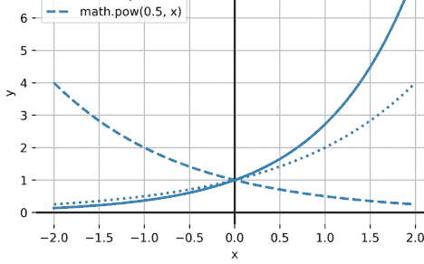

图5.7：三个指数函数的图像

对数是指数的逆运算。如果

y = c a^x      那么      log_a(y/c) = x。

这意味着

x = a^{log_a(x)}      且      x = log_a(a^x)。

我们说，“log_a 是以 a 为底的对数。”对于小于或等于0的参数，它没有定义。当 c = 1 且 a = 2 时，log_2(16) 是使2得到16所需的幂次。

```
math.log2(16)
```

4.0

math 模块提供了 log、log2 和 log10 函数。数学家称 log 为自然对数，有时写成“ln”。log2 是二进制对数。

```
math.log10(10**8)
```

8.0

```
math.log2(2*2*2*2*2)
```

5.0

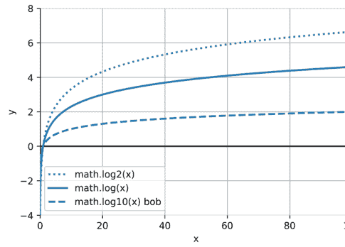

图5.8：三个对数函数的图像

## 练习 5.22

x² 和 2ˣ 哪个增长更快？√x 和 log₂(x) 呢？

## 练习 5.23

函数

```
def mystery_function(n):
    return math.trunc(math.log2(n))
```

对于正整数 n，这个函数做了什么？编写一个函数，在不使用任何浮点数或任何导入的 Python 模块中的函数的情况下，返回相同的结果。

Python 以最简形式存储分数，这意味着分子和分母没有共同的质因数。另一种说法是，分子和分母的最大公约数为1。

```
f.numerator
```

2

```
f.denominator
```

3

```python
import math

math.gcd(f.numerator, f.denominator)
```

1

仔细看最后一个表达式，注意我写的是 `f.numerator` 而不是 `f.numerator()`。我没有把 *numerator* 作为方法调用，而是请求分数的“分子属性”。*属性*是对象固有的部分或特征。我们将在[第7.5节](#)中讨论如何在类中定义属性。

Python 会规范化负分数，使其分子为负。

```
Fraction(1, -5)
```

Fraction(-1, 5)

```
- Fraction(3, 7)
```

Fraction(-3, 7)

**Fraction** 支持常用的代数运算符。

```
a = Fraction(2, 3)
b = Fraction(7, 4)

2 * a
```

Fraction(4, 3)

```
a + b
```

Fraction(29, 12)


```
r, phi = p = cmath.polar(z)

print(f"z = {z}\n{r = }\n{phi = }")
```

```
z = (-1.7677669529663689-1.7677669529663689j)
r = 2.5
phi = -2.356194490192345
```

```
-3 * math.pi / 4
```

```
-2.356194490192345
```

*polar* 方法将直角坐标形式转换为极坐标形式，而 *rect* 方法则将极坐标形式转换为直角坐标形式。

```
cmath.rect(r, phi)
```

```
(-1.7677669529663687-1.7677669529663689j)
```

一些作者将非零复数的相位 φ 取值范围定义为 0 ≤ φ < 2π，另一些作者则定义为 −π < φ ≤ π。Python 采用前一种方式，而我的图展示的是后一种方式。相位有时也称为复数的*辐角*。

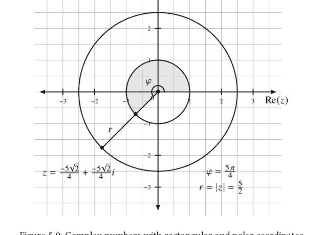

图 5.9：具有直角坐标和极坐标的复数

我们首先定义一个不定符号 x 和一个多项式 p。

```
import sympy as sym

x = sym.Symbol('x')
p = x**3 - 2*x**2 - 5*x + 6
p
```

```
x**3 - 2*x**2 - 5*x + 6
```

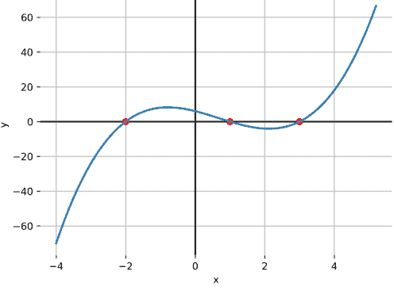

图 5.10：三次多项式 x³ - 2x² - 5x + 6 的图像

虽然并非所有多项式都能在整数范围内因式分解，但 p 可以。

```
sym.factor(p)
```

```
(x - 3)*(x - 1)*(x + 2)
```

通过观察因式分解结果，我们可以看到 p(3) = 0。我们可以通过将 x 替换为 3 来确认这一点。

```
p.subs(x, 3)
```

```
0
```

我们还可以稍微复杂一些，计算 x → 3 时的极限。

```
sym.limit(p, x, 3)
```

```
0
```

求导很直接：

```
sym.diff(p, x)
```

```
3*x**2 - 4*x - 5
```

积分同样简单。

```
sym.integrate(p, x)
```

```
x**4/4 - 2*x**3/3 - 5*x**2/2 + 6*x
```

## 5.7 随机数

这里有一个任务：请给我五个介于 1 和 10 之间（包括 1 和 10）的随机整数。出现重复数字也没关系。

Python 在 `random` 模块中提供了 `randint`，用于生成指定范围内的随机整数。

```
import random

[random.randint(1, 10) for i in range(6)]
```

```
[5, 8, 5, 10, 10, 1]
```

这些数字真的随机吗？我们再做一次：

```
[random.randint(1, 10) for i in range(6)]
```

```
[9, 6, 4, 5, 6, 8]
```

两个列表不同，但现在让我们在列表推导式之前插入一次额外调用，然后再执行两次。

```
random.seed(10)
[random.randint(1, 10) for i in range(6)]
```

```
[10, 1, 7, 8, 10, 1]
```

```
random.seed(10)
[random.randint(1, 10) for i in range(6)]
```

```
[10, 1, 7, 8, 10, 1]
```

这些序列看起来就不那么随机了。

### 5.7.1 伪随机性

*random* 函数计算一个大于或等于 0 且小于 1 的伪随机**浮点数**。

```
[random.random() for i in range(3)]
```

```
[0.20609823213950174, 0.81332125135732, 0.8235888725334455]
```

在经典计算中，我们从某个*种子*数开始，然后执行一系列算术运算和位运算，以获得“随机”数。如果使用相同的种子开始，我们就会得到相同的数字序列。默认情况下，Python 使用计算机系统时间作为种子，不过你也可以通过 `seed` 设置种子。因此，我们将这些数字称为*伪随机*数。

如果我知道你的种子，并且知道你使用的随机数生成算法，那么我可能就能复现你生成的数字。因此，在将伪随机数用于密码学时必须格外谨慎。Python 文档在讨论 `random` 时对此作出了说明：

> **警告：** 不应将此模块中的伪随机数生成器用于安全目的。
> 对于安全或密码学用途，请参阅 `secrets` 模块。

牢记这一点后，我们继续介绍 `random`。

### 5.7.2 分布

*random* 函数提供的是区间上的*均匀分布*数字，这意味着任意一个值出现的可能性都与其他值相同。更一般地说，`uniform(r, s)` 提供范围 *r ≤ n ≤ s* 内的随机**浮点数** *n*。

```
[random.uniform(0, 2) for i in range(3)]
```

```
[1.3069450678023515, 0.3204591130376393, 1.0413387192798491]
```

这三个随机数都介于 0 和 2 之间（包括端点）。只有三个值时，你无法看出这是均匀分布，但使用一百万个值就能更好地观察到这一点。

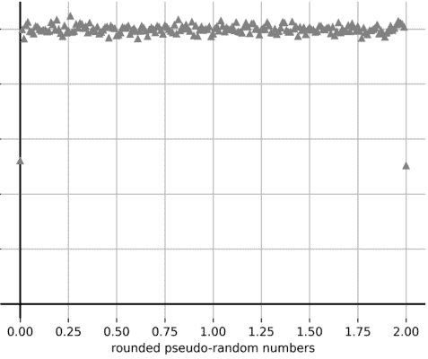

图 5.11：均匀分布中的一百万个伪随机数

我使用 **matplotlib** 创建了图 5.11，我们将在_第 13 章：创建绘图和图表_中讨论它。具体步骤如下：

- 在循环中调用 `random.uniform(0, 2)` 一百万次，并将每个伪随机数四舍五入到小数点后两位。
- 创建一个字典，其中键是四舍五入后的伪随机数，值是这些数字出现的次数。
- 将伪随机数绘制在横轴上，将出现次数绘制在纵轴上。

先不考虑端点处的异常，你可以看到我生成每个值的次数大致相同。这就是分布中“均匀”的部分，也通常是人们要求一个“随机数”时所希望得到的结果。

## 练习 5.29

描述一下：如果我使用的伪随机数远多于或远少于一百万个，图像会是什么样子？

## 3.5 比较判别法

假设我们有两个正项级数 ∑aₙ 和 ∑bₙ。如果 ∑bₙ 是一个已知的收敛级数，且 aₙ ≤ bₙ，那么 ∑aₙ 收敛。如果 ∑bₙ 是一个已知的发散级数，且 aₙ ≥ bₙ，那么 ∑aₙ 发散。

比较判别法很有用，但它要求我们有一个已知级数可供比较。在许多情况下，我们可以使用几何级数或 p 级数作为比较级数。然而，寻找所需的不等式并不总是容易的，而极限比较判别法提供了一种更加灵活的替代方案。

*sample* 函数不会将牌从牌堆中移除。你必须自行移除这些牌。

## 练习 5.32

编写一个函数，发出 *n* 张牌，然后将它们从牌堆中移除。请务必检查牌堆中是否有足够的牌可供发出。

如果我只想要一张随机牌，可以使用 `choice`。这个函数同样不会修改列表。

```
random.choice(card_deck)
```

`'9H'`

`choice` 和 `sample` 可以处理列表，但不能直接处理集合或字典。你必须先将其转换为列表。

```
random.choice(list({1, 2, 3, 4, 5}))
```

`4`

```
numbers = {0: "zero", 1: "one", 2: "two"}
key = random.choice(list(numbers.keys()))
key
```

`2`

```
numbers[key]
```

`'two'`

## 5.8 量子随机性

在本章中，我们已经看到，数字有许多不同的表示方式。对于整数，我们有十进制、二进制和十六进制。对于浮点数，有带小数点的数字和科学计数法。对于复数，我们使用 Python 的 j 语法。

量子比特也有其特殊的表示方式。在数学上，我们将量子比特的状态写作

$$a\lvert 0\rangle + b\lvert 1\rangle$$

## “啊哈！”时刻的心理学：前因与洞见后果的元分析

Sara W. Staszak¹ 和 Subrahmanyam²

¹ 加利福尼亚大学戴维斯分校心理学系，美国加利福尼亚州戴维斯

² 加利福尼亚大学伯克利分校心理学系，美国加利福尼亚州伯克利

> “啊哈！”时刻是突然出现的洞见，它们会改变我们理解世界的方式。但是什么会触发这些时刻？它们又会对我们产生什么影响？一项新的元分析发现，关键成分包括惊讶、努力，以及少量积极情绪。

## 摘要

突然洞见的体验——俗称“啊哈！”时刻——长期以来一直令心理学家着迷，但其前因与后果从未得到系统量化。本元分析综合了 214 项独立研究的数据（总 N = 28,491），考察“啊哈！”体验的认知、情感和动机预测因素，以及其对记忆、学习和创造力的后续影响。通过使用随机效应模型，我们发现了强有力的证据表明：“啊哈！”时刻更可能出现在经历一段僵局之后（Cohen's d = 0.72），当解决方案通过重构而非渐进式分析获得时（d = 0.68），以及当解决方案伴随着惊讶感时（d = 0.93）。 “啊哈！”时刻的后果同样显著：它们增强了对解决方案及其背景的记忆（d = 0.81），提高了任务动机（d = 0.57），并增加了将解决方案迁移到新问题中的可能性（d = 0.49）。然而，“啊哈！”体验本身并不一定意味着更高的客观洞见准确性——事实上，虚假洞见几乎与真实洞见一样常见。调节分析显示，“啊哈！”体验的强度受到认知需要、特质积极情感和文化背景等个体差异的影响。我们提出了一个整合模型：在该模型中，“啊哈！”体验充当一种元认知奖励信号，强化导致洞见的探索性搜索过程，从而塑造未来的问题解决策略。

## 引言

很少有体验像一个困难问题的解决方案突然跃入脑海的那一刻一样，既普遍可识别，又令人强烈着迷；这一刻通常还伴随着确定感和愉悦感。威廉·詹姆斯将这一现象称为“解决方案瞬间合理性的感觉”（James, 1890），而卡尔·邓克等格式塔心理学家则将其视为“生产性”而非“再生性”潜伏期的一个实例，神经相关因素），所操纵或测量的前因变量（例如时间压力、僵局、积极情绪、睡眠），所测量的后果变量（例如记忆表现、动机、创造力），以及所报告效应的方向和显著性。

在一项研究报告多个效应量的情况下，我们为每项研究中的每个构念选择一个效应量，以确保独立性。对于组间比较，我们计算标准化均值差（Cohen's d）；必要时，则使用标准公式将相关系数转换为 d。

## 统计分析

所有分析均使用 R 中的 metafor 包（版本 3.0；Viechtbauer, 2010）和 JASP（版本 0.17）完成。我们使用限制性最大似然估计的随机效应模型来估计平均效应量，并检验异质性（I²）。我们使用 Egger 回归检验和剪补法分析检验发表偏倚。调节变量则通过混合效应元回归进行检验。

## 结果

我们的检索确定了 1,947 条记录。移除重复记录并筛选标题和摘要后，对 412 篇全文文章进行了资格评估，其中 214 项研究符合纳入标准。最终样本包括来自 29 个国家的 28,491 名参与者，发表年份从 1962 年到 2024 年不等。样本量中位数为 87（四分位距 52–154）。

## “啊哈！”时刻的前因

表 1 总结了至少在三项独立研究中考察过的所有前因变量的效应。最强且最稳健的前因是僵局的存在：在解决问题之前陷入僵局的参与者，相比于未经历僵局就解决问题的参与者，体验到的“啊哈！”时刻强度显著更高，平均效应量为 d = 0.72，95% CI [0.58, 0.86]。第二强的前因是解决方式：通过重构解决的问题，相比于通过渐进式、逐步分析解决的问题，会产生更强烈的“啊哈！”体验（d = 0.68，95% CI [0.51, 0.84]）。惊讶也是一个显著的前因：出乎意料的正确解决方案比预期中的正确解决方案引发了更高的“啊哈！”评分（d = 0.93，95% CI [0.71, 1.15]）。情感状态也会调节“啊哈！”体验：积极情绪诱导（例如在任务开始前观看一段简短的喜剧片段）会增强“啊哈！”时刻的强度（d = 0.35，95% CI [0.19, 0.51]），而消极情绪诱导则会减弱其强度（d = −0.42，95% CI [−0.58, −0.26]）。

**表 1：关于“啊哈！”时刻前因的随机效应元分析汇总**

| 前因变量 | k | N | d | 95% CI | I² | Egger 检验 p |
| --- | --- | --- | --- | --- | --- | --- |
| 僵局（相对于无僵局） | 34 | 4,567 | 0.72 | [0.58, 0.86] | 61% | .12 |
| 重构（相对于渐进式分析） | 28 | 3,821 | 0.68 | [0.51, 0.84] | 67% | .08 |
| 惊讶（对解决方案的惊讶） | 18 | 2,401 | 0.93 | [0.71, 1.15] | 72% | .03 |
| 提示呈现 | 12 | 1,857 | 0.45 | [0.26, 0.64] | 55% | .21 |
| 消极情绪（相对于中性情绪） | 9 | 1,263 | −0.42 | [−0.58, −0.26] | 43% | .46 |
| 积极情绪（相对于中性情绪） | 15 | 2,198 | 0.35 | [0.19, 0.51] | 58% | .19 |

注：k = 研究数量；N = 各研究总样本量；d = 标准化均值差（Cohen's d）；CI = 置信区间；I² = 异质性指数。

## “啊哈！”时刻的后果

我们还对“啊哈！”体验对一系列结果测量的影响进行了元分析（表 2）。最显著的后果体现在记忆方面：经历过“啊哈！”时刻的参与者，无论是对解决方案本身还是对问题背景的记忆，都明显优于未经历“啊哈！”时刻的参与者，d = 0.81，95% CI [0.65, 0.97]。这种记忆优势既存在于即时记忆测试中，也存在于延迟测试中（最长可达一周后）。“啊哈！”时刻还对动机产生了积极影响：它提高了参与者自我报告的任务兴趣，以及他们在后续问题上的坚持程度（d = 0.57，95% CI [0.41, 0.73]）。此外，“啊哈！”时刻促进了迁移：经历洞见的参与者更有可能将解决策略应用到不同领域的新问题中（d = 0.49，95% CI [0.33, 0.66]）。

**表 2：“啊哈！”时刻后果的随机效应元分析汇总**

| 结果测量 | k | N | d | 95% CI | I² | Egger 检验 p |
| --- | --- | --- | --- | --- | --- | --- |
| 记忆（解决方案和背景） | 31 | 4,672 | 0.81 | [0.65, 0.97] | 64% | .07 |
| 任务动机 | 14 | 1,954 | 0.57 | [0.41, 0.73] | 51% | .33 |
| 向新问题迁移 | 17 | 2,610 | 0.49 | [0.33, 0.66] | 55% | .18 |
| 创造力（发散性思维） | 11 | 1,745 | 0.34 | [0.15, 0.53] | 62% | .27 |
| 解决方案的准确性 | 26 | 3,982 | 0.22 | [0.06, 0.38] | 71% | .09 |
| 确定感 | 8 | 1,204 | 0.74 | [0.51, 0.97] | 49% | .15 |

注：k = 研究数量；N = 各研究总样本量；d = 标准化均值差（Cohen's d）；CI = 置信区间；I² = 异质性指数。

## “啊哈！”与洞见准确性

洞见研究中最具争议的问题之一，是“啊哈！”体验是否是解决方案客观正确性的可靠指标。我们的元分析呈现出更复杂的图景。尽管“啊哈！”对解决方案准确性的影响为正但较小（d = 0.22；95% CI [0.06, 0.38]），但这一效应受到一个关键调节变量的影响：问题类型。对于具有唯一客观正确答案的问题（例如复合远距联想题、数学谜题），“啊哈！”与准确性之间的联系中等且显著（d = 0.48，95% CI [0.30, 0.66]）。然而，对于开放式问题（例如创造性生成任务、定义不明确领域中的问题解决），二者的联系实际上为零（d = 0.03，95% CI [−0.18, 0.24]；调节效应 p < .001）。这表明，“啊哈！”体验只有在定义明确的问题空间中，才是准确性的可靠信号。

此外，我们数据集中的若干研究明确考察了虚假洞见现象——即对客观错误解决方案产生“啊哈！”时刻的体验。在六项共计 1,472 名参与者的研究中，所有“啊哈！”时刻中有 28% 是虚假的，这意味着主观确定感并不一定与客观准确性相符。这一发现强调，洞见的现象学体验是心智建构的结果，并且可以与客观现实脱钩。

## 调节分析

为了探究异质性的来源，我们针对僵局对“啊哈！”体验的影响（研究最多的前因）进行了调节分析。以下编码的调节变量均未对效应量产生显著影响：任务类型、控制条件类型、“啊哈！”体验是通过自我报告还是行为指标测量，以及研究是在实验室还是在线进行。然而，个体差异确实发挥了作用。将参与者划分为高认知需要和低认知需要（NFC）的研究报告称，对于高 NFC 参与者，僵局对“啊哈！”体验的影响更大（β = 0.08，p < .001）。考察特质积极情感的研究发现，对于积极情感更高的参与者，僵局增强“啊哈！”体验的效应更强（β = 0.06，p = .01）。文化背景也调节了这一效应：与东亚（集体主义）国家的样本相比，来自西方（个人主义）国家样本的效应更大（β = −0.12，p = .04）。

## 发表偏倚

只有一项分析中的 Egger 检验显著（惊讶作为前因，p = .03）。剪补法分析表明，校正潜在缺失研究后，惊讶的效应量将从 d = 0.93 降至 d = 0.71，但仍然较大且具有统计学显著性，这表明发表偏倚不太可能解释本文报告的主要发现。

## 讨论

“啊哈！”时刻不仅仅是一个主观上的奇特体验；它是一种具有明确触发因素和深远后果的稳健心理现象。我们的元分析表明，当个体通过突然重构问题摆脱僵局时，“啊哈！”体验会可靠地产生，并且会受到积极情感和惊讶的增强。反过来，这种体验会强化记忆、提升动机，并促进策略向新情境迁移。按照传统标准（Cohen, 1988），我们报告的效应量属于中等到较大范围，并且在大量异质性研究中表现出惊人的一致性。

## 元认知奖励假说

我们将这些发现模式解释为支持“啊哈！”时刻的元认知奖励假说。根据这一观点，“啊哈！”体验既不是问题解决的附带现象，也不是事实真相的可靠指标；相反，它是一种评估发现过程的元认知信号。具体而言，“啊哈！”时刻代表一种奖励信号，强化了导致发现的认知行动，其作用类似于多巴胺在强化学习中的作用。这一解释简洁地说明了为什么“啊哈！”时刻在僵局之后更加强烈（僵局带来的紧张与解决方案带来的释然之间的对比更加鲜明），为什么它们会带来更好的记忆（预测奖励的信号会增强记忆巩固），为什么它们会提高动机（奖励本身就具有动机作用），以及为什么它们不能完美追踪客观准确性（奖励信号由内部产生，可能存在校准错误）。

元认知奖励假说还提出了一些可在未来研究中检验的新预测。例如，如果“啊哈！”时刻是一种内部奖励，那么其频率应与特质层面的奖励敏感性呈正相关；即使解决方案是错误的，多巴胺系统的药理学操纵也应增强这种体验。此外，当“啊哈！”体验伴随着强烈的惊讶感时，其记忆优势应当更大，因为已知惊讶会增强多巴胺能信号传递。

## 局限性

本元分析存在若干局限。第一，不同研究对“啊哈！”时刻这一构念的操作性定义并不相同——有些研究依赖主观评分，有些依赖面部表情，还有一些依赖外周生理测量（例如心率、皮肤电导）。虽然这些不同的操作性定义产生了总体一致的发现，但它们在多大程度上反映完全相同的心理构念，仍不清楚。第二，绝大多数研究都以西方受教育的工业化、富裕和民主（WEIRD）社会中的大学生为对象（Henrich et al., 2010），而我们的调节分析表明，文化背景会影响效应大小。第三，由于我们要求研究包含对“啊哈！”体验的测量，因此无法排除我们的检索系统性地排除了仅使用纯行为结果的洞见研究。最后，与所有元分析一样，我们结论的质量取决于原始研究的质量；一些研究的统计功效不足，而且很少有研究预先注册其假设或分析方案。

## 结论

“啊哈！”时刻是一种真实、可测量且具有强大心理效力的事件。它既不是偶然现象，也不只是问题解决的副产品；它是心智向自身发出“已经完成发现”信号的核心机制。理解这一体验的前因和后果，不仅具有理论意义，也对教育、创造力提升和治疗实践具有实际影响。通过阐明“啊哈！”时刻在何时以及为何发生，本元分析为建立更加统一的洞见科学奠定了基础——在这种科学中，我们每个人都熟悉并珍视的突然灵光乍现，将成为心理学研究的核心主题。


我在 *Dancing with Qubits* 的第 7 章开始讨论量子比特。[D.W.Q]

## 5.9 Summary

在本章中，我们看到了许多种类的数字以及表示它们的方式。我通过 **sympy** 引入了像多项式这样的符号计算对象。我们以计算和使用随机数和伪随机数结束了讨论。我开始使用 **qiskit** 来演示在量子计算机上生成 2 位整数的简单方法。量子计算是概率性的，这与经典情况相比是我们设计和实现算法时一个本质的区别。

尽管我们多次使用并定义了 Python 函数，但在下一章我们会深入讨论它们。我们将讨论 Python 提供的许多函数定义特性，以及你为文档说明你的函数做什么的正确方法。

## 6

## Defining and Using Functions

> We are what we repeatedly do. Excellence, therefore, is not an act, but a habit.
> 
> —Will Durant, The Story of Philosophy

我们已经看到了许多简单函数的例子。函数让你编写并打包代码，以便可以多次使用。假设你想打印出大于 0 且小于 6 的奇整数。这可行：

```
for i in range(6):
    if i % 2 == 1:
        print(f"{i} ", end="")
```

1 3 5

如果不是 6，而是想使用 9 或 16 或 1,036 呢？你不想每次更改上界时都重复上面的内容。相反，你编写一个函数，用不同的值反复调用它。

```
def odd_numbers_less_than(n):
    # this function prints out all odd numbers greater
    # than 0 and less than n
    for i in range(n):
        if i % 2 == 1:
            print(f"{i} ", end="")
```

这个定义以 `def` 关键字开始。然后是函数名，*f*，一对开闭括号，以及冒号“：”。下一行缩进并开始 *函数体*。这里是 `pass`。

我们使用 `pass` 在必须包含操作但没有有用的事情可做的地方。把它想成是说，“看我如何强调不做任何事情。” 例如，我可以在条件语句中使用 `pass` 来表示我意识到某种处理选项并选择不做任何事。你也可以使用三个句点“...”代替 `pass`。

从这种最小形式开始，我们开始添加和使用额外的 Python 特性。函数体可以是我们想要打包在一起并反复调用的任何表达式集合。让我们定义一个打印当前时间的函数。

我首先导入两个处理时间的 Python 模块：**datetime** 和 **time**。

```
```python
import datetime
import time
```
```

现在我定义一个函数来获取当前时间并创建格式化的字符串。我使用 *strftime* 来表示小时、分钟和秒，但它也提供其他选项来包含年份、日期、月份和星期几。

```
```python
def print_the_time():
    print(datetime.datetime.now().strftime("%H:%M:%S"))
```
```

```
```python
print_the_time()
```
```

```text
12:47:43
```

由于计算机非常快，如果我立即调用 *print_the_time*，我很可能会得到相同的结果。我暂停两秒钟，使用 *sleep*，然后再次打印时间。

```
```python
time.sleep(2.0)

print_the_time()
```
```

```text
12:47:45
```

我没有给 *print_the_time* 提供任何额外的数据让它工作。函数通常有 *参数* 来改变其行为和计算。

如果你解包一个元组或列表，请对不需要的值使用“_”。你可以使用它多次。

```
```python
quo, _ = divmod(37, 5)
quo
```
```

7

```
```python
_, b, _, d = 10, 20, 30, 40
b + d
```
```

60

如果你想避免使用 Python 关键字作为名称，请使用尾随下划线。

```
```python
import_ = "to bring items into a country for sale"
```
```

当你在屏幕上查看代码或打印在纸上时，很难区分某些字符，尤其是在某些字体中。那是字母大写的“O”还是数字“0”？小写字母“l”和“i”与数字“1”呢？如果可能引起混淆，请小心在名称中使用这些字符。

程序员通常使用变量 i、j 和 k 作为循环中的索引和计数器。我们经常使用 n 和 m 表示整数，z 和 w 表示复数。这反映了作者在技术书籍和文章中使用名称的方式。

当我不需要描述性时，我在本书中使用通用的函数名如 *f*、*g* 和 *h*。同样，我使用 x 和 y 作为通用变量和参数名。

尽可能使你的代码自文档化，在有意义时使用描述性名称。在第 7.8 节，我们将查看显式记录你的工作的约定。

### 6.4 Return values

Python 函数可以不返回任何东西，返回一个东西，或返回许多东西。这涵盖了所有可能性！

事实上，Python 函数总是返回一个对象。让我解释一下。我们本章开头的简单无操作函数似乎不产生任何东西。

```
```python
def f():
    pass
```
```

但如果我们检查结果的类型，我们会看到它是 **NoneType**。

```
type(f())
```

NoneType

```
f() is None
```

True

返回的对象是 None，我们在第 3.9.5 节中讨论过它。如果我们在 f 中使用裸 return，我们会得到相同的结果。

```
def f():
    return
```

```
f() is None
```

True

使用 return 让函数将值传回调用它的地方。

```
def g(x, y):
    return x + y

g(10, 23)
```

33

如果你忘记了 return，你将得到 None。

```
def bad_g(x, y):
    x + y

bad_g(10, 23) is None
```

True

程序员经常忘记 return 语句，尤其是在使用条件语句时是一个常见错误。

```
def bad_abs(x):
    if x < 0:
        return -x
    x

bad_abs(-2)**3
```

8

我可以使用 *位置参数* 调用 *raiser*，此时 Python 将第一个参数分配给 base，第二个分配给 exponent。

```
```python
raiser(2, 3)
```
```

8.0

我也可以显式使用参数名作为 *关键字参数*。

```
```python
raiser(base=2, exponent=3)
```
```

8.0

单独来看，这并不令人兴奋，但它更清楚地说明了参数为函数提供了什么。你可以以任何顺序使用关键字参数。

```
```python
raiser(exponent=3, base=2)
```
```

8.0

位置参数必须在关键字参数之前。这可行：

```
```python
raiser(2, exponent=3)
```
```

8.0

但这不行：

```
```python
raiser(base=2, 3)
```
```

SyntaxError: positional argument follows keyword argument

如果你想强制你的代码使用者传递关键字参数，请在参数列表中放一个“*”。

```
```python
def raiser(*, base, exponent):
    return math.pow(base, exponent)
```
```

```
```python
raiser(2, 3)
```
```

TypeError: raiser() takes 0 positional arguments
           but 2 were given

尽管你不能在星号参数之后使用位置参数，但你可以使用关键字参数。

```
def pick_an_argument(*args, k):
    return args[k]
```

```
pick_an_argument("one", "two", "three", k=1)
```

```
'two'
```

```
pick_an_argument("one", "two", "three", 1)
```

```
TypeError: pick_an_argument() missing 1 required keyword-only argument: 'index'
```

我们使用 "*" 在参数名前收集位置参数到一个元组中，并使用 "**" 收集关键字参数到一个字典中。

```
def show_keyword_args(**kwargs):
    for key, value in kwargs.items():
        print(f"{key = }    {value = }")
```

```
show_keyword_args(x=1, y=2, z=3)
```

```
key = 'x'    value = 1
key = 'y'    value = 2
key = 'z'    value = 3
```

我不会对必需参数使用这种方法，如

```
def raiser(**kwargs):
    if "base" in kwargs and "exponent" in kwargs:
        return math.pow(kwargs["base"], kwargs["exponent"])
    return "I do not know what you are trying to do"
```

```
raiser(exponent=3, base=2)
```

```
8.0
```

```
raiser(sugar=3, flour=2)
```

```
'I do not know what you are trying to do'
```

但我会考虑将其用于可选参数。你可以使用任何有效的变量名代替 kwargs。


- 9. 在关键字或默认参数中，**不要**在等号周围包含空格。

- 10. 在算术表达式中，**不要**在负号和数字、变量或表达式之间放置空格。**不要**在用于指数运算的“**”周围放置空格。**要**在“+”、“-”和“*”用于加法、减法和乘法时周围放置空格。然而，当将变量乘以整数或当紧密分组项使表达式更易读时，你可以省略空格。例如，2*x - x*y。运用你的判断，但要保持一致。

## 6.8 嵌套函数

你可以在另一个函数内部定义一个函数。我们说内部函数是 *nested* 在外部函数内部。

```python
def f(x, y):
    w = 10
    def g(z):
        return z**3 + w
    return g(x + y)
```

```python
f(2, 3)
```

```text
135
```

第 3 行的嵌套函数 g 可以看到并使用在 *f* 内部但在其定义外部的 w。

你不能通过名称在包含它的函数外部调用嵌套函数。

```python
g(3)
```

```text
NameError: name 'g' is not defined
```

为避免混淆，不要为嵌套函数使用一个你也用于包含函数的参数名。你不能从嵌套函数返回到定义它的函数之外。你可以使用异常通过 try 和 except 来实现这种行为。

你可以定义多于一个嵌套函数，并且嵌套函数内部可以包含额外的函数定义。

按照惯例，我们将全局常量的名称全部大写。为了使我的代码更易读，我将赋值块中的等号对齐。

## 6.9.3 nonlocal

有一个情况 global 无法解决。如何处理在函数中定义、而我想在嵌套函数中重新赋值的变量？

```python
my_variable = "SET AT GLOBAL SCOPE"
print(f"Global: {my_variable}")
```

```text
Global: SET AT GLOBAL SCOPE
```

```python
def h():
    my_variable = "SET IN h"
    print(f"Inside h: {my_variable}")
    def inner_h():
        my_variable = "SET IN inner_h"
        print(f"Inside inner_h: {my_variable}")
    inner_h()
    print(f"Inside h: {my_variable}")

h()
```

```text
Inside h: SET IN h
Inside inner_h: SET IN inner_h
Inside h: SET IN h
```

```python
print(f"Global: {my_variable}")
```

```text
Global: SET AT GLOBAL SCOPE
```

嵌套行为符合我们的预期，我们在不同作用域中有三个名为 `my_variable` 的变量。我怎样才能让 `inner_h` 中的 `my_variable` 与 `h` 中的 `my_variable` 相同？让我们看看使用 global 会发生什么：

```python
my_variable = "SET AT GLOBAL SCOPE"
print(f"First global: {my_variable}")
```

```text
First global: SET AT GLOBAL SCOPE
```

```python
def h():
    my_variable = "SET IN h"
    print(f"In h: {my_variable}")

    def inner_h():
        nonlocal my_variable
        my_variable = "SET IN inner_h"
        print(f"In inner_h: {my_variable = }")
    inner_h()
    print(f"In h: {my_variable = }")

h()
```

```text
In h: my_variable = 'SET IN h'
In inner_h: my_variable = 'SET IN inner_h'
In h: my_variable = 'SET IN inner_h'
```

```python
print(f"Global: {my_variable = }")
```

```text
Global: my_variable = 'SET AT GLOBAL SCOPE'
```

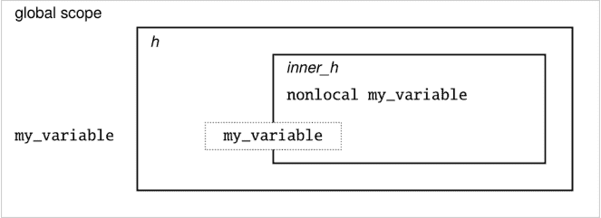

图 6.4：在嵌套函数中使用 "nonlocal"

### 练习 6.9

在 *inner_h* 内部定义一个函数 *inner_inner_h*。在 *inner_inner_h* 中为 *my_variable* 分配一个值，使其与 *inner_h* 中的 *my_variable* 相同。你能使 *inner_inner_h* 中的 *my_variable* 与 *h* 中的相同但不同于 *inner_h* 中的吗？

正如你所见，这可能会非常令人困惑，所以保持你的代码简单。考虑使用函数参数和返回的元组来访问和传递变量的更改。Python 提供了 *nonlocal* 以实现完整性，但我从未在自己编写的代码中使用过它。我使用的语言特性的选择反映了我的软件设计哲学和风格。

```python
product = 1
for i in range(1, n + 1):
    product *= i
return product
```

```python
iterative_factorial(12)
```

```text
479001600
```

```python
iterative_factorial(1000)
```

```text
4023872600770937735437024339230039857193748642107146325437999104299385123986290205920442084869694048004799886101971960586316668729948085589013238296699445909974245040870737599188236277271887325197795059509952761208749754624970436014182780946464962910563938874378864873371191810458257836478499770124766328898359557354325131853239584630755574091142624174743493475534286465766116677939666888209210739143853719588249808126867838374559731746136085379534524215...15680594187274899809425474217358240106367740459574178516082923013558081
```

```text
-> 19: x = 8  y = 8
-> 20: x = 0  y = 8

gcd = 8
```

我们可以用一个使用除法的版本做得更好。回想一下 divmod(x, y) 返回元组 (x // y, x % y)。如果我们令 q, r = divmod(x, y)，那么 x == q*y + r 且 x - q*y = r。

### 练习 6.18

证明这个等式意味着如果素数 p 整除 x 和 y，则 p 整除 r。

```python
def gcd(x, y, step=1):
    print(f"-> {step:>2}: {x = }  {y = }")
    x, y = abs(x), abs(y)

    if x < y:
        x, y = y, x

    if y == 0:
        return x

    # at this point, we know that x and y are positive integers > 1
    # with x >= y > 0

    return gcd(y, x % y, step + 1)
```

```python
print(f"\ngcd = {gcd(-24, 400)}")
```

```text
->  1: x = -24  y = 400
->  2: x = 24   y = 16
->  3: x = 16   y = 8
->  4: x = 8    y = 0

gcd = 8
```

将数学定义翻译成 Python 实现有两个明显的缺陷：

- 1. 有许多递归调用，特别是，
- 2. 在计算 Fₙ₋₁ 的过程中，我们计算了 Fₙ₋₂，然后又单独再次计算。

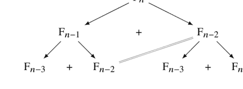

图 6.5：斐波那契双递归函数调用

### 练习 6.21

找到一个数 c₂ 使得

Cₙ ≤ c₂ 2ⁿ

对 F₀ 到 F₉ 成立。你能找到的最小 c₂ 是多少？

令 a = (1 + √5) / 2。找到一个数 cₐ 使得 Cₙ ≤ cₐ aⁿ 对 F₀ 到 F₉ 成立。你能找到的最小 cₐ 是多少？

递归斐波那契函数是 O(2ⁿ) 吗？它是 O(aⁿ) 吗？

一种更有效的方法是缓存我们在字典中计算的值。“缓存”是指为以后重用保存结果。

```python
def cached_fibonacci(n, cache=None):
    if not isinstance(n, int) or n < 0:
        raise ValueError("Argument must be a non-negative integer.")

    if n < 2:
        return n

    if cache is None:
        cache = {0:0, 1:1}

    # Compute Fibonacci(n - 1) first, thereby calculating all
    # Fibonacci values for values less than n - 1

    if n - 1 in cache:
        fibonacci_n_minus_1 = cache[n - 1]
    else:
        cache[n - 1] = fibonacci_n_minus_1 = cached_fibonacci(n - 1, cache)

    # I know we have computed Fibonacci(n - 2)

    result = cache[n] = fibonacci_n_minus_1 + cache[n - 2]
    return result

for j in range(16):
    print(f"{cached_fibonacci(j)} ", end="")
```

```text
0 1 1 2 3 5 8 13 21 34 55 89 144 233 377 610
```

注意我如何使用 None 和 cache 的默认值。

### 练习 6.22

对于 n = 0 到 9，计算计算 Fₙ 所需的 cached_fibonacci 调用次数 Cₙ。

在这个缓存版本中，我们只计算一次斐波那契数列中的值，并且在必须时才递归。我们用这个迭代版本完全去除了递归，该版本包含了优雅的并行赋值用法：

```python
def iterative_fibonacci(n):
    if not isinstance(n, int) or n < 0:
        raise ValueError("Argument must be a non-negative integer.")

    if n < 2:
        return n
```


a, b, m = 0, 1, 2

while m < n:
    a, b, m = b, a + b, m + 1

return a + b

for j in range(16):
    print(f"{iterative_fibonacci(j)} ", end="")

0 1 1 2 3 5 8 13 21 34 55 89 144 233 377 610

## Exercise 6.23

在 while 循环中插入 print(f"{a = } {b = } {m = }")。解释在计算 iterative_fibonacci(5) 时 a、b 和 m 的值。

## Exercise 6.24

对于 n = 0 到 9，计算计算 Fₙ 时我们必须进行的对 iterative_fibonacci 的调用次数 Cₙ。

谨慎且深思熟虑地在 Python 中使用递归。在本节中，我们看到了三种完成相同任务的算法，它们具有非常不同的执行时间和计算机资源使用情况。

## 6.12.4 Execution timing

让我们定义一个函数来运行并计时我们的斐波那契实现。

```
import time

def time_a_fib(n, fib_function, fib_function_name):
    # time_a_fib computes a fibonacci value for n.
    # fib_function is the function object and
    # fib_function_name is a string with the function's name
```

```
def p(x):
    return x**3 - 5*x**2 + 7*x + 1

[p(x) for x in range(-2, 4)]
```

[-41, -12, 1, 4, 3, 4]

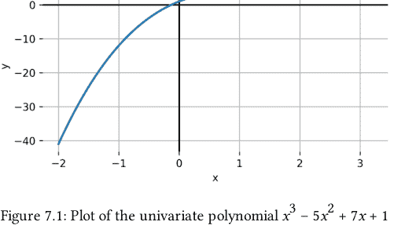

Figure 7.1: Plot of the univariate polynomial x³ - 5x² + 7x + 1

在我们对 p 的定义中，有四个系数：1、-5、7 和 1。它们分别是 x³、x²、x 和不可见的 x⁰ = 1 之前的显式或隐式数字。我们的每个系数在实现中都必须是 int。

单个系数-不定元-指数表达式是一个项。当且仅当其系数为零时，项为零。只有一个项的多项式是单项式。

对于任何给定的指数，最多只有一个项具有该指数。也就是说，我们总是将类似 3x² - 5x² 的式子简化为 -2x²。

每个指数都必须是大于或等于 0 的 int。属于非零项的最大指数是多项式的次数。零多项式的次数为 0。次数为 0 的多项式称为常数多项式。

如果我们有两个多项式

p = x² + 7x + 1    and    q = 4x² - 7x + 3

那么

2p = 2x² + 14x + 2    and    p + q = 5x² + 4.

请注意，两个多项式的相加会将具有相同指数的对应项的系数相加。

```
# Validate that the coefficient is an int.
if not isinstance(coefficient, int):
    raise ValueError(
        "The coefficient for a UniPoly must "
        "be an int.")

# Validate that the exponent is a non-negative int.
if not isinstance(exponent, int) or exponent < 0:
    raise ValueError(
        "The exponent for a UniPoly must "
        "be a non-negative int.")

# Validate that the indeterminate is an alphabetic
# string of length 1.
if (not isinstance(indeterminate, str) or
    len(indeterminate) != 1 or
    not indeterminate[0].isalpha()):
    raise ValueError(
        "The indeterminate for a UniPoly must "
        "be an alphabetic str of length 1.")

self.coefficient = coefficient
self.indeterminate = indeterminate
self.exponent = exponent

def __repr__(self):
    # create the object representation of the polynomial
    return f"UniPoly({self.coefficient}, " + \
           f"{repr(self.indeterminate)}, {self.exponent})"

def __str__(self):
    # create the displayable string form of the polynomial
    return f"{self.coefficient}*" + \
           f"{self.indeterminate}**{self.exponent}"
```

我们对 UniPoly 的初始定义以 class 关键字开始，后跟类名。第一行以冒号 “:” 结束。然后我使用 def 定义了三个实例方法。

这些是实例方法，因为它们是我在类中定义的、在类创建的实例上操作的功能。每个方法的第一个参数是必需的，名为 “self”。self 表示方法所应用的实例。

我们使用 __str__ 来创建多项式的可显示形式，尽管我们需要改进其样式使其更具数学性。当你对对象使用 str 函数时，Python 会调用 __str__ 方法。Python 也可能在期望 str 对象的情况下调用 __str__，例如在 f-string 中。

```
str(x)
```

'1*x**1'

```
print(x)
```

1*x**1

## Exercise 7.2

你将如何定义 UniPoly 才能在不带参数调用时使用三个参数的默认值？这些值应该是什么？

到目前为止的类定义会产生无用的多项式。

```
2 * UniPoly(1, 'J', 1)
```

```
TypeError: unsupported operand type(s) for *:
'int' and 'UniPoly'
```

```
UniPoly(2, 'α', 3) + 1
```

```
TypeError: unsupported operand type(s) for +:
'UniPoly' and 'int'
```

## Exercise 7.3

你对 'α' 在 isalpha 测试中返回 True 感到惊讶吗？研究 Python 接受的字母字符，从 Unicode 中的“字母”开始。 [UNI]

现在让我们引入系数、指数和项。

## 7.3 Object representation

正如我们之前看到的，每个多项式都将其不定元存储为单个字母字符的字符串。记住，一个多项式的不定元可能是 'x'，而另一个可能使用 'z'。我们现在不必担心这个问题，但在进行加法和乘法等二元运算时我们会担心。

我们需要设计如何表示多个项。由于所有项共享一个不定元，每个项只需要系数和指数的 int 值。我可以将它们放在一个列表的列表中，并说那些就是项。我们的多项式

p = x² + 7x + 1   and   q = 4x³ − 7x² + x − 9

可以表示为

```
[[1, 2], [7, 1], [1, 0]]
```

和

```
[[4, 3], [-7, 2], [1, 1], [-9, 0]]
```

其中每个内部列表都是一个系数-指数对。

如果我们使用这种表示法，有三条规则：

- 1. 没有两个不同的项具有相同的指数。
- 2. 从不包含系数为零的项。
- 3. 因此，我们可以用一个空列表唯一地表示零多项式。

我们将多项式

3x⁶ − 5x⁴ + x

表示为

```
[[3, 6], [-5, 4], [1, 1]]
```

在这个设计中。

多项式 0 是 [ ]。

当我以数学格式显示像 3x⁶ − 5x⁴ + x 这样的多项式时，我按指数降序显示。我也可以按升序显示，但其中一种是必要的，以便于阅读多项式。毫不奇怪，我对内部列表按第二项即指数进行了降序排序，在 Python 表示中也是如此。这有必要吗？我需要保持项列表的排序吗？

如果需要，每次我乘两个多项式并为乘积创建新项时，我必须将新项插入到正确序列中或在最后对项进行排序。

```
unsorted_terms = [[-5, 4], [1, 1], [3, 6]]
unsorted_terms
```

[[-5, 4], [1, 1], [3, 6]]

```
sorted(unsorted_terms, key=(lambda term: term[1]), reverse=True)
```

[[3, 6], [-5, 4], [1, 1]]

sorted 的可选关键字参数 key 接受一个返回用于比较的某个值的函数。在这种情况下，它返回项中的第二项，即指数。sorted 使用 “<” 来比较 key 的结果。如果设置 reverse=True，sorted 使用 “>”。

## Exercise 7.4

key 的默认值是 None。那么 sorted 使用什么比较值？

你可能会认为仔细的项插入或重复排序并不费力，但在多项式具有数十或数百个项时，它可能成为严重的性能瓶颈。我现在决定我不会担心表示中的指数顺序，我只会在需要显示多项式时排序。

放弃指数的顺序似乎更好，但如果我正在加两个多项式并且必须查看每个多项式中具有相同指数的项怎么办？如果我手头有一个多项式的项，我必须搜索第二个多项式的每个项以尝试找到具有相同指数的对应项（如果存在）。


```python
# Validate that the indeterminate is an alphabetic
# string of length 1.
if (not isinstance(indeterminate, str) or
    len(indeterminate) != 1 or
    not indeterminate[0].isalpha()):
    raise ValueError(
        "The indeterminate for a UniPoly must "
        "be an alphabetic str of length 1.")

# The 'variable' for the polynomial.
self.indeterminate = indeterminate

# The terms in the polynomial. Each key is an int
# exponent and each value is the int coefficient.

if coefficient != 0:
    self.terms = {exponent: coefficient}
else:
    self.terms = dict()
```

在`__init__`的第二个版本中，我在第32行和第34行定义了一个字典实例变量`self.terms`。`self.terms`保存指数-系数键值对。

你注意到我如何处理系数为零的情况了吗？当且仅当`terms`字典为空时，`UniPoly`实例为零。在我们的实例方法中，我们经常会检查这种特殊情况。

我暂时推迟重新实现`__repr__`和`__str__`，直到我们能够创建包含多项的多项式。

## 7.4 魔术方法

你并不直接调用`__init__`、`__repr__`和`__str__`这三个方法；当 Python 需要初始化实例、获取输入表示或转换为字符串时，它会“神奇地”替你调用它们。你可以定义数十个这类带有预定义用途的“魔术方法”。对多项式而言，代数方法和比较方法对我们很重要，让我们来看一些例子。

### 7.4.1 取负

我现在通过`__neg__`定义取负运算，通过对每个系数应用“ - ”来创建新的多项式。在`UniPoly`的第三个版本中，我扩展了`__init__`，使其接受一个系数和一个指数。

```python
class UniPoly:
    # UniPoly creates univariate polynomials with integer coefficients
    # Version 3

    def __init__(self,
        coefficient=1,
        indeterminate='x',
        exponent=0):

        # Create a UniPoly object from an integer coefficient,
        # string indeterminate, and non-negative integer
        # exponent

        if not isinstance(coefficient, int):
            raise ValueError(
                "The coefficient for a UniPoly must "
                "be an int.")

        if not isinstance(exponent, int) or exponent < 0:
            raise ValueError(
                "The exponent for a UniPoly must "
                "be a non-negative int.")

        if (not isinstance(indeterminate, str) or
            len(indeterminate) != 1 or
            not indeterminate[0].isalpha()):
            raise ValueError(
                "The indeterminate for a UniPoly must "
                "be an alphabetic str of length 1.")

        # The 'variable' for the polynomial
        self.indeterminate = indeterminate

        # The terms in the polynomial. Each key is an int
        # exponent and each value is the int coefficient.

        if coefficient != 0:
            self.terms = {exponent: coefficient}
        else:
            self.terms = dict()

    def __neg__(self):
        # Negate the polynomial term-wise unless it is already 0.
        if not self.terms:
            return self

        new_poly = UniPoly(0, self.indeterminate)
        for exponent in self.terms:
            new_poly.terms[exponent] = -self.terms[exponent]

        return new_poly

    def __repr__(self):
        return str(self)

    def __str__(self):
        # Do a very rough and incomplete conversion to str.

        if not self.terms:
            return '0'

        print_terms = [
            f"{self.terms[exponent]}*{self.indeterminate}**{exponent}"
            for exponent in sorted(self.terms, reverse=True)
        ]

        return " + ".join(print_terms)
```

现在我们验证一下我们可以对多项式取负：

```python
p = UniPoly(2, 'z', 5)
```

```python
p, -p
```

```
(2*z**5, -2*z**5)
```

```python
UniPoly(0), -UniPoly(0)
```

```
(0, 0)
```

在我的`__neg__`定义中（第43行），我复制了`self`的实例数据，只是对系数取了负。我没有改变`self`中`terms`字典里的系数。如果我改变了，任何指向原始多项式的变量都将指向一个取负后的版本。

### 7.4.2 布尔转换

虽然我本可以通过以下方式定义`__bool__`：

```python
def __bool__(self):
    # Returns "True" if self is nonzero.
    return True if self.terms else False
```

但类中的版本更简洁。

完成这一步之后，我们就可以使用`if self:`这样的测试，而不是`if self.terms`：

```python
def poly_is_zero(p):
    print("not zero" if p else "zero")

poly_is_zero(UniPoly(0, 'x', 1))
```

```
zero
```

```python
poly_is_zero(UniPoly(1, 'x', 1))
```

```
not zero
```

在你的`__bool__`实现中，请显式返回 True 或 False。

### 7.4.3 相等性测试

我们实现的下一个魔术方法是`__eq__`，当调用`==`时，它测试两个多项式是否相等。

我把相等性测试搞得比较复杂，因为我想在常数多项式等于某个整数时返回 True。记住，常数是零次多项式。

我测试两个多项式是否相等的策略，是查看所有它们可能不相等的方式。一旦我把这些方式都排除掉，这两个多项式就一定相同。

```python
def __eq__(self, other):
    # Tests for equality between a polynomial and an int
    # or between two polynomials.

    if isinstance(other, int):
        # If we have a constant polynomial and the
        # coefficient is the int, return True.

        if not self.terms:
            # self is the zero polynomial.
            return other == 0
        if other == 0:
            # self is not 0 but other is 0.
            return False
        if len(self.terms) > 1:
            return False
        if 0 not in self.terms:
            return False
        # self is a constant polynomial.
        if self.terms[0] == other:
            return True
        return False

    if isinstance(other, UniPoly):
        # Both are polynomials.

        if self.indeterminate != other.indeterminate:
            # The indeterminates are different.
            return False
        if len(self.terms) != len(other.terms):
            # They have different numbers of terms.
            return False

        for exponent in self.terms:
            if exponent not in other.terms:
                # An exponent in self is missing from other.
                return False
            if self.terms[exponent] != other.terms[exponent]:
                # The coefficients of terms of equal exponent
                # are different.
                return False

        return True

    return NotImplemented
```

我们首先检查与常数进行比较的情况：

```python
UniPoly(0) == 0, UniPoly(3, 'w', 0) == 3
```

```
(True, True)
```

现在用一些非平凡的多项式来测试：

```python
p = UniPoly(3, 'w', 1)
p
```

```
3*w
```

```python
p == 3
```

```
False
```

```python
UniPoly(3, 'x', 7) == UniPoly(3, 'y', 7)
```

```
False
```

```python
q = UniPoly(3, 'x', 7)
q == q
```

```
True
```

你可能会惊讶地发现，“!=” 现在也能正常工作。

```python
q != q
```

```
False
```

```python
UniPoly(3, 'x', 7) != UniPoly(3, 'y', 7)
```

```
True
```

实现 `!=` 的魔术方法是`__ne__`。如果你没有实现它，Python 会计算 `not (a == b)` 而不是 `a != b`。

我实现了判断多项式 `p` 是否等于整数 `n` 的测试：`p == n`。我没有显式实现 `n == p`。必要时 Python 会替我们反转参数并执行测试。

```python
-5 == UniPoly(-5, 'w', 0)
```

```
True
```

虽然这在这里是合适的，但对于减法之类的运算就不合适了。

注意`__eq__`的最后一行：`return NotImplemented`。在这个定义中，我检查了多项式与整数之间以及两个多项式之间的相等性。我返回 NotImplemented 的意思是：“我已经在此处做了所有能做的。看看周围是否还有其他方法可用于测试相等性。”例如，我以后可能会编写另一个数学类，并测试其实例与多项式之间的相等性。

### 7.4.4 “is” 与 “==”

假设我有以下三个多项式定义：

```python
p = UniPoly(-3, 'z', 10)
```

```python
q = p
```

```python
r = UniPoly(-3, 'z', 10)
```

它们看起来都一样：

```python
p, q, r
```

```
(-3*z**10, -3*z**10, -3*z**10)
```

并且使用`==`测试时它们都相等：

```python
p == q, p == r, q == r
```

```
(True, True, True)
```

然而，当我们使用`is`时，会得到不同的结果。

```python
p is q, p is r, q is r
```

```
(True, False, False)
```

当我们想知道两个对象在 Python 中是否真的是同一个对象时，我们使用`is`。我们不是在测试它们看起来是否相同；我们是在问：“如果我前往计算机系统内存中 Python 存储`p`的位置，这个位置是否也是 Python 存储`q`的位置？”

现在让我们更改多项式`p`中的不定元。

```python
p
```

```
-3*z**10
```

```python
p.indeterminate = 'M'
```

```python
p, q, r
```

```
(-3*M**10, -3*M**10, -3*z**10)
```

正如你所见，我更改了`p`，但`q`也随之更改。它们是同一个 Python 对象，只是通过两个不同的名称来引用。打个比方，你可以叫我“鲍勃”或“罗伯特”，但我还是我。

实现`is`不需要你做任何特殊处理。


## 7.5 属性和特性

由 UniPoly 创建的每个多项式都有一个名为 `indeterminate` 的属性，以及另一个名为 `terms` 的属性；这些就是我们定义的实例变量。UniPoly 也有与每个实例方法对应的属性，无论这些方法是你定义的，还是 Python 自动创建的。如果 `obj` 是一个 Python 对象，那么 `dir(object)` 会返回一个属性名列表。

```
"indeterminate" in dir(p)
True
```

```
"terms" in dir(p)
True
```

```
"__init__" in dir(p)
True
```

实例变量是一种读写属性，也就是说，你可以使用 `.` 表示法获取和设置它的值。

在设计类时，你可能希望允许用户直接、公开地访问某个实例变量。如果不希望这样，可以在变量名前加上两个下划线 `__`。Python 会在内部重命名这个变量，使它更难以访问，但并不是不能访问。我们把这种重命名称为“名称改写（mangling）”。

现在，我们就在自己的类中实践一下。下面是 `__init__` 现在的样子：

```
def __init__(self,
    coefficient=1,
    indeterminate='x',
    exponent=0):

    # Create a UniPoly object from an integer coefficient,
    # string indeterminate, and non-negative integer
    # exponent

    if not isinstance(coefficient, int):
        raise ValueError(
            "The coefficient for a UniPoly must "
            "be an int.")

    if not isinstance(exponent, int) or exponent < 0:
        raise ValueError(
            "The exponent for a UniPoly must "
            "be a non-negative int.")
```

## 7.6 命名约定与封装

在第 6.3 节中，我们介绍了函数的命名约定。现在，让我们把类和类中内容的命名约定也补全。

虽然 `int` 和 `float` 等许多内置类的名称是小写，但你的类名应以大写字母开头。如果名称包含多个“单词”，这些单词也应以大写字母开头，而且不要使用下划线。例如 `BreadRecipe`、`ElectricGuitar` 和 `Matrix`。

实例变量应遵循与其他变量相同的命名约定，方法应遵循与函数相同的约定。所有字母都应小写，可以使用下划线。

在名称末尾加一个下划线，可以避免与 Python 关键字混淆。

```
class_ = "Quantum Computing 101"
class_

'Quantum Computing 101'
```

魔术方法（第 7.4 节）以两个下划线开头和结尾。

Python 并不会严格强制从类外部隐藏方法和变量。在名称开头加一个下划线，可用来告诉他人并提醒自己：该变量或方法是类的“私有”成员。例如，你可能会有一个仅供其他实例方法调用的辅助方法。

如果名称以两个下划线开头，并且结尾处的下划线不超过一个，Python 就会对该名称进行“名称改写（mangling）”，使你在类外部难以访问它。当然，你可以查清 Python 的改写方式，然后照样访问这些变量或方法。但请守规矩，不要这样做！我们说，不是以下划线开头的方法或变量是公有的（public）。

如果你熟悉 C++，那么你会知道 Python 没有与之对应的 `public`、`private` 和 `protected` 概念或关键字。

定义一个包含数据和方法的类，并同时提供某种限制访问的方式，这被称为封装（encapsulation）。可以把它想象成在类及其实例外面套上一个保护性的“胶囊”。与 C++、Java 和 PHP 等编程语言相比，Python 的“胶囊”相对多孔。

封装有助于向使用者隐藏类的数据和实现。作为类的作者，这使你可以更改表示和实现，而不会破坏依赖你代码功能的代码。作为类的使用者，不要深入到类内部去使用以下划线（“_”）开头的变量。

```
# If index is not prime, set potential_primes[index] to 0.
# We start with 0 and 1

potential_primes[0] = 0
potential_primes[1] = 0

p = 2  # 2 is prime, so start with that.

while p <= n:
    # If at an index whose value in potential_primes
    # is not 0, it is prime.

    if potential_primes[p]:
        i = 2 * p

        # Mark p+p, p+p+p, etc. as not prime.
        while i <= n:
            if i != p:
                potential_primes[i] = 0
            i += p
    p += 1

# The only non-zero integers left in potential_primes
# are primes. Return a list of those.

return [prime for prime in potential_primes if prime]
```

在开发代码时，可以把注释和 `pass` 语句结合起来，创建并填写实现的骨架。以 `# TODO:` 开头的注释很容易找到，以 `# BUG:` 开头的注释也是一样。

关于注释，我最后的建议是：写注释时要注意措辞，让你的代码不是“只写（write-only）”的。所谓“只写”代码，是指你创建它时完全清楚它的作用，但现在无论你还是其他人都无法再理解它。

## 7.8 为 Python 代码编写文档

*docstring*（文档字符串）是一个由三个双引号括起来的独立字符串，用来描述代码的功能。

开发人员在浏览你的代码时会阅读文档字符串。Python 根据文档字符串所在的位置，将它们与你的模块、类、函数和方法关联起来。Python 会收集这些文档字符串，并通过像 *help* 这样的函数提供给代码使用者。像 **Sphinx** 这样的第三方工具可以处理你的代码，生成漂亮的网页和 PDF 文档，供你的用户参考。[SPH]

最流行的 Python 文档约定之一出自《*Google Python 风格指南*》。[GSG, 第 3.8 节] 为了添加轻量级标记以实现格式化，许多程序员会在文档字符串中使用 “reStructuredText”。[RST] NumPy 和 SciPy 包的开发者将这些做法结合并调整，形成了 “numpydoc 文档字符串指南”。在本书中，从现在开始我将采用他们的这些约定。[NDG]

### 7.8.1 结构

对于函数或方法，文档包含一行简短的描述、可选的多行详细描述，以及几个带标题的章节，例如：

- **参数**
- **异常**
- **生成**
- **备注**
- **示例**
- **参考**
- **返回**

每个标题都用短横线作下划线。

正如我们在第 7.4.2 节中所见，`__bool__` 实现了等于零的多项式的“假值”行为。它只需要极简的文档：一段简短的功能描述，以及关于其返回内容的说明。

```
def __bool__(self):
    """Returns True if the polynomial is non-zero, False otherwise.

    Returns
    ------
    bool
    """

    return bool(self.__terms)
```

函数和方法的简短描述应以 “Computes”“Calculates”“Extracts”“Copies” 等词开头。万不得已时，用 “Returns”。

如果你在 Python 中运行 `help(UniPoly)`，你会看到该类的完整文档，包括它的方法。如果只想查看顶层类的文档，请查看 `__doc__` 属性。

```
print(UniPoly.__doc__)
```

具有一个变量和整数系数的多项式。

UniPoly 创建一个只含一项且系数为整数的单变量多项式。多项式可以使用不同的变量（这里称为“不定元”），但每个变量名都必须是单个字母字符。这些多项式是不可变的。

参数
----------
coefficient : int，可选
    该项的系数。默认值为 1。
indeterminate : str，可选
    “变量”。必须是单个字母字符。默认值为 'x'。
exponent : int，可选
    该项的指数。默认值为 1。

异常
------
ValueError
    如果系数不是整数。
ValueError
    如果指数不是非负整数。
ValueError
    如果不定元不是单个字母字符。

我对类简短描述的习惯是：它应当是“This creates a …（这创建一个……）”这个句子的后半部分。类的参数就是 `__init__` 的参数，而属性则是实例变量和类变量。

在后续遇到更多文档特性时，我会再指出来。


### 7.8.2 格式化

Python 代码工具如 **Sphinx** 理解如何将 reStructuredText 标记翻译为从代码创建网页和印刷文档。

用双星号包围文本使其加粗："**This is so bold**" 会得到 **This is so bold**。单星号会得到斜体文本："*I am italic*" 会得到 *I am italic*。对于等宽字体，使用双反引号："``This looks like code``" 会生成 `This looks like code`。

我们用一个空行分隔段落。对于项目符号列表，每行以星号开头：

```
* The first item
* The second item
* The third item
```

标记会生成

- The first item
- The second item
- The third item

使用 `#` 代替 `*` 来得到编号列表。

你的 Python 代码以及从 *help* 和查看 `__doc__` 得到的内容会包含这种格式。只有当像 **Sphinx** 这样的工具处理你的代码后，你才会看到它漂亮地显示出来。

`__add__` 的文档包含类似 :class:`UniPoly` 的标记。这是语义标记，表示“**UniPoly** 是一个 Python 类，你应该以你显示类的方式以某种花哨的方式格式化它。”它还允许 **Sphinx** 跨引用该类并提供指向其定义的自动链接。

`:class:` 被称为 *role*。其他角色包括

- `:attr:`（数据属性 / 实例变量），
- `:const:`（模块级常量），
- `:data:`（模块级非常量变量），
- `:exc:`（异常），
- `:func:`（函数），
- `:meth:`（方法），以及
- `:mod:`（模块）。

如果你不想使用这种语义标记，请用单反引号包围名称。

要包含数学标记，请在反引号内使用 :math: 和 LaTeX。例如，:math:`2x^3-5z^2` 将显示为 2x³ − 5z²。

如果愿意，你可以为文档中的每个 Python 元素使用格式和语义标记。这会创建漂亮的网页和印刷文档，但会使代码难以阅读。在可读性和足以使代码文档具有吸引力的标记之间取得平衡。

创建文档字符串可能很乏味，但像 Visual Studio Code 的 Python Docstring Generator 这样的工具可能会加快工作。

## 7.9 枚举

Bob’s Bakery Bistro 制作并出售四种饼干：巧克力、糖、燕麦和短面包。Bob 雇佣了高手程序员 Will 为酒吧使用 Python 编写新的饼干库存应用程序。

Will 应该如何表示饼干？一种方法是使用全局常量。

```
CHOCOLATE_COOKIE = 0
SUGAR_COOKIE = 1
OATMEAL_COOKIE = 2
SHORTBREAD_COOKIE = 3

COOKIE_NAMES = [
    "chocolate",
    "sugar",
    "oatmeal",
    "shortbread"
]
```

如果你有饼干常量，很容易得到名称：

```
COOKIE_NAMES[SUGAR_COOKIE]
```

'sugar'

从名称到饼干常量的转换就不那么明显了，除非我们对位置和索引做出一些假设。如果你开始添加更多种类的饼干，很容易在代码中引入错误。

在 Python 中以更简单且面向对象的方式做到这一点会很好。这种功能就是 *枚举* 的作用。

```
from enum import Enum

class Cookie(Enum):
    CHOCOLATE = "chocolate"
    SUGAR = "sugar"
    OATMEAL = "oatmeal"
    SHORTBREAD = "shortbread"
```

分配枚举值给其名称的行末尾没有逗号。每个名称-值对称为一个 *枚举成员*。

我们使用“.”语法访问成员：

```
Cookie.SHORTBREAD
```

```
<Cookie.SHORTBREAD: 'shortbread'>
```

```
Cookie.SUGAR
```

```
<Cookie.SUGAR: 'sugar'>
```

### 练习 7.10

枚举成员的类型是什么？

如果你有一个成员，你可以检索其名称和值。

```
cookie = Cookie.OATMEAL
cookie.name
```

```
'OATMEAL'
```

```
cookie.value
```

```
'oatmeal'
```

给定值，你可以得到成员。

```
Cookie("sugar")
```

```
<Cookie.SUGAR: 'sugar'>
```

### 练习 7.12

如果使用无效的枚举名称如 CatAge.GEORGE，Python 会引发什么异常？

## 7.10 更多多项式魔法

现在我们为多项式奠定了基础，是时候实现加法、减法和乘法等运算了。由于我们将系数限制为整数，因此不实现除法。

### 7.10.1 更好的 __str__

我们将看到不止一个项，并且需要更健壮的 __str__ 实现。

```
def __str__(self):
    """Creates a human-readable string representation.

    This returns forms that look like 2x**6 + x**3 - 1.

    Returns
    ------
    str
        Mathematical human-readable form of the polynomial.
    """
    if not self.__terms:
        return '0'

def format_term(coefficient, exponent):
    """Format a single term in the polynomial.

    This function formats a term and handles the special
    cases when the coefficient is +/- 1 or the exponent is
    0 or 1.

    Parameters
    ----------
    coefficient : int
        The coefficient of the term.
    exponent : int
        The exponent of the term.
```

```
UniPoly(-1, 'z', 1)
```

-z

```
UniPoly(3, 'x', 7)
```

3*x**7

### 7.10.2 不断思考常数

常数系数是指指数为 0 的项的系数。我将 constant_coefficient 实现为 Python 属性，因为它是一个多项式的内在部分。

```
@property
def constant_coefficient(self):
    """The coefficient of the term with exponent 0."""
    if self.__terms and 0 in self.__terms:
        return self.__terms[0]
    return 0
```

```
UniPoly(3, 'x', 0).constant_coefficient
```

3

同样，is_constant 是一个布尔值属性，告诉我们是否存在指数大于 0 的项。我推迟到第 7.14 节末尾再向你展示其实现，因为我需要先介绍其他 Python 特性。

```
UniPoly(3, 'x', 7).is_constant, UniPoly(2, 'y', 0).is_constant
```

(False, True)

### 7.10.3 加法

我们用 __add__ 实例方法定义加法。

```
def __add__(self, other):
    """Adds a polynomial to a polynomial or an integer.

    Parameters
    ----------
    other : :class:`UniPoly` or int
        A polynomial or integer.
```

这种实现有效，因为我们的多项式加法是可交换的：p + q = q + p 且 p + n = n + p 对于 UniPoly p 和 q，以及 int n。

### 练习 7.13

__radd__ 中的“r”代表“right-side”还是“reverse”？

### 练习 7.14

在 Python 中我们使用“+”进行字符串连接。这是可交换的吗？

### 7.10.4 减法

__sub__ 的减法定义几乎与 __add__ 相同。一些注释应该有所不同，并且一些“+”操作应该改为“-”。

### 练习 7.15

实现 __sub__。

```
w = UniPoly(1, 'w', 1)
w, w - w, w - -w
```

(w, 0, 2*w)

```
UniPoly(3, 'x', 7) - UniPoly(5, 'x', 3) + 1
```

3*x**7 - 5*x**3 + 1

```
UniPoly(3, 'x', 7) - UniPoly(-5, 'x', 3) + 1
```

3*x**7 + 5*x**3 + 1

```
UniPoly(3, 'x', 7) - 2
```

3*x**7 - 2

### 练习 7.16

在数学上 p - q = p + -q 是正确的，为什么用 __neg__ 和 __add__ 实现 __sub__ 是低效的？如果 q 有 10,000 个项会怎样？

### 练习 7.17

这个 __rsub__ 的实现：

```
def __rsub__(self, other):
    """Computes other - self.

    Returns
    ------
    :class:`UniPoly`
        The difference of other and self.
    """

    # other - self == -(self - other)
    # For efficiency, this should be computed like __sub__
    # so we create fewer intermediate polynomials.

    return self.__sub__(other).__neg__()
```

是否尽可能高效？

```
2 - UniPoly(3, 'x', 7)
```

-3*x**7 + 2

如果写出并使用一个仅内部的实例方法 __destructive_negate 在原地否定 self 的系数会怎样？

### 7.10.5 乘法

要实现乘法“*”，我们编写 __mul__ 和 __rmul__ 实例方法。由于我们的多项式乘法是可交换的，__rmul__ 很简单：

```
def __rmul__(self, other):
    """Computes other * self.

    Returns
    ------
    :class:`UniPoly`
        The product of other and self.
    """


```
if self.__indeterminate != other.__indeterminate:
    if self.is_constant and other.is_constant:
        return UniPoly(self.constant_coefficient * other.constant_coefficient, self.__indeterminate, 0)
    return NotImplemented

new_poly = UniPoly(0, self.__indeterminate, 0)

for exponent_1, coefficient_1 in self.__terms.items():
    for exponent_2, coefficient_2 in other.__terms.items():
        new_poly += UniPoly(coefficient_1 * coefficient_2, self.__indeterminate, exponent_1 + exponent_2)

return new_poly

return NotImplemented
```

```
z = UniPoly(1, 'z', 1)
(z + 1) * (z - 1)
```

z**2 - 1

```
(z + 1) * (z + 1)
```

z**2 + 2*z + 1

```
(2*z + 1) * (-3*z*z*z + 4)
```

-6*z**4 - 3*z**3 + 8*z + 4

## Exercise 7.18

在“new_poly +=”这一行，我们执行的是不可变加法。这会创建并复制许多项。定义一个仅限内部使用的实例方法 __destructive_add，使其就地修改 self，使其成为自身与 other 的和。在改进版的 __mul__ 中使用它。

我们的数学看起来不错！我们还有一个基本代数运算需要编码。

## 7.10.6 指数运算

要实现非负整数的指数运算，我们编码 __pow__ 实例方法。

如果 p 是一个多项式，那么 p⁴ 就是 p × p × p × p。一般来说，按这种方式计算 pⁿ 需要 n − 1 次乘法运算。算法是 O(n − 1)。

不过，p⁴ 也可以是 q × q，其中 q = p × p。我们只需要做两次乘法而不是三次！对于 p⁵，我们计算 p × q × q。如果 n = 8，

p⁸ = p⁴ × p⁴

我们只需做 3 次乘法而不是 7 次。我们使用的是指数运算的重复平方算法。它是递归的。

**Exercise 7.19**
你是否怀疑 3 = log₂(8)？对重复平方做一个 O() 分析。

要通过重复平方计算 pⁿ，

- 如果 n 为 0，则返回 1。
- 如果 n 为 1，则返回 p。
- 如果 n 为 2，则返回 p × p。
- 递归计算 q = pⁿ // 2。记住“//”是整数除法，例如 7 // 2 == 3。
- 将 q 设为 q × q。
- 如果 n 为偶数，则返回 q。
- 返回 p × q。

```
def __pow__(self, exponent):
    """Raises a polynomial to a non-negative integer exponent.

    `__pow__` used by both `**` and `pow`.

    Parameters
    ----------
    exponent : int
        The non-negative exponent to which self is raised.
```

## 文档编辑助手

这是一个示例段落，用于演示文档编辑助手的功能。经过仔细的检查，这个示例展示了如何从图片中提取文本内容。

- 第一项
- 第二项
- 第三项

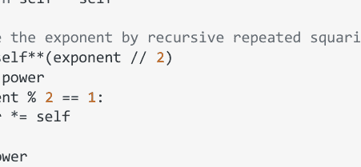

这是图片下方的说明文字，用来补充说明上面的图示。

## 7.10.8 对象作为函数

在本章开头，我展示了如何将多项式视为数学函数。我们通过 `__call__` 为实例实现函数行为。

```
```python
def __call__(self, x):
    """Evaluates a polynomial by substituting `x` for the indeterminate.

    Python calls this when it sees a polynomial being used
    in function application. If `p` is a polynomial, then
    `p(3.4)` substitutes 3.4 for the indeterminate and
    does the math as expressed by the polynomial.

    Parameters
    ----------
    x : any object that supports -, +, *, **
        The value to be substituted for the indeterminate.

    Returns
    -------
    Probably `type(x)`
    """
    result = 0

    for exponent, coefficient in self.__terms.items():
        result += coefficient * x**exponent

    return result
```
```

现在我们定义一个多项式并展示它产生的值与之前相同。

```
```python
x = UniPoly(1, 'x', 1)
p = x**3 - 5*x**2 + 7*x + 1

[p(x) for x in range(-2, 4)]
```
```

```text
[-41, -12, 1, 4, 3, 4]
```

我们可以为任何具有基本代数运算的类型求值 p。

```
```python
p(2.75)      # float
```
```

```text
3.234375
```

```
int(UniPoly(3, 'x', 0))
```

3

```
int(UniPoly(3, 'x', 2))
```

ValueError: non-constant polynomial for int()

## Exercise 7.23

通过 __float__ 和 __complex__ 实现并测试多项式到浮点数和复数的转换。

## 7.10.11 附加练习

我们对 UniPoly 的基本定义已经具有显著功能，但仍有许多扩展方式。可自行或与编程伙伴一起完成以下附加练习。重点关注效率，并很好地记录和注释你的代码。

## Exercise 7.24

扩展附录 C 中的 UniPoly 以支持 int 和 float 系数。

实现 divmod 以从两个扩展多项式的除法返回商和余数元组。

## Exercise 7.25

扩展 UniPoly 以支持 int 和 Fraction 系数。

实现 divmod 以从两个扩展多项式的除法返回商和余数元组。

## Exercise 7.26

扩展 UniPoly 以支持 int、float、complex 和 Fraction 系数。

## Exercise 7.27

编写 BiPoly 类，创建具有两个指定且不同的不变量的多项式。这些是二元多项式。例如，BiPoly(4, 'x', 6, 'y', 2)。

## Exercise 7.28

创建一个抽象基类 Poly。使 UniPoly 和 BiPoly 成为 Poly 的具体子类。

## Exercise 7.29

允许单变量多项式与二元多项式之间的加法、减法和乘法。第一个中的不定元必须是第二个中的不定元之一。例如，允许 UniPoly(2, 'x', 3) + BiPoly(4, 'x', 6, 'y', 2)：

2x³ + 4x⁶y²

## 7.11 类变量

实例变量对由类创建的每个对象都是唯一的。类变量是共享的，可被类的所有对象访问和更改。有点类似于我们在 6.9.2 节中看到的全局变量。程序员经常使用类变量代替顶层全局变量。将它们的使用限制在类内部更为可接受，尤其是当它们的名称以 "__" 开头时。

正如我们所见，如果 obj 是实例的名称，你通过以 "obj." 为前缀的名称引用实例变量。obj 通常是 self。

你在类的顶层与实例方法一起定义类变量。

```
class Guitar:
    number_of_guitars = 0

    def __init__(self, brand):
        Guitar.number_of_guitars += 1
```

## 7.12 类方法和静态方法

类方法和静态方法都定义在类内。与实例方法不同，Python 不会将类方法绑定到特定实例。它绑定到整个类并了解整个类。静态方法是一个驻留在类内的函数，但对类或其实例没有任何特殊了解。

你通过在方法定义前一行放置 @classmethod 装饰器来创建类方法。与在实例方法中使用的 self 不同，第一参数使用“cls”。运行时，Python 将类对象作为第一个参数传递给方法。

```
@classmethod
def get_count_class(cls):
    return cls.number_of_guitars
```

如果在类方法内引用类变量，请将变量名以 cls 和“.”为前缀。不要在调用中硬编码类名，这可能会干扰继承。

如果从 Python 命令行调用类方法，你可以使用类名或实例名作为前缀。

```
Guitar.get_count_class(), g.get_count_class()

(3, 3)
```

我们使用 @staticmethod 装饰器而不是 @classmethod 定义静态方法，并且没有特殊的第一个参数。你可以使用类的硬编码名称访问类内的对象，但你手头没有类对象。

```
@staticmethod
def get_count_static():
    return Guitar.number_of_guitars
```

```
Guitar.get_count_class(), g.get_count_static()

(3, 3)
```

类方法和静态方法之间的差异似乎很细微。

- 如果你想将相关函数打包到一个类中并且不打算实例化类对象，如果你有类变量则使用类方法，否则使用静态方法。
- 如果你编写的非实例方法创建类的新实例，请使用类方法。
- 如果你计划在子类中重新定义该方法（下一节），请使用类方法。

## 7.13 继承

从一个类开始，我们可以派生出继承并修改原始行为和功能的其它类。继承允许我们在重用类层次结构代码的同时使实例专业化。

在 1.10 节中，我们专注于 Bay 叶，但在这里我们回到吉他及其各种类型。让我们从 Guitar 类的基本定义开始。我们在此开发的完整且带文档的代码在附录 D 中。

```
class Guitar:
    def __init__(self, brand, model, year_built, strings=6):
        self._brand = brand
        self._model = model
        self._year_built = year_built
        self._strings = strings

    def __str__(self):
        return f"{self._strings}-string " \
            + f"{self._year_built} " \
            + f"{self._brand} {self._model}"

print(Guitar("Fender", "Stratocaster", "2012"))
```

6-string 2012 Fender Stratocaster

在 Guitar 类中，我们有

- 实例方法 __init__ 和 __str__，以及
- 实例变量 _brand、_model、_year_built 和 _strings。


实例变量名以下划线开头，这向我们表明，这些变量应仅由此类及其任何派生类中的其他编码者私有使用。Python 并不强制执行这一点，但这是一个约定。

## 7.13.1 父类和子类

**Guitar** 是一个独立的类，但如果我们查看品牌、型号和制造年份这些属性，它们可以适用于任何商业乐器。所以让我们定义 **MusicalInstrument**：

```
class MusicalInstrument:
    def __init__(self, brand, model, year_built):
        self._brand = brand
        self._model = model
        self._year_built = year_built

    def __str__(self):
        return f"{self._year_built} " \
            + f"{self._brand} {self._model}"
```

在 **MusicalInstrument** 中，我们有
- 实例方法 __init__ 和 __str__，以及
- 实例变量 _brand、_model 和 _year_built。

现在我们让 **Guitar** 从 **MusicalInstrument** 派生。

```
class Guitar(MusicalInstrument):
    def __init__(self, brand, model, year_built, strings=6):
        super().__init__(brand, model, year_built)
        self._strings = strings

    def __str__(self):
        return f"{self._strings}-string " \
            + super().__str__()
```

**Guitar** 添加了实例变量 _strings。

```
isinstance(guitar, MusicalInstrument), isinstance(guitar, Guitar)
```

(True, True)

### 练习 7.31

向 Guitar 添加一个 _number_of_guitars 类变量，以及一个返回该类变量的类函数 get_count。每次我们初始化一个新实例时，都在 __init__ 中递增 _number_of_guitars。

如果我们只想通过 isinstance 将其与父类区分开来，那么我们可以不进行任何额外工作就派生一个子类。

```
class Clarinet(MusicalInstrument):
    pass
```

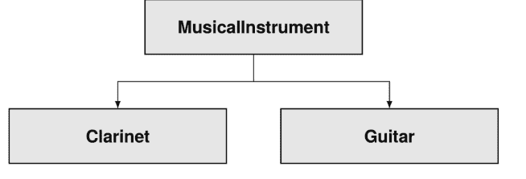

图 7.3：MusicalInstrument 类层次结构，包含 Guitar 和 Clarinet

```
help(Clarinet)
```

```
Help on class Clarinet in module src.code.guitar_04:

class Clarinet(MusicalInstrument)
    Clarinet(brand, model, year_built)

    Method resolution order:
        Clarinet
        MusicalInstrument
        builtins.object

    Methods inherited from MusicalInstrument:
```

我们无法创建 **Clarinet**，因为我们没有实现 `__str__`，因此它仍然是抽象的。

```
print(Clarinet("Yamaha", "YCL-650", "2021"))
```

TypeError: Can't instantiate abstract class
Clarinet with abstract methods __str__

**Guitar** 是一个具体类，因为它实现了所有必需的抽象方法。在图中，具体类用实线框表示，抽象基类用虚线框表示。

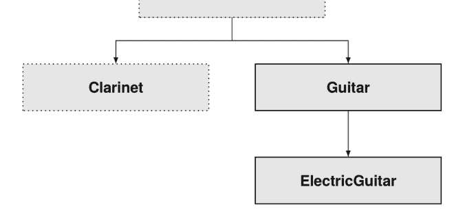

图 7.5：作为抽象基类的 MusicalInstrument

在实践中，您的抽象基类会更大，并且会有更多的方法，开发人员必须在派生的具体类中实现这些方法。

## 7.13.3 多重继承

我现在通过添加 **AcousticGuitar** 来完成我的吉他类层次结构。虽然这不完全正确，但我假设所有原声吉他都是木质的。具体来说，我说的是音板，也就是吉他的面板。

```
guitar = AcousticGuitar("Taylor", "AD27e", "2021", "mahogany")
print(guitar)
```

6-string 2021 Taylor AD27e with mahogany soundboard

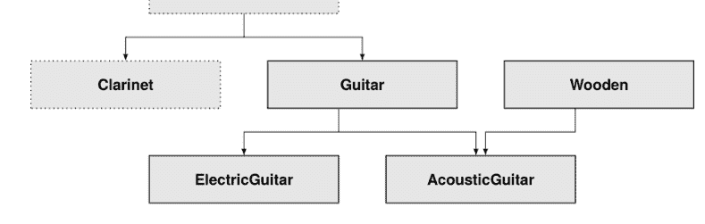

图 7.7：具有多重继承的 AcousticGuitar

注意我如何编写 __init__ 来调用 Guitar 和 Wooden 的初始化方法。

如果我在 AcousticGuitar 的实例上调用一个方法，Python 会首先在 AcousticGuitar 自身中查找，然后是 Guitar，再然后是 MusicalInstrument，最后在 Wooden 中查找。这被称为方法解析顺序。

如果有第三个类也是 AcousticGuitar 继承的，Python 会在 Wooden 之后搜索它及其父类。

### 练习 7.33

为层次结构中的每个类定义一个 whoami 方法，该方法返回类似“I am an ElectricGuitar object”的字符串。在每种具体类型的实例上调用此方法，以确保其正常工作。

当你从本身有共同祖先的类进行多重继承时，就形成了菱形继承。如果你的代码还能够运行，那么它是错误的一大来源。在图 7.8 中，我用双线展示了这个菱形。

## 7.14 迭代器

当 Python 遍历一个列表时，实际会发生什么？

```
for i in [2, 3, 5]:
    print(i)
```

2
3
5

Python 会跟踪你在列表中的位置，并在你每次请求时返回“下一个”项目。当你到达列表末尾时，循环终止。它的行为类似于这样：

```
the_list = [2, 3, 5]
the_index = 0

while True:
    if the_index < len(the_list):
        print(the_list[the_index])
        the_index += 1
    else:
        break
```

2
3
5

这种迭代看起来像是从列表开头到末尾的正常推进。“迭代”的含义由你决定：你可以定义它来做任何你想做的事情。

```
the_list = [2, 3, 5]
the_index = len(the_list) - 1

while True:
    if the_index >= 0:
        print(the_list[the_index])
        the_index -= 1
    else:
        break
```

5
3
2

在这种情况下，我们设置的迭代框架会从最后一个到第一个选择项目。“下一个”项目位于列表中我们最后访问的项目之前。

*迭代器*对象有一个由它的类定义的 `__next__` 魔术方法。第一次调用 `__next__` 时，它会返回“初始”对象。Python 代码会记住你的位置，随后对 `__next__` 的调用会逐个处理所有项目。

*可迭代对象*有一个 `__iter__` 魔术方法，它返回一个迭代器对象。一个对象可能同时是可迭代对象和迭代器。在这种情况下，`__iter__` 通常只返回 self。

可迭代对象通过 `__iter__` 返回一个迭代器。

### 练习 7.35
*range* 返回的对象是可迭代对象、迭代器，还是两者都是？

Python 在 for 循环中通过 *iter* 和 *next* 自动调用 `__iter__` 和 `__next__`。你也可以自己调用它们。

```
my_iter = iter([2, 3, 5])
print(next(my_iter))
```

2

```
print(next(my_iter))
```

3

```
print(next(my_iter))
```

5

如果你再调用一次，*next* 会引发 **StopIteration** 异常。

```
print(next(my_iter))
```

StopIteration

你应该在 `__next__` 代码中引发这个异常，以便 for 循环正确工作。在 try 块中查找并捕获 **StopIteration**。

如果你在迭代对象时修改了它，你可能会遇到错误，或者至少会得到意外结果。例如，你可能不希望在循环处理列表时向其中插入或删除项目。

### 练习 7.36

设 numbers 为字典：

```
numbers = {1: "one", 2: "two", 3: "three"}
```

解释以下每项中发生的事情：

```
next(iter(numbers))
```

1

```
next(iter(numbers.keys()))
```

1

```
next(iter(numbers.values()))
```

'one'

```
next(iter(numbers.items()))
```

(1, 'one')

哪些是迭代器，哪些是可迭代对象？

对于 UniPoly 实例，我们很自然地使用“字典”一词来表示迭代。

```
def __iter__(self):
    """Iterator returning exponent-coefficient tuple pairs.

    Notes
    -----
    The order of the pairs is not guaranteed to be sorted.

    Returns
    -------
    tuple:
        (exponent, coefficient) in polynomial.
    """

    return iter(self.__terms.items())
```

```
s = UniPoly(1, 's', 1)

for exp_coef in (s - 1)**4:
    print(exp_coef)
```

(4, 1)
(3, -4)
(2, 6)
(1, -4)
(0, 1)

我在 __iter__ 的文档中使用了一个 Notes 部分。

如果一个对象同时是可迭代对象和迭代器，那么该对象很可能将迭代状态存储在其自身内部。这就是为什么 __iter__ 可能返回 self 的原因。不过，正如我们所见，你可能希望以多种方式迭代一个对象。在这种情况下，你会像 Python 对字典所做的那样，创建单独的可迭代对象。

### 练习 7.37

在我们的 UniPoly 类中，我定义了一个属性 is_constant，它告诉我们一个多项式是否为常数。请记住，常数多项式没有自变量指数大于 0 的项。

```
@property
def is_constant(self):
    """True if the polynomial only contains a term of exponent 0."""

    if not self.__terms:
        return True
    if len(self.__terms) != 1:
        return False
    return next(iter(self.__terms)) == 0
```

最后一行做了什么？


## 7.15 生成器

与迭代器密切相关的是 Python 的生成器概念。生成器 g 是一种具有以下行为的特殊函数：

- 第一次调用 g 时，它会初始化自身，返回一个值，并冻结其状态。
- 下一次调用 g 时，它会继续处理直到返回一个值，然后再次冻结其状态。
- 这些操作会一直持续到函数终止，然后它不再返回额外的值。

我们使用 yield 来告诉 Python 返回一个值并冻结所有内容，直到下一次对生成器的调用。

```
def create_odd_number_generator():
    n = 1
    while True:
        yield n
        n += 2
```

```
odd_number_generator = create_odd_number_generator()
odd_number_generator
```

<generator object create_odd_number_generator at 0x0000024A93102660>

```
next(odd_number_generator)
```

1

```
next(odd_number_generator)
```

3

```
next(odd_number_generator)
```

5

```
for n in odd_number_generator:
    print(f"{n} ", end="")
    if n > 20:
        break
```

7 9 11 13 15 17 19 21

生成器是使用 *惰性求值* 的一个例子。与其生成一个很大的奇数列表然后遍历它们，我们只在用户请求时才计算下一个奇数。这样，我们就不会浪费内存来保存一个大的集合，也不会浪费计算时间去生成可能没人使用的值。

### Exercise 7.38

使用第 6.1.2 节中的迭代斐波那契函数，编写一个生成器，根据请求返回下一个斐波那契数。

### Exercise 7.39

在第 5.2.2 节中，我们定义了一个实现埃拉托斯特尼筛法来创建素数列表的函数。编写一个生成器，根据请求返回下一个素数。

生成器不需要永远产生值。在这个生成器的实现中，你可以指定想要它产生值的最大数量。一旦生成器达到该值，我们就从函数中返回。

```
```python
def create_even_number_generator(maximum_n=None):
    n = 0
    while True:
        if maximum_n is not None and n > maximum_n:
            return
        yield n
        n += 2
```
```

```
```python
even_number_generator = create_even_number_generator(20)
even_number_generator
```
```

```
```text
<generator object create_even_number_generator at 0x0000024A9310D040>
```
```

```
```python
for n in even_number_generator:
    print(f"{n} ", end="")
```
```

```
```text
0 2 4 6 8 10 12 14 16 18 20
```
```

通常，你希望能够判断一个实例是否等于另一个实例，因此你应该实现 __eq__。为了完整性，我经常也定义 __ne__。Python 分别使用它们来实现“==”和“!=”。如果缺少 __ne__，Python 会取 __eq__ 的结果的否定。

如果你计划对列表进行排序，你需要一种比较项目的方法来知道哪个对象“小于”另一个对象。对于 sorted 函数和原地排序方法，Python 会查找 __lt__ 来实现“<”。如果它不存在，你会得到一个错误信息。

```
polys.sort()
```

TypeError: ' < ' not supported between instances
of 'UniPoly' and 'UniPoly'

在处理数学对象时，你必须小心区分运算的代数含义与结构解释。数学上，你不能说一个 UniPoly 多项式小于另一个多项式。对于某些子集如常数，你可以决定这一点，但通常不起作用。结构上，我们可以通过按指数和系数的元组对多项式进行字典序比较。

给定

p = x² + 7x + 1   and   q = 4x² − 7x + 3

查看最高次项的元组。对于 p，它是 (2, 1)，对于 q，它是 (2, 4)。如果一个指数更小，则该多项式“小于”另一个。在这种情况下，指数相等，因此我们比较系数。由于 1 < 4，p “小于” q。如果它们相等，我们就会转到下一个更低次的项。

### Exercise 7.42

sort 和 sorted 每个都接受一个可选的 key 函数参数，该函数返回对象用于“<”比较。编写一个 UniPoly 的方法以与 key 一起使用，该方法返回合适的元组的元组。


### Exercise 7.43

在第 7.9 节中，我们定义了 **Cookie** 枚举。存在一个问题：我们无法对饼干列表进行排序。

```
cookies = [Cookie.SUGAR, Cookie.SHORTBREAD,
Cookie.OATMEAL, Cookie.CHOCOLATE]
sorted(cookies)

TypeError: '<' not supported between instances of
            'Cookie' and 'Cookie'
```

编写一个匿名函数作为 key，以便我们可以通过枚举值对列表进行排序。

### Exercise 7.44

如果对 **CatAge** 枚举成员的列表进行排序，就不会有比较问题。为什么？

字典键和集合成员必须是不可变对象，正如我们在第 3.9.1 节和第 3.10 节中所看到的。由于你不能更改它们，Python 可以使用 *hash* 函数计算固定信息，从而加快相等性检查和访问时间。例如，如果两个对象具有不同的 *hash* 值，它们就不能相等。

当 Python 看到 `hash(object)` 时，它会查找实例方法 `__hash__` 并在 object 上调用它。

```
hash(-0.8367)

-1929298845809097728
```

```
hash(735678)

735678
```

```
hash("A solitary string")

5073272553319032547
```

```
hash((4, 3, 2, 1))
```

1111739957947434390

__hash__ 必须返回一个整数，并且你的实现必须遵守一条规则：如果实例 a 和 b 满足 a == b，则 hash(a) == hash(b)。理想情况下，反之亦然，但这并非必须。

你的 __hash__ 方法应该是非平凡的。不要，例如，总是返回 0。程序员常用的一个方法是创建一个实例变量的元组，然后对该元组调用 hash。你也可以对实例变量求和其 hash 值。

UniPoly 的完整最终代码在附录 C 中，它创建了不可变实例。我以这种方式定义 __hash__：

```
def __hash__(self):
    """Computes a hash code for a polynomial.

    If p and q are equal polynomials, then their hash codes
    are equal.

    Returns
    ------
    int
        An integer hash code.
    """
    h = hash(self.__indeterminate)
    for exponent_coefficient in self.__terms:
        h += hash(exponent_coefficient)
    return h
```

```
hash(UniPoly(10, 'z', 100))
```

-483907656708034775

```
hash(UniPoly(10, 'w', 100))
```

1477461016404213130

### Exercise 7.45

为什么我没有计算 hash(self.__terms)？为什么我没有构建指数-系数对的元组并对其调用 hash？

or

```
from guitar import Guitar, Pickup, ElectricGuitar
```

**guitar** 模块本身从另外两个模块导入。

```
from abc import ABC, abstractmethod
from enum import Enum
```

在模块文件文档之后，将 `import` 语句放在模块文件的顶部。先列出标准模块，然后是第三方模块，最后是自己的模块。在每个组内按模块名称对 `import` 语句进行排序。

你应该以一行摘要文档字符串开始一个模块，尽管我建议你在其后包含扩展摘要。此外，还应考虑包含 **Notes**、**References** 和 **Examples** 部分。

## 7.18 Summary

在本章中，我们学习了如何使用 Python `class` 定义创建新类型的对象。类将数据形式为实例变量和类变量与操作它们的功能结合在一起。这些函数可以是实例方法，操作由类创建的对象，也可以是类方法和静态方法，在所有实例上工作。

类继承是 Python 对面向对象编程支持的关键特性。继承使我们能够在对象逻辑层次结构中重用代码，同时通过自己的数据和操作使这些对象专业化。

注释和记录 Python 代码是一项关键活动，以便其他开发人员能够理解和使用你创建的内容。它还允许你在可能不记得其工作原理时返回并修复或改进代码。

我们在下一章结束本书的第一部分，在那里我们学习如何读取和写入文件的信息。


