## 8 文件操作

> *走自己的路，让别人说去吧。*
> 
> ——但丁·阿利吉耶里

文件提供了信息的持久化存储。如果你希望数据的可用时间比应用运行所需的时间更长，甚至长达数年，那么你应该将这些数据存储在文件中。物理存储设备可能是当今手机、笔记本电脑和服务器中的硬盘驱动器（HDD）、固态驱动器（SSD）或闪存驱动器。

本书不涉及物理设备的工作原理，也不涉及对硬件的底层软件访问。相反，在本章中，我们探讨使用文件存储和检索信息的抽象概念。我们将文件分组到*目录*或*文件夹*中，这些目录或文件夹可以嵌套。文件和文件夹共同构成了*文件系统*。操作系统管理文件系统，这是操作系统最重要的角色之一。

### 本章涵盖的主题

- 8.1 路径与文件系统 ...... 306
- 8.2 在文件系统中移动 ...... 310
- 8.3 创建和删除目录 ...... 312
- 8.4 文件和文件夹的列表 ...... 313
- 8.5 名称与位置 ...... 316
- 8.6 文件类型 ...... 317

### 8.1 路径与文件系统

描述如何从文件系统顶部到达我们所需确切文件的文本字符串称为*路径名*。你可以将其视为导航到所需信息的一组方向。

图 8.1 中的树显示了我在编写本书时使用的文件夹和文件的子集。

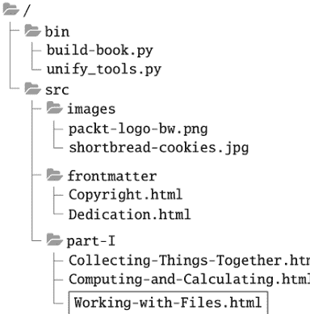

图 8.1：包含文件夹和文件的目录树

在 Linux 和 macOS 上，文件 **Working-with-Files.html** 的完整路径的路径名为

```text
/src/part-I/Working-with-Files.html
```

在 Microsoft Windows 上，我们会有一个类似 “C:” 的驱动器盘符，并且使用反斜杠而不是斜杠。路径名的大小写在 Windows 上不敏感，但在其他操作系统上是敏感的。

```text
C:\src\part-I\Working-with-Files.html
```

我将使用斜杠，而大多数处理路径名的 Python 例程在 Windows 上也能处理这两种分隔符。你可能会发现，如 4.1 节所述，对 Windows 路径名使用原始字符串会很方便。原始字符串减少了需要转义的字符数量。

```
"C:\\src\\part-I\\Working-with-Files.html"
'C:\\src\\part-I\\Working-with-Files.html'
r"C:\src\part-I\Working-with-Files.html"
'C:\\src\\part-I\\Working-with-Files.html'
```

“/”目录是根目录。

我们使用 os 包和 os.path 模块来操作路径名。“os”代表“operating system”（操作系统）。

```
import os

pn = "/src/part-I/Working-with-Files.html"
```

```
os.path.split(pn)

('/src/part-I', 'Working-with-Files.html')
```

元组中的第二项是基本名称。

```
os.path.basename(pn)

'Working-with-Files.html'
```

用 splitext 拆分文件路径或基本名称来获取扩展名。

```
os.path.splitext(pn)

('/src/part-I/Working-with-Files', '.html')
```

```
os.path.splitext(os.path.basename(pn))

('Working-with-Files', '.html')
```

在 Windows 上，使用 splitdrive 获取驱动器盘符和后面的冒号。

```
os.path.splitdrive("C:\\src\\part-I\\Working-with-Files.html")

('C:', '\\src\\part-I\\Working-with-Files.html')
```

操作系统会跟踪大量关于文件的数据，os.path 提供了获取这些数据的方法。图 8.2 显示了 Windows 10 在开发过程中的某个时刻为本章的源文件提供的文件信息：


图 8.2：Windows 资源管理器文件信息

getctime、getmtime 和 getatime 函数分别返回文件的创建时间、最后修改时间和最后访问时间。

```
mod_time = os.path.getmtime("src/part-I/Working-with-Files.html")
mod_time
```

1628111739.0

这个结果是某人最后一次修改文件的时间，它是自纪元以来的秒数。

纪元是一个特殊的计算机系统概念，对许多操作系统来说，第 0 秒是 1970 年 1 月 1 日午夜。如果使用 gmtime 和 asctime，我们可以更好地理解 mod_time。

```
import time

time.gmtime(mod_time)

time.struct_time(tm_year=2021, tm_mon=8, tm_mday=4, tm_hour=21,
tm_min=15, tm_sec=39, tm_wday=2, tm_yday=216, tm_isdst=0)
```

```
time.asctime(time.gmtime(mod_time))

'Wed Aug  4 21:15:39 2021'
```

文件创建、修改和访问时间，以及说明谁可以对该文件执行哪些操作的权限数据，共同构成文件元数据的一部分。

要获取文件中的字节数，请使用 getsize。

```
f'{os.path.getsize("src/part-I/Working-with-Files.html"):,} bytes'

'53,449 bytes'
```

我使用了 f-string 来格式化输出，使其更美观。

如果你尝试访问不存在的文件或路径，大多数 os.path 函数会引发 OSError。

```
os.path.getsize("src/part-I/Working-with-Flies.html")

FileNotFoundError: The system cannot find the file specified:
'src/part-I/Working-with-Flies.html'
```

使用 exists 来测试文件或目录是否存在。

```
os.path.exists("src/part-I/Working-with-Files.html")

True
```

```
os.path.exists("src/part-I")

True
```

isfile 测试文件是否存在并且不是目录。

```
os.path.isfile("src/part-I/Working-with-Files.html")

True
```

```
os.path.isfile("src/part-I/Working-with-Flies.html")

False
```

```
os.path.isfile("src/part-I")

False
```

要查看路径是否指向目录或文件夹，请使用 isdir。

```
os.path.isdir("src/part-I/Working-with-Files.html")

False
```

```
os.path.isdir("src/part-I")

True
```

### 练习 8.1

编写一个函数，该函数接受两个文件路径名，验证它们指向存在的文件，并打印最近修改的文件的名称。

### 8.2 在文件系统中移动

如果你在 Windows、macOS 或 Linux 中使用过命令行，你就会了解“当前工作目录”的概念，以及如何移动到另一个目录。Python 也有同样的概念和功能。

图 8.3 是构成这本书的文件目录树的另一个部分视图。

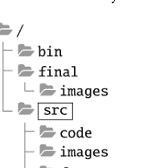

图 8.3：显示当前目录的目录树

如果我位于 src 目录中，我可以在操作系统命令行上发出 pwd 命令，看到类似如下的内容：

```text
Path
----
C:\src
```

在 Windows 上是这样，在 macOS 或 Linux 上则是 /src。“pwd” 是 “print working directory” 的缩写。对应的 Python 函数是 getcwd，即 “get the current working directory” 的缩写，

```
import os

os.getcwd()

'C:\\src'
```

我在命令行上发出 cd code 命令以切换到 code 子目录。在 Python 中，对应的函数是 chdir。

```
os.chdir("code")
os.getcwd()

'C:\\src\\code'
```

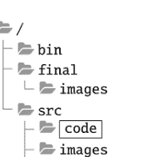

图 8.4：显示新的当前目录的目录树

当前目录的简写是 “.”。使用 “..” 可以移动到当前目录之上的目录，即父目录。将其与其他目录名组合，可以“向上、跨越、向下”。这里，我们使用了一个相对目录路径。

```
os.chdir("../../final/images")
os.getcwd()

'C:\\final\\images'
```

使用绝对路径可以转到完整指定的目录。

```
os.chdir("/src/frontmatter")
os.getcwd()

'C:\\src\\frontmatter'
```

### 8.4 文件和文件夹的列表

如果我有五个文件名

guitar_01.py, guitar_02.py, unipoly_01.py, unipoly_02.py, and unipoly_10.py,

那么我可以使用*通配符*来匹配其中一些名称。下面是一些示例：

- 模式 "*.py" 匹配所有这些文件，因为该模式表示“名称可以以任何字符开头，但必须以 '.py' 结尾”。
- 模式 "*01*" 匹配 **guitar_01.py** 和 **unipoly_01.py**。
- "unipoly_0?.py" 匹配 **unipoly_01.py** 和 **unipoly_02.py**。“?” 是单字符通配符，匹配该位置上的任意字符。

使用这样的模式来匹配文件名称为 “globbing”（文件名通配匹配），其历史可以追溯到 20 世纪 60 年代末和 70 年代初 UNIX 的早期。Python 中的 **glob** 模块实现了 globbing。

该模块的两个最重要的函数是 *glob*（返回匹配列表）和 *iglob*（生成一个迭代器，按需提供匹配项）。除非你需要列表，否则我建议你在循环中使用 *iglob*。

下面是我列出本书第一部分所有源 HTML 文件的方法：

```
import glob

for html_file in glob.iglob("src/part-I/*.html"):
    html_file = os.path.normcase(html_file)
    print(html_file)
```

```text
src\part-i\collecting-things-together.html
src\part-i\computing-and-calculating.html
src\part-i\defining-and-using-functions.html
src\part-i\organizing-objects-into-classes.html
```


```
src\part-i\part-i.html
src\part-i\stringing-you-along.html
src\part-i\working-with-expressions.html
src\part-i\working-with-files.html
```

normcase 是一个主要在 Windows 上有用的便捷函数。它会将路径名转为小写，并在 Windows 上将所有正斜杠转换为反斜杠。在其他操作系统下，该函数不执行任何操作。

glob 和 iglob 会返回文件以及目录。你可以用 isfile 和 isdir 来测试二者区别。

```python
directories = []

for name in glob.iglob("src/**", recursive=True):
    if os.path.isdir(name):
        dir = os.path.normcase(name)
        directories.append(dir)

print(directories)
```

```
['src\\', 'src\\appendices', 'src\\art', 'src\\backmatter', 'src\\code', 'src\\code\\linting', 'src\\code\\__pycache__', 'src\\css', 'src\\examples', 'src\\frontmatter', 'src\\images', 'src\\matplotlib', 'src\\matplotlib\\__pycache__', 'src\\part-i', 'src\\part-ii', 'src\\part-iii', 'src\\preface', 'src\\preliminary']
```

“**” 通配符与 recursive=True 关键字参数的组合告诉 iglob 遍历目录树以查找匹配项。

### Exercise 8.3

编写一个推导式，使其产生与 directories 相同的结果。

### Exercise 8.4

不使用 “**” 和 recursive=True，编写一个递归函数，从某个初始目录开始查找所有目录。

如果你想列出目录中的文件，使用 `os` 中的 `listdir`。以下代码统计 **src/part-i** 目录中的文件数：

```python
len(os.listdir("src/part-i"))
```

```
8
```

### Exercise 8.5

编写一个 `DirectoryTree` 类，接受 `__init__` 的目录路径名参数，并在实例数据中保存完整的子目录树。在实现中使用 `os.walk`。通过发出 `help(os.walk)` 来了解如何调用该函数。

### Exercise 8.6

如何修改 `DirectoryTree` 使其延迟发现目录树，而不是在 `__init__` 中构建它？实现 `iter` 方法以允许你的代码使用者遍历该树。

### Exercise 8.7

对于 `DirectoryTree` 的 `str` 方法，使用 “+”、“-” 和 “|” 字符绘制一棵树。示例：

```
A
|
+---B
|
+---C
    |
    +---D
    |
    +---E
```

检查它在系统目录上是否有效，例如 Windows 上的 `C:\Program Files` 或其他操作系统上的 `/etc`。

## 8.5 Names and locations

如果你想更改目录的名称，调用 *rename*。

```python
os.rename("recipes/cookies", "recipes/moms-cookies")
os.rename("recipes", "moms-recipes")
```

我们也可以 *rename* 文件。文件仍在同一目录中，但名称已更改。

```python
os.rename("test.py", "chapter-test.py")
os.rename("recipes/cookies/shortbread.docx", "recipes/cookies/moms-shortbread.docx")
```

要复制文件的内容，可以使用新名称在当前目录或其他目录中复制它，也可以使用当前名称复制到不同目录。**shutil** 模块提供了多个复制文件的函数。它们接受相同的参数。

```python
import shutil

shutil.copyfile("t.py", "test-01.py")      # same dir, new name
```

'test-01.py'

```python
shutil.copy("t.py", "/tests")      # different dir, same name
```

'tests\\t.py'

```python
shutil.copy2("t.py", "/tests/test-01.py")  # different dir, different name
```

'tests/test-01.py'

*copyfile* 不保留任何元数据，*copy* 保留权限元数据，而 *copy2* 保留权限和时间元数据。每个函数在复制操作成功时返回新的路径名。我通常使用 *copy2*，除非有充分理由使用其他两个。

### Exercise 8.8

如果尝试将文件复制到自身，Python 会引发什么异常？

### Exercise 8.9

shutil 中的 copytree 做什么？导入 shutil 后使用 help(shutil.copytree)。

一种“移动”文件的方法是复制它然后删除原文件。要一步完成，使用 shutil 中的 move，其参数与复制函数相同。你可以在移动时重命名文件。

move 如果两个参数都是目录，也适用于目录。第一个参数中的目录将被移动到第二个参数中的目录下作为子目录。

要删除目录、其文件、其子目录及其内容，使用 shutil.rmtree。要删除空目录，调用 os.rmdir。如上所述，要删除文件，使用 os.remove。

在尝试删除文件或目录之前，你应该知道它存在，或者使用 try / except 块。

## 8.6 Types of files

文件主要分为两种类型：文本和二进制。我们可以将文本文件视为人类可读的内容。它可以是包含文字、数字和标点的纯文本。它可以是 HTML 文件，其中包含这些内容，外加标记以告诉我们信息的含义以及如何显示它。文本文件可能包含你在编程编辑器中阅读、创建、更新和扩展的代码。信息很可能采用 Unicode 编码。

我们以字符串的形式读写文本文件，以换行符分隔各个行。我们可能会将文件作为字符串列表或一个长字符串来读写。

二进制文件的示例包括照片、图像和视频。我们不将数据表示为字符串中的字符，而是表示为字节。每个字节包含八个 0 和 1。与文本文件不同，你不会请求下一行，而是请求接下来的 n 个字节，其中 n > 0。一旦获得这些字节，你就会适当地处理它们。如果你正在寻找某物并找到了它，你就完成了。否则，你会请求更多字节。

这里有一个记住文件类型差异的方法：对于文本，我们会使用字符串字符 "2" 表示数字二。对于二进制，我们会使用字节 00000010 表示数字二。

## Working with Files

我们打开文件以开始使用它，并在完成时关闭它。打开文件时，我们告诉 Python 需要的访问模式。模式如下：

- **r** – 以文本文件形式打开以便从中读取。这是默认模式。
- **rb** – 以二进制文件形式打开以便从中读取。
- **w** – 以文本文件形式打开以便写入。
- **wb** – 以二进制文件形式打开以便写入。
- **r+** – 以文本文件形式打开以便从中读取和写入。
- **rb+** – 以二进制文件形式打开以便从中读取和写入。

使用上述模式时，我们从文件开头开始工作。

如果你以以下模式打开文件，Python 会将你定位到文件内容的末尾。

- **a** – 以文本文件形式打开以便追加。
- **ab** – 以二进制文件形式打开以便追加。
- **a+** – 以文本文件形式打开以便从中读取和追加。
- **ab+** – 以二进制文件形式打开以便从中读取和追加。

如果指定的文件尚不存在，Python 会为写入或追加的模式创建一个新文件。我主要使用文本文件，所以我经常使用 **w** 和 **r**，偶尔使用 **a**。

## 8.7 Reading and writing files

文件 **src/examples/sonnet-18.txt** 包含莎士比亚《第18首十四行诗》的文本。以下代码序列以文本形式打开文件以便读取，将文件读入 content，关闭文件，并打印字符串 content。

```python
input_file = open("src/examples/sonnet-18.txt", "r")
content = input_file.read()
input_file.close()

print(content)
```

> Shall I compare thee to a summer's day?
> Thou art more lovely and more temperate.
> Rough winds do shake the darling buds of May,
> And summer's lease hath all too short a date.
> Sometime too hot the eye of heaven shines,
> And often is his gold complexion dimmed;
> And every fair from fair sometime declines,
> By chance, or nature's changing course, untrimmed;
> But thy eternal summer shall not fade,
> Nor lose possession of that fair thou ow'st,
> Nor shall death brag thou wand'rest in his shade,
> When in eternal lines to Time thou grow'st.
> So long as men can breathe, or eyes can see,
> So long lives this, and this gives life to thee.

**在读完文件后立即关闭它！** 这不是编码要求，但有助于避免处理但未关闭的文件时出现错误。

请记住，字符串在 Python 中以及文件中都是 Unicode 编码的。我们可以像处理其他任何字符串一样处理它。这段代码统计十四行诗中字母 'a' 出现的次数。

```python
count = 0
for c in content:
    if c == 'a':
        count += 1

count
```

### Exercise 8.10

编写代码统计以字母 'S' 开头的行数。

### Exercise 8.11

使用 split 将 contents 拆分为不带尾随换行符的字符串列表。

使用 readlines 将文件内容读入带尾随换行符的字符串列表。

```python
input_file = open("src/examples/sonnet-18.txt", "r")
content = input_file.readlines()
input_file.close()
```


```
print(content)
```

```
["Shall I compare thee to a summer's day?\n", 'Thou art more lovely and more temperate.\n', 'Rough winds do shake the darling buds of May,\n', "And summer's lease hath all too short a date.\n", 'Sometime too hot the eye of heaven shines,\n', 'And often is his gold complexion dimmed;\n', 'And every fair from fair sometime declines,\n', "By chance, or nature's changing course, untrimmed;\n", 'But thy eternal summer shall not fade,\n', "Nor lose possession of that fair thou ow'st,\n", "Nor shall death brag thou wand'rest in his shade,\n", "When in eternal lines to Time thou grow'st.\n", 'So long as men can breathe, or eyes can see,\n', 'So long lives this, and this gives life to thee.']
```

readline 函数一次一行地读取文本文件。成功从文件中读取的每一行的长度至少为一个，因为该行有尾随换行符，或者是文件中的最后一行非空行。如果该行为空，我们就到达了文件末尾。

下面的代码逐行读取文件，然后打印该行的全大写形式，并在前面加上其行号。

```
input_file = open("src/examples/sonnet-18.txt", "r")

line_number = 0
line = input_file.readline()

while line:
    line_number += 1
    print(f"{line_number:>2} {line.upper()}", end="")
    line = input_file.readline()  # Don't forget this!

input_file.close()
```

```
1  SHALL I COMPARE THEE TO A SUMMER'S DAY?
2  THOU ART MORE LOVELY AND MORE TEMPERATE.
3  ROUGH WINDS DO SHAKE THE DARLING BUDS OF MAY,
4  AND SUMMER'S LEASE HATH ALL TOO SHORT A DATE.
5  SOMETIME TOO HOT THE EYE OF HEAVEN SHINES,
6  AND OFTEN IS HIS GOLD COMPLEXION DIMMED;
7  AND EVERY FAIR FROM FAIR SOMETIME DECLINES,
8  BY CHANCE, OR NATURE'S CHANGING COURSE, UNTRIMMED;
9  BUT THY ETERNAL SUMMER SHALL NOT FADE,
10 NOR LOSE POSSESSION OF THAT FAIR THOU OW'ST,
11 NOR SHALL DEATH BRAG THOU WAND'REST IN HIS SHADE,
12 WHEN IN ETERNAL LINES TO TIME THOU GROW'ST.
13 SO LONG AS MEN CAN BREATHE, OR EYES CAN SEE,
14 SO LONG LIVES THIS, AND THIS GIVES LIFE TO THEE.
```

### Exercise 8.12

解释在 print 的调用中 {line_number:>2} 的作用。如果我省略 end=""，打印行为会如何改变？

### Exercise 8.13

你知道可以使用 import 读取 Python 模块并使其内容可供使用。你也可以读取代码文本文件并调用 exec 运行其字符串结果。研究 exec 函数并将其与 import 进行比较。有任何安全问题吗？

write 对字符串和 writelines 对字符串列表的行为与其读取对应函数互补。两个函数都不会自动向字符串追加换行符 '\n'。记住，如果你想写入文件的末尾，请使用 "a" 打开文件。

### Exercise 8.14

为什么我们不需要 writeline 函数？

### Exercise 8.15

编写一个函数 my_file_copy，带有两个文件路径参数：source_file 和 destination_file。在检查 source_file 存在后，使用 read 和 write 将其内容复制到 destination_file。务必检查异常。

除了我们在 6.5 节看到的 sep 和 end 可选参数外，print 函数还有另一个参数叫做 file。你可以用它代替 write 用于文本文件。它会自动追加换行符，除非你用 end 更改它。

```
output_file = open("src/examples/print-test.txt", "w")

print("First line", file=output_file)
print("Second line", file=output_file)

output_file.close()
```

我们也使用 read 读取二进制文件。如果我们为 read 包含一个正整数参数，它就是从二进制文件读取的字节数。对于文本文件，它就是要读取的字符数。记住，一个 Unicode 字符可能使用多于一个字节！

```
input_file = open("src/examples/sonnet-18.txt", "rb")
content = input_file.read(39)
input_file.close()

content

b"Shall I compare thee to a summer's day?"
```

```
type(content)

bytes
```

```
content[0]

83
```

```
bin(content[0])  # binary

'0b1010011'
```

```
hex(content[0])  # hexadecimal

'0x53'
```

给定一个 Unicode 字符串，我们可以将其编码为二进制字符串。然后我们可以使用二进制字符串并将其写入二进制文件。

```
s = "Sîne klâwen æðelen XM ᚺᚱ ᚫᚱ ᚲᚾ ᚹ"
```

```
t = s.encode("utf-8")
t

b'S\xc3\xaene kl\xc3\xa2wen \xc3\xa6\xc3\xb0elen XM \xe1\x9a\xba\xe1\x9a\xb1 \xe1\x9a\xab\xe1\x9a\xb1 \xe1\x9a\xb2\xe1\x9a\xbe \xe1\x9a\xb9'
```

要从字节字符串反向到字符串，请使用 decode。

```
t.decode("utf-8")

'Sîne klâwen æðelen XM ᚺᚱ ᚫᚱ ᚲᚾ ᚹ'
```

Sîne klâwen æðelen
XM ᚺᚱ ᚫᚱ ᚲᚾ ᚹ

Figure 8.5: Example of Unicode text

一个字符串及其编码的字节字符串不是相等对象。

```
s == t

False
```

总结以上内容，从文件中获取信息和向文件中放入信息的两个主要函数是 read 和 write。对于文本文件，我们还有额外的 readline、readlines 和 writelines 函数。

Python 提供了打开和关闭文件的简化语法。

```
with open("src/examples/sonnet-18.txt", "r") as input_file:
    print(input_file.readline())

Shall I compare thee to a summer's day?
```

```
"Ibanez RG": 1987
}
```

现在我们导入 pickle 模块，打开一个二进制文件用于写入，并转储字典。

```
import pickle

with open("work/pickle_example", "wb") as pickle_file:
    pickle.dump(guitars, pickle_file)
```

记住 with/as 会自动关闭 pickle_file。

此时，我们可以继续我们的业务。几个月后，我们想恢复吉他数据。我们打开二进制文件用于读取并加载字典。

```
with open("work/pickle_example", "rb") as pickle_file:
    new_guitars = pickle.load(pickle_file)
```

我们加载的数据看起来正确：

```
print(new_guitars)

{'Fender Stratocaster': 1954, 'Fender Telecaster': 1950, 'Gibson Les Paul': 1952, 'Gibson Flying V': 1958, 'Ibanez RG': 1987}
```

对于此示例，我仍然有 guitars，我们看到旧字典与新字典相同。

```
guitars == new_guitars

True
```

Pickling 对基本类型有效。这里我们对字典、字符串和整数进行了 pickling。

如果有更复杂类型或我们自己构建的类的实例呢？如果实例变量是可 pickling 的，我们不能在有类变量的情况下使用 pickle。Python 可以自动转储和加载类实例。因此类实例是可 pickling 的。

### Exercise 8.17

证明你可以使用 Fraction 制作的分数进行 pickle。

让我们用上一章的多项式来展示这一点。我们不需要编写任何新代码来使 **pickle** 工作。

```
t = UniPoly(1, 't', 1)
p = (t**3 - 7)**5
p

t**15 - 35*t**12 + 490*t**9 - 3430*t**6 + 12005*t**3 - 16807
```

现在我们 *dump* 和 *load* 多项式。

```
with open("work/pickle_example", "wb") as pickle_file:
    pickle.dump(p, pickle_file)

with open("work/pickle_example", "rb") as pickle_file:
    new_p = pickle.load(pickle_file)
```

它们相等：

```
p == new_p

True
```

**dill** 模块扩展了 **pickle** 并处理类变量。[DILL] 与 **pickle** 一样，**dill** 是 Python 专用的。它们创建的文件可能与你自己的 Python 版本显著不同而无法使用。

## 8.8.2 JSON

JSON 是作为 JavaScript 编程语言的一部分创建的标准化的基于文本的交换格式。“JSON” 代表“JavaScript Object Notation”。它与 JavaScript 没有特殊联系，Python 对该格式有良好的支持。[JSON]

JSON 与 Python 数据类型匹配得很好，Python 有四个主要函数用于处理它。

**src/examples/example.json** 文件包含我当前 Visual Studio Code 设置文件的扩展子集。JSON 文件应具有 “.json” 扩展名。让我们使用 *load* 读取示例文件，看看 Python 如何处理它。

```
import json

with open("src/examples/example.json", 'r') as input_file:
    json_ = json.load(input_file)
```


首先需要注意的是，Python 创建了一个字典。

```
type(json_)
```

```
dict
```

```
json_

{'editor.columnSelection': False,
'editor.detectIndentation': True,
'editor.autoClosingQuotes': 'never',
'nothing': None,
'pi.approximation': 3.14159,
'python.formatting.autopep8Args': ['--max-line-length', '100'],
'githubIssues.queries': [{'label': 'My Issues', 'query': 'default'}],
'debug.console.fontSize': 12,
'files.associations': {'.ncx': 'xml', '.opf': 'xml'}}
```

键是无序的，值可以是 True、False、None、整数、浮点数、字符串、列表和字典。集合类型的 value 也可以包含所有这些类型的对象。

load 函数做了两件事：它将文件读入字符串并将其解码为 Python 对象。要自行执行第二步，请使用 loads。“s”代表“string”。

如果您有一个 Python 对象，请使用 dumps 创建一个 JSON 格式的字符串。

```
json_string = json.dumps(json_, indent=4, sort_keys=True)
print(json_string)
```

```
{
  "debug.console.fontSize": 12,
  "editor.autoClosingQuotes": "never",
  "editor.columnSelection": false,
  "editor.detectIndentation": true,
  "files.associations": {
    ".ncx": "xml",
    ".opf": "xml"
  },
  "githubIssues.queries": [
    {
      "label": "My Issues",
      "query": "default"
    }
  ],
  "nothing": null,
  "pi.approximation": 3.14159,
  "python.formatting.autopep8Args": [
    "--max-line-length",
    "100"
  ]
}
```

我使用了 indent 和 sort_keys 可选参数来使 JSON 表达式更易读。

练习 8.18
Python 的 True、False 和 None 对应于哪些 JSON 值？

现在我已将数据以 JSON 格式获取，我可以用通常的方式将其写入文本文件。我也可以直接将其转储到文件中。

```
with open("work/new_example.json", 'w') as output_file:
    json.dump(json_, output_file, indent=4, sort_keys=True)
```

## 8.9 总结

我们使用文件来存储数据以供以后重复使用。在本章中，我们查看了 Python 用于在计算机操作系统控制的文件系统上移动和检查的函数。我们了解到文件有两种类型：文本和二进制。我们看到了如何访问文件以及如何对每种类型进行读写。

除了 pickle 和使用 JSON，您还可以使用数据库来保存和检索信息，但这里不涉及。我们将在第 14 章《分析数据》中探讨使用 pandas 处理数据集。

我们现在完成了第一部分和 Python 的基础知识。我们现在将在第二部分中研究和实现经典和量子算法与电路。

- 9.3 逻辑电路 ................................................... 342
- 9.4 简化位表达式 ........................................... 345
- 9.5 位门的通用性 ............................................ 346
- 9.6 量子门和操作 .......................................... 348
- 9.7 量子电路 .................................................... 365
- 9.8 量子门的通用性 ........................................ 382
- 9.9 总结 ............................................................. 382

## 9.1 软件栈

软件运行在硬件上，您使用两者来构建应用程序和解决问题。这无论您完全在笔记本上工作还是在云上访问计算资源都适用。软件并非一成不变。它始于非常接近硬件的一层。在其之上，我们实现抽象和更高级别的功能，以使编码和开发解决方案更容易。

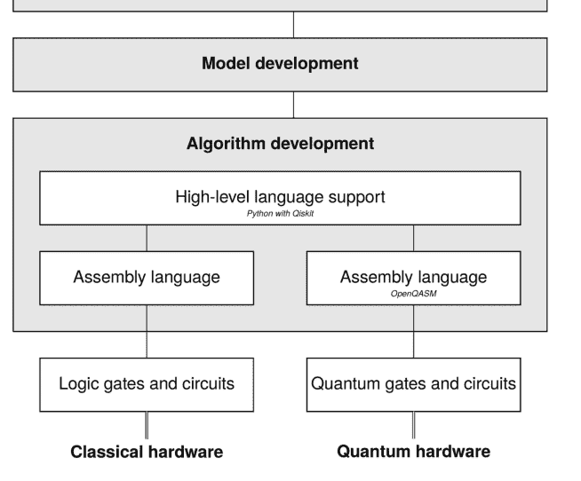

图 9.1：经典和量子软件栈

我们在硬件和软件层中都有门和电路。这些是最原始的操作，我们将它们组合成有用的过程。

汇编语言允许我们将门编码为自定义电路。它们让我们控制底层硬件，并在经典情况下访问和使用系统内存。OpenQASM3 是 IBM 等开发的一种量子计算汇编语言的示例。

编码人员和研究人员在经典计算汇编语言之上创建了数十种高级编程语言。这些包括 Python、C、C++、Swift、Java、JavaScript、PHP、Go、Rust 和 R。我们应该为量子计算开发一种新语言还是利用现有语言？

尽管看起来很极客，编写新语言很有趣。支持它们并说服成千上万的程序员学习又一种创建代码的方式就不那么有趣了。有了 qiskit，您可以利用您从 Python 中了解的一切，并使用数百位量子专家开发的开源代码。这就是本书采用的方法。

有了这个硬件和软件基础，我们设计和实现算法。领域专家模型开发者使用算法为解决方案和应用程序创建计算构建块。从那里，我们为消费者构建应用程序，为行业用例构建工作流程。

经典软件开发比其量子对应物领先数十年。在下一节中，我将展示如何使用逻辑门和电路编码更高级别的函数，例如加法。在 Python 和其他语言中，加法本身相对于其他语言特性和数千个库中的代码来说是低级的。尽管如此，我们随后可以类似地检查量子门和电路，并开始我们通往算法的旅程。

## 9.2 布尔运算和位逻辑门

正如我们在第 2.5 节中看到的，布尔值和位之间存在直接对应关系，将 True 等同于 1，将 False 等同于 0。我第一次在大学哲学系的逻辑课程中学习了布尔值及其运算。[MQL] 您也可以采用数学方法并查看布尔代数。位和电路是电气工程和计算机科学的基础。这些方法之间的 perceived 区别可能具有误导性，因为我们用不同的词谈论相同的想法。

在本节中，我使用位及其相关的门语言进行工作。

我在《Dancing with Qubits》的第 2 章中介绍了逻辑门和电路。[D.W.Q]

### 9.2.1 1 位门

最简单的 1 位门是 id，它使 0 和 1 保持不变。它是恒等门。更有用的门是 not，它将 0 映射到 1，将 1 映射到 0。

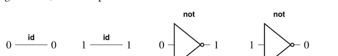

图 9.2：1 位逻辑“id”和“not”门

id 的实现是微不足道的，因为没有什么可做的。not 在 Python 中更微妙。

```
not 0
True
```

```
not 1
False
```

尽管我们从看起来像位的对象开始，但我们最终得到了布尔值。这是因为 Python 对“真值”和“假值”的扩展概念。我们在第 7.4.2 节讨论 __bool__ 时看到了这一点。我们可以通过定义来修复它

```
def bit_not(bit):
    return 0 if bit else 1
```

```
bit_not(0)
1
```

```
bit_not(1)
0
```

Python 确实提供了一个按位 not 操作“~”，它翻转 int 中的每一位。

```
~0
-1
```

~1
-2

您可能没有预料到这些结果！Python 使用“补码”表示负整数。当我写一个二进制数如 101101100 时，“高位”是左边的。当我使用补码时，如果高位是 1，则数字为负，否则为非负。

由于 Python 的行为，当我提到位的 not 时，我指的是我们实现的作为 bit_not 的函数。我们称此门为“位翻转”，因为它将 0 “翻转”为 1，反之亦然。

### 练习 9.1

通过检查这些结果：

```
[~5, ~2, ~1, ~0, ~1, ~2, ~5]
```

```
[-6, -3, -2, -1, -2, -3, -6]
```

解释 Python 如何表示小整数。~x 的公式是什么，其中 x 为 int？

我们为单个位定义了另外两个门：0，它将 0 和 1 都映射到 0；以及 1，它将 0 和 1 都映射到 1。

### 练习 9.2

证明 id、not、0 和 1 是唯一可能的 1 位门。

## 9.2.2 2 位门

在第 2.5.2 节中，我们看到了 and、or 和异或“^”的布尔“真值表”。真值表显示了所有可能的布尔值或位值以及对它们应用操作或门的结果。

为了查看 2 位门的真值表，让我们编写一个具有简单格式的功能。顶行有门的名称和第二个位的值。第一列显示第一个位的值。

```
def print_truth_table(op, name):
    print(f"{name:4} | 0     1")
```


```python
print("-----+------")
for bit in (0, 1):
    print(f"{bit}  | {op(bit, 0)}      {op(bit, 1)}")
```

**and** 的真值表为：

```python
print_truth_table(lambda x, y: x and y, "and")
```

| and | 0 | 1 |
| --- | --- | --- |
| 0 | 0 | 0 |
| 1 | 0 | 1 |

该表例如说明，对于输入 0 和 0，0 和 0 的输出为 0。电气工程师使用一套标准化的符号来表示门。图 9.3 显示了 **and** 门的“美国”符号，其有两个输入和一个输出：

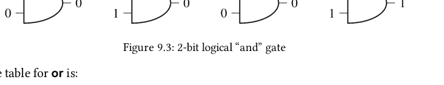

图 9.3：2 位逻辑“and”门

**or** 的表为：

```python
print_truth_table(lambda x, y: x or y, "or")
```

| or | 0 | 1 |
| --- | --- | --- |
| 0 | 0 | 1 |
| 1 | 1 | 1 |

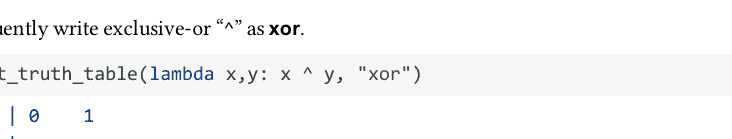

图 9.4：2 位逻辑“or”门

我们经常将异或“^”写为 **xor**。

```python
print_truth_table(lambda x, y: x ^ y, "xor")
```

| xor | 0 | 1 |
| --- | --- | --- |
| 0 | 0 | 1 |
| 1 | 1 | 0 |

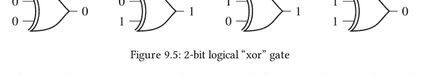

图 9.5：2 位逻辑 "xor" 门

除了这三个主要的 2 位门之外，我们通过对其应用 not 来定义次要门。`nand` 是 `not and`：

```python
print_truth_table(lambda x, y: bit_not(x and y), "nand")
```

| nand | 0 | 1 |
| --- | --- | --- |
| 0 | 1 | 1 |
| 1 | 1 | 0 |

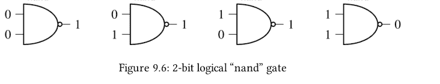

图 9.6：2 位逻辑 "nand" 门

### Exercise 9.3

验证函数

```python
def bit_nand(bit_0, bit_1):
    return bit_not(bit_0 and bit_1)
```

具有与上面相同的真值表。

`nor` 是 `not or`：

```python
print_truth_table(lambda x, y: bit_not(x or y), "nor")
```

| nor | 0 | 1 |
| --- | --- | --- |
| 0 | 1 | 0 |
| 1 | 0 | 0 |


图 9.7：2 位逻辑 "nor" 门

### xnor is not xor：

```python
print_truth_table(lambda x, y: bit_not(x ^ y), "xnor")
```

| xnor | 0 | 1 |
| --- | --- | --- |
| 0 | 1 | 0 |
| 1 | 0 | 1 |

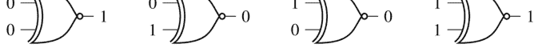

图 9.8：2 位逻辑“xnor”门

### Exercise 9.4

定义函数 `bit_nor` 和 `bit_xnor` 并验证其结果。

### Exercise 9.5

定义函数

```python
def mystery_gate(bit_0, bit_1):
    x = bit_nand(bit_0, bit_1)
    y = bit_nand(bit_0, x)
    z = bit_nand(bit_1, x)
    return bit_nand(y, z)
```

显示其真值表并确定这是什么 2 位门。请注意，我们用四个 nand 门构建了它，这意味着 `mystery_gate` 是多余的。

### Exercise 9.6

定义函数

```python
def another_mystery_gate(bit_0, bit_1):
    return abs(bit_0 - bit_1)
```

显示其真值表并确定这是什么 2 位门。

2 位受控非门 CNOT 具有以下特性：

- 第一个位是 *控制位*，第二个位是 *目标位*。
- 根据控制位的值，我们要么对目标位应用 **not**，要么保持不变。第一个位控制是否对目标位应用 **not**。
- 具体来说，如果控制位为 1，我们对目标位应用 **not**。如果控制位为 0，我们不对目标位做任何操作。
- 该门有两个输出位，控制位和我们对目标位所做的操作。

**CNOT** 是我们见过的第一个具有两个输入和两个输出的 2 位门。

### Exercise 9.7

编写实现 **CNOT** 门的函数 `controlled_not`。它应返回两个位的元组。如果我们使用返回元组的第二个位作为结果，其真值表是什么？我们以前见过这个门吗？

### Exercise 9.8

如果我们使用 `controlled_not` 的输出位作为对 `controlled_not` 的另一次调用的参数会得到什么？也就是说，对于任意位 x 和 y，

```python
controlled_not(*controlled_not(x, y))
```

是什么？

## 9.2.3 Reversible gates

一个 *可逆门* **F** 具有两个基本属性：

- **F** 的输入数与输出数相同。
- 存在一个门 **G**，其输入数和输出数与 **F** 相同，使得如果将 **G** 应用于 **F** 的输出，则得到 **F** 的输入。

在数学符号中，**G = F⁻¹** 且 **G ∘ F = id**。我们通过“反向运行 **F**”得到 **G**。**G** 是 **F** 的 *逆*。

### Exercise 9.9

**G** 可逆吗？它的逆是什么？

对于 1 位门，**id** 和 **not** 是可逆的，并且是其自身的逆。**0** 和 **1** 不是可逆的。

没有单输出 2 位门是可逆的。**CNOT** 是可逆的，并且是其自身的逆。

为了更好地展示可逆门，我现在引入一种在图表中绘制它们的新方法。

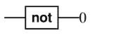

当 **not** 门的输入为 0 时，结果为 1。当输入为 1 时，结果为 0。

**CNOT** 门有一个控制位，用黑色圆点表示，和一个目标位，用圆圈中的加号表示。我们用一条线将它们连接起来。

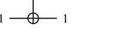

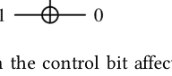

示例说明了控制位中的 0 或 1 如何影响目标位中的 1。我们可以用函数在 Python 中实现 **CNOT**

```python
def bit_cnot(bit_0, bit_1):
    return (bit_0, bit_not(bit_1) if bit_0 else bit_1)
```

**SWAP** 门交换位的值。我们用两条连接的 X 画出该门。例如，

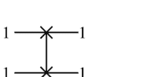


在第二个示例中，位值相同，交换并不明显。

### Exercise 9.10

使用同时赋值在 Python 中实现函数 `bit_swap`。

## 9.2.4 Gates on more than two bits

我们可以将许多 2 位门扩展到三个或更多输入。3 位 **and** 在其所有输入都为 1 时返回 1，否则返回 0。例如，

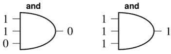

尽管这些在电气工程中有用，但在编码中用处较小。

Toffoli 或 **CCNOT** 门是一个可逆的 3 位门。前两个位是控制位，第三个是目标位。如果两个控制位都为 1，我们对目标应用 **not**。否则，我们保持目标位不变。我们将其绘制如下所示。

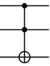

### Exercise 9.11

证明 **CCX** 是可逆的。

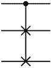

Fredkin 或 **CSWAP** 门是另一个可逆的 3 位门。第一个位是控制位，其值决定是否交换第二和第三位的值。如果控制位为 1，我们执行交换。否则，我们保持位 2 和 3 不变。我们将其绘制如下所示。

### Exercise 9.12

证明 **CSWAP** 是可逆的。

如果 `a` 有 `n` 位且 `b` 有 `m` 位，则和最多有 `maximum(n, m) + 1` 位，其中额外的位用于进位。进位位可能为 0。扩展我们对 `a` 和 `b` 各有 2 位的图，我们得到

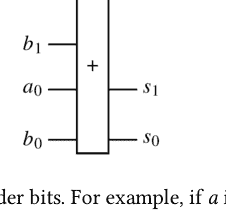

`a0` 和 `b0` 是最右边的低位。例如，如果 `a` 是 01，则 `a0` 为 1。我们的任务是了解那个带“+”的大框内有什么。我们能否将其分解为对 1 位加法器的调用？我们是否需要修改 1 位加法器，使其能够作为较大电路的组件？

我们对 2 位加法的计划是这样的：

1. 将 `a0` 和 `b0` 相加得到 `s0` 和临时进位位 `c0`。
2. 将 `a1`、`b1` 和 `c0` 相加得到 `s1` 和进位位 `c`。

我们在每一步都加单个位，但在步骤 2 中存在一个问题：我们需要加三个单个位，而不是两个。我们修改 1 位加法器使其具有三个输入：

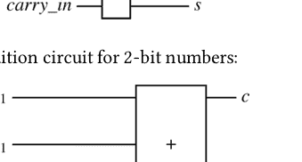

现在我们可以为 2 位数字创建加法电路：

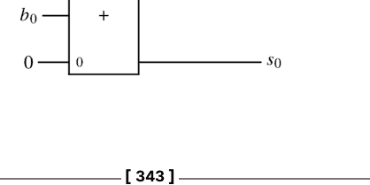

我标记了进位位。

### Exercise 9.19

对于 xor、nand、nor、xnor 及其组合，这些关系中哪些成立？

这些规则在 Python 条件语句中有用。例如，语句

```python
if x != y and z != w:
```

与

```python
if not (x == y or z == w):
```

相同。

### Exercise 9.20

用涉及 `not` 的表达式替换 `x < y`。对 `<=`、`>` 和 `>=` 做同样的处理。

## 9.5 Universality for bit gates

我们需要所有这些门吗？是否存在 1 位和 2 位门的一个子集可以生成所有其他门？让我们从一个 nand 门开始，看看能从中构建什么。

第一个新构造是 `not x = x nand x`。如果我们将 `x` 输入到 nand 的两个输入，我们得到的结果与 not 相同！

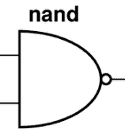

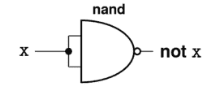

黑色圆点“●”重用位的值，以便我们可以将其用作两个输入。

该电路表明，如果我们有 nand，我们就不需要 not。尽管我们可能在电路中使用 not，但它是多余的。

原始的 1 位和 2 位门集合为

`not`, `and`, `or`, `xor`, `nand`, `nor`, `xnor`.

由于 `x and y = not (x nand y)`，我们仍需要的门为

`or`, `xor`, `nand`, `nor`, `xnor`.


我们可以用三个**与非门**构造**或门**。

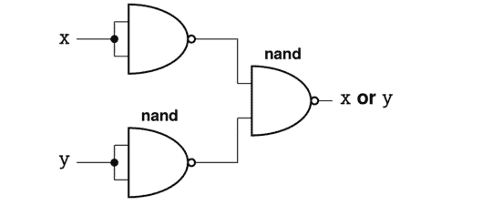

因为 x **同或** y = **非**（x **异或** y），我们现在需要的门列表是：**异或、与非、同或**。

我们需要四个**与非门**来创建一个**异或门**：

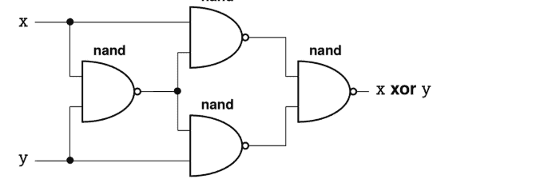

我们还剩下**与非门**，从它可以生成所有其他逻辑门。因此，**与非门**是一种*通用逻辑门*。**或非门**也具有通用性。

## 练习 9.21

1 位加法器电路使用一个**与门**和一个**异或门**。请只用**与非门**画出该电路。你需要多少个**与非门**？对于 2 位加法器电路，你又需要多少个？

实际上，经典计算机处理器并不会把所有逻辑门都化简为数百万个**与非门**。尽管如此，这能让你体会到，计算 73569367 + 278356937563489 这样的任务需要多少底层计算机制！[E.CA]

## 练习 9.22

说明如何仅用**与门**和**异或门**构造 Fredkin CSWAP 门。说明如何用 CSWAP 构造**与门**和**非门**（从而构造**与非门**）。提示：让某些输入为 0 或 1。

## 练习 9.23

说明如何用 Toffoli CCNOT 门构造**与非门**。

这些练习表明，Fredkin CSWAP 门和 Toffoli CCNOT 可逆逻辑门具有通用性。

## 9.6 量子门与操作

我们在本书中已经两次遇到量子比特：第一次在介绍性的 1.1.1 节，第二次在 5.8 节，我们在那里探讨了量子随机性。本章的其余部分将扩展这些讨论，并把它们放到更大的量子计算背景中。

虽然我会在这里讨论并使用量子比特，但我不会重复其他文本中关于复数、概率和线性代数的数学基础。[DWQ]

### 9.6.1 单量子比特门简介

我们将量子比特的值或状态表示为两个复数 $(a, b)$，满足

$|a|^2 + |b|^2 = 1$。

例如，我们可能有 $a = 1$、$b = 0$，或者反过来。这些是重要的情形，我们为它们起了专门的名字。$(1, 0)$ 是 $|0\rangle$，读作“ket-0”，而 $(0, 1)$ 是 $|1\rangle$，读作“ket-1”。

如果你熟悉线性代数，$|0\rangle$ 和 $|1\rangle$ 合在一起被称为单量子比特的计算基或标准基。用线性代数的列向量记号表示，它们就是

$|0\rangle = \begin{bmatrix} 1 \\ 0 \end{bmatrix}, \qquad |1\rangle = \begin{bmatrix} 0 \\ 1 \end{bmatrix}$。

由于 $a$ 是复数，$a = a_1 + a_2 i$，其中实部为 $a_1$、虚部为 $a_2$。它们都是实数。根据定义，$|a| = \sqrt{a_1^2 + a_2^2}$。因此 $|a|^2 = a_1^2 + a_2^2$。对 $b$ 也有类似的结论。

我们可以写成

$(a, b) = a\,(1, 0) + b\,(0, 1) = a\,|0\rangle + b\,|1\rangle$。

这个描述量子态的方程被称为*叠加*。$a$ 是 $|0\rangle$ 的*振幅*，$b$ 是 $|1\rangle$ 的振幅。在量子计算教材和文章中，你常会看到 $a\,|0\rangle + b\,|1\rangle$ 被简写为 $|\psi\rangle$。

虽然这种记号对你来说可能有些奇怪，但假设我请你“向东走 3 个街区，再向北走 4 个街区”。用 ket 记号表示，就是：

$3\,|\text{east}\rangle + 4\,|\text{north}\rangle$。

这样一来，你就“同时既向东又向北”。这就是人们有时会说“量子比特同时是 0 和 1”的由来。

振幅 3 和 4 不能用于量子态，因为 $|3|^2 + |4|^2 \neq 1$。

如果存在一个复数 $c$，满足 $|c| = 1$，且 $a_0 = c\,a_1$、$b_0 = c\,b_1$，则两个量子态 $a_0\,|0\rangle + b_0\,|1\rangle$ 和 $a_1\,|0\rangle + b_1\,|1\rangle$ 是*等价*的。我们说这两个量子态“相差一个*全局相位* $c$”。

现在来看作用于单个量子比特的量子门。我用下面的记号展示门的工作方式：

$a\,|0\rangle + b\,|1\rangle \mapsto c\,|0\rangle + d\,|1\rangle$

箭头“$\mapsto$”表示“映射到”。对于下面每个门，请验证 $|c|^2 + |d|^2 = 1$。

所有量子门都是可逆的。

### id 量子门

与比特情形一样，恒等门 **id** 不做任何操作。在电路图中，我们用右侧的符号表示 **id** 门。

**id**: $a\,|0\rangle + b\,|1\rangle \mapsto a\,|0\rangle + b\,|1\rangle$


### X 量子门

**X** 门将经典比特的**非门**推广到量子比特。

**X**: $a\,|0\rangle + b\,|1\rangle \mapsto b\,|0\rangle + a\,|1\rangle$


我们称 **X** 为比特翻转，因为 $X(|0\rangle) = |1\rangle$ 且 $X(|1\rangle) = |0\rangle$。它能做的更多，因为量子态比比特状态丰富得多。例如，

$X:\; (\sqrt{3}/2)\,|0\rangle - (1/2)\,|1\rangle \mapsto (-1/2)\,|0\rangle + (\sqrt{3}/2)\,|1\rangle$。

最后一个量子态表达式使用了精确值 $\sqrt{3}/2$。当我们在 Python 中把它转换为**浮点数**时，会得到一个近似值。随着我们使用量子门和量子电路，舍入误差会悄然出现。

```python
import math

a = math.sqrt(3)/2
b = 1/2
(a, b)
```

`(0.8660254037844386, 0.5)`

```python
abs(a)**2 + abs(b)**2
```

`0.9999999999999999`

你会学会识别一些在量子计算中反复出现的数。特别是，$\pm\sqrt{2}/2$ 和 $\pm\sqrt{2}/2\,i$ 的**浮点**和**复数**近似值如下：

```python
for x in (1, -1, 1j, -1j):
    print(x * math.sqrt(2)/2)
```

```text
0.7071067811865476
-0.7071067811865476
0.7071067811865476j
-0.7071067811865476j
```

在文献中，你有时会看到 $\sqrt{2}/2$ 被写成与之等价的 $1/\sqrt{2}$。


### Z 量子门

**Z** 门改变 $|1\rangle$ 振幅的符号。

**Z**: $a\,|0\rangle + b\,|1\rangle \mapsto a\,|0\rangle - b\,|1\rangle$

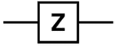

我们称 **Z** 为*相位翻转*，原因来自量子力学的物理。

### Y 量子门

**Y** 门是我们见到的第一个使用非实数复数的单量子比特门。

**Y**: $a\,|0\rangle + b\,|1\rangle \mapsto -bi\,|0\rangle + ai\,|1\rangle$

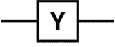

**Y** 既是比特翻转，也是相位翻转。我们可以把它重写为

**Y**: $a\,|0\rangle + b\,|1\rangle \mapsto (-i)(b\,|0\rangle - a\,|1\rangle) = (-i)\,\mathbf{ZX}(a\,|0\rangle + b\,|1\rangle)$

因为 $|-i| = 1$，所以应用 **Y** 得到的量子态与应用 **X** 后再应用 **Z** 得到的量子态等价。如果我们有 **X** 和 **Z**，那么 **Y** 就是多余的。

### 练习 9.26

证明 $XY = -YX$，$ZY = -YZ$，以及 $YY = \mathrm{id}$。

我在 *《与量子比特共舞》* 的 7.6.3 节中介绍了 **Y** 门。[DWQ]

### H 量子门

**H** 门又称阿达马门，得名于雅克·阿达马，它作用在 $|0\rangle$ 和 $|1\rangle$ 上如下：

$\mathbf{H}(|0\rangle) = (\sqrt{2}/2)(|0\rangle + |1\rangle)$，且 $\mathbf{H}(|1\rangle) = (\sqrt{2}/2)(|0\rangle - |1\rangle)$。

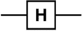

经过简单的代数运算，我们得到

\[
\begin{aligned}
\mathbf{H}(a|0\rangle + b|1\rangle)
&= a\,\mathbf{H}(|0\rangle) + b\,\mathbf{H}(|1\rangle)\\
&= a(\sqrt{2}/2)(|0\rangle + |1\rangle) + b(\sqrt{2}/2)(|0\rangle - |1\rangle)\\
&= a(\sqrt{2}/2)|0\rangle + a(\sqrt{2}/2)|1\rangle + b(\sqrt{2}/2)|0\rangle - b(\sqrt{2}/2)|1\rangle\\
&= (\sqrt{2}/2)(a+b)|0\rangle + (\sqrt{2}/2)(a-b)|1\rangle.
\end{aligned}
\]

这是一张占位图片。我用它来测试 API。

### CNOT 量子门

在量子情形下，CNOT 更准确的说法是受控 X 门或 CX 门。

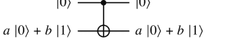

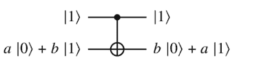

如果第一个量子比特的量子态是 $|1\rangle$，就对第二个量子比特施加 X；如果状态是 $|0\rangle$，则第二个量子比特的状态保持不变。

上方的门作用为

$\mathrm{CNOT}(|0\rangle \otimes (a|0\rangle + b|1\rangle)) = |0\rangle \otimes (a|0\rangle + b|1\rangle) = a|00\rangle + b|01\rangle$。

下方的门作用为

$\mathrm{CNOT}(|1\rangle \otimes (a|0\rangle + b|1\rangle)) = |1\rangle \otimes X(a|0\rangle + b|1\rangle) = |1\rangle \otimes (b|0\rangle + a|1\rangle) = b|10\rangle + a|11\rangle$。

我在 *《与量子比特共舞》* 的 8.3.3 节中介绍了 CNOT / CX 门。[D.W.Q]

### SWAP 量子门

SWAP 交换两个量子比特的量子态。

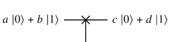


### 其他受控门

我们可以为任何量子门的执行添加一个控制量子比特，不仅仅是 X 门。在图 9.10 的电路中，顶部量子比特的状态控制着我们是否将 X、Y、Z 和 H 门应用到其他量子比特上。从左到右，我们有 CX（= CNOT）、CY、CZ、CZ（另一种形式）和 CH。

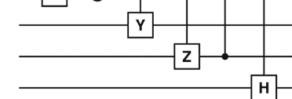

图 9.10：CX、CY、CZ 和 CH 量子门

控制端不必从上到下。它们可以沿任一方向，而且如你所见，可以跨量子比特跳跃。

### 张量积门

正如我们可以对两个单独的量子态取张量积

|φ⟩ = a |0⟩ + b |1⟩ 和 |ψ⟩ = c |0⟩ + d |1⟩

得到一个 2 量子比特的量子态，

|φ⟩ ⊗ |ψ⟩ = (a |0⟩ + b |1⟩) ⊗ (c |0⟩ + d |1⟩) = ac |00⟩ + ad |01⟩ + bc |10⟩ + bd |11⟩

我们也可以对两个 1 量子比特门取张量积。

如果 A 和 B 是两个 1 量子比特门，那么

(A ⊗ B)(|φ⟩ ⊗ |ψ⟩) = (A |φ⟩) ⊗ (B |ψ⟩)

就是一个 2 量子比特门。

例如，如果 A = B = H，即哈达玛门，那么

H |0⟩ = (√2/2) |0⟩ + (√2/2) |1⟩

### 练习 9.38

证明 |a|² + |(cos(φ) + sin(φ) i) b|² = 1。

S、S†、T 和 T† 门分别是 RZ_{π/2}、RZ_{3π/2}、RZ_{π/4} 和 RZ_{7π/4} 门。

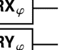

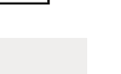

类似地，我们将 RX_φ 和 RY_φ 定义为分别绕 x 轴和 y 轴旋转 φ 弧度的操作。X = RX_π，Y = RY_π。

### 练习 9.39

当 ψ 和 φ 取什么值时，H 门等于 RZ_ψ RY_φ？这里我们先应用 RY_φ，再应用 RZ_ψ。（“ψ”是希腊字母“psi”。）

√NOT 门还有其他几个名称和符号：√X、√¬ 和 Sx。无论你怎么称呼它，当你对量子态连续应用两次 √NOT 时，你会得到该状态的比特翻转。

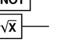


√NOT 对 |0⟩ 和 |1⟩ 的作用如下

|0⟩ ↦ (1/2) ((1 + i) |0⟩ + (1 − i) |1⟩)  
|1⟩ ↦ (1/2) ((1 − i) |0⟩ + (1 + i) |1⟩)

### 练习 9.40

利用 √NOT 作用于 |0⟩ 和 |1⟩ 的公式，证明 √NOT √NOT 是比特翻转。

### 练习 9.41

在 Python 中实现 √NOT

```python
def qubit_SQRT_NOT(a, b):
    ...
```

针对量子态 a |0⟩ + b |1⟩。它应返回一个 2 元组。

我在《与量子比特共舞》的第 7.6.12 节中介绍了 √NOT 门。[D.W.Q]

## 9.7 量子电路

我们现在已经看到了本书所需的所有量子门，是时候将它们组合成电路了。

在电路中实现的量子算法的目标是操纵量子比特的状态，使我们在测量时得到的 0 和 1 有非常高的概率是正确答案。

### 9.7.1 基础电路

我已在简单情况中做过这些，但让我们从始至终看看一个基础电路是什么样的。

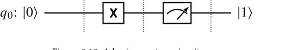

图 9.12：一个基础量子电路

图 9.12 中的电路包含一个带有一个量子比特的量子寄存器。初始化阶段位于第一条垂直虚线的左侧。在这个阶段，我们将量子比特 q0 初始化为 |0⟩。如果我们没有显式显示 |0⟩，你可以假设量子比特从该状态开始。我们称水平线为导线。

在第一条和第二条虚线之间，我们对量子比特施加门。从第二条到第三条虚线之间，我们测量量子比特。之后，我们查看每次测量得到的是 |0⟩ 还是 |1⟩，并将其解释为比特 0 或 1。

当 IBM 在 2016 年首次在云上提供量子计算机时，你只能将测量放在电路的末尾。现在，你可以在电路中间测量，并带着你看到的 |0⟩ 或 |1⟩ 继续电路。

第二个操作是重置，它将量子态强制为 |0⟩。它不是门，也不是可逆的。尽管如此，它是一个有用的功能，允许你在算法中重用辅助或“暂存”量子比特。我们按右侧所示绘制重置操作。

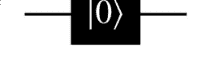

### 9.7.2 物理量子比特与逻辑量子比特

当我们运行电路时，我们期望看到 X 门将量子态从 |0⟩ 改变为 |1⟩。数学告诉我们，得到 |1⟩ 的概率应该是 100%，无论我们运行电路一次还是一千次都是如此。

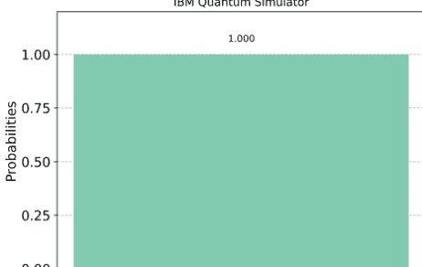

图 9.13：在模拟器上执行电路的结果

图 9.13 中的直方图显示，每次执行电路我们都得到 1。我们没有显示 0 的条形，因为它没有出现。该直方图针对的是使用伪随机数模拟的电路。

在图 9.14 的直方图中，我展示了通过 IBM Cloud 上的 IBM Quantum 在实际量子硬件上运行电路 8,192 次的结果。除 1 之外，我们还看到了一些 0。

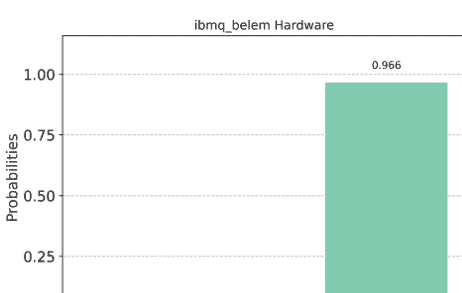

图 9.14：在量子硬件上执行电路的结果

我定义了以下样式字典，以便为本书美观地格式化量子电路。你会看到我在调用 QuantumCircuit 的 draw 方法时将它作为 **kwargs 参数使用。

```python
draw_kwargs = {
    "output": "mpl",      # use matplotlib
    "cregbundle": False,    # separate classical register wires
    "initial_state": True,  # show |0> and 0
    "idle_wires": False,    # don't show unused wires

    "style": {
        "name": "bw",       # black-and-white for book
        "subfontsize": 9,    # font size of subscripts
        "dpi": 600           # image resolution
    }
}

histogram_color = "#82caaf"
```

我们首先从其组成部分创建一个电路：一个量子寄存器和一个经典测量寄存器。每个寄存器有一个量子比特或比特，我们分别用“q”或“meas”作为前缀。

```python
qreg_q = QuantumRegister(1, "q")
creg_c = ClassicalRegister(1, "meas")
```

我们将它们组合成一个电路，

```python
circuit = QuantumCircuit(qreg_q, creg_c)
```

并在量子比特线上放置一个 X 门。

```python
circuit.x(qreg_q[0])
```

<qiskit.circuit.instructionset.InstructionSet at 0x1cf2bcef220>

```python
circuit.draw(**draw_kwargs)
```

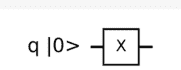

现在我们运行电路 1,000 次，看看得到多少个 0 和 1。counts 变量保存这些数据，它是一个字典，包含我们看到的每个结果及其出现的次数。这 1,000 次执行中的每一次都是一次 shot。

```python
result = execute(circuit, simulator, shots=1000).result()
counts = result.get_counts(circuit)
counts
```

{'1': 1000}

我们只看到了 1，但让我们在直方图中显示这些结果，以便稍后比较。

```python
histogram = plot_histogram(counts, color=histogram_color,
    title="IBM Quantum Simulator")
```

<Figure size 504x360 with 1 Axes>

```python
histogram
```

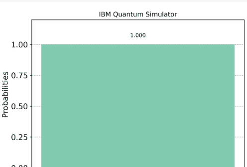

现在我们使用真实硬件。虽然模拟器适合学习、调试和小型实验，但未来是量子硬件。我们可以这样看：如果你只在飞行模拟器上学习过，而没有在真正的飞机上学习过，我绝不会让你开飞机把我从纽约送到东京。也别指望能当上飞行员。

首先加载你的 IBM Quantum 账户凭据。

```python
IBMQ.load_account()
```

<AccountProvider for IBMQ(hub='ibm-q', group='open', project='main')>

如果你看到了错误

IBMQAccountCredentialsNotFound:
'No IBM Quantum Experience credentials found.'

那么请参阅附录 A.10 节，了解如何设置你的账户。

提供者提供一个或多个模拟器或量子计算机后端。[QQP] 你可能会使用“ibm-q”提供者。我编写了一些 Python 代码，以便更容易查看系统数据。

```python
IBMQ.providers()
provider = IBMQ.get_provider("ibm-q")

print("System Name               Number of Qubits")
print("--------------------------------------------")
for backend in sorted(provider.backends(), key=lambda x: x.name()):
    config = backend.configuration()
    print(f"{config.backend_name:22}      {config.n_qubits:>3}")
```

| 系统名称 | 量子比特数 |
| --- | --- |
| ibmq_armonk | 1 |
| ibmq_belem | 5 |
| ibmq_bogota | 5 |
| ibmq_lima | 5 |
| ibmq_manila | 5 |
| ibmq_qasm_simulator | 32 |
| ibmq_quito | 5 |
| ibmq_santiago | 5 |
| simulator_extended_stabilizer | 63 |
| simulator_mps | 100 |
| simulator_stabilizer | 5000 |
| simulator_statevector | 32 |

我选择“ibmq_belem”量子计算系统作为我们的后端，但你应该选择一个你可访问的系统。你看到的系统列表可能与之前的列表不同，“ibmq_belem”可能不在你的列表中。要找出哪个系统最不繁忙，请执行如下代码：

```python
from qiskit.providers.ibmq import least_busy

device = least_busy(provider.backends(
    filters=lambda x: x.configuration().n_qubits >= 3 and
                      not x.configuration().simulator and
                      x.status().operational==True))
```


我们插入一个最终的CNOT门。

```
circuit.cx(0, 1)
```

<qiskit.circuit.instructionset.InstructionSet at 0x1cf9e8be880>

```
circuit.draw(**draw_kwargs)
```

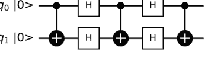

# 练习 9.42

上面的电路实现了我们之前见过的2量子比特门之一。它是哪一个？为什么？

量子比特 q₀ 和 q₁ 由 IBM Quantum 硬件初始化为 |0⟩，但我想将 q₁ 设置为 |1⟩。下面是一个明确显示这些值的短电路：

```
initialization_circuit = QuantumCircuit(2)
initialization_circuit.id(0)
initialization_circuit.x(1)
initialization_circuit.barrier()
```

<qiskit.circuit.instructionset.InstructionSet at 0x1cf9eaf6fd0>

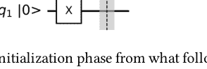

我插入屏障（barrier）是为了将初始化阶段与后续部分分开。

现在我将这些电路“组合”在一起，构成一个新电路。

```
new_circuit = initialization_circuit.compose(circuit)
new_circuit.measure_all()
```

```
new_circuit.draw(**draw_kwargs)
```

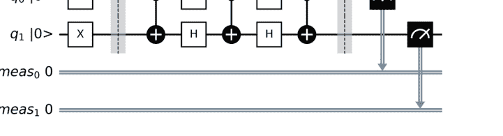

像之前一样，我们用模拟器运行该电路1,000次。

```
result = execute(new_circuit, simulator, shots=1000).result()
```

```
counts = result.get_counts(new_circuit)
counts
```

{'01': 1000}

再一次，每次我们得到相同的结果，但我必须解释一下'01'。Qiskit在绘制的电路图中从上到下编号量子比特，并在写出结果时从右到左排列。所以'01'表示测量q0的结果是1，也就是最右边的值。来自q1的测量结果是0，也就是左边的下一个值。电路的门的阶段和测量阶段将|0>映射为1，将|1>映射为0。

```
histogram = plot_histogram(counts, color=histogram_color,
    title="IBM Quantum Simulator")
```

<Figure size 504x360 with 1 Axes>

```
histogram
```

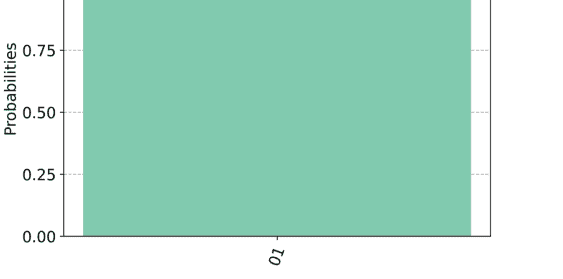

让我们看看在量子计算系统上会得到什么。请记住，由于概率和硬件错误，您的结果可能会有所不同。

```
result = execute(new_circuit, quantum_hw, shots=1000).result()
counts = result.get_counts(new_circuit)
```

```
counts
```

{'00': 49, '01': 923, '10': 12, '11': 16}

这次结果是混合的，但很明显哪个值是最有可能的。

```
histogram = plot_histogram(counts, color=histogram_color,
    title="ibmq_belem Hardware")
```

<Figure size 504x360 with 1 Axes>

```
histogram
```

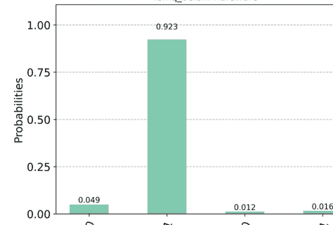

您编写的门并不一定是真正在量子硬件上运行的门。正如我们将在9.8节中看到的，每种硬件都提供一套特定于其物理量子比特和控制技术的通用量子门集。Qiskit也会以复杂和直接的方式优化电路。例如，Qiskit可以移除HH，因为它与id相同。

这种“翻译和编译”的过程称为transpiling（转译）。（这个词不是我创造的。）Qiskit会自动完成此操作，但您可以调用transpile函数来查看它如何改变您的电路。可选的optimization_level参数告诉transpile它应该花多大精力来改进电路。optimization_level增加时，它会更加努力。默认值为1，当optimization_level为0时，Qiskit不进行优化。

```
new_circuit_hw = transpile(new_circuit, quantum_hw,
optimization_level=1)
```

```
new_circuit_hw.draw(**draw_kwargs)
```

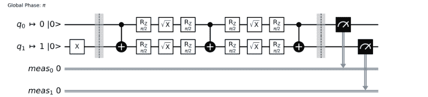

您是否看到哈达玛H门在转译后被替换了？

## 9.7.7 设置特定的量子态

给定一个量子态 a |0⟩ + b |1⟩，initialize方法在电路中将该量子比特设置为该状态。设 a = √3/2 且 b = 1/2。

```
a, b = quantum_state = (-math.sqrt(3)/2, complex(0, 1/2))
abs(a)**2 + abs(b)**2
```

0.9999999999999999

我们遇到了浮点数舍入误差，所以绝对值的平方和并不等于1.0。

```
circuit = QuantumCircuit(1)
circuit.initialize(quantum_state, 0)
circuit.measure_all()
```

```
circuit.draw(**draw_kwargs)
```

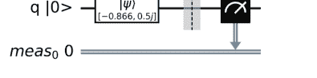

当我们在模拟器上运行这个电路时，我们期望看到0的概率是四分之三，1的概率是四分之一。

# 练习 9.43

为什么我们期望这些概率？

```
result = execute(circuit, simulator, shots=5000).result()
```

```
counts = result.get_counts(circuit)
counts
```

{'0': 3717, '1': 1283}

鉴于我们在5.7节中关于伪随机数的讨论，这些值是合理的。

```
histogram = plot_histogram(counts, color=histogram_color,
    title="IBM Quantum Simulator")
```

<Figure size 504x360 with 1 Axes>

```
histogram
```

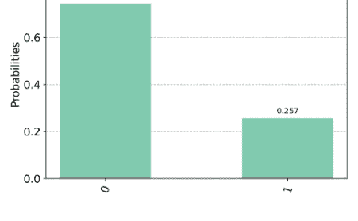

## 9.7.8 纠缠量子比特

在本节中，我们处理两个量子比特。如果量子比特 $q_0$ 的量子态为

$|\psi_0\rangle = a_0 |0\rangle + b_0 |1\rangle$

且量子比特 $q_1$ 的量子态为

$|\psi_1\rangle = a_1 |0\rangle + b_1 |1\rangle,$

那么它们的2量子比特量子态为

$|\psi_0\rangle \otimes |\psi_1\rangle = (a_0 |0\rangle + b_0 |1\rangle) \otimes (a_1 |0\rangle + b_1 |1\rangle) =$
$a_0 a_1 |00\rangle + a_0 b_1 |01\rangle + b_0 a_1 |10\rangle + b_0 b_1 |11\rangle.$

我们能把所有2量子比特量子态都写成这种形式吗？**不能。**

如果一个2量子比特量子态可以写成单量子比特态 $|\psi_0\rangle$ 和 $|\psi_1\rangle$ 的 $|\psi_0\rangle \otimes |\psi_1\rangle$ 形式，那么这些量子比特就是*可分离的*。否则，量子比特就是*纠缠的*。纠缠是量子计算的一个基本性质。

一个简单的可分离态是 $(\sqrt{2}/2)|00\rangle + (\sqrt{2}/2)|01\rangle$，因为它等于 $|0\rangle \otimes ((\sqrt{2}/2)|0\rangle + (\sqrt{2}/2)|1\rangle)$。这里 $|\psi_0\rangle = |0\rangle$，$|\psi_1\rangle = (\sqrt{2}/2)|0\rangle + (\sqrt{2}/2)|1\rangle$。当我测量 $|\psi_0\rangle$ 时，它不会告诉我关于 $|\psi_1\rangle$ 的任何信息。

相反，考虑

$(\sqrt{2}/2)|00\rangle + (\sqrt{2}/2)|11\rangle.$

让我们测量第一个量子比特，而暂时不管第二个。如果我们得到0，我们必定是从 $|00\rangle$ 得到它的，因为 $|11\rangle$ 中的第一个量子比特会给出1。因此，第二个量子比特**必须**测量为0，即 $|00\rangle$ 中的第二个分量。类似地，如果我们测量第二个量子比特并得到1，那么第一个量子比特也必定测量为1，这来自 $|11\rangle$。这些量子比特的行为是纠缠的，它们失去了独立性。

量子态 $(\sqrt{2}/2)|00\rangle + (\sqrt{2}/2)|11\rangle$ 是四个纠缠贝尔态之一：

$|\Phi^+\rangle (\sqrt{2}/2)|00\rangle + (\sqrt{2}/2)|11\rangle \quad |\Psi^+\rangle (\sqrt{2}/2)|01\rangle + (\sqrt{2}/2)|10\rangle$

$|\Phi^-\rangle (\sqrt{2}/2)|00\rangle - (\sqrt{2}/2)|11\rangle \quad |\Psi^+\rangle (\sqrt{2}/2)|01\rangle - (\sqrt{2}/2)|10\rangle$

这里有两件事我想让你记住：

- 1. 当你看到 √2/2 时，想到 **H** 门。
- 2. 当你需要纠缠时，想到 **CNOT** 门。

右侧的电路片段创建了贝尔态。把它看作一个可复用的量子函数。我们可以很容易地用Python中的Qiskit构建它。

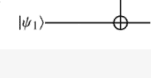

```
circuit = QuantumCircuit(2)
circuit.h(0)
circuit.cnot(0, 1)
```

```
circuit.draw(**draw_kwargs)
```

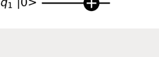

# 练习 9.44

|11⟩、|01⟩、|00⟩ 和 |10⟩ 中哪一个产生了四个贝尔态中的每一个？

我们在量子计算的许多地方使用纠缠，包括在您可能本想复制数据的算法中。爱因斯坦起初并不相信纠缠，并称之为“幽灵般的超距作用”。纠缠的量子粒子在很大、有时甚至天文学尺度的距离上保持其相关性。

纠缠将量子系统的不同部分联系在一起，因此您无法通过观察单个组件来了解其中包含的所有信息。John Preskill教授将这一情况比作必须一次读完一本书的一个章节才能理解其内容，而不是一页一页地阅读。[QEF]


我在《Dancing with Qubits》一书的8.2节中介绍了量子比特纠缠。[DWQ]


## 9.8 量子门的普适性

对于一本编程书籍来说，量子计算中通用门集的存在性大多是学术性的，但值得简单讨论一下，以与经典情况互补。

与经典情况不同，1量子比特门有无限多个。RX_φ、RY_φ和RZ_φ就给出了这样一个集合，其中0 ≤ φ < 2π。如果我们无法精确地生成这些门，就需要尽量接近地逼近它们。我们修改定义：如果我们可以用这些门构建一个电路，并以任意精度逼近任何n量子比特门，那么这组量子门就是普适的。[TCN]

我们需要量子比特纠缠，这在经典中没有对应物。

最后，在X、Y、Z、H和CNOT这些优雅的门之下，我们需要了解在任何给定的量子计算技术中，工程师在硬件中实现了哪些门。例如，这些门在“超导transmon”、“离子阱”、“量子点”和“光子”量子比特方法中有所不同，并且可能在每个类别内部也有差异。[DRQ] 我们能否从硬件门出发近似生成我们想要的任何门？

研究人员已经发现了几个量子门的通用集，包括：

-   所有1量子比特门加上CNOT，
-   Toffoli CCX、Hadamard H和S

以及

-   CNOT、Hadamard H和T。

在实践中，通过Qiskit可用或你可以用电路自行构建的门集非常大。我们重点讨论这些门。

## 9.9 小结

本章探讨了经典计算的门与电路基础。它展示了底层编码者如何构建位加法和更高级别的函数。然后，我们转向量子门与电路。虽然我们使用了相同的术语，但编程模型有着根本性的不同。特别是，叠加和纠缠带来了仅靠经典技术无法获得的行为和工具。

下一章，我们将研究测试和优化代码的技术，无论是经典代码还是量子代码。我们已经通过使用Qiskit的transpile函数为通用和硬件特定用途优化量子门时看到了一些相关内容。
