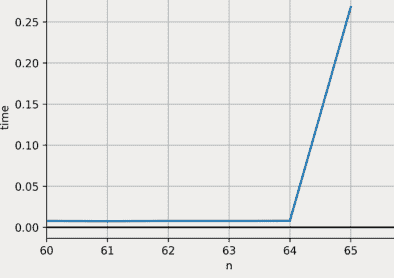
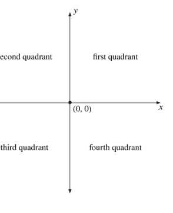

## 10

## 优化和测试你的代码

> *经验是每个人赋予自己错误的名称。*
> 
> ——奥斯卡·王尔德，*《温德米尔夫人的扇子》*

如果我们的代码完美无缺，那将是多么美妙。它会以最有效的方式运行，并且会完全按照我们的意图从第一次就表现出来。不会有任何一行或一个表达式是无用的。它会在标准情况下以及软件用户扔给我们的每一个怪异的转折中正确执行。

在本章中，我们面对现实。代码在开始时通常有一个或多个bug。你的编程编辑器（例如Visual Studio Code）可能会帮助你处理语法错误，但语义错误可能更难发现。我们首先学习广泛使用的测试代码的技术，从简单的健全性检查到有组织的、可重复的过程。然后，我们查看代码运行所需的时间，并给出提高性能的建议。你的所有代码都被使用了吗？我们考察一下“覆盖率”的概念，看看我们编写的所有代码是否都被测试和执行。最后，我们研究Python装饰器，学习如何在不修改原始代码的情况下向函数和方法添加额外功能。

## 本章涵盖的主题

-   10.1 测试你的代码  384
-   10.2 测量代码运行时间  391
-   10.3 优化你的代码  393
-   10.4 查找孤立代码  400
-   10.5 定义和使用装饰器  403
-   10.6 小结  408

## 10.1 测试你的代码

你编写的代码必须在所有可能的情况下对所有可能的输入都能工作。因此，你必须设计一个测试系统，确保所有可能性都被覆盖，并且结果是正确的。

这是一个强有力的说法，如果你编写“快速而粗糙”的一次性代码或仅供自己使用，你可能会放宽规则。如果你要分享你的代码，或者它将作为生产环境的一部分，测试是必不可少的。

### 10.1.1 __debug__

默认情况下，系统变量__debug__为True。此设置允许你编写如下代码：

```
from src.code.unipoly import UniPoly

x = UniPoly(1, "x", 1)

def square_poly(p):
    if __debug__:
        print(f"Argument {p = }\n")
    return p*p

square_poly(x**2 - 3*x + 7)
```

Argument p = x**2 - 3*x + 7

x**4 - 6*x**3 + 23*x**2 - 42*x + 49

注意，我从特定文件夹路径“src.code.unipoly”导入了UniPoly。你可能需要根据你对该模块的使用情况将其更改为其他路径。我在第7章“将对象组织成类”中介绍了UniPoly。

```
iterative_factorial(1.3)

File "<stdin>", line 1, in "<module>"
File "<stdin>", line 2, in iterative_factorial
AssertionError
```

更具体地说，在条件后面包含一条消息：

```
def iterative_factorial(n):
    assert isinstance(n, int), "n not an int"
    assert n >= 0, "n < 0"

    product = 1
    for i in range(1, n + 1):
        product *= i
    return product
```

```
iterative_factorial(-1.3)

File "<stdin>", line 1, in "<module>"
File "<stdin>", line 2, in iterative_factorial
AssertionError: n not an int
```

```
iterative_factorial(-17)

File "<stdin>", line 1, in "<module>"
File "<stdin>", line 3, in iterative_factorial
AssertionError: n < 0
```

你可以在一个assert语句中测试多个条件，但我更喜欢将它们分开，以便查看哪个测试失败了。

使用assert是有开销的，因为Python必须计算每个条件。如果你在代码开发早期添加了断言，一旦你确信一切正常，就可以删除它们。启动Python时使用-O或-OO会关闭所有assert条件检查。

### 10.1.3 pytest

假设你编写了一个函数或类。通常，它们不会单独存在，而是包含在模块、包或项目中。尽管如此，对每个组件进行正确行为测试是合理的。运行并强调一段代码的软件称为单元测试。

```
"""Tests that a multiplication fails."""
x = UniPoly(1, 'x', 1)
p = x + 1
q = x - 1
>     assert p * q == x * x + 1
E     assert x**2 - 1 == x**2 + 1
E       Use -v to get the full diff

unipoly.py:732: AssertionError
=========================== short test summary info ===========================
FAILED unipoly.py::test_bad_multiplication - assert x**2 - 1 == x**2 + 1
=========================== 1 failed, 1 passed in 0.10s ============================
```

这里有很多信息，包括操作系统、pytest版本、已安装的测试插件、断言失败的代码、原始断言以及求值后的断言。输出中未提及test_good_addition，因为断言条件为True。

pytest会查看输入文件，并处理所有名称以“test_”开头的函数。

通常，我不会定义像test_bad_multiplication这样的函数，而是会编写类似这样的代码：

```
def test_multiplication():
    """Tests polynomial multiplication."""
    x = UniPoly(1, 'x', 1)
    p = x + 1
    q = x - 1
    assert 0 * p == 0
    assert p * 0 == 0
    assert 1 * p == p
    assert -1 * p == -p
    assert p * 1 == p
    assert 2 * p == p * 2
    assert p * q == q * p
    assert p * q == x * x - 1
    # ... more multiplication tests
```

我会对每个函数和方法都这样做。

## 练习10.1

在图10.1中，对于60 ≤ n ≤ 65的2ⁿ的*timeit*时间曲线中，当n = 64时出现了奇怪的现象。解释为什么我们会看到执行时间的大幅增加。（提示：参见5.2节。）



你可以通过定义一个函数，来评估比容易放入`stmt`字符串中更多的代码。

```
def f(n):
    assert n > 6

    the_list = []
    for x in range(n):
        the_list.append(x)
    for _ in range(10):
        the_list += the_list
        the_list = the_list[5:]
```

*f*是一个低效的无意义函数，它创建一个列表，将其追加到自身，进行切片，并重复十次。使用`globals`关键字参数，让*timeit*可以使用你的局部定义。

```
count = 1000
timeit.timeit(stmt="f(100)", number=count, globals=globals())
```

0.9215112999999997


先让你的代码正确，然后在必要时让代码更快。

## 10.3.1 使用现有代码

是否存在一个 Python 库，提供与你想要或需要的功能接近的功能？如果有，请研究人们对这个库及其实现的看法。如果你可以使用专家编写的代码，那么它很可能比你从头开始创建的代码更好。[PYL] [PYPI]

## 10.3.2 选择一个好的算法

在第六章“定义和使用函数”中查看阶乘和斐波那契函数的实现时，我们看到选择正确的算法会在执行时间或内存使用上产生很大差异。请注意，你可能直到问题规模足够大时才会看到这一点，因此你可能不需要在小型情况下过度分析该怎么做。

例如，你真的需要对只有两个元素的列表调用 sorted 吗？

```
def adder_1(n):
    sum = 0
    for j in range(1, n + 1):
        sum += j
    return sum

adder_1(100)
```

5050

```
t = timeit.timeit(stmt="adder_1(1000000)",
                number=3, globals=globals())
print(f"{t:.10f}")
```

2.0824539000

或者，你可以注意到这个总和是 n (n + 1)/2。

```
def adder_2(n):
    return n * (n + 1) // 2
```

现在让我们看看使用列表推导式创建相同列表的速度有多快。

```
def build_list_2(n):
    [j for j in range(n)]

t_2 = timeit.timeit(stmt="build_list_2(100000)",
                    number=3, globals=globals())
print(f"Execution time = {t_2:.10f}")
```

Execution time = 0.0098197000

如果你正在过滤项目或对它们进行计算，执行时间的差异可能远小于我们刚才看到的构建简单列表的差异。列表推导式可能不是每种情况下最快的解决方案，因为 Python 知道如何从 range 等函数创建其内置集合。

```
def build_list_3(n):
    list(range(n))

t_3 = timeit.timeit(stmt="build_list_3(100000)",
                    number=3, globals=globals())
print(f"Execution time = {t_3:.10f}")
```

Execution time = 0.0062501000

```
def speed(n, m):
    ratio = eval(f"t_{n}") / eval(f"t_{m}")
    print(f"build_list_{m} is " +
          f"{ratio:.2f} times faster than build_list_{n}")
```

```
speed(1, 2)
speed(1, 3)
speed(2, 3)
```

build_list_2 is 1.82 times faster than build_list_1
build_list_3 is 2.86 times faster than build_list_1
build_list_3 is 1.57 times faster than build_list_2

## 练习 10.5

在 speed 的定义中，eval 做了什么？

## 10.3.6 不要在循环中做额外的工作

考虑函数 *looper_1*，它接受一个正整数 n。在 *looper_1* 内部，我们执行一个 n 次的循环。在循环内部，我们计算 2¹⁰⁰，然后将它加到循环变量 j 上。

```python
def looper_1(n):
    for j in range(n):
        a = 2**100
        b = a + j


t_1 = timeit.timeit(stmt="looper_1(100000)",
                    number=3, globals=globals())
print(f"Execution time = {t_1:.10f}")
```
Execution time = 0.0875948000

Python 在循环的每次迭代中都会计算赋值 `a = 2**100`。循环内没有任何操作会改变该值！**将不受循环影响的语句和表达式计算移出循环。** 当我们把赋值移到循环之前时，函数速度显著提高。

```python
def looper_2(n):
    a = 2**100
    for j in range(n):
        b = a + j


t_2 = timeit.timeit(stmt="looper_2(100000)",
                    number=3, globals=globals())
print(f"Execution time = {t_2:.10f}")
```
Execution time = 0.0128910000

现在我们在循环内相加两个数，但从未使用这个和！如果我们调用了一个有副作用的函数或方法，这可能说得通，但这里不是这样。**不要执行无用的循环，除非你是在展示无用循环的示例！**

什么都不做的时间远远少于执行无用循环的时间。

```python
def looper_3(n):
    pass
```

```
t_3 = timeit.timeit(stmt="looper_3(10000)",
                    number=3, globals=globals())
print(f"Execution time = {t_3:.10f}")
```

Execution time = 0.0000008000

Python 的哲学是，程序员如果愿意，应该能够做无用和低效的事情。进行必要的手动优化是你的责任。如果你使用像 pylint 或 flake8 这样的静态代码检查器，你可以看到警告和改进代码的建议。如果我将 looper_1 的源码放在文件 looper_1.py 中，当我从操作系统命令行运行 flake8 looper_1.py 时，我会看到以下内容：

```
looper_1.py:4:9: F841 local variable 'b' is assigned to but never used
```

pylint 会给出类似的信息，并附带一些关于我如何命名变量的贬低性评论。这些和其他静态检查器有许多选项，允许你指定它们执行哪些诊断以及显示哪些消息。顺便说一句，静态检查的过程被称为“linting”。

## 10.3.7 除非必须，否则不要排序

在 7.3 节中，我们研究了如何在 UniPoly 多项式对象中表示各项。我们得出的结论是，不需要按排序顺序将它们保存在列表中，我们可以在打印时将它们按正确的顺序排列。

这里的一般教训是，在编写代码的过程中，可能会做额外的不必要或不最优的实现工作。我们决定使用字典来表示多项式数据会快得多。

是的，先让代码跑起来，但偶尔停下来问问自己，是否在用正确的方式处理问题。不要害怕尝试，并使用 timeit 之类的函数来了解性能是否在提升。性能速度是你的首要考虑吗？也许一个更好、更优雅、稍慢的设计才是你最好的编码解决方案。

## 练习 10.6

本节开头的 Knuth 引言是什么意思？

## 10.4 寻找孤儿代码

如果你还没有至少执行每一行一次，那么你就没有彻底测试你的代码。检查这一点的做法称为*覆盖率测试*，而 **coverage** 是要使用的工具。通过以下命令从操作系统命令行安装 **coverage**：

```
pip install coverage
```

假设我有一个函数 *plane_location*，它接受两个参数：平面上一点的 *x* 坐标和 *y* 坐标。该函数打印该点是否：

- 位于原点 (0, 0)
- 在 *x* 轴上（如果 *y* = 0）
- 在 *y* 轴上（如果 *x* = 0）
- 在第一象限（如果 *x* 和 *y* > 0）
- 在第二象限（如果 *x* < 0 且 *y* > 0）
- 在第三象限（如果 *x* < 0 且 *y* < 0）
- 在第四象限（如果 *x* > 0 且 *y* < 0）



实现很简单，下面给出一些示例：

```
def plane_location(x, y):
    if x == 0:
        if y == 0:
            message = "at the origin"
        else:
            message = "on the y-axis"
    elif y == 0:
        message = "on the x-axis"
    elif x > 0:
        if y > 0:
            message = "in the first quadrant"
        else:
            message = "in the fourth quadrant"
    elif y > 0:
        message = "in the second quadrant"
    else:
```

我们可以获取更多信息，并让 **coverage** 将其放入 JSON 文件中。我们在 8.8.2 节中介绍了读写 JSON 格式文件的内容。

```
coverage json
```

一旦你运行此命令，**coverage** 会生成文件 **coverage.json**。其内容大致如下：

```
{
  "meta": {
    "version": "5.4",
    "timestamp": "2021-02-12T17:31:54.234031",
    "branch_coverage": false,
    "show_contexts": false
  },
  "files": {
    "coverage-example.py": {
      "executed_lines": [
        1, 2, 3, 6, 7, 8, 9, 10, 11, 14, 15,
        17, 19, 22, 23, 24, 25, 26, 27, 28
      ],
      "summary": {
        "covered_lines": 20,
        "num_statements": 22,
        "percent_covered": 90.9090909090909,
        "missing_lines": 2,
        "excluded_lines": 0
      },
      "missing_lines": [
        4, 13
      ],
      "excluded_lines": []
    }
  },
  "totals": {
    "covered_lines": 20,
    "num_statements": 22,
    "percent_covered": 90.9090909090909,
    "missing_lines": 2,
    "excluded_lines": 0
  }
}
```


开发人员通常会在其 **pytest** 文件上运行 **coverage**，以确保它们对代码实现的所有内容进行了充分测试。

**coverage** 还有许多其他选项，并且可以生成 HTML 格式的交互式报告。然后，你可以在浏览器中查看这些信息。使用 `--help` 选项查看可用功能。

```
coverage --help
coverage report --help
coverage json --help
coverage html --help
```

## 10.5 定义和使用装饰器

到目前为止，我们已经多次使用 Python 装饰器，但现在是时候学习如何亲自编写装饰器了。我们见过以下装饰器：

+   - `@abstractmethod`：在第 7.1.3.2 节中，用于指示抽象基类中的某个方法，编写代码时必须重写该方法
+   - `@classmethod` 和 `@staticmethod`：在第 7.1.2 节中，用于定义类方法和静态方法
+   - `@property`：在第 7.5 节中，用于从无参数的类实例方法定义属性

装饰器的核心思想如下：给定一个函数 `my_function`，我希望用一段调用 `my_function` 的附加代码将它包装起来。也就是说，我正在用额外的功能*装饰* `my_function` 的外部。更进一步，我希望能够通过 `my_function` 使用添加了新装饰的原始代码。

我将从一个打印 100 的简单函数开始。

```
def one_hundred():
    return 100

one_hundred()
```

100

```
one_hundred
```

<function __main__.one_hundred()>

one_hundred 是一个函数，也是一个一等 Python 对象。我希望每次运行 one_hundred 时都打印当前时间。我可以直接修改这个函数：

```
import datetime

def one_hundred():
    now = datetime.datetime.now()
    print(f"The time is {now.strftime('%H:%M:%S')}")
    return 100
```

```
one_hundred()
```

The time is 12:48:28
100

装饰器可以大幅简化这一过程，而且我不必修改原始函数体。我将 one_hundred 重置为其原始定义，并创建 say_the_time。

```
def one_hundred():
    return 100
```

```
def say_the_time(func):
    def wrapper():
        now = datetime.datetime.now().strftime("%H:%M:%S")
        print(f"The time is {now}")
        return func()
    return wrapper
```

say_the_time 接受一个参数 func，它是一个不带参数的函数。它定义了一个内部函数 wrapper，该函数会打印时间、计算 func()，并返回结果。然后，say_the_time 返回 wrapper 函数。让我们看看它对 one_hundred 的作用：

```
h = say_the_time(one_hundred)
```

```
h
```

<function __main__.say_the_time.<locals>.wrapper()>

```
h()
```

The time is 12:48:28
100

Python 打印出了日期和时间。当我们反转装饰器的顺序时，会先显示时间，然后显示日期。

```
@say_the_time
@say_the_date
def one_million():
    return 100000

one_million()
```

The time is 12:48:28
The day is August 11, 2021
1000000

你可以将装饰器用于带有普通参数和关键字参数的函数（第 6.5 节）。在下一个示例中，我使用 *args 和 **kwargs 收集位置参数和关键字参数，并将它们传递给内部的 wrapper。

```
# first define without the decorator
def adder_with_carry(a, b, carry=0):
    return a + b + carry

adder_with_carry(10, 20, carry=1)
```

31

```
def say_the_date(func):
    def wrapper(*args, **kwargs):
        now = datetime.datetime.now().strftime("%B %d, %Y")
        print(f"The day is {now}")
        return func(*args, **kwargs)
    return wrapper

# now use the decorator

@say_the_date
def adder_with_carry(a, b, carry=0):
    return a + b + carry

adder_with_carry(10, 20, carry=1)
```

The day is August 11, 2021
31

只需添加或删除 `@decorator` 行，就可以添加或移除额外功能。

### 练习 10.7

编写一个装饰器函数 assert_first_arg_is_int，插入一条 assert 语句，用于检查传递给函数的第一个参数是否为 int。

虽然我编写了 return func(*args, **kwargs)，但我也可以将结果保存到一个变量中，在 wrapper 函数中执行更多操作，然后再返回该值。

```
def enter_and_exit(func):
    def wrapper(*args, **kwargs):
        print(f">>> Entering {func.__name__}")
        result = func(*args, **kwargs)
        print(f">>> Exiting {func.__name__} with {result}")
        return result
    return wrapper

@enter_and_exit
def adder_with_carry(a, b, carry=0):
    return a + b + carry

adder_with_carry(10, 20, carry=1)
```

>>> Entering adder_with_carry
>>> Exiting adder_with_carry with 31
31

### 练习 10.8

扩展 enter_and_exit 的上一个定义，使其在“Entering ...”消息中打印参数值。

### 练习 10.9

使用 time 模块中的一个或多个函数创建一个装饰器，用于显示在 wrapper 中执行 func 所需的时间。

## 10.6 总结

在本章中，我们学习了如何测试代码并改进代码。开发人员创建了许多模块和工具，例如 **timeit**、**coverage**、**pytest**、**pylint** 和 **flake8**，来让你的工作更加轻松。你有责任将它们纳入开发流程。

下一章中，我们将概览一些经典算法和量子算法，学习如何进行搜索，以及如何在 Python 中实现这些算法。
