## 11

## 寻找量子改进

> *增进理解有两个目的：第一，增加我们自己的知识；第二，使我们能够将这些知识传授给他人。*
> 
> ——约翰·洛克

通过考虑新的方法并发挥聪明才智，我们可以开发出比你预期更快的经典算法。利用量子技术，我们可以更进一步：以看似不可能的速度执行某些操作。

本章比较经典搜索技术和量子搜索技术，探讨如何将基本信息单位从比特扩展到量子比特，从而展现出显著的改进。请注意，我只讨论主流的“通用”量子计算，而不讨论执行模拟退火等操作的有限用途系统。

### 本章涵盖的主题

+   11.1 经典搜索 ......................................................... 410
+   11.2 通过 Grover 进行量子搜索 .............................................. 415
+   11.3 预言机 ........................................................................... 417
+   11.4 关于均值的反演 ..................................................... 424

数字 17 不在列表中。

```
find_number(17, numbers)
```

(None, 16)

如果我们对列表进行排序，能否做得更好？

```
numbers.sort()
numbers
```

[2, 4, 5, 15, 16, 20, 22, 24, 30, 32, 34, 36, 40, 46, 49, 50]

在 find_number 的下一个版本中，当列表中的数字大于搜索值时，我们就停止搜索。我们同时使用 "==" 和 "<"。

```
def find_number(n, list_of_numbers):
    # list_of_numbers must be sorted in ascending order
    for j in range(len(list_of_numbers)):
        if n == list_of_numbers[j]:
            return (j, j + 1)
        if n < list_of_numbers[j]:
            break
    return (None, len(list_of_numbers))
```

```
for n in [2, 17, 30, 50]:
    print(f"n = {n:2}: {find_number(n, numbers)}")
```

n = 2: (0, 1)
n = 17: (None, 16)
n = 30: (8, 9)
n = 50: (15, 16)

这种方法通常更好，但搜索缺失的数字或位于列表末尾的数字时，效率仍然很低。最坏情况下，我们仍然需要进行 len(number) 次 "==" 比较。

### 练习 11.1

在最坏情况下，我们需要进行多少次 "<" 比较？

### 练习 11.2

对于长度为 n 的已排序列表，证明之前的两个 find_number 版本在最坏情况下进行的比较次数都是 O(n)。

我们没有充分利用列表已经排序这一事实。find_number 的下一个版本采用分治式二分搜索方法。

+   1. 查看“列表中间”的值。如果它就是我们要查找的数字，则搜索结束。
+   2. 如果列表长度为 1，则该数字不在列表中，因此返回 None。
+   3. 如果我们的数字小于该值，则转到第 1 步，但只考虑列表的前半部分。
+   4. 如果我们的数字大于该值，则转到第 1 步，但只考虑列表的后半部分。

通过这种方式，我们会反复将搜索列表的大小缩减一半，因此称为“二分搜索”。

```
def find_number(n, list_of_numbers):
    """Returns index of found number via binary search or None

    Parameters
    ----------
    n : `int` or `float` or `Fraction`
        The number we seek.
    list_of_numbers: `list`
        Sorted list of numbers.

    Returns
    -------
    `int` or None
        The index of n in list_of_numbers if found,
        None otherwise.
    """

def print_num(j):
    # Utility function to display search progress
    if j is not None:
        print(f"-> {list_of_numbers[j]}", end=' ')
    else:
        print("-> None", end=' ')

def binary_find(start, end, count):
    # Recursive binary search
    # start and end are list indices, count is the
    # number of times this function is called.

    count += 1

    # Handle the case when the list has one item.
    if start + 1 == end:
        if n == list_of_numbers[start]:
            print_num(start)
```


```python
return (start, count)

print_num(None)
return (None, count)

# 查找列表中间位置的元素的索引。
mid_point = (start + end) // 2

# 成功了吗？
if n == list_of_numbers[mid_point]:
    print_num(mid_point)
    return (mid_point, count)

print_num(mid_point)

# 我们应该检查列表的后半部分吗？
if n > list_of_numbers[mid_point]:
    return binary_find(mid_point + 1, end, count)

# 检查列表的前半部分。
return binary_find(start, mid_point, count)

# 在整个列表上开始搜索。
return binary_find(0, len(list_of_numbers), 0)

numbers
```

[2, 4, 5, 15, 16, 20, 22, 24, 30, 32, 34, 36, 40, 46, 49, 50]

让我们看看新的 `find_number` 在几个数字上的表现：

```python
for n in [2, 4, 17, 30, 34, 50]:
    print(f"n = {n:>2}:", end=' ')
    result = find_number(n, numbers)
    print('\n', 9*' ', result)
```

```text
n = 2: -> 30 -> 16 -> 5 -> 4 -> 2
    (0, 5)

n = 4: -> 30 -> 16 -> 5 -> 4
    (1, 4)

n = 17: -> 30 -> 16 -> 22 -> None
    (None, 4)

n = 30: -> 30
    (8, 1)

n = 34: -> 30 -> 40 -> 34
    (10, 3)

n = 50: -> 30 -> 40 -> 49 -> 50
    (15, 4)
```

## 练习 11.3

解释在最后一个 `for` 循环和 `find_number` 中，`print` 是如何工作从而得到你所看到的格式的。

`find_number` 中的搜索序列如图 11.1 所示。

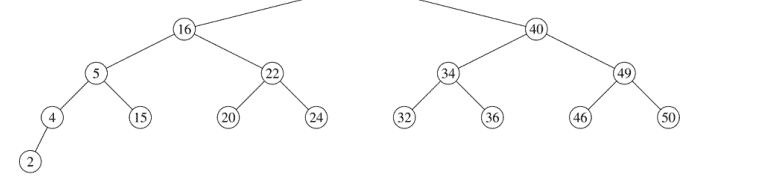

图 11.1：数字列表的二分搜索序列

图 11.1 展示了一个图。圆圈中的数字是节点，连接它们的线是边。当你沿着一条左边缘从一个节点出发时，你会到达一个值较小的节点。当你沿着右边缘走时，你会到达一个值较大的节点。让我们用这张图来定位 36。

我们从最顶端的节点开始，即根节点。它的值是 30。因为 36 > 30，所以我们沿着从 30 出发的右边缘到达值为 40 的节点。因为 36 < 40，我们沿着从 40 出发的左边缘到达 34。我们有 36 > 34，所以走左边缘落到 36。完成！

## 练习 11.4

设计一个涉及 `math.log2` 的公式，用来预测 `find_number` 返回的元组的第二个值。

## 练习 11.5

尽管 `find_number` 的定义使用了递归的 `binary_find` 函数，但这不太可能成为问题，因为递归深度永远不会太深。为什么？不过，还是请将 `binary_find` 重写为迭代函数。不要使用切片。

对集合进行排序并不一定涉及物理移动这些项目。例如，想象你想“排序”仓库中成箱的产品。你可以让箱子留在原处，但为它们创建一个索引。索引中的第一个条目是产品名称按字母顺序排在最前面的那个箱子的位置，依此类推。这样，你可以创建多个索引，以便根据不同的特征访问产品。

虽然二分搜索是一个显著的改进，但要求列表已排序这一条件相当苛刻。看起来对于任意顺序的数据项，我们仍然受限于 O(n)。真的是这样吗？

## 11.2 通过 Grover 进行量子搜索

那么我们怎样才能比在无序集合中逐个查看 n 个数据项做得更好呢？如果我们有十个经典系统，我们可以将集合分成十份并搜索每一块。这个过程仍然是 O(n)，因为时间仍然与集合的大小成正比。而且我们还要增加并行化多个系统搜索的开销。

本章其余部分展示了 Grover 搜索算法如何在 O(√n) 时间内找到结果的基本思想。[GSA] 该算法的详细数学描述在其他地方有很好的阐述。

> 我在《与量子比特共舞》的第 9.5 到 9.7 节中介绍了 Grover 搜索算法。[DWQ]

假设我有一个盒子，里面装有 8 个可调光的灯泡。它们在某种程度上都是不同的，所以我能区分它们。我给它们编号为 0 到 7，或者用二进制表示为 000 到 111。更好的是，我用量子态 |000⟩ 到 |111⟩ 来标记它们，正如我们在 9.6.5 节中看到的那样。开始时，每个灯泡都处于半暗状态，如图 11.2 所示。这个例子只是一个类比，所以灯泡并不是真的以量子方式运作。

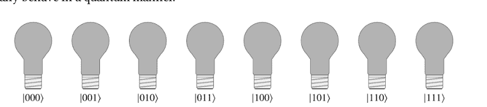

如果我使用量子比特术语，我会说我们拥有灯泡的一个平衡的“变暗”叠加态。在这个类比中，如果一个灯泡更接近于完全点亮，那么我“测量”它为完全点亮的可能性就大于测量它为熄灭的可能性。如果它更接近于完全熄灭，那么我更有可能测到它是熄灭的。

因为它们处于半暗状态，如果我根据概率法则对它们进行“测量”来决定它们是亮还是灭，我预计大约一半的灯会亮，一半会灭。图 11.3 展示了这种情况。

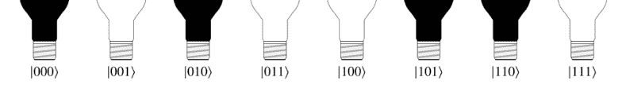

图 11.3：八个灯泡，一半灭，一半亮

在我们继续调暗之前，我打算把灯泡扔掉。

什么？

如果我把灯泡一个接一个地依次扔到地板上，这个过程是 O(n)，这里 n 是 8。如果我让八个人同时各扔一个灯泡，分发灯泡的过程是 O(n)，所以整个过程也是 O(n)。如果我一次性把整个盒子扔下去，我就是同时对每个灯泡做了一件事。这是 O(1)。

我现在有一个新的装有八个可调光灯泡的盒子。如果我们能设法以某种同时对灯泡起作用的方式来搜索某个特定的灯泡，也许我可以做得比 O(n) 更好。这就是 Grover 搜索算法的思想。我执行某个动作 O(√n) 次，这样当之后我“测量”所有灯泡时，最亮的那一个就是我寻找的。

假设我想找到标记为 |000⟩ 的灯泡。在动作的一次迭代之后，灯泡看起来如图 11.4 所示。一个灯泡稍微亮一些，其他七个更暗。

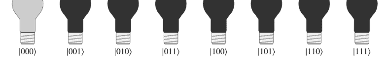

## 11.3.3 三量子比特预言机

当我们有三个量子比特时，受控-受控-Z 门（CCZ）是 |111⟩ 的预言机。双重控制意味着 q0 和 q1 都必须为 |1⟩，Z 才会作用于 q2。

我们可以在 q1 上使用一个 CX 门，并在其两侧各加一个 Hadamard H，来构造 |11⟩ 的 CZ 预言机。类似地，我们可以使用一个 CCX Toffoli 门来制作 CCZ。我们在 9.6.5 节中讨论过 Toffoli 门。

以下是 |111⟩ 的 Qiskit 预言机电路：

```python
circuit = QuantumCircuit(3)
circuit.h(2)
circuit.ccx(0, 1, 2)
circuit.h(2)
```

```text
<qiskit.circuit.instructionset.InstructionSet at 0x286be92efd0>
```

```python
circuit.draw(**draw_kwargs)
```

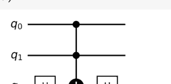

这是 |000⟩ 的预言机：

```python
circuit = QuantumCircuit(3)
for q in range(3): circuit.x(q)
circuit.h(2)
circuit.ccx(0, 1, 2)
circuit.h(2)
for q in range(3): circuit.x(q)
```

```python
circuit.draw(**draw_kwargs)
```

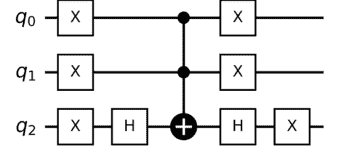

## 练习 11.13

验证最后两个电路分别是 |111⟩ 和 |000⟩ 的预言机。|010⟩ 的预言机是什么？|101⟩ 呢？

## 11.4 关于均值的反转

假设我有四个数据点以及它们的均值：

```python
data = [3, 1, 2, 5]
mean = float(sum(data)) / len(data)
mean
```

```text
2.75
```

我在图 11.6 左侧的条形图中展示了这些值。

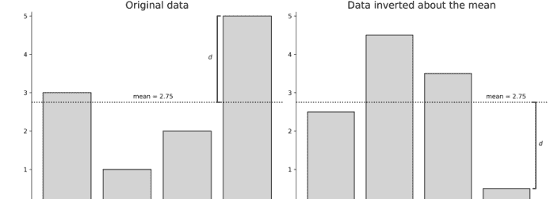

```python
abs(amplitudes[0])**2
```

```text
0.12499999999999997
```

我们看到了一个舍入误差，但概率是 1/8 = 0.125。

```python
# |001> 的振幅
amplitudes[1]
```

```text
0.35355339059327373
```

```python
abs(amplitudes[1])**2
```

```text
0.12499999999999997
```

# 第一次反转

现在我们右侧的振幅关于它们的均值进行反转。这个动作产生了我们在图 11.9 左侧看到的结果。

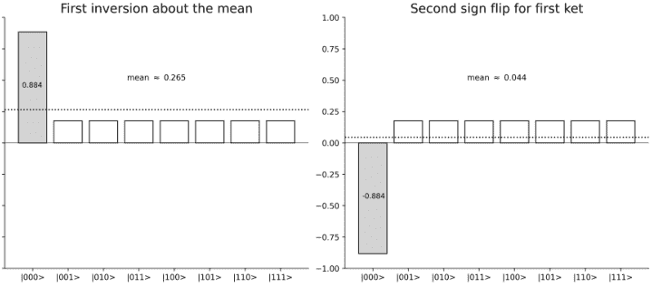

图 11.9：关于均值的第一次反转，随后是符号翻转

看到了吗，我们是如何增大或 *放大* 了 |000⟩ 的振幅？如果我们现在测量，得到该量子态的概率大约是 |0.884|² ≈ 0.781。

```python
inverted_amplitudes = invert_about_the_mean(amplitudes)
inverted_amplitudes[0]
```

```text
0.8838834764831843
```


```
abs(inverted_amplitudes[0])**2
```

0.7812499999999999

```
inverted_amplitudes[1]
```

0.17677669529663687

```
abs(inverted_amplitudes[1])**2
```

0.03124999999999993

这个结果不错，但正如你在最后一个表达式中看到的，得到任何其他特定 ket 的概率仍然超过 3%。

### 第二次反转

让我们重复符号翻转和反转，给出图 11.10 的左侧。

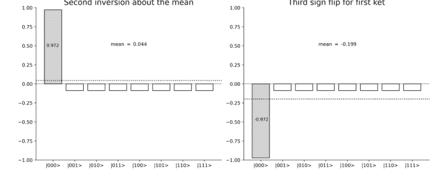

图 11.10：关于均值的第二次反转，然后进行符号翻转

得到 |000⟩ 的几率现在几乎为 95%，得到任何其他特定 ket 的可能性小于 1%。

```
amplitudes = inverted_amplitudes
amplitudes[0] = -amplitudes[0]
inverted_amplitudes = invert_about_the_mean(amplitudes)
inverted_amplitudes[0]
```

0.9722718241315027

```
abs(inverted_amplitudes[0])**2
```

0.9453124999999998

```
inverted_amplitudes[1]
```

-0.08838834764831843

```
abs(inverted_amplitudes[1])**2
```

0.007812499999999998

### 练习 11.18

将我们在这里所做的工作与第 11.2 节中寻找指定灯泡的过程联系起来。特别是，解释该节中的句子

> “我对所有灯泡同时做的‘事情’” somehow 以特殊的方式影响了 |000⟩ 灯泡。

### 第三次反转尝试

我们还能继续吗？看图 11.10 的左侧。除了 |000⟩ 之外的所有 ket 的振幅都是负的。如果我们再重复一次符号翻转-反转过程，我们得到的就是图 11.11 中显示的内容。得到 |000⟩ 的几率下降了！

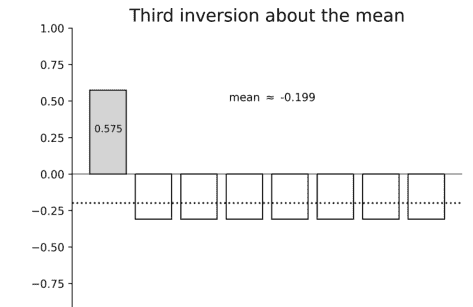

图 11.11：关于均值的第三次反转

### √n 次反转

这就是 Grover 搜索算法的实际应用。我们正在一个大小为 n 的集合中搜索某个对象 X。我们将集合中的项目与 m 个量子比特的标准基 ket 对应起来，其中 n ≤ 2^m。本节的示例中，n = 8 且 m = 3。

现在假设有人给我们一个按如下方式作用的 oracle：当给定 X 时，oracle 会翻转对应于 X 的 ket 的振幅符号。当给定除 X 之外的任何对象时，它不会改变振幅。

我们现在大约进行 √n 次符号翻转-反转过程。在此迭代结束时，我们以非常高的概率得到对应于 X 的正确 ket。答案错误的概率为 O(1/n)。我们重复搜索，直到确信找到了正确的结果。

我跳过了“将集合中的项目与 m 个量子比特的标准基 ket 对应起来”和“假设有人给我们一个 oracle”这两个部分。这些是特定于每个具体问题的。在我们的示例中，集合是三个量子比特的标准基 ket 的集合，我们按第 11.3.3 节中看到的方式编码 oracle。

### 练习 11.19

如果我们集合的大小不是 2 的幂，该怎么办？

### 11.6 在两个量子比特上搜索

回去看看图 11.7。这告诉你找到四个项目中的一个需要多少次迭代以及成功概率是多少？

```
# Set the drawing options
draw_kwargs = {
    "output": "mpl",      # use matplotlib
    "initial_state": True,  # show |0> and 0
    "idle_wires": False,    # don't show unused wires

    "style": {
        "name": "bw",        # black-and-white for book
        "subfontsize": 9,     # font size of subscripts
        "dpi": 600            # image resolution
    }
}
```

```
circuit.x(0)
circuit.x(1)
circuit.id(0)
circuit.h(1)
circuit.cx(0, 1)
circuit.id(0)
circuit.h(1)
circuit.x(0)
circuit.x(1)
circuit.h(0)
circuit.h(1)
```

`<qiskit.circuit.instructions.InstructionSet at 0x286be8fe8e0>`

```
circuit.measure_all()
```

```
circuit.draw(**draw_kwargs)
```

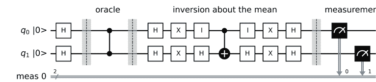

旁注：draw 的结果是一个 matplotlib 图形。我使用 text 函数为电路的每个部分标注。有关详细信息，请参阅第 13 章《创建图表》。

在解释电路中关于均值反转部分的工作原理之前，让我们通过在模拟器上运行电路来验证结果。

```
from qiskit import execute, Aer
from qiskit.visualization import plot_histogram

simulator = Aer.get_backend("aer_simulator")
```

```
result = execute(circuit, simulator, shots=1000).result()
counts = result.get_counts(circuit)
counts
```

{'11': 1000}

在对 |11⟩ 进行符号翻转的 CZ oracle 之后，2 量子比特量子态为

(1/2) |00⟩ + (1/2) |01⟩ + (1/2) |10⟩ − (1/2) |11⟩

我们接下来对每个量子比特应用 H 门。这是我们在第 9.6.4 节末尾看到的 2 量子比特 H⊗2 门。

(1/2) (H⊗2) |00⟩ + (1/2) (H⊗2) |01⟩ + (1/2) (H⊗2) |10⟩ − (1/2) (H⊗2) |11⟩

这是一个包含 16 项的非常繁琐的计算。H⊗2 在标准基 ket 上的应用为

H⊗2 |00⟩ = (1/2) (|00⟩ + |01⟩ + |10⟩ + |11⟩)
H⊗2 |01⟩ = (1/2) (|00⟩ − |01⟩ + |10⟩ − |11⟩)
H⊗2 |10⟩ = (1/2) (|00⟩ + |01⟩ − |10⟩ − |11⟩)
H⊗2 |11⟩ = (1/2) (|00⟩ − |01⟩ − |10⟩ + |11⟩)

代入这些值并整理项，结果为

(1/2) |00⟩ + (1/2) |01⟩ + (1/2) |10⟩ − (1/2) |11⟩

这可能让你惊讶这是原始值，但在这种情况下它确实是结果。

接下来，我们查看 X⊗2 对标准基 ket 的影响：

X⊗2 |00⟩ = |11⟩
X⊗2 |01⟩ = |10⟩
X⊗2 |10⟩ = |01⟩
X⊗2 |11⟩ = |00⟩

将其应用于前一个结果，我们得到

− (1/2) |00⟩ + (1/2) |01⟩ + (1/2) |10⟩ + (1/2) |11⟩

现在我们检查 id ⊗ H。由于

id ⊗ H |00⟩ = (√2/2) |00⟩ + (√2/2) |01⟩
id ⊗ H |01⟩ = (√2/2) |00⟩ − (√2/2) |01⟩
id ⊗ H |10⟩ = (√2/2) |10⟩ + (√2/2) |11⟩
id ⊗ H |11⟩ = (√2/2) |10⟩ − (√2/2) |11⟩

下一步的结果为

− (1/2) ((√2/2) |00⟩ + (√2/2) |01⟩) + (1/2) ((√2/2) |00⟩ − (√2/2) |01⟩) + (1/2) ((√2/2) |10⟩ + (√2/2) |11⟩) + (1/2) ((√2/2) |10⟩ − (√2/2) |11⟩)

或

−(√2/2)|01⟩ + (√2/2)|10⟩

应用 2 量子比特 CX 门得到

−(√2/2)|01⟩ + (√2/2)|11⟩

随后是第二个 id ⊗ H

−(1/2)|00⟩ + (1/2)|01⟩ + (1/2)|10⟩ − (1/2)|11⟩

几乎完成了！应用第二个 X ⊗ X

−(1/2)|00⟩ + (1/2)|01⟩ + (1/2)|10⟩ − (1/2)|11⟩

最后加上 H⊗2，得到

−|11⟩

当我们测量它时，结果必须是 |11⟩，除非有硬件噪声。因此，只用一次 oracle 调用和一次关于均值的反转，我们就能以 100% 的准确率找到搜索值。

### 练习 11.20

验证当我们使用 |00⟩、|01⟩ 和 |10⟩ 的 oracle 时，Grover 搜索算法是否有效。

虽然我刚刚向你展示了一系列门在两个量子比特上计算关于均值的反转，但谁发现了这个电路？简单的答案是一个“量子算法开发者”。[GSA] 从量子比特习惯用法到小型电路再到算法组件，我们学习并扩展了我们解决问题的技术集合。

### 11.7 总结

在本章中，我们研究了经典的线性搜索和二分搜索。在第一种情况下，集合中的项目最初没有排序，因此我们被迫逐一查看每个项目以找到我们想要的那个。当我们可以假设项目已排序时，二分搜索方法效率高得多，因为我们可以迭代地将问题规模减半，直到得到结果。然后我们转向最容易理解的量子算法之一——Grover 搜索。使用 Grover，搜索时间与项目数量的平方根成正比。

Grover 算法的一个重要警告是，今天的量子计算机无法处理足够大的数据集合，使得它在实践中比经典方法更有效。尽管如此，它仍然是我们可以获得量子优势的地点和方式的一个绝佳例子。
