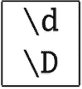
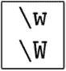
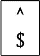
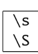
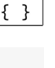
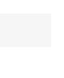
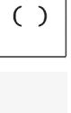
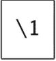
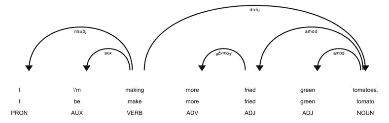
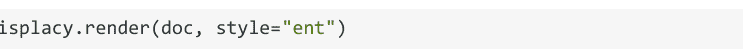

## 12 搜索和更改文本

> 如果我停止搜索，那么，唉，我就迷失了。这就是我的看法——继续前进，不管怎样。
> 
> ——文森特·梵高

我们将世界的大部分信息表示为文本。想想所有数字报纸、电子书、PDF 文件、博客、电子邮件、短信以及 Twitter 和 Facebook 等社交媒体服务中的所有文字。给定一段文本，我们如何搜索它以查看是否包含某些期望的信息？我们如何更改文本以添加格式或更正或提取信息？

第 4 章《Stringing You Along》涵盖了 Python 的函数和方法。本章首先介绍正则表达式，然后介绍自然语言处理的基础：如何从一段文本字符串中提取其中包含的部分含义。

### 本章涵盖的主题

- 12.1 核心字符串搜索和替换方法 ........................................................ 442
- 12.2 正则表达式 ........................................................ 445
- 12.3 自然语言处理简介 ........................................................ 462
- 12.4 总结 ........................................................ 473


## 12.1 核心字符串搜索与替换方法

本节列出了用于查找和替换子字符串的主要 `str` 方法。虽然我们在*第 4 章：带你玩转字符串*中已经讨论过其中几个，但在讨论更高级的正则表达式函数之前，将这些描述集中在一处会更有帮助。

在下面每个包含可选参数 `start=0` 和 `end=len(string)` 的方法中，搜索范围限定在由切片坐标 `start:end` 所指定的子字符串内。

### 子字符串在字符串中

如果子字符串在字符串中，则返回 `True`，否则返回 `False`。参见 4.2 节。

```python
"z Fe" in "Franz Ferdinand"
```

True

### 子字符串不在字符串中

如果子字符串不在字符串中，则返回 `True`，否则返回 `False`。参见 4.2 节。

```python
"Ferd" not in "Franz Ferdinand"
```

False

### `string.count(substring, start=0, end=len(string))`

返回 `substring` 在 `string` 中出现的次数。`count` 不会计入 `substring` 的重叠实例，因此 `"ZZZ".count("ZZ")` 的结果是 1 而不是 2。

```python
"a aa aaa aaaa aaaaa".count("aa")
```

6

```python
"a aa aaa aaaa aaaaa".count("aa", 8, 13)
```

2

### `string.find(substring, start=0, end=len(string))`

如果 `string` 中不包含 `substring`，则返回 -1。否则，返回 `substring` 在 `string` 中首次出现的索引。参见 4.3 节。

```python
len("a aa aaa aaaa aaaaa")
```

19

```python
"a aa aaa aaaa aaaaa".find("B")
```

-1

### `string.startswith(substring_or_tuple, start=0, end=len(string))`

如果 `substring_or_tuple` 是一个 `str`，那么当 `string` 以 `substring` 开头时返回 `True`。如果 `substring_or_tuple` 是字符串元组，那么当 `string` 以其中任意一个字符串开头时返回 `True`。否则返回 `False`。参见 4.7 节。

```python
"# This is a Python comment".startswith('#')
```

True

```python
"abcdef".startswith(('b', 'B'), 1)
```

True

### `string.endswith(substring_or_tuple, start=0, end=len(string))`

如果 `substring_or_tuple` 是一个 `str`，那么当 `string` 以 `substring` 结尾时返回 `True`。如果 `substring_or_tuple` 是字符串元组，那么当 `string` 以其中任意一个字符串结尾时返回 `True`。否则返回 `False`。参见 4.7 节。

```python
"Is this a question?".endswith('?')
```

True

```python
"This could be a sentence!".endswith(('.', '!', '?'))
```

True

在使用 *startswith* 或 *endswith* 之前，你可能需要先调用 *strip*、*lstrip* 或 *rstrip*。

> **练习 12.1**
> 
> 使用 *startswith* 和 *endswith* 来测试一个字符串是否为回文。写出你用来使测试不区分大小写的代码。

### `string.replace(old_substring, new_substring, count=-1)`

不带 `count` 参数时，*replace* 会将 `string` 中所有 `old_substring` 的实例替换为 `new_substring`。当给定了 `count` 且它是一个非负 `int` 时，*replace* 最多执行 `count` 次替换，从 `string` 的开头开始。参见 4.4.2 节。

```python
"-A-A-A-A-A-A-A-".replace("-A-", "=B=")
```

'=B=A=B=A=B=A=B='

```python
"-A-A-A-A-A-A-A-".replace("-A-", "=B=", 2)
```

'=B=A=B=A-A-A-A-'


### 练习 12.2

定义 *replace* 函数应做什么，并实现它。

## 12.2 正则表达式

假设你在在线软件开发者频道或网站上发布了一个关于某个复杂文本搜索问题的提问。很可能有人会给出一个正则表达式答案，它由你能想象到的大多数字母和标点符号组合而成。

Python 用于处理正则表达式并通过它在文本中查找匹配内容的引擎位于 `re` 模块中。**[PYR2]** 我们还使用正则表达式来执行复杂的文本替换。

让我们先想一想，如何找到以下字符串中的子字符串 "ecos"：

```python
string = "Economic, ecological ecosystem"
```

如果子字符串不在字符串中，我们的过程应返回 `None`。如果存在，函数返回一个元组，其中第一项是它首次出现位置的索引，第二项是子字符串的长度。我们将这个元组称为*匹配信息*。

我们把这个过程编码到一个函数 *my_search* 中。虽然它与 *find* 和 *index* 类似，但我们在实现中不会使用它们。那将是一种作弊！

```python
def my_search(string, substring):
    if not string or not substring:
        return None

    def have_a_match(n):
        for m in range(0, len(substring)):
            if n >= len(string):
                return False
            if string[n] != substring[m]:
                return False

            n += 1
        return True

    for j in range(len(string)):
        if have_a_match(j):
            return (j, len(substring))

    return None
```

图 12.1 展示了字符串的字符及其索引。

| E | c | o | n | o | m | i | c | , |   | e | c | o | l | o | g | i | c | a | l |   | e | c | o | s | y | s | t | e | m |
|---|---|---|---|---|---|---|---|---|---|---|---|---|---|---|---|---|---|---|---|---|---|---|---|---|---|---|---|---|---|
| 0 | 1 | 2 | 3 | 4 | 5 | 6 | 7 | 8 | 9 | 10 | 11 | 12 | 13 | 14 | 15 | 16 | 17 | 18 | 19 | 20 | 21 | 22 | 23 | 24 | 25 | 26 | 27 | 28 | 29 |

图 12.1：字符串 "Economic, ecological ecosystem" 及其索引

现在我们尝试一些搜索。检查字符串开头和结尾的“边界情况”：

```python
print(my_search(string, "Eco"))
```

(0, 3)

```python
print(my_search(string, "stem"))
```

(26, 4)

测试子字符串中的所有字符都不在字符串中的情形：

```python
print(my_search(string, "ABC"))
```

None

测试存在部分匹配但最终不在字符串中的情形：

```python
print(my_search(string, "ecom"))
```

None

测试搜索我们指定的子字符串：

```python
print(my_search(string, "ecos"))
```

(21, 4)

### 练习 12.3

如果你想要不区分大小写的搜索，你会修改哪一行？重写 my_search，让它接受一个关键字参数 case_insensitive=False，并使用该选项来决定是遵循字母大小写还是忽略大小写。

现在我来改变术语：不再是“查找子字符串”，而是“匹配模式”。在之前的例子中，模式是 "ecos"。这个模式由开头的 'e'、紧接着的 'c'、再接着的 'o' 以及收尾的 's' 组成。

如果我把“后面跟着一个收尾的 's'”改为“后面跟着一个收尾的小写字符”，那么显然我并不是在匹配字面子字符串。如果我们修改 my_search 以支持这种形式的模式匹配，那么第二个参数无论是 "ecom" 还是 "ecos" 都将返回相同的结果。

我们用一种定义语言来编写正则表达式，这种语言允许我们指定既简单又复杂的模式，并带有选项和条件。下一节将开始讨论 Python 中正则表达式的核心特性。

my_search 展示了查找模式匹配的一般思路：向右移动，直到你位于某个候选字符串的开头，不断尝试匹配字符，然后要么成功，要么回溯到你上次做出选择的位置。根据需要重复这个过程。

正则表达式的实现在不同的编程语言和应用程序中各不相同。Visual Studio Code、vi/vim、Emacs、Sublime Text、TextMate、Notepad++、Bluefish 和 PyCharm 等代码编辑器都支持不同形式的正则表达式搜索和替换。

### 12.2.1 搜索与基本字符类

正则表达式通常包含特殊字符和反斜杠。在这里，我采用将模式写成 Python 原始字符串的约定，即使这并非严格要求。例如，我现在写 r"ecos" 而不是 "ecos"。

给定一个模式后，我们首先通过调用 compile 将其转换为 re 匹配引擎可以使用的形式。

```python
import re

string = "Economic, ecological ecosystem"

pattern = re.compile(r"ecos")
pattern
```

```
re.compile(r'ecos', re.UNICODE)
```

现在我们可以使用 search 来定位与模式匹配的子字符串。

```python
result = pattern.search(string)
print(result)
```

```
<re.Match object; span=(21, 25), match='ecos'>
```

结果要么是 `None`，要么是 `re.Match` 类的实例。为方便起见，这里给出一个函数，用于显示匹配对象中的关键信息：

```python
def print_match(result, group_number=0):
    if result is not None:
        # Display the matched substring
        print(f"group({group_number}) = "
              f'{result.group(group_number)}' , end="")
        # Display the starting index and index after end of match
        print(f"start({group_number}) = {result.start(group_number)}  "
              f"end({group_number}) = {result.end(group_number)}")
    else:
        print(None)
```

```python
print_match(result)
```

group(0) = ecos  start(0) = 21   end(0) = 25

我稍后会描述 group_number 参数的作用。目前请注意，当 group_number 为 0 时，我们获得的是整个匹配的信息。

函数的注释解释了显示的内容，但请注意，result.end() 显示的是匹配子字符串之后的索引。

### 练习 12.4

你将如何使用带有 result.start() 和 result.end() 的切片从原始字符串中提取匹配的子字符串？


模式 `r"ecom"` 不匹配任何子串：

```python
pattern = re.compile(r"ecom")
print_match(pattern.search(string))
```

None

有两个子串以 "eco" 开头。为了找到它们，我们在模式中使用方括号插入一个 *字符类*：

```python
pattern = re.compile(r"eco[ls]")
pattern
```

`re.compile(r'eco[ls]', re.UNICODE)`

此模式表示我们应匹配显式字符 'e'、'c' 和 'o'，后跟 'l' 或 's'。

```python
result = pattern.search(string)
print_match(result)
```

`group(0) = ecol"  start(0) = 10  end(0) = 14`

我们匹配了第一次出现，"ecol"。使用 *findall* 来获取所有匹配子串的列表：

```python
pattern.findall(string)
```

`['ecol', 'ecos']`


## 练习 12.5

为什么下面的代码返回的结果与上一个示例相同？

```python
pattern = re.compile(r"[e][c][o][l][s]")
pattern.findall(string)

['ecol', 'ecos']
```

如果我们向 *compile* 传递 `re.IGNORECASE` 参数，搜索将不区分大小写。你也可以使用 `re.I`。

## 练习 12.6

解释以下代码中 compile、search、findall 和 finditer 返回的内容：

```
pattern = re.compile(r"eco[lns]", re.IGNORECASE)
pattern
```

```
re.compile(r'eco[lns]', re.IGNORECASE|re.UNICODE)
```

```
print_match(pattern.search(string))
```

```
group(0) = Econ"  start(0) = 0  end(0) = 4
```

```
pattern.findall(string)
```

```
['Econ', 'ecol', 'ecos']
```

```
for match in pattern.finditer(string):
    print(match)
```

```
<re.Match object; span=(0, 4), match='Econ'>
<re.Match object; span=(10, 14), match='ecol'>
<re.Match object; span=(21, 25), match='ecos'>
```

我们使用的是什么字符类？

## 练习 12.7

设

```
string = "[1] Sutor, Robert S. (2019). Dancing with Qubits."
```

以下各语句分别返回什么？

```
re.compile(r"[1]").search(string)
re.compile(r"\[1\]").search(string)
```

如果省略 r 前缀会发生什么？

为了简化后续代码，我现在定义这个辅助函数：

```
def print_matches(string, pattern):
    for match in re.compile(pattern).finditer(string):
        print(match)
```

## 12.2.2 更一般的模式

当字符类只包含单个字符时，我们可以省略周围的方括号。这就是模式 `r"ABC"` 与 `r"[A][B][C]"` 相同的原因。

### 字母数字字符

使用连字符 “-” 在方括号内的字符类中指定字符范围。不要使用此模式来匹配小写字母：

```
r"[abcdefghijklmnopqrstuvwyz]"
```

更简单的

```
r"[a-z]"
```

就足够了。要匹配大写或小写字母，使用模式

```
r"[a-zA-Z]"
```

要匹配十进制数字，使用 `r"[0-9]"` 或 `r"\d"`。要匹配 **不是** 十进制数字的任何字符，使用 `r"[^0-9]"` 或 `r"\D"`。当你在方括号内使用 “^” 时，它会否定其后紧跟的内容。



要匹配字母数字字符，在 Python 中它是字母或十进制数字或下划线，使用 `\w`。使用 `\W` 来匹配非字母数字字符。



要匹配任何字符，使用句点 “.”。

### 开始和结束

当 “^” 开始一个模式如 `r"^Eco"` 时，表示“仅在字符串开头匹配 'Eco'”。模式末尾的美元符号 “$” 表示在字符串末尾匹配。



```python
string = "economic ecosystem center"

# match 'e' followed by any lowercase letter

re.compile(r"e[a-z]").findall(string)
```

```text
['ec', 'ec', 'em', 'en', 'er']
```

```python
# match 'e' at the beginning of the string
# followed by any lowercase letter

re.compile(r"^e[a-z]").findall(string)

['ec']
```

```python
# match any character that is not 'e' that is
# followed by any lowercase letter

re.compile(r"[^e][a-z]").findall(string)

['co', 'no', 'mi', ' e', 'co', 'sy', 'st', ' c', 'nt']
```

```python
# match 'E' at the beginning of the string
# followed by any lowercase letter

re.compile(r"^E[a-z]").findall(string)

[]
```

### 空白字符

空白字符是空格 " "、制表符 \t、换行符 \n、回车符 \r、换页符 \f 或垂直制表符 \v。后两者是打印机使用的历史控制字符。

要匹配特定的空白字符，使用空格或这些转义字符之一作为模式。要匹配任何空白字符，使用 \s。对于非空白字符，使用 \S。



```
string = "economic ecosystem center"

pattern = re.compile(r"c e")
print_match(pattern.search(string))

group(0) = c e  start(0) = 7  end(0) = 10
```

```
pattern = re.compile(r"c\se")
print_match(pattern.search(string))

group(0) = c e  start(0) = 7  end(0) = 10
```

### 可选性和重复

如果我们想指定模式的一部分是可选的怎么办？在可选部分后使用问号 “?” 表示接受零次或一次出现。

```
print_matches(string, r"c\s?e")
```

<re.Match object; span=(7, 10), match='c e'>
<re.Match object; span=(19, 21), match='ce'>

在模式中使用问号是 {0, 1} 的简写。{x, y} 表示“匹配至少 x 次但不超过 y 次”。如果你想精确匹配 x 次，使用 {x}。



```
string = "economic ecosystem bookkeeping center"

print_matches(string, r"[eko]{2}")
```

<re.Match object; span=(20, 22), match='oo'>
<re.Match object; span=(22, 24), match='kk'>
<re.Match object; span=(24, 26), match='ee'>

## 练习 12.8

为什么我们没有匹配到 "ok" 或 "ke"？

我们经常使用的另外两个重复修饰符是 “*”，它指定 re 引擎应匹配零次或多次出现。使用 “+” 来匹配一次或多次。



```
re.compile(r"[cb]o*").findall(string)
```

[ 'co', 'c', 'co', 'boo', 'c' ]

```
re.compile(r"[cb]o+").findall(string)
```

[ 'co', 'co', 'boo' ]

你可以使用正则表达式进行数据格式验证。此示例展示了如何使用连字符和北美编号计划验证 10 位电话号码：

```
string = "914-555-1234"

pattern = re.compile(r"[2-9]\d{2}-[2-9]\d{2}-\d{4}")
print_match(pattern.search(string))
```

group(0) = 914-555-1234"  start(0) = 0  end(0) = 12

第一位和第四位数字不能为 0 或 1。

### 单词边界

以下字符串对 "red" 有三个匹配项：

```
string = "too much credit reduction can put you in the red"

print_matches(string, r"red")
```

<re.Match object; span=(10, 13), match='red'>
<re.Match object; span=(16, 19), match='red'>
<re.Match object; span=(45, 48), match='red'>

第一个在单词 "credit" 中间，第二个在单词 "reduction" 开头，第三个是句子末尾的 "red" 本身。如果我们想要独立的第三种情况怎么办？在模式开头或结尾使用 \b 表示任何匹配都应在单词边界处。

```
print_matches(string, r"\bred\b")
```

<re.Match object; span=(45, 48), match='red'>

匹配引擎仅返回第三种情况，即句子末尾的 "red"。如果我们只在开头放置 \b 而不在结尾放置，我们会得到 "reduction" 和 "red"。

```
print_matches(string, r"\bred")
```

<re.Match object; span=(16, 19), match='red'>
<re.Match object; span=(45, 48), match='red'>

使用 \b 指定匹配不应在单词边界处。

```
print_matches(string, r"\Bred\B")
```

<re.Match object; span=(10, 13), match='red'>

```
print_matches(string, r"red\B")
```

<re.Match object; span=(10, 13), match='red'>
<re.Match object; span=(16, 19), match='red'>

### 转义特殊字符

字符 “?”、“*”、“+”、“.”、“|”、“{”、“}”、“(”、“)”、“[” 和 “]” 在模式内具有特殊含义，如果你想匹配它们，必须用反斜杠转义。你还必须转义反斜杠以匹配反斜杠。这就是为什么我们对正则表达式模式使用 Python 原始字符串！

练习 12.9
设
fstring = 'f"{x} {y} {A_1}"'
为一个 Python f-string。使用 findall 获取大括号内所有 Python 标识符的列表。

## 12.2.3 分组

当你需要对模式的一部分进行分组时，使用圆括号。在此示例中，我使用分组和“或”特殊字符“|”来匹配 "red" 或 "green" 或 "blue"。



```
string = "Do you have the red piece, the green piece, and the blue piece?"

print_matches(string, r"(red)|(green)|(blue)")
```

<re.Match object; span=(16, 19), match='red'>
<re.Match object; span=(31, 36), match='green'>
<re.Match object; span=(52, 56), match='blue'>


如果我们想要“红色棋子”或“绿色棋子”或“蓝色棋子”呢？

```python
print_matches(string, r"(red)|(green)|(blue) piece")
```

<re.Match object; span=(16, 19), match='red'>
<re.Match object; span=(31, 36), match='green'>
<re.Match object; span=(52, 62), match='blue piece'>

这并没有像你预期的那样工作，因为 `re` 引擎尝试匹配“red”或“green”或“blue piece”。它把第二个“|”之后的所有内容都当作“或”的可能性之一。

多使用一对括号来得到我们想要的结果：

```python
print_matches(string, r"((red)|(green)|(blue)) piece")
```

<re.Match object; span=(16, 25), match='red piece'>
<re.Match object; span=(31, 42), match='green piece'>
<re.Match object; span=(52, 62), match='blue piece'>

当用“|”指定备选项时，把最可能匹配的内容放在最左边。在这种情况下，如果我们怀疑“red”不太常出现，就把它放在末尾而不是开头。[F.I.T]

`re` 引擎让我们可以访问模式中每个组匹配到的内容。假设我为一个名字定义一个简单的模式，尝试匹配一个大写首字母的名字、一个大写中间名首字母和一个大写首字母的姓氏：

```python
pattern = re.compile(r"\b([A-Z][a-z]*)\s+([A-Z])\.\s+([A-Z][a-z]*)\b")
result = pattern.search("My name is Robert S. Sutor")
print_match(result)
```

group(0) = Robert S. Sutor  start(0) = 11  end(0) = 26

我知道这个过于简单的例子并没有涵盖所有可能字母表下的所有可能名字。

# 练习 12.10

用文字解释该正则表达式模式中每个部分的含义。

一次成功的匹配总是至少有一个组，即组 0，也就是整个匹配。这就是为什么我之前定义的 `print_match` 为 `group_number` 参数设置了默认值：

```python
def print_match(result, group_number=0):
    if result is not None:
        # Display the matched substring
        print(f"group({group_number}) = "
              f'{result.group(group_number)}', end="")

        # Display the starting index and index after end of match
        print(f"start({group_number}) = {result.start(group_number)}  "
              f"end({group_number}) = {result.end(group_number)}")
    else:
        print(None)
```

因为我在模式中用括号显式地划分了组，所以我也能访问它们，从编号 1 开始：

```python
for g in range(1, 4):
    print_match(result, g)
```

group(1) = Robert  start(1) = 11  end(1) = 17
group(2) = S  start(2) = 18  end(2) = 19
group(3) = Sutor  start(3) = 21  end(3) = 26

对从 `groups` 方法返回的值使用 `len`，即可知道匹配了多少个组。

```python
len(result.groups())
```

# 练习 12.11

定义一个函数 `number_of_groups`，无论搜索是否成功，都返回显而易见的值。

如果我们在一个组内定义组，编号会先深入内部，然后再继续向右。

```python
pattern = re.compile(r"\b([A-Z]([a-z]*)\s+([A-Z])\.\s+([A-Z][a-z]*)\b")
result = pattern.search("My name is Robert S. Sutor")
```

```text
for g in range(1 + len(result.groups())):
    print_match(result, g)

group(0) = Robert S. Sutor  start(0) = 11  end(0) = 26
group(1) = Robert  start(1) = 11  end(1) = 17
group(2) = obert  start(2) = 12  end(2) = 17
group(3) = S  start(3) = 18  end(3) = 19
group(4) = Sutor  start(4) = 21  end(4) = 26
```

这里，组 2 是名字去掉首字母后的部分。组 3 是中间名首字母。

我们还用组号来进行*反向引用*。在下面的模式中，“\1”表示“你在组 1 中匹配到的内容必须原样出现在这里”：

```python
pattern = re.compile(r"\b(.+)\s+City\s+is\s+in\s+\1\b")
print_match(pattern.search("New York City is in New York"))

group(0) = New York City is in New York  start(0) = 0  end(0) = 28
```



```text
print_match(pattern.search("Iowa City is in Iowa"))

group(0) = Iowa City is in Iowa  start(0) = 0  end(0) = 20
```

```text
print_match(pattern.search("Jefferson City is in Missouri"))

None
```

如果你想使用一个组，但之后并不打算引用它，就在左括号后面立即插入“?:”。

```python
pattern = re.compile(r"\b(?:[A-Z][a-z]*)\s+([A-Z])\.\s+(?:[A-Z][a-z]*)\b")
result = pattern.search("My name is Robert S. Sutor")
for g in range(1 + len(result.groups())):
    print_match(result, g)

group(0) = Robert S. Sutor  start(0) = 11  end(0) = 26
group(1) = S  start(1) = 18  end(1) = 19
```

在这个例子中，我只想在名字的上下文中获取中间名首字母。

# 搜索和更改文本

使用 `replace` 时，我需要匹配特定的电话号码。而使用正则表达式，我可以匹配任何看起来像电话号码的内容。

出于隐私原因，我可能想用星号掩蔽号码。这个替换可以做到：

```python
pattern.sub("***-***-****", string)
```

`'My phone number is ***-***-****.'`

我可以用对某个组的反向引用来修改引擎匹配到的通用文本。这里，我在添加美国国家代码：

```python
pattern.sub(r"+1-\1", string)
```

`'My phone number is +1-914-555-1234.'`

默认情况下，`sub` 作用于所有不重叠的匹配。如果你给它第三个正的 `int` 参数，它将最多执行那么多次替换。这个参数的默认值是 0，表示“执行所有替换”。

```python
string = "212-555-0123    585-555-9876    320-555-3467"
pattern.sub("***-***-****", string)
```

`'***-***-****    ***-***-****    ***-***-****'`

```python
pattern.sub(r"+1-\1", string, 2)
```

`'+1-212-555-0123    +1-585-555-9876    320-555-3467'`

`subn` 函数返回一个元组，其中包含新字符串以及执行的替换次数。

```python
string = "212-555-0123    185-555-9876    320-555-3467"
pattern.subn("***-***-****", string)
```

`('***-***-****    185-555-9876    ***-***-****', 2)`

> **练习 12.13**
>
> 为什么是两次替换而不是三次？

我们最后一个正则表达式函数是 `split`，它是我们在 4.8 节中见到的核心 `str` 方法的高级版本。

我想分割一个由我几只猫的名字以及它们现在的年龄组成的字符串。我期望的结果是一个包含猫名字的列表。

```python
string = "Hilbert 40 Charlie 35 Gideon 28"
```

我将在任何匹配“可选空白后跟两位数字，再后跟可选空白”的位置进行分割。

```python
pattern = re.compile(r"\s*\d{2}\s*")
pattern.split(string)
```

```text
['Hilbert', 'Charlie', 'Gideon', '']
```

要把匹配项也包含在列表中，就在模式中加上括号。

```python
pattern = re.compile(r"(\s*\d{2}\s*)")
pattern.split(string)
```

```text
['Hilbert', ' 40 ', 'Charlie', ' 35 ', 'Gideon', ' 28', '']
```

# 练习 12.14

最后一个例子和下面这个例子的模式与结果有什么不同？

```python
pattern = re.compile(r"\s*(\d{2})\s*")
pattern.split(string)
```

```text
['Hilbert', '40', 'Charlie', '35', 'Gideon', '28', '']
```

# 练习 12.15

为什么在结果中会看到空字符串？你能通过修改模式或其他方法把它去掉吗？

# 12.2.5 使用正则表达式的建议

虽然我已经涵盖了 Python 正则表达式实现的很多内容，但官方文档中还有几个额外的特性和微妙之处供你阅读。[PYR1] [PYR2] 在你开始使用这个强大但有时也很复杂的工具时，下面几点你应该记住：

- 如果 `str` 方法（如 `find` 和 `replace`）能完成你的任务，就使用那些方法，而不是引入额外的 `re` 机制。
- 记住，`search` 在找不到匹配时返回 `None`。
- 注意你要搜索的字符串的大小。如果文本是 50 个字符而不是 5 兆字节，你可能会选择不同的方法。例如，在后一种情况下，你可能会使用 `finditer` 而不是 `findall`。
- 在创建正则表达式模式时，要注意收益递减的问题。例如，你可以对 `split` 返回的列表中的字符串使用 `strip`。
- 在网上搜索可能接近你需求的正则表达式。
- 正则表达式匹配在模式写得不好时可能会非常慢。要尽可能具体。例如，如果你知道自己要找的是字母数字字符，就不要用 `".*"` 而要用 `\w*`。[FIT]
- 正则表达式语法和所有特殊字符很容易忘记。需要的时候不要害怕去查阅。
- 创建模式时，问问自己：“我是否应该在某个地方使用 `\b` 或 `\w`？”。

# 12.3 自然语言处理入门

自然语言处理（NLP）将文本及其包含的字符转化为含义。从含义中，我们获得知识和洞见，并可能采取行动。本节概述了 Python 中可用于 NLP 的一些工具。请参阅参考资料以获取关于具体工具的更多信息和示例。

假设我站在厨房里说：

“我正在做更多的油炸绿番茄。”

这如何转化为我烹饪食物的过程？

第一步是知道是否有人或什么东西在听我说话，但这并不是编码问题。也许，我的女儿和我一起在厨房里，或者是一个虚拟个人助理（VPA），比如 Apple 的 Siri®、Amazon 的 Echo®（搭载 Alexa®）、Google Home™ 或 Microsoft Cortana®。


也许我们可以使用字符串替换：

```python
def clean_text(text):
    for wrong, right in corrections.items():
        text = text.replace(wrong, right)
    return text

result = clean_text(the_text)
result
```

“我在做更多油炸绿番茄。”

不错！再看看如果我再次调用会怎样：

```python
clean_text(result)
```

“我在做更多油炸绿番茄。”

哎呀。我们忘了词边界。应该试试正则表达式。

```python
import re

def clean_text(text):
    for wrong, right in corrections.items():
        pattern = re.compile(fr"\b({wrong})\b")
        text = pattern.sub(f"{right}", text)
    return text

result = clean_text(the_text)
result
```

“我在做更多油炸绿番茄。”

```python
clean_text(result)
```

“我在做更多油炸绿番茄。”

## 练习 12.16

为什么我在正则表达式模式字符串中使用了 `fr`？

正则表达式方法奏效了。在实践中，我们会使用一个更大的拼写纠正列表。我们还可能将城市、州或国家缩写转换为其全称。我们也可以展开缩略词，例如将“I’ll”变为“I will”。另一个常见任务是去除多余的空白。

## 练习 12.17

扩展 `clean_text`，将任何连续两个或更多空格的出现减少为单个空格。对连续的换行符也做同样处理。

我们在 `clean_text` 中使用 `sub` 来扫描整个字符串中的每一对错误词-正确词。对于大量文本上的数百个替换，`flashtext` 模块可能高效得多。`flashtext` 不是 Python 标准库的一部分，你必须从操作系统命令行安装它。

```
pip install flashtext
```

要处理替换，从 `flashtext` 导入 `KeywordProcessor`，加载纠正项，然后调用 `replace_keywords`：

```python
from flashtext import KeywordProcessor

keyword_processor = KeywordProcessor(case_sensitive=True)

for wrong, right in corrections.items():
    keyword_processor.add_keyword(wrong, right)

result = keyword_processor.replace_keywords(the_text)
result
```

“我在做更多油炸绿番茄。”

```python
keyword_processor.replace_keywords(result)
```

“我在做更多油炸绿番茄。”

对于超出词边界内精确文本的更复杂匹配，请使用正则表达式。

## 12.3.3 使用 spaCy 进行 NLP

为了超越字符、单词、数字、空白和模式，我们需要经过大量文档训练的更复杂工具，以识别词性、词根、短语、结构、人名和地名以及其他语言特征。一个这样的 Python 工具是 spaCy，你可以从命令行安装它作为 **spacy** 包。

```sh
pip install spacy
python -m spacy download en_core_web_sm
```

本节介绍 **spacy** 的基本功能，但我鼓励你阅读教程和文档，以查看更多示例和功能广度。[SCY]

### 分词

我们首先导入 **spacy**，并将“小型英语数据库”加载到 `nlp` 引擎中。

```python
import spacy

nlp = spacy.load("en_core_web_sm")
```

现在我们处理我们的文档，也就是前面示例中一直使用的字符串。在实践中，文档可能是一个段落、一篇文章、一本书、一个网页、一组社交媒体条目、一位客户的购买历史、聊天机器人问题，或任何我们想要分析的文本*语料库*。结果是一系列*词元*：

```python
doc = nlp("I'm making more fried green tomatoes.")

print(" | ".join([token.text for token in doc]))
```

```text
I | 'm | making | more | fried | green | tomatoes | .
```

词元是一个单词或单词片段，*分词* 是创建词元的过程。

### 词元与原形及词性

除了其包含的字符外，文档中的每个词元还包括语言属性。以下是文档词元及其一些属性的格式化表格：

```python
for token in doc:
    print(f"{token.text:9} {token.lemma_:8} "
          f"{token.pos_:8} {token.dep_:8}")
```

| 词元 | 原形 | 词性 | 依存关系 |
|---|---|---|---|
| I | I | PRON | nsubj |
| 'm | be | AUX | aux |
| making | make | VERB | ROOT |
| more | more | ADV | advmod |
| fried | fried | ADJ | amod |
| green | green | ADJ | amod |
| tomatoes | tomato | NOUN | dobj |
| . | . | PUNCT | punct |

第 1 列包含词元本身。唯一令人意外的条目是第一个和第二个，spacy 将“I’m”拆分成了“I”和“’m”。如果我们先将缩略词展开为“I am”，我们也会看到两个词元。

第 2 列列出了词根，也称为原形。在词形还原中，我们选择一个在所有可能形式中唯一的词。这里，“’m”的原形是“be”，就像“am”“are”“is”“be”“was”等一样。“making”的原形是“make”，“tomatoes”的原形是“tomato”。

第 3 列显示词性。[SCA]

+   - ADJ：形容词
+   - ADV：副词
+   - AUX：助动词
+   - NOUN：名词
+   - PRON：代词
+   - PUNCT：标点符号
+   - VERB：动词

还有十几种其他词性，包括 ADP（附置词，通常是介词）、PROPN（专有名词）、CONJ（连词，如“and”“but”“or”）和 DET（限定词，如“a”“an”“the”）。

### 依存关系

第 4 列包含依存关系标签。

+   - advmod：状语修饰语
+   - amod：形容词修饰语
+   - aux：助动词
+   - dobj：直接宾语
+   - nsubj：名词性主语
+   - punct：标点符号
+   - root：句子的根动词

这些以及另外四十个依存标签超出了大多数人在学校所学的内容。当你想理解一个句子及其结构时，可能需要这种详细程度。

对我们句子的这种分解使我们能够分析它：

+   - 从根开始问：“正在做什么？”：**making**
+   - “它是否由助动词扩展？”[aux]：是——**am**
+   - “谁在做？”[nsubj]：**I**
+   - “正在做什么？”[dobj]：**tomatoes**
+   - “关于 tomatoes 有更多信息吗？”[amod]：是——**green tomatoes**
+   - “关于 green tomatoes 有更多信息吗？”[amod]：是——**fried green tomatoes**
+   - “关于 fried green tomatoes 有更多信息吗？”[advmod]：是——**more fried green tomatoes**
+   - “完成了吗？”[punct]：是！

这在图 12.2 中由 spacy 生成的依存关系可视化中更容易看到：

```python
from spacy import displacy

nlp = spacy.load("en_core_web_sm")
doc = nlp("I'm making more fried green tomatoes.")
format_options = {"distance": 125, "add_lemma": True}
```

```python
displacy.render(doc, style="dep", options=format_options)
```



图 12.2：spaCy 生成的句子可视化

`render` 生成一个可缩放矢量图形（SVG）文件，你可以直接使用它，或将其转换为 jpg 或 png 图像。`options` 关键字参数是一个字典，控制图表格式的几个方面。`distance` 决定单词之间应以像素为单位的距离。默认值为 175，但我选择了 125 以获得更紧凑的显示。通过 `add_lemma`，我告诉 `render` 在句子中的单词下方显示原形。

### 命名实体

现在，让我们看看命名实体。spacy 有一个庞大的数据库，用于猜测某个单词或短语是否是一个特定的人、组织、地点、数量、日期、金额等。我说“猜测”是因为选择正确的实体取决于上下文。如果我的句子在讨论 Fiona Apple 的歌曲，然后下一句以“Apple”开头，那么我是在谈论这位歌手，还是在指水果或电脑公司？比“猜测”更好更准确的说法是“统计预测”。

spacy 在处理文本时会自动进行命名实体识别。

```python
doc = nlp("William Shakespeare ate crumpets in England in 1597.")

for ent in doc.ents:
    print(f'{ent.label_}: "{ent.text}"')
```

PERSON: "William Shakespeare"
GPE: "England"
DATE: "1597"

句子中的三个命名实体是：

+   - William Shakespeare：PERSON（人名）
+   - England：GPE（地缘政治实体）
+   - 1597：DATE（日期）

spacy 可以通过生成带注释的 HTML 来帮助你可视化实体，如图 12.3 所示。

```python
displacy.render(doc, style="ent")
```



图 12.3：spaCy 生成的实体可视化


# 练习 12.18

**spacy** 在句子中识别出哪些实体：[C.N.W]

> “American Bill Gates was estimated to be worth $60 billion in 2000.”

# 匹配

现在我们知道了 **spacy** 能识别出一些什么，让我们基于字面文本、词元和词性来进行一些匹配。我们首先导入 **Matcher** 类。

```
```python
from spacy.matcher import Matcher
```
```

我的目标是创建一个模式，可以判断我家里的某个人是否正在做饭、做过饭或将要做饭某种食物。**spacy** 的模式是一个 Python 字典的列表。从上到下，我正在寻找与这些组件匹配的文档部分：

```
```python
pattern = [
    {"TEXT": {"IN": ["I", "brother", "father", "mother", "sister"]}},
    {"OP": "*"},
    {"POS": "VERB", "LEMMA": {"IN": ["bake", "cook", "make"]}},
    {"OP": "*"},
    {"LEMMA": {"IN": ["cake", "peach", "bean", "pea", "tomato"]}}
]
```
```

模式从第 2 行开始，以可以 IN 一个可能性列表中的显式 TEXT 开头。如果我只想匹配 "brother"，我会将其编码为 {"TEXT": "brother"}。如果你想更具语言技术性，可以使用 ORTH 代替 TEXT。

第 3 行，我允许通过 {"OP": "*"} 出现零个或多个任意实例。这种形式类似于正则表达式 r".*"。

到目前为止，第 4 行是最有趣的。它说：“匹配一个词根形式为 "bake"、cook 或 make 的动词。”

我再次允许零个或多个任意 token，并在第 6 行通过尝试匹配一份食物列表来终止模式。我使用词元形式，以便我可以匹配食物的单数或复数形式。

我们定义并使用 *callback function*，当我们在另一个函数中想要在某事发生时得到通知时。例如，我们可能会将回调传递给包含条件测试的函数。当测试评估为 True 时，该函数会调用回调。回调的关键字参数通常具有 None 默认值。

当 **spacy** 找到匹配时，它会创建一个包含规则匹配的内部标识符、起始 token 索引以及结束 token 之后的索引的元组。我们编写回调函数 *on_match* 来打印匹配的文档部分：

```
```python
def on_match(matcher, doc, id, matches):
    # Callback function for matcher
    # Show the span of text that we matched
    for id, start, end in matches:
        print(doc[start:end])
```
```

在你的工作中，你可能希望显示更多信息，例如词性。现在我们构建一个 matcher 对象并向其添加模式。*add* 的第一个参数是模式列表的名称，第二个是该列表。我还传入了 *on_match*。

```
```python
matcher = Matcher(nlp.vocab)
matcher.add("Cooking", [pattern], on_match=on_match)
```
```

现在我们看看 **spacy** 对三句关于家庭做饭的句子会产生什么：

```
```python
doc = nlp("I'm making more fried green tomatoes.")
matches = matcher(doc)
```
```

```
```text
I'm making more fried green tomatoes
```
```

```
```python
matches = matcher(nlp("My sister cooked peas."))
```
```

```
```text
sister cooked peas
```
```

```
```python
matches = matcher(nlp("My father will bake three cakes."))
```
```

```
```text
father will bake three cakes
```
```

由于我不再需要 "Cooking" 模式列表，我将其从 matcher 中移除。

```
```python
matcher.remove("Cooking")
```
```

我本可以同样快速地创建一个没有规则的新 matcher，因为集合中只有一个规则。

# 12.3.4 其他可考虑的 NLP 工具

我在本章中使用 spaCy，因为它相对较新而且相当快。你在 Python 中有其他 NLP 选项，如果你使用其他语言编写的工具或用于专门目的的工具，选项就更多了。你应该选择能为你的工作提供你所需易用性、速度和多语言支持的包。我认为你需要考虑的另外两个主要候选是

- TextBlob – 易于使用和入门，可能没有 spaCy 快。 [TBL]
- Natural Language Toolkit (NLTK) – 非常全面，几乎包含了你能想象到的所有语言分析功能。 [NLTK]

我认为 spaCy 大致介于 TextBlob 和 NLTK 之间，尽管他们的作者可能会对此争论。由于这三个包都在不断发展，请尝试每个包，看看哪个对你的任务表现最好且最容易。

另一个选项是基于云的 NLP 服务。像我在 12.3.1 节中提到的用于语音转文字的 IBM 这样的主要提供商，都有 NLP API，并且可以在云上完成所有计算和数据存储。 [INL]

# 12.4 总结

在本章中，我们研究了文本。我们从字符串及其中的字符开始，然后使用正则表达式执行复杂的匹配和替换。虽然字符模式很有趣，但它们并不能告诉我们太多关于语言内容的信息。为此，我们看到了使用 spacy Python 包进行自然语言处理 (NLP) 的许多示例。

理解文本很复杂，即使对人来说有时也是如此。请谨慎使用这些工具，不要假设你的结果代表绝对真理。例如，比较

"I love your new apartment!"

和

"I love that my boss bought a €150,000 sports car
and I bought a 20-year old rusty van."

两者中都有“love”，但很容易忽略第二句中的讽刺。

# 13
