# 创建图表

> > 我的最后一句话是，这一切都取决于你如何可视化。
> >
> > —Ansel Adams

在数学家和计算机科学家中，有人说一幅图胜过 2¹⁰ 个词。好吧，这是一个糟糕的笑话，但操纵和计算数据是一回事，创建传达有用信息的惊人可视化又是另一回事。

虽然构建图像和图表的方法有很多，但 Matplotlib 是最广泛使用的用于此目的的 Python 库。 [MAT] Matplotlib 非常灵活，可以为印刷或数字媒体生成高质量的输出。它还对各种后端有很好的支持，可以提供强大的鼠标驱动交互性。一般来说，如果你有一个编码项目并且需要可视化数字信息，请先看看 Matplotlib 是否已经能满足你的需求。本章涵盖了这个必备库的核心功能。

# 本章涵盖的主题

- 13.1 函数图 — 476
- 13.2 条形图 — 499
- 13.3 直方图 — 506
- 13.4 饼图 — 508
- 13.5 散点图 — 511

- 13.6 转向三维 ............................................................ 516
- 13.7 总结 ....................................................................................... 525

# 13.1 函数图

本节介绍 **matplotlib** 并开发创建图 13.1 中绘图的技术。

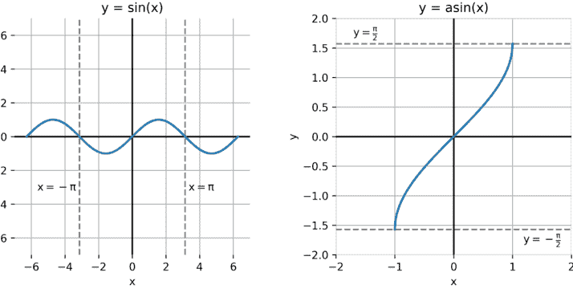

图 13.1：正弦和反正弦函数的图

我们使用 **matplotlib.pyplot** 模块，我们总是将其导入为 `plt`。

# 13.1.1 绘制一个点

在最基本的形式中，*plot* 函数接受点的 *x* 坐标、*y* 坐标以及一些关键字参数来说明如何显示该点。

```
import matplotlib.pyplot as plt

the_plot = plt.plot(1, 0.5, color="black", marker='o')
```

```
<Figure size 432x288 with 1 Axes>
```

*show* 函数显示绘图。

```
plt.show()
```

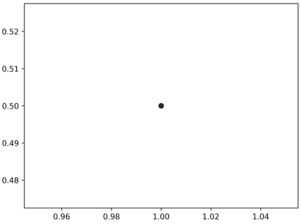

*color* 关键字参数设置点的颜色，你可以使用 "black"、"blue"、"cyan"、"green"、"magenta"、"red"、"white" 和 "yellow"。你也可以使用 HTML 颜色名称，如 "ForestGreen" 或 "MediumSlateBlue"，或十六进制 RGB 颜色规范，如 "#4169E1"。

# 练习 13.1

"#4169E1" 对应的 HTML 颜色名称是什么？

*marker* 关键字参数设置点的形状。在此示例中，我使用 "o"，它是一个实心圆。**matplotlib.pyplot** 模块文档列出了 22 种标记形状，包括 "s" 表示正方形、"*" 表示星形和 "x" 表示 "x"。

我们将所有数据和样式信息称为 *figure*。**matplotlib** 在创建这个非常简陋的绘图时使用了许多假设和默认设置。让我们看看如何开始自定义绘图的外观。


- 使用名为 **grid** 的函数，说明我们要显示一个**网格**。**matplotlib** 对调用 *grid* 及其他一些函数的时机很敏感。如果没有看到某个视觉元素显示出来，请在代码序列中将函数调用向前或向后移动。
- 调用 *axhline* 获取一条**水平线**。通过 *xlabel* 使用 `x` 为其添加标签。
- 调用 *axvline* 获取一条**垂直线**。通过 *ylabel* 使用 `y` 为其添加标签。
- 使用带字符串参数的 **title** 函数，在绘图上方显示标题文字。
- 使用黑色的“.”标记绘制该点。

## 13.1.3 调整纵横比

在前面的章节中，我们将 **matplotlib 图形**视为包含一个绘图区域，而该模块使添加线和点变得十分容易。一个图形可以包含多个绘图区域，每个绘图区域都对应一个坐标轴对象。虽然接下来的几个章节我们仍将使用单个绘图区域，但现在我们会更加精确，并使用坐标轴来指定绘图元素。

为了不必多次重复相同的代码，现在我先定义一个辅助函数的初始版本，用于执行我通常的绘图初始化操作。

```python
def initialize_plot(x_label, y_label, title_label=''):
    plt.clf()                         # clear the figure

    figure, axes = plt.subplots()     # set the plot layout

    axes.grid()                       # include a background grid

    axes.axhline(color="black")      # draw a horizontal axis in black
    if x_label:
        axes.set_xlabel(x_label)      # label the horizontal axis

    axes.axvline(color="black")      # draw a vertical axis in black
    if y_label:
        axes.set_ylabel(y_label)      # label the vertical axis

    if title_label:
        axes.set_title(title_label)   # set the title

    return figure, axes
```

赋值语句

```python
figure, axes = plt.subplots()
```

会返回用于绘图的图形和一个坐标轴。默认情况下，subplot 函数会返回单个坐标轴对象，但稍后我们会通过传入参数来获取多个坐标轴。

`initialize_plot` 在坐标轴上调用 `grid`、`axhline` 和 `axvline` 等方法，而不是使用模块级函数。它还使用 `set_xlabel`、`set_ylabel` 和 `set_title` 方法，分别设置 x 轴、y 轴和绘图标题的文本。

我已将 `initialize_plot` 放入“mpl_helper_1.py”文件中，这样每当需要时，就可以导入 `mpl_helper_1` 模块。

到目前为止，matplotlib 一直在决定水平轴和垂直轴上显示的数值范围。它对坐标轴进行了缩放，使一个坐标轴上一个单位的长度与另一个坐标轴上一个单位的长度并不相同。当两个轴的范围差异很大时，这种行为通常很方便，但我希望我们的绘图具有相等的坐标轴缩放比例。为此，我调用坐标轴的 `set_aspect` 方法。

```python
import matplotlib.pyplot as plt
from mpl_helper_1 import initialize_plot

figure, axes = initialize_plot('x', 'y',
    "Setting the aspect ratio for the axes")

# ----------------------------------------------------------------
# set the aspect ratio of vertical to horizontal
axes.set_aspect('equal')
# ----------------------------------------------------------------

the_plot = axes.plot(1, 0.5, color="black", marker='o')
```

```text
<Figure size 432x288 with 0 Axes>
<Figure size 432x288 with 1 Axes>
```

```python
plt.show()
```

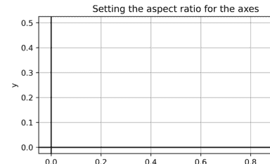

## 13.1.4 移除外部线条

想要更改点的大小和形状吗？想要更改线条的样式、宽度和颜色吗？想要更改某些文本的字体吗？matplotlib 为某些方法或函数提供了关键字参数，可以满足你的样式需求。其详尽的文档介绍了许多可选项。[MPL]

在下面的示例中，我移除了绘图周围的线条，因为我不喜欢它们的外观。这些线条称为脊柱线（spines）。

```python
import matplotlib.pyplot as plt
from mpl_helper_1 import initialize_plot

figure, axes = initialize_plot('x', 'y')

# set the aspect ratio of vertical to horizontal
axes.set_aspect('equal')

# -----------------------------------------------------------------------------
for position in ("top", "right", "bottom", "left"):
    # turn off the extra lines around the plot
    axes.spines[position].set_visible(False)

axes.set_title("Plot with annoying\nouter lines removed",
               fontsize=20, fontstyle="italic")
# -----------------------------------------------------------------------------

the_plot = axes.plot(1, 0.5, color="black", marker='o')
```

```text
<Figure size 432x288 with 0 Axes>
<Figure size 432x288 with 1 Axes>
```

```python
plt.show()
```

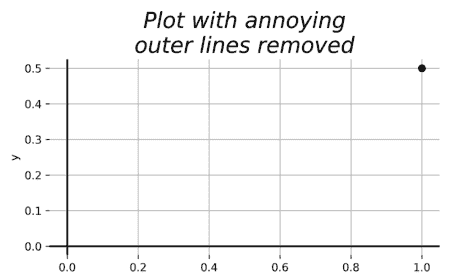

注意，标题更大，并且使用了斜体。我通过 `set_title` 的 `fontsize` 和 `fontstyle` 关键字参数设置了标题的大小和样式。

让我们更新初始化函数，以移除脊柱线：

```python
def initialize_plot(x_label, y_label, title_label):
    plt.clf()                # clear the figure

    figure, axes = plt.subplots()   # set the plot layout

    axes.grid()                 # include a background grid

    axes.axhline(color="black")   # draw a horizontal axis in black
    if x_label:
        axes.set_xlabel(x_label)    # label the horizontal axis

    axes.axvline(color="black")   # draw a vertical axis in black
    if y_label:
        axes.set_ylabel(y_label)    # label the vertical axis

    if title_label:
        axes.set_title(title_label) # set the title

    for position in ("top", "right", "bottom", "left"):
        # turn off the extra lines around the plot
        axes.spines[position].set_visible(False)

    return figure, axes
```

## 13.1.5 绘制两个点

如果我再 *plot* 一个点，**matplotlib** 会显示这个点和原来的点，但不会将它们连接起来。

```python
import matplotlib.pyplot as plt
from mpl_helper_2 import initialize_plot

figure, axes = initialize_plot('x', 'y',
    "Plot with an extra point added")

# set the aspect ratio of vertical to horizontal
axes.set_aspect('equal')

axes.plot(1.0, 0.5, color="black", marker='o')
axes.plot(0.25, 0.25, color="black", marker='o')
```

```text
[<matplotlib.lines.Line2D at 0x23176f90af0>]
<Figure size 432x288 with 0 Axes>
<Figure size 432x288 with 1 Axes>
```

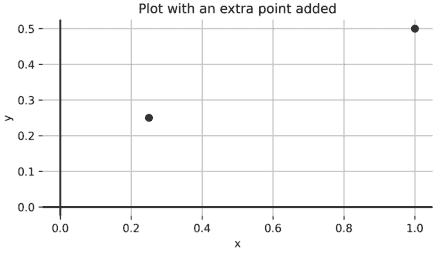

要连接这些点，请向 *plot* 传入一个 *x* 坐标列表和一个对应的 *y* 坐标列表。

```python
import matplotlib.pyplot as plt
from mpl_helper_2 import initialize_plot

figure, axes = initialize_plot('x', 'y',
    "Plot with a line between two points")

# set the aspect ratio of vertical to horizontal
axes.set_aspect('equal')

# ----------------------------------------------------------------
x_values = [1.0, 0.25]
y_values = [0.5, 0.25]
# ----------------------------------------------------------------

the_plot = axes.plot(x_values, y_values, color="black", marker='o')
```

```text
<Figure size 432x288 with 0 Axes>
<Figure size 432x288 with 1 Axes>
```

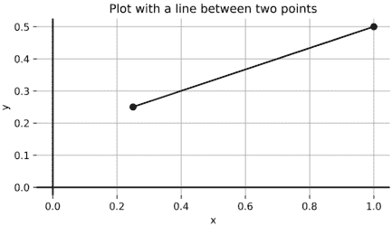

如果我省略关键字参数 `color` 和 `marker`，**matplotlib** 将不会显示标记，并会以蓝色绘制线条。当你有很多点时，可能不会希望使用标记。

每次调用 *plot* 时，都会获得额外的点、线，以及后面我们将看到的曲线。如果不指定颜色，**matplotlib** 会为这些元素选择颜色。

```python
import matplotlib.pyplot as plt
from mpl_helper_2 import initialize_plot

figure, axes = initialize_plot('x', 'y',
    "Plot with two lines and a labeled point")

# set the aspect ratio of vertical to horizontal
axes.set_aspect('equal')

x_values = [1.0, 0.25]
y_values = [0.5, 0.25]
axes.plot(x_values, y_values, color="black", marker='o')

# draw a point with a square shape
axes.plot(0.5, 0.4, marker='s')

# label the point with the text centered
axes.text(0.5, 0.43, "(0.5, 0.4)", horizontalalignment="center")

# draw another line
the_plot = axes.plot([0.1, 0.3], [0.4, 0.1])
```

```text
<Figure size 432x288 with 0 Axes>
<Figure size 432x288 with 1 Axes>
```

```python
plt.show()
```

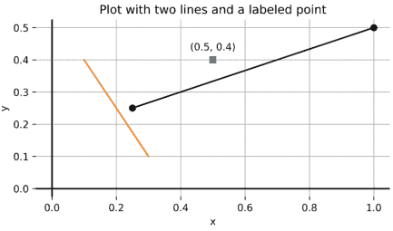

正如你可能猜到的，*text* 方法会在指定位置显示文本标记。`horizontalalignment` 关键字参数告诉 **matplotlib** 将文本居中放置在我指定的点上。

## 13.1.6 绘制抛物线

现在我想绘制抛物线 $y = x^2 - 3$ 的图像。我创建了列表 `x_values`，其中包含从 −4 到 4（包括两端）的九个整数值。对于其中每个值，我使用列表推导式计算 `y_values`。

```python
import matplotlib.pyplot as plt
from mpl_helper_2 import initialize_plot

figure, axes = initialize_plot('x', 'y',
    r'Plot of the parabola $\mathregular{y=x^2-3}$')

# ----------------------------------------------------------------------
x_values = list(range(-4, 5))
```


```
y_values = [x**2 - 3 for x in x_values]
# -----------------------------------------------------------------------------
```

the_plot = axes.plot(x_values, y_values)

<Figure size 432x288 with 0 Axes>
<Figure size 432x288 with 1 Axes>

图 13.2 显示了我们调用 plt.show() 时 **matplotlib** 生成的绘图。

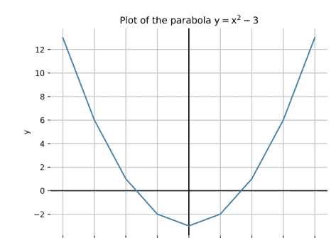

图 13.2：抛物线 y = x² - 3 的绘图

为了使标题的格式更好，我在多项式方程的两侧使用了美元符号之间的 LaTeX 标记。LaTeX \mathregular 表达式告诉 **matplotlib** 使用与 surrounding 文本相同的字体。

为了使这张图更平滑，我们需要计算更多点。我们可以使用列表，但使用一维 NumPy 数组会更高效。

## 13.1.7 NumPy 数组

如果我们以字节为单位测量，Python 对象的大小是多少？让我们看看一个空字符串的大小。

```
from sys import getsizeof

getsizeof("")
```

`getsizeof` 是 **sys** 模块中的一个函数，它返回对象使用的内存字节数。对于字符串的情况，它包括长度、字符本身，以及垃圾回收等过程的系统开销。如果我们添加一些文本，大小会变大，正如我们所期望的。

```
```python
a = "Better a witty fool, than a foolish wit."
len(a)
```
```

40

```
```python
getsizeof(a)
```
```

89

一个包含字符数是 100 倍的字符串对象的大小大约是 100 倍大，考虑到开销。

```
```python
b = 100 * a
len(b)
```
```

4000

```
```python
getsizeof(b)
```
```

4049

如果包含这两个字符串的列表呢？

```
```python
getsizeof([a, b])
```
```

72

这很奇怪，而且远小于字符串大小的总和。如果我们有一个包含较长字符串两个副本的列表，大小也是相同的。

```
```python
getsizeof([b, b])
```
```

72

如果我们包含第三个副本，字节数会适度增加。

```
```python
getsizeof([b, b, b])
```
```

80

getsiz​​eof 测量对象的大小，**但不测量它所引用的对象的大小。** 在这个例子中，`getsizeof` 没有包含列表中字符串的大小。我们可以用以下类似的函数来更好地近似实际使用的总内存量：

```
```python
def getsizeof_list(the_list):
    size = getsizeof(list)
    for item in the_list:
        size += getsizeof(item)
    return size
```
```

```
```python
x_values = list(range(1000))
getsizeof_list(x_values)
```
```

28404

### 练习 13.2

> 如果列表包含集合、字典或另一个列表，`getsizeof_list` 的结果是否正确？编写一个新函数，递归地测量对象及其包含内容的大小。

通过将数据紧密地连续打包在内存中，可以更高效地存储数值数据。这种结构称为 *array*，NumPy 是一个广泛使用的 Python 包，包含强大的多维数组支持。NumPy 自称“Python 科学计算的基础包”，我同意。[ANN] [NPY] [NUM] 按照传统，我们将 NumPy 包导入为 np。

```
```python
import numpy as np
```
```

*arange* 函数类似于 *range*，但它比使用迭代器、生成器或列表更高效地构建数组。

```
```python
x_values_array = np.arange(1000)

getsizeof(x_values_array)
```
```

4104

看看数组从 0 到 999 的整数使用的内存比上面的列表少多少？size 函数返回数组中的项目数。

```
x_values_array.size
```

1000

正如我们在第 5.2 节看到的那样，Python 可以计算任意大的整数。当我们知道整数的值是有界的时，我们可以使用固定数量的字节来容纳数字。items size 属性获取每个项目使用的大小。

```
x_values_array.itemsize
```

4

这个结果说明每个整数值使用 4 个字节。将它乘以项目数，你就得到 nbytes 属性的值，即所有数组数据的总字节数。

```
x_values_array.nbytes
```

4000

### 练习 13.3

为什么 x_values_array.nbytes 与 getsizeof(x_values_array) 不同？

如果您有一个数字元组的列表，请使用 array 创建一个数组。NumPy 强制数组中的所有数字具有相同的类型，它称之为 dtype。

```
np.array([2, 3.4])
```

array([2., 3.4])

```
np.array((-1, 3.1415926j))
```

array([-1.+0.j , 0.+3.1415926j])

假设您想要 0 到 1 之间包含端点的十一个浮点数。linspace(n, m, count) 给您一个从 n 开始以 m 结束的 count 个数的数组。

```
np.linspace(0, 1, 11)

array([0. , 0.1, 0.2, 0.3, 0.4, 0.5, 0.6, 0.7, 0.8, 0.9, 1. ])
```

我们可以通过以下方式创建我们在图 13.2 中绘制抛物线时使用的 x 坐标的数组：

```
x_values = np.linspace(-4, 4, 9)
```

NumPy 最强大的功能之一是您可以直接对数组使用代数运算。当我们定义 p 来计算抛物线的公式时，我们可以直接将其应用于 x_values。

```
def p(x): return x*x - 3

p(x_values)

array([13., 6., 1., -2., -3., -2., 1., 6., 13.])
```

我们现在准备好用 1,000 个点绘制我们的抛物线。

```
import matplotlib.pyplot as plt
from mpl_helper_2 import initialize_plot
import numpy as np

figure, axes = initialize_plot('x', 'y',
    r"Smooth plot of the parabola $\mathregular{y=x^2-3}$")

# Generate 1000 equally spaced points between -4 and 4
x_values = np.linspace(-4, 4, 1000)

def p(x): return x*x - 3

the_plot = plt.plot(x_values, p(x_values))
```

<Figure size 432x288 with 0 Axes>
<Figure size 432x288 with 1 Axes>

```
plt.show()
```

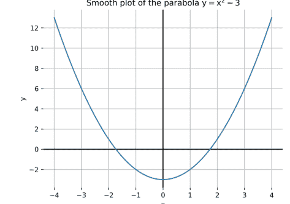

## 13.1.8 绘制正弦函数

将函数应用于数组的每个元素的技术适用于许多数学运算，不过您应该使用 numpy 模块中的函数而不是 math 模块。这里我从 x = −2π 到 2π 绘制正弦函数：

```
import matplotlib.pyplot as plt
from mpl_helper_2 import initialize_plot
import numpy as np

figure, axes = initialize_plot('x', 'y', "y = sin(x)")

# set the aspect ratio of vertical to horizontal
axes.set_aspect('equal')

# --------------------------------------------------------------------------
# Generate 1000 equally spaced points between -2 pi and 2 pi
x_values = np.linspace(-2*np.pi, 2*np.pi, 1000)
# --------------------------------------------------------------------------

the_plot = plt.plot(x_values, np.sin(x_values))
```

<Figure size 432x288 with 0 Axes>
<Figure size 432x288 with 1 Axes>

## 创建绘图和图表

```
```python
plt.show()
```
```

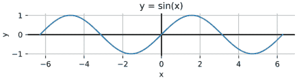

这张图在高度上宽但短。我现在使用 `set_xlim` 和 `set_ylim` 方法来设置 x 和 y 坐标显示值的范围。

```
```python
import matplotlib.pyplot as plt
from mpl_helper_2 import initialize_plot
import numpy as np

figure, axes = initialize_plot('x', 'y', "y = sin(x)")

# set the aspect ratio of vertical to horizontal
axes.set_aspect('equal')

# -----------------------------------------------------------------
# show x-coordinates from -7 to 7
axes.set_xlim([-7, 7])

# show y-coordinates from -7 to 7
axes.set_ylim([-7, 7])
# -----------------------------------------------------------------

# Generate 1000 equally spaced points between -2 pi and 2 pi
x_values = np.linspace(-2 * np.pi, 2 * np.pi, 1000)
the_plot = plt.plot(x_values, np.sin(x_values))
```
```

`<Figure size 432x288 with 0 Axes>`
`<Figure size 432x288 with 1 Axes>`

```
```python
plt.show()
```
```

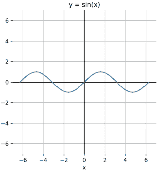

最后，我使用 *axvline* 和 *text* 方法在 $x = -\pi$ 和 $x = \pi$ 处绘制并标记灰色虚线垂直线。

```
```python
import matplotlib.pyplot as plt
from mpl_helper_2 import initialize_plot
import numpy as np

figure, axes = initialize_plot('x', 'y',
                               "y = sin(x)")

# set the aspect ratio of vertical to horizontal
axes.set_aspect('equal')

# show x-coordinates from -7 to 7
axes.set_xlim([-7, 7])

# show y-coordinates from -7 to 7
axes.set_ylim([-7, 7])

# ----------------------------------------------------------------------
# draw and label a dashed vertical line at x = -pi
axes.axvline(x=-np.pi, color="#808080",
             linestyle="dashed", linewidth=1.5)

axes.text(-4.5, -3.2,
          r"$\mathregular{x = -\pi}$",
          horizontalalignment="center")
```


```
# draw and label a dashed vertical line at x = -pi
axes.axvline(x=np.pi, color="#808080",
    linestyle="dashed", linewidth=1.5)

axes.text(4.1, -3.2,
    r"$\mathregular{x = \pi}$",
    horizontalalignment="center")
# ------------------------------------------------------------

# Generate 1000 equally spaced points between -2 pi and 2 pi
x_values = np.linspace(-2 * np.pi, 2 * np.pi, 1000)

the_plot = axes.plot(x_values, np.sin(x_values))
```

<Figure size 432x288 with 0 Axes>

<Figure size 432x288 with 1 Axes>

```
plt.show()
```

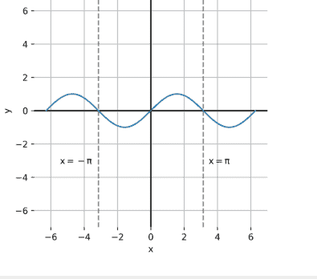

## Exercise 13.4

使用本节中的技术绘制图 13.1 右侧所示的反正弦图。使用函数 np.arcsin。

## 13.1.9 Multiple plots

在 13.1.3 节中我们看到

```
figure, axes = plt.subplots()
```

创建一个包含一个子图的图形，我们可以使用 axes 来引用它。更一般地，

```
figure, axes = plt.subplots(number_of_rows, number_of_columns)
```

返回一个包含多个子图和 axes 对象的图形。要引用特定的 axes，请使用索引。第一个子图的索引为 0。

```
import matplotlib.pyplot as plt

figure, axes = plt.subplots(1, 3)

for x in range(3):
    axes[x].set_title(f"Plot at position {x}")
    axes[x].plot(x, x, marker='o')

figure.tight_layout()
```

```
<Figure size 432x288 with 3 Axes>
```

```
plt.show()
```

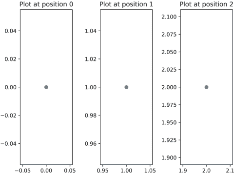

调用 *tight_layout* 强制 **matplotlib** 避免子图重叠。

## Exercise 13.5

更改此示例，使每个子图使用相等的纵横比，并且具有相同的 x 和 y 坐标范围。

我们也可以将子图垂直堆叠，而不仅仅是水平展开。在下一个示例中，我们有两行，每行有三个子图。我们现在需要两个索引来访问一个 axes，第一个是行。

```
import matplotlib.pyplot as plt

figure, axes = plt.subplots(2, 3, constrained_layout=True)

for row in range(2):
    for col in range(3):
        axes[row, col].set_title(f"Plot at position {row}, {col}")
        axes[row, col].plot(row, col, marker='o')

figure.suptitle("This is a title above the figure",
    y=1.05, fontweight="bold",
    family="serif", fontsize=16)
```

Text(0.5, 1.05, 'This is a title above the figure')
<Figure size 432x288 with 6 Axes>

```
plt.show()
```

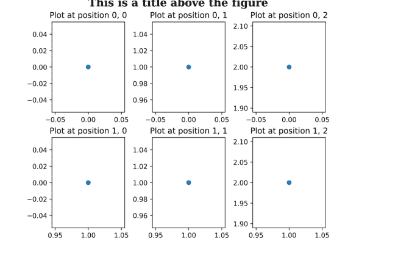

我没有调用 *tight_layout*，而是在调用 *subplots* 时使用了 *constrained_layout=True*。尝试两者以查看哪种间距更好。要手动控制水平和垂直内边距，请使用 *subplots_adjust*。

我使用 *suptitle* 为整个图形设置标题。我指定了大号、粗体、衬线字体，并使用 *y* 关键字参数将其上移，以免与子图标题重叠。

## Exercise 13.6

使用本节的技术以及 13.1.8 节中的正弦和反正弦图来绘制图 13.1。

## 13.1.10 Semi-log plots

我们本章看到的每个图都具有线性刻度的每个轴。这意味着我们添加某个恒定值即可从轴上一个标记位置到下一个。半对数图有一个轴具有线性刻度，另一个具有对数刻度。这意味着垂直轴显示的不是 y，而是 10^z，其中 z = log(y)。通常，水平轴是线性的，垂直轴是对数的。

我们在图 5.7 中看到了三个指数函数的图，我在此将其作为图 13.3 重现。

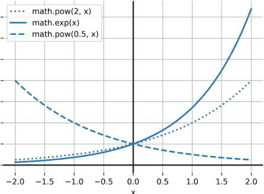

图 13.3：三个指数函数的图

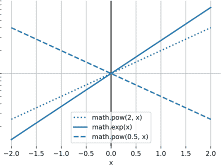

图 13.4：三个指数函数的半对数图

从数学上讲，指数函数 `c * a**x` 的对数产生直线方程 `log(c) + x * log(a)`。

## 13.2 Bar charts

条形图在媒体中很受欢迎，用于显示计数和测量数据。我怀疑人们在 Microsoft Excel 中创建了许多这样的图表，但你也可以使用 **matplotlib** 制作用于显示或出版的条形图。我们在 9.7.2 节生成量子电路结果的直方图时看到了条形图。

我们在上一节中看到的用于图的许多方法、函数和样式控制也适用于条形图。尝试直到你喜欢看到的效果。

### 13.2.1 Basic bar charts

最直接的条形图对应于一组数值数据。这些值是条形的高度。

```
```python
import matplotlib.pyplot as plt

data = [21, 14, 10, 9, 19]

# draw the bar chart
bar_chart = plt.bar(range(1, len(data) + 1), data)
```
```

`<Figure size 432x288 with 1 Axes>`

```
plt.show()
```

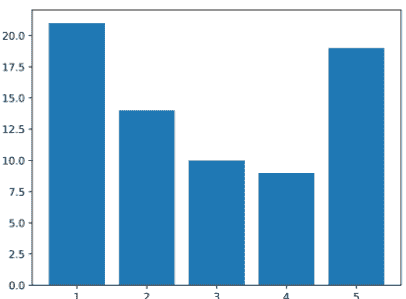

如果为条形图查看者标记图表和水平轴值会更有信息量。

```
import matplotlib.pyplot as plt

# give descriptive names to the values on the horizontal
# and vertical axes

days = ["Monday", "Tuesday", "Wednesday", "Thursday", "Friday"]
support_calls = [21, 14, 10, 9, 19]

# add a title to the top of the bar chart
plt.title("Support Call Data for Last Week")

# draw the bar chart
bar_chart = plt.bar(days, support_calls)
```

<Figure size 432x288 with 1 Axes>

```
plt.show()
```

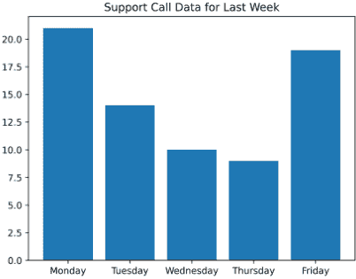

## Exercise 13.7

通过为星期六添加 6 次支持呼叫，为星期日添加 4 次来扩展此条形图。

## Exercise 13.8

用“Days”标记水平轴，用“Number of Support Calls”标记垂直轴。

### 13.2.2 Horizontal bar charts

如果使用 `barh` 函数而不是 `bar`，你将得到图 13.5 中的图表。

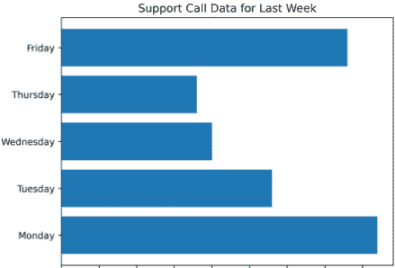

图 13.5：水平条形图

### 13.2.3 Adding colors and grid lines

默认情况下，matplotlib 将每个条形显示为蓝色。如果使用单个颜色的 color 关键字参数，每个条形都将使用该颜色。你也可以提供一个颜色列表，为水平轴上的每个条形提供一种颜色。

在下一个示例中，我使用三种灰色阴影来显示代表三类每日支持呼叫计数的条形。我还用水平黑色虚线绘制了网格。alpha 参数决定线的不透明度。

```
import matplotlib.pyplot as plt

days = ["Monday", "Tuesday", "Wednesday", "Thursday", "Friday"]
support_calls = [21, 14, 10, 9, 19]

# create a list of colors for ranges of daily call values
colors = []
for calls in support_calls:
    if calls >= 15:
        colors.append("#505050")
    elif calls >= 10:
        colors.append("#808080")
    else:
        colors.append("#B0B0B0")

# add the bar chart title
plt.title("Number of Support Calls Per Day")

# draw horizontal lines
plt.grid(color="black", alpha=0.6, axis='y', linewidth=1, linestyle='--')

# draw the bar chart
bar_chart = plt.bar(days, support_calls, color=colors)
```

<Figure size 432x288 with 1 Axes>

```
plt.show()
```

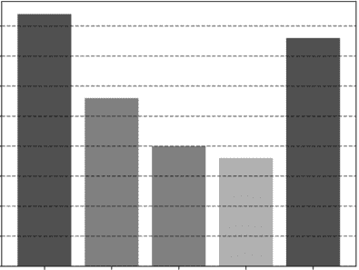

## Exercise 13.9

`alpha = 1.0` 表示完全不透明还是完全透明？

## Exercise 13.10

我运行了图 13.6 中的 3 量子位电路一千次，得到了以下结果：

```
counts = {"000": 129, "001": 128, "010": 93, "011": 115,
          "100": 138, "101": 128, "110": 93, "111": 124}
```

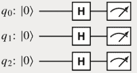

图 13.6：具有三个 Hadamard 门的量子电路

绘制一个条形图，水平轴为计数键，垂直轴为值。使用 *axhline* 在 y = 125 处绘制一条绿色水平线。将值小于 120 或大于 130 的任何条形着色为红色。

### 13.2.4 Stacking and labeling bars

堆叠条形图是可视化单个结果和总结果的好方法。堆叠的关键是绘制在最低层之上条形时使用 bottom 关键字参数。上层条形的底部是其下方条形的高度。

你可以使用 `label` 关键字参数为每个图或条形图，并然后使用 *legend* 函数。**matplotlib** 会在角落显示一个框，告诉查看者哪个标签对应哪个条形。

```
import matplotlib.pyplot as plt
import numpy as np

data = [[21, 14, 10, 9, 19],
        [17, 16, 4, 12, 14]]

# draw the bar chart for Team A
plt.bar(np.arange(1, len(data[0]) + 1), data[0],
        color="#505050", label="Team A")

# draw the bar chart for Team B above that of Team A
bar_chart = plt.bar(np.arange(1, len(data[1]) + 1), data[1],
                    color="#B0B0B0", label="Team B",
                    bottom=data[0])

# draw a legend identifying the bars for each team
plt.legend()

<matplotlib.legend.Legend at 0x23177034b20>
<Figure size 432x288 with 1 Axes>
```

```
plt.show()
```


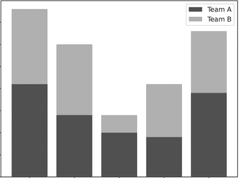

## 练习 13.11

扩展此示例，堆叠第三个值列表 `[12, 21, 7, 9, 16]`。

## 13.2.5 并排条形图

并排条形图可以方便地查看不同时间下对应结果的变化。绘制并排条形图的技巧是：先指定每个条形的宽度，然后以该宽度为偏移量将条形向右平移。

``` 
```python
import matplotlib.pyplot as plt
import numpy as np

plt.clf()

data = [[21, 14, 10, 9, 19],
        [17, 16, 4, 12, 14]]

# set the width of a bar
width = 0.4

# draw the first bar chart with each bar the specified width
bar_chart = plt.bar(np.arange(1, len(data[0]) + 1), data[0],
                    width=width, color="#505050")

# draw the second bar chart with the bars to the right of the first
```
```

```
```python
bar_chart = plt.bar(np.arange(1, len(data[1]) + 1) + width, data[1],
                   width=width, color="#B0B0B0")
```
```

<Figure size 432x288 with 1 Axes>

```
```python
plt.show()
```
```

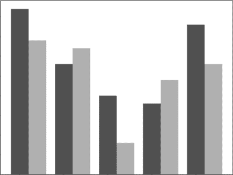

## 练习 13.12

扩展此示例，为数据 [12, 21, 7, 9, 16] 在上一示例的条形右侧放置新的条形。

## 13.3 直方图

直方图是一种用于展示统计数据的条形图。在第 5.7.2 节的图 5.12 中，我展示了一个包含一百万个随机数的正态分布图，其均值 μ = 1.0，标准差 σ = 0.2。以下代码创建了具有相同特征的直方图：

``` 
```python
import matplotlib.pyplot as plt
import numpy as np

plt.clf()

np.random.seed(23)

# generate the random numbers in a normal distribution
```
```

```
```python
mu = 1.0
sigma = 0.2
random_numbers = np.random.normal(mu, sigma, 1000000)

# set the number of bins in which to divide up the random numbers
bin_size = 100

# draw the histogram
the_plot = plt.hist(random_numbers, bins=bin_size)
```
```

```
```python
plt.show()
```
```

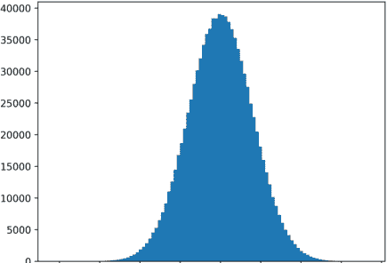

`bins` 参数决定直方图中条形的数量。

**练习 13.13**

减小 `bin_size` 会让直方图更平滑还是更块状？

**练习 13.14**

查阅 `hist` 的关键字参数 `density` 和 `orientation` 的定义。为每个参数的每个选项各创建一个直方图。

## 13.4 饼图

另一种常见的图表类型是饼图，我们用扇形来可视化数据。每个扇形的大小与其数据值在总数值中所占的比例相关。我们使用 pie 函数创建饼图。

```
import matplotlib.pyplot as plt

days = ["Monday", "Tuesday", "Wednesday", "Thursday", "Friday"]
support_calls = [21, 14, 10, 9, 19]

# draw the pie chart
pie_chart = plt.pie(support_calls, labels=days)
```

<Figure size 432x288 with 1 Axes>

```
plt.show()
```

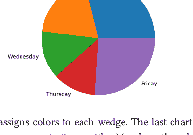

matplotlib 会自动为每个扇形分配颜色。在上一张图中，从星期一开始，扇形依次为蓝色、紫色、红色、绿色和橙色；不过，根据你阅读本书的媒介，它们在你眼中可能是单色的。

pie 函数提供了许多关键字参数，用于控制图表的显示样式。如果在调用 pie 时添加参数 `autopct="%1.1f%%"`，matplotlib 会显示每个扇形的相对百分比大小。图 13.7 展示了使用 autopct 后的结果。

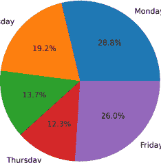

图 13.7：带扇形百分比的饼图

格式说明符 `"%1.1f%%"` 来自 Python 支持 f-string 之前的时代。第一个“%”表示“这是一个格式字符串”。“1.”表示“至少显示一位数字，后跟一个小数点”。“1f”表示“对该浮点数在小数点后显示一位数字”。最后，“%%”会插入一个百分号。

使用 colors 关键字参数可提供一个颜色名称或十六进制 RGB 值序列。通常，这个序列是列表或元组。如果提供的颜色数量少于数据值数量，**matplotlib** 会从序列开头重新循环使用这些颜色。我定义了

```
gray_shades = ["#A0A0A0", "#B0B0B0", "#C0C0C0", "#D0D0D0", "#E0E0E0"]
```

然后通过 `colors=gray_shades` 将它们传给 *pie*。更新后的图表见图 13.8。

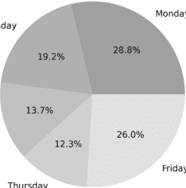

图 13.8：用灰色调绘制的饼图

## 练习 13.16

将任何对应数据值小于或等于 10 的扇形向外拉出。

最后，你可以旋转饼图，以获得最佳的视觉效果。

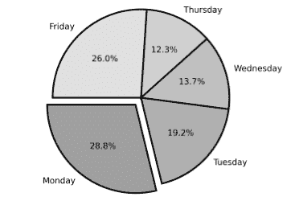

图 13.11：旋转后的饼图

在图 13.11 中，我通过 `startangle=180` 参数将饼图旋转了 180°。

## 练习 13.17

解释 pie 的 counterclock 关键字参数在赋值为 True 或 False 时的作用。

## 13.5 散点图

我们使用散点图来显示许多点。之后，我们可以用颜色、标记、标签、标题和字体让它更美观，并调整坐标轴，使图表有效而悦目地传达数据。

与 pie 类似，我们通过向 scatter 传递关键字参数来控制散点图的大部分外观。这些图的数据是 A、B、C 三个城市在 2021 年 3 月前 10 天的最高气温。温度以华氏度为单位，我使用 numpy 数组保存月份中的数字日期和这些数据。

## 创建图形和图表

如果我通过 **numpy 的 concatenate 函数**将日期和温度数据合并为单个数组，scatter 会以相同的颜色和相同的标记显示所有点。默认颜色是蓝色。

``` 
```python
import matplotlib.pyplot as plt
import numpy as np

days = np.arange(1, 11)

city_high_temperatures = {
    'A': np.array([63, 57, 59, 67, 54, 53, 59, 62, 62, 58]),
    'B': np.array([45, 45, 39, 31, 34, 41, 66, 63, 60, 56]),
    'C': np.array([80, 82, 82, 79, 78, 76, 76, 82, 84, 83])
}

figure, axes = plt.subplots()

# draw the scatter charts

axes.set_xlabel("Day in March, 2021")
axes.set_ylabel("Temperature in F°")
axes.set_title("Daily high temperatures for three cities")

d = np.concatenate([days, days, days])
t = np.concatenate([
    city_high_temperatures['A'],
    city_high_temperatures['B'],
    city_high_temperatures['C']])

the_plot = axes.scatter(d, t)
```
```

<Figure size 432x288 with 1 Axes>

```
```python
plt.show()
```
```

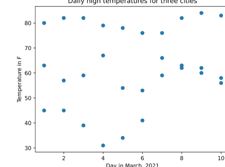

如果我们调用三次 scatter，就能以不同的方式显示每个城市的点。像下面这段代码一样，使用 s 参数来改变标记的大小：

```
axes.scatter(days, city_high_temperatures['A'], s=10)
axes.scatter(days, city_high_temperatures['B'], s=100)
axes.scatter(days, city_high_temperatures['C'], s=50)
```

s 可以是单个 int 或 float，也可以是每点一个尺寸的数组。结果见图 13.12。

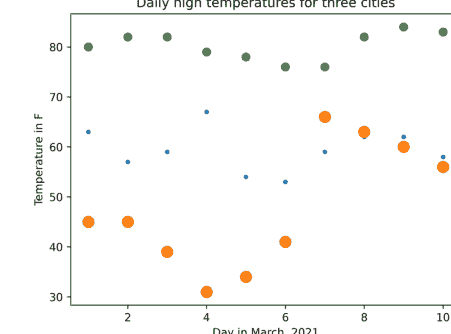

图 13.12：每个城市使用不同大小圆圈的散点图

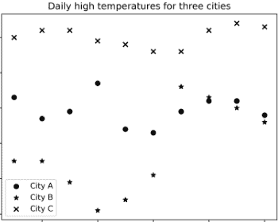

图 13.14：每个城市使用不同标记的散点图

通过混合搭配传给 *scatter* 的样式关键字参数，你可以让图表呈现出你想要的外观。

请看图 13.14，注意只有偶数日期被标注出来。我们把数字上方的短竖线称为“刻度标记”或“刻度”。**matplotlib** 提供了 **ticker** 模块来控制标签和刻度的显示。这远没有本章前面使用的绘图功能那么直接，所以我只展示调整编号的代码。要将水平刻度改为每天一个、垂直刻度改为每五天一个，请执行：

```
import matplotlib.ticker as ticker

axes.xaxis.set_major_locator(ticker.MultipleLocator(1))
axes.yaxis.set_major_locator(ticker.MultipleLocator(5))
```

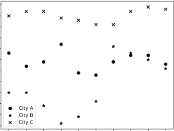

图 13.15：调整刻度标记后的散点图


调整后的图在图 13.15 中。此技术适用于任何具有坐标轴的图。水平网格线也有助于更轻松地从图表中确定数据值。

```python
plt.grid(color='black', alpha=0.6, axis='y',
         linewidth=0.5, linestyle='-')
```

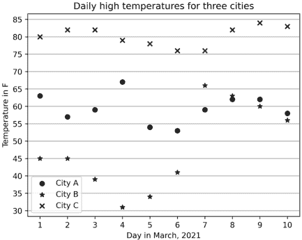

图 13.16：带水平网格线的散点图

## 13.6 转向三维

**matplotlib** 可以在三维中绘图，如果我们从 **mpl_toolkits.mplot3d** 导入所需的工具。为了帮助你看到 3D 图的主要组件，这里有一个例子，我在原点 (0, 0, 0) 绘制了点并指定了坐标轴范围和标签。

```python
import matplotlib.pyplot as plt
from mpl_toolkits.mplot3d import Axes3D

# -----------------------------------------------------------------
# create the plot figure
figure = plt.figure()

# create a 3D axes
axes = plt.axes(projection='3d')
# -----------------------------------------------------------------

# label the x, y, and z axes in a large font
axes.set_xlabel('x', fontsize="16")
axes.set_ylabel('y', fontsize="16")
axes.set_zlabel('z', fontsize="16")

# set the limits of the values shown on the axes
axes.set_xlim(0, 1)
axes.set_ylim(0, 1)
axes.set_zlim(0, 1)

# label the origin
axes.text(0.1, 0, 0.03, "(0, 0, 0)")

# draw the axes
axes.plot([0, 0], [0, 0], [0, 1], linewidth=2, color="black")
axes.plot([0, 0], [0, 1], [0, 0], linewidth=2, color="black")
axes.plot([0, 1], [0, 0], [0, 0], linewidth=2, color="black")

# draw the point at the origin
the_plot = axes.plot([0, 0], [0, 0], [0, 0], marker='o',
                    markersize=6, color="black")
```

<Figure size 432x288 with 1 Axes>

```python
plt.show()
```

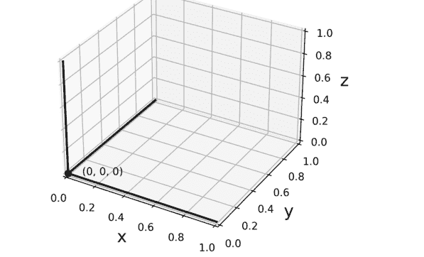

最新的特性是我们创建坐标轴的方式。首先，我们使用

```python
figure = plt.figure()
```

构建图形，然后通过

```python
axes = plt.axes(projection='3d')
```

在图形内创建三维坐标轴。

我使用 *set_zlabel* 来标记 z 轴，这与我在 13.1.2 节中对 *set_xlabel* 和 *set_ylabel* 的使用是一致的。

### 13.6.1 绘制曲线

我们对 3D 绘图的第一个方法是取我们在二维中对点、线和曲线所做的工作并赋予它们垂直分量。本质上，它们是三维中的 0 维和 1 维对象。让我们绘制余弦：

```python
import matplotlib.pyplot as plt
from mpl_toolkits.mplot3d import Axes3D
import numpy as np

# create the plot figure and 3D axes
figure = plt.figure()
axes = plt.axes(projection='3d')

# x will range from -10 to 10 for 1000 values
xs = np.linspace(-10, 10, 1000)

# y will always be 0
ys = np.full(1000, 0)

# z is the cosine of x
zs = np.cos(xs)

# draw the curve
the_plot = axes.plot(xs, ys, zs, color='black')
```

```text
<Figure size 432x288 with 1 Axes>
```

```python
plt.show()
```

```python
figure = plt.figure()
axes = plt.axes(projection='3d')

# draw the scatter plot
the_plot = axes.scatter(xs, ys, zs, color="black")
```

<Figure size 432x288 with 1 Axes>

```python
plt.show()
```

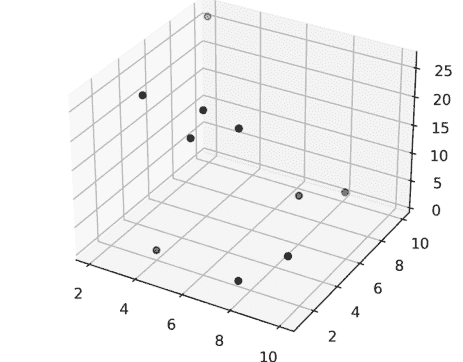

考虑使用网格或不同的标记或颜色使绘图更易于解释。

## 练习 13.19

通过调用 scatter 两次，绘制此散点图，使得 z 值小于 20 的点使用 '+' 标记，否则使用 '*' 标记。

## 练习 13.20

绘制此散点图，使得 x + y > 10 的点以红色显示，否则以绿色显示。

### 13.6.3 绘制正方形

让我们考虑绘制一个平放在 z = 10 处的 10×10 正方形。有四个角，但如果我们提供其 x 坐标的一维数组和其 y 坐标的一维数组，plot 将绘制四个点并连接它们。

```python
import matplotlib.pyplot as plt
from mpl_toolkits.mplot3d import Axes3D
import numpy as np

# set the data coordinates
xs = np.array([0, 0, 10, 10])
ys = np.array([0, 10, 10, 0])
zs = np.array([10, 10, 10, 10])

# create the plot figure and 3D axes
figure = plt.figure()
axes = plt.axes(projection='3d')

axes.set_title("plot", fontstyle="italic")

# draw the plot for the corners
the_plot = axes.plot(xs, ys, zs, color="black")
```

<Figure size 432x288 with 1 Axes>

```python
plt.show()
```

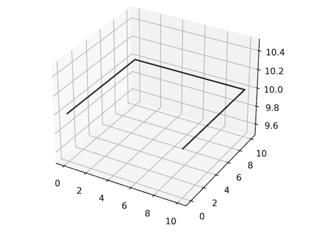

## 练习 13.21

为什么只有三条线？你如何绘制第四条线？

### 13.6.4 绘制线框和曲面图

正方形是二维的，所以我们需要改变数据表示和绘图函数。假设我们有九个点，其 x 和 y 坐标如下。

```python
xs = [4, 5, 6]
ys = [1, 2, 3]
```

这些点对应于 xs 和 ys 值的全部组合，并在图 13.17 中显示。

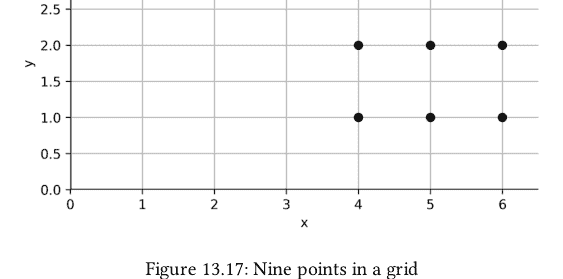

图 13.17：网格中的九个点

要创建曲面，我们需要二维数组。meshgrid 函数接受 x 和 y 值的列表或数组并生成 2D numpy 数组。

```python
x_mesh, y_mesh = np.meshgrid(xs, ys)
x_mesh
```

```text
array([[4, 5, 6],
       [4, 5, 6],
       [4, 5, 6]])
```

```python
y_mesh

array([[1, 1, 1],
       [2, 2, 2],
       [3, 3, 3]])
```

图 13.17 中标记点的坐标是数组 x_mesh 和 y_mesh 中对应的数字。

现在我可以正确绘制我们的正方形。在建立网格后，我使用 plot_wireframe 显示正方形的轮廓，并使用 plot_surface 显示填充的曲面。

```python
import matplotlib.pyplot as plt
from mpl_toolkits.mplot3d import Axes3D
import numpy as np

# set the data coordinates
xs = [0, 1]
ys = [0, 1]
zs = np.array([[10, 10], [10, 10]])

# compute the grids
x_mesh, y_mesh = np.meshgrid(xs, ys)

# create the plot figure and two 3D axes
figure, axes = plt.subplots(1, 2,
                            figsize=(8, 4),
                            subplot_kw={'projection': "3d"},
                            constrained_layout=True)

# draw the wireframe plot
axes[0].set_title("plot_wireframe", fontstyle="italic")
axes[0].plot_wireframe(x_mesh, y_mesh, zs, color="black")

# draw the filled surface plot
axes[1].set_title("plot_surface", fontstyle="italic")
axes[1].plot_surface(x_mesh, y_mesh, zs, color="lightgray")
```

<mpl_toolkits.mplot3d.art3d.Poly3DCollection at 0x23178d009d0>
<Figure size 576x288 with 2 Axes>

```python
plt.show()
```

plot_wireframe

plot_surface

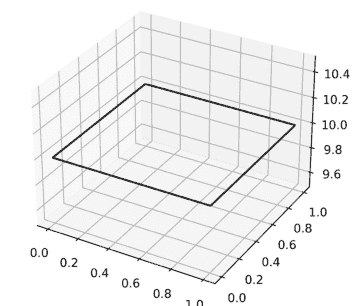

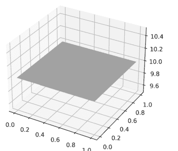

这个最后一个例子演示了另一种说明你想要 3D 图的方式，使用 subplot_kw={'projection': "3d"} 参数传递给 subplots。为了帮助 matplotlib 更好地布局这个宽而短的图形，我指定了 figsize=(8, 4)。该指令将图形大小设置为宽 8 英寸、高 4 英寸。

### 13.6.5 以两种方式绘制余弦

我们对三维绘图的最后一个例子是涉及余弦的两个曲面图。在图 13.18 左侧，我使用 plot_surface 显示了一个曲面，其中 z 值不依赖于 y。在右侧，图在 xy 平面内关于原点对称。

z = cos(x)

z = cos(√(x² + y²))

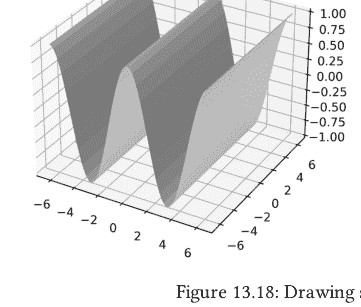

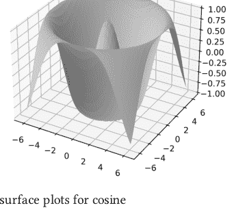

图 13.18：绘制余弦的曲面图

## 练习 13.22

在一个图形中绘制图 13.18 中的曲面图。使用以下代码行以某种方式并按某种顺序使用：

```python
xs = np.linspace(-2 * np.pi, 2 * np.pi, 125)
ys = np.linspace(-2 * np.pi, 2 * np.pi, 125)
zs = np.cos(x_mesh)
zs = np.cos(np.sqrt(x_mesh**2 + y_mesh**2))
```

不要忘记标记绘图。

## 13.7 总结

在本章中，我们研究了 matplotlib 以及我们如何绘制点、线、曲线、曲面、饼图、条形图和散点图。虽然这是一个强大的模块，但它违反了 Python 之禅，尤其是在关于做某事只有一种方式方面。 [ZEN] 你可以在 plt 或 axes 级别做很多事情。我给你提供了每种的例子，但我更喜欢后者。

我们还学习了如何创建和使用一维和二维 numpy 数组。这些在科学计算、AI 和数据科学中的绘图之外有许多应用。


## 14 分析数据

> *在没有数据之前就进行理论化是一个致命的错误。*
> 
> —亚瑟·柯南·道尔，《夏洛克·福尔摩斯》

虽然我们可以用“数据科学”、“分析”和“人工智能”等花哨的名字来谈论数据工作，但有时你只是想读取、写入和处理包含许多行和列信息的文档。人们多年来一直以交互方式进行此操作，通常使用 Microsoft Excel® 和 Google Sheets™ 等在线应用等应用程序。

“以编程方式”操作数据，我的意思是我们使用 Python 函数和方法。本章使用流行的 pandas 库来创建和操作这些行列集合，称为 DataFrames。我们将在第 15 章《学习，简要》中介绍其他方法。在讨论 DataFrames 之前，让我们回顾一下统计学的一些核心概念。

**本章涵盖的主题**

- 14.1 统计学 528
- 14.2 猫和逗号 538
- 14.3 pandas DataFrames 539
- 14.4 数据清洗 555
- 14.5 使用 pandas 进行统计 558
- 14.6 转换分类数据 561
- 14.7 各地猫的性别 563
- 14.8 所有虎斑猫都是雌性吗？ 569
- 14.9 树上和圆圈里的猫 571
- 14.10 总结 574

### 14.1 统计学

本节介绍用于分析数据的几个核心统计函数。我们使用的数据是 2021 年在一场虚构的 1990 年代音乐翻唱乐队音乐会上的一百名与会者的年龄。

```python
import numpy as np

ages = np.array(
    [40, 41, 39, 35, 42, 37, 45, 43, 42, 38, 39, 45, 37, 36,
     45, 41, 41, 31, 42, 40, 39, 38, 40, 39, 41, 46, 42, 44,
     46, 48, 45, 39, 46, 43, 35, 38, 43, 41, 36, 40, 34, 44,
     42, 44, 40, 49, 47, 51, 52, 45, 44, 47, 39, 38, 43, 39,
     45, 40, 36, 43, 38, 43, 32, 35, 36, 42, 40, 38, 37, 36,
     41, 41, 31, 39, 51, 38, 42, 36, 35, 36, 40, 40, 37, 43,
     39, 42, 44, 50, 39, 38, 37, 33, 52, 35, 44, 29, 42, 39,
     40, 42]
)
```

#### 14.1.1 均值和中位数

均值是数据值的平均值。我们通常将均值写为希腊字母 mu = μ，尽管你也可能看到“m。”

```python
mean = np.mean(ages)
mean
```

```text
40.62
```

你也可以通过将值的总和除以值的数量来直接计算均值。

```python
np.sum(ages)/ages.size
```

```text
40.62
```

我们使用 **numpy** 函数 *max* 和 *min* 来计算最大和最小数据值。

```python
np.max(ages), np.min(ages)
```

```text
(52, 29)
```

在第 13.3 节中，我们看到了如何使用 **matplotlib** 绘制直方图。以下是年龄数据的直方图，并标出了均值：

```python
import matplotlib.pyplot as plt
plt.hist(ages, bins=33, color="lightgray", edgecolor="black")

plt.xlabel("Age")
plt.ylabel("Count")
plt.title("Histogram of concert attendee ages")

mean = np.mean(ages)
plt.axvline(mean, color="black", linestyle="dotted")
plt.text(mean + 0.1, 11, "mean")
```

Text(40.72, 11, 'mean')
<Figure size 432x288 with 1 Axes>

```python
plt.draw()
```

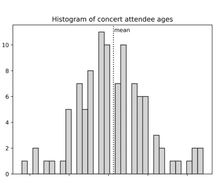

将数据在中间分割，使一半在上方一半在下方的值称为 *中位数*。

```python
np.median(ages)
```

```text
40.0
```

#### 练习 14.1

如果数据值的数量是偶数，奇数时如何计算中位数？


第一四分位数，通常称为 *Q1*，是小于中位数的数据值的中位数。大约 25% 的最小数据值在第一四分位数中。我们使用 *quantile* 函数计算它。

```python
Q1 = np.quantile(ages, 0.25)
```

第三四分位数，通常称为 *Q3*，是大于中位数的数据值的中位数。大约 25% 的最大数据值在第三四分位数中。

```python
Q3 = np.quantile(ages, 0.75)
Q1, Q3
```

```text
(38.0, 43.0)
```

#### 练习 14.2

`np.quantile(ages, 0.1)` 是什么？它代表什么？`np.quantile(ages, 2.0/3.0)` 呢？


四分位距，通常称为 *IQR*，是 *Q3* 与 *Q1* 的差值。

```python
IQR = np.quantile(ages, 0.75) - np.quantile(ages, 0.25)
```

数据通常与米、英尺、小时、纳秒、加仑和升等单位相关联。ages 中每个值的单位是“年”。因此，均值、中位数和标准差的单位也是年。

#### 14.1.2 箱线图和须线图

*箱线图*，也称为 *须线图*，显示了所有这些描述性统计。我们可以用 **matplotlib** 绘制一个：

```python
plt.boxplot(ages)
plt.draw()
```

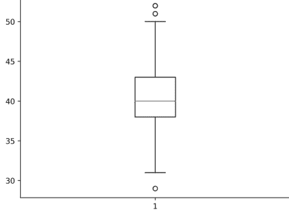

中间的箱子垂直范围从 *Q1* 到 *Q3*，中位数由箱内的水平线标记。**matplotlib** 在底部和顶部显示最小值和最大值。

最大值的下方看起来像一个“T”，最小值的上方是一个倒置的“T”。这些是“须线”。上须线位于 Q3 + 1.5 * IQR，若有必要则向下取整，下须线位于 Q1 - 1.5 * IQR，若有必要则向上取整。须线之外的是 *异常值*，应检查其正确性。

此图非常简陋，因此让我们对其进行修饰以了解图所描述的内容。以下代码向箱线图添加线条和标签，使其更容易理解：

```python
import matplotlib.pyplot as plt
import numpy as np
import math

ages = np.array(
    [40, 41, 39, 35, 42, 37, 45, 43, 42, 38, 39, 45, 37, 36,
     45, 41, 41, 31, 42, 40, 39, 38, 40, 39, 41, 46, 42, 44,
     46, 48, 45, 39, 46, 43, 35, 38, 43, 41, 36, 40, 34, 44,
     42, 44, 40, 49, 47, 51, 52, 45, 44, 47, 39, 38, 43, 39,
     45, 40, 36, 43, 38, 43, 32, 35, 36, 42, 40, 38, 37, 36,
     41, 41, 31, 39, 51, 38, 42, 36, 35, 36, 40, 40, 37, 43,
     39, 42, 44, 50, 39, 38, 37, 33, 52, 35, 44, 29, 42, 39,
     40, 42]
)

plt.title("Box plot of concert attendee ages")
plt.ylabel("Age in years")

# medianprops is a dict with the
# drawing options for the median line
plt.boxplot(ages, medianprops={"color": "black", "linewidth": 2})

quantiles = np.quantile(ages, [0.0, 0.25, 0.5, 0.75, 1.0])
labels = ["minimum", "Q1 = first quartile",
          "mean", "Q3 = third quartile", "maximum"]

for (q, label) in zip(quantiles, labels):
    plt.axhline(q, color="gray", linewidth=0.5)
    plt.text(0.55, q + 0.2, f"{label} = {q}", fontsize=9)

IQR = quantiles[3] - quantiles[1]

# Draw the lower whisker extreme. Below this are outliers.
q = math.ceil(quantiles[1] - 1.5 * IQR)
plt.axhline(q, color="gray", linewidth=0.5)
plt.text(0.55, q + 0.2, f"Q1 - 1.5 * IQR = {q}", fontsize=9)

# Draw the upper whisker extreme. Above this are outliers.
q = math.floor(quantiles[3] + 1.5 * IQR)
plt.axhline(q, color="gray", linewidth=0.5)
plt.text(0.55, q + 0.2, f"Q3 + 1.5 * IQR = {q}", fontsize=9)
```

Text(0.55, 50.2, 'Q3 + 1.5 * IQR = 50')
<Figure size 432x288 with 1 Axes>

```python
plt.draw()
```

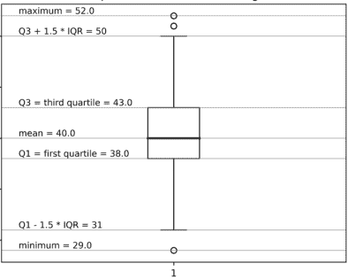

#### 14.1.3 标准差和方差

让我们来看两个包含 99 个数字的数据集。第一个包含从 1 到 99 的每个整数。第二个包含 99 个整数 50 的副本。在每种情况下，均值都是 50。

```python
data_1 = np.arange(1, 100)
data_2 = np.repeat(50, 99)
(np.mean(data_1), np.mean(data_2))
```

```text
(50.0, 50.0)
```

在第一种情况下，值从均值广泛分布。在第二种情况下，每个值都集中在均值。我们使用 *标准差*，写为希腊字母 sigma = σ，来衡量这种离散程度。**numpy 函数** *std* 计算一维数组值的标准差。

```python
(np.std(data_1), np.std(data_2))
```

```text
(28.577380332470412, 0.0)
```


第二种情况下均值没有偏差。图 14.1 中的箱线图显示了两个数据集中不同的分布。

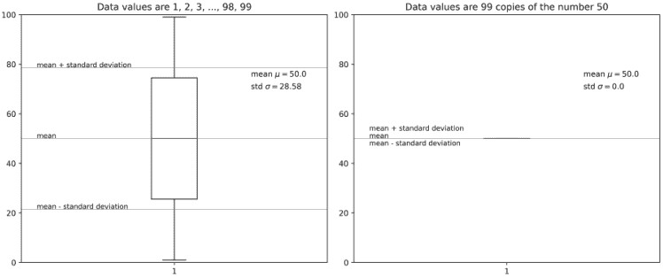

图 14.1：数字 1 到 99 的两个分布的箱线图

非正式地说，我们想要了解每个数据值在平均值上平均相差多少。这将给出一个“平均偏差”，我们可以想象将其计算为值减去均值的绝对值的平均值。如果数据值是数字 *d*₁ 到 *d*ₙ，则这将是

$$\text{mean}=\mu=\frac{d_1+\cdots+d_n}{n}=\frac{1}{n}\sum_{j=1}^{n}d_j$$

$$\text{average deviation}=\frac{|\mu-d_1|+\cdots+|\mu-d_n|}{n}=\frac{1}{n}\sum_{j=1}^{n}|\mu-d_j|$$

$$\text{standard deviation}=\sigma=\sqrt{\frac{(\mu-d_1)^2+\cdots+(\mu-d_n)^2}{n}}=\sqrt{\frac{1}{n}\sum_{j=1}^{n}(\mu-d_j)^2}$$

中的第二行

平均偏差在数学上不容易操作，因此我们使用第三行定义的标准差。标准差也有利于给离均值更远的值赋予更大的权重。

均值、平均偏差和标准差公式中的最右侧表达式使用 Σ 求和符号，如果你在学校见过的话。每个 Σ 表达式的定义是其左侧的公式。

## Exercise 14.3

定义一个函数来计算一维 **numpy** 数组的标准差，而不使用 std。你能在一行内完成吗？

## Exercise 14.4

定义一个函数来计算一维 **numpy** 数组的平均偏差。你能在一行内完成吗？data_1 的平均偏差是多少？

*方差* 是标准差的平方，因此为 σ²。与标准差一样，它衡量数据值与其均值的离散程度。

variance = σ² = ((μ − d₁)² + ··· + (μ − dₙ)²) / n = (1 / n) ∑ⱼ₌₁ⁿ (μ − dⱼ)²

在第 14.1 节开头的数据集 ages 中，有一百名音乐会观众的年龄，方差的单位为 years²（年平方）。

我们使用 *var* 函数计算方差。

```
np.var(ages)
```

20.555599999999995

## 14.1.4 Covariance and correlation

我们有一些关于我们 1990 年代翻唱乐队音乐会观众的额外（虚构）数据。除了他们的年龄外，我们还知道他们在 1995 年参加了多少场音乐会。

```
concerts_attended_in_1995 = np.array(
    [0, 0, 0, 0, 2, 0, 4, 4, 4, 0, 0, 4, 0, 0, 6, 0, 2, 0, 4, 0,
     0, 0, 0, 0, 0, 5, 4, 4, 5, 5, 4, 0, 5, 4, 0, 0, 4, 0, 0, 0,
     0, 4, 3, 4, 0, 7, 5, 6, 6, 4, 4, 5, 0, 0, 4, 0, 4, 0, 0, 4,
     0, 4, 0, 0, 0, 4, 0, 0, 0, 0, 2, 0, 0, 0, 6, 0, 4, 0, 0, 0,
     1, 0, 0, 4, 0, 4, 3, 6, 0, 0, 0, 0, 6, 0, 4, 0, 6, 0, 0, 4])
```

图 14.2 是年龄与 1995 年参加音乐会次数的散点图。

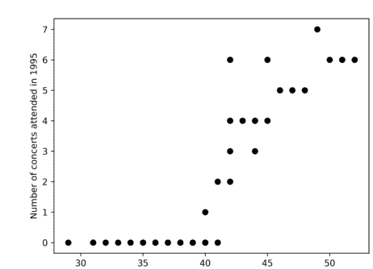

图 14.2：年龄与 1995 年参加音乐会次数的散点图

我们预计当时非常年轻的人在 1995 年参加的音乐会很少或为零。对于 16 岁以上的人，我们预计会看到一些非零计数。此外，如果人们年纪较大并且在工作，他们可能会去参加更多的音乐会。散点图似乎支持这些假设。

两个等长数据集的协方差让我们了解一个数据集中的值是否随另一个数据集中的值线性增加或减少。如果协方差接近 0，我们不期望两个数据集中测量的特征之间存在线性关系。协方差为正意味着它们一起增加或减少，而为负则意味着一个增加时另一个减少。图 14.2 表示协方差为正。

numpy 可以计算一般的协方差矩阵，但我们只需要其中的第一行的第二个位置的值。也就是说，索引 [0, 1] 处的值。

```
covariance_matrix = np.cov(ages, concerts_attended_in_1995)
covariance_matrix[0, 1]
```

8.792323232323243

我在第 14.5 节解释了为什么我们需要 [0, 1]。

*皮尔逊相关系数*，通常简称为相关系数 *r*，是协方差除以每个数据集的标准差。这种除法将协方差归一化到 -1.0 到 1.0 之间。接近两个极端的值为“强相关”。另一种说法是，两个数据集之间存在非常强的线性关系。它并不意味着因果关系。

```
```python
correlation_coefficients = np.corrcoef(ages, concerts_attended_in_1995)
correlation_coefficients[0, 1]
```

0.8480108438760603
```

你可能会看到相关系数写成 ρ 而不是 *r*。ρ 是希腊字母“rho”。

给定两个数据集 *D* 和 *E*，其值分别为 *d*₀ 到 *d*ₙ 和 *e*₀ 到 *e*ₙ，协方差 Cov(*D*, *E*) 和相关系数 *r* 的公式如图所示 14.3。

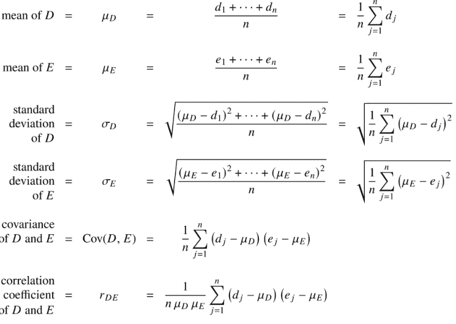

图 14.3：协方差和相关的公式

## Exercise 14.5

为什么 $\operatorname{Cov}(D, E)$ 等于 $\operatorname{Cov}(E, D)$？相关系数是否同样对称？

## Exercise 14.6

编写 Python 函数根据其公式计算协方差和相关系数。

## 14.2 Cats and commas

澳大利亚大丹顿市自由提供截至 2021 年 1 月 6 日已在该市注册的猫的数据。 [CAT] 大丹顿位于维多利亚州，是墨尔本的一个郊区。 [DAN]

该文件采用 CSV 格式，这意味着每行上的值由逗号分隔。你可以将逗号视为分隔数据列。每行数据包含一只猫的信息。

我们可以通过在文本编辑器中打开文件或使用 *read* 函数检查文件开头的行来预览文件。第一行不是数据，而是每列的标签或标题。


```
```python
cats = open("src/examples/registered-cats.csv", "rt")
print(cats.readline())
```
```

"Locality","Postcode","Animal_Type","Breed_Description",
"Colour_Description","GENDER"

共有六列，其标签用双引号括起来。并非每个 CSV 文件都包含第一行为列标签。有些文件从数据开始，并假设你另行了解列定义。

第二行是第一只猫的数据。

```
```python
print(cats.readline())
cats.close()
```
```

"DANDENONG NORTH","3175","Cat","DOMSH","TAB","F"

列与行的交集是一个字段。因此，第一条记录中 Locality 字段的数据是 DANDENONG NORTH。数据包括诸如 DOMSH 表示“家养短毛猫”、“TAB”表示“虎斑猫”和“F”表示“雌性”等代码。

## 14.3 pandas DataFrames

DataFrame 是一个灵活的二维数据结构，表示行和列。行是记录，列是特定特征的数据。例如，我们将看到一个 DataFrame，其中行对应于猫，列包括它们的品种和颜色。

我们可以用类似于列表和字典的方式访问行和列；也就是说，我们可以使用数字索引或字符串标签/键。pandas 建立在 numpy 和 matplotlib 之上，因此你可以使用它们的函数和方法进行计算和可视化。我们在第 13 章《Creating Plots and Charts》中讨论了这些包。

pandas 是一个非常大的 Python 包，拥有许多用于处理 DataFrames 的函数和方法。 [PAN] 你通常可以通过使用 Python 风格的行列操作组合、索引和切片来获得所需的结果。有时，你可能需要在列表或数组上使用循环。我给出了这两种 pandas 编码风格的示例。对于任何特定任务，很可能有几种方法可以得到相同的结果。

### 14.3.1 Loading a DataFrame

我们首先导入 pandas 为 pd 并使用 read_csv 函数从文件中加载我们的猫数据。

```
import pandas as pd

df = pd.read_csv("src/examples/registered-cats.csv")
```

现在我们使用 info 来了解数据：

```
df.info()
```

```
<class 'pandas.core.frame.DataFrame'>
RangeIndex: 3485 entries, 0 to 3484
Data columns (total 6 columns):
```


# Column          Non-Null Count  Dtype
---  ------        --------------  -----
0   Locality       3485 non-null   object
1   Postcode       3485 non-null   int64
2   Animal_Type    3485 non-null   object
3   Breed_Description 3482 non-null object
4   Colour_Description 3483 non-null object
5   GENDER         3485 non-null   object
dtypes: int64(1), object(5)
memory usage: 163.5+ KB

此显示告诉我们新的 DataFrame 具有

+   - 六列和 3,485 条记录
+   - Postcode 字段以 **numpy** 64 位整数加载（dtype **int64**）
+   - Locality、Animal_Type、Breed_Description、Colour_Description 和 GENDER 的 dtype **object** 字段

就我们的目的而言，我们可以将对象视为字符串。

虽然 Python **int** 数字可以有任意数量的位数，但 **int8**、**int16**、**int32** 和 **int64** 类型对象分别使用 8、16、32 和 64 位。在 **numpy** 和 **pandas** 中使用时，使用能安全容纳你的值且最小的尺寸。

*head* 函数默认显示 DataFrame 中的前五行记录。给它一个正整数参数以显示更多或更少。

```
df.head()
```

|   | Locality | Postcode | Animal_Type | Breed_Description | Colour_Description |
|---:|---|---:|---|---|---|
| 0 | DANDENONG NORTH | 3175 | Cat | DOMSH | TAB |
| 1 | DANDENONG NORTH | 3175 | Cat | DOMLH | BLAWHI |
| 2 | DANDENONG | 3175 | Cat | DOMSH | TABWHI |
| 3 | SPRINGVALE | 3171 | Cat | DOM | TORWHI |
| 4 | DANDENONG | 3175 | Cat | DOM | WHIGRE |

|   | GENDER |
|---:|---|
| 0 | F |
| 1 | M |
| 2 | F |
| 3 | F |
| 4 | M |

tail 函数默认显示 DataFrame 中的最后五行记录。

```
df.tail()
```

Locality Postcode Animal_Type Breed_Description Colour_Description \
3480 SPRINGVALE 3171 Cat RAG SEAL
3481 NOBLE PARK 3174 Cat DOMM BLACK
3482 NOBLE PARK 3174 Cat DOMM WHIGIN
3483 SPRINGVALE 3171 Cat RAGX BLUEP
3484 SPRINGVALE 3171 Cat DOMSH GINGER

GENDER
3480 M
3481 F
3482 M
3483 M
3484 M

该显示相当混乱。让我们去掉多余的数据并改进列名。

## 14.3.2 Changing columns

在第 3.2.4 节中，我们看到了如何使用 del 删除列表项。我们可以用它从 DataFrame 中删除一列。Animal_Type 列是多余的，因为我们知道每只动物都是猫。让我们将其删除：

```
del df["Animal_Type"]
```

```
df.head()
```

Locality Postcode Breed_Description Colour_Description GENDER
0 DANDENONG NORTH 3175 DOMSH TAB F
1 DANDENONG NORTH 3175 DOMLH BLAWHI M
2 DANDENONG 3175 DOMSH TABWHI F
3 SPRINGVALE 3171 DOM TORWHI F
4 DANDENONG 3175 DOM WHIGRE M

显示更简洁了，但我们仍然可以缩短 Breed_Description 和 Colour_Description 列标签。此外，GENDER 列为大写，而其他列都不是，这很奇怪。

现在我们可以继续查看数据本身了。顺便说一下，在处理这个 DataFrame 时，我使用澳大利亚英语拼写“colour”而不是我本来的美国英语拼写“color”。

## 14.3.3 Examining a DataFrame

DataFrame 的 *shape* 属性返回行数和列数的元组。请注意，这是一个属性而不是方法，因此我们不使用括号。

```
```python
df.shape
```
```

(3485, 5)

这个 DataFrame 有超过三千行，但数据科学家经常使用有数十万或数百万行的 DataFrame。**pandas** 包有很多函数可以让你总结行和列的内容。例如，*nunique* 函数返回每列中唯一项的数量。

```
```python
df.nunique()
```
```

```
```text
Locality     10
Postcode      6
Breed        53
Colour      137
Gender        3
dtype: int64
```
```

正如你所见，数据中地区、邮编和性别相对较少，但品种和颜色很多。

*value_counts* 函数告诉你每列中每个唯一项出现的次数。

```
```python
df["Locality"].value_counts()
```
```

```
```text
NOBLE PARK          737
KEYSBOROUGH         656
DANDENONG NORTH     651
DANDENONG           549
SPRINGVALE          333
SPRINGVALE SOUTH    263
NOBLE PARK NORTH    224
BANGHOLME            68
DANDENONG SOUTH       3
LYNDHURST             1
Name: Locality, dtype: int64
```
```

## Analyzing Data

如果你使用 `normalize=True` 关键字参数，_value_counts_ 会以 _frequency_ 的形式给出结果，即百分比除以 100。

```
df['Locality'].value_counts(normalize=True)

NOBLE PARK             0.211478
KEYSBOROUGH            0.188235
DANDENONG NORTH        0.186801
DANDENONG              0.157532
SPRINGVALE             0.095552
SPRINGVALE SOUTH       0.075466
NOBLE PARK NORTH       0.064275
BANGHOLME              0.019512
DANDENONG SOUTH        0.000861
LYNDHURST              0.000287
Name: Locality, dtype: float64
```

_value_counts_ 默认按降序对结果排序。使用 `ascending=False` 反转该顺序，并使用 `sort=False` 关闭排序。

此 _series_ 中的索引是 BANGHOLME 和 NOBLE PARK NORTH 等地区名称。虽然 DataFrame 是 2 维的，但 series 是 1 维的。例如，我们可以提取一列作为 series。使用 `sort_index` 方法按其索引值对 series 进行排序。

```
cat_data = df["Locality"].value_counts().sort_index()
cat_data

BANGHOLME              68
DANDENONG             549
DANDENONG NORTH       651
DANDENONG SOUTH         3
KEYSBOROUGH            656
LYNDHURST                1
NOBLE PARK             737
NOBLE PARK NORTH       224
SPRINGVALE             333
SPRINGVALE SOUTH       263
Name: Locality, dtype: int64
```

> **Exercise 14.7**
> 
> `ascending` 和 `inplace` 关键字参数如何改变 `sort_index` 的行为？

## Exercise 14.8

DataFrame 中有多少不同的品种和颜色，它们是什么？

为了更好地理解这些数据，我们现在创建一个条形图。我不会重复第 13.2 节中关于 matplotlib 条形图的讨论；但会向你展示如何使用 pandas 及其对应的可视化函数。

给定一个 pandas DataFrame 或 series 对象，使用带有 kind="bar" 关键字参数的 plot 来创建简单的条形图。

```
import matplotlib.pyplot as plt
plt.clf()
cat_data.plot(kind="bar")
```

<AxesSubplot:>
<Figure size 432x288 with 1 Axes>

```
plt.draw()
```

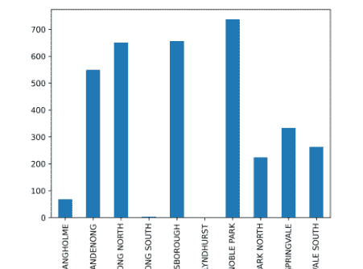

我们也可以使用 cat_data.plot.bar()。

现在我们美化我们的图表。首先，我们将水平轴标签旋转 45 度，因为它们太长了。我们还使条形为浅灰色，带黑色轮廓和斜线阴影。

```
plt.clf()
```

```
cat_data.plot(kind="bar", color="lightgray", edgecolor="black", rot=45, hatch="///")
```

<AxesSubplot:>
<Figure size 432x288 with 1 Axes>

水平标签仍然很大，所以我们减小其字体大小。

```
plt.tick_params(axis='x', labelsize=7)
```

<Figure size 432x288 with 1 Axes>

最后，我们为坐标轴添加标签和图表标题。

```
plt.xlabel("Locality")
plt.ylabel("Number of cats")
plt.title("Number of registered cats in 2021 per locality in the City of Greater Dandenong")
```

Text(0.5, 1.0, 'Number of registered cats in 2021 per locality in the City of Greater Dandenong')
<Figure size 432x288 with 1 Axes>

```
plt.draw()
```

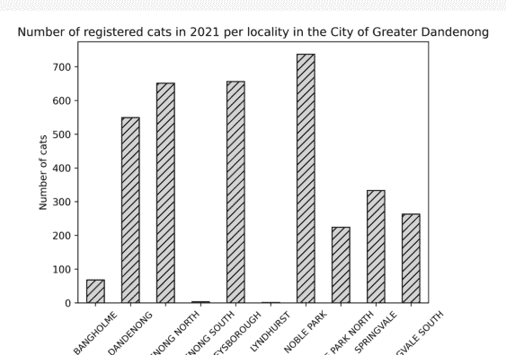

pandas 文档包含其可视化能力的完整指南。 [P.V.Z] 如示例所示，大多数都基于你在 matplotlib 中可以完成的功能。

`small_df` 中的第一行索引为 50，尽管其整数位置为 0。

```
```python
small_df.loc[50]
```
```

```text
Locality      SPRINGVALE SOUTH
Postcode                  3172
Breed                     DOMSH
Colour                   BLAWHI
Gender                        F
Name: 50, dtype: object
```

如果你混淆索引和整数位置，你很可能会得到错误。

```
```python
small_df.loc[0]
```
```

```
```text
ValueError: 0 is not in range
```
```

```
```python
small_df.iloc[50]
```
```

```
```text
IndexError: single positional indexer is out-of-bounds
```
```

要删除一个或多个行，请使用 *drop* 方法并传入行索引的列表。像往常一样，指定 `inplace=True` 会改变 DataFrame 本身而不是制作副本。

```
```python
small_df.drop([51], axis=0, inplace=True)
small_df
```
```

```text
   Locality       Postcode  Breed  Colour  Gender
50 SPRINGVALE SOUTH    3172  DOMSH  BLAWHI       F
52 SPRINGVALE SOUTH    3172  DOMSH  REDCRM       M
53 DANDENONG           3175  DOMM   BLAWHI       F
54 DANDENONG           3175  DOMLH  GREWHI       F
55 DANDENONG           3175  CHIN   WHISIL       M
56 DANDENONG           3175  DOMSH  TRI          F
```

DataFrame 有两个 *axes*，不要与 **matplotlib** 绘图轴混淆。Axis 0 指的是行，axis 1 是列。在 *drop* 的情况下，默认轴是 0，但我为了清晰起见包含它。你也可以使用 `axis="index"` 和 `axis="columns"` 代替 `axis=0` 和 `axis=1`。

```
```python
small_df.drop([53, 54], axis="index")
```
```

```text
   Locality       Postcode  Breed  Colour  Gender
50 SPRINGVALE SOUTH    3172  DOMSH  BLAWHI       F
```


```
y = small_df["Breed"]
y
```

50      DOMSH
52      DOMSH
53      DOMM
54      DOMLH
55      CHIN
56      DOMSH
Name: Breed, dtype: object

在第一种情况下，我们有一个 DataFrame，它是二维的。在第二种情况下，我们有一个一维的 Series。

```
type(x), type(y)
```

(pandas.core.frame.DataFrame, pandas.core.series.Series)

```
x.shape, y.shape
```

((6, 1), (6,))

由于 x 是一个 DataFrame，我们使用 loc 来访问一行：

```
x.loc[54]
```

Breed    DOMLH
Name: 54, dtype: object

结果是一个 series：

```
type(x.loc[54])
```

pandas.core.series.Series

y 是一个 series，所以我们使用单括号和索引：

```
y[54]
```

'DOMLH'

结果是一个单一的数据项，通常称为标量：

```
type(y[54])
```

str

## Exercise 14.11

y[[54]] 返回什么？它的类型是什么？为什么？

## Exercise 14.12

调用 nunique 的结果是 DataFrame 还是 Series？如何访问 Locality 数据？

## Exercise 14.13

DataFrame 是二维的，series 是 一维的，而标量是零维的。你能设计一个规则，将使用双括号或单括号时原始对象的维度与结果的维度联系起来吗？

## 14.3.6 创建 DataFrame

我们从文件中加载了 df DataFrame，但你可以直接从字典创建。列标签是字典的键。这里我合并了第 14.1.4 节中的两个购票者数据序列：

```
concert_df = pd.DataFrame(
    {
        "Age": ages,
        "1995 Concerts": concerts_attended_in_1995
    }
)

concert_df.iloc[3:9]
```

Age 1995 Concerts
3 35 0
4 42 2
5 37 0
6 45 4
7 43 4
8 42 4

如果你想使用不同的列顺序，使用 columns 关键字参数，并提供一个按你希望的顺序排列的列标题列表。

describe 方法提供了 DataFrame 中数值列的描述性统计摘要。

```
concert_df.describe()
```

Age 1995 Concerts
count 100.000000 100.000000
mean 40.620000 1.880000
std 4.556669 2.275384
min 29.000000 0.000000
25% 38.000000 0.000000
50% 40.000000 0.000000
75% 43.000000 4.000000
max 52.000000 7.000000

我现在想为每个演唱会参与者分配一个唯一的识别号码，从 1,000 开始。我们使用 random 模块中的 sample 函数。我们使用 series 记法将识别号码作为新列插入：

```
import random

random.seed(23)

num_rows = concert_df.shape[0]
concert_df["Id"] = random.sample(range(1000, 1001 + num_rows),
num_rows)
```

```
concert_df.head(5)
```

Age 1995 Concerts Id
0 40 0 1099
1 41 0 1037
2 39 0 1010
3 35 0 1002
4 42 2 1075

## Exercise 14.14

我犯了一个错误，本意是 Id 值应该是字符串而不是整数。

```
concert_df.info()
```

```
<class 'pandas.core.frame.DataFrame'>
RangeIndex: 100 entries, 0 to 99
Data columns (total 3 columns):
#  Column         Non-Null Count  Dtype
--- ------------  --------------  -----
0  Age            100 non-null    int32
1  1995 Concerts  100 non-null    int32
2  Id             100 non-null    int64
dtypes: int32(2), int64(1)
memory usage: 1.7 KB
```

删除该列并添加一个同名的新列，使用转换为 str 的随机数。

使用双括号重新排序列。如果你希望的话，需要将结果赋给原始 DataFrame，因为没有 inplace 选项。

```
concert_df = concert_df[["Id", "Age", "1995 Concerts"]]
```

```
concert_df.head(5)
```

|    | Id   | Age | 1995 Concerts |
| --- | ---- | --- | ------------- |
| 0   | 1099 | 40  | 0             |
| 1   | 1037 | 41  | 0             |
| 2   | 1010 | 39  | 0             |
| 3   | 1002 | 35  | 0             |
| 4   | 1075 | 42  | 2             |

我们随机分配了 Id 值，但我们可以按该列的值对 DataFrame 进行排序：

```
concert_df.sort_values(by="Id", inplace=True)
```

```
concert_df.head(5)
```

|    | Id   | Age | 1995 Concerts |
| --- | ---- | --- | ------------- |
| 93  | 1000 | 35  | 0             |

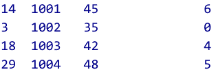

> **Exercise 14.15**
> 
> 按年龄原地对 DataFrame 进行排序。

## 14.3.7 保存 DataFrame

在第 14.3.1 节中，我们使用 `read_csv` 从文件中读取 DataFrame。要写入 CSV 文件，使用 `to_csv`。

```
```python
concert_df.to_csv("work/concert-goers.csv", index=False)
```
```

这是一个文本文件，所以我们可以用 `readline` 瞥一眼。以下是文件中的标题和前五行数据：

```
```python
with open("work/concert-goers.csv", "rt") as csv_file:
    for _ in range(6):
        print(csv_file.readline(), end="")
```
```

```
```text
Id,Age,1995 Concerts
1000,35,0
1001,45,6
1002,35,0
1003,42,4
1004,48,5
```
```

**pandas** 支持多种文件数据格式，并提供读取和写入它们的方法：

- `read_csv` 和 `to_csv` 用于 CSV 文件
- `read_excel` 和 `to_excel` 用于 Microsoft .xlsx 文件
- `read_json` 和 `to_json` 用于 JSON 文件（参见第 8.8.2 节）
- `read_pickle` 和 `to_pickle` 用于 pickle 文件（参见第 8.8.1 节）

此表达式将我们的演唱会参与者 DataFrame 写入 Microsoft Excel 电子表格：

```
```python
concert_df.to_excel("work/concert-goers.xlsx", index=False)
```
```

图 14.4 是结果的截图。请注意，我包含了 index=False，这样 pandas 只会将数据写入 Excel 工作表。读取和写入方法的其他关键字参数允许你指定列、行和工作表。


图 14.4：由“to_excel”生成的电子表格的 Microsoft Excel

## 14.4 数据清洗

数据清洗是一个重要的话题，作者们已就此主题撰写了数十本书、章节和论文。 [CLD] 当数据错误或缺失时，你该怎么办？

我第一次查看 cats DataFrame 时感到惊讶，发现 GENDER 列有三个代码：F、M 和 U。 presumably，最后一个代表“未知”。

```
df['Gender'].value_counts()
```

F      1863
M      1616
U         6
Name: Gender, dtype: int64

我们使用条件表达式来过滤行，只查看性别为 U 的那些行：

```
df[df["Gender"] == "U"]
```

Locality Postcode Breed Colour Gender
259 DANDENONG NORTH 3175 DOM UNKNOW U

我们对这些行做什么？

- 我们可以去数据提供者那里，看看是否能获得正确的 F 或 M 值。此操作可能很容易、困难或不可能。
- 我们可以删除这些行。这很简单，但可能会影响其他地方的统计分析。如果其中一行对应于特定品种或颜色的独特猫怎么办？如果它是生活在某个地区或邮政编码区域的唯一一只猫怎么办？
- 我们可以用保持整个列统计分布的值替换字段。雌猫和雄猫的数量大致相同，所以我们可以随机将三只猫分配为 F，另外三只猫分配为 M。
- 我们可以用保持地区、邮政编码、品种或颜色内分布的值替换字段。我们选择哪一个？参见第 14.8 节，了解性别与颜色之间联系的一个有趣案例。

无论你做什么，都要写下来，并确保在你撰写的任何练习、论文、研究或报告中注明对原始数据集的所有更改。未能这样做会使你的结果和你的声誉受到质疑。著名期刊的编辑在后续分析显示作者忽略或修改了重要数据时，已撤回先前发表的论文。

假设我们发现索引为 611 的那只猫的性别应该是 F。我们使用 iloc 在赋值的左侧更改它：

```
df.loc[611, ["Gender"]] = 'F'

df[df["Gender"] == "U"]
```

|  | Locality | Postcode | Breed | Colour | Gender |
|---|---|---|---|---|---|
| 259 | DANDENONG NORTH | 3175 | DOM | UNKNOW | U |
| 690 | NOBLE PARK NORTH | 3174 | DOMSH | SILTAB | U |
| 1273 | NOBLE PARK | 3174 | DOMSH | TAB | U |
| 1697 | KEYSBOROUGH | 3173 | DOMSH | BLACK | U |
| 1750 | DANDENONG NORTH | 3175 | DOM | BROWHI | U |


如果我们没有其他更改并且决定删除性别为 U 的所有其他记录，可以在一行中完成：

```
```python
df = df[df['Gender'].str.contains('F|M')]
df['Gender'].value_counts()
```
```

F    1864
M    1616
Name: Gender, dtype: int64

## Exercise 14.16

为什么在 *contains* 的参数中会出现垂直条 “|”？提示：参见 *section 12.2.3*。

现在索引名称与整数位置相比出现了空缺。使用 *reset_index* 将它们设置为基于新行数相同的值。

```
```python
df.reset_index(drop=True, inplace=True)
```
```

在上一个示例中，我们有一列中的数据，但我们认为它是错误的。如果数据缺失会怎样？**pandas** 使用 np.nan 作为任何缺失数据的取值。使用 *isna* 测试这种“非数字”值。

```
```python
df[df["Breed"].isna()]
```
```

|    | Locality    | Postcode | Breed | Colour | Gender |
|---:|:------------|---------:|:------|:-------|:-------|
| 437  | DANDENONG NORTH | 3175 | NaN | GINGER | F |
| 2461 | KEYSBOROUGH     | 3173 | NaN | TAB    | F |
| 2566 | DANDENONG       | 3175 | NaN | TABWHI | F |

你可以使用 *isnull* 作为 *isna* 的别名。

如果查看我们加载 DataFrame 的原始文件，你会看到缺失值是逗号之间的空字符串。**Colour** 列缺少一些数据，但 **Locality** 列是完整的。

```
```python
df[df["Colour"].isna()]
```
```

|    | Locality   | Postcode | Breed | Colour | Gender |
|---:|:-----------|---------:|:------|:-------|:-------|
| 1205 | SPRINGVALE  | 3171 | DOMLH | NaN | F |
| 2462 | KEYSBOROUGH | 3173 | TAB   | NaN | F |

```
df[df["Locality"].isna()]
```

Empty DataFrame
Columns: [Locality, Postcode, Breed, Colour, Gender]
Index: []

现在我们知道了缺失值的位置，可以像之前那样替换它们，或使用 dropna 删除有问题的行。

```
df.dropna(inplace=True)
df[df["Breed"].isna()]
```

Empty DataFrame
Columns: [Locality, Postcode, Breed, Colour, Gender]
Index: []

```
df[df["Colour"].isna()]
```

Empty DataFrame
Columns: [Locality, Postcode, Breed, Colour, Gender]
Index: []

## Exercise 14.17

方法 notna 和 notnull 分别是 isna 和 isnull 的否定形式。dropna 删除任何包含缺失值的行。使用 notna 在一个表达式中仅删除 Breed 列中缺失值的行。

## 14.5 Statistics with pandas

pandas 实现了我们在 14.1 节中看到的所有统计函数的版本。describe 方法为具有数值数据的列总结了其中许多。它返回一个 DataFrame。

```
concert_df.describe()
```

|          | Id        | Age       | 1995 Concerts |
|----------|-----------|-----------|---------------|
| count    | 100.00000 | 100.000000 | 100.000000    |
| mean     | 1049.69000| 40.620000 | 1.880000      |
| std      | 29.28084  | 4.556669  | 2.275384      |
| min      | 1000.00000| 29.000000 | 0.000000      |
| 25%      | 1024.75000| 38.000000 | 0.000000      |
| 50%      | 1049.50000| 40.000000 | 0.000000      |

看一下从左上到右下对角线的数字。这些比较列与自身，列必须高度相关！

我们可以忽略包含 Id 的任何行或列，因为我们随机分配了这些值。

表中有趣的位置是其中一行是 Age，另一行是 1995 Concerts。

```
```python
cc.loc["Age", "1995 Concerts"]
```
```

0.8480108438760597

这个数字为正且比 0.0 更接近 1.0。因此，这两列高度相关，一个随另一个增加。我解释为年龄越大，1995 年参加音乐会的数量可能越多。

看到我使用 ["Age", "1995 Concerts"] 来获取相关系数了吗？这种索引检索了特定行和列的值。这就是为什么在 14.1.4 节中，我使用 [0, 1] 来获取协方差和相关矩阵的第一行、第二位置的值。

## 14.6 Converting categorical data

GENDER 列包含 *categorical data* 而不是数值。列中的项目属于一组固定的值，通常是字符串。在这种情况下，值是 'F' 和 'M'。虽然我们可以检查项目是否等于其中之一，但通常更容易将分类列转换为多个包含 0 和 1 的数值“虚拟列”。

以下是 df 的前两行：

```
```python
df.head(2)
```
```

|   | Locality | Postcode | Breed | Colour | Gender |
|---|---|---:|---|---|---|
| 0 | DANDENONG NORTH | 3175 | DOMSH | TAB | F |
| 1 | DANDENONG NORTH | 3175 | DOMLH | BLAWHI | M |

而当我们对 GENDER 列使用 *get_dummies* 时得到的是：

```
```python
pd.get_dummies(df, columns=["Gender"]).head(2)
```
```

|   | Locality | Postcode | Breed | Colour | Gender_F | Gender_M |
|---|---|---:|---|---|---:|---:|
| 0 | DANDENONG NORTH | 3175 | DOMSH | TAB | 1 | 0 |
| 1 | DANDENONG NORTH | 3175 | DOMLH | BLAWHI | 0 | 1 |

pandas 删除了 GENDER 列并用两个新列 Gender_M 和 Gender_F 替换了它。默认情况下，get_dummies 将原始列名作为新名称的前缀，并用下划线作为分隔符。使用 prefix 关键字参数以你选择的字符串开头新列名：

```
pd.get_dummies(df, columns=["Gender"], prefix="G").head(2)
```

| Locality | Postcode | Breed | Colour | G_F | G_M |
|---|---|---|---|---|---|
| 0 DANDENONG NORTH | 3175 | DOMSH | TAB | 1 | 0 |
| 1 DANDENONG NORTH | 3175 | DOMLH | BLAWHI | 0 | 1 |

你可以通过使用空字符串作为 prefix 和 prefix_sep 完全删除前缀和分隔符。

```
df = pd.get_dummies(df, columns=["Gender"], prefix="", prefix_sep="")
df.head(2)
```

| Locality | Postcode | Breed | Colour | F | M |
|---|---|---|---|---|---|
| 0 DANDENONG NORTH | 3175 | DOMSH | TAB | 1 | 0 |
| 1 DANDENONG NORTH | 3175 | DOMLH | BLAWHI | 0 | 1 |

由于新列是数值，describe 返回它们的统计信息：

```
df.describe()
```

| | Postcode | F | M |
|---|---|---|---|
| count | 3475.000000 | 3475.000000 | 3475.000000 |
| mean | 3173.969209 | 0.534964 | 0.465036 |
| std | 13.652882 | 0.498848 | 0.498848 |
| min | 3171.000000 | 0.000000 | 0.000000 |
| 25% | 3173.000000 | 0.000000 | 0.000000 |
| 50% | 3174.000000 | 1.000000 | 0.000000 |
| 75% | 3175.000000 | 1.000000 | 1.000000 |
| max | 3975.000000 | 1.000000 | 1.000000 |

## Exercise 14.20

F 和 M 的 mean 行条目关于各自相对百分比说了什么？为什么？

## Exercise 14.21

为什么你可能不想从 Breed 和 Colour 列创建虚拟列？

## 14.7 Cats by gender in each locality

本节的目标是创建并绘制一个包含每个地区雌性和雄性猫数量的 DataFrame。我们首先通过列表推导构建 DataFrame 的版本。

unique 函数返回 pandas 列中唯一值的 numpy 数组。

```
localities = df["Locality"].unique()
localities
```

array(['DANDENONG NORTH', 'DANDENONG', 'SPRINGVALE', 'SPRINGVALE SOUTH', 'KEYSBOROUGH', 'NOBLE PARK NORTH', 'NOBLE PARK', 'BANGHOLME', 'DANDENONG SOUTH', 'LYNDHURST'], dtype=object)

```
type(localities)
```

numpy.ndarray

为了让用户更容易理解结果，我们将地区按字母顺序排列。numpy sort 方法就地对数组进行排序。

```
localities.sort()
localities
```

array(['BANGHOLME', 'DANDENONG', 'DANDENONG NORTH', 'DANDENONG SOUTH', 'KEYSBOROUGH', 'LYNDHURST', 'NOBLE PARK', 'NOBLE PARK NORTH', 'SPRINGVALE', 'SPRINGVALE SOUTH'], dtype=object)

现在我使用两个列表推导来创建每个地区的雌性和雄性猫数量列表。注意我在每个推导中如何按地区过滤 DataFrame 的行。

```
number_of_male_cats = [
    df[df["Locality"] == locality]["M"].sum()
    for locality in localities
]
```


number_of_male_cats

[36, 263, 295, 1, 301, 1, 337, 109, 144, 129]

number_of_female_cats = [
    df[df["Locality"] == locality]["F"].sum()
    for locality in localities
]

number_of_female_cats

[32, 285, 353, 2, 352, 0, 399, 114, 188, 134]

我们还将地名更改为每个单词的首字母大写。这称为“标题大小写”。

localities = [locality.title() for locality in localities]
localities

['Bangholme',
 'Dandenong',
 'Dandenong North',
 'Dandenong South',
 'Keysborough',
 'Lyndhurst',
 'Noble Park',
 'Noble Park North',
 'Springvale',
 'Springvale South']

## Exercise 14.22

str 方法 capitalize 和 title 有什么区别？

## Exercise 14.23

localities 现在是一个列表。你如何将其转换为 numpy 数组？

我们已经有了各个部分，现在创建 DataFrame：

```python
df_cats = pd.DataFrame(
    {
        "Locality": localities,
        'F': number_of_female_cats,
        'M': number_of_male_cats
    }
)

df_cats
```

|   | Locality | F | M |
|---:|:---|---:|---:|
| 0 | Bangholme | 32 | 36 |
| 1 | Dandenong | 285 | 263 |
| 2 | Dandenong North | 353 | 295 |
| 3 | Dandenong South | 2 | 1 |
| 4 | Keysborough | 352 | 301 |
| 5 | Lyndhurst | 0 | 1 |
| 6 | Noble Park | 399 | 337 |
| 7 | Noble Park North | 114 | 109 |
| 8 | Springvale | 188 | 144 |
| 9 | Springvale South | 134 | 129 |

这很直接，但我们本可以使用 *groupby* 一步完成大部分工作。此函数将数据收集到组中，然后在每个组内应用某种聚合或转换函数。这里我们按 Locality 分组，并在每个组内对各列的数值求和：

```python
df_cats = df.groupby(["Locality"]).sum()
df_cats
```

| Locality | Postcode | F | M |
|:---|---:|---:|---:|
| BANGHOLME | 215900 | 32.0 | 36.0 |
| DANDENONG | 1739900 | 285.0 | 263.0 |
| DANDENONG NORTH | 2057400 | 353.0 | 295.0 |
| DANDENONG SOUTH | 9525 | 2.0 | 1.0 |
| KEYSBOROUGH | 2071969 | 352.0 | 301.0 |
| LYNDHURST | 3975 | 0.0 | 1.0 |
| NOBLE PARK | 2336064 | 399.0 | 337.0 |

# Analyzing Data

```text
NOBLE PARK NORTH    707802   114.0  109.0
SPRINGVALE          1052772  188.0  144.0
SPRINGVALE SOUTH    834236   134.0  129.0
```

这不太正确。我们不需要 Postcode 列的和，因此指定我们想要的两个列：

```python
df_cats = df.groupby(["Locality"])[['F', 'M']].sum()
df_cats
```

```text
                    F      M
Locality
BANGHOLME          32.0   36.0
DANDENONG         285.0  263.0
DANDENONG NORTH   353.0  295.0
DANDENONG SOUTH     2.0    1.0
KEYSBOROUGH       352.0  301.0
LYNDHURST           0.0    1.0
NOBLE PARK        399.0  337.0
NOBLE PARK NORTH  114.0  109.0
SPRINGVALE        188.0  144.0
SPRINGVALE SOUTH  134.0  129.0
```

地名是索引，你可以在 DataFrame 左侧看到。*reset_index* 方法将地名设为列并创建新的数值索引。

```python
df_cats.reset_index(inplace=True)
df_cats
```

```text
   Locality             F      M
0  BANGHOLME           32.0   36.0
1  DANDENONG          285.0  263.0
2  DANDENONG NORTH    353.0  295.0
3  DANDENONG SOUTH      2.0    1.0
4  KEYSBOROUGH        352.0  301.0
5  LYNDHURST            0.0    1.0
6  NOBLE PARK         399.0  337.0
7  NOBLE PARK NORTH   114.0  109.0
8  SPRINGVALE         188.0  144.0
9  SPRINGVALE SOUTH   134.0  129.0
```

使用 *astype* 来更改列或行中值的类型。这里我们将 F 和 M 列设为 **numpy** 8 位整数。

```
df_cats = df_cats.astype({'F': 'int8', 'M': 'int8'})
```

我们最后的转换是对 Locality 列进行标题大小写：

```
df_cats["Locality"] = df_cats["Locality"].str.title()
df_cats
```

|   | Locality | F | M |
|---:|:---|---:|---:|
| 0 | Bangholme | 32 | 36 |
| 1 | Dandenong | 29 | 7 |
| 2 | Dandenong North | 97 | 39 |
| 3 | Dandenong South | 2 | 1 |
| 4 | Keysborough | 96 | 45 |
| 5 | Lyndhurst | 0 | 1 |
| 6 | Noble Park | -113 | 81 |
| 7 | Noble Park North | 114 | 109 |
| 8 | Springvale | -68 | -112 |
| 9 | Springvale South | -122 | -127 |

## Exercise 14.24

`df_cats["Locality"].str.title()` 返回什么？它的类型是什么？

从这里开始，生成并排条形图很简单：

```
plt.clf()

df_cats.plot.bar(
    x="Locality",
    y=['F', 'M'],
    color=["gray", "black"],
    title="Number of female and male cats per locality",
    xlabel="Locality",
    ylabel="Count"
)
```

```
<AxesSubplot:title={'center':'Number of female and male cats per locality'}, xlabel='Locality', ylabel='Count'>
```

```
<Figure size 432x288 with 0 Axes>
```

```
<Figure size 432x288 with 1 Axes>
```

```
plt.draw()
```


添加 stacked=True 关键字参数以显示如图 14.5 所示的堆叠条形图。


Figure 14.5: Number of female and male cats per locality

## 14.8 Are all tortoiseshell cats female?

我们的 DataFrame 包含许多颜色的猫。这里有一些 Python 代码以八列整齐地打印颜色代码：

```
colours = sorted(df["Colour"].unique())

for count, colour in enumerate(colours, start=1):
    print(f"{colour:<9}", end=("\n" if count % 8 == 0 else ""))
```

AGOUTI AMB APR APRWHI BEIBLA BEIGE BEIWHI BLAAPR
BLABRI BLABRO BLACK BLACRE BLAGIN BLAGRE BLAORA BLATAN
BLATOR BLAWHI BLONDE BLUBI BLUCRE BLUE BLUEP BLUGRE
BLUMIT BLUSPO BLUTAB BLUTOR BLUWHI BONE BRIBRO BRIGRE
BRIND BROBEI BROBLA BROCRE BROGRE BROMER BROSPOT BROTAB
BROWHI BROWN BRSPTAB CALI CHAMP CHAR CHARTAB CHAWHI
CHMWHI CHOC CHOCP CHOCRE CHOWHI CINN CREAM CREAPOI
CREBEI CREBRO CREGIN CREGRE CREWHI DKGREY DTORT FAWN
GINBLA GINBRO GINGER GINTAB GINWHI GOLD GREBLA GREBLU
GREBRO GRECRE GREGIN GREGOL GRESIL GRETAB GRETAN GREWHI
GREY LILAC LILBI LILMIT LILWHI LIVWHI MARB MINK
MOTT ORABLA ORAGRE ORANGE ORAWHI PEACH RED REDCRM
REDGIN REDPOINT REDTAB SABLE SAND SBROW SEAL SEALM
SEALTORT SEPIA SILBLA SILGRE SILTAB SILVER SILWHI SPOT
TAB TABBLA TABGREY TABPOI TABWHI TANWHI TORGRY TORT
TORTTAB TORWHI TRI UNKNOW WHIAPR WHIBLA WHIBLU WHIBRO
WHICRE WHIGIN WHIGRE WHIORA WHIRED WHISIL WHITAN WHITE
WHITOR

 presumably，一只 TANWHI 猫在与 WHITAN 猫相比时，棕色比白色多。我对颜色代码中包含 TOR 的猫感兴趣。TOR 是 “tortoiseshell” 的缩写，我一直听说这类猫都是雌性。我们的數據支持这一点吗？

包含 TOR 的颜色代码有九个：

```
[colour for colour in colours if "TOR" in colour]
```

```
['BLATOR',
 'BLUTOR',
```

|  | M | F |
|---|---:|---:|
| Colour |  |  |
| CALI | 0 | 20 |


## Exercise 14.25

重复前面的分析以确定姜色猫（颜色中包含 GIN 的猫）是否主要是雄性或雌性。


## Exercise 14.26

创建一个水平条形图，显示每个邮政编码区域的雌性姜色猫数量。

## 14.9 Cats in trees and circles

虽然我主要以 **matplotlib** 作为数据可视化的主要引擎，但还有几个其他 Python 包可能适合你的高级需求。我特别建议你查看 **seaborn** 和 **plotly**。 [SEA] [PLY]

我用我们的猫数据创建树形图和 Venn 图来结束本章。

## 14.9.1 Treemaps

现在我们有了颜色数据，可以以多种方式可视化它。**squarify** 模块创建 *treemaps*，即基于相对数据计数分解为子矩形的矩形。

首先，我们从操作系统命令行安装 **squarify**： [SQU]

```
```bash
pip install squarify
```
```

并导入它：

```
```python
import matplotlib.pyplot as plt
import squarify
```
```


如果你省略 color 关键字参数，squarify 会为你随机选择矩形阴影。每次调用 plot 时这些阴影可能会改变。

## Exercise 14.28

扩展此示例以包含姜色猫。

## 14.9.2 Venn diagrams

我们许多人在学校学习过 Venn 图。它们使用重叠的圆圈来显示数据集的交集。

要使用 Python 绘制它们，我们从操作系统命令行安装 matplotlib-venn 并导入它： [VEN]

```
pip install matplotlib-venn
```

```
import matplotlib_venn
```

该模块可以绘制两个和三个圆圈的 Venn 图。我使用上一节中的灰色、棕色和白色颜色列表作为 3 圆图的数据：

```
matplotlib_venn.venn3(
    subsets=(set(grey_colours), set(tan_colours), set(white_colours)),
    set_labels=("Grey", "Tan", "White")
)
```


&lt;matplotlib_venn._common.VennDiagram at 0x227fb9a02e0&gt;
&lt;Figure size 432x288 with 1 Axes&gt;

```
plt.draw()
```


### Exercise 14.29

“Grey”和“White”圆圈中的数字 18 和 27 分别是什么意思？

### 14.10 Summary

在本章中，我们学习了描述性统计的基本概念，并看到了如何使用 **numpy** 和 **matplotlib** 进行计算和可视化。然后我们转向了 **pandas**，这是一个用于读取、写入和分析 DataFrames 的高度复杂的 Python 包。我们重新回顾了统计学，以展示 **pandas** 如何轻松地让我们检查和汇总大型和小型数据集。

下一章将结束本书，但不包括附录、参考文献和索引。我将简要介绍使用 Python 进行机器学习。这方面的知识将使我希望你能够继续阅读更高级的书籍和文章，以了解人工智能 Python 工具的全部广度。
