## 15 Learning, Briefly

> *Learning is the only thing the mind never exhausts, never fears, and never regrets.*
> 
> —Leonardo da Vinci

机器学习并非新事物，但它及其子学科深度学习现在被广泛用于人工智能（AI）的许多应用。有数百本关于机器学习的学术和实践编程书籍。

本最后一章主要通过 scikit-learn **sklearn** 模块介绍机器学习和神经网络。将此视为一个跳板，你可以在此基础上利用本书中学到的 Python 特性，更深入地探索这些重要的 AI 领域，如果它们引起你的兴趣。

### Topics covered in this chapter

- 15.1 What is machine learning? — 576
- 15.2 Cats again — 577
- 15.3 Feature scaling — 580
- 15.4 Feature selection and reduction — 586
- 15.5 Clustering — 589
- 15.6 Classification — 595
- 15.7 Linear regression — 605
- 15.8 Concepts of neural networks — 611
- 15.9 Quantum machine learning — 618
- 15.10 Summary — 619

### 15.1 What is machine learning?

考虑我与某在线零售商的完整产品浏览和购买历史。该数据代表了我从卖家处购买的体验，以及卖家向我销售的体验。数据和我的新购买如何帮助零售商向我销售额外的产品和服务？

机器学习是一组技术，其中计算机算法从现有数据中学习，而不是在其中内置硬编码决策。这种算法在接收到新数据时，其准确性会提高。它也可能在人类或流程介入以判断之前结果的正确性和质量时变得更好。

在 *无监督学习* 中，算法会在数据中寻找可能帮助用户获得洞察的模式。无监督算法可能帮助零售商看到我在某些季节对烹饪、旅行或家庭维修的兴趣有所增加。卖家随后可以在我通常购买之前几周就提前向我提供产品推荐。

在 *监督学习* 中，数据在其特征中还包含我们可能对其提出的问题的“答案”。假设在线零售商还拥有一个旅行社。我在购买旅行后购买了推荐的书籍和衣服。在这种情况下，零售商可以将书籍和衣服数据标记为“为旅行购买”。给定新的服装购买，零售商的机器学习算法可能会强烈建议我正在计划度假并提供可能的航班和酒店。

在 *强化学习* 中，算法会根据结果添加某种奖励或惩罚。如果我购买后退回产品，算法可能会在与推断结果相关的数据中插入一个负分作为特征。该特征可以帮助算法在两个可能的操作之间做出更好的未来选择。也许我正在旅行，想买新衬衫。如果我购买后退回其中一些，零售商可以更新数据以注明我不喜欢去温暖气候时穿有长尾和扣子的衬衫。

获取强化数据另一种方式是直接询问用户。如果零售商网站向你展示产品然后询问，“你喜欢这个推荐吗？”，卖家就可以使用“是”或“否”的回应来调整其推荐算法。当然，如果你购买了产品，这应该会产生积极的强化。

### Exercise 15.1

你如何使用强化学习来教一辆自动驾驶汽车在绕过道路弯道时应该行驶多快？

机器学习算法用来“学习”的信息称为 *训练集*。对于监督学习，训练集有一个或多个 *标签* 特征。当我们获得新的未标记数据时，我们运行算法并希望它与预期结果相匹配。当我们用算法 *拟合* 训练数据以进行预测时，我们创建了一个机器学习 *模型*。

测试机器学习算法的常见方法是随机选择所有标记数据的 50% 并将其指定为训练集。然后，取剩余的数据，忽略标签，看看算法在该 *测试集* 中预测结果的效果如何。尽可能调整算法以提高准确性。你可能需要更改使用的特征，归一化特征（第 15.3 节），减少特征数量（第 15.4 节），或完全切换到另一种技术。

### 15.2 Cats again

我们再次使用我在第 14.2 节中介绍的来自大丹宁根市的猫数据。如前所述，我们清理数据并创建性别虚拟列。

```python
import pandas as pd

df = pd.read_csv("src/examples/registered-cats.csv")
del df["Animal_Type"]
del df["Postcode"]

new_column_names = {
    "Breed_Description": "Breed",
    "Colour_Description": "Colour",
    "GENDER": "Gender"
}

df.rename(columns=new_column_names, inplace=True)

df.loc[611, ["Gender"]] = 'F'
df = df[df["Gender"].str.contains("F|M")]
df.reset_index(drop=True, inplace=True)
```

现在是地区：

```python
locality_dict = dict()

for count, locality in enumerate(np.sort(df["Locality"].unique())):
    locality_dict[locality] = count
```

现在我们准备更新条目。我遍历 DataFrame 行并将字符串品种、颜色和地区值作为元组提取出来。然后我查找 int 编码并将它们放入 DataFrame 中：

```python
for n in range(df.shape[0]):
    breed, colour, locality = df.loc[n, ["Breed", "Colour", "Locality"]]
    df.at[n, "Breed"] = breed_dict[breed]
    df.at[n, "Colour"] = colour_dict[colour]
    df.at[n, "Locality"] = locality_dict[locality]
```

注意我如何使用 at 来处理每一行和每一列中的单个值。

### Exercise 15.2

at 是使用索引还是数值行位置值？如果我告诉你还有一个名为 iat 的函数呢？

我们最后将 Breed、Colour 和 Locality 列类型转换为 int16：

```python
df = df.astype({"Breed": "int16", "Colour": "int16", "Locality": "int16"})
df.info()
```

&lt;class 'pandas.core.frame.DataFrame'&gt;
RangeIndex: 3475 entries, 0 to 3474
Data columns (total 5 columns):

| # | Column | Non-Null Count | Dtype |
|---|--------|----------------|-------|
| 0 | Locality | 3475 non-null | int16 |
| 1 | Breed | 3475 non-null | int16 |
| 2 | Colour | 3475 non-null | int16 |
| 3 | F | 3475 non-null | int8 |
| 4 | M | 3475 non-null | int8 |

dtypes: int16(3), int8(2)
memory usage: 27.3 KB

```python
df.head()
```

|  | Locality | Breed | Colour | F | M |
|---|---|---|---|---|---|
| 0 | 2 | 21 | 112 | 1 | 0 |
| 1 | 2 | 19 | 17 | 0 | 1 |
| 2 | 1 | 21 | 116 | 1 | 0 |
| 3 | 8 | 18 | 121 | 1 | 0 |
| 4 | 1 | 18 | 130 | 0 | 1 |

以下句子是等价的：

- df has 5 columns.
- df has 5 *features*.
- df has 5 *dimensions*.
- df is 5-dimensional.

由于我们将使用并看到许多浮点数，我现在使用 pandas 功能以标准、非科学记数法显示浮点数：

```python
pd.set_option("display.float_format", lambda x: "%.4f" % x)
```

格式表示法与我们在 f-string 中使用的类似，但来自 Python 历史上的更早时期。它表示，“将 x 替换为字符串中的浮点数，并显示小数点后 4 位数字。”我们仍会看到计算舍入误差，其中 Python 显示的数字在数学上本应为 0.0 和 1.0，但显示为接近但不等于这些值。

我们对 numpy 做类似处理：

```python
np_float_formatter = "{:.4f}".format
np.set_printoptions(formatter={'float_kind':np_float_formatter})
```

### 15.3 Feature scaling

由于我们现在有了维度，几何学进入画面也就顺理成章了。如果我在笛卡尔平面上有两个点，v = (v₁, v₂) 和 w = (w₁, w₂)，那么它们之间的欧几里得距离，或简单地说是距离，为

‖v − w‖ = √((v₁ − w₁)² + (v₂ − w₂)²)


例如，点 (-3, -1) 和 (2, 1.5) 之间的距离约为 5.6。请注意两点之差周围的双竖线。

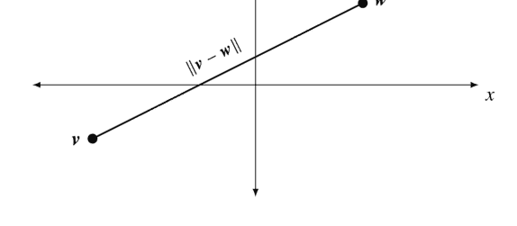

用文字表述，我们说任意两点之间的距离等于对应坐标之差的平方和的平方根。在三维空间中，距离公式为

```
||v - w|| = sqrt((v₁ - w₁)² + (v₂ - w₂)² + (v₃ - w₃)²)
```

其中点为 (v₁, v₂, v₃) 和 (w₁, w₂, w₃)。请注意，当点具有两个或更多维度时，使用粗斜体字体的约定：v = (v₁, v₂, v₃)。

这些是数轴上两个数 v 和 w 之间距离公式的推广，该距离即绝对值。

```
|v - w| = sqrt((v - w)²)
```

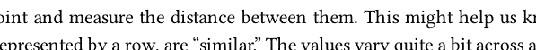

我们的 DataFrame 有 5 个维度，每个列条目都是数值。我们可以将每一行视为一个点，并测量它们之间的距离。这可能有助于我们了解两只猫（每只由一行表示）何时“相似”。所有行和列的值差异都相当大。

```
df.describe()
```

|  | 地区 | 品种 | 颜色 | F | M |
|---|---|---|---|---|---|
| count | 3475.0000 | 3475.0000 | 3475.0000 | 3475.0000 | 3475.0000 |
| mean | 4.4518 | 21.7706 | 77.2702 | 0.5350 | 0.4650 |
| std | 2.6689 | 7.0630 | 43.0268 | 0.4988 | 0.4988 |
| min | 0.0000 | 0.0000 | 0.0000 | 0.0000 | 0.0000 |
| 25% | 2.0000 | 19.0000 | 23.0000 | 0.0000 | 0.0000 |
| 50% | 4.0000 | 21.0000 | 80.0000 | 1.0000 | 0.0000 |
| 75% | 6.0000 | 21.0000 | 116.0000 | 1.0000 | 1.0000 |
| max | 9.0000 | 52.0000 | 136.0000 | 1.0000 | 1.0000 |

地区的最小值和最大值分别为 0 和 9。品种的最小值和最大值分别为 0 和 52，依此类推。每列的值范围差异很大。

假设我们有三只猫，用 (地区, 品种) 对表示为 (0, 0)、(0, 1) 和 (0, 52)。品种并不表示有序且连续的数据：没有理由认为品种 0 和 52 比品种 0 和 1 “更接近”。然而，前两只猫之间的“距离”是 1，第二只和第三只猫之间的“距离”是 51。这第二个更大的数字可能会影响我们的计算，使我们误以为后两只猫与前两只猫的差异要大得多。

为了使各列的值更具可比性，我们将对各列的值进行归一化或缩放。有些算法需要归一化，而另一些算法如果事先归一化则运行得更快。归一化数据有几种技术，接下来我将重点介绍其中的三种。

## 15.3.1 最小-最大归一化

最小-最大缩放或归一化产生的值介于 0 和 1 之间（包含端点）。实际上，我们从一列中的每个数字中减去该列的最小值，然后除以新的最大值。如果最小值和最大值都为零，则不应进行此操作。

数学上，这表示为

```
x_new = (x_old - x_min) / (x_max - x_min)
```

其中 x_old 是列值。计算完成后，我们将列中的 x_old 替换为 x_new。

### 练习 15.3

有什么方法可以调整此变换，使值范围介于 -1 和 1 之间？

为了计算地区的这一变换，我们使用 values 属性提取列项，然后调用 sklearn 中的 minmax_scale：

```
from sklearn.preprocessing import minmax_scale

new_locality = minmax_scale(df["Locality"].values)
new_locality[:10]
```

array([0.2222, 0.2222, 0.1111, 0.8889, 0.1111, 0.1111, 0.2222, 0.2222, 0.2222, 0.2222])

虽然我现在不这样做，但可以通过执行 df["Locality"] = new_locality 来将地区列设置为这些新的缩放值。

### 练习 15.4

验证 new_locality 中的最小值和最大值分别是 0.0 和 1.0。

### 练习 15.5

证明最小-最大归一化会使 F 和 M 列保持不变。

### 练习 15.6

编写一个 Python 函数，对 DataFrame 中指定的数值列执行最小-最大归一化。你可以使用 pandas 中的 min 和 max，但不能使用 numpy 或 sklearn 中的任何函数或方法。

## 15.3.2 标准化

设 μ 为一列的均值，σ 为其非零标准差。列值 x_old 的标准化为

x_new = (x_old - μ) / σ

如果 x_old = μ + σ，则 x_new = 1。类似地，如果 x_old = μ - σ，则 x_new = -1。

### 练习 15.7

标准化后的值能否大于 1.0 或小于 −1.0？

### 练习 15.8

标准化后的列均值是多少？其标准差是多少？

**sklearn** 有许多类、方法和函数，允许你以不同方式转换数据。例如，以下代码使用 **StandardScaler** 类来计算地区列数据的标准化：

```
from sklearn.preprocessing import StandardScaler

new_locality = StandardScaler().fit_transform(df[["Locality"]])
pd.Series(new_locality.flatten()).describe()
```

count    3475.0000
mean      -0.0000
std        1.0001
min       -1.6683
25%       -0.9188
50%       -0.1693
75%        0.5802
max        1.7044
dtype: float64

我们也可以使用 **numpy** 方法来实现。首先，我们计算均值和标准差：

```
locality = df["Locality"].values
mu = locality.mean()
sigma = locality.std()
```

由于 **numpy** 在处理数组方面非常灵活，标准化数组的计算很简单：

```
new_locality = (locality - mu)/sigma
pd.Series(new_locality).describe()
```

count 3475.0000
mean -0.0000
std 1.0001
min -1.6683
25% -0.9188
50% -0.1693
75% 0.5802
max 1.7044
dtype: float64

### 练习 15.9

使用 **pandas** 方法而不是 **numpy** 方法对 `Locality` 列进行标准化。

## 15.3.3 均值归一化

设 μ 为一列的均值。列值 x_old 的*均值归一化*为

x_new = (x_old - μ) / (x_max - x_min)

我们假设分母不为零。

我们再次使用 **numpy** 方法计算：

```
max_minus_min = locality.max() - locality.min()

assert max_minus_min != 0.0

new_locality = (locality - mu) / max_minus_min
pd.Series(new_locality).describe()
```

count 3475.0000
mean -0.0000
std 0.2965
min -0.4946
25% -0.2724
50% -0.0502
75% 0.1720
max 0.5054
dtype: float64

### 练习 15.10

使用 pandas 方法而不是 numpy 方法对 Locality 列执行均值归一化。

## 15.4 特征选择和降维

回顾一下，我们的 df DataFrame 有 5 个特征/列/维度。我们的分析需要所有这些特征吗？还是其中有些是冗余的？

在我们的 df DataFrame 中，我们不需要同时保留 F 和 M 列。当一列中的条目为 0 时，另一列中的条目为 1，反之亦然。这一点很容易看到，但列之间可能存在其他更微妙的关系。

例如，如果 a、b 和 c 是浮点数，X、Y 和 Z 是列，那么对于同一行中的每个值 x（在 X 中）、y（在 Y 中）和 z（在 Z 中），我们可能有 z = a x + b y + c。用列符号表示，即 Z = a X + b Y + c。

### 练习 15.11

证明 F = - M + 1。

### 练习 15.12

解释以下 F 和 M 列的相关系数矩阵：

```
df[['F', 'M']].corr(method="pearson")
```

|  | F | M |
|---|---|---|
| F | 1.0000 | -1.0000 |
| M | -1.0000 | 1.0000 |

为了进一步分析猫的 DataFrame，我们可以而且应该删除 F 和 M 列中的一列。

*主成分分析（PCA）* 是一种在保持数据许多统计特性的同时减少特征数量的技术。

请注意，我说的是“减少特征数量”。我并没有说“选择现有特征的子集”。通常，PCA 通过数学组合现有数据来创建更少且不同的特征。如果你熟悉线性代数，PCA 会计算一个线性变换矩阵，将我们的数据映射到更低维度。一般来说，我们会丢失一些信息，但可能保留足够的信息，以实现足够快的计算和有用的结果。

在执行 PCA 之前，我们需要对数据进行归一化或标准化。我选择对每一列进行标准化（第 15.3.2 节），使它们具有相同的均值和标准差（舍入误差允许范围内）。

```
def standardize_DataFrame_column(df, column_label):
    data = df[column_label].values
    mu = data.mean()
    sigma = data.std()
    assert sigma != 0  # don't forget this!
    df[column_label] = (data - mu)/sigma
```

```
for label in df.columns.values:
    standardize_DataFrame_column(df, label)

df.describe()
```

|  | 地区 | 品种 | 颜色 | F | M |
|---|---|---|---|---|---|
| count | 3475.0000 | 3475.0000 | 3475.0000 | 3475.0000 | 3475.0000 |
| mean | -0.0000 | -0.0000 | -0.0000 | -0.0000 | -0.0000 |
| std | 1.0001 | 1.0001 | 1.0001 | 1.0001 | 1.0001 |
| min | -1.6683 | -3.0828 | -1.7961 | -1.0726 | -0.9324 |
| 25% | -0.9188 | -0.3923 | -1.2615 | -1.0726 | -0.9324 |
| 50% | -0.1693 | -0.1091 | 0.0635 | 0.9324 | -0.9324 |
| 75% | 0.5802 | -0.1091 | 0.9003 | 0.9324 | 1.0726 |
| max | 1.7044 | 4.2806 | 1.3652 | 0.9324 | 1.0726 |

### 练习 15.13

df.columns.values 返回什么？其类型是什么？


现在，我们为 DataFrame 计算 PCA。我们不减少特征数量，而是保留五个维度，看看结果的统计数据能告诉我们什么。

```python
from sklearn.decomposition import PCA

pca = PCA(n_components=5)
pca.fit(df)

pca.explained_variance_ratio_
```

```text
array([0.4045, 0.2060, 0.1977, 0.1917, 0.0000])
```

PCA 通过尝试捕获最大量的方差来创建新的第一个特征。也就是说，第一个特征包含了我们能够转换到一个特征中的尽可能多的信息。`pca.explained_variance_ratio_`中的第一个元素是 0.4045，这意味着第一个特征包含了 DataFrame 中原始信息的大约 40.45%。

第二个特征与第一个特征“正交”，这意味着它包含了第一个新特征未表示的其他信息。与第一个特征相比，第二个特征代表了另一个维度。它捕获了 DataFrame 中额外 20.6% 的信息。

随后，PCA 算法会继续构建维度，直到达到你在`n_components`关键字参数中指定的数量。

请注意，当我们查看`pca.explained_variance_ratio_`的末尾时，会发生一些奇怪的事情。除去舍入误差，我们仅用四个新特征就捕获了原始信息的 100%。第五个特征完全没有增加任何信息。

这并不应该让我们感到惊讶，因为我们已经知道 F 和 M 中只需要一个！所有有用的信息都包含在四个特征中。

如果我们计算 PCA，但要求使用三个成分，会得到如下结果：

```python
pca = PCA(n_components=3)
pca.fit(df)

pca.explained_variance_ratio_
```

```text
array([0.4045, 0.2060, 0.1977])
```

这些值与上一次计算中的前三个值相同。其他`sklearn`函数、方法和属性可以为我们提供转换后的低维数据，我们可以将其用于新的 DataFrame，以便进一步处理。

现在，我删除冗余的 M 列。

```python
del df['M']
df.head(2)
```

|   | Locality | Breed | Colour | F |
|---|---|---|---|---|
| 0 | -0.9188 | -0.1091 | 0.8073 | 0.9324 |
| 1 | -0.9188 | -0.3923 | -1.4010 | -1.0726 |

如果我使用或开发一种监督式机器学习方法，根据猫的 Locality、Breed 和 Colour 来确定其性别，那么 F 列就是训练集中的标签。

### 练习 15.14

可选：我在《与量子比特共舞》第 5 章中介绍了线性代数。[D.W.Q] 如果你对此熟悉，请研究 PCA 与 DataFrame 协方差矩阵的特征向量和特征值之间的关系。

## 15.5 聚类

假设我有一个 CSV 数据集，其中包含 75 个 (x, y) 几何坐标。我将这些坐标加载到名为 xy_df 的 pandas DataFrame 中，并查看其描述性统计摘要：

```python
xy_df = pd.read_csv("src/examples/clustering-xy.csv")
xy_df.describe()
```

|   | x | y |
|---|---:|---:|
| count | 75.0000 | 75.0000 |
| mean | 7.5733 | 4.5401 |
| std | 4.0102 | 2.1265 |
| min | 1.9796 | 1.1947 |
| 25% | 3.4182 | 2.8896 |
| 50% | 7.0173 | 3.6819 |
| 75% | 12.2170 | 6.9615 |
| max | 13.5643 | 8.2785 |

一支棒球队在防守时有三名球员站在外场。我们数据中的点，是一支虚构球队的外场手在对方球队的 25 名连续击球手依次上场击球时所站位置的几何坐标。

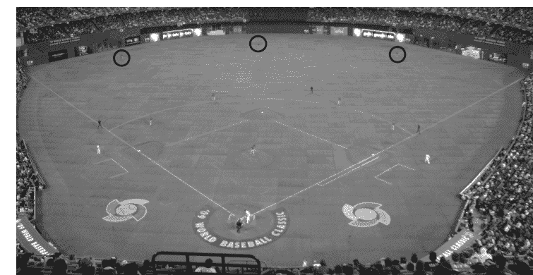

图 15.1：棒球场照片

图 15.1 中的照片展示了一座职业棒球场及其场地。（图片来源信息请参见附录 E.1 节。）照片中，外场手站在靠近上方的位置，我在他们所站的位置周围画了圆圈。

到目前为止，我只是给出了这些点，并进行了一些计算。我推迟绘制散点图，但现在我们在图 15.2 中绘制它。

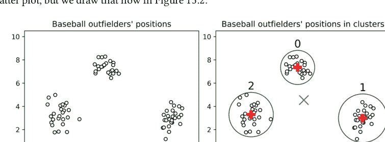

图 15.2：两个特征上的数据聚类

我在图 15.2 中用圆圈绘出了这些位置，并用较大的“+”号标记质心。我在聚类质心周围画了圆圈，以包围每个聚类中的点。从左到右依次是左外场手的聚类 2、中外场手的聚类 0，以及右外场手的聚类 1。

从散点图中，我可以看到点 (14, 3) 位于最右侧的聚类中，即聚类 1。*predict*函数会计算出这一结果：

```python
k_means.predict([[14, 3]])
```

```text
array([1])
```

用机器学习的语言来说，将 CSV 文件作为具有 3 个聚类的 k-means 聚类算法的训练集，我们可以预测站在 (14, 3) 位置的棒球运动员最有可能是右外场手。

### 练习 15.15

我用“x”标记的散点图中的点位于三个质心的几何平均位置。其坐标为：

```python
center_point = np.mean(k_means.cluster_centers_, axis=0)
center_point
```

```text
array([7.5733, 4.5401])
```

这里，我指定了**axis=0**，以便沿二维 **numpy** 数组 **k_means.cluster_centers_** 的列进行平均。

这些坐标与之前在`xy_df.describe()`中报告的均值相比如何？

**sklearn** 会将这个点放入哪个预测聚类中？要让它落入其他每个聚类，需要对 x 和 y 坐标分别加上或减去多少？

现在，让我们回到 k-means 聚类，其中 *k* 是聚类的数量。请记住，虽然聚类图通常只有三个或更少的维度，但这并不限制你使用更多的数值特征，从而使用更多维度。

下面是该算法的概要：

- 1. 如果你的特征代表不同类型的数据或具有不同的数值范围，请像我们在第 15.3 节中所做的那样，对它们进行归一化或标准化。
- 2. 将 n 个点编号为 x₀ 到 xₙ₋₁。必须满足 k ≤ n。
- 3. 随机选择 k 个不同的点 c₀ 到 cₖ₋₁，作为质心的初始猜测。这就是 KMeans 函数提供可选的 random_state 参数来设置随机种子的原因。
- 4. 现在，我们为各个聚类生成第一次猜测。将聚类称为 C₀ 到 Cₖ₋₁。从 x₀ 开始，计算 x₀ 与每个质心之间距离的平方。如果质心 cⱼ 具有最小的平方距离，并且 j 是取此值的最小整数，则将 x₀ 放入 Cⱼ。例如，如果 x₀ 到 c₂、c₃ 和 c₇ 的平方距离相同，则将 x₀ 放入 C₂，因为 2 < 3 < 7。
- 5. 对每个点重复上一步。现在，我们已经将每个点放入了某个聚类。
- 6. 将每个质心重新计算为其所在聚类中所有点的均值。
- 7. 重复将点分配到 k 个聚类的过程。
- 8. 现在完成了吗？重新计算质心；如果它们自上次计算以来没有发生变化，我们就完成了。使用计算出的质心和聚类退出算法。如果质心发生了变化，则返回上一步，将点分配到各个聚类中。

### 练习 15.16

为什么我们知道在第 4 步之后，每个聚类至少包含一个点？

遗憾的是，该算法并不总能保证收敛到一组唯一的聚类。它可能会在不同的质心之间来回跳动。你可能需要将最后几步限制为固定次数的迭代，例如 10 次或 50 次。请进行实验！

在最后一步中，我说的是“如果它们自上次以来没有发生变化”。你可能希望将其改为类似“如果它们自上一次迭代以来的变化不超过 0.1”。也就是说，接受接近但不完美的结果。

并非所有数据集和特征子集都能很好地进行聚类。值得将聚类作为第一种技术，尝试了解信息中是否存在某种明显的结构。

虽然我用圆圈包围聚类来进行可视化，但聚类可能呈现许多不同的几何形状。我们也可以使用不同的函数来度量质心之间的“距离”。图 15.3 展示了其中两个示例。

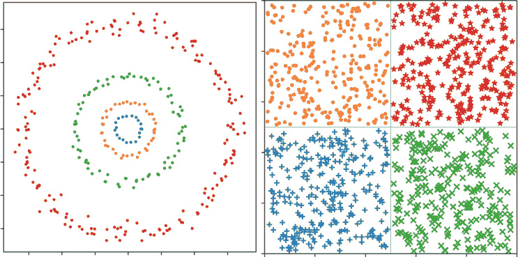

图 15.3：另外两种聚类形式

### 练习 15.17

讨论一下，你可以如何根据自己过去的购买习惯以及与你相似的人的购买习惯，使用聚类来推荐书籍。“与你相似的人”在这里可能意味着什么？

### 练习 15.18

你申请加入一家公司。公司的人力资源部门可以如何使用聚类，将你匹配到组织中的合适职位？

### 练习 15.19

搜索引擎可以如何结合聚类和 NLP（第 12.3 节），向你展示彼此相似的新闻文章？


## 15.6 分类

分类提供对以下问题的答案：

- 穿蓝色、白色还是黄色衬衫？
- 买车还是租车？
- 雇佣该人还是不雇佣？
- 看电影还是不看？
- 上这门课还是不上？
- 阅读电子邮件还是将其移至垃圾文件夹？
- 发放信用卡还是不发放？

分类查看一个 *observation* 并将其放置在若干 *classes* 中的一个。在第一个问题中，观察是选择衬衫的情况以及我的过去行为。有三种可能的衬衫，因此有三个类别。其他问题需要 *binary classification*，因为它们每个只有两种可能的答案，“yes” 或 “no”。

统计学和机器学习的一般分类学科并不局限于两个类别，尽管二元分类非常常见。*classifier* 通过使用训练集之前构建的模型将观察分配给一个类别。分类是监督机器学习的一个例子。

分类器可能产生观察属于某个类别的概率，而不是类别标签。考虑第 14.8 节中关于猫性别的信息。如果我给你一只花猫或玳瑁猫，我可以以非常高的概率将其归入 F 类。对于其他颜色的猫，猫是雌性还是雄性的几率更接近 50–50。

在我们查看一些分类技术之前，让我们加载一个 DataFrame，其中包含第 15.5 节中的外野手位置坐标和计算的聚类标签。我们只考虑位于聚类 1 或聚类 2 的点，我在图 15.4 中显示了这些点。

```
df = pd.read_csv("src/examples/clustering-xy-labels.csv")
df = df[df["label"] != 0]
df.head()
```

x y label
0 13.4832 3.2657 1
2 2.9279 2.9603 2
4 3.3011 2.4642 2

5  3.4519  4.0798     2
6  3.3845  3.6431     2

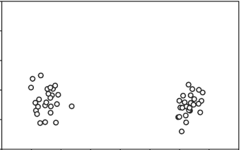

图 15.4：左外野手和右外野手的位置

我们现在查看用于二元分类的支持向量机和用于多类分类的 *k*-nearest neighbors。你将遇到其他技术，如果你学习更多关于机器学习的内容，包括逻辑回归和决策树。

### 15.6.1 支持向量机（SVM）

给定如图 15.4 中所示的具有两个特征的数据，我们能否使用数据和标签在它们之间画一条线来帮助我们进行预测？在这种情况下，点是两个棒球运动员的初始场地位置，一个左外野手和一个右外野手。给定一个新点，如果它位于线的左侧，则它是左外野手站立的位置。同样，如果它位于线的右侧，则是右外野手的位置。我们正在执行二元分类。

有很多这样的线，我在图 15.5 中显示了其中五条。有没有“最佳”线具有良好的数学性质？

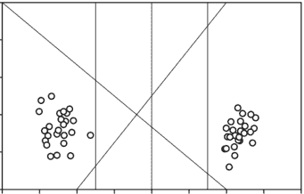

图 15.5：分离点簇的线

找到最佳线是 *support vector machine (SVM)* 执行 *linear support vector classification (SVC)* 的任务。在我展示如何使用 Python 和 **sklearn** 计算它之前，我们需要一些术语。

从你在学校学习的数学中，你知道什么是“平面”。它可能是我用于二维绘图的笛卡尔平面，或三维中无限平面中的任意一个。例如，所有点 (x, y, 0) 的集合是三维中所有垂直坐标等于 0 的平面。

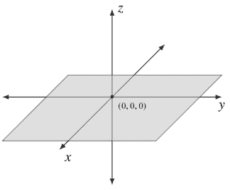

*hyperplane* 是一个线性对象，其维度比它所在的空间少一维。平面是二维的，所以三维中的平面是超平面。线有一维，所以平面中的线是超平面。线上的点是超平面。如果我们有 16 个特征，则其内部的 15 维线性子空间是超平面。

SVC 找到分离数据的最佳超平面，如果存在的话。SVC 超平面的定义确保超平面最大化它与任一组中最接近点的距离。

图 15.6 显示了两组点，左侧用白色圆圈标记，右侧用黑色实心圆圈标记。它们之间有一个间隙，因此这些组是 *linearly separable*。*support vectors* 是 5，即最左边的点中的最大值，以及 7，即最右边的点中的最小值。超平面是点 6，它位于支持向量之间。

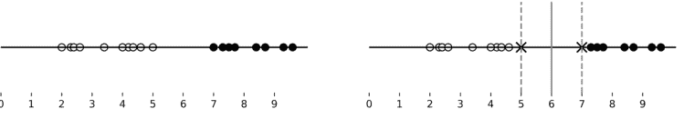

图 15.6：一维线性支持向量分类

回到我们的棒球运动员和他们的二维位置，我们使用来自 **sklearn** 的 **SVC** 类来计算支持向量。

```
```python
from sklearn import svm

classifier = svm.SVC(kernel="linear")
classifier.fit(df[['x', 'y']], df["label"])
```
```

SVC(kernel='linear')

SVC 创建一个分类器对象。我通过 kernel 关键字参数指定我想要执行线性分类。fit 的第一个参数是 x 和 y 坐标的 DataFrame，第二个是标签序列。

现在我们有了分类器，我们可以使用 predict 来查看我们应该将 [14, 3] 分配到哪个标签。与聚类示例一样，它属于组 1。

```
classifier.predict([[14, 3]])

array([1], dtype=int64)
```

支持向量始终是训练集中的点，所以让我们检索它们：

```
classifier.support_vectors_

array([[11.9108, 2.1622],
       [11.9830, 3.2777],
       [4.7231, 2.8998]])
```

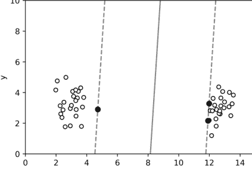

图 15.7：二维线性支持向量分类

在这个例子中，前两个支持向量属于同一组。我们可以计算连接它们的线的斜率：

```
a = classifier.support_vectors_[0]
b = classifier.support_vectors_[1]
slope = (a[1] - b[1]) / (a[0] - b[0])
slope

15.450138504155019
```

### 练习 15.20

1. 从几何学来看，两点之间线的斜率公式是什么？解释我对 `slope` 的计算。
2. 现在你知道了斜率，计算经过右侧组中支持向量的线的方程。
3. 经过另一组中支持向量的平行线的方程是什么？
4. 我们寻求的超平面位于你刚刚计算的两条平行线之间。它的方程是什么？

在实践中，我们希望分类器函数对新数据进行预测，而不需要超平面的方程。可以从分类器的属性中获得超平面的方程。这种方法需要比我在 Python 中对机器学习的这一高级概述中能提供的更深入的讨论。

如果数据不是线性可分的会怎样？我们能否应用一个称为 *kernel* 的函数来分离和分类数据？例如，多项式定义了一条曲线，使用该多项式的核可能分离点。我们能否使用更多特征来增加维度，如图 15.8 所示？一种称为“核技巧”的技术将我们的数据提升到更高维度，在那里它可能变得可分离。

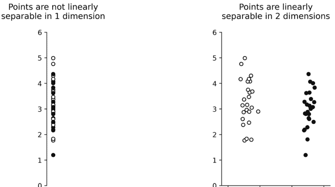

图 15.8：使用两个特征而不是一个以允许可分离性

大都会球迷的标签为 0，洋基球迷的标签为 1。

### 练习 15.21

派对上每种类型的球迷各有多少？

图 15.9 显示了这些位置。黑色圆点是洋基球迷，“x”标记是大都会球迷。

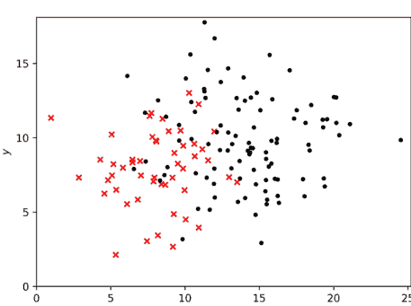

图 15.9：派对上纽约棒球迷的位置

派对上洋基球迷比大都会球迷多。洋基球迷在右上方更常见，而大都会球迷在左下方更常见。

三个朋友是新到这座城市的，漫步进入派对。他们对棒球了解不多，但想融入。他们在派对上靠近人们站立。每个朋友都采用一个简单的规则：问最近的球迷他最喜欢的球队，是洋基还是大都会。球迷的回答就是朋友的新最喜欢球队。

图 15.10 中的圆圈显示朋友在房间中的站立位置。我已将朋友及其位置标记为 A、B 和 C。


## 15.7 线性回归

*线性回归*是一种将超平面拟合到包含自变量和一个因变量的训练集上的技术。

一个常见用途是确定一条“最佳”直线，使其尽可能逼近二维散点图中的点。这里，*x* 坐标是自变量，*y* 坐标是因变量。这就是*简单线性回归*。

如果我们有多个自变量，就是在执行*多元线性回归*。在本节中，我们考察一个简单案例以及普通最小二乘算法。

给定一个新的自变量观测值 *x*，直线方程使我们能够计算其因变量 *y* 的估计值。设 *x*ₘᵢₙ 和 *x*ₘₐₓ 分别为训练集中 *x* 的最小值和最大值。如果

*x*ₘᵢₙ ≤ *x* ≤ *x*ₘₐₓ

那么对 *y* 的预测称为*插值*。否则，该预测称为*外推*或*预测*。

### 练习 15.25

为什么线性回归是一种监督式技术？

笛卡尔 *xy* 平面中直线的方程是

*y* = *m x* + *b*

其中 *m* 是斜率，*b* 是 *y* 截距，因为当 *x* = 0 时，*y* = *b*。在将直线拟合到训练数据之前，统计学家将 *m* 和 *b* 称为*未知参数*。

### 练习 15.26

在平面中定义一条直线需要多少个不同的点？确定一个超平面需要多少个不同的点？

将你对这些问题的答案与你在测试集 DataFrame 中所需的最少行数联系起来。

当我们有两个点，例如 (2.0, 2.0) 和 (8.0, 5.0) 时，计算穿过它们的直线很简单。在这种情况下，$m = 0.5$，$b = 1.0$，图 15.11 显示了该直线。

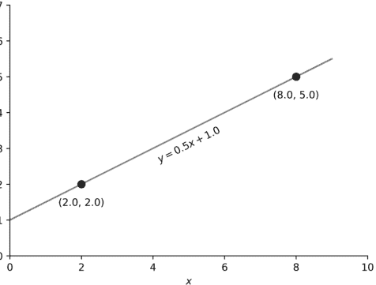

图 15.11：两个点上的简单线性回归

当我们加上点 (4.0, 5.0) 时会发生什么？不存在一条直线同时穿过这三个点，因此我们要找一条在某种程度上比其他任何直线都更好地代表这些数据的直线。

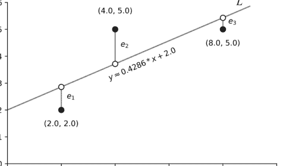

图 15.12：三个点上的简单线性回归

我在图 15.12 中将我们想要的直线标记为 $L$。最初的三个点是黑色实心圆。我们需要计算 $L$ 的方程，使得从我们的点到 $L$ 的垂直距离的平方和最小。白色圆圈是 $L$ 上离初始点最近的点，它们的垂直距离分别是 $e_1$、$e_2$ 和 $e_3$。

可以把 e₀ 中的“e”看作数据与理想直线 L 之间的“误差”（error）。你可能会看到有些人用希腊字母 epsilon = ε 来代替 e。

我们将以下技术称为线性最小二乘算法，因为我们想要最小化

e₁² + e₂² + e₃²

更一般地，这个总和除以观测数量称为均方误差（Mean Squared Error，MSE）：

MSE = (e₁² + e₂² + e₃²) / 3

这是代价函数（cost function）的一个例子。我们在机器学习中，以及更一般地在优化问题中，经常定义和使用这类函数。在将机器学习模型最佳拟合到训练数据时，最小化代价函数的输出往往是目标。

另一个代价函数是平均绝对误差（Mean Absolute Error，MAE）：它取 eⱼ 的绝对值而不是平方。

MAE = (|e₁| + |e₂| + |e₃|) / 3

我们在第 14.1.3 节定义绝对偏差和标准差时，已经考虑过绝对值与平方的比较。

我们有三个点

(x₁, y₁) = (2.0, 2.0)
(x₂, y₂) = (4.0, 5.0)
(x₃, y₃) = (8.0, 5.0)

设 y = m x + b 为直线 L 的方程。我们希望找到 m 和 b，使得

(y₁ − m x₁ − b)² + (y₂ − m x₂ − b)² + (y₃ − m x₃ − b)²

尽可能小。

计算这个的数学内容超出了本书的范围，但如果我们令 μₓ 为原始点的 x 坐标均值，μᵧ 为原始点的 y 坐标均值，那么

m = [(x₁ − μₓ)(y₁ − μᵧ) + (x₂ − μₓ)(y₂ − μᵧ) + (x₃ − μₓ)(y₃ − μᵧ)] / [(x₁ − μₓ)² + (x₂ − μₓ)² + (x₃ − μₓ)²]
b = μᵧ − m μₓ

使用求和记号并推广到 $n$ 个点，我们得到

$$m = \frac{\sum_{j=1}^{n}(x_j-\mu_x)(y_j-\mu_y)}{\sum_{j=1}^{n}(x_j-\mu_x)^2} = \frac{n\sum_{j=1}^{n}x_jy_j-\left(\sum_{j=1}^{n}x_j\right)\left(\sum_{j=1}^{n}y_j\right)}{n\sum_{j=1}^{n}x_j^2-\left(\sum_{j=1}^{n}x_j\right)^2}$$

$$b = \mu_y-m\mu_x$$

诚然，这看起来很复杂。$m$ 的第二种定义很容易用 **numpy** 转化为一个 Python 函数：

```
def simple_linear_regression(xs, ys):
    # return the slope and y-intercept of the simple
    # linear regression line

    n = xs.size
    assert n == ys.size

    numer = n * (xs * ys).sum() - xs.sum() * ys.sum()
    denom = n * (xs * xs).sum() - (xs.sum())**2
    slope = numer / denom
    y_intercept = ys.mean() - slope * xs.mean()
    return slope, y_intercept
```

注意，用 **numpy** 表达这些求和多么容易。现在计算 $m$ 和 $b$，从而得到 $L$：

```
xs = np.array([2.0, 4.0, 8.0])
ys = np.array([2.0, 5.0, 5.0])

simple_linear_regression(xs, ys)
```

(0.42857142857142855, 2.0)

- **练习 15.27**
  
  为什么在 `simple_linear_regression` 的定义中要有 `assert`？

- **练习 15.28**
  
  点 $(\mu_x,\mu_y)$ 在 $L$ 上吗？

### 练习 15.29

用 x 和 y 坐标集合的标准差和协方差重新表达 m 的一般公式。参见第 14.1.4 节。

sklearn 使得执行线性回归变得很容易。当我们对 LinearRegression 对象拟合数据时，第一个参数是自变量值的二维数组或 DataFrame，第二个参数是因变量值的数组。

```
from sklearn.linear_model import LinearRegression

lin_reg = LinearRegression()
lin_reg.fit(pd.DataFrame({'x': xs}), ys)
```

LinearRegression()

现在我们可以提取 m：

```
lin_reg.coef_
```

array([0.4286])

以及 y 截距 b：

```
lin_reg.intercept_
```

1.9999999999999996

### 练习 15.30

解释我们如何得到插值结果

```
lin_reg.predict([[6]])
```

array([4.5714])

以及外推结果

```
lin_reg.predict([[10]])
```

array([6.2857])

随着我们添加更多观测值，我们可以更新线性回归模型。也就是说，我们可以从进一步的经验中*学习*。图 15.13 显示了一条拟合到 100 个点的直线。

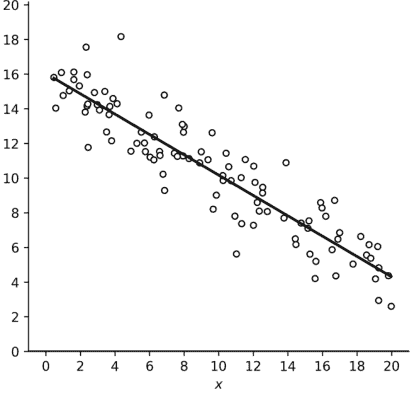

图 15.13：100 个点上的简单线性回归

> **练习 15.31**
> 
> 为第 14.1.4 节中图 14.2 所示的数据计算简单线性回归直线。

在一般的多维情形下，我们有多个输入，我将其称为 *x*。在四维空间中，超平面的方程是

$$y = w_1x_1 + w_2x_2 + w_3x_3 + b$$

其中 $w_j$ 和 $b$ 是常数，$x_j$ 是自变量。你可能会看到其他字母代替 $w$：$a$ 和 $c$ 也很常见。$b$ 是一个常数，通常为 0。在机器学习中，我们称 $b$ 为“偏置”（bias）。

除了预测之外，我们还可以将线性回归用于二分类，如图 15.14 所示。例如，如果 $y \geq 0$，则当新观测为“真”时返回 1；否则，返回 0 表示“假”。

图 15.15 显示了三个输入节点、隐藏层中的四个节点和两个输出节点。我还展示了输入节点到第一个隐藏节点 $h_1$ 的*权重* $w_{i,1}$。我们还有连接输入节点与 $h_2$、$h_3$、$h_4$ 的权重，以及连接这些节点与输出节点的权重。为了保持图表简洁，我没有画出它们。

节点的另一个名称是*神经元*，图 15.15 展示了一个*神经网络*。更准确地说，这是一个*人工神经网络（ANN）*，因为它与我们相信在大脑中发生的事情相似。正如我们将看到的，我们可以用这类网络进行机器学习。

重要的问题包括：

- 我们可以有更多输入吗？（可以）
- 我们可以有更多隐藏节点吗？（可以）
- 我们可以有更多输出吗？（可以）
- 隐藏层中的节点会发生什么？
- 我们可以有更多隐藏层吗？

我已经回答了前三个问题，所以让我们看看隐藏节点的内部来回答第四个问题。我以 $h_1$ 为例。与线性回归一样，我们计算

```
$$w_{1,1}x_1 + w_{2,1}x_2 + w_{3,1}x_3 + b_1$$
```

我调整了下标以表示我们在处理 $h_1$。我把这个结果称为 $z_1$。接下来呢？我们向输出层中的 $y_1$ 和 $y_2$ 发送什么？

### 15.8.1 激活函数

在 $h_1$ 内部，我们计算 $z_1$，然后应用一个*激活函数*，我称之为 $af$。

```
$$af(z_1) = af(w_{1,1}x_1 + w_{2,1}x_2 + w_{3,1}x_3 + b_1)$$
```

我们将 $af$ 的结果发送给 $y_1$ 和 $y_2$。如果我们发送的结果是 0，就等于在说“这个节点没有贡献”。反过来，非零结果则表示“这个节点/神经元已被激活”。

如果 $af$ 是线性函数，那么这个神经网络实现的就是线性回归，因此作为一种新技术并不十分有趣。然而，机器学习从业者有时会使用恒等函数 $af(x)=x$ 作为激活函数。其作用是接收 $z_1$ 并将其原样传递到 $y_1$ 和 $y_2$。


在 $h_1$ 中，我们计算

$$w_{1,1}x_1+w_{2,1}x_2+b_1$$

然后应用二进制阶跃激活函数。我们必须定义输入变量、权重和偏置。

$x_1$ 是一个二值变量。如果你**没有**两个小时去杂货店、回家并准备晚餐，它的值为 0；如果你有，则值为 1。当 $x_1$ 为 0 时，我会点披萨，因为我没有时间去购物。

$x_2$ 是一个取值范围在 0.0 到 1.0 之间的**浮点数**。如果你非常想吃披萨，值为 1.0；如果你不想吃披萨，值为 0.0。我假设你可以吃披萨，但 0.0 表示你更想吃别的东西。

考虑

$$z_1=-10x_1+20x_2+1$$

之后我应用二进制阶跃函数 $H$。当 $x_1$ 为 0 时，$z_1$ 对所有允许的 $x_2$ 值都为正。因此，我们将 1 传递给 $y_1$：我们会点披萨。

当 $x_1$ 为 1 时，意味着我确实有时间去购物，

$$z_1=-10\times1+20x_2+1=20x_2-9$$

当 $x_2=0.45$ 时，$z_1=0.0$。当 $x_2=0.5$ 时，$z_1=1.0$。这意味着当我有时间并且对披萨的渴望大于 0.45 时，我会点披萨。否则，我会去商店。

在实践中，我们会有更多的输入和隐藏节点。我们会从人们那里收集许多关于他们认为重要特征的示例数字输入。然后，我们会将所有数据划分为训练集和测试集。请记住，对于训练集，我们知道人们是否点了披萨：这就是结构化学习。

在运行一个训练示例后，我们用数学方法调整权重，然后处理下一个示例。我们不断调整权重和偏置。如果我们有足够的数据并且这些数据是线性可分的，最终我们会稳定下来。然后我们使用测试集来确认我们拥有一个能在大多数情况下正确预测输出的模型。

这只是机器学习软件和从业者处理简单神经网络的一个粗略概述，但我希望它足以让你有所了解。

## 15.8.3 深度学习

当我们有多个隐藏层时，我们就在进行*深度学习*。对于深度学习所需的最少层数，人们看法不一，但简单来说，我认为是两层。图15.19展示了一个具有三个隐藏层的网络。

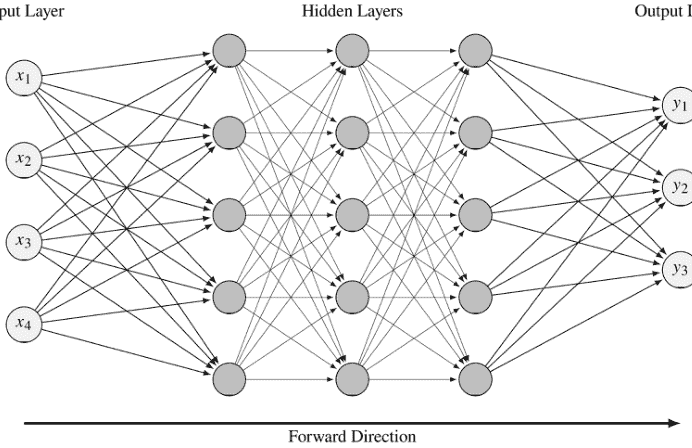

图15.19：具有4个输入、3个隐藏层和3个输出的深度神经网络

请注意，并非每个隐藏层的节点数都与其他隐藏层相同。一个层中的每个节点也未必与下一层中的每个节点相连。当所有节点都相连时，该网络就是*全连接*的。

每一层内部会发生什么？一个全连接层可能将其输入乘以权重，然后加上一个偏置值。另一个层可能唯一的功能就是应用我们之前见过的某个激活函数。

*归一化层*应用我们在*第15.3节*中讨论过的归一化或标准化变换，或其他适合数据类型的变换。该操作可能是其他层（如输入层）的一部分。

许多深度学习网络的例子都涉及图像识别。在这里，你可以想象输入是一个三维像素数组。其中两个维度表示图像像素的矩形布局，第三个维度存储每个像素的RGB值。

如果一张照片的分辨率是 4,032 × 3,024，那么它有 12,192,768 个像素。如果我们将此乘以 3，得到 36,578,304。这是大量的输入！如果第一个隐藏层有 100 个节点，并且我们将输入与这个隐藏层全连接，那么我们将有超过 3600 万个权重。这会导致大量的计算。

对于这种输入，我们可能会使用*池化层*，它查看像素的方形块，并计算每个方块中像素的平均或最大RGB值。这样，我们可以缩小图像尺寸，尽管会损失分辨率。

另一种类型的层执行*卷积*操作。可以把卷积理解为一种过滤或聚焦输入特征的过程。例如，给定一张输入照片，我们可以使用卷积来检测物体的边缘。

*裁剪层*会截去图像的一部分，可能会生成更小的图像。例如，我们可能想要移除图像周围的额外空白区域。

我们通过连接和应用这些以及其他类型的层，从 3600 万个输入走向图像识别。是的，我们可能会说“照片里有三只猫”或“这是一只狗，不是一条鱼”，但我们也许还能识别医学图像中的肿瘤。

深度学习推动了自然语言处理（NLP）领域的巨大进步，我们曾在*第12.3节*中讨论过这一主题。从业者使用深度神经网络进行情感分析、命名实体解析、文本和语音生成，以及实现聊天机器人和其他应用。

我们训练深度学习网络的方法是：输入数据，让数据通过各层，并将计算出的输出与我们的预期进行比较。请记住，这是监督学习，因此我们知道训练集中数据的输出。利用线性代数和微积分，我们从期望输出与实际输出之间的差异反向计算，以调整各层中的权重和其他内部参数。这种技术称为*反向传播*。

如果想学习神经网络和深度学习的数学原理与技术，我强烈推荐 Ian Goodfellow、Yoshua Bengio 和 Aaron Courville 合著的《深度学习》一书。[DLG]

接下来，由于纠缠，每增加一个量子比特，我们的量子计算空间的维度就会翻倍。如果我们有 10 个量子比特，量子态所处的空间维度为 $2^{10}=1,024$。对于 64 个量子比特，维度为 $2^{64}=18,446,744,073,709,551,616$，也就是一千八百四十四京六千七百四十四兆零七百三十七亿零九百五十五万一千六百一十六。

虽然我们在数据集中永远不会需要那么多特征，但研究人员正在探索如何利用量子计算中维度增长的“有益”一面，来控制人工智能中特征和计算结构（如矩阵）的“有害”增长。

我们在本章中看到的技术是许多人长期发展而来的，还有更多我未讨论的激活函数、算法、隐藏层类型和方法。量子计算中像叠加和纠缠这样根本不同的想法能否为我们提供新的模式匹配方法？我们能否用更少的训练创建更好的核函数来进行分类？

量子计算机不是“大数据机器”。它们无法摄入 GB 级的数据并对其进行处理。然而，我们能做的是研究如何将最好的经典思想和新的量子思想结合起来，创造出更好的AI，造福社会。

## 15.10 小结

在本章中，我们简要了解了机器学习、神经网络和深度学习。我们聚焦于这些技术背后的核心思想，并向你展示了如何通过几个 Python 中的**sklearn**编码示例来入门。

但是，就附录和书末内容而言，本章结束了这次 Python 入门介绍。我们一起探索了经典编程技术，并看到了量子计算如何成为这些技术的自然补充和延伸。编码的未来是经典与量子对象、构造、控制和算法的集成。祝愿你在通往那个激动人心的未来的个人旅程中取得巨大成功！
