## 附录 A 工具

阅读一本关于编写软件的书籍是一回事，安装你需要的工具并使用它们又是另一回事。在本附录中，我将讨论如何获取并安装 Python、安装模块和包、启动并使用 Python 解释器、使用集成开发环境、在本地机器上和在线安装与使用 Qiskit，以及通过“linting”对代码进行检查。

### 本附录涵盖的主题

- A.1 操作系统命令行 ............................................................ 624
- A.2 安装 Python ..................................................................................... 624
- A.3 安装 Python 模块和包 ............................................................ 625
- A.4 安装虚拟环境 ........................................................................ 629
- A.5 安装本书使用的 Python 包 ................................................... 630
- A.6 Python 解释器 .................................................................................... 630
- A.7 IDLE .............................................................................................................. 631
- A.8 Visual Studio Code .......................................................................................... 633
- A.9 Jupyter 笔记本 ........................................................................................... 635
- A.10 安装和设置 Qiskit ......................................................................... 638
- A.11 IBM Quantum Composer 和 Lab .................................................................... 639
- A.12 代码检查（Linting） ........................................................................................................... 641


## A.1 操作系统命令行

在本书的若干处，我会要求你在“操作系统命令行”中输入并执行一条语句。例如，在第 10.1.3 节中，我会要求你从命令行运行 `pytest unipoly.py`。

打开命令行的方式取决于你使用的操作系统：

- 对于 Microsoft Windows，请从“开始”菜单打开 **Windows PowerShell** 或 **Windows 命令提示符**，也可以在搜索框中输入“PowerShell”或“命令提示符”。
- 对于 Apple macOS，请从 **Launchpad** 或“应用程序/实用工具”文件夹中启动 **终端**应用程序。
- 对于 Linux，如果你处于图形环境中，可以尝试按 Ctrl-Alt-T 打开**终端**。也可以在系统菜单中寻找“终端”应用程序。如果你不处于图形环境中，那么你已经在终端里了！

在一些操作系统中，命令行也称为“shell 提示符”。

## A.2 安装 Python

你的系统上可能已经安装了 Python 3。尝试在操作系统命令行中运行

```
python -VV
```

或

```
python3 -VV
```

如果你看到 Python 3 应用程序的版本和说明，就表示它已经安装。有些系统可能安装的是 Python 2，此时 `python -VV` 命令可能会启动 Python 2 并显示其信息。尝试运行 `python3 -VV`，查看是否也安装了 Python 3。

本书使用 Python 3.9，有些示例可能无法在更低版本中运行。升级到较新版本的 Python 可能需要特殊权限，才能在计算机上安装软件。若要了解当前的系统升级信息，请在网上搜索以下任一内容：

```
windows upgrade python
mac upgrade python
linux upgrade python
```

然后按照相关说明操作。

若要重新安装 Python，请访问

```
https://www.python.org/downloads/
```

并下载适用于你系统的最新版本。对于 Windows，请务必下载 64 位版本，因为 qiskit 需要该版本。

对于 macOS 和 Windows，请运行下载的软件安装程序。对于 Windows，请选择为所有用户安装并更新 PATH 的选项。

Linux 需要你完成更多安装工作，因此不一定适合新手：

- 下载源代码“tarball”后，使用 tar -xvf，后面跟文件名，解压 Python 文件。
- 进入存放这些文件的文件夹，并在命令行中执行 ./configure。
- 在命令行中运行 make。
- 在命令行中运行 make install。

安装 Python 后，使用 python 或 python3 启动它。具体名称可能因操作系统或安装类型而异。下文中我会使用 python 来指代它。

## A.3 安装 Python 模块和包

PyPI 是“Python 包索引”（Python Package Index），其中包含超过 300,000 个可供下载和导入的模块与包。你可以在以下网址浏览和搜索此目录：

```
https://pypi.org/
```

pip 应用程序可在你的系统上下载和管理 PyPI 包。使用命令行中的 pip 或 pip3 启动该应用程序。下文中我会使用 pip 来展示它的若干功能。运行这些命令时，你看到的输出可能与这里展示的不同，因为我还安装了其他包。如果你感兴趣，可以在附录 F“生产说明”中查看我这台计算机上安装的 Python 包列表。

### 查看 pip 的帮助信息

```
pip --help
```

用法：
  pip <command> [options]

命令：

    install                         安装包。
    download                        下载包。
    uninstall                       卸载包。
    freeze                          以 requirements 格式输出已安装的包。
    list                            列出已安装的包。
    ...

若要查看特定命令的详细帮助信息，请将该命令的名称插入 pip 和 --help 之间。

```
pip list --help
```

```
用法：
    pip list [options]

说明：
    列出已安装的包，包括可编辑安装的包。

包按名称排序，排序时不区分大小写。

列表选项：
    -o, --outdated                 列出过期的包
    -u, --uptodate                 列出最新的包
    -e, --editable                 列出可编辑的项目。
    -l, --local                    如果位于可访问全局包的
                                   虚拟环境中，则不列出
                                   全局安装的包。

...
```

### 列出已安装的 Python 模块和包

```
pip list
```

| 包 | 版本 |
|---|---|
| alabaster | 0.7.12 |
| appdirs | 1.4.4 |
| argon2-cffi | 20.1.0 |
| astroid | 2.5.6 |
| async-generator | 1.10 |
| atomicwrites | 1.4.0 |
| attrs | 21.2.0 |
| ... | ... |

若要查看已过期的包，请添加 --outdated 选项：

| 包 | 版本 | 最新版本 | 类型 |
|---|---|---|---|
| click | 7.1.2 | 8.0.1 | wheel |
| decorator | 4.4.2 | 5.0.9 | wheel |
| h5py | 3.1.0 | 3.2.1 | wheel |
| idna | 2.10 | 3.1 | wheel |
| isort | 4.3.21 | 5.8.0 | wheel |
| ... |  |  |  |

### 安装包

我们安装 **treemap** 模块：

```
pip install treemap
```

Collecting treemap
  Downloading treemap-1.05.tar.gz (5.4 kB)
Building wheels for collected packages: treemap
  Building wheel for treemap (setup.py) ... done
  Created wheel for treemap: filename=treemap-1.5-py3-none-any.whl size=6115

sha256=82cda8fc01b5159ea028900ec198c11a593edd0944223ba636a69850da03cab9
  Stored in directory: c:\users\rssut\appdata\local\pip\cache\wheels\ef\c0\38\d343a9431900820517 18405c15277e4cf5977d0689b7fa345f
Successfully built treemap

Installing collected packages: treemap
Successfully installed treemap-1.5

你可以在 pip install 后列出多个包，一次安装多个包。

### 升级已安装的包

在 pip 后添加 --upgrade 选项，即可升级先前安装的包。对于 **treemap**，我们刚刚才安装，因此无需升级。

```
pip install --upgrade treemap
```

Requirement already satisfied: treemap in d:\python\python39\lib\site-packages (1.5)

**flake8** 模块确实需要升级。从输出中可以看到，pip 会检查 **flake8** 所依赖的包。如果这些依赖包需要升级，pip 也会一并升级。

```
pip install --upgrade flake8
```

```
Collecting flake8
    Using cached flake8-3.9.2-py2.py3-none-any.whl (73 kB)
    Requirement already satisfied: pyflakes<2.4.0,>=2.3.0 in
        d:\python\python39\lib\site-packages (from flake8) (2.3.1)
    Requirement already satisfied: pycodestyle<2.8.0,>=2.7.0 in
        d:\python\python39\lib\site-packages (from flake8) (2.7.0)
    Requirement already satisfied: mccabe<0.7.0,>=0.6.0 in
        d:\python\python39\lib\site-packages (from flake8) (0.6.1)

    Installing collected packages: flake8
      Attempting uninstall: flake8
        Found existing installation: flake8 3.8.4
        Uninstalling flake8-3.8.4:
          Successfully uninstalled flake8-3.8.4
    Successfully installed flake8-3.9.2
```

### 卸载包

我不需要系统上的 **treemap**，因此将其卸载：

```
pip uninstall treemap
```

```
Found existing installation: treemap 1.5
Uninstalling treemap-1.5:
  Would remove:
    d:\python\python39\lib\site-packages\treemap-1.5.dist-info\*
    d:\python\python39\lib\site-packages\treemap\*
    d:\python\python39\scripts\treemap_coverage.exe
    d:\python\python39\scripts\treemap_demo.exe
Proceed (y/n)? y
  Successfully uninstalled treemap-1.5
```

注意，**pip** 会提示我确认是否要删除 **treemap**。我输入“y”，表示“是”。如果我在 pip 命令中加入 --yes 选项，它就不会再要求我确认。

### 更新 pip

虽然 **pip** 随 Python 一同安装，但其开发者更新 pip 的频率比更新 Python 本身更高。你应该定期更新它，以获取最新版本：

```
python -m pip install -U pip
```

Requirement already satisfied: pip in d:\python\python39\lib\site-packages (21.1.2)

在这个例子中，pip 已是最新版本，但我每周都会检查一次。

## A.4 安装虚拟环境

在附录 F“生产说明”中，我列出了安装在我计算机上的 Python 模块，数量将近 200 个。

我真希望能说这些模块彼此配合时都毫无问题，但事实并非如此。开发者更新某个模块时，可能会破坏依赖它的其他代码。

你可以创建较小的虚拟环境，而不是让系统使用一个庞大的 Python 环境。虚拟环境包含 Python 解释器、工具、标准库，以及项目所需的、与之兼容且通过 pip 安装的模块和包。当你同时处理多个需要不同模块集合的项目时，这项功能尤其有用，因为你可以为每个项目分别设置一个虚拟环境。[P.Y.Y]

按照第 A.2 节所述安装 Python 后，你就可以创建虚拟环境。首先，决定要将它放在哪里。常见做法是在主目录下创建一个子目录，并将其命名为 .venv。在 Linux、Mac 或 Windows PowerShell 的命令行中，执行以下命令：

```
cd ~
python -m venv .venv
```

这些命令会将你带到主目录，并安装所需的 Python 核心工具。若要使用此虚拟环境，请输入

```
.venv\Scripts\activate.bat
```

（适用于 Windows），或输入

```
source .venv/bin/activate
```

（适用于 Linux 或 Mac）。

现在，你可以像第 A.3 节中那样使用 pip，安装所需的模块和包。


## 工具

不必使用主目录下的 **.venv**，你可以为虚拟环境文件指定任何有效的目录路径。例如，在Windows上，我可以执行：

```bat
python -m venv c:\my-qiskit-env
c:\my-qiskit-env\Scripts\activate.bat
pip install qiskit
```

### A.5 安装本书使用的Python包

执行以下命令以下载并安装本书使用的包：

```bash
pip install wheel coverage flake8 flashtext jupyter
pip install matplotlib matplotlib-venn numpy pandas
pip install pylint pytest qiskit qiskit-sklearn spacy squarify sympy
python -m spacy download en_core_web_sm
```

### A.6 Python解释器

Python解释器是命令行驱动的读取-求值-打印循环（Read-Evaluate-Print-Loop，REPL）的经典例子。

图A.1展示了我如何从操作系统命令行启动Python。

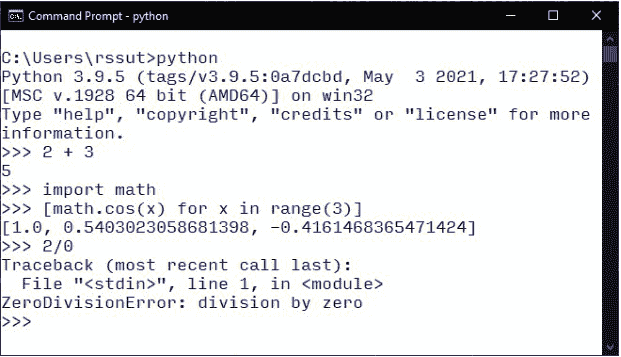

图A.1：Python解释器

显示版本信息后，Python会显示一个“>>>”提示符。我输入第一条命令：2 + 3。

- Python *读取* 2 + 3 并将其*解析*为可以操作的内部数据结构。
- 然后确定必须通过对 **int** 2 和 **int** 3 应用“+”来*求值*该表达式。它执行此操作并产生结果5。
- 由于结果不是None，Python打印5。
- 然后它显示另一个“>>>”并等待输入。

下一个表达式是 import math。Python读取并执行此代码，将 **math** 模块加载到你的工作区。它不会产生输出。

图A.1中的输入是一个列表推导式，Python显示了计算出的结果。

最后一个表达式引发了一个 **ZeroDivisionError** 异常。Python会显示导致问题的代码的追溯信息。

Python解释器的编辑功能有限。你可以使用键盘方向键在输入内容中前后移动，并且可以删除和输入字符。剪切粘贴也可以使用。要获得更复杂的编辑和文件操作，你需要一个更复杂的Python环境。

### A.7 IDLE

**IDLE**是Python的**集成开发与学习环境**（Integrated Development and Learning Environment）。它是一个窗口应用程序，随Python一起分发。图A.2展示了**IDLE**处于编辑模式，编辑的是*附录C*中包含**UniPoly**类的文件。

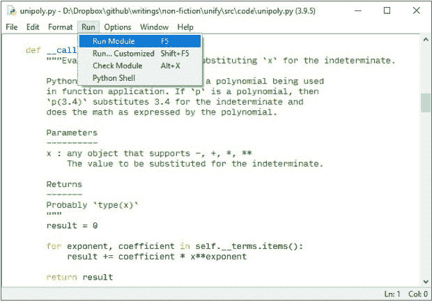

图A.2：Python IDLE

你可以从命令行启动**IDLE**：

```bash
python -m idlelib
```

或者从应用程序菜单或文件夹中启动。图A.3显示了**IDLE**在我的Microsoft Windows开始菜单中的情况。

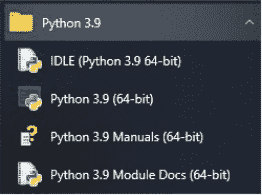

图A.3：Python IDLE的Windows开始菜单

**IDLE**可以在具有增强代码编辑功能的解释器模式下运行，也可以在文件编辑模式下运行，如图A.2所示。IDLE会以不同颜色高亮显示注释、字符串、标点和关键字等语法元素。它还会自动缩进你的代码。

一个重要特性是*调试*。**IDLE**允许你逐步遍历代码。

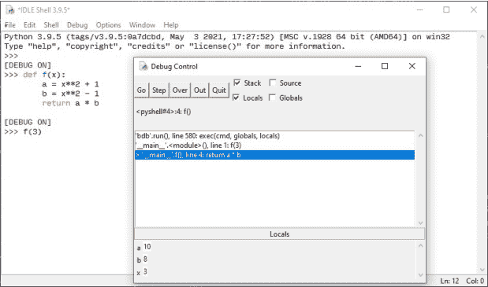

图A.4：处于调试模式的Python IDLE

在图A.4中，我首先从菜单中打开调试模式。我定义了一个函数*f*，然后调用f(3)。通过反复点击“Step”按钮，我逐步执行代码。在Debug Control窗口底部，你可以看到所有局部变量的值。

这种调试方式有助于你了解代码是否在做你期望做的事情，如果没有，还能看到问题出在哪里。你还可以设置*断点*，即代码中调试执行将停止的位置。你不需要逐行运行代码，可以说：“执行到这里，然后停下来让我看看周围。”[IDL]

### A.8 Visual Studio Code

*IDE*是集成开发环境（Integrated Development Environment）。这些工具有时专用于一种编程语言，但我认为最好的工具能为多种语言提供统一且一致的支持。**Visual Studio Code**是我现在使用的IDE，也是我迄今为止最喜欢的。我用**Visual Studio Code**撰写了本书的内容。[VSC]

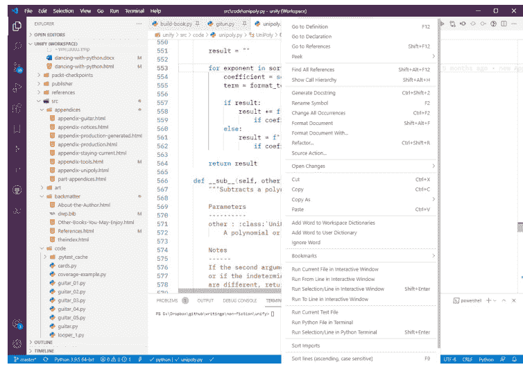

图A.5：Visual Studio Code

图A.5是Visual Studio Code编辑附录C中文件的截图。文本具有彩色语法高亮，编辑器还提供代码补全和自动缩进等功能。在左侧，你可以看到本书部分内容文件的目录列表。当我右键单击代码中的 sorted 时，编辑器显示了上下文菜单。

在Visual Studio Code中，你可以创建、运行和调试代码。“IDE”中的“集成”一词意味着该工具支持git等版本控制系统，并在项目层面汇聚了各种高级功能。你可以将文件分组到工作区，Visual Studio Code还可以跳转到你的函数、类和方法的定义处。图A.5所示图像的底部是一个集成命令提示符，因此几乎无需离开IDE即可完成所有工作。

对我来说，**Visual Studio Code**最令人兴奋的部分是用户贡献的扩展。需要开始使用一种新的编程语言？可能已经有人编写了完全支持它的扩展。想要环境看起来不同？可能已经有人编写了具有你喜欢的颜色和字体的“主题”。想按键对JSON文件排序？我使用一个扩展来完成。想重新格式化你的HTML代码？有多个扩展可供选择。

我使用**Visual Studio Code**处理Python、HTML、CSS、XML、Markdown、LaTeX、JSON、C++、PHP和JavaScript。

如果你想探索其他编辑器和IDE，我建议你看看**PyCharm、Komodo、Sublime Text、Eclipse/PyDev和Kite**。

### A.9 Jupyter笔记本

**Jupyter**是一个基于浏览器的交互式环境，主要用Python编写。虽然你可以立即使用它来编辑和运行Python，但它也支持其他可安装的运行时环境，称为*内核*，并被数据科学家广泛使用。开发人员已经编写了一百多个内核，这些内核支持R、Scala、Go、Java、Ruby、Rust甚至Fortran等语言。[JUP.]

**Jupyter**创建*笔记本*，它们是文本、图像、代码和代码执行结果的组合。笔记本是持久的，这意味着你可以保存它并在以后重新启动它。默认情况下，**Jupyter**使用Markdown描述语言来格式化文本。

从命令行安装并启动**Jupyter**：

```bash
pip install jupyter
jupyter notebook
```

你可能会看到一个窗口提示，询问你想使用哪个浏览器。选择一个浏览器，然后在右上角点击“New”。选择“Python 3”。现在你应该会看到一个类似于图A.6的浏览器窗口。

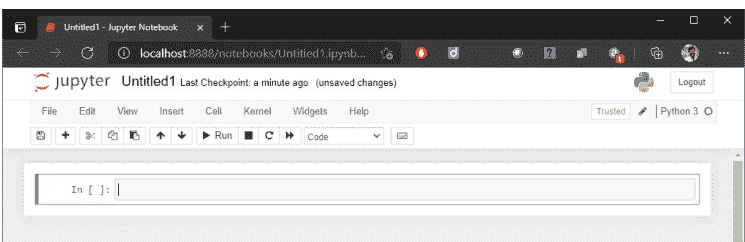

图A.6：新的Jupyter会话

笔记本是从上到下排列的一序列*单元格*。你可以运行和重新运行单个单元格，或者执行笔记本中的所有命令。以下是你创建图A.7所示笔记本的步骤：

1. 默认情况下，新单元格用于Python输入。点击“In [ ]:”后面的第一个单元格框。然后转到菜单中有一个显示“Code”的下拉列表。点击它，将单元格类型改为“Markdown”。回到单元格，输入：“## 绘制抛物线”。按下菜单上的**Run**按钮。你的文本现在显示为标题，**Jupyter**会显示一个新的输入单元格。
2. 在单元格中输入Python代码 `import matplotlib.pyplot as plt`。然后点击**Run**按钮或按下**Shift + Enter**组合键。你会得到一个新单元格。
3. 将新单元格改为Markdown，并输入图A.7中以“现在我们定义点”开头的文本。运行此单元格（接下来我不会再提醒你这样做）。
4. 输入Python代码来定义 x_values 和 y_values。请注意，你的输入可以是多行代码。
5. 输入以“最后，我们创建”开头的Markdown文本。
6. 最后一步是创建图表。输入 `plt.plot(x_values, y_values)`。**Jupyter**会显示该图表。


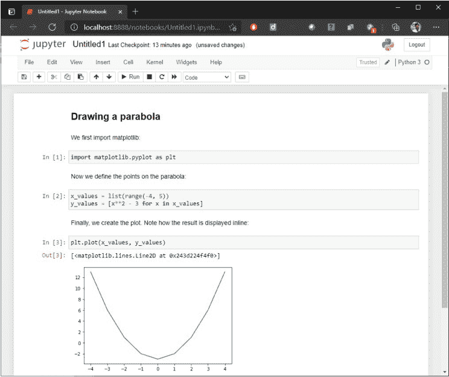

Figure A.7: Jupyter session with matplotlib output

我鼓励你探索 **Jupyter** 窗口中提供的其他命令。你可以从 Python 以非交互模式运行该应用程序：我执行了本书中的 Python 命令，并通过未使用浏览器界面的 **Jupyter** 笔记本收集了它们的输出。

你可以将笔记本存储在你的电脑上或通过多个商业服务存储在云端。一些在线工具如 IBM Quantum Lab 使用 **Jupyter** 在网页上运行并通过自定义小部件对其进行扩展。

## A.10 Installing and setting up Qiskit

在你的电脑上安装 **qiskit** 的基本方法很简单：

```
pip install wheel 'qiskit[visualization]'
```

你可能需要也可能不需要单引号。

如果你计划在 Microsoft Windows 上使用 Qiskit，请确保安装 64 位版本的 Python。

要访问基于云的 IBM Quantum 硬件系统，请访问

```
https://quantum-computing.ibm.com/
```

如有必要创建账户，并在进入 IBM Quantum 主页后，查找如图 A.8 所示的“API token”部分。你需要一个 API token 来向 IBM Quantum 云服务进行身份验证。 [QIS]

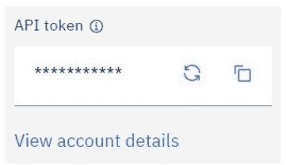

Figure A.8: IBM Quantum API token

如果该字段为空白而不是填充了星号，请点击带有循环箭头的按钮。然后点击其右侧的按钮，该按钮有一个正方形重叠另一个正方形。此按钮将你的 API token 复制到剪贴板。

你也可以直接从以下地址检索你的 API token

```
https://quantum-computing.ibm.com/account
```

现在启动 Python 并输入以下内容，将 API token 剪切粘贴作为 TOKEN 的替代项放入 save_account 的调用中：

```
from qiskit import IBMQ

IBMQ.save_account("TOKEN")
```

请注意 save_account 预期其参数为字符串。要测试你是否正确设置了账户，输入 Python 命令：

```
IBMQ.load_account()
<AccountProvider for IBMQ(hub='ibm-q', group='open', project='main')>
```

你应该会看到有关你的账户提供者的信息。

## A.11 The IBM Quantum Composer and Lab

IBM Quantum 提供了一个在线拖放电路编辑器和执行环境，称为 IBM Quantum Composer。你可以通过访问以下网址访问它

https://quantum-computing.ibm.com/composer/

从此网页，你可以阅读文档和交互式教程，设计电路，在硬件和模拟器上运行电路，并以多种方式可视化执行结果。

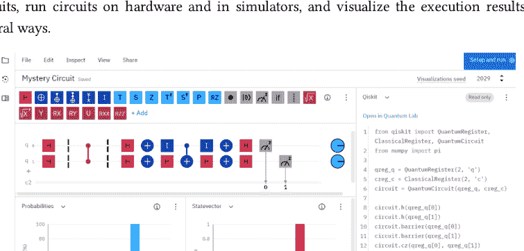

Figure A.9: IBM Quantum Composer

图 A.9 显示了我创建的一个电路。在右侧，Composer 显示了你可以在 Python 中用来构建相同电路的 **qiskit** 代码。底部的可视化显示了该电路预期结果的静态分析。

### Exercise A.1

图 A.9 显示了 *Chapter 11, Searching for the Quantum Improvement* 中的哪个量子电路？

IBM Quantum Lab 是一个基于 **Jupyter** 的在线环境，用于使用 **qiskit** 和 Python 编码和可视化量子电路。从以下地址访问它：

https://quantum-computing.ibm.com/lab/

图 A.10 显示了带有基本 3 门电路的 IBM Quantum Lab。当你创建一个新的 Lab 文件时，它会自动导入最常用的 Python **qiskit** 和 IBM Quantum 模块。然后它从云端加载你的账户信息。

在此文件中，我定义了一个 **QuantumCircuit** 对象，然后向其添加门。电路的 *draw* 方法在 **Jupyter** 窗口内显示其输出。由于这是一个 **Jupyter** 笔记本，你可以保存你的工作。

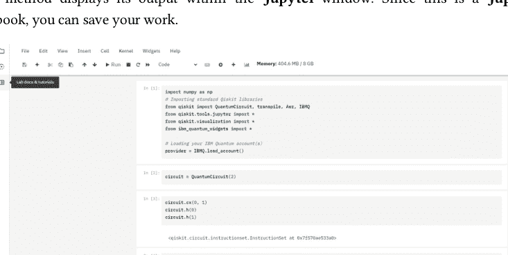

Figure A.10: IBM Quantum Lab

IBM Quantum Composer 是一个在云中运行的强大工具。如果你希望使用 Python 和 qiskit 一起创建量子电路和程序，则无需将任何东西下载到你的机器上。

## A.12 Linting

Linter 是一种扫描你的代码查找错误或与风格约定不一致的应用程序。许多 IDE 如 Visual Studio Code 都有内置支持一个或多个 linter。 [VSL] Linter 执行静态分析，即它不运行你的代码，只查看你所写的内容。

Linter 通常有三类消息：

- **Informational** – “你可能想知道这一点，但如果你一直告诉我，我可能会感到厌烦。”
- **Warning** – “你在这里做了一些可能导致问题的事情，或者你没有遵循格式约定。不要拖延，现在就看一下。”
- **Error** – “修复它。现在。”

一个不错的 Python linter 入门选择是 pylint。通过以下方式安装它：

```
pip install pylint
```

一旦安装完成，从操作系统命令行发出 pylint --help 将显示关于选项的几屏信息。

如果我们将错误的代码

```
def f(x=1, y)
    return x+y
```

存储在文件 src\code\linting\lint-01.py 中，或在非 Windows 系统上为 src/code/linting/lint-01.py，然后从操作系统命令行运行

```
pylint src\code\linting\lint-01.py
```

我们看到输出

```
************ Module lint-01
src\code\linting\lint-01.py:1:13: E0001: non-default argument follows default
argument (<unknown>, line 1) (syntax-error)
```

由于消息代码为“E0001”并且以“E”开头，这是一个错误。

**flake8** 是另一个 Python linting 应用程序。通过以下方式安装它：

```
pip install flake8
```

现在我在目录中放置另一个文件，这次命名为 **src\code\linting\lint-02.py**，或在非 Windows 系统上为 **src/code/linting/lint-02.py**。它包含代码：

```
def f(x, y):
    #useless comment
    return x+y
```

在 **directory** 上运行 **flake8**，

```
flake8 src\code\linting
```

我们看到：

```
src\code\linting\lint-01.py:1:13: E999 SyntaxError: non-default
argument follows default argument
src\code\linting\lint-01.py:2:3: E111 indentation is not a multiple of four
src\code\linting\lint-01.py:2:3: E113 unexpected indentation
src\code\linting\lint-01.py:2:13: W292 no newline at end of file
src\code\linting\lint-02.py:2:5: E265 block comment should start with '# '
src\code\linting\lint-02.py:3:15: W292 no newline at end of file
```

我们得到了关于 **lint-01.py** 和 **lint-02.py** 的消息。

我发现“W292”警告很烦人，所以我关闭它：

```
flake8 --ignore=W292 src\code\linting
```

然后得到

```
src\code\linting\lint-01.py:1:13: E999 SyntaxError: non-default
argument follows default argument
src\code\linting\lint-01.py:2:3: E111 indentation is not a multiple of four
src\code\linting\lint-01.py:2:3: E113 unexpected indentation
src\code\linting\lint-01.py:2:11: E226 missing whitespace around arithmetic operator
src\code\linting\lint-02.py:2:5: E265 block comment should start with '# '
src\code\linting\lint-02.py:3:13: E226 missing whitespace around arithmetic operator
```

### Exercise A.2

我们从 **flake8** 看到代码中的哪个新的错误消息？你能在代码中找到问题吗？ [PEP008]

其他你应该调查并考虑使用的 linter 包括 **prospector**、**pycodestyle**、**pydocstyle** 和 **pylama**。其中一些 linter 在其处理中整合了其他 linting 应用程序。还考虑使用 **mccabe** 评估代码复杂性以及 **bandit** 进行安全检查。

我不从命令行运行 linter，只在 IDE 中使用它们。 **Visual Studio Code** 通过其 Python 扩展支持我提到的所有 linter。图 A.11 显示了编辑器中 **lint-02.py** 的消息和问题位置。

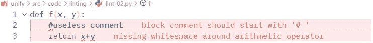

Figure A.11: Visual Studio Code linting example

在 **Visual Studio Code** 中，你通过首选项和设置系统配置 linter。图 A.12 显示了其中一些设置。

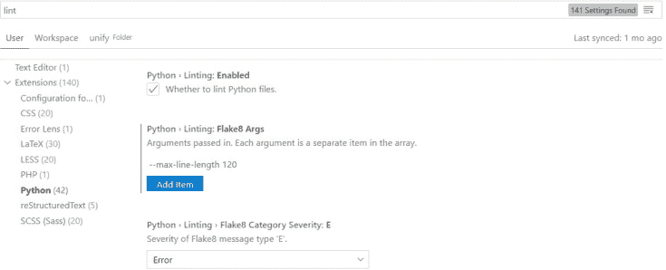

Figure A.12: Visual Studio Code linting settings


## B.2 qiskit.org

Qiskit 开源量子计算软件开发工具包（SDK）的主页是

https://qiskit.org/

了解 **qiskit** 的权威来源是 Qiskit 教科书，网址为

https://qiskit.org/textbook/preface.html

它提供了量子计算的综述以及交互式 Python 示例。[LQCQ]

Qiskit 文档的主网页是

https://qiskit.org/documentation/index.html

所有版本的发布说明位于

https://qiskit.org/documentation/release_notes.html

你可以在 Python 中执行以下命令来查看已安装的 **qiskit** 版本及其组成模块：

```python
import qiskit

qiskit.__qiskit_version__
```

```text
{'qiskit-terra': '0.18.0', 'qiskit-aer': '0.8.2', 'qiskit-ignis': '0.6.0', 'qiskit-ibmq-provider': '0.16.0', 'qiskit-aqua': '0.9.4', 'qiskit': '0.28.0', 'qiskit-nature': None, 'qiskit-finance': None, 'qiskit-optimization': None, 'qiskit-machine-learning': None}
```

这是在发布说明中引用的版本：

```python
qiskit.__qiskit_version__["qiskit"]
```

```text
'0.28.0'
```

## B.3 Python 专家网站

有很多网站可以找到关于用 Python 做各种事情的信息。其中许多是正确的，并且很多使用 Python 3。请寻找最近五年内撰写的文章。如果你看到使用 *print* 且后面没有左括号的代码，那就不要读了。他们讨论的是 Python 2，而不是 Python 3。

我认为 **Real Python** 网站

https://realpython.com/

一直提供关于 Python 编码大多数方面的有用且全面的文章。你可以免费阅读的文章数量有限，之后他们会要求你注册并付费。（我与他们没有商业关系。）

**W3Schools** 上的 Python 教程

https://www.w3schools.com/python/

是查找 Python 示例的好地方。这些示例可能会让你想起完成特定任务的语法或函数或方法。

我建议你访问并使用我们在本书中使用的四个主要 Python 包的网站：**matplotlib**、**numpy**、**pandas** 和 **sklearn**：

- https://matplotlib.org/
- https://numpy.org/
- https://pandas.pydata.org/
- https://sklearn.org/

## B.4 提问与获取答案

当你在网上搜索如何用 Python 做某事时，你很有可能会最终到达 **Stack Overflow**：

https://stackoverflow.com/questions/tagged/python

你会看到关于简单和具有挑战性问题的问答。如果你登录并参与，随着时间推移，你可以对问题和答案进行点赞和点踩。许多答案是有帮助的，但有些是不正确的或由非专家发布的。无论如何，你很可能找到一些可以用于或修改为你项目所用的代码。

即使你暂时不需要这些代码，浏览人们提出的问题也能让你学到很多。你会了解别人在用 Python 做什么。你可以提出自己的问题，但**始终**要先进行彻底的网络搜索。如果你不先做基本研究而浪费专家的时间，他们会感到沮丧。

## 完整的 UniPoly 类

本附录包含我们在*第 7 章，将对象组织成类*中开发的一元多项式 **UniPoly** 类的完整且最终的定义。

```python
"""The unipoly module contains the UniPoly class for polynomials.
"""

# The next line is for the spell-checker in Visual Studio Code
# cspell:ignore radd rsub rmul

class UniPoly:
    """Polynomial with one variable and integer coefficients.

    UniPoly creates a univariate polynomial with a single term
    and an integer coefficient. Polynomials may use different
    variables, here called 'indeterminates', but their names
    must each be a single alphabetic character. These polynomials
    are immutable.

    Parameters
    ----------
    coefficient : int, optional
        The coefficient of the term. Default value is 1.
    indeterminate : str, optional
        The "variable." Must be a single alphabetic character.
        Default value is 'x'.
    exponent : int, optional
        Default value is 0.
    """

    def __init__(self, coefficient=1, indeterminate='x', exponent=0):
        if not isinstance(indeterminate, str) or len(indeterminate) != 1 or \
                not indeterminate[0].isalpha():
            raise ValueError(
                "The indeterminate for a UniPoly must "
                "be an alphabetic str of length 1.")

        self.__indeterminate = indeterminate

        if coefficient != 0:
            self.__terms = {exponent: coefficient}
        else:
            self.__terms = dict()

    # ----------------------------------------------------------------------------
    # Magic methods
    # ----------------------------------------------------------------------------

    def __add__(self, other):
        """Adds a polynomial to a polynomial or an integer.

        Parameters
        ----------
        other : :class:`UniPoly` or int
            A polynomial or integer.

        Notes
        -----
        If the second argument is not a polynomial or integer,
        or if the indeterminates in non-constant polynomials
        are different, returns NotImplemented.

        Returns
        -------
        :class:`UniPoly` or NotImplemented
            The sum of self and other, or NotImplemented.
        """

        if not self.__terms:
            return other

        # if other is an integer, create a constant polynomial
        if isinstance(other, int):
            other = UniPoly(other, self.__indeterminate, 0)

        # both objects are polynomials

        if isinstance(other, UniPoly):
            # if other == 0, return self
            if not other.__terms:
                return self

            if self.__indeterminate != other.__indeterminate:
                if self.is_constant and other.is_constant:
                    return UniPoly(self.constant_coefficient + other.constant_coefficient, self.__indeterminate, 0)

                return NotImplemented

            new_poly = UniPoly(0, self.__indeterminate, 0)

            for exponent, coefficient in self.__terms.items():
                if exponent not in other.__terms:
                    new_poly.__terms[exponent] = coefficient
                else:
                    sum = self.__terms[exponent] \
                        + other.__terms[exponent]
                    if sum:
                        new_poly.__terms[exponent] = sum

            for exponent, coefficient in other.__terms.items():
                if exponent not in self.__terms:
                    new_poly.__terms[exponent] = coefficient

            return new_poly

        return NotImplemented

    def __radd__(self, other):
        """Compute other + self.

        Returns
        -------
        :class:`UniPoly`
            The sum of other and self.
        """
        # Addition is commutative, so we call __add__.
        return self.__add__(other)

    def __bool__(self):
        """Returns True if the polynomial is non-zero, False otherwise.

        Returns
        -------
        bool
        """
        return bool(self.__terms)

    def __call__(self, x):
        """Evaluates a polynomial by substituting `x` for the indeterminate.

        Python calls this when it sees a polynomial being used in function application. If `p` is a polynomial, then `p(3.4)` substitutes 3.4 for the indeterminate and does the math as expressed by the polynomial.

        Parameters
        ----------
        x : any object that supports -, +, *, **
            The value to be substituted for the indeterminate.

        Returns
        -------
        Probably `type(x)`
        """
        result = 0

        for exponent, coefficient in self.__terms.items():
            result += coefficient * x**exponent

        return result

    def __copy__(self):
        """Copies a polynomial, returning a new polynomial.

        This creates a deep copy of a polynomial, even if the original was zero.

        See Also
        --------
        `deepcopy`

        Returns
        -------
        :class:`UniPoly`
            A complete copy of the polynomial.
        """
        new_poly = UniPoly(0, self.__indeterminate)
        for exponent in self.__terms:
            new_poly.__terms[exponent] = self.__terms[exponent]

        return new_poly

    def __deepcopy__(self, memo):
        """Copies a polynomial, returning a new polynomial.

        This creates a deep copy of a polynomial, even if the original was zero.

        See Also
        --------
        `copy`

        Returns
        -------
        :class:`UniPoly`
            A complete copy of the polynomial.
        """
        return self.__copy__()

    def __eq__(self, other):
        """Tests for equality between a polynomial and polynomial or `int`.

        Parameters
```


```python
other : :class:`UniPoly` 或 `int`
    要与当前对象进行相等性测试的对象。

返回
------
bool
    若两个对象在数学上相等，则为 True。
"""

# 如果 other 是一个 `int`，则将其转换为多项式。
if isinstance(other, int):
    other = UniPoly(other, self.__indeterminate, 0)

if isinstance(other, UniPoly):
    # 寻找它们不相等的理由。

    # 它们是否具有不同的不定元？
    if self.__indeterminate != other.__indeterminate:
        return False

    # 它们的项数是否不同？
    if len(self.__terms) != len(other.__terms):
        return False

    # 是否存在指数和系数都相同的项？
    for exponent in self.__terms:
        if exponent not in other.__terms:
            # self 中的某个指数在 other 中缺失
            return False
        if self.__terms[exponent] != other.__terms[exponent]:
            # 相同指数的项的系数
            # 不同
            return False

    # 那么它们必然相等。
    return True

return NotImplemented

def __getitem__(self, exponent):
    """获取具有给定指数的项的系数。
支持通过方括号访问多项式中各项的系数。如果不存在具有给定指数的项，则返回 0。

参数
----------
exponent : int
    表示多项式项指数的非负整数。

返回
-------
int or NotImplemented
    具有给定指数的项的系数。

异常
------
ValueError
    当指数为整数但小于零时抛出。
"""
if not isinstance(exponent, int):
    return NotImplemented
if exponent < 0:
    raise ValueError("polynomial exponents are integers >= 0")

if not self.__terms:
    return 0
return self.__terms.get(exponent, 0)

def __hash__(self):
    """计算多项式的哈希码。

如果 p 和 q 是相等的多项式，那么它们的哈希码相等。

返回
-------
int
    一个整数哈希码。
"""
h = hash(self.__indeterminate)

other : :class:`UniPoly` 或 int
    一个多项式或整数。

备注
-----
如果第二个参数不是多项式或整数，
或者非常数多项式中的不定元
不同，则返回 NotImplemented。

返回
------
:class:`UniPoly` or NotImplemented
    self 与 other 的乘积，或 NotImplemented。
"""

# 如果 self == 0，返回自身
if not self.__terms:
    return self

# 如果 other 是整数，创建一个常数多项式
if isinstance(other, int):
    other = UniPoly(other, self.__indeterminate, 0)

# 两个对象都是多项式

if isinstance(other, UniPoly):
    # 如果 other == 0，返回 other
    if not other.__terms:
        return other

    # 现在有两个非零多项式。

    if self.__indeterminate != other.__indeterminate:
        if self.is_constant and other.is_constant:
            return UniPoly(self.constant_coefficient *
                           other.constant_coefficient,
                           self.__indeterminate,
                           0)
        return NotImplemented

new_poly = UniPoly(0, self.__indeterminate, 0)

for exponent_1, coefficient_1 in self.__terms.items():
    for exponent_2, coefficient_2 in other.__terms.items():
        new_poly += UniPoly(coefficient_1 * coefficient_2,
                            self.__indeterminate,
                            exponent_1 + exponent_2)

    return new_poly

return NotImplemented

def __rmul__(self, other):
    """计算 other * self。

    返回
    -------
    :class:`UniPoly`
        other 和 self 的乘积。
    """

    # 乘法满足交换律，因此我们调用 __mul__。

    return self.__mul__(other)

def __neg__(self):
    """对多项式取负，返回一个新的多项式。

    返回
    -------
    :class:`UniPoly`
        一个新的多项式。
    """
    # 逐项取负多项式，除非它已经是 0
    if not self.__terms:
        return self

    new_poly = UniPoly(0, self.__indeterminate)
    for exponent in self.__terms:
        new_poly.__terms[exponent] = -self.__terms[exponent]

    return new_poly

def __pow__(self, exponent):
"""将多项式进行非负整数次幂运算。

`__pow__` 同时被 ** 和 `pow` 使用。

参数
----------
exponent : int
    self 被提升的非负指数。

备注
-----
如果指数不是非负整数，此方法
返回 NotImplemented。这允许另一个类实现
多项式的商以及像 `p**(-1)` 这样的表达式。

返回
-------
:class:`UniPoly` or NotImplemented
    多项式 `self` 的 `exponent` 次幂，或
NotImplemented。
"""

# 验证指数。
if not isinstance(exponent, int) or exponent < 0:
    return NotImplemented

# 处理简单情况
if exponent == 0:
    return UniPoly(1, self.__indeterminate, 0)

if exponent == 1:
    return self

if exponent == 2:
    return self * self

# 通过递归平方求幂计算指数。
power = self**(exponent // 2)
power *= power
if exponent % 2 == 1:
    power *= self

return power

def __repr__(self):
    """返回多项式的人类可读表示形式。

    备注
    -----
    为简单起见，我们返回 `__str__` 的结果。我们
    应该返回类似这样的内容：
    UniPoly(2, 'x', 6) + UniPoly(1, 'x', 3) + UniPoly(-1, 'x', 0)

    返回
    -------
    str
    """
    return str(self)

def __str__(self):
    """创建人类可读的字符串表示形式。

    这会返回像 2x**6 + x**3 - 1 这样的形式。

    返回
    -------
    str
        多项式的数学人类可读形式。
    """
    if not self.__terms:
        return '0'

    def format_term(coefficient, exponent):
        """格式化多项式中的单项。

        此函数格式化一个项，并处理特殊情况
        如系数为 +/- 1 或指数为
        0 或 1。

        参数
        ----------
        coefficient : int
            该项的系数。
        exponent : int
该项的指数。

返回
------
str
    多项式项的人类可读表示。
"""
coefficient = abs(coefficient)

if exponent == 0:
    return str(coefficient)

if exponent == 1:
    if coefficient == 1:
        return self.__indeterminate
    return f"{coefficient}*{self.__indeterminate}"

if coefficient == 1:
    return f"{self.__indeterminate}**{exponent}"

return f"{coefficient}*{self.__indeterminate}**{exponent}"

# 将格式化并排序后的项收集到 result 中，
# 注意处理开头或中间的负号。

result = ""

for exponent in sorted(self.__terms, reverse=True):
    coefficient = self.__terms[exponent]
    term = format_term(coefficient, exponent)

    if result:
        result += f" - {term}" \
            if coefficient < 0 else f" + {term}"
    else:
        result = f"-{term}" \
            if coefficient < 0 else term

return result

def __sub__(self, other):
    """从多项式中减去一个多项式或一个整数。

参数
----------
other : :class:`UniPoly` 或 `int`
    一个多项式或整数。

备注
-----
如果第二个参数不是多项式或整数，
或者非常数多项式中的不定元
不同，则返回 NotImplemented。

返回
-------
:class:`UniPoly` or NotImplemented
    self 与 other 的差，或 NotImplemented。
"""
if not self.__terms:
    return -other

# 如果 other 是整数，创建一个常数多项式
if isinstance(other, int):
    other = UniPoly(other, self.__indeterminate, 0)

# 两个对象都是多项式

if isinstance(other, UniPoly):
    # 如果 other == 0，返回 self
    if not other.__terms:
        return self

    if self.__indeterminate != other.__indeterminate:
        if self.is_constant and other.is_constant:
            return UniPoly(self.constant_coefficient - other.constant_coefficient, self.__indeterminate, 0)

        return NotImplemented

new_poly = UniPoly(0, self.__indeterminate, 0)

for exponent, coefficient in self.__terms.items():
```


if exponent not in other.__terms:
    new_poly.__terms[exponent] = coefficient
else:
    sum = self.__terms[exponent] \
        - other.__terms[exponent]
    if sum:
        new_poly.__terms[exponent] = sum

for exponent, coefficient in other.__terms.items():
    if exponent not in self.__terms:
        new_poly.__terms[exponent] = -coefficient

return new_poly

return NotImplemented

def __rsub__(self, other):
    """Computes other - self.

    Returns
    -------
    :class:`UniPoly`
        The difference of other and self.
    """

    # other - self == -(self - other)
    # For efficiency, this should be computed like __sub__
    # so we create fewer intermediate polynomials.

    return self.__sub__(other).__neg__()

# ----------------------------------------------------------------------------
# Properties
# ----------------------------------------------------------------------------

@property
def constant_coefficient(self):
    """The coefficient of the term with exponent 0."""
    if self.__terms and 0 in self.__terms:
        return self.__terms[0]
    return 0

@property
def degree(self):
    """Returns the largest exponent in the polynomial."""
    if self.__terms:
        max_degree = None
        for exponent in self.__terms:
            if max_degree is None or exponent > max_degree:
                max_degree = exponent
    else:
        return 0

@property
def indeterminate(self):
    """The indeterminate (or variable) in the polynomial."""
    return self.__indeterminate

@property
def is_constant(self):
    """True if the polynomial only contains a term of exponent 0."""
    if not self.__terms:
        return True
    if len(self.__terms) != 1:
        return False
    return next(iter(self.__terms)) == 0

@property
def minimum_degree(self):
    """The smallest exponent among the non-zero terms, or 0."""
    if self.__terms:
        min_degree = None
        for exponent in self.__terms:
            if min_degree is None or exponent < min_degree:
                min_degree = exponent
    else:
        # Return 0 for the zero polynomial
        return 0

# ------------------------------------------------------------
# Instance methods
# ------------------------------------------------------------

# D

# The Complete Guitar
Class Hierarchy

This appendix contains the complete and final definition of the **Guitar** class for guitars that we developed in *Chapter 7. Organizing Objects into Classes*.

```
```python
"""The guitar module implements the class hierarchy from Chapter 7.

Wooden       MusicalInstrument (ABC)
|            |
|            +-- Clarinet (ABC)
|            |
|            +-- Guitar
|                 |
|                 +-- ElectricGuitar
|                 |
+-------------+-- AcousticGuitar
"""
from abc import ABC, abstractmethod
from enum import Enum


class MusicalInstrument(ABC):
    """Abstract base class for musical instruments.

    Parameters
    ----------
    brand : str
```
Manufacturer brand name. E.g., "Fender".
model : str
    Instrument model name. E.g., "Stratocaster".
year_built : str
    Year the instrument was built.
"""
def __init__(self, brand, model, year_built):
    self._brand = brand
    self._model = model
    self._year_built = year_built

@abstractmethod
def __str__(self):
    """Abstract method -
    creates a human-readable string representation.

    Returns
    ------
    :class:`NotImplementedType`
        NotImplemented
    """
    return NotImplemented

class Guitar(MusicalInstrument):
    """Guitar.

    Parameters
    ----------
    brand : str
        Manufacturer brand name. E.g., "Fender".
    model : str
        Instrument model name. E.g., "Stratocaster".
    year_built : str
        Year the instrument was built.
    strings : int, optional
        Number of strings. Default is 6.

    Also See
    --------
    :class:`MusicalInstrument`
    """
```

```
def __init__(self, brand, model, year_built, strings=6):
    super().__init__(brand, model, year_built)
    self._strings = strings

def __str__(self):
    """Creates a human-readable string representation.

    Returns
    -------
    str
        Description of the guitar.
    """
    return f"{self._strings}-string " \
        + f"{self._year_built} " \
        + f"{self._brand} {self._model}"

class Pickup(Enum):
    """Enumeration type of pickups for electric guitars.
    """
    UNKNOWN = "unknown"
    SINGLECOIL = "single coil"
    HUMBUCKER = "Humbucker"
    ACTIVE = "active"
    GOLDFOIL = "gold foil"
    TOASTER = "toaster"

class ElectricGuitar(Guitar):
    """Electric guitar.

    Parameters
    ----------
    brand : str
        Manufacturer brand name. E.g., "Fender".
    model : str
        Instrument model name. E.g., "Stratocaster".
    year_built : str
        Year the instrument was built.
    strings : int, optional
        Number of strings. Default is 6.

```

```
def __init__(self, wood_name):
    self._wood_name = wood_name

def __str__(self):
    """Creates a human-readable string representation.

    Returns
    -------
    str
        Name of the wood used.
    """
    return self._wood_name

class AcousticGuitar(Guitar, Wooden):
    """Acoustic guitar.

    Parameters
    ----------
    brand : str
        Manufacturer brand name. E.g., "Fender".
    model : str
        Instrument model name. E.g., "Stratocaster".
    year_built : str
        Year the instrument was built.
    soundboard_wood : str
        Kind of wood used in the guitar soundboard.
    strings : int, optional
        Number of strings. Default is 6.

    Also See
    --------
    :class:`Guitar`
    :class:`Wooden`
    """
    def __init__(self, brand, model, year_built,
                 soundboard_wood, strings=6):
        super().__init__(brand, model, year_built, strings)
        Wooden.__init__(self, soundboard_wood)

    def __str__(self):
        """Creates a human-readable string representation.
```

```
Returns
------
str
    Description of the acoustic guitar.
"""
return f"{self._strings}-string " \
    + f"{self._year_built} " \
    + f"{self._brand} {self._model} " \
    + f"with {self._wood_name} soundboard"

class Clarinet(MusicalInstrument):
    """Abstract base class derived from MusicalInstrument.

    See Also
    --------
    MusicalInstrument
    """
    pass

# E
