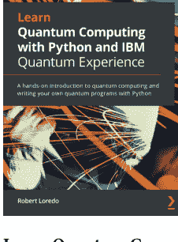
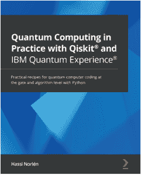

## 其他图书
您可能喜欢

如果您喜欢本书，您可能对Packt出版的其他图书感兴趣：

### 使用Python和IBM Quantum Experience学习量子计算

Robert Loredo

ISBN：978-1-83898-100-6

- 探索量子计算原理，如叠加和量子纠缠
- 熟悉IBM Quantum Experience的内容和布局
- 理解量子门及其如何在量子比特上运行
- 掌握量子信息科学工具包及其元素，如Terra和Aer
- 熟悉量子算法，如Bell State、Deutsch-Jozsa、Grover算法和Shor算法
- 如何创建和可视化量子电路

### 使用Qiskit®和IBM Quantum Experience®进行量子计算实践

Hassi Norlén

ISBN：978-1-83882-844-8

- 在Python中可视化量子比特并理解叠加的概念
- 安装本地Qiskit®模拟器并连接到实际的量子硬件
- 使用Qiskit® Terra在电路级别编写量子程序
- 使用模拟器和IBM Quantum®硬件比较和对比噪声中等规模量子计算（NISQ）与通用容错量子计算
- 使用Qiskit® Ignis减轻量子电路和系统中的噪声
- 通过在Qiskit®中实现Grover算法来理解经典算法与量子算法之间的差异

### Packt正在寻找像您一样的作者

如果您有兴趣成为Packt的作者，请访问 authors.packtpub.com 并立即申请。我们与成千上万的开发人员和技术专业人士合作，就像您一样，帮助他们与全球技术社区分享见解。您可以进行一般性申请，申请我们正在招募作者的特定热门主题，或提交您自己的想法。

### 分享您的想法

现在您已经读完了《与Python共舞》，我们很乐意听到您的想法！如果您从亚马逊购买了这本书，请点击此处直接前往本书的亚马逊评论页面分享您的反馈，或在您购买本书的网站上留下评论。

您的评论对我们和技术社区都很重要，将帮助我们确保提供高质量的内容。
