# 大规模数据管理：Data Mesh and Data Fabric 现代数据架构（第2版）

皮特海因·斯特伦霍尔特是微软荷兰的首席数据官。他担任CDO的对话者，是社区和产品组的推动力。皮特海因也是多产的博主，经常就数据管理的最新趋势发表演讲，包括数据网格概念、数据治理和大规模战略。

# 使用 Azure 进行大规模数据管理

大规模数据管理始于选择一个支持数据无处不在的平台：本地、混合或完全现代化的环境。Azure 提供从边缘到云的完整部署选项，总拥有成本最低。

了解有关 Azure 如何帮助你使用灵活的解决方案和定价来迁移和现代化数据环境的更多信息。

使用 Azure 免费账户和 200 美元信用额度开始。

# 前言

无论何时谈及软件，我们都不可避免地要谈论数据——数据量有多少，数据存储在何处，数据意味着什么，数据源自何处或需要流向何处，以及数据变更时会发生什么。这些问题多年来始终萦绕在我们心中，而我们用来管理数据的技术却在迅速演变。当今的数据库可提供对海量在线数据集的即时访问；分析系统能回答复杂、深入的问题；事件流平台不仅连接不同的应用程序，还提供存储、查询处理和内置的数据管理工具。

随着这些技术的演进，用户的期望也随之提升。用户通常同时连接到许多不同的后端系统，这些系统分布在公司的不同部位，用户在移动端、桌面端和呼叫中心之间切换，更换地点，或在不同应用程序之间迁移。与此同时，他们期望获得无缝且实时的体验。我认为，这带来的影响远比许多人意识到的要大得多。这一挑战涉及大量的软件、数据和人员，它们必须——至少在用户看来——是一个连为一体的整体。

管理像这样的公司级系统向来是一门深奥的艺术，我是在帮助构建支撑 LinkedIn 的基础设施时才对其有所体会。LinkedIn 的所有数据都由永不停歇的流程每天 24 小时持续生成。但当我初到该公司时，用于利用这些数据的基础设施往往局限于每天结束时的大型、缓慢的批量数据转储，以及拼凑起来的自制数据馈送所实现的简单查询。在我看来，“每日结束批处理”这一概念似乎是打孔卡和大型机时代遗留下来的产物。的确，对于一家全球性企业来说，白天永远不会结束。

随着 LinkedIn 的发展，它也变成了一个庞大的软件系统，我清楚地意识到，对于这类问题，并没有现成的解决方案。此外，由于曾构建过支撑 LinkedIn 网站的 NoSQL 数据库，我知道分布式系统技术正迎来新的复兴，这意味着可以构建以前不可能实现的解决方案。这催生了 Apache Kafka，它将可扩展的消息传递、存储和处理相结合，作用于处于 LinkedIn 核心的个人资料更新、页面访问、付款及其他事件流。

尽管 Kafka 精简了 LinkedIn 的数据流，但也影响了应用程序的构建方式。就像上世纪初的许多硅谷公司一样，我们一直在尝试微服务，经过多次迭代才开发出既功能完善又稳定的东西。这个问题不仅关乎软件，同样关乎数据和人员：一个复杂且相互关联的系统，必须随着公司的发展而演进。处理如此大的问题需要一种新型技术，同时还需要配套的新技能集。

当然，当时并没有关于如何应对这一问题的手册。我们是边做边摸索的，但这本书很可能正是我们所需的那本缺失的手册。书中，Piethein 提出了一套全面的数据管理策略，不仅限于单一的数据库或应用程序，而是涵盖当今技术版图中构成的众多数据库、应用程序、微服务、存储层以及所有其他类型的软件。

他还持有鲜明的观点，并配有相匹配的架构，其基础是一套深思熟虑的原则。这些原则以逻辑护栏界定了决策空间，其中应能容纳大量实用解决方案。我认为，当架构师和工程师将自己的问题领域映射到本书描述的权衡之上时，这种方法将非常有价值。的确，Piethein 带领你踏上一段超越数据和应用程序、深入将整个公司连接在一起的丰富互动网络的旅程。

> — Jay Kreps
> Confluent 联合创始人兼首席执行官

# 前言

数据管理是一个新兴且颠覆性的主题。数据化无处不在。这种变革正在我们周围发生：在智能手机、电视设备、电子阅读器、工业机器、自动驾驶汽车、机器人等等。它正以加速的速度改变着我们的生活。

随着产生的数据量急剧增加，其复杂性也随之上升。云化、API 与生态系统连接、微服务、开放数据、软件即服务（SaaS）以及新的软件交付模式等颠覆性趋势对数据管理产生了巨大影响。与此同时，我们看到大量新应用正在改变我们的业务。所有这些趋势都在碎片化数据版图。因此，我们看到了越来越多的点对点接口、关于数据质量和数据所有权的无休止讨论，以及涉及隐私、安全和防护的众多伦理和法律两难困境。敏捷性、长期稳定性和清晰的数据治理与迅速开发新业务用例的需求相互竞争。我们迫切需要为数据管理的未来制定清晰的愿景。

本书对数据管理的看法源于我作为首席数据架构师为一家大型企业制定数据架构议程的个人经历。担任该职位让我清楚地看到，良好的数据战略对大型组织可能产生的影响。离开那家公司后，我开始担任微软荷兰分公司的首席数据官。在这个令人兴奋的新职位上，我与 50 多家大型客户合作，讨论并试图制定完美的数据解决方案。以下是我在所有企业中识别出的一些共同点：

- 往往缺乏全局性的数据战略，或该战略与业务目标不相连接。关于数据管理的讨论大多偏向技术趋势和工程讨论。需要的是业务参与：一份良好的策略以及经过深思熟虑的数据管理和分析计划，其中以业务用例的形式包含切实的价值。也就是说：重点必须放在使用和将数据转化为业务价值上。


- 企业在解释数据网格和数据结构等新概念时存在困难，因为缺乏来自实践领域的指导和经验。此外，数据网格完全拥抱去中心化方法，这是一种不仅针对数据架构和技术，甚至更针对组织和流程的变革性变化。这意味着变革不能仅由 IT 主导；这也是一场业务变革。
- 企业难以理解最新的技术趋势。它们无法解读细微差别或做出务实的选择。
- 企业在起步阶段举步维艰：宏大的蓝图往往只落得有限的行动；执行计划和架构过于高层、过于概念化；缺乏来自领导层的自上而下承诺。

这些经验以及我对多家企业的观察激励我撰写*大规模数据管理*第二版。你或许会问，与第一版相比，这本书值得阅读吗？让我们深入了解一下。

# 我为何撰写此书，为何此刻撰写

第一版立足于我在 ABN AMRO 担任首席数据架构师期间积累的经验。¹ 担任该职务期间，我的团队和我实践了联邦制方法：根据更快速变革的需求，调整活动和职责。我们利用治理来平衡集中化与去中心化的要求。这一转变由一个中央数据团队支持，该团队开始开发平台，赋能业务单元实现其目标。借助平台，我们引入了自助服务，并将分析师与领域相匹配，支持他们实施用例。我们尝试了领域驱动设计，并最终转向业务架构，以整体管理架构图谱。我将所有这些经验作为撰写第一版的素材。

*数据网格* 一词作为描述大规模使用数据的社会技术方法的术语，大约在第一版手稿定稿之时被提出。当扎马克·德赫甘尼撰文描述该概念并在马丁·福勒网站上发表时，它为我们在 ABN AMRO 已使用多年的概念提供了具体名称。这些名称成为行业术语，该概念迅速开始与大型组织产生共鸣，成为企业规模化时遇到的摩擦问题的解决方案。

那么，为何要撰写第二版？首先，是源于数据网格概念。我喜欢将数据管理与软件架构更紧密地结合起来，并让企业对其数据拥有所有权的想法，但我坚信，在所有喧嚣之下，需要一种更细致入微的视角。¹

¹ 本书表述的观点和意见不一定反映 ABN AMRO 或 Microsoft 的立场。

在我之前担任企业架构师的职位中，我们需要管理数百个应用程序团队、数千项服务以及众多大型遗留应用程序。在这种情况下，处理复杂性的方法与众不同。在数据网格架构中，艺术家、歌曲和播放列表常被用作数据领域示例。将数据分解为细粒度领域的方法在设计微服务时可能效果不错，但并不适合（重新）构建大型数据图谱。规模化需要不同的视角。接下来，需要对数据产品有一个更细致、更务实的视角。数据必须全面、端到端地进行管理，这是有充分理由的。企业对可重用性和一致性有顾虑。受法规约束，它们必须在集团报告、会计、财务报告以及审计和风险管理方面遵循相同的维度。我知道这听起来可能有争议，但不能主张将数据产品作为容器来管理：即在微服务般微小的架构中，将数据、元数据、代码和基础设施全部打包在一起。这不符合当今大数据平台的工作方式。最后，数据网格的故事并不完整：它仅关注用于分析目的的数据，而非运营目的的数据；它遗漏了主数据管理；² 消费者端必须辅以智能数据结构；而且它对构建数据产品的数据建模指导不足。

² 术语“主/从”显然具有冒犯性，许多组织已转而使用“源/副本”或“主/从属”等替代方案。我们尽可能做到包容，但本书将继续使用“主数据管理”，因为行业尚未采纳替代方案。

出版第二版的另一动力是对本书实用性的担忧。各位读者普遍认为第一版过于抽象。一些批评性评论者甚至留言质疑我的实操经验。在第二版中，我努力回应这些担忧，提供了大量真实案例和具体的解决方案图表。我还不时引用自己关于如何实施设计的博客文章。最后要说明的是：需要涵盖大量极其复杂的主题，且这些主题高度依赖上下文。在一本书中不可能提供所有内容的示例，因此我不得不酌情取舍。

我很高兴分享我在最佳实践和实地观察方面的想法，并希望本书能给你带来启发。回顾我在 ABN AMRO 工作的时光，可以从其他企业身上学到许多宝贵经验。我见过很多好的方法。构建良好的数据架构并无对错之分，关键在于做出正确的权衡，并找到最适合你情况的方法。

如果你已经读过第一版，应该会发现这一版有显著不同，并且改进更大。在结构上它大致相同，但每一章都经过修订和增强。所有图表也已修订，新增了内容，并且更加实用。在每一章中，你会发现许多技巧、起点以及有用文章的引用。

# 本书适合谁阅读？

本书面向大型企业，但较小的组织也能从中获得很多有价值的内容。本书面向以下人群：

- 高管和架构师
  - 首席数据官、首席技术官、首席架构师、企业架构师和首席数据架构师

- 分析团队
  - 数据科学家、数据工程师、数据分析师和分析负责人

- 开发团队
  - 数据工程师、数据科学家、商业智能工程师、数据建模师和设计师，以及其他数据专业人员

- 合规与治理团队
  - 首席信息安全官、数据保护官、信息安全分析师、监管合规负责人、数据管家和业务分析师

# 如何阅读或使用本书

首先需要说明的是，本书涉及许多复杂主题，这些主题常常相互关联或与其他学科交织。因此，我们将在不同的技术、业务方法、框架和架构模式之间跳跃。不时地，我会分享自己在实施不同架构时的操作经验，因此我们将在不同的抽象层次上工作。为了描述阅读本书的过程，我将使用直升机之旅的比喻。

我们将从宏观视角开始，在抽象和高层次上审视数据管理、数据战略和数据架构。从这个直升机视角出发，我们将开始放大，首先探索什么是数据领域和着陆区。接着，我们将飞向我们图谱中的源系统一侧，在那里管理应用程序并产生数据，并盘旋直到覆盖大多数数据管理领域。随后，我们将飞向图谱的消费者一侧，开始了解那里的动态。之后，我们将把所学的一切结合起来，付诸实践。

为了帮助你在书中导航，下表概述了每章将深入讨论的主题。


# 表 P-1. 各章关键主题

| | 第 1 章 | 第 2 章 | 第 3 章 | 第 4 章 | 第 5 章 | 第 6 章 | 第 7 章 | 第 8 章 | 第 9 章 | 第 10 章 | 第 11 章 | 第 12 章 |
|---|---|---|---|---|---|---|---|---|---|---|---|---|
| 数据管理 | x | | | | | | | | | | | |
| 数据策略 | x | x | x | | | | | | | | x | |
| 数据架构 | | x | x | | | | x | | | | x | |
| 数据集成 | | | | x | x | x | x | | | | | |
| 数据建模 | | | | x | | | x | | x | | | |
| 数据治理 | | | | | | | | x | | | | |
| 数据安全 | | | | | | | | x | | | | |
| 数据质量 | | | | x | | | | | | | | |
| 元数据管理 | | | | | | | | | x | | | |
| MDM | | | | | | | | x | | | | |
| 商业智能 | | | | | | | | | | x | | |
| 高级分析 | | | | | | | | | | x | | |
| 企业架构 | | | | | | x | | | | | x | |

第 1 章介绍数据管理主题。它提供了关于数据管理是什么、它如何变化以及如何影响我们的数字化转型的上下文视角。它还对近年来该领域的状况进行了评估，并为制定数据策略提供了指导。在第 2 章中，我们将深入探讨大规模数据管理的细节，探索领域驱动设计和业务架构作为使用数据域管理大规模数据景观的方法论。接下来，第 3 章专注于拓扑和数据着陆区，作为构建数据架构并与数据域对齐的方式。

以下章节讨论数据分发的具体内容。第 4 章专注于数据产品、命令查询职责分离 (CQRS) 和指导原则，并展示了示例解决方案设计。第 5 章讨论 API 管理，第 6 章涵盖事件和通知管理。第 7 章将所有内容汇总，提供全面的概述，并辅以架构指导和经验。

接下来，我们深入探讨数据管理的更高级方面。第 8 章探讨了如何以实用且可持续的方式处理数据治理和安全，即使在快速变化的时期也是如此。第 9 章深入探讨元数据的使用、重要性和民主化潜力。第 10 章提供了关于使用主数据管理 (MDM) 在分布式、广泛的资产上保持数据一致性的指导，而第 11 章则涉及将数据转化为价值。第 12 章通过一个实现示例以及对数据管理和企业架构未来的愿景来结束本书。

# 本书使用的约定

本书使用以下排版约定：

## 斜体

表示新术语、URL、电子邮件地址、文件名和文件扩展名。

## 等宽体

用于程序清单，以及在段落中引用变量或函数名、数据库、数据类型、环境变量、语句和关键字等程序元素。


此元素表示提示或建议。


此元素表示一般性说明。


此元素表示警告或注意事项。

## O'Reilly 在线学习


超过 40 年来，_O'Reilly 媒体_一直提供技术和商业培训、知识和洞察，以帮助公司取得成功。

我们独特的专家和创新者网络通过书籍、文章和我们的在线学习平台分享他们的知识和专长。O'Reilly 的在线学习平台让您按需访问实时培训课程、深度学习路径、交互式编码环境，以及来自 O'Reilly 和 200 多家其他出版商的大量文本和视频。有关更多信息，请访问 _http://oreilly.com_。

# 如何联系我们

请将有关本书的意见和问题发送给出版社：

O'Reilly 媒体公司
1005 格拉文斯坦北部高速公路
加利福尼亚州塞巴斯托波尔 95472
800-998-9938 (美国或加拿大)
707-829-0515 (国际或本地)
707-829-0104 (传真)

我们为本书提供了一个网页，列出了勘误表、示例和任何其他信息。您可以通过 https://oreil.ly/data-mgmt-at-scale-2e 访问该页面。

发送电子邮件至 bookquestions@oreilly.com 以评论或就本书提出技术问题。

有关我们的图书、课程、会议和新闻的更多信息，请访问我们的网站 http://www.oreilly.com。

在 Facebook 上找到我们：http://facebook.com/oreilly。

在 Twitter 上关注我们：http://twitter.com/oreillymedia。

在 YouTube 上观看我们：http://youtube.com/oreillymedia。

# 致谢

我要感谢 Jessica Strengholt-Geitenbeek 允许我撰写本书。她在整个过程中一直支持我，照顾孩子并为我创造工作空间，她是我的挚爱。

我也要感谢 ABN AMRO，尤其是 Santhosh Pillai 对我的信任以及在我在该公司的职业生涯中对我的指导。该项目的许多最初想法都源自他。如果没有他和我之间无数次的讨论，本书就不会存在。接下来，我要感谢 Microsoft 为我撰写第二版提供所需的支持。此外，还有许多人对本书提供了支持和反馈：感谢 Tim Ward (CluedIn 首席执行官)、Batuhan Tuter、Nasim Mehrshid、Rob Worrall、Frank Leisten 以及以各种方式做出贡献的其他所有人。

还要感谢本书的技术审稿人 John Mallinder 和 Ole Olesen-Bagneux。您的宝贵见解和反馈帮助验证了技术内容，使本书更加出色。

最后，我要感谢 O'Reilly 的所有出色团队成员对我的支持和信任。Shira，感谢您照顾我。我喜欢我们的谈话，并感谢您的建设性反馈。Katie，感谢您持续的支持和透明度。我出色的编辑 Rachel Head，感谢您审阅和编辑所有内容所付出的艰苦工作。您通过调试内容和连接我的句子，确实做出了出色的工作。

# 成为数据驱动型组织的旅程

COVID-19 之前的世界已经快节奏且高度数据驱动，但变化的步伐已迅速加快。激烈的竞争、数字优先时代、不断提高的客户期望以及日益严格的监管审查，要求组织将自身转型为现代数据驱动型企业。这种转型必然会导致未来的组织比当今的组织更加数字化，并对数据持有不同的看法。明天的组织将以数据为生命，拥抱一种将数据置于业务核心的哲学。他们将把数据作为产品来管理，基于数据分析做出战略决策，并拥有以数据为驱动的行动文化。

数据驱动不仅仅是一个流行词。1 数据驱动为组织相对于其他组织提供了显著的竞争优势。它可以主动出击，并能在事情发生之前预测将要发生的事情。通过正确使用数据，组织可以快速应对变化。使用数据能带来更大的信心，因为决策基于事实而非直觉。有了数据，可以更早地发现新的行业趋势和商业机会。客户留存率和满意度也会提高，因为数据能告诉组织客户在想什么、他们的行为如何以及他们想要什么。有了数据，组织可以更加灵活、敏捷且成本效益更高，因为数据能提供关于衡量结果、员工忠诚度、依赖关系、应用程序和流程的洞察。因此，组织将自身转型为数据驱动型企业的必要性是确凿的。

在深入探讨转型本身之前，我们将探讨当今要求我们重新评估数据管理方式的挑战。我们将建立数据管理的通用定义，涵盖与将数据作为资产进行管理相关的所有学科和活动。之后，我们将聚焦于几个


关键技术发展和行业趋势，并考虑其对数据管理的影响。我们将回顾过去十年数据管理中的一些最佳实践，探讨为何上一代架构难以扩展。最后，我们将探讨下一代数据架构可能是什么样子，我将提出一系列行动要点，这些要点在制定数据战略时需要解决。

## 最近的技术发展和行业趋势

将组织转变为数据驱动型组织并非易事。这是一个需要耐心和毅力的长期过程。随着数据量的增加，传统架构由于其规模、复杂性、单体设计和集中式运营模式，已无法再进行纵向扩展。企业需要新的数据战略和基于云的架构。还需要范式转变和文化变革，因为当今有效的集中式数据和IT运营模式，在应用联邦数据所有权和自助式消费模式时将不再有效。这要求组织重新定义人员、流程和技术如何与数据保持一致。

最近的技术发展和行业趋势迫使我们重新思考如何管理数据。我们需要从将所有数据漏入单一数据孤岛，转向能够使领域、团队和用户轻松、安全地自行分发、消费和使用数据的方法。平台、流程和模式应简化他人的工作。我们需要简单、文档完善、快速且易于消费的接口。我们需要能够大规模运行的架构。

尽管向真正数据驱动型组织演进有许多积极方面，但了解几项正在影响数据版图的技术发展和行业趋势也很重要。在本章中，我将逐一讨论这些趋势及其对数据管理的影响。首先，由于用例多样性，分析正在碎片化数据版图。其次，新的软件开发方法论正在使数据更难以管理。第三，云计算和更快的网络正在碎片化数据版图。此外，还需注意隐私、安全和合规性问题，而数据的快速增长和高强度数据消费正在使运营系统承受压力。最后，数据货币化需要生态系统对生态系统的架构。这些趋势对数据管理的影响巨大，正迫使整个行业重新思考未来如何开展数据管理。

幸运的是，近年来出现了新的数据管理方法，包括数据网格和数据网状结构的理念：

- 数据网格是一种用于大规模数据管理的令人兴奋的新方法论。该概念预见了一种架构，其中数据高度分布，可通过联邦责任实现可扩展性。它强调人为因素，并解决管理日益复杂的数据架构所面临的挑战。

- 数据网状结构是一种通过添加智能并利用自助服务简化数据访问来解决当今数据管理和可扩展性挑战的方法。与数据网格相比，它更侧重于技术层。它是一种架构愿景，使用统一元数据与端到端集成层（网状结构），以便轻松访问、集成、配置和使用数据。

这些新兴的数据管理方法相辅相成，且常有重叠。尽管数据从业者中普遍持此观点，商业厂商也如此宣称，但它们不应被视为僵化或独立的技术。事实上，我预计这些方法将共存并相互补充，并与任何现有的运营数据存储、数据仓库和数据湖投资相辅相成。

在向数据驱动型组织转型过程中，组织需要权衡利弊，以平衡集中化与分散化的要求。有些组织倾向于为其业务团队提供高度的自主权，而另一些则更注重质量和控制。有些组织结构相对简单，而另一些则规模庞大且复杂。打造完美的治理结构和数据架构并非易事，因此在制定战略时，我鼓励您将这些数据管理方法视为框架。没有对错之分。例如，在采用数据网格方法时，您可能喜欢其中的一些最佳实践和原则，但不喜欢其他；您不一定非要全部应用。

在本书中，我将分享我对数据管理的看法——这一观点基于与众多大型企业紧密合作时的实地观察，并能通过向他人学习帮助您做出正确决策。我们将超越数据网格和数据网状结构的概念，因为我坚信数据战略应涵盖运营平面和分析平面，并且数据领域和数据产品的分解方法必须经过调整，以适应大型企业的规模。为助您踏上旅程，我将分享关于不同企业设计的战略和架构、其原因以及所做权衡的观察。

在深入细节之前，我们需要就什么是数据管理以及为何它很重要达成一致。接下来，我们需要确定如何根据各种权衡来定义边界并塑造我们的版图。最后，我们将探讨当前企业数据架构如何为今天和明天进行设计和组织。

让我直言不讳：分散化并非理想状态，而是数据不可避免的未来。因此，我坚信可扩展性正迫使数据管理变得更加分散化。大规模数据管理要求您联邦关键职责、制定强有力的标准，并妥善协调中央和本地资源与活动。这一变化影响多个领域：人员、流程和技术。它迫使您分解架构，划分和分组职责。从集中化向分散化的转变也与过去十年确立的最佳实践相矛盾：构建大型数据孤岛，在其中收集和集成所有数据后再提供服务。尽管数据仓库和数据湖架构是利用数据的优秀方法，但这些集中式模型不适合分散化的分布式数据架构。

现在既然已经铺垫完毕，我请您深呼吸并放下成见。我们许多人可能深度投入于集中式数据架构；多年来这一直是最佳实践。我承认数据标准化以及将大量数据纳入特定上下文的需求依然存在，并且这样做能为组织带来价值，但我们必须考虑的是应用这一纪律的规模。在拥有数百甚至数千个应用程序的高度分布式生态系统中，管理数据的最佳方式是否是对所有维度应用集中化？是否最好集成和标准化所有数据？

## 数据管理

数据管理一词是指用于管理数据的一系列流程和程序。数据管理协会的《数据管理知识体系》(DAMA-DMBOK) 对数据管理有更详细的解释，将其定义为“在整个生命周期中交付、控制、保护并提升数据和信息资产价值的计划、政策、计划和实践的开发、执行与监督”。22 DAMA-DMBOK 指出数据管理有11个职能领域，数据治理位于核心位置，如图 1-1 所示。将所有这些都深植于组织中至关重要。否则，您将缺乏洞察力且效果不佳，数据也将失控。要成为数据驱动型组织——从数据中榨取尽可能多的价值——将成为一项挑战。例如，如果数据质量低劣，分析将毫无价值。

22 知识体系由 DAMA 社区开发。其更新周期较慢：第一个版本发布于 2008 年，第二个版本于 2014 年发布。


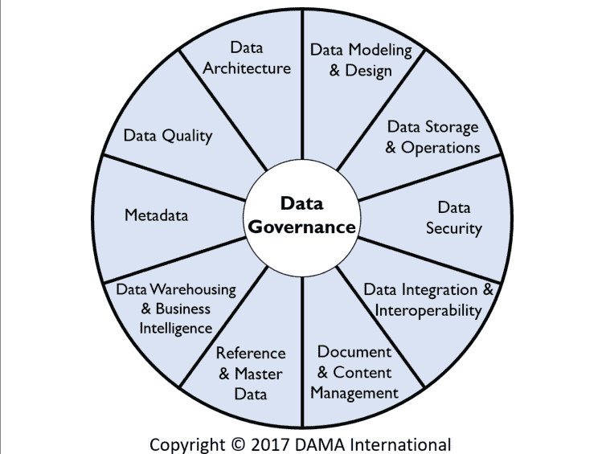

### 图 1-1. 数据管理的 11 个功能领域

数据管理的活动和学科范围广泛，涵盖多个领域，其中一些与软件架构密切相关。3 在本书中，我将专注于数据管理中与大规模管理现代数据架构最相关的方面。让我们仔细看看此图中识别的 11 个领域，以及它们在本书中的位置：

- 数据治理，如图 1-1 所示位于核心位置，涉及围绕实施和强制执行对数据管理的权威和控制的所有活动，包括所有相应资产。此领域在第 8 章中有详细描述。
- 数据架构涉及为您的数据定义总体计划，包括蓝图、4 参考架构、未来状态愿景和依赖关系。

3 软件架构是指为开发满足业务需求的系统所需的软件设计和高级结构，包括灵活性、可扩展性、可行性、可重用性和安全性等特征。如果您想了解更多，请阅读 Mark Richards 和 Neal Ford 所著的《软件架构基础》（O’Reilly）。

4 蓝图也称为参考实现。它包含基础设施即代码（IaC）定义，以便为特定用例成功创建一组服务。

管理这些可帮助组织做出决策。整本书围绕数据架构展开，但该学科及其活动将在第 2 章和第 3 章中全面介绍。

- 数据建模与设计是关于在特定上下文和特定系统中结构化和表示数据。发现、设计和分析数据需求都属于此学科范畴。我们将在第 4 章、第 7 章和第 11 章中讨论这些主题。

- 数据存储与运维是指对数据库设计、正确实施和支持进行管理，以最大限度地发挥数据的价值。数据库管理还包括数据库运维管理。我们将在第 11 章中对此进行阐述。

- 数据安全包括提供安全身份验证、授权和数据访问的所有学科和活动。这些活动包括预防、审计和升级缓解措施。此领域在第 8 章中有更详细的描述。

- 数据集成与互操作性包括与移动、收集、整合、组合和转换数据相关的所有学科和活动，以便将数据高效地从一个上下文移动到另一个上下文。数据互操作性是指在各种应用程序之间通信、调用函数或传输数据的能力，且需很少或无需了解应用程序特征。另一方面，数据集成是指将来自不同（多个）来源的数据整合为统一视图。我认为这一过程最为重要，通常由复制和 ETL（提取、转换和加载）工具等额外工具支持。该过程在第 4 章、第 5 章和第 6 章中有详尽描述。

- 文档和内容管理是管理存储在非结构化（媒体）和数据格式中的数据的过程。其中一些方面将在第 5 章和第 6 章中讨论。

- 参考数据和主数据管理是关于管理关键数据，以确保数据可访问、准确、安全、透明和可信。此领域在第 10 章中有更详细的描述。5

- 数据仓库与商业智能管理包括提供商业洞察并支持决策的所有活动。此领域（包括高级分析）在第 11 章中有更深入的描述。

5 本书使用“主数据管理”（MDM）一词，因为它已被广泛采用，在撰写本书时尚无行业通用的替代方案，但我们欢迎对“主/从”术语提出更具包容性的替代方案。

- 元数据管理涉及管理对数据进行分类和描述的所有数据。元数据可用于使数据易于理解、可集成和安全。它还可用于确保数据质量。此领域在第 9 章中有更详细的描述。
- 数据质量管理包括与管理数据质量相关的所有活动，以确保数据可使用。此领域的某些方面在第 2 章和第 3 章中有所描述。

DAMA-DMBOK 中需要更多工作的部分，也是激励我撰写本书第一版的部分，是关于 *数据集成与互操作性* 的章节。我认为该章节缺乏深度：它与应用集成和软件架构的关系不清晰。它没有讨论去中心化架构，并且在数据互操作性方面缺乏现代指导，例如可观测性最佳实践和现代数据流水线管理。此外，它与元数据管理的关联较弱。元数据也需要集成和互操作性，因为它分散在许多工具、应用程序、平台和环境中，形态各异。元数据互操作性——即两个或多个系统或组件交换关于数据的描述性数据的能力——未得到足够重视：构建和管理大规模架构在很大程度上关乎元数据集成。互操作性和元数据也与数据架构领域未很好地关联。如果以正确方式利用元数据，您可以看到哪些数据正在流动，如何对其进行集成、分发和保护，以及它如何与应用程序、业务能力等关联。DAMA-DMBOK 中关于如何通过利用和连接元数据来整体管理数据的指导有限。

我还担心 DAMA 和许多组织对实现端到端语义一致性的看法。截至目前，为提供企业范围的一致性而统一语义的尝试仍在进行。这被称为 *单一真实版本*。然而，应用程序始终是独特的，*数据亦是如此*。设计应用程序涉及大量隐性思维。业务问题的（领域）上下文影响应用程序的设计，并渗入数据中。当我们从概念设计进入逻辑应用设计和物理应用设计时，会经历这个上下文。6 理解这一点至关重要，因为它为任何未来架构定下基调。当数据在应用程序之间移动时，始终需要数据转换步骤！无法逃避这个数据转换困境！在后续章节中，我将回到这一想法。

6 如果您想了解数据建模的不同阶段，请参阅我的博客文章《数据集成与数据建模揭秘》。概念模型有时也称为 *业务模型*、*领域模型*、*领域对象模型* 或 *分析对象模型*。

我在许多组织中看到的另一种观点是，数据管理应该是集中式的，并且必须与企业的战略目标相连接。一些组织仍然认为，通过集中化所有数据和管理活动可以降低运营成本。还存在一种深层假设，即集中式平台可以为其用户和消费者消除数据集成的痛苦。公司大力投资于其企业数据平台，其中包括数据仓库、数据湖和服务总线。主数据管理活动与这些平台紧密相关，因为整合使我们能够同时提高最关键数据的准确性。

集中式平台——以及随之而来的集中式模型——将面临失败，因为它无法跟上支撑去中心化的发展和趋势，例如分析、云计算、新的软件开发方法论、实时决策和数据货币化。虽然许多公司可能意识到这些趋势，但它们未能理解这些趋势对数据管理的影响。让我们审视最重要的趋势，并确定该影响的程度。

## 分析正在碎片化数据格局

最具开创性的趋势是 *高级分析*，它利用数据使公司更具响应力、竞争力和创新力。为什么高级分析会颠覆现有的数据格局？随着更多数据的可用性，选项和机会的数量呈爆炸式增长。高级分析是关于进行什么如果分析、预测未来趋势和结果或事件、检测隐藏的关系和行为，以及自动化决策。由于高级分析的公认价值和战略效益，已开发出许多方法论、框架和工具，以多种不同的方式使用它。我们才刚刚触及人工智能（AI）、机器学习（ML）和自然语处理（NLP）在未来能够做到的事情的表面。


OpenAI 的新 ChatGPT 是 AI 能力的一个令人惊叹的示例。OpenAI 背后的模型（包括生成式预训练变换器（GPT）系列）可以处理复杂任务，例如分析数学问题、编写代码片段、撰写书评、使用食材清单创建食谱，以及更多。

这些分析趋势迫使数据分布在许多分析应用程序中，因为每个单独的用例都需要不同的数据。独特的业务问题需要独特的思维、独特的数据和优化的技术，以提供最佳解决方案。举个例子，一个市场营销业务部门的目标是为年长和年轻客户识别新的销售机会。针对这些


两个受众群体需要不同的特征——用于分析的可衡量属性——在数据集中。例如，年轻的潜在客户将与年长的潜在客户进行不同的细分和聚类。要求营销部门对两个目标受众群体使用单一数据集需要做出许多妥协，你最终可能会得到一个对每个用例都未增加任何价值的特征存储。7 生成最大价值的最佳方案是为每个用例提供针对每个学习算法优化的独特特征集。高级分析日益普及以及由此产生的用例多样性问题导致两个问题：数据泛滥和数据密集度。

在数据泛滥的情况下，数据分布在众多位置、应用程序和数据库中，呈分散状态。这是因为消费领域需要处理数据以使其适应其独特的解决方案。这种数据分布引入了其他问题。首先，当数据在组织中反复复制和分散时，查找其来源和判断其质量变得更加困难。这要求你为在不同位置管理的相同数据开发单一逻辑视图。此外，大规模的数据分布使得控制数据变得更加困难，因为数据一旦离开任何给定应用程序，可能会被进一步传播。这要求你开发一个高效重用数据的框架，同时应用治理并遵守外部法规。

分析技术的泛滥也在加速数据密集度的增长：读写比例正在发生显著变化。例如，不断重新训练的分析模型会持续读取大量数据。这会影响应用程序和数据库设计，因为我们需要针对数据可读性进行优化。这也可能意味着我们需要复制数据，以减轻系统不断提供数据的压力，或者因为大量多样的用例变体及其相关的读取模式而需要预处理数据。此外，我们可能需要为许多不同的消费者提供相同数据的不同表示。在复制数据并保持控制的同时，促进高度多样的读取模式并不容易。本问题的解决方案将在第 4 章中提供。

## 软件交付速度正在改变

在当今世界，基于软件的服务是大多数企业的核心，这意味着新功能和特性必须快速交付。为了回应对更大敏捷性的需求，亚马逊、Netflix、Meta、谷歌和 Uber 等公司涌现出新的意识形态。这些公司基于两个信念推进了其软件开发实践。

7 特征存储是用于存储常用特征（现象的个别可衡量属性或特征）的工具。

第一个信念是，软件开发（Dev）与信息技术运维（Ops）必须结合，以缩短系统开发生命周期并提供高质量的持续交付。这种称为 DevOps 的方法论需要一种新文化，这种文化拥抱更多的自主权、开放沟通、信任、透明度和跨学科团队合作。

第二个信念是关于应用程序必须开发的规模。当应用程序转换为更小的解耦服务时，开发的灵活性和速度预计会提高。这种开发方法包含几个流行语：*微服务、容器、Kubernetes、领域驱动设计、无服务器计算* 等。我暂时不会详细介绍所有这些概念，但重要的是要认识到，软件开发的这种演进涉及更高的复杂性以及对更好地控制数据的更大需求。

将单体应用程序转换为分布式应用程序（例如，微服务）为数据管理带来许多困难。在将应用程序拆分为更小的组件时，数据会分布在不同的较小组件中。开发团队还必须将其（单一）独特数据存储（在那里他们完全了解数据模型并将所有数据对象放在一起）转换为数据对象分散到处里的设计。这引入了几个挑战，包括增加的网络通信、需要同步的数据读取副本、合并许多数据集时的困难、数据一致性问题、引用完整性问题等等。

软件开发趋势的最近转变需要一种架构，允许更精细的应用程序分发其数据。它还需要一种新的 *DataOps* 文化和一种不同的设计哲学，更加强调数据互操作性、不可变事件的捕获以及可重现和松散耦合。我们将在第 2 章中更详细地讨论这一点。

## 云对数据管理的影响是无法估量的

网络正在变得更快，带宽年复一年地增加。大型云供应商已经证明，在几分钟内将 TB 级数据移动到云中是可能的，这允许一种有趣的方法：与其将计算能力带到数据——由于网络限制，这一直是常见的最佳实践——不如扭转过来，通过分发数据将数据带到计算能力所在之处。网络不再是瓶颈，因此我们可以在环境之间快速移动数据，以允许应用程序消费和使用它。随着软件即服务（SaaS）和机器学习即服务（MLaaS）市场日益流行，这种模式变得特别有趣。与其在内部完成所有复杂工作，不如利用网络向其他各方提供大量数据。

这种复制（复制）数据并将其带到不同设施（例如云数据中心）中的计算能力处的分发模式，将进一步碎片化数据格局，使清晰的数据管理策略比以往任何时候都更加重要。它要求你提供指导方针，因为数据碎片化可能会由于数据访问滞后而对性能产生负面影响。它还要求你以不同的方式组织和建模数据，因为云服务提供商设计了分离的计算和存储，以使它们可以独立扩展。

## 隐私和安全问题是最高优先级

企业需要重新思考数据安全，以应对数据源泛滥和数据量不断增长的问题。数据无疑对于希望优化、创新或使自身差异化的组织至关重要，但也存在一个更黑暗的一面，其不友好的内涵包括数据盗窃、歧视以及破坏民主价值观的政治危害。让我们看几个例子，了解不良数据隐私和安全的影响。

UpGuard 维护着迄今为止最大数据泄露的长名单，其中许多泄露利用了相同的错误。剑桥分析公司泄露事件和万豪酒店 5 亿个被黑客攻击的账户是破坏性事件的显著例子。政府越来越多地介入安全和隐私，因为我们个人和职业生活的各个方面现在都已连接到互联网。迫使我们许多人在家工作和社交的 COVID-19 大流行加速了这一趋势。企业无法忽视知识产权侵权和数据隐私丑闻的威胁。

大数据、更强大的高级分析以及更快的数据分发趋势引发了围绕数据危险的辩论，提出了伦理问题和讨论。让我分享我自己国家的一个例子。在荷兰，荷兰税务管理局实行非法和歧视性活动。他们在系统中跟踪双重国籍人士，并使用种族和民族分类来训练模型，以确定育儿津贴资格。结果：成千上万个家庭被错误地归类为罪犯，其津贴被停止。他们被命令偿还已经领取的款项，有时是因为技术性违规，例如未能正确签署表格。有些人在被拒绝债务重组准入后，被迫出售自己的房屋和财物。

这只是数据不当使用的一个例子。随着组织难免犯错并越过道德红线，我预计政府将通过要求更多的安全、控制和洞察力来加强监管。我们只是触及了真正数据隐私和伦理问题的表面。法规，例如新的欧洲


关于数据治理和人工智能的法律将迫使大公司公开其收集和购买的数据、合并的数据、分析模型中使用的数据以及分发（出售）的数据。如果大公司还未这样做，现在就需要开始思考透明度和隐私优先方法，以及如何处理重大监管问题。

监管是一个复杂的主题。想象一下，在使用多个云区域和不同 SaaS 服务且数据分散的情况下，满足 GDPR、CCPA、BCBS 239 和新的跨大西洋数据隐私框架等法规很困难，因为公司需要对所有个人数据拥有洞察力和控制力，无论数据存储在何处。数据治理和正确处理个人数据是许多大公司议程的首要事项。8

更严格的监管要求和数据伦理问题将导致进一步的限制、额外的流程和更强的控制。了解数据源头、模型训练方式以及数据分发方式至关重要。需要更强的内部治理，但这种加强控制的趋势与快速软件开发的方法论背道而驰，后者涉及更少的文档和更少的内部控制。它要求对数据管理的处理采取不同的、更具防御性的观点，并采用更集成的流程和更好的工具。第 8 章将讨论其中的若干问题。

## 运营系统和分析系统需要集成

更快响应业务事件的需求带来了新的挑战。传统上，事务型（运营）应用程序和分析应用程序之间存在巨大的鸿沟，因为事务系统通常不足以交付大量数据或持续推送数据。公认的最佳实践是将数据战略分为两部分：运营事务处理和分析数据仓库及大数据处理。

然而，这种鸿沟正面临颠覆。运营分析侧重于预测和改进现有的运营流程，预计将与事务系统和分析系统密切协作。分析结果需要集成回运营系统的核心，以便洞察在运营环境中变得相关。针对实时事件也可以提出同样的论点：当事件携带状态时，相同的事件可以用于运营决策和数据分发。

这一趋势需要一种不同的集成架构，能够更好地同时管理运营系统和分析系统。它还要求数据集成以不同的速度工作，因为运营系统和分析系统的速度通常不同。在本书中，我们将探讨在保留历史数据的原始运营环境的同时，使其同时可供运营系统和分析系统使用的选项。

## 组织在协作生态系统中运营

许多人认为所有业务活动都在企业运营的单个逻辑边界内进行。现实情况不同，因为许多组织与其他组织密切合作。公司越来越多地将其核心业务能力与第三方服务集成。这种协作方面影响您的架构设计，因为您需要能够快速分发数据、纳入开放数据，9 使 API 公开可用，等等。

这些变化意味着数据在环境之间分布的频率更高，因此更加去中心化。当数据与其他公司共享，或使用云或 SaaS 解决方案时，它最终会出现在不同的地方，这使集成和数据管理变得更加困难。此外，在平台或环境之间移动数据时，网络带宽、连接性和延迟问题不可避免地会出现。追求单一公有云或单一平台战略无法解决这些挑战，因为去中心化是未来。这意味着，如果您希望 API 和 SaaS 系统正常工作并利用公有云的功能，就必须精通数据集成，本书将教您如何做到这一点。

此处讨论的趋势非常重大，将影响人们使用数据的方式以及公司组织架构的方式。数据增长正在加速，计算能力正在提高，分析技术正在进步。数据消费也在增加，这意味着数据需要快速分发。需要更强的数据治理。由于云服务、SaaS 和微服务等趋势，数据管理也必须去中心化。所有这些因素都必须在强大竞争带来的短时间上市需求之间取得平衡。这种风险组合挑战我们以完全不同的方式管理数据。

## 企业背负着过时的数据架构

许多企业面临的最大问题之一是如何从当前的数据架构中获取价值。10 大多数现有数据架构采用单体设计——要么是企业数据仓库（EDW），11 要么是数据湖——并集中管理和分发数据。在高度分布且以消费者为导向的环境中，这些架构将无法满足未来需求。让我们看看每种架构的一些特征。

## 企业数据仓库：单一事实来源

大多数企业的第一代数据架构都基于数据仓库和商业智能。其理念是，集中化是解决数据管理问题的银弹。采用这种方法，存在一个面向整个组织的中央集成数据存储库，包含多年的详细稳定数据。但在大规模分发数据方面，这种单体设计有几个缺点。

企业数据统一是一项极其复杂的工作，完成需要多年。即使数据属性名称相似，数据含义在领域、12 部门和系统之间也很可能存在差异。因此，我们要么最终创建许多变体，要么只是接受差异和不一致。添加的数据越多，出现的冲突和不一致越多，协调数据就越困难。我们最终可能会得到一个对最终用户没有意义的统一上下文。此外，对于机器学习等高级分析，省略上下文可能是一个重大问题，因为如果数据没有意义或无法识别，就不可能正确预测未来。

企业数据仓库的行为类似于*集成数据库*，如图 1-2 所示。它们充当多个数据消费应用程序的数据存储。这意味着它们是所有想要访问数据的应用程序之间的耦合点。通常认为集中化是数据管理解决方案——这包括使用一个中央团队集中所有数据和管理活动、构建一个数据平台、使用一个 ETL 框架和一个规范模型等。然而，采用集中式架构时，更改需要

- 10. 企业的数据架构包括基础设施、数据以及为支持信息架构的分析需求所需的架构、集成、转换、存储和工作流。
- 11. 有关（企业）数据仓库及其不可扩展性的背景信息，请参阅我的博客文章“企业数据仓库的灭亡”。
- 12. 领域是定义一组通用需求、术语和功能的研究领域，适用于为解决计算机编程领域的问题而构建的任何软件程序。


仔细考量，因为不同应用程序之间存在许多交叉依赖。某些更改还可能引发其他更改的连锁反应。当你创建了这种高度耦合且难以更改的设计时，你就创造了某些工程师所称的“大泥球”（big ball of mud）。

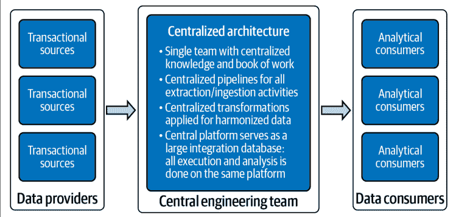

图1-2. 集中式架构是许多组织的瓶颈：一个团队必须等待另一个团队完成工作

## 大泥球

大泥球是一种结构杂乱、蔓延生长、混乱不堪、靠临时补丁勉强维持、充斥意大利面条式代码的丛林。该术语由Brian Foote和Joseph Yoder提出，用来描述一种系统架构：由于其众多依赖关系，该架构呈单体结构，难以理解、难以维护，并且高度耦合。图1-3展示了一个依赖图，用以说明这一点。每条线代表两个软件组件之间的关系。

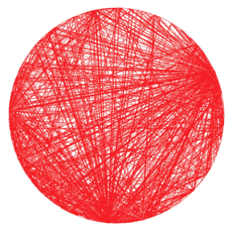

图1-3. 大泥球依赖图

> 正如你所见，大泥球中所有组件之间都存在极端依赖，这使得在不影响其他组件的情况下修改某个组件几乎是不可能的。数据仓库拥有多层结构、视图、无数表格、关系、脚本、ETL作业和调度流，往往会导致这种混乱的依赖网络。

由于数据仓库的高度复杂性以及由一个中央团队进行管理，缺乏敏捷性往往成为一个问题。等待时间增加激发了人们走捷径的创造力。例如，工程师可能会绕过集成层，直接将暂存层的数据映射到他们的数据集市，而其他开发人员则使用视图创建变通方案，快速合并来自不同层的数据。因此累积的技术债务（未来的返工）稍后会引起问题。架构将变得更加复杂，人们将失去对为确保及时交付而设计的创造性解决方案的洞察。

此外，数据仓库与所选的底层解决方案或技术紧密耦合，这意味着需要不同读取模式的消费者必须将数据导出到其他环境。随着供应商格局的变化和新类型数据库的出现，仓库越来越需要将数据分发到管理位置之外。这种趋势破坏了高效使用单一中央存储库并利用底层（昂贵）硬件的宏大愿景。

历史数据的生命周期管理通常也是一个问题。数据仓库被视为真实档案，允许运营系统清理不相关的数据，因为知道数据会被保留在仓库中。对于高级运营分析——这是数据仓库出现后才出现的东西——这可能是一个问题。如果数据已被管理组织所有数据的中央团队转换，那么交付该数据的团队可能不再能识别它（或无法用于预期的运营用例）。此外，快速提供数据可能很困难，因为许多仓库通常在存储数据之前要处理数小时。这是必要的，因为在存储之前，数据必须与其他数据进行转换、合并和集成。

数据质量也常常是一个问题。谁拥有数据仓库中的数据？如果源系统提供损坏的数据，谁负责？我在组织中经常看到的情况是，中央工程团队处理由其他团队引起的数据质量问题。在一个案例中，工程师修复了暂存层中的数据，以便它能正确加载到数据仓库中。这些修复变成了永久性的，随着时间的推移，在数据处理开始之前，必须应用数百个额外脚本。这些脚本不是可信的ETL流程的一部分，也不允许拥有可追溯的数据所有权和血缘关系。

合规问题也可能出现。仓库往往缺乏对临时消费和进一步分发的洞察，尤其是当数据被带出其管理边界之外时。随着新法规的出台，数据所有权以及对数据消费和分发的洞察很重要，因为你需要能够说明谁出于什么目的消费了哪些个人数据。

考虑到典型数据仓库中的数据总量、开发所花费的年限、人们拥有的知识以及密集的业务使用，替换迁移将是一项风险高且耗时的活动。因此，许多企业继续使用这种架构，从数据仓库为其业务报告、仪表板、13和数据饥渴型应用程序提供数据，尽管维护成本高且缺乏灵活性。

## 数据湖：结构化和非结构化数据的中央存储库

随着数据量和对更快洞察的需求增长，工程师开始探索其他概念。数据湖作为访问原始数据和更大数据量的替代方案应运而生。14 按原样提供数据，而无需先进行结构化，使任何消费者都能决定如何使用数据，以及如何转换和集成数据。

与数据仓库一样，数据湖是集中式（单体）数据存储库，但它们与仓库的不同之处在于，它们在数据转换、清洗和结构化之前存储数据。因此，架构通常在读取数据时确定。这与使用预定义且固定结构的数据仓库不同。数据湖还通过支持多种数据格式（结构化、半结构化和非结构化）提供更大的多样性。

许多数据湖实现从原始源系统收集纯净、未修改的原始数据。倾倒原始应用程序结构（精确副本）速度快，并允许数据分析师和科学家快速访问。但是，原始数据的复杂性在于，用例始终需要重新处理数据。必须解决数据质量问题，需要进行转换，并且需要与其他数据进行丰富化，以便将数据置于上下文中。这会引入大量可重复的工作，也是数据湖通常与数据仓库结合使用的原因之一。在这种组合中，数据仓库充当清洗和协调数据的高质量存储库，而数据湖则充当（临时）分析环境，保存大量原始数据以促进分析。

13 报告通常主要是表格形式，但可能包含其他图表或图表组件。仪表板更具可视化性，并使用多种图表类型。

14 James Dixon，时任Pentaho首席技术官，创造了“数据湖”一词。

设计数据湖，就像设计数据仓库一样，是一项挑战。Gartner、VentureBeat AI和Deloitte等公司发现大数据项目的失败率很高——通常超过60%。15 数据湖实现通常部分由于其巨大的复杂性、难以维护以及共享依赖而失败：

- 应用程序推入数据湖的数据通常是原始数据，很可能是对各个应用程序在内部如何组织其数据的复杂表示。如果你采用这种方法，你的数据湖很快就会变成一个包含数以万计的表格、不可理解的数据结构以及只有应用程序本身才能理解的技术值的集合。此外，与提供应用程序存在紧密耦合，因为继承的结构是完全相同的副本。当消费者直接使用这些数据时，当提供应用程序更改其数据结构时，数据管道中断的风险是真实存在的。

- 数据湖中的分析模型通常在原始数据和协调数据上进行训练。数据工程师和数据科学家在技术上实际上是数据管道工，他们手动或在数据科学项目中创建数据并运行这些数据管道和模型。因此，数据湖带来了重大的（运营）风险。

- 数据湖通常是许多不同用例共享的单一平台。由于其紧密耦合、兼容性挑战、共享库和配置，这些平台难以维护。

这些只是大数据项目失败率如此之高的几个原因。其他原因包括管理层抵制、内部政治、缺乏专业知识以及安全性和治理挑战。

## 集中式的痛苦

企业数据仓库或中央数据湖可以使用元数据驱动的ELT、数据虚拟化、云服务、分布式处理、实时摄取、用于丰富化的机器学习等技术进行扩展。但是，存在一个更大的问题：这些架构背后的集中式思维。这包括集中式管理、集中式数据所有权、集中式集群资源以及规定所有人都必须使用相同术语和定义的集中式数据模型。这种集中化的一个后果是，将数据专业人员从业务领域中移除限制了创造力和业务洞察。团队被迫进行不断的跨部门沟通和工单管理，因为他们相隔甚远。正是中央操作模式构成了瓶颈：中央团队无法足够快地处理所有问题和请求。这是有充分理由的


## 定义数据策略

组织正在拥抱去中心化的方法论，例如数据网格，并倡导领域驱动设计。带领域团队的联邦模式可以成为一种超能力：它促进独立性和问责制；它能够实现扩展，因为自治团队可以并行管理、共享和消费数据；并且它能促进质量、协作和生产力的提升。

然而，去中心化也存在一个需要注意的地方。职责的联邦化始终始于集中化，这涉及在企业层面定义标准、设定边界，并提供专业知识和可扩展性。没有中央权威，去中心化的授权将变成一个巨大问题。我观察到过一些情况：团队开始自行定义技术、互操作性和元数据标准；部门规定对其自身数据拥有完全控制权，因此无法与其他团队的数据合并；团队套用自己的数据建模标准、参考数据标准、粒度级别等等，导致无法在域之间合并或集成数据。总结来说：通过去中心化实现可扩展性并非没有风险，而这些风险最好通过组织、治理、技术和架构的中央对齐来缓解。因此，你需要的是一份数据策略：一项（重新）定义文化、组织和人员、架构、治理和流程，以及将自身转变为数据驱动型组织所需规则的计划。

既然你了解了数据的重要性、最近的趋势，以及集中化和去中心化所带来的挑战，那么通向成功的数据转型之战略路径会是什么样子呢？要回答这个问题，必须进行一项策略练习，考虑公司的商业模式以及数据在其中的作用。策略师和架构师应考虑是否需要对现有商业模式进行更改，以及条件是否适合，例如应用联邦。

惯例是从分析组织及其运营条件开始。从那里，必须制定一个企业视图，将企业的构建模块与用于实现策略的应用程序、数据源、流程、人员和其他技术解决方案连接起来。该视图能够可视化（数据）架构，从而实现公司的战略目标。在下一章中，我将回到所有这些方面，但首先让我们来看看定义数据策略的步骤。

制定策略可能很困难。这通常涉及对可创造哪些商业价值或未来可能为真的事物进行预测。这需要将高层愿景与资源、流程和支持能力连接起来。如果你还没有数据策略，或者对自己的愿景不确定，请考虑以下行动要点：

- 首先，关注你的业务目标和策略。不要沉迷于关于最新技术变革的炒作。
- 拥抱公司的愿景，并将其调整为数据将如何推动它。确定数据如何在解决业务问题中发挥更好的作用。尝试量化商业影响。接下来，定义未来三年及以后的核心业务策略将是什么样子。
- 确定“防御”与“进攻”之间的正确平衡。完全控制是首要任务吗？还是你希望拥有颠覆性创新的灵活性？监管如何影响你的策略？这些考虑将影响你的初始设计以及联邦化某些职责的速度。
- 建立清晰且可衡量的里程碑。制定计划以确定你的数据策略何时成功并提供价值。定义指标和关键绩效指标（KPI）来衡量结果。
- 制定沟通计划，以确保你的策略在整个组织中被理解和传达。
- 确定你的首个关注领域。这可能是研究和开发、法规遵从、成本削减、收入增加或其他内容。
- 识别组织内部可能阻碍成功结果的障碍，并寻找绕过它们的方法。
- 重新思考你的人才策略，并确定你的组织是否适合充分利用数据。如果不适合，请制定（文化）转型和招聘计划，通过让业务部门负责大规模管理和使用数据来使它们保持一致。
- 定义你的下一代 IT 能力将是什么样子。未来的 IT 是否负责所有执行？还是未来的 IT 充当卓越中心，提供领导力、最佳实践、培训、研究和支持？
- 定义数据驱动文化是什么样子。例如，识别所需的技能和教育。你是否计划允许业务用户完全自助式使用数据？是否有意愿与他人共享数据？
- 收集你现有环境的数据。例如，每个组织业务单元是否都在相同的生态系统边界内参与？或者你是否看到不同环境中应用了不同的规则？首先，通过分析不同的环境和数据源，创建数据环境的高层概览。研究数据在哪里创建，以及这些数据如何分发和使用。
- 确定你是否需要转变软件开发方法。如果是，确定这可能如何影响构建下一代架构的交付模式。
- 建立向未来的过渡将是什么样子。你的过渡是彻底的改造还是有机的演进？
- 定义一些初始的高层技术选择。例如，你是否计划利用可扩展的云计算来处理数据？你是否更喜欢灵活性和适应性，因此会将你的 IT 能力开发为与供应商无关？或者你更喜欢使用原生服务，尽管有供应商锁定的风险？
- 创建一份高管演示文稿，包含最重要的元素，全部为高层内容，包含章节：为什么、什么、差距、路线图和投资案例。
- 创建成本管理策略，将你的预算与目标和用例保持一致。确定审查和投资数据管理意愿的计划。除此之外，将预算与你的 IT 生命周期管理流程保持一致，该流程包括规划、外包、采购、部署和潜在的停用。¹⁶

解决这些行动要点应该能让你的高层愿景和策略变得清晰。首先这样做很重要，因为战略方向将为架构、流程、工作方式、过渡路线图、治理等方面的决策提供输入。

请注意，数据驱动策略对于每个组织都会有所不同，这取决于其愿景、业务的规模和类型、计划的资金和投资、现有文化和成熟度水平，以及底层业务目标。例如，在我之前在 ABN AMRO 的职位中，我们希望客户在与我们的数据驱动银行互动时，在整个数字化旅程中都能获得定制、无缝且统一的体验。因此，我们决定强烈对齐和集成所有零售、企业和国际业务单元。这意味着所有业务单元都必须在同一个以数据为中心的生态系统中工作，遵循相同的数据素养计划，并坚持相同的架构原则。为了便于此，我们还必须集成不同的企业架构职能，以设计、指导和控制整个企业。

在另一个组织中，数据策略可能看起来完全不同。例如，如果组织内的业务目标不那么紧密对齐，可能就较少需要标准化和集成。如果你最近经历了数据泄露这一创伤性事件，那么你可能会高度关注数据防御。如果你的主要目标是变现数据并建立伙伴关系，那么你的关注点将是为经济价值提供互操作性，以及为购买方值得消费的有价值的数据。

16 技术是不稳定的，因此在某个时候你可能需要更换或升级它们。


The most important point is to align your data strategy with your current and future business needs.

最重要的一点是将你的数据战略与当前和未来的业务需求保持一致。

Before we wrap up, I want to acknowledge that some people advocate that an over-arching strategy isn't required. For them, it's too much up-front work. Instead of developing a plan, they believe you should just get started and see what happens along the way while implementing use cases. This approach will absolutely deliver immediate value. However, in the long term it will have disastrous consequences for your architecture because there will be no commitment to consistency and standardization. Without a guiding map, the transition could be a long march in the wrong direction, requiring frequent reboots and backpedaling exercises.

在总结之前，我要承认，有些人主张不需要宏大的战略。对他们而言，这是过多的前期工作。与其制定计划，他们认为你应该直接开始，并在实施用例的过程中看看会发生什么。这种方法绝对能带来即时价值。然而，从长远来看，它会对你的架构产生灾难性的后果，因为没有对一致性和标准化的承诺。没有指引地图，过渡可能会是朝错误方向的长途跋涉，需要频繁的重启和回退练习。

## Wrapping Up

## 总结

A strategy is the starting point of every digital transformation. Data undoubtedly is a core ingredient. But how do you ensure that data actually contributes to your long-term goals and ambitions? And how do you facilitate the organizational change that is needed for using data at large? This is where a helicopter view is required, to enable a real understanding of the business from end to end. Planning for success requires you to first get a complete picture. You need to zoom out and get an abstract view of your business, before zooming in to specific problem spaces. After that, you need to define an architecture and organizational structure that will support your transition and align with your overall planning, way of working, and governance model. As we progress further into the book, you'll learn more about these concepts.

战略是每一次数字化转型的起点。数据无疑是核心要素。但如何确保数据实际上能为你的长期目标和抱负做出贡献？又如何推动为大规模使用数据所需的组织变革？这就是需要鸟瞰视角的地方，以便实现对业务从端到端的真实理解。为成功做计划要求你先获得完整的图景。你需要先拉远视野，获取业务的抽象视图，再放大到特定的问题领域。之后，你需要定义支持你的过渡并与你的整体规划、工作方式和治理模式相一致的架构和组织结构。随着我们在书中不断深入，你将了解更多这些概念。

Designing an architecture that matches all of your data strategy requirements and ambitions is the hardest part of the transition. First, you must create a holistic picture of your organizational structure, applications, processes, and data landscape. Next, you can work out different potential scenarios by balancing dimensions such as flexibility, openness, control, time, cost of realization, risks, and so on. Each potential scenario might include road maps, transition architectures, and different future states. This process is a dynamic and collaborative exercise and goes far beyond creating simple visualizations. An important note on this: setting out the strategic and future direction starts top-down, from the business. It shouldn't come from only the IT department.

设计一个与你的数据战略所有要求和抱负相匹配的架构是过渡中最难的部分。首先，你必须创建组织结构、应用程序、流程和数据环境的整体图景。接着，你可以通过平衡灵活性、开放性、控制力、时间、实现成本、风险等维度，推导出不同的潜在场景。每个潜在场景可能包括路线图、过渡架构和不同的未来状态。这个过程是动态且协作的练习，远不止于创建简单的可视化。需要注意的是：制定战略和未来方向是自上而下、从业务开始的。它不应仅来自IT部门。

An important aspect of your data strategy is balancing the imperatives of centralization and decentralization. For example, do you federate governance and activities, or architecture and infrastructure, or both? There's a lot of confusion on this subject, as we often see extremes. For example, the data mesh, as a reaction to centralized data organizations, architectures, and governance models, promotes a 180-degree change of direction. It embraces decentralization in all aspects by advocating that all data must be decentrally owned by domains using decentrally managed infrastructure. On paper, decentralization resonates well with business leaders and IT managers, but in practice, things aren't that easy.

你的数据战略的一个重要方面是平衡集中化和分散化的要求。例如，你是联合治理和活动，还是联合架构和基础设施，还是两者都是？关于这个主题有很多混淆，因为我们经常看到极端情况。例如，数据网格（data mesh）作为对集中化数据组织、架构和治理模式的反应，倡导180度的方向转变。它通过主张所有数据必须由领域分散拥有并使用分散管理的基础设施，来拥抱各个方面的分散化。从理论上看，分散化与业务领导者和IT经理很契合，但在实践中，事情并没有那么容易。

Decentralization involves risks, because the more you spread out activities across the organization, the harder it gets to harmonize strategy and align and orchestrate planning, let alone foster the culture and recruit the talent needed to properly manage your data. The resulting fragmentation also raises new questions, like "How many business models or domains do I have?" and "How many data platforms do I need?" What I have observed in practice is that many architects and data practitioners find domain decomposition and setting boundaries the hardest part of decentralization. Often, there’s a fundamental lack of understanding of business architecture and domain-driven design. Many data practitioners find the conceptual notions of domain-driven design too difficult to grasp. Others try to project oversimplified or object-oriented programming examples onto their data landscape.

分散化涉及风险，因为你在组织中分散的活动越多，就越难协调战略、协调和编排计划，更不用说培养文化和招聘妥善管理数据所需的人才了。由此产生的分散也带来了新问题，比如“我有多少个业务模型或领域？”和“我需要多少个数据平台？”我在实践中观察到，许多架构师和数据从业者发现领域分解和设置边界是分散化中最难的部分。通常，对业务架构和领域驱动设计存在根本性的理解不足。许多数据从业者发现领域驱动设计的概念性概念过于难以掌握。另一些人试图将过度简化的或面向对象编程的示例投影到他们的数据环境中。

The principles underpinning decentralization are also subject to discussion with regard to how data and platforms must be managed. Among data engineers, there’s skepticism because no open interoperability standards for data products exist yet. In addition, there are concerns about the usability of data when individual teams operate in bubbles.

支撑分散化的原则也关于数据和平台如何管理而存在讨论。在数据工程师中，存在怀疑，因为目前尚不存在针对数据产品的开放互操作性标准。此外，当单个团队在孤岛中运作时，人们还对数据的可用性感到担忧。

These observations are a nice transition to the following chapters. In the next chapter, we’ll fly our helicopter one level lower, taking you close enough to identify your architecture, data domains, and landing zones. I’ll help you with this by simplifying the vocabulary of domains and providing you with pragmatic guidance and observations from the field. After that, we’ll fly over to the source system side of our landscape and stay there for a few chapters before our journey continues. Bon voyage!

这些观察为后续章节提供了良好的过渡。在下一章中，我们将把直升机降低一个层级，带你足够接近以识别你的架构、数据领域和登陆区。我会通过简化领域的术语，并为你提供来自实战的实用指导和观察来帮助你完成这一点。之后，我们将飞到环境的源系统侧，并在那里停留几章，然后继续我们的旅程。一路顺风！

# Organizing Data Using Data Domains

# 使用数据领域组织数据

The trends discussed in Chapter 1 require us to rethink the way data management is done. We’ve talked about the tight couplings that arise when making exact copies of application data and the difficulties of operationalizing analytics on raw data. We’ve also looked at the unification problems, the tremendous effort of building an integrated data warehouse, and its impact on agility. As discussed in Chapter 1, we need to shift toward an approach that enables domains, teams, and users to distribute, consume, and use data themselves easily and securely. We need a strategy and organizational change that moves data closer to the business. We need platforms, processes, patterns, and standard interfaces that simplify the work for others. We need a data management architecture that works at scale. This chapter discusses this further, starting with how to organize the landscape using data domains.

第1章讨论的趋势要求我们重新思考数据管理的方式。我们讨论了在创建应用程序数据精确副本时产生的紧密耦合，以及在原始数据上运行分析的困难。我们还探讨了统一问题、构建集成数据仓库的巨大努力及其对敏捷性的影响。如第1章所述，我们需要转向一种能够使领域、团队和用户轻松安全地自行分发、消费和使用数据的方法。我们需要一种战略和组织变革，使数据更贴近业务。我们需要平台、流程、模式和标准接口，以简化他人的工作。我们需要一种可大规模运行的数据管理架构。本章将进一步讨论此问题，首先从如何使用数据领域组织环境开始。

Before we delve into that topic, however, we’ll explore a number of generally acknowledged principles of how applications are designed and work together. After that, we’ll zoom in on the inner architecture of applications and discover what we can learn from that. Then we’ll turn our attention to domains, looking at domain-driven design and business architecture. We’ll discuss different characteristics of domains, key data management principles, and domain ownership responsibilities. By the end of this chapter, you’ll understand what data domains are and why they are important. This background theory is necessary to understand the core drivers of your new architecture. In subsequent chapters, we’ll take a more in-depth look at patterns, designs, diagrams, and workflows, and you’ll start to understand how this domain-oriented architecture links all the areas of data management together.

不过，在深入该主题之前，我们将探讨一些关于应用程序如何设计和协同工作的公认原则。之后，我们将放大到应用程序的内部架构，发现可以从中学到什么。然后我们将关注领域，探讨领域驱动设计和业务架构。我们将讨论领域的不同特征、关键数据管理原则以及领域所有权责任。在本章结束时，你将了解什么是数据领域以及它们为什么重要。这些背景理论对于理解新架构的核心驱动因素是必要的。在后续章节中，我们将更深入地探讨模式、设计、图表和工作流，你将开始理解这种面向领域的架构如何将数据管理的所有领域联系在一起。

## Application Design Starting Points

## 应用程序设计的起点

In preparation for our deep dive, I want to spotlight some key application design principles that are widely acknowledged and will be referred to many times throughout this book.

为我们的深入探讨做准备，我想强调一些广泛认可的关键应用程序设计原则，这些原则将在本书中多次引用。

## Each Application Has a Data Store

## 每个应用程序都有数据存储

In the context of data management and moving data between applications, we can assume that each application has some form of data storage. So whenever you run into a data-usage situation, you need to store data in an application database. Yes, there might be stateless applications that store their data elsewhere, applications that share the same database, or applications that do in-memory processing. But this still implies that all applications need to store their data somewhere.

在数据管理和在应用程序之间移动数据的背景下，我们可以假设每个应用程序都有某种形式的数据存储。因此，无论何时遇到数据使用情况，你都需要将数据存储在应用程序数据库中。是的，可能存在将数据存储在其他地方的无状态应用程序、共享同一数据库的应用程序或进行内存处理的应用程序。但这仍然意味着所有应用程序都需要在某个地方存储其数据。

## Applications Are Always Unique

## 应用程序始终是唯一的

Business challenges are never the same. In Chapter 1, I noted that applications are used to solve specific problems. Each application's data is unique and unlike the data and context from other applications. This is rooted in how we create applications. There are several stages to the design and development process:1 We start with conceptual thinking about the business requirements and needs, then we translate our business knowledge to a logical application data model, which is a more formal and concrete representation of the requirements. Finally, we make the physical application data model—the true design of the application—which is based on the nonfunctional requirements from the logical design.

业务挑战从不相同。在第1章中，我指出应用程序用于解决特定问题。每个应用程序的数据都是唯一的，与其他应用程序的数据和上下文不同。这源于我们创建应用程序的方式。设计和开发过程：1 我们从对业务需求和需求的概念性思考开始，然后将业务知识转换为逻辑应用程序数据模型，这是对需求的更正式、更具体的表示。最后，我们制作物理应用程序数据模型——即应用程序的真实设计——它基于逻辑设计中的非功能性需求。

Every context is unique, and we can say the same for applications and the data underpinning the business problems. Each business problem requires a distinctive sphere of knowledge. This ties into the concept of domains, but before we get to that, let's examine what the origin of data means for data management.

每个上下文都是唯一的，应用程序和支撑业务问题的数据也是如此。每个业务问题都需要独特的知识领域。这与领域的概念相关，但在进入该话题之前，让我们先看看数据的来源对数据管理意味着什么。

## Golden Sources

## 黄金来源

In a fragmented and distributed environment, it can be difficult to determine the authoritative sources of original and unique data. Therefore, it's important to know where the data originated and where it's managed. I use the foundational concept of

在分散和分布式环境中，很难确定原始和唯一数据的权威来源。因此，了解数据的来源和管理位置很重要。我使用基础概念


贯穿本书的金色数据源；² 这是权威的 *应用程序*，在特定上下文中管理所有真实数据。³

当您仅捕获唯一数据，并且始终直接从金色数据源获取时，即可确保对数据拥有精确且一致的问责责任。这对于实施强大的数据治理至关重要，因为不同的领域有时会试图声称对物理数据集和数据设计的所有权。因此，识别您的金色数据源应作为起点。金色数据源对于数据质量也很重要。它们是数据被创建或首次输入系统的点。通过在金色数据源处修复数据质量问题，您可以避免这些问题出现在其他地方，因为数据始终从此源分发。

## 数据集成两难困境

由于应用程序具有独特的上下文，在将数据从一个应用程序移动到另一个应用程序时，始终需要进行转换。这意味着始终需要某种形式的数据集成。无论您使用 ETL（提取、转换和加载）或 ELT（提取、加载和转换），虚拟或物理，批处理或实时流程，都无法摆脱数据集成两难困境。在跨应用程序移动数据时，无论设计或架构类型如何，始终需要数据转换。

## 应用程序角色

应用程序要么是数据提供者，要么是数据消费者，或者，如我们将看到的，有时两者兼具。一个应用程序要使用数据，另一个应用程序必须创建并提供它。这可能显而易见，但在跨大量应用程序和系统集成和分发数据的背景下，这对于问责目的非常重要。


在数据社区中，您会遇到 *源系统对齐* 和 *消费者对齐领域* 等术语。这些术语指的是相同的提供和消费角色，尽管它们使用不同的粒度级别：领域视角与应用程序视角。

2 有些人使用 *系统记录*（SOR）一词，它是特定数据元素或信息片段的权威来源。

3 识别权威应用程序可能不容易。某些权威来源可能隐藏在您需要理解才能找到的复杂模式背后。有关金色数据源的更多信息，请参阅 Andy Graham 的著作 *Mastering Your Data*（Kioios）。

根据系统或应用程序是充当提供者还是消费者，如图 2-1 所示，游戏规则会发生变化：应用不同的架构原则。

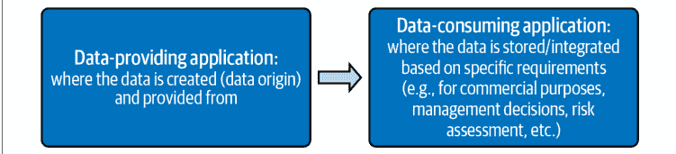

图 2-1. 数据提供者和数据消费者的应用程序角色构成了我们的架构

数据提供者和数据消费者角色也适用于外部各方。外部各方（例如第三方）是指在企业生态系统的逻辑边界之外运营的实体。它们通常存在于独立且不受控制的环境中。如第 1 章所述，许多公司将公共 Web 视为可货币化以创建和共享可重用服务的（开放）数据宝库。这种新的合作方式改变了组织边界。我在这本书中引入的新架构要求具有灵活性，允许外部各方既是数据提供者也是数据消费者。通常需要额外的安全措施，因为外部各方并不总是可信、已知或与更广泛的上下文直接相关。


您可以直接消费外部各方的数据，还是应该创建另一个抽象层以实现解耦？这取决于外部各方是否能够或愿意通过遵守并符合您的原则来进行调解，以及您是否需要符合外部提供者制定的标准。如果无法保证由外部各方进行调解，则需要额外的抽象和解耦层。如果可以进行调解，直接消费可能是可接受的。

除了应用程序运行的独特上下文、数据提供者和消费者的角色以及应用程序之间始终发生的转换之外，我们对架构还需要考虑什么？什么是良好的整体架构？在下一节中，我们将深入探讨一些软件架构模式，看看可以从中汲取哪些灵感。

## 软件架构的启示

应用程序之间的数据集成是关于管理通信的复杂性和数据的互操作性。在企业架构中，我们通常关注大局，但应用程序内部的组件如何协同工作以分发和共享数据，我们能从中学到什么？创造数据网格一词的 Zhamak Dehghani 从微服务中获得了灵感，⁴ 因此让我们考察这种架构风格及其影响。

如图 2-2 所示，微服务采用一种软件开发架构方法，其中应用程序由小型独立服务组成，这些服务使用轻量级通信模式进行通信。因此，不要将应用程序构建和打包为一个巨大的单体，而是将其拆分为称为微服务的更小组件。

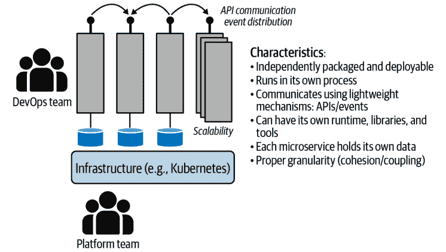

图 2-2. 微服务架构的高级表示

使用微服务架构的好处之一是微服务可以单独且独立地开发、测试和部署。每个微服务管理自己的运行时和数据，并在其自己的专用进程中运行，这使您的设计更具可扩展性。不要扩展整个应用程序，而是可以根据需要独立地上下扩展单个应用程序组件。编程语言也是如此：您可以混合使用语言，并选择最适合特定组件的语言。例如，您可以使用 C# 编写第一个微服务，使用 NodeJS 编写第二个微服务，使用 Python 编写第三个微服务，等等。

这一切听起来很棒，但这里有一个注意事项：您添加的微服务越多，管理微服务架构就越困难。想象一种情况，应用程序已发展到需要三个开发团队来维护的规模，并且所有微服务都直接相互通信，如图 2-3 所示。

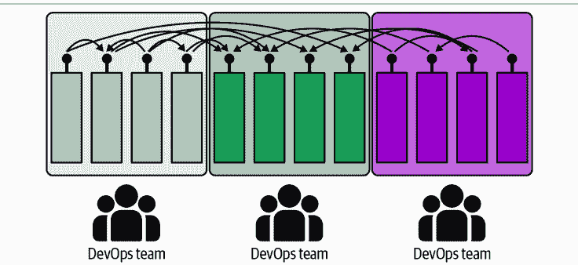

图 2-3. 复杂的通信

微服务在这种架构中通信的方式使这个应用程序成为一个脆弱系统。⁵ 如果某个服务失败或开始表现异常，可能会对整个系统产生连锁反应。为避免此类灾难，您可以使用一种称为 *服务网格* 的模式来控制微服务之间的通信。它将管理服务间通信的逻辑从单个服务中提取出来，并将其抽象为一个独立的层。服务网格提供监控、可发现性、优雅关闭、策略强制执行等功能。

服务网格可用于对微服务进行分组和解耦。使用这种架构模式，您可以根据功能内聚性将微服务分组在一起，例如在命名空间中。组内微服务（安全边界）可以直接通信，但要与另一组中的微服务通信，必须使用服务网格。在这种模式中，服务网格充当安全代理。

4 在创立 Nextdata 之前，Dehghani 曾是 Thoughtworks 北美地区新兴技术总监。Thoughtworks 的顾问是推广微服务和数据网格架构的先行者。

5 这种架构的社区术语是 *分布式大泥球*。由许多相互通信的微服务组成的环境充当复杂状态机，随着环境的增长，结果变得越来越不可预测。


图 2-4 展示了如果您应用面向域设计原则并添加服务网格，修订后的架构可能是什么样子。

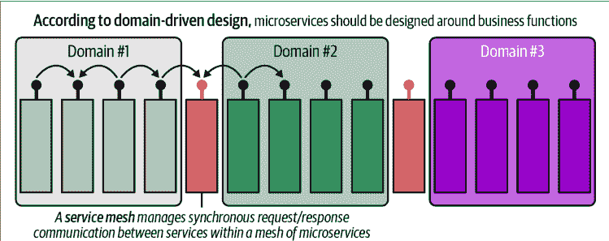

图 2-4. 添加服务网格以管理服务之间的同步请求/响应通信

在更新后的架构设计中，微服务基于内聚性（即各个微服务归属并协同工作的程度）进行分组。在此配置中，每个 DevOps 团队拥有并控制架构的特定部分。这种所有权与功能对齐降低了应用程序出现异常行为的风险，因为依赖项得到了更好的管理。另一种最佳实践是，每当一个 DevOps 团队希望其微服务与另一个 DevOps 团队的微服务通信时，应使用服务网格将应用程序的特定部分与其他部分解耦。

微服务架构中的服务网格为同步请求/回复通信提供管理，例如安全性和共享请求逻辑。对于异步通信，它可以轻松替换为事件代理（例如，用于在微服务之间分发通知和事件）。根据您需要的通信样式，可以选择其中一种模式，也可以并排使用两种模式。

这种微服务设计中缺少的是分析数据架构，用于支持用于分析目的的数据。为了比较服务网格和数据网格，在服务网格中，服务请求通过代理在微服务之间路由。服务网格管理服务间通信，将其从单个服务中抽象到另一层。在数据网格中，分析数据通过数据产品提供。数据产品转换数据、维护其完整性、管理其策略，并最终提供数据。

数据产品也能获得与服务网格相同的架构优势，如图 2-5 所示。

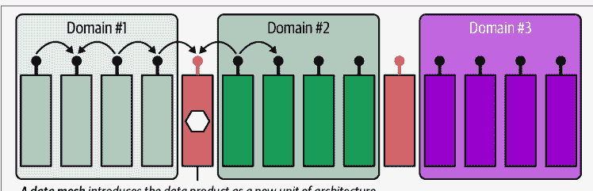

图 2-5. 显示数据产品的数据网格架构：最小的独立可部署单元

尽管将数据产品作为架构最小单元的想法很出色，但并非所有架构都仅由微服务构成。当今企业的架构通常包含许多应用程序，范围从大型旧系统到商业现成（COTS）产品、SaaS、运营数据存储、主数据管理存储、数据仓库等等。许多应用程序在用户或组织单元之间共享。如何在如此大规模的数据架构中恰当设置边界？让我们尝试放眼全局来寻找答案！

## 数据域

为定义所有权而设置边界是架构设计中最重要的方面之一。有许多权衡决定了这些边界应该位于何处。一种常被引用的最佳实践是使用一种称为领域驱动设计（DDD）的方法论。在以下部分中，我将讨论 DDD 背后的基本理论（不深入细节）。之后，我们将转向业务架构，以修订对域的定义。

## 领域驱动设计

DDD 是一种涉及大型组织复杂系统的软件开发方法，最初由 Eric Evans 在其著作《领域驱动设计》（Addison-Wesley）中描述。它很受欢迎，因为其许多高层实践对现代软件和应用程序开发方法（例如微服务）产生了影响。让我们看看一些关键概念。

## 有界上下文

有界上下文是领域驱动设计中的核心概念。有界上下文用于设置域解空间的逻辑边界，以更好地管理复杂性。这些边界通常是显式的，并在具有清晰且高度内聚的区域强制执行。域依赖可以位于不同级别，例如应用程序的特定部分、进程、关联的数据库设计、平台等。这些边界通常是显式的，并在具有清晰且高度内聚的区域强制执行。团队了解哪些方面（包括数据）可以自行更改，哪些是需要与其他团队协调以避免出问题的共享依赖，这一点很重要。设置边界（如您在上一节中看到的微服务示例所示）有助于团队和开发人员更有效地管理依赖项。

有界上下文具有多态性，这意味着其大小和形状可以根据观点和环境而变化。也就是说，有界上下文可以根据您采取的观点而移动并与其他有界上下文重叠。这意味着在使用有界上下文时需要明确；否则，其他人可能不明白您具体指的是什么。

## 域和有界上下文

DDD 区分了有界上下文、域和子域。域是我们试图解决的问题空间。知识、行为、法律和活动在此汇聚。它们是我们看到语义耦合的区域：组件或服务之间的行为依赖。域通常分解为子域，以更好地管理复杂性。一个常见的示例是将域分解为使每个子域对应组织的不同部分的方式。

并非所有子域都相同。它们可以分为核心、通用或支持三类。核心子域最重要。它们是秘诀，是构成企业独特性的要素。通用子域不特定，通常代表可以轻松使用现成产品解决的业务问题。支持子域不提供竞争优势，但对保持组织运行是必要的。通常，它们并不那么复杂。

有界上下文是逻辑（上下文）边界。它们关注解空间：系统和应用程序的设计。这可以是代码、数据库设计等。域和有界上下文之间可以存在对齐，但这不是必需的。有界上下文本质上是技术性的，因此可以跨越多个域和子域。

设置逻辑边界或使用有界上下文的背后想法是，职责更清晰，管理会更好。团队成员之间的沟通是高效的，因为相同的人正在处理类似的目标。在软件上设置逻辑边界在某种程度上类似于处理微服务。

在企业级别，我们基于高内聚性或共享兴趣（即执行类似任务或具有类似职责的应用程序）对应用程序进行逻辑分组。有些人将这些称为功能域、逻辑组、集群或组织能力。

将实体、进程或应用程序分组在一起并非新理念。“传统”分组与领域驱动设计模型之间的巨大区别在于 DDD 的 *强制的严格边界*。Evans 认为，有界上下文可以独立演进，但 *必须* 解耦。解耦通常通过隐藏或抽象应用程序的复杂内部功能，并确保接口和层达到一定稳定性来实现。

## 通用语

DDD 中的 *通用语* 是由开发人员和用户共同建立和共享的通用、严谨语言。它类似于任何特定关注领域内的人们使用的共享定义、词汇、行话和术语集合。通用语有助于连接大型团队或跨团队内的人员，在这些团队中很难达成共同词汇。为了避免团队之间过多的跨沟通和术语不一致，通用语用于支持域内应用程序或软件的设计。因此，企业内不一定存在单一的统一语言，尽管可能存在重叠。


> 我强烈推荐阅读 *语义软件设计*，由 Eben Hewitt（O'Reilly）编写。本书运用设计思维，并在语义与架构设计之间建立了类比。

有界上下文和通用语之间存在强关系，因为在 DDD 中，每个有界上下文都应该有自己的通用语。属于同一组并在有界上下文中管理的应用程序或应用程序组件应全部使用相同的语言。如果有界上下文增长到理解它对团队来说成为挑战的程度，则可以将有界上下文拆分为更小的部分。如果有界上下文发生变化，通用语也预期会随之变化。经验法则是，一个有界上下文由一个团队（敏捷或 DevOps）管理，因为单个团队的成员更容易了解当前情况及其所有依赖项。


我经常将“有界上下文”与文化概念结合提出，以明确不同团队之间的定义和术语往往并不相同。上下文是特定的，通常基于我们所知道的内容。每个有界上下文都有不同的目标、不同的背景，以及最重要的是，不同的文化。文化影响我们的思考、设计和建模方式。在一个文化中，可能存在亚文化：共享共同目标和实践的较小人群。DDD 也是如此：一个有界上下文可以划分为多个子域或多个更小的有界上下文。如您在第 1 章中看到的，(业务)上下文与应用程序设计之间存在强烈的依赖关系。因此，用于描述上下文的通用语言也会影响应用程序的设计。

DDD 方法使用有界上下文来设定高度内聚的独立区域的边界。如果在企业级别将 DDD 投影到我们的应用程序环境中，那么域边界不仅将应用程序，还将语言、知识、团队资源和技术保持在一起。但是，DDD 在数据管理方面的难点在于，DDD 的原始用例是在软件开发环境中（例如，微服务）对复杂系统进行建模。它并非旨在用于建模企业数据，数据管理从业者通常认为它过于抽象和技术化。让我通过提供一个比喻来帮助您更好地理解。将域视为一个共同兴趣领域，例如您居住的街道。街道是一个域，而每栋房子代表一个子域。每栋房子都矗立在其自身的地产上，但它并未占据整个地产，因为周围有花园和围栏。本例中的围栏代表有界上下文的边界。在此示例中，单个房主负责维护自己的房屋，并在其边界内可以随心所欲。但是，当跨越边界（围栏）时，有某些规则需要遵守。例如，他们应始终通过公共车道进入和退出地产，并沿街道行驶或在人行道上行走。

例如，如果我们将数据网格（data mesh）作为数据民主化的概念，并实施面向域的数据所有权原则以获得更大的灵活性，这在实践中如何运作？从企业数据建模向 DDD 建模的过渡可能是什么样子？我们可以从 DDD 中为数据管理汲取哪些经验？

## 业务架构

在设计大规模架构时，我的建议是先审查范围，并了解您试图解决的战略问题空间。在深入技术实现细节之前，首先完成此练习非常重要。正如 DDD 拥护者所主张的，在问题空间之间设置逻辑边界有所帮助，因为这可以使职责更加清晰，并确保它们得到更好的管理。

为确定如何分组问题空间，我鼓励您查看业务架构。在《业务架构知识体系指南》（BIZBOK 指南）中，业务架构公会将业务架构描述为代表“关于能力、端到端价值交付、信息和组织结构的整体、多维业务视图；以及这些业务视图与策略、产品、政策、举措和利益相关者之间的关系。”架构师使用业务架构作为设定原则、指导、期望结果以及企业及其业务生态系统边界的基础。6 换句话说，我们可以从有界上下文类比到业务架构和业务能力。

6 詹姆斯·摩尔，《竞争的终结》（Harper）的作者，将业务生态系统定义为“一群为了满足客户需求而协作和竞争的公司集合。”

## 业务能力

为解决业务问题并满足需求，一种常用的技术是使用业务能力。业务能力是业务架构中使用的构建块。该术语由 Ulrich Homann 引入，7 他将其定义如下：

7 克里斯·理查森，Microservices.io 的作者之一，也认可业务能力视角。

> 业务能力是企业可能拥有或交换以实现特定目的或结果的特定能力或能力。能力描述了企业为客户创造价值所做的事情（结果和服务级别）；例如，支付员工工资或运送产品。业务能力将人员、流程/程序、技术和信息抽象并封装为促进绩效改进和重新设计分析所需的基本构建块。

业务能力很有用，因为它们提供了业务现实的抽象，以帮助公司实现其战略业务目标和目的。它们捕获并描述特定上下文中数据、流程、人员和技术之间的关系，并用于交付端到端价值。为了更清晰地说明业务能力的实际应用，我将首先关注价值流。

顾名思义，价值流关注价值增加：它们通常是一组为交付价值而执行的操作。例如，价值流可能向一组客户交付产品、服务或体验。

如果将价值流作为起点，您会发现业务能力是每个步骤中提供价值所必需的。图 2-6 说明了价值流、业务能力及其底层业务流程、技术和信息之间的关系。价值流与业务能力之间的关系是多对多。例如，图 2-6 显示了一个业务对业务（B2B）价值流，它与多个业务能力相关联。这些能力中的某些也可能用于零售业务价值流。

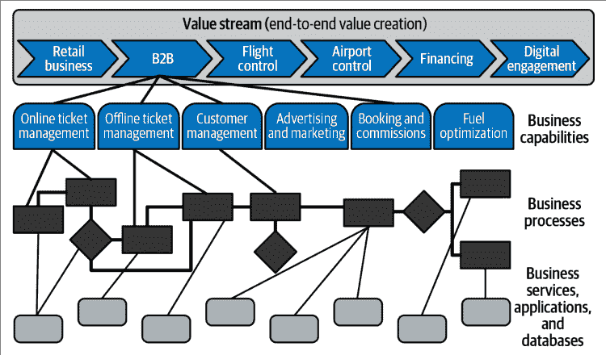

图 2-6. 将价值流映射到业务能力

管理复杂性始于创建整体视图。就此而言，*业务能力模型*有助于提供必要的洞察，以确定例如哪些应用程序是共享的。业务能力模型以结构化可视化的形式表示组织的整体战略业务目标和活动。每个业务能力至少实现一次，并在价值流中使用。业务能力通常在*能力图*中描述，这是对业务所做的事情的层次描述。我们通常讨论第 1 级、第 2 级和第 3 级业务能力（或更多级别，具体取决于业务的复杂性），其中每个级别是对更高级别中一个或多个能力的分解。


> 业务能力模型有一个设计原则。业务能力是唯一的、相互排斥的，并且整体穷尽，确保没有重复、重叠或缺口。

良好的业务能力模型与业务相关，并使用业务术语定义。能力的重要性可以与特定的业务目标和指标相关联。能力模型提供了相当稳定的业务视图，因为基本业务目标很少改变，尽管底层流程、应用程序和数据会随时间变化。业务能力模型还可用于映射到价值流、应用程序和流程，或绘制依赖关系，或者也许可以显示新策略对业务能力的影响。例如，为了展示数据管理策略的有效性及其对组织的影响，您可以将 KPI 绘制到已实现的业务能力上。

在图 2-7 中，我为虚构的航空公司 Oceanic Airlines 创建了一个业务能力图，该公司需要掌握此处列出的所有功能领域才能成功。8 例如，Oceanic Airlines 必须能够销售机票、处理行李和遗失物品，并维护其飞机。该公司可以外包某些活动，同时将其他活动保留为其业务核心。9

8 Oceanic Airlines 是多部电影、电视节目和漫画书中使用的虚构航空公司名称；例如，该品牌在电视剧《迷失》中被广泛使用。

9 业务能力不会告诉我们有关组织结构和组织边界的任何信息，也不会告诉我们能力是内部开发还是外包。它们也可以在组织内部或跨组织独立移动。例如，像在线支付服务这样的能力最初可以内部开发，但后来可以外包给 PayPal。这种组织变更不应影响业务能力。为了实现企业目标，处理在线支付的特定能力保持不变。

在实践中，您会发现大多数人围绕这些能力组织起来。从事同一业务能力的人共享相同的词汇。您的应用程序和流程也是如此，它们通常根据需要支持的活动的内聚性而很好地对齐和紧密连接。因此，业务能力映射是一个很好的起点——但故事并未结束。


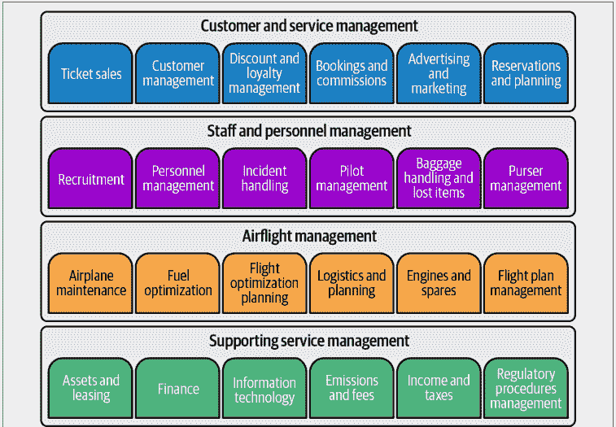

图 2-7. 航空公司功能领域分解示例—此业务能力模型代表了从业务能力角度对组织进行的高级分解

## 将业务能力与应用程序关联

为了更好地管理企业架构，你应该确保业务能力、限界上下文和应用程序保持一致。在这样做时，遵循某些基本规则很重要。至关重要的是，业务能力应保持在业务层面并保持抽象。它们代表组织所做的工作并针对*问题空间*。它们是你用于沟通和战略的语言。

当实现业务能力时，会为特定上下文创建一个实现或“能力实例”。在这些*解决方案空间*内的边界中，多个应用程序和组件可以协同工作以交付特定的业务价值。与特定业务能力对齐的应用程序和组件与与其他业务能力对齐的应用程序保持解耦。

重要的是要指出，逻辑应用程序边界是框定的：理想情况下，应用程序应只链接到一个能力实例。它们不应该跨越或同时链接到多个能力实例。在能力实例边界内的这些应用程序的整体集合形成一个限界上下文。数据和流程也是如此——它们同样具有内聚性。

### 应用程序边界

什么定义了应用程序的范围和边界？绘制应用程序边界的方式取决于你的观点；应用程序一词对不同的人意味着不同的事情。你可能将其定义为应用程序代码和数据如何打包、一起部署以及与其他应用程序隔离的方式。从另一个角度看，应用程序可以是虚拟地址空间，例如运行不同进程的虚拟机。还有一个角度可能将应用程序视为一组共享语言运行时系统并通过服务层与其他集成代码通信的集成应用程序组件。

从业务角度看，应用程序可能是为满足特定业务需求而共同使用的所有代码和数据。这种观点可以跨越不同的物理环境、运行时环境和平台来划定边界。边界也可以基于公司内部的（政治）所有权和组织结构。简而言之，你和其他人认为什么是应用程序，很大程度上取决于你的观点。

为了进行数据管理，我们可以结合两种观点来创建全面的分解。应用程序的概念本身仍然是抽象的。它是一个逻辑边界，应用程序组件可以在其中一起构建或部署。与应用程序不同，应用程序组件是具体的：它们针对解决方案空间。它们具有大小和组成，并存在于技术环境中。例如，作为 Docker 容器或 JAR 文件打包和部署的应用程序模块是一个有形的构件。

结合这两种不同的观点可以带来很多价值。在应用程序层面，我们可以连接业务能力、产品负责人、DevOps 团队、项目等。在应用程序组件层面，我们可以连接 IT 产品、版本、配置项、合同、维护计划等。

勾勒业务能力与应用程序架构之间的清晰关系可以带来许多好处。它使解耦接口和应用程序的指导方针更加清晰。它有助于你更好地执行数据治理；你可以认为，为特定业务能力在特定上下文中创建的所有数据都属于特定的产品负责人。产品所有权和数据所有权突然变得更加一致。你也可以更容易地在能力层面得出结论，因为应用程序与能力被显式链接。

## 域边界和粒度

设定精确的边界和这些边界的适当粒度并不是一门精确的科学。它是一门艺术，依赖于经验法则。我喜欢将域边界映射到业务架构的逻辑边界，以便进行数据管理并了解企业的规模和复杂性。其他人更多地关注组织边界、业务流程或领域专业知识。确定域边界的另一种方法是制定详细的软件架构蓝图，并确定哪些应用程序组件应更松散耦合或更紧密连接。这种技术在微服务中相对流行。所有这些方法都是有效的，你可以根据要解决的业务问题的范围、规模和上下文选择应用其中任何一种。

如果你想更好地了解域边界的含义以及如何设置限界上下文，我建议你研究领域讲故事、事件风暴和限界上下文画布。所有这些技术都专注于理解域复杂性，了解域内发生的事情，以及学习如何构建或分解它。

与特定业务能力对齐的应用程序和组件与与其他业务能力对齐的应用程序和组件保持解耦。这允许更大的灵活性，这就是域和限界上下文发挥作用的地方，就像我们之前讨论的边界栅栏和房屋一样。你可以设定明确的原则：限界上下文源自业务能力，并与其独占映射。它们代表业务能力实现的边界，并表现得像域。如果业务能力发生变化，限界上下文也会发生变化。理想情况下，你会期望域与相应的限界上下文完全对齐，但现实——正如你将在第 45 页的“域特性”中了解到的那样——可能不同。

为了使这一点更具体，让我们回到我们的大洋航空示例。图 2-8 显示了在这个虚构公司中，某些限界上下文边界和域实现可能的样子。

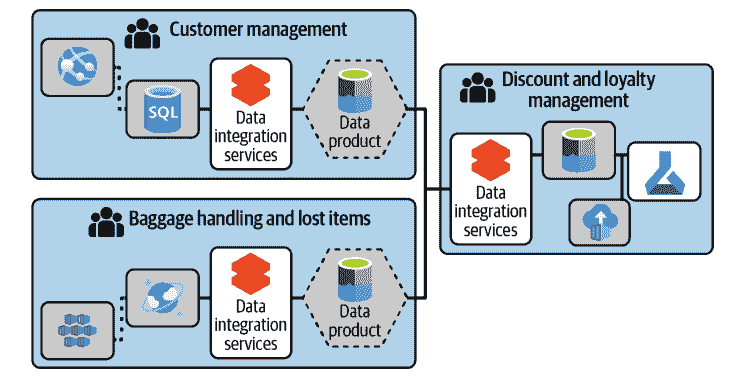

图 2-8. 应用程序和组件如何在解决方案空间内协同工作

客户管理域需要维护关于客户及其关系的信息。管理该域的团队拥有深厚的专业知识。它知道哪些相关数据存在，因此也最清楚哪些数据应该提供给其他域。该域的内部架构是解耦的，因此其边界内的所有应用程序组件都可以使用应用程序特定的接口和数据模型直接通信。通过这种方法，数据与域上下文对齐。因此，数据会自动继承通用语言：由同一领域的利益相关者和设计师商定的一种构建的、形式化的语言，用于满足该领域的需求。向其他域分发数据是形式化的：它必须通过共享车道离开该属性并遵守交通规则。换句话说，当域与其他域通信时，它们使用标准化接口。

## 能力实现

使用业务能力图时，必须承认某些业务能力可以实例化多次。图 2-9 可视化了业务能力与业务能力实例之间的关系。

图 2-9. 业务能力与业务能力实例之间的关系是一对多

| 业务能力 | 业务能力实例 |
|---|---|
| 业务现实的抽象；代表组织所做的工作并针对 | 代表业务能力的实现 |
| 为变更和战略提供常见的抽象语言 | 是具体的；代表解决方案空间 |
| 连接战略和运营执行 | 与系统（和数据）、流程、人员、角色和职责对齐 |

例如，大洋航空可能对“行李处理和失物招领”能力拥有多个本地化实现（或实施），针对公司运营的每个地区（亚洲、欧洲等）各一个。这些实现中的每一个可能使用不同的技术服务，由不同的团队操作这些服务。由于业务能力与能力实例（实现）之间的关系是一对多，因此在多次实施业务能力时，你最终会得到额外的（子）域。

## 共享能力

更重要的是，你应该如何处理共享业务能力。此类能力通常集中实施，采用即服务模型，并提供给不同的业务线。“客户管理”可能就是一种这样的能力示例：大洋航空的亚洲和欧洲业务线可能使用同一系统来管理其客户。那么，如何在共享能力上投射域数据所有权？很可能有多个业务代表对同一共享管理系统及底层数据库中的客户承担责任。总之，存在应用程序域和数据域！从数据角度看，你的域和应用程序限界上下文并不总是完美对齐。相反，你可以认为，从业务能力的角度来看，仍然存在单一的数据和应用程序关注点。

> 组织几乎肯定会遇到共享业务能力，因为企业资源计划（ERP）、供应链管理（SCM）和客户关系管理（CRM）系统的单体特性传统上跨越多个域。因此，尽早解决这个问题至关重要。


对于共享能力，例如复杂的供应商包、SaaS 解决方案和旧系统，我建议在域数据所有权方法上保持一致。一种技术可能是通过数据产品来隔离数据所有权。这意味着来自不同数据域的多个数据产品源自同一个应用程序域。以客户管理为例，不同的数据产品可以代表与欧洲相关的不同问题：一个用于所有与亚洲相关的客户的数据产品，一个用于所有与欧洲相关的客户的数据产品。处理共享数据的另一种技术是要求应用程序域设计一个单一的数据产品，该产品封装用于区分数据产品内部数据所有权的元数据。例如，您可以使用用于所有权的标记列名，将每一行映射到单个特定的数据域。在第 8 章中，我将在讨论数据治理和安全时提供图表和其他指导。

图 2-10 说明了通用业务能力与共享业务能力之间的区别。如您所见，共享能力的复杂性在于它们有一个单一提供者，该提供者确定能力的实现，并与使用它的不同域保持一致。

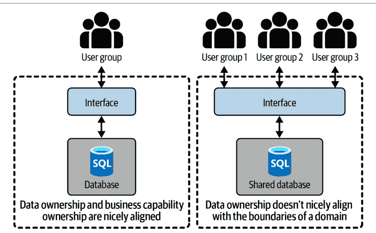

图 2-10. 通用（左）与共享（右）业务能力

理想情况下，拥有业务能力的团队应与您的应用程序域保持一致，因此软件所有权和数据所有权也应保持一致。如果无法拆分域，则需要区分应用程序所有权和数据所有权。因此，以客户管理为例，您将有一个应用程序所有者，负责底层技术服务、管道和应用程序组件，以及多个数据所有者（业务代表），负责不同的数据集，包括元数据注册、隐私、安全等等。

## 复杂的应用程序

另一个需要关注的领域是面向多个业务能力的应用程序，这类应用程序在大型传统企业中很常见。例如，Oceanic Airlines 可能使用一个软件包来同时促进成本管理和资产与租赁。此类共享应用程序通常规模庞大且复杂；它们可能是供应商业务套件或尽可能提供更多功能的旧式单体系统。虽然这可能看起来与前一节中描述的问题相似，但在这种情况下复杂性不同：并非单个业务能力在团队之间共享，而是单个应用程序和数据库由不同的业务能力共享。这引发了我们之前讨论过的相同数据所有权问题。

## 域特征

在映射域和应用程序时，您将了解到存在不同的数据分发模式，这些模式基于数据的创建、消费或再分发。我建议定义原则、设计架构蓝图，并将这些与您的域的特征相结合。在高层面上，我们可以区分两种类型的域。

源系统对齐域是与黄金源系统（即数据源）对齐的域。这些系统通常在本质上是事务性或操作性的。从这些域共享数据的原则是直接从黄金源系统捕获数据。为了便于正确捕获数据和所有权信息，您可以使用标准化的数据转换和共享服务来支持这些域。这种类型域的示例可见于图 2-11。该域使用“共享车道”模式将数据产品分发给其他消费域。

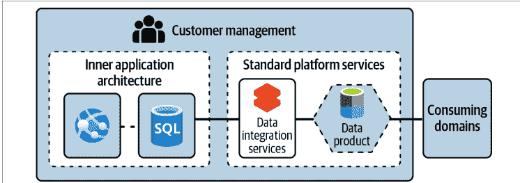

图 2-11. 客户管理域是源系统对齐域

消费者对齐域是消费和使用来自其他域的数据的域。它们与源系统对齐域相反，因为它们与需要来自其他域的数据的特定最终用户用例保持一致。它们消费和转换数据以满足其业务需求。为了满足这些消费需求，您应该使用标准化的数据转换和消费服务来支持这些域。消费域的示例见图 2-12。该域使用标准平台服务将数据转化为价值。

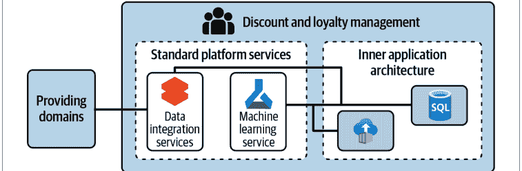

图 2-12. “折扣和忠诚度管理”域是消费者对齐域

一个不同且更难的场景（我们将在第 10 章中深入探讨）是需要重复使用数据时。想象一种情况：多个下游消费者对来自不同域的相同数据组合感兴趣。为了隔离并更有效地管理这些重叠和共享的问题，您可能希望将构建共享数据的业务逻辑集中在一个与数据使用位置分开管理的位置。图 2-13 展示了这在实践中如何工作。在此示例中，“排放和费用”域表现为一个聚合域，它先结合和集成数据，然后为自己使用此数据并与其他域共享。当域之间的集成要求重叠时，这种客户/供应商模式尤其有用。

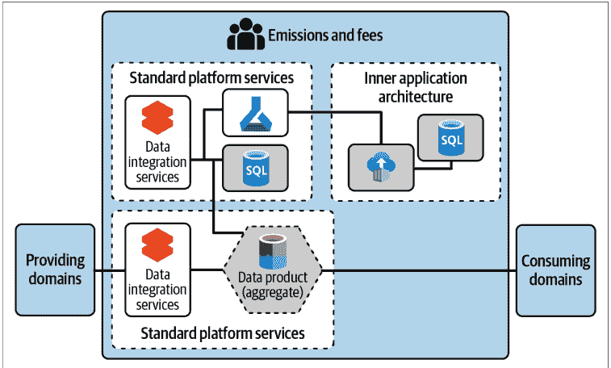

图 2-13. 不同模式在“排放和费用”域中融合在一起


另一种协作模式是让域仅在纯上游/下游关系中协同工作。在此设置中，聚合域充当向其他域提供组合数据的专用供应商。此类供应商域同时表现为数据消费者和提供者。它通过消费数据、创建域聚合（一个组合数据产品），然后直接分发来实现这一点。在此协作模式中，新创建的数据产品不用作该域自身用例的输入。

域聚合是一组可以视为单个单元的域对象。当您有一组相同格式和类型且一起使用的对象时，可以将它们建模为单个对象，从而简化其他域对其的使用。域聚合不应与数据聚合混淆，数据聚合是将数据分组并以摘要形式表达的过程。

图 2-14 说明了另一种场景：消费者在创建新数据后成为提供者，例如，通过对乘客出行习惯进行预测。在成为提供者之前，这些消费域会使用其他域的部分域逻辑，结合自身域逻辑，将聚合数据转换为新的数据产品，这些数据产品可能也对其他域有用。此类域有时被称为构造器域，因为它们创造了新事物。

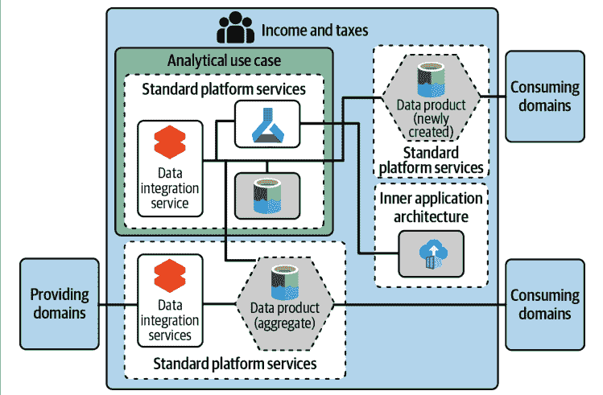

图 2-14. “收入和税收”域表现为构造器域：它聚合数据以供自身用途使用，并将新创建的数据产品导出到其他域

与之前的域聚合场景相比，区别在于新创建的数据产品包含新的业务洞察。因此，发送到消费者的数据不仅经历了一些结构变化，还使用了不同的上下文，注入了新的业务洞察。


> 对于所有这些场景，遵循使用共享车道进行数据分发的最佳实践很重要。

如您所见，域可以根据数据产品使用和分发的特征进行分类。视情况而定，规则可能会发生变化：例如，可能适用不同的蓝图和架构模式。在后续章节中，我们将回到刚刚讨论的场景。


## 针对复杂集成挑战的模式

当将企业架构拆分为更细粒度的领域结构时，您将遇到复杂的集成挑战。以大西洋航空（Oceanic Airlines）为例，“客户管理”领域的客户数据可能在许多不同的领域中都需要，“飞行计划管理”领域在规划航班前必须知道“飞行员管理”领域的管理系统中飞行员是否仍然存在。您如何应对这些复杂性？

最佳做法是标准化多种公共车道模式，以支持不同的集成风格。例如，在进行大规模数据处理时，领域可以向其他领域提供数据产品，使它们能够大量读取数据。对于强一致性读取（和命令），例如，推荐使用 API 服务。我们将在第四章、第五章和第六章中更深入地介绍这些及相关主题。

## 业务能力建模的优势

业务能力建模的好处在于，它可以帮助您更好地在分布式架构中识别和组织领域。它提供了数据和应用程序如何为您的业务创造价值的整体视图。这使您能够优先处理并专注于数据战略和真实业务需求。您还可以将此模型应用于数据领域之外。例如，如果可扩展性是一个问题，您可以识别最关键的核心业务能力并为其制定战略。

有些人可能会担心，通过预先绘制所有内容来构建这种目标状态架构是一项密集型工作。所提议的替代方案是在将领域纳入新架构的同时，有机地识别您的领域。采用这种方法，您不是自上而下地定义目标状态，而是自下而上地工作，在将当前状态过渡到目标状态的过程中进行探索、分析和实验。这可能最初能为您节省一些时间，但当事情开始出问题时，可能会导致需要进行复杂的移动或重塑操作。一种更微妙的方法是双向工作，大致绘制事物，并随时间推移添加细节。

运行企业数据管理架构需要标准化模式、遵循清晰的设计原则并做出艰难的抉择。在接下来的章节中，我将从基本设计选择开始，逐渐揭示最重要的模式和原则。

## 分布式和面向领域的数据管理原则

现在您对数据共享和跨领域协作模型有了更清晰的了解，我想分享一些关键原则，您应牢记这些原则以确保您的分布式数据管理战略成功。我将先在此处提供一些高层次的建议，然后再深入探讨数据领域和数据提供者的具体内容：

### 避免数据孤岛。

第一个设计原则是不鼓励为数据分发使用孤岛或集成中枢。数据孤岛需要额外的转换步骤，这使得提供者与消费者之间的链条更长且难以管理。例如，在数据仓库模型中，我们在集成所有数据时必须处理不一致性，因为有界上下文经常发生冲突。数据仓库模型中的数据提供者和数据消费者是紧密耦合的，这使得依赖关系更难以管理。组织通常无法信任数据孤岛，因为存在数据质量问题、更正和不一致性。

通过消除用于数据分发的数据孤岛，并使用更新、更现代的数据集成和分发形式，我们可以避免团队绕过集成障碍，将架构推向不可管理的点对点架构。


使用点对点接口连接您的领域会产生指数级复杂性，应不惜一切代价避免。例如，互连 100 个应用程序会产生 5,000 个点对点连接。对于 1,000 个应用程序，大约会有 500,000 个点对点连接。点对点连接无法提供企业所需的控制和敏捷性，因为通信通道的数量庞大，几乎不可能监督所有依赖关系。

### 仅在黄金数据源中捕获和修改数据。

第二个原则旨在提高对数据的信任。确保在将任何数据分发到其他系统之前，仅从黄金数据源中捕获唯一数据非常重要。对原始数据的更改应仅在黄金数据源中、在领域内，并经所有者批准后进行。为了透明度和信任，使您的黄金数据源公开是重要的，因此我鼓励您建立一个中央注册表或目录，用于跟踪所有唯一的黄金数据源系统。

### 尊重数据所有权规则。

当应用程序消费和使用数据时，它们可能会成为新的黄金数据源。在这种情况下，数据确实具有新的上下文，因此会产生新事实。这引出了我们的下一个原则：当数据被更改并创建新事实时，预期会有新的所有权。简单的“语法转换”，例如过滤、并集、大写到小写转换和字段重命名不需要新的所有权，因为所有事实都保持不变。这与另一项基础原则紧密相关：不要分发您不拥有的任何数据。在分发源自并由另一个领域拥有的数据时，务必确保您的领域获得该领域的批准。

## 数据领域的设计原则

在企业级实施领域驱动设计时，管理依赖关系和分离关注点的最大变化在于，DDD 理念和有界上下文将用于在应用程序架构中设置逻辑边界。正如我们之前讨论的，有界上下文是关于找到合适的凝聚力级别和理想大小，以妥善管理问题领域。一旦识别出有界上下文，它就必须被解耦，并且只能通过正式化的端点与其他有界上下文进行通信（这就是我们一直在讨论的公共车道模式）。

在企业级使用领域驱动设计模型与使用孤岛方法截然不同，后者是将所有数据集中在使用企业语言的高度集成环境中。在 DDD 中，每个有界上下文使用自己的通用语言。当有界上下文发生变化时，通用语言也会随之改变。我们新架构中的企业语言变成了多种通用语言的集合。

DDD 模型不明确说明如何找到凝聚力并确定有界上下文的边界。因此，我建议在设计新架构时也遵守以下设计原则列表：

### 数据由领域管理，并在整个领域中交付。

数据质量、数据管道和数据可读性都是领域关注的问题。预期最了解数据的人员负责管理数据。数据所有权模型将是分布式的，而不是集中式的。

### 有界上下文与已实例化的业务能力相关联。

有界上下文实现——因此代表——一个业务能力实例或其特定部分。因此，有界上下文专注于相同的解决方案领域。

### 有界上下文可以与一个或多个应用程序相关联。

有界上下文可以是单个应用程序或多个应用程序的分解。在多个应用程序的情况下，所有应用程序都预期为相同的（业务）能力实例提供价值。


分解和解耦复杂架构有不同的方法。细化程度和解耦程度可以使用领域来确定：一个领域中的多个应用程序形成一个有界上下文，并与其他领域解耦。另一种方法是使细化程度更精细，并使应用程序与应用程序解耦。这将迫使（可能具有一定自主权的）领域始终解耦其应用程序。

### 通用语言在有界上下文中共享。

在其自身有界上下文中分发数据的应用程序或应用程序组件使用相同的通用语言。术语和定义不冲突。每个有界上下文与概念数据模型具有一对一的关系。

### 有界上下文与基础设施、网络和组织无关。

凝聚力关注应用程序功能、流程和数据。从数据管理角度来看，有界上下文在基础设施、网络或组织方面不会发生变化。

### 一个有界上下文属于一个团队。

理想情况下，每个有界上下文属于一个敏捷或 DevOps 团队，因为当只有一个团队时，耦合点的数量是可管理的，并且易于所有团队成员理解。

### 边界是严格的。

有界上下文的边界是严格的。每个有界上下文都是独立的。属于同一类的业务问题、流程和数据必须保持在一起，并在有界上下文中维护和管理。

### 跨越边界时进行解耦。

在有界上下文中，允许紧密耦合；但是，当跨越边界时，接口必须解耦。

对于特定有界上下文，任何形状的数据都是允许的，只要尊重明确的边界。

### 领域数据不应通过额外或中间系统交付。

额外层，例如跨领域数据虚拟化层，会使黄金数据源模糊化。此类层会增加复杂性，改变数据及其


质量，并使得难以将数据的血缘追溯至源头。不鼓励使用额外的或中间系统来传递数据。


数据网格架构强烈主张不应存在单一的数据模型。现实情况不同，因为业务中存在清晰且共享的关系，这些关系对于正确建模数据至关重要。忽略这些关系将导致数据无法再跨域集成。这些方面将在第 10 章和第 11 章中讨论。

## 通用数据服务必须保持领域无关性。

领域逻辑和集成复杂性应留在限界上下文中，而不应放置在任何通用数据服务中。这使各领域能够专注于自身最擅长的事情：交付价值，而无需担心可能破坏与其他领域交互的隐藏领域逻辑。

DDD 方法显著提高了敏捷性，因为数据提供者和数据消费者之间的耦合更加松散。限界上下文逻辑边界内的每个业务领域都可以按自己的速度变化，因为一个领域唯一的依赖是与数据端点（例如数据产品）的依赖。

## 数据提供者的最佳实践

将数据从一个上下文移动到另一个上下文总是很困难，因为这需要了解两个上下文。一个问题是，应用程序通常没有针对高强度数据消费进行优化。架构模式通常高度规范化，业务逻辑隐藏在数据中，或者文档缺失。为了减轻数据集成的痛苦，我们需要遵循一些额外原则，关于如何在一个限界上下文到另一个限界上下文之间对数据进行建模、公开和展示：

## 隐藏应用程序技术细节

数据消费者不需要成为物理数据模型的专家，也不应该被要求重建应用程序功能来使用数据。从应用程序逻辑的角度来看，这意味着数据提供者必须过滤掉任何需要特定应用程序知识的应用程序逻辑。这一原则还涉及我们通常在应用程序中发现的技术数据，例如迁移信息、日志信息或数据库架构。这种技术数据是特定的，并且可能只对内部领域感兴趣。数据提供者在公开数据之前应过滤掉任何对消费者没有意义的数据。

## 针对高强度数据消费进行优化

许多应用程序没有针对高强度数据消费进行优化。允许各领域轻松消费数据，并不意味着要向其他领域提供带有无尽父子结构的高度规范化数据。数据应更加反规范化，并直观地组合在一起。用户友好的字段名称将帮助数据消费者找到所需内容。命名约定和数据格式中的不一致和差异应预先解决。在此方法中，数据必须针对通用消费进行优化，目的是使其尽可能可重用，以满足所有数据消费者的潜在需求。这与第 1 章中讨论的读写比率不断提高相关。

## 通用语言是沟通的语言

充当数据提供者的每个限界上下文应使用其自身的通用语言公开其数据。这意味着数据提供者不应将其他领域的业务逻辑纳入其自身领域。

## 接口必须具备一定程度的成熟度和稳定性

这一原则是关于抽象变化的节奏。例如，如果领域范围经常变化，则预期会抽象到更稳定的范围。架构模式还必须提供稳定的兼容性级别。

## 数据应在所有模式中保持一致

这一原则要求在不同模式中公开数据时保持一致性。例如，客户地址元素应在所有模式中保持一致，即使相同的数据被多次公开。

这种拉取自描述、用户友好的数据的方法与直接共享原始数据的数据湖实现不同。在数据湖中（参见第 17 页“数据湖：结构化和非结构化数据的集中式存储库”），数据通常直接作为源的一对一副本拉取，然后（直接）用于下游消费。数据和接口与底层源系统紧密耦合，因此任何源系统更改都会立即中断生产管道。正因为如此，企业很难成功地将高级分析运营化。因此，作为一般最佳实践，不要吸收应用程序团队的变更。相反，请要求您的域团队在其域边界内封装其物理数据模型。这意味着上游域团队构建自己的领域对象或数据产品。

从这些原则我们可以得出结论，数据提供者应以更加用户友好、可消费且合乎逻辑的方式公开其数据。必须避免在原始数据上进行重复工作。数据应表示为逻辑业务模型的抽象版本，而不是来自应用程序的纯物理数据模型。在第 4 章中，我将提供关于什么是良好数据表示的更具体指导。

### 域所有权职责

在各域之间联合架构所有权需要遵循一些额外原则。除了各域对应用程序及其衍生的数据产品承担所有权之外，您的域团队还必须承担额外的责任，例如：

- 对数据管道承担所有权，例如摄取、清理和转换数据，以尽可能满足众多数据客户的需求
- 提高数据质量并遵守数据消费者制定的服务级别协议（SLA）和质量措施
- 封装元数据或使用保留列名进行细粒度行/列级过滤和动态数据脱敏
- 遵守元数据管理标准，包括：
  - 应用程序和源系统架构模式注册
  - 提供元数据以改善可发现性
  - 遵循版本控制规则
  - 链接数据属性和业务术语
  - 确保元数据信息的完整性，以允许域之间更好的集成
- 遵守数据互操作性标准，包括协议、数据格式和数据类型
- 提供血缘，可以是手动的，也可以通过将源系统和集成服务链接到扫描器来实现
- 完成数据共享任务，包括身份和访问管理审查以及数据契约创建

这些章节中的原则可以严格遵循，也可以宽松遵循。对于临时的、探索性的、实验性的用例，接口可能更具不稳定性或针对直接消费的优化程度较低。对于稳定的生产用例，应严格遵循这些原则。您甚至可以在系统内允许组合来混合这些方法：例如，一个数据产品可以强烈遵循此处概述的设计原则进行交付，而另一个数据产品（可能是较不重要的一个）可以更宽松地进行交付。

遵循这些原则至关重要，因为新架构以不同的方式促进数据分发和集成。如果您希望成为数据驱动型企业并推动数据消费，所有域都必须将其数据及其提供方式作为头等关切。域必须遵循这些原则，并将其应用于下一章中介绍的所有通信模式。

### 向分布式和面向域的数据管理过渡

此时，您可能在想：“好吧，这些业务能力和原则很有道理，但我从哪里开始？”要成功过渡到面向域的数据所有权，您需要的先决条件可以概括如下：

- 在讨论应用程序、应用程序组件、（数据）域和业务能力等概念时，就要使用的术语集达成一致。应用程序和域边界的绘制方式取决于您的观点，因为这些词对不同的人意味着不同的事物。因此，创建清晰定义并确定这些概念如何保持一致非常重要。关于使用元模型的指导和支持将在第 9 章中讨论。
- 使用业务能力映射来构建您的业务关切。在大型企业中，业务能力是以整体方式描述组织的一种好方法。请注意，业务能力关关乎的是“什么”，而不是“怎么做”。实施细节及其与技术架构的对齐将在第 3 章中讨论。
- 在识别业务能力后，具体映射哪些应用程序和数据贡献于哪些业务关切。识别并列出您的黄金数据源，并识别数据的所有者。我还建议使用 IT 服务管理解决方案、像 ServiceNow 这样的配置管理数据库或自建的应用程序目录来维护所有应用程序的列表。
- 在列出业务能力和应用程序时，问自己这些应用程序是仅分配给一个业务能力、在多个业务能力之间共享，还是在服务模型中使用。识别哪些应用程序在业务能力之间共享，哪些业务能力在价值流之间共享。对于团队之间共享的大型应用程序，将数据划分为内聚且自包含的限界上下文，每个上下文拥有独立的所有权。我将在第 8 章中再次讨论此问题并提供更多指导。
- 绘制您的数据消费图表，并映射数据消费如何与数据创建保持一致——边界也可以由消费需求定义，例如数据处理或数据协调。在此过程中，识别任何共享或重叠的数据关切非常重要。稍后，您需要在一致性和自主性之间取得平衡。关于这一点的指导将在第 10 章中提供。
- 定义您的（数据）域。经验法则是每个域都与业务能力的实现保持一致。在此解决方案空间中，多个


应用程序和组件可以协同工作，以提供特定的业务价值。为此练习，请努力使你的限界上下文、业务能力和团队保持一致。限界上下文，正如你所学，是对业务能力的封装，每个业务能力至少实现（实例化）一次。为了在团队中传播你的领域视角，一个指导原则是每个限界上下文应由单一团队拥有。然而，单个团队可以拥有多个限界上下文。

- 边界不应重叠。如果发生这种情况，你可能需要将组织结构与领域结构保持一致或重新校准。与具有跨职能团队的扁平组织结构相比，具有集中式运营和开发团队的传统公司结构更难以围绕业务领域建模。考虑你是否偏好虚拟团队对齐，如果你想在团队之间调动人员，以及向目标状态过渡的分步过程可能是什么样子。
- 限界上下文是适用政策和标准的区域。为了监督目的，请使用能力图绘制你的业务能力，并将其作为应用政策和标准的输入。底层领域将继承你在业务能力级别设置的政策和标准。因此，这张图将作为指南，显示哪些标准适用于哪些区域。
- 清楚地规定当跨过分界线时必须发生什么——也就是说，你的领域必须遵循哪些标准和原则。跨领域边界分发数据和集成应用程序很困难，原因有很多：为域内运行使用而设计的系统可能不易互操作，流程可能难以同步，或者仅仅是相关人员相互疏远、不太熟悉。这是危险区域，有各种危险需要规避。

对当前状态的准确、全面的洞察是任何数字化转型的基础。如果不清楚自己现在所在的位置，就不可能朝着优化的未来状态努力。一旦了解当前状态，你就可以开始规划有机变化可能是什么样子。

## 总结

让我们回顾迄今所学的内容。成功实施新设计的关键路径在于：一切，绝对一切，都必须围绕业务能力构建。这是一种以业务为中心的方法，可确保真正的价值交付。因此，你必须将业务能力锚定到关键业务战略上。业务能力本身定义了你的问题空间。它们是定义架构的领域。系统、数据库、应用程序、流程、API、团队和数据产品都映射到这些领域。使用DDD的另一种（沙粒）方法，如在微服务中通常见到的，主要用于挖掘复杂性和梳理应用程序接口。

接下来，你了解了设置强边界。通过在联邦模型中使领域或业务团队能够独立更改和交换数据，你获得更多灵活性，并允许领域并行工作。联邦模型中的每个领域拥有并管理整体架构的一部分。通过在业务能力级别的限界上下文中逻辑分组应用程序，你确保共享相同关注点的应用程序一起管理，并且与由不同业务关注点管理的应用程序没有直接依赖。这种方法为组织创造了清晰度和敏捷性，因为团队可以完全专注于交付单个业务能力的价值。每个领域都被限界上下文的逻辑边界围起来，维护着整体架构的特定部分，包括权威的唯一数据集。最后请注意：重要的是要记住，关于领域和解耦的讨论并不特别与数据网格架构相关。设置清晰的分界线对任何数据管理或应用程序集成范例都是普遍的。

达到成熟领域架构的水平并不简单。它始于将企业架构作为一门学科。企业架构领导者应该推动变革过程，并确保业务愿景转化为坚实的设计。它还始于集中设置标准。向数据驱动转型要求各个团队放弃关于如何绘制边界以及数据如何被拥有、管理、分发和消费的决策权。所有权需要纪律和日常实践。这种责任转移可能会引发抵制，你可能不得不做出政治选择。如果没有强有力的指导，组织转型就不会发生，架构也无法发挥其全部潜力。忽视边界、自行部署数据服务并进行点对点集成的团队面临数据蔓延的风险。12 可重用性、一致性和数据质量是新架构的重要方面。一致的沟通、承诺和强有力的治理是扩展所必需的。

此外，这种数据环境现代化需要务实的方法，因为远离紧密耦合的环境很困难。通过循序渐进并缓慢扩展，你为你的领域和用户提供了识别好处的机会，这样他们就会愿意参与到将为组织带来竞争优势的新架构中来。随着时间的推移，你的架构可以扩展，包含更多领域、额外的集成模式和增强的能力。我们将在第12章讨论将理论付诸实践时再次回到分步方法。

12 数据蔓延是指企业每天产生的大量且多样化的数据。

本章以大量关于领域驱动设计、业务架构、数据共享和跨领域协作模型等理论结束。如果这些内容显得过于概念化，不用担心。在接下来的章节中，我们将重新乘坐直升机，俯瞰解决方案空间，并了解登陆区、数据产品、API和事件。我们将飞得低一级，但仍留在云层之上，以便拥有良好的观察点。

# 将领域映射到技术架构

既然你知道数据领域是什么以及如何识别它们，现在是讨论如何将它们组合和管理在一起，以及如何在技术架构中绘制它们的时候了。你的功能领域和架构的分解以及两者之间的对齐很重要，因为架构与如何实施治理标准、设置控制、管理数据产品等之间存在着强相关性。

根据我的经验，组织之间在分解和管理其领域架构方面存在显著差异。组织在设计大规模架构时会进行权衡，因为架构必须根据其独特的组织要求和战略进行塑造。这些权衡涵盖许多方面，例如所有权、组织规模和复杂性、安全性、变化速度、技术、成本管理以及文化和政治特征。如第1章所讨论，一些组织偏好高度自主，而其他组织则偏好质量和控制。一些组织结构相对简单，而另一些组织则庞大而复杂。平衡所有这些要求并不容易，因此组织通常选择一个符合其大多数要求的常见架构设计作为基础并在此基础上构建。正如你将看到的，从一开始就选择正确的架构基础有助于避免后期问题。

本章分为两部分。第一部分关注*领域拓扑*：领域分组、相互关联和排列的方式。我们将研究几种常见的架构设计，并讨论驱动组织的因素以及为什么他们可能偏好一种设计而非另一种。


在本章的第二部分，我们将讨论*登陆区拓扑*：域与解决方案空间对齐的方式。我们将探讨云配置、标准服务、组织存储的方法等内容。我将以一个务实的示例结束本部分，再次使用第 2 章中的虚构公司大洋航空。在两个部分中，我将结合与众多客户合作的经验，讨论必须考虑的权衡。

## 域拓扑：管理问题空间

在上一章中，你了解到，分散式数据所有权的概念在不同域之间联合了责任。我们讨论过，在确定技术栈并释放数据团队之前，你应该先看看大局，识别你的问题空间（或者更积极地表述，业务机会）。我们涉及了业务能力，并且构建业务能力图是一个很好的起点。我们还讨论了许多关于良好数据所有权的设计原则和指南。

但是在将域粘合在一起时，问题空间和解决方案空间应当如何协同工作？你是否应该根据某些特征对域进行分组？如果是，分组哪些，为什么，如何分组？你是否应该赋予所有域完全的自主权，让它们自行连接到数据产品网络，还是应该有中央机构介入？你如何处理跨域数据问题？例如，域是否可以与其他域重叠？如果可以，数据如何流动？模型更像是星型还是点对点设计？在本节中，我们将通过介绍不同的域拓扑来回答所有这些问题。1

1 这些域拓扑类似于网络拓扑。它们描述了网络中域的物理和逻辑关系、链路和域的示意图排列，或者某种混合组合。

请记住，我们将讨论的所有拓扑中，数据所有权和域边界的原则保持不变。每个域负责自己的数据，将数据作为产品来管理，并使用第 2 章中讨论的公共车道模式。我们在这里将讨论的拓扑旨在探索治理与灵活性、依赖与独立、控制与自主之间的平衡。

### 完全联邦域拓扑

我们将讨论的第一个域拓扑是我称之为 *完全联邦* 域拓扑。为了最好地解释这种拓扑如何组织数据域，我将使用数据网格的示例。这是一种大规模管理数据的分散式方法，基于四项原则：数据的域驱动所有权、数据即产品、自助式数据平台和联邦计算治理。在其最纯粹的理论形式中，数据网格是一种细粒度架构设计，强调联邦且没有中央编排器。图 3-1 展示了数据网格中域组织方式的抽象示例。这种拓扑致力于细粒度解耦和数据的高度可重用性。

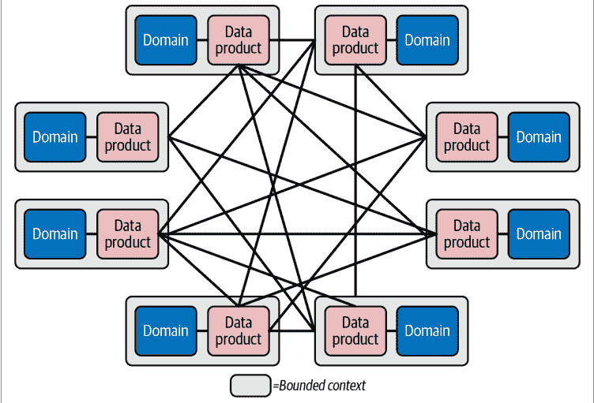

图 3-1. 数据网格是细粒度且完全联邦域拓扑的示例

如你所见，自主边界与各个域很好地对齐。每个域对其自身数据承担全面的端到端责任。每个域独立运行，将数据作为产品提供，并对其他域负有数据共享责任。这与采用微服务架构的组织中普遍采用的细粒度分解相同。

在图 3-1 中，你还可以看到域之间的直连线。数据网格中的数据分发是点对点进行的：直接进行，不依赖于专门的中央机构。域很灵活，不依赖中央团队进行协调或数据分发。治理是计算式的（即自动化的）；合规性通过平台强制执行。

在数据网格中，数据产品是细粒度的。简单来说，你会实例化许多不同的小型数据产品架构，用于跨域提供和拉取数据。在这些架构中，数据和元数据、基础设施以及代码被组合在一起并作为单个单元部署。其概念工作原理如图 3-2 所示。

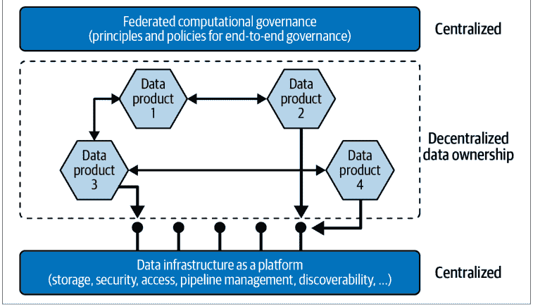

图 3-2. 数据网格逻辑架构：集中式联邦计算治理和自助式平台能力，分散式数据所有权

数据网格拓扑支持细粒度域专业化。它提供了组织灵活性和更少的依赖，因为交互是多对多的。最后，它促进了数据的高度复用，因为存在高度的数据产品创建，每个数据产品都是一个架构量子。

尽管细粒度且完全联邦的设计在理论上似乎完美，但当组织更深入地审视时，它们往往会提出担忧并识别潜在挑战。让我们看看是什么阻止组织实施类似数据网格的架构。

### 房间里的大象

首先，数据网格要求所有域在数据互操作性、元数据、治理和安全标准方面达成一致。这种标准化过程不会自发发生。它要求组织将其架构和工作方式经历不同阶段，从预概念化、概念化、讨论和编写，到实施和控制。由于该架构中的域对其应用程序和数据拥有近乎完全的管辖权，因此让所有域团队遵循共同的工作方式预计将是一项艰巨的工作。各域存在利益冲突：有些域只索取数据，而不消耗任何数据的域则认为构建数据产品是一项昂贵的投资。除了利益冲突外，各域在技术和工作方式方面也可能存在偏好冲突。一些爱好者甚至可能倡导完全的域自主权，而不涉及任何企业架构。归根结底，协调所有域需要你打破政治边界。你需要关键规模和更广泛社区的支持。

其次，组织担心能力重复和网络利用率过高。许多细粒度数据产品架构意味着基础设施资源数量急剧增加。这可能使你的架构变得昂贵且难以管理。例如，想象一个拥有数千个应用程序并在本地和不同云上有足迹的大规模组织。当域进行点对点通信时，你如何轻松且安全地管理域之间的网络连接？当应用程序数量增加时，点对点通信会呈指数级增长。这对于依赖中央团队来维护网络可见性和安全性的公司来说，是一个尤其严重的问题。在此示例中，这意味着域与网络和安全团队之间存在持续的通信流。

第三，数据产品架构的细粒度会带来问题：当数据需要从许多不同的位置拉取时，性能会受影响；当数据孤立时，数据查找、数据质量验证和历史数据对账都很困难；当数据处理分散时，隔离问题具有挑战性。当许多域依赖大量其他域的数据时，这些问题大多会显现出来。例如，金融机构必须确保整个企业范围内的报告一致。根据法规，强制要求会计、财务和集团报告以及审计和风险管理使用相同的维度。解决此对账问题的典型方案是将大量数据聚集在一起，这种方法与数据网格形成鲜明对比。

第四，公司难以吸引和留住合适的人才。分散数据管理并建立平台以支持数据网格拓扑（包括自动数据产品架构创建、策略强制执行、智能路由、分散式编排、目录和交付）是一项复杂且风险高的工作。要实施数据网格，你需要大量精通 DataOps、自动化、安全、平台设计等知识的高技能软件工程师。很可能你需要显著更多的工程师来启动数据网格，因为成功采用需要关键规模。并非所有组织都愿意进行如此大规模的投资，更不用说能够吸引到合适的人才了。

归根结底，细粒度且完全联邦的域拓扑是一个极好的选择，但难以实现。我经常在云原生组织、主要使用微服务、采用多云策略并使用 a

应用数量有限，相对年轻，并且拥有大量高技能的软件工程师。当公司内部已有高度自治权时，采用这种拓扑也可能是一个经过深思熟虑的决定。

## 治理型域拓扑

让生产者对其创建、管理和分发的数据负全责，是组织真正喜欢的数据网格架构的特点之一。它将数据管理的责任联邦化。这种对齐是有道理的，因为数据生产者是其自身数据的专家。他们知道系统的设计方式以及这些系统内部管理的数据是什么。他们经常与最终用户或业务分析师密切合作，因此知道良好的数据质量对数据消费者意味着什么。此外，联邦化提供可扩展性：多个团队独立开发数据管道并并行提供数据。因此，许多大型企业有兴趣联邦化任务和职责，也不足为奇。

为降低管理基础设施的开销，你可以通过添加中央分发层来调整前一种拓扑。虽然由此产生的治理型域拓扑并不精确实现数据网格架构，但它确实遵循许多数据网格原则：每个域在明确边界内运行，并对其自身应用程序和数据产品拥有自主所有权，但这些数据产品必须通过一个集中管理的共享逻辑实体进行分发，如图 3-3 所示。

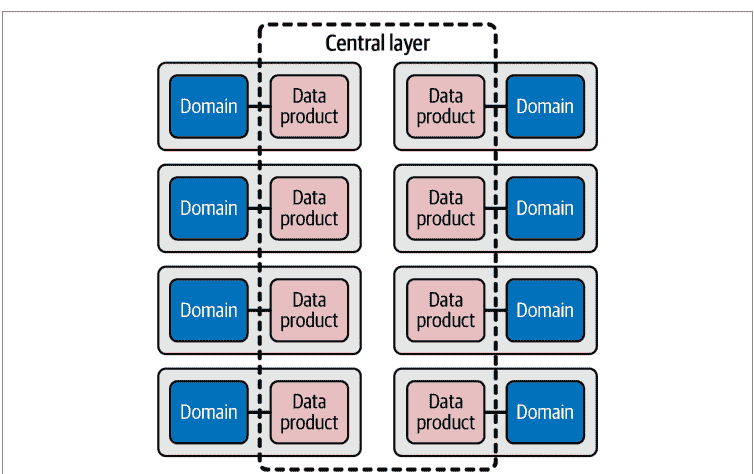

图 3-3. 治理型域拓扑

这种拓扑与轮毂-辐条模型²相似。通过添加集中共享的数据产品架构，它高效管理数据分发；它允许数据一次性交付到集中逻辑位置，然后由不同的消费者多次消费。


> 域是否应始终公开或共享其生产的所有数据？
>
> 这取决于情况。我的建议是采用需求驱动的方法构建数据产品——即仅在有需求时才构建。然后，作为一般最佳实践，我建议构建数据产品，使其尽可能为尽可能多的（可重用的）数据消费者服务。但是，我见过一些组织要求始终提供所有数据。此类组织预期将成为数据驱动型组织，因此需要快速上市时间。

组织常常感到，中央分发（如图 3-4 所示）更能解决开发早期阶段的符合性问题；例如，在缺乏自动化时。当使用单个数据分发平台时，你可以更轻松地阻止数据分发或消费，强制元数据交付，或要求特定的工作方式。中央分发的另一个好处是避免大量网络流量，因为有一个集中连接点。如果所有域都使用点对点连接分发其数据，你会看到入站和出站连接点的激增。向集中逻辑实体分发数据并从中分发数据解决了这个问题。

在中央分发下，组织也试图使其架构更具成本效益。一些组织使用共享计算服务来补充中央分发层。例如，你可以将 Apache Spark 处理部分从单个数据产品架构中提取出来，并在多个域之间共享该计算，以确保数据以更具成本效益的方式处理。拥有一个用于分发的中央层还简化了满足数据仓库工作负载典型的时间变体和非易失性要求。³

2 轮毂-辐条是一种广为人知的架构模式，数据传输和服务器间通信通过集中式轮毂进行。

3 这些概念由 Bill Inmon 在其著作 *构建数据仓库* (Wiley) 中提出。*时间变体*意味着会进行历史化处理，因此你可以进行时间旅行并查看较旧的数据集。*非易失性*意味着一旦数据被处理，它就不会改变。因此，历史数据绝不应被更改。我们将在第 4 章更详细地讨论历史化。

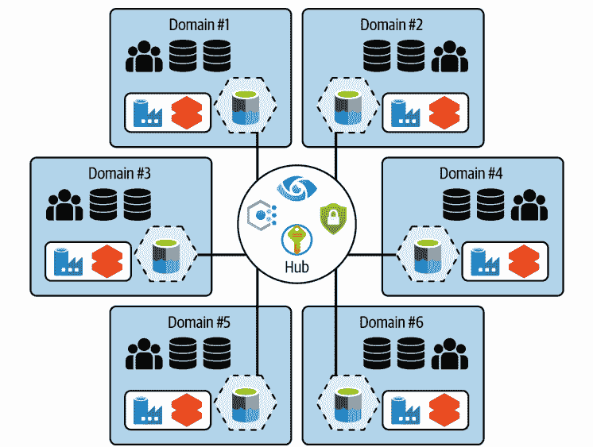

图 3-4. 一个抽象设计，展示域如何对其自身应用程序、数据和数据产品拥有所有权，且数据产品通过集中逻辑实体进行路由

这种拓扑要求域遵循合规性，因为它们必须通过集中逻辑实体分发和路由数据。结合更强的集中化，这是一个需要牢记的重要因素。它在域之间引入了更多的耦合，并可能导致更长的上市时间：你的中央分发层可能成为瓶颈，在中央功能未准备就绪时阻碍域交付业务价值。对于多云部署，这种拓扑也可能更难以实现，因为构建一个能够无缝跨不同云移动数据的中央数据分发服务是困难的，考虑到某些云原生服务的锁定和有限灵活性。

治理型域拓扑仍然是从集中式到联邦式数据管理的转变。其实施可能很复杂，但尽管如此，我看到许多组织选择治理型域拓扑以获得更多可扩展性。这适用于我合作过的大多数金融机构和政府，以及其他重视控制、质量和合规性而非团队自主权的大型组织。

## 部分联邦型域拓扑

并非所有组织都有幸拥有大量高技能的软件工程师。其他组织面临限制，或被迫使用难以维护和从中提取数据的旧版应用程序。属于这些类别的组织通常实施“部分”联邦化，使用类似于图 3-5 中可视化的拓扑。

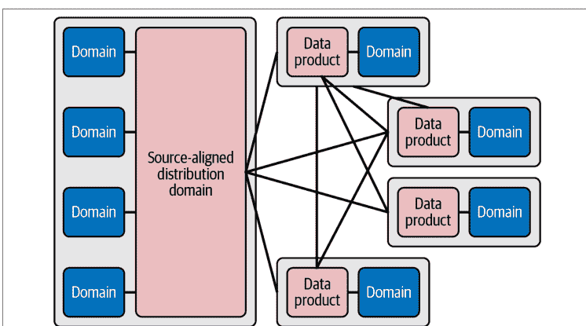

图 3-5. 部分联邦型域拓扑：消费方联邦化，源系统对齐方略微集中化

这种拓扑与前几种拓扑有什么区别？联邦化较少，集中化较多。存在数据产品管理思维，但数据在集中式共享数据产品架构中进行管理。有时，当域团队缺乏必要技能或资源时，甚至有一个集中工程团队接管数据的所有权。在这种情况下，你会看到虚拟对齐：项目团队成员代表域来帮助解决问题和上线数据。

在这种架构的消费方，通常存在更高程度的自主权和网格风格的数据分发。不同的域团队处理用例并对其转换后的数据和分析应用程序拥有所有权。结果或新创建的数据通过点对点方式分发，或推送回中央数据平台。

这种拓扑的一个注意事项是源系统对齐域的管理开销增加，因为它们很可能由中央团队上线。使用这种架构的组织可能会遭受源于不同运营模型、缺乏自助服务功能以及更复杂的指导和原则的问题。数据分发的规则也可能不一致，因为消费域通常也是提供域。

## 价值链对齐型域拓扑

在供应链管理、产品开发或运输方面具有核心竞争力的组织非常重视其价值链。这些组织的特征是域所交付的增值。域通常以流式对齐的方式工作，作为整个业务切片（因此是端到端）。因此，域通常紧密互连且本质上是运营性的。它们还双向处理数据，即从运营型到分析型，再回到运营型。这种拓扑的示例可见于图 3-6。

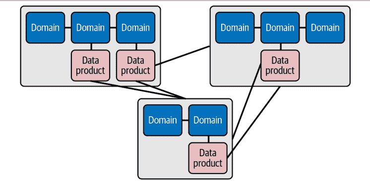

图 3-6. 价值链对齐型域拓扑：围绕一系列业务活动进行紧密域对齐

在此上下文中，价值链是一小群为实现共同增值而紧密协作的域。价值链本身需要更高水平的自主权，并可以视为更大的域。在这些更大的域中，你通常会看到不同的模式：既有价值链内部的数据分发，也有跨价值链的数据分发。在价值链本身的边界内，可能较少或有限地遵循中央标准，但当数据跨越价值链的边界时，必须遵循这些标准。

在应用价值链对齐型域拓扑时，你可以混合使用不同类型的治理模型：你可能要求一个域严格遵循，但允许其他域采用宽松控制。这种拓扑的另一个注意事项是，它需要架构师提供更强的指导，因为边界可能不总是


如此明确（例如，当业务能力在不同价值流之间共享时）。采用这种拓扑的最后一个考虑因素是，你会变得不那么数据驱动，因为只有跨越价值链边界的数据才能进入数据产品。

## 粗粒度域拓扑

一些组织通过有机增长、并购实现了规模扩张。这些组织通常拥有复杂的系统格局，有时包含数百甚至数千个应用和系统。在这些复杂的结构中，存在不同层级的治理、对齐和分解。有些结构可以独立运行并自治，而另一些则与组织的控股集团结构更加集成。

在这些组织中观察到的结构通常很大。单个域可能包含几十个或数百个应用。这种粗粒度拓扑在图 3-7 中以抽象形式可视化。

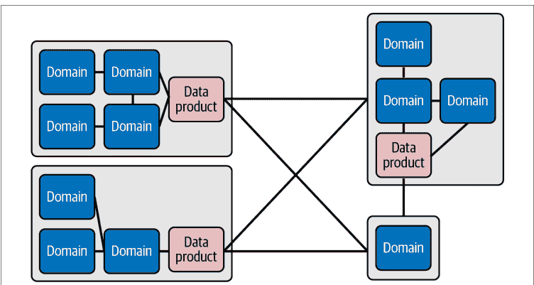

图 3-7. 粗粒度域拓扑：域大致围绕业务单元、地区或业务能力等进行对齐

粗粒度域拓扑的难点在于，边界并不总是明确的。域可能与其他域重叠，或位于更大的域之中。此外，应用和数据并不总是与业务目标对齐。更常见的是，域边界基于相对宽泛的组织或区域视角。这种分组可能会引发政治内斗，关于谁控制数据以及应采用哪些治理规则来正确管理数据。

另一个挑战是，以粗粒度方式管理应用和数据会引入能力重复。每个粗粒度域很可能使用自己的数据平台来进行数据上线、转换和分发。这种实施多个平台的方法会导致重复。例如，企业范围内可能都需要数据质量管理和主数据管理。联邦平台方法可能会导致在各种数据平台上多次实施数据质量和 MDM。确保所有平台上这些服务的一致实施需要强有力的协作和指导。组织越大，难度越大。

这种多平台方法通常会引发许多问题：如何对齐数据平台和域？连接到同一数据平台的较大域是否允许直接共享数据？当相同数据在不同平台上都需要时，如何处理重叠的数据需求？如何高效地在域和平台实例之间分发数据？在实施任何平台服务之前，一个良好的起点是使用第 2 章中讨论的业务能力建模，对组织进行适当的域分解。接下来，建立应用和数据所有权，然后制定关于数据产品创建和分发的强有力指导。

## 面向域的数据仓库

一些组织通过实施使用规范数据模型（或超模型）的大型粗粒度数据仓库，并使用一种语言来连接较大域内的所有各方，来设想面向域的方案。在此方法中，数据仓库或数据湖捕获并保留原始数据，然后直接将其转换为和谐的域模型。和谐化后，原始域直接向运营应用和其他使用域提供数据。当数据仓库充当众多域的存储时，有几件重要的事需要牢记：

- 为一组用例实施特定逻辑，同时直接向其他域提供通用数据，极其困难。这是两种截然不同的关注点，不易整合为一个设计。例如，您可能需要为消费者抽象数据，同时为其他用例增加额外复杂性。在同一数据模型中实现此功能时，最终结果通常是一种难以使用的设计。

- 仅保留原始数据并直接对其进行和谐化，意味着您不再能轻松支持运营报告或分析。要么您拥有原始、紧密耦合且过于复杂难以处理的输入数据，要么拥有对于运营用例而言毫无意义的和谐化数据。

- 进行变更时涉及的风险显著增加，因为所有用例都与同一底层结构耦合。也就是说，仅关心单一来源数据的消费者也与其他系统耦合，可能会受到影响，因为数据首先在和谐层中合并，然后再提供出来。

共享数据库模型（例如，为具有不同业务关注点的多个域构建的大型域数据仓库）最终会导致严重问题，必须不惜一切代价避免。

当组织考虑将粗粒度域拓扑作为起点时，应计划向更细粒度、更去中心化的模型过渡。粗粒度方法意味着高度自治，因此需要更强的治理策略和自助数据平台能力。例如，根据域所做的技术和互操作性选择，可能需要为数据产品注册和发现提供特定指导。否则，跨域方法的泛滥可能导致可见性不佳和成本增加。

此处描述的粗粒度域拓扑与数据网格实现相去甚远。通常，域的划分界线尚未设定。这有可能形成更大的孤岛，并增加系统之间的耦合。粗粒度边界还会造成数据所有权模糊，因为数据产品通过中间系统、孤岛或点对点接口分发，这使得难以确定实际来源。为降低这些风险，应设定清晰的划分界线，并在技术服务、元数据和互操作性标准上强制标准化。此外，应遵循仅捕获唯一数据并直接从原始来源使用其唯一域上下文捕获数据等原则。

## 粗粒度和部分受治域拓扑

一些大型复杂组织旨在通过构建位于这些粗粒度边界之间的集中分发层，来克服复杂性、点对点分发和互操作性偏差等问题。这种拓扑的抽象可视化如图 3-8 所示。

在此拓扑中，团队或组织结构同意使用一个分发平台或市场，通过该平台可以发布和消费数据。它吸纳了受治域拓扑的一些特征，但在较大的边界内允许更宽松的控制。

所有粗粒度拓扑都要求数据平台团队具备高度成熟度。所有组件都需要支持自助服务，并且必须在集中分发层与域平台之间良好集成。元数据管理、治理标准和策略至关重要。如果中央架构和治理团队没有强有力的授权，这些架构很可能失败。

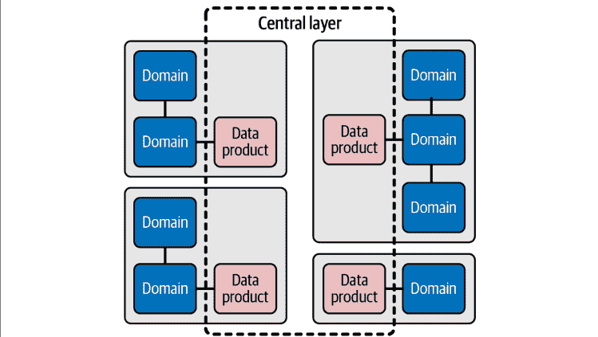

图 3-8. 粗粒度和部分受治域拓扑：粗粒度对齐，同时治理跨边界的数据分发

## 集中式域拓扑

一些组织对去中心化持抵制态度。并非所有组织都能为其所有团队配备用于执行数据产品创建任务的工程工具。并非所有组织都有 500 多名数据工程师。并非所有组织团队都熟悉复杂的数据建模技术、变更数据捕获、Kubernetes 和 Python 笔记本。公司根据其规模、业务需求和现有架构要求采用不同的方法。

我合作过的许多组织已实施了集中式平台团队管理所有共享基础设施（包括数据平台）的中心辐射网络拓扑架构。对于通用数据服务，组织通常使用与其他团队密切协作以进行数据上线或消费的中央团队。通过要求团队承担数据所有权来构想数据产品思维，这意味着在故障排除、修复数据质量问题或解决摄取问题时提供支持。但在涉及复杂工程时存在成熟度曲线，因此中央团队还经常帮助上线数据、管道配置、培训，并指导团队采用最佳实践。这些赋能团队在另一团队缺乏必要技能的情况下，也可能承担数据所有权。

同样的成熟度曲线通常也出现在数据使用方。在许多情况下，团队依赖于共享资源池，以获取关于数据配置、摄取和转换的知识和帮助。他们使用所学到的教训


学会了进行改进以增强服务，例如数据管道和摄取的框架，并使这些更加动态和可配置。这是一种不断的校准，在解决低效问题和实现自助服务与用于帮助新数据入驻所花费的时间之间取得平衡。

为解决能力重复问题，企业通常选择一个中央（面向域的）数据平台，而不是许多由各个团队管理的已部署组件。这也是我看到与许多架构（例如数据湖仓架构）⁴重叠的地方。在这种情况下，有一个集中式共享数据平台，在一个逻辑数据湖中处理所有数据摄取、存储、转换和数据输出。数据组织以及与源系统或域的对齐在中央平台内进行。图 3-9 提供了一个参考模型，展示了具有单个平台实例和域对齐数据所有权的此类架构。

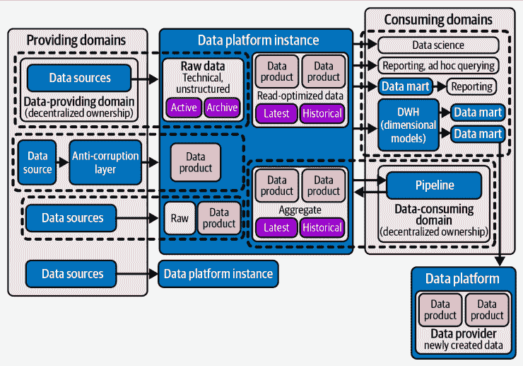

图 3-9. 一个参考模型，展示域如何使用集中式域拓扑在共享平台实例上进行协作

⁴ 数据湖仓是一种架构设计，它结合了数据湖的灵活性、成本效益和规模，以及数据仓库的数据管理和 ACID 事务，从而在所有数据上实现商业智能（BI）和机器学习（ML）。

在这种设计中，有一个用于在域之间分发数据的逻辑存储层。该图 3-9 中称为数据平台实例的层，充当所有团队之间的解耦点。对于提供域一侧，分段和隔离通常通过使用存储帐户、存储桶、容器或文件夹在平台中物理隔离数据来实现。在数据入驻过程中，数据通常分层并经过多个阶段处理，例如原始数据和精选数据。最终结果（通常称为数据产品）是源自源系统的数据的丰富且清洁的版本。组织通常试图通过启用自助服务和应用元数据驱动的摄取等技术来加速此过程。

在消费域一侧，您可能会根据消费者的需求发现不同的消费模式。有些用例（例如数据科学和报告）将直接消费数据，而其他用例则将数据推送到新创建的数据集市或数据仓库。通常应用语义层和数据虚拟化，以将数据集中在虚拟或逻辑数据组中。这些新创建的数据集通常也称为数据产品，并与不同数据消费者的用例相一致。与提供方一样，在消费方您也常常会看到自助服务模型。组织使用目录让最终用户请求数据，并提供工具来消费和重新发布数据。

集中式域拓扑在使用企业范围数据模型或企业范围数据协调方面，通常与所有其他拓扑形成对比。尽管由于其复杂性和开发所需的时间较长，企业数据建模名声不佳，但我仍然看到许多组织应用某种企业范围数据建模，以解决关于数据可重用性和标准化的问题。在这种情况下，新建模的数据集位于与源系统和面向消费者的数据分别管理的区域之外的一个单独管理区域中。该区域中的数据通常由中央团队所有。此企业数据受到严格治理并有完善文档。企业标准化的程度因组织而异。大多数组织仅对部分数据进行建模——例如，仅对其最重要且最常用的维度进行建模——而有些组织则试图对所有数据进行建模。对这些「企业数据产品」消费的原则也有所不同：一些组织规定团队始终消费这些数据产品，而另一些组织则采取更灵活的方法，允许域选择要消费的数据。解决企业一致性问题的相关内容将在第 10 章中讨论。

此拓扑中更高程度的集中化有助于小型组织解决诸如无需在域之间移动数据即可浏览大型历史数据集、数据一致性（数据在逻辑上相互连接且相互一致的程度）、MDM 效率以及通过不同团队之间共享计算资源来降低成本等问题。同时，它从数据网格架构中继承了一些最佳实践，例如数据产品思维、面向域且与域对齐的数据所有权、自助服务功能和数据治理。

## 选择合适的拓扑

在集中化和去中心化之间找到良好的平衡仍然是许多组织的两难困境。从集中式数据管理转向去中心式数据管理，完全重新定义了数据管理对组织的含义。您的中央团队不再集中执行数据管理的所有领域，而是负责定义什么是强大的数据治理。本章概述的域拓扑将帮助您了解可以应用哪种程度的集中化或去中心化、如何划定界限，以及架构中的域将如何交互和连接。

企业必须只实现其中一个域拓扑，这是一种误解。组织可以根据想要做出的权衡，组合或混合不同的拓扑。例如，在图 3-10 中，一个相对灵活的治理模型与一个更严格、更集中的模型相结合。若干域以完全联邦的方式运行，而其他域则采用中心辐射型和集中式模型进行组织。

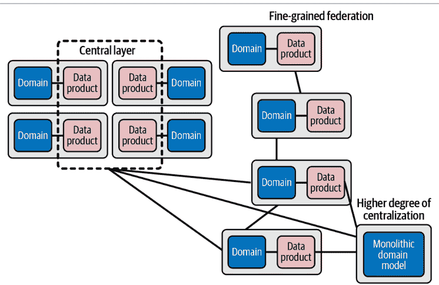

图 3-10. 在单个组织中组合不同的域拓扑

最初选择的拓扑将是最终拓扑，这也是一种误解。域分组和互连中不存在完美的平衡状态。请考虑宇宙：起初，我们经历了碰撞、合并和崩溃。在后期阶段，宇宙进入了一种更加和谐、更清楚地了解引力成因的状态。这导致了一个变化较少的更平静状态。设计大规模架构也是如此：您将经历所有这些不同阶段，因此不要追求完美的初始设计，因为这会为自己埋下失败的隐患。相反，“从小处着手，快速失败，快速失败以更快成功。”

总结并结束：在选择域拓扑时，我建议尽可能设置细粒度的域边界，因为成为数据驱动型组织的关键在于使数据可供密集（再）使用。如果您的域边界过于粗粒度，您将在许多应用程序之间强制产生不希望的耦合，数据可重用性将受到影响。每次数据跨越业务能力或功能问题的边界时，都应努力实现解耦。此最佳实践意味着，在域的内部架构中允许紧密耦合。但是，在跨越边界时，域必须保持解耦，并分发读取优化的数据以便与其他域共享数据。

在定义域拓扑结构时，您还必须设计和实施底层技术架构。迄今为止，我们尚未涉及解决方案空间，但请考虑这些拓扑在作为技术架构实现时将是什么样子。您可以应用隔离和模块化吗？例如，域可以逻辑上分组在一起吗？如果可以，哪些是共享平台基础设施的良好候选者？

建议使用云采用框架。此类框架提供规定性指导、最佳实践、文档和开源蓝图。它通过对齐业务和技术目标来提供帮助，从而更容易选择正确的前进路线。在下一节中，我们将考察这些框架的工作原理，以及域拓扑的技术实现可能是什么样子。

## 登陆区拓扑：管理解决方案空间

在云基础设施上构建大规模架构时，建议使用云采用框架并采用登陆区方法论。简而言之，登陆区是一组标准构建块，允许您自动创建符合安全策略、合规指南和最佳实践的预配置项目、基础设施和环境。这些构建块通常包括安全性、治理、自动化、网络、存储、计算、审计和日志记录以及数据管理方面的服务。登陆区有多种类型，并可通过配置进行调整。有些组织将其通用化，以便尽可能适应多种场景。其他组织则将其特定化，这意味着您拥有例如针对数据相关场景优化的登陆区。


落地区域为您的域提供预配置环境，并通过代码进行配置。所有主要云提供商均提供开源蓝图和最佳实践，包括以下内容：

- Amazon 的 AWS 云采用框架
- 适用于 Azure 的 Microsoft 云采用框架
- 适用于 GCP 的 Google 云采用框架


数据落地区域蓝图的一个最佳实践是将这些蓝图托管在开放且集中的代码库中。提供透明度将鼓励您的域团队做出贡献并参与进来。同时，中央团队将负责监督，并确保所有实现中的标准化。

落地区域加速了大规模架构的实施，因为它们允许您标准化向团队提供的服务。它们提供易于部署、命名一致性、策略强制执行、缩放、安全性、备份和灾难恢复以及法规合规性。它们还确保当新工作负载进入您的架构时，合适的基础设施已经就绪。

通常，云采用框架由两个构建块组成，这两个构建块对所有部署选择都至关重要：

## 数据管理落地区域

这是您架构的基础。它包含用于监督和管理工作负载的所有监管功能，例如安全组件、防火墙、监控解决方案以及端到端数据管理服务；这些包括数据目录、数据血缘、API 目录、MDM 服务、中央元数据存储库等等。原则上，此区域始终与域无关。

## 数据落地区域或落地区域

这些是托管您的域工作负载或用例的帐户或订阅。它们为您的域包含关键功能，因此可以开发特定应用程序。对于数据相关用例，落地区域必须提供集成、报告、机器学习、数据库、存储解决方案、运行时或用于分析处理、编排等等的计算池等服务。

云采用框架并不总是明确说明必须实施的确切数据架构类型。如果您研究不同云提供商的文档和最佳实践，您将了解到这些框架可用于任何常见的数据管理和分析解决方案，包括（企业）数据仓库、数据湖、数据湖仓、数据网格和数据网状架构。因此，它们可以用于之前讨论过的任何域拓扑。让我们继续，探讨这些框架如何支持架构设计。我们将通过研究不同的部署选项，并讨论每种设计的注意事项来实现这一点。在本节结束时，我将通过展示蓝图如何支持部署 Oceanic Airlines 的架构，使事情更加具体。

落地区域有不同的类型。当落地区域被称为 _落地区域_ 或 _应用程序落地区域_ 时，它倾向于更通用，用于广泛的应用程序和工作负载。当落地区域被称为 _数据落地区域_ 时，它专注于数据和分析处理。_控制区域_、_管理区域_ 或 _平台区域_ 的重点是管理集中式或共享服务。


## 单数据落地区域

构建数据架构的最简单部署设计是使用一个（数据）管理落地区域和一个数据落地区域，如图 3-11 所示。这种极简设置适用于希望获得强控制和标准化、处于新实施初期和/或偏好简单性的场景。所有数据管理相关服务均集中在管理落地区域内。同样的集中化也适用于所有数据相关域：它们位于同一个单一数据落地区域中，其中落地区域代表包含标准服务集的单个订阅或帐户。

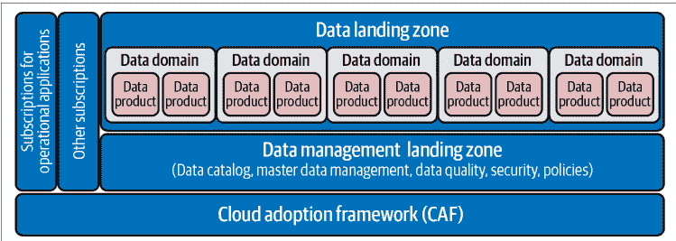

_图 3-11. 建议的最小设置由单个数据管理落地区域和单个数据落地区域组成_

以下目标通常作为此类设计的基础：

- 目标是为域建立端到端组织其数据的基础，包括对血缘、数据质量、安全性、数据目录和共享等进行强有力且一致的治理。
- 每个提供域拥有并运行多个数据产品，使用其自己的数据和技术服务，这些服务与其他域的服务独立。同样，每个消费域都运行自己的工具集来执行分析和报告。
- 数据域可以扮演提供方、消费方或两者兼有的角色。根据其所扮演的角色，映射的服务数量可能更多或更少。
- 数据湖仓方法被视为使团队能够构建数据产品的最佳实践。数据域提供方通过一组他们管理、拥有和运行的管道，将数据摄入到其各自的数据湖服务中。

此架构在解决方案空间中可能是什么样子？为了演示，让我们回到第 2 章中的 Oceanic Airlines 示例。在图 3-12 中，您可以看到公司内不同域如何协作和使用数据。设计中的每个区域都是可重复的蓝图，可提供一组标准化服务。

在左侧和右侧，您会看到通过常规落地区域配置的操作应用程序。每个域都有自己的落地区域，原因包括自治性、灵活性要求、地理位置和安全要求。

在中间，您会看到通过单个数据落地区域配置的数据相关服务。此区域提供的服务对所有域都是通用的，尽管它们要么与数据提供方对齐，要么与数据消费方对齐：数据提供服务使域能够摄取、存储、转换和提供数据，而消费服务使域能够构建分析应用程序并执行数据驱动的决策分析。

底部是数据管理落地区域。该区域管理所有集中式或与域无关的服务，例如用于端到端管理数据的数据目录。

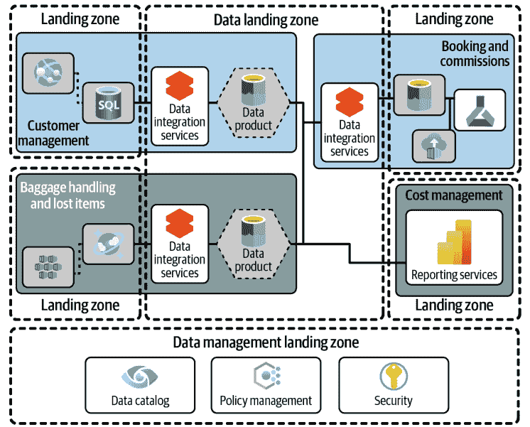

## 图 3-12. Oceanic Airlines 内不同域的运作方式

有些组织问我：“我们能否只为架构使用一个单一落地区域？” 从技术上讲，可以将所有数据管理和数据相关服务合并到一个巨大的落地区域中，但那样您将失去日后扩展的能力。因此，最佳实践是始终从（最少）一个数据管理区域和一个单独的数据落地区域开始。

在图 3-12 中，您会发现我已决定将报告服务定位在常规落地区域中，而不是数据落地区域内。这是一个设计决策，我们将在第 4 章和第 11 中再次讨论。您还会发现，某些域边界横跨常规落地区域和（共享）数据落地区域。这是另一个设计决策。

另一种配置可能是为每个域配置一个通用落地区域，将应用程序和数据服务放在一起。这种设计更适于实现更强的域自治性，所有服务都与相应的域对齐。然而，缺点是很难标准化落地区域和蓝图，因为业务域及其应用程序，正如您所了解的，始终是独特且不同的。

先不谈实际示例，将视角拉回到我们开始讨论拓扑的起点。在配置单个落地区域时，您可能会想知道如何最佳地在落地区域内部组织服务。部署一组服务的通用最佳实践是将它们逻辑上分组，例如使用标签或资源组。使用这种方法，每个域团队都会使用这样的资源组来端到端管理其数据解决方案。以这种方式分组和映射服务的动机是，所有服务共享配置、更新和停用的共同生命周期。除此之外，分组服务继承相同的安全控制，因为它们都属于同一个域。

服务与域的对齐也可以以不同方式进行：不再将服务独占地映射到域，而可以在域之间共享服务。共享服务主要出于安全性、流程简化和节省成本的目的。例如，想象一种情况，您使用高性能数据库和转换框架来处理数据。您不必为所有域配置许多（昂贵）服务，而是可以选择在域之间共享同一组服务。在某些情况下，这可能导致成本降低或更统一的工作方式，这更容易控制和管理。

在共享服务时，重要的是要了解隔离和安全性通常发生在更深层级，即服务本身内部。我关于决定是否共享服务的建议是对服务进行分类，并确定每个类别或类型的运营模型。您通常需要在成本效率、实施成本、灵活性、安全性和管理开销之间进行权衡。

## 组织数据产品

数据产品也必须考虑相同的权衡。存储帐户、数据湖服务或数据库通常用于存储和管理这些产品。使用这些服务中的任何一种时，每个域都映射到一个实例，每个实例都托管来自单个域的一组数据产品。您可以在图 3-13 中看到这种设计的体现。


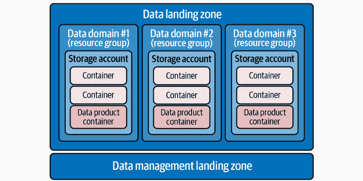

图 3-13. 所有数据产品都托管在与领域资源对齐的容器中

这种配置使领域在管理其数据产品方面拥有更多的自由度和灵活性——例如，每个领域可以选择如何暂存或分层其数据。这种设计还允许每个领域拥有不同的安全模型、功能专业化、配额和服务标记。此外，性能更具可预测性，因为每个领域都有自己的性能限制。


AWS、Azure 和 GCP 使用不同类型的层次结构来管理其资源。AWS 使用四个级别：组织、组织单元、账户和资源。Azure 使用五个级别：根、管理组、订阅、资源组和资源。GCP 也使用四个级别：组织、文件夹、项目和资源。有关此主题的更多信息，请参阅 Petteri Kivimäki 的博客文章。

但是，您也可以修改设计，使单个存储服务实例在不同领域之间共享。在这种情况下，数据产品隔离通常在更深层级完成，即在服务内部，通过容器、存储桶、文件夹或逻辑数据库实现。您可以在图 3-14 中看到这种设计的示例。

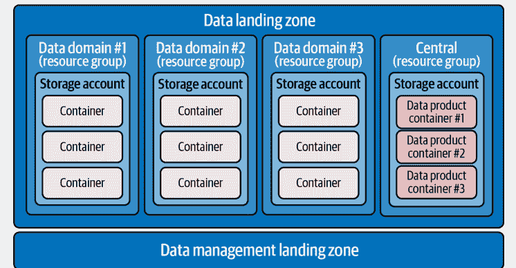

图 3-14. 数据产品通过容器进行隔离，使用在数据登陆区内预配置的中央共享存储账户实例

这种方法有时是更好的选择，原因有几点。首先，它减轻了领域的安全责任，并在管理服务方面提供了更高的效率，因为可以更容易地为所有领域强制实施一致的层次结构。其次，它更好地处理大规模数据处理任务，因为所有数据产品都集中且紧密地存储在一起。当需要统一安全或带有中央服务的更严格治理模型时，这也可能更可取。例如，当不同数据产品共享相同的底层存储层时，开发自动向数据产品分配用户访问权限的数据合同服务会更容易。我将在第四章中回到此话题并提供更多注意事项。

在跨领域共享存储服务时也存在缺点。例如，可能会出现性能和配置限制，因为项目和带宽在领域之间共享。此外，您没有灵活性为单个领域开启或关闭特定功能，因为只使用一个实例，并且您的领域需要更多的耦合和一致性。

图 3-15 展示了集中式设计的一个略微变体。与之前的设计相比，区别在于我们将数据产品的中央管理移到了数据管理登陆区。

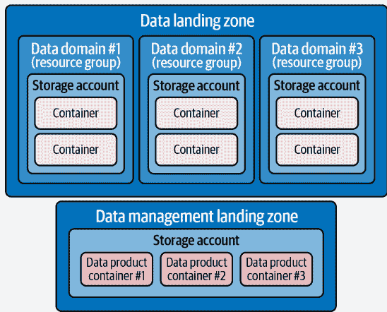

图 3-15. 数据产品通过容器进行隔离，使用在数据管理登陆区内预配置的中央共享存储账户实例

使用数据管理登陆区进行数据产品管理的这种场景，在将数据移近集中管理服务（例如 MDM 或数据质量服务）时可能更可取。在这些情况下，有时将数据放置在更靠近处理位置的地方可能更好。

> 您不需要为所有领域明确选择希望如何管理数据产品。您可以结合之前讨论的任何或所有方法，并将它们融合在单一登陆区拓扑或本章讨论的任何其他拓扑中。例如，您可以为大多数领域提供专用存储账户，而为其他一些领域共享资源。归根结底，关键在于做出正确的权衡。

## 缩放单个登陆区

让我们暂时放下数据产品管理，回到数据登陆区。使用单个数据登陆区的理由是应用标准化并保持简单。当仅使用一个云提供商并在单个区域中预配所有资源、没有复杂的计费或账户结构要求，以及希望或需要跨所有领域为所有服务和策略设定基准时，这种方式很合适。在应用这种简化和标准化形式时，领域团队之间不应存在（或很少存在）相互冲突的要求。

所有相关团队必须对发布计划（用于对总体蓝图进行更改）保持高度一致。

请注意，使用单个数据登陆区并不意味着无法缩放。如果更多领域或数据产品需要纳入您的架构，您可以快速添加带有预定义服务的更多资源组。通过启用自助服务和自动化，可以进一步缩放。缩放时需要注意的一点是，您的数据领域应遵循前一章中概述的数据管理原则。

单个数据登陆区拓扑对于较小的组织、绿色项目或需要强标准化的情况非常有用。它也可以是计划构建更复杂系统的组织的良好起点。在这种情况下，您设想未来过渡到使用多个登陆区的更精细且完全联合的实现。

## 源和消费者对齐登陆区

在讨论之前的拓扑时，我们没有考虑任何其他云服务账户或本地应用程序。这是因为使用单个登陆区时，难以同时管理它们有时相互冲突的关注点。让我们研究一种更能应对这些挑战的设计。

数据加载仍然是大规模使用数据时最困难的方面之一。它通常需要额外的服务来解决复杂的集成挑战。加载集成与数据消费集成不同，因为源系统可能非常复杂。为了应对这一情况，您可以稍微修改之前的设计，使用两个登陆区：一个用于管理源系统侧的复杂服务，另一个则为消费侧应用更多标准化。图 3-16 演示了这种拓扑。

左侧是一个提供数据服务的登陆区，用于促进数据获取和构建数据产品。这些服务，例如，可以是变更数据捕获服务、API 服务或面向旧系统的专用连接器。它们通常从各种位置提取数据：本地、其他云环境、外部 API 或 SaaS 供应商。这个登陆区通常还涉及更多开销，因为服务在领域之间共享，并且与底层运营应用程序更加耦合。右侧的登陆区针对消费进行了优化，并提供专注于将数据转化为价值的服务。这些服务可能包括，例如，机器学习和报告。

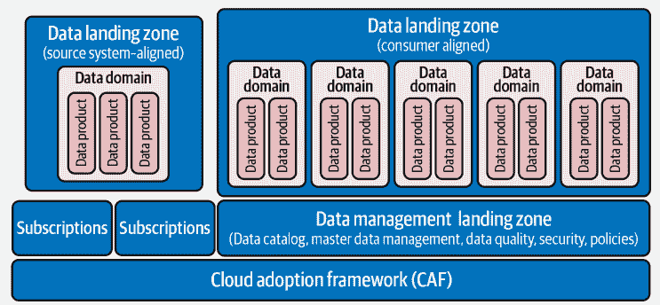

图 3-16. 具有独立源系统和消费者对齐登陆区的拓扑可能更好地解决复杂集成挑战

在隔离提供和消费数据的关注点时，我鼓励您确保您的数据领域遵循面向领域的数据所有权的所有原则。领域应对数据负责，并被允许直接将数据分发到其他领域。此架构的部署模型可以与之前讨论的混合或部分联合拓扑，以及精细且完全联合的模型完美对齐。在后一种情况下，您需要检查领域的角色，角色可以是提供或消费。如果领域同时扮演这两种角色，您预期会看到它们位于架构的两侧。

## 中心数据登陆区

我们接下来要考虑的拓扑使用一个中心，它位于其他登陆区之间，并充当连接和分发的中心点。中心通过防止领域直接自行分发数据来隔离领域。相反，所有数据都流过这个中心位置。在一定程度上，中心是我们在第 83 页“组织数据产品”中讨论过的集中管理存储服务的扩展版本。区别在于，这些存储服务被分组在一个专用的登陆区中。

使用中心的好处是您了解每一次数据移动。此外，星形拓扑架构更有效地利用网络：数据产品仅复制一次，然后从中心分发到消费领域。如图 3-17 所示，这种方法自然遵循受管领域拓扑：数据通过中央逻辑实体或权威机构进行分发。


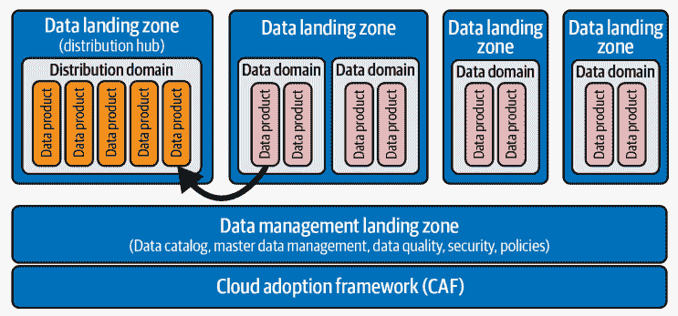

图 3-17. 在此模型中，中心节点充当中央分发点

中心节点的设计通常与其他数据着陆区不同。它与领域无关，由中央团队拥有，负责监督哪些数据分发到哪些其他领域。在中心节点内，你通常主要会看到中央存储服务。在这些服务中，数据按领域在逻辑上组织、隔离，且未集成。中心节点通常还承载（自助式）服务，以便于提供或消费数据。

使用中心节点，你还可以应用数据虚拟化。因此，与在中心节点中复制数据或始终预配数据产品不同，各领域使用标准服务来提供虚拟化数据产品。这种虚拟化可以简化整体数据访问管理，或者可以掩盖多样化环境中底层技术的复杂性，前提是你的各领域使用不同的服务。

如果你的组织需要控制不同领域分发和消费哪些数据，这种拓扑是一个不错的选择。它也是管理许多大型数据消费者的大量历史数据的一个有用选择，因为中心节点在跨多个客户共享数据时更高效。中心节点模型常见于金融行业、受监管环境，以及全球运营且需要完全控制所有跨区域数据移动的组织。

## 多数据着陆区

在更大的规模上，多个数据着陆区更适合分离职责或关注点。图 3-18 展示了此数据架构可能的示例。

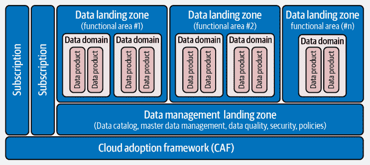

图 3-18. 多个数据着陆区更好地允许关注点分离

多个方面决定你应当将哪些功能数据领域在逻辑上分组，并作为共享数据着陆区的候选项。让我们来看看一些主要因素：

### 安全控制

不同的应用程序可能有不同的安全配置文件，需要围绕它们制定不同的控制策略和机制。

### 共享数据中的内聚性和效率

你应该考虑大型数据处理任务将如何在着陆区内管理，因为这类工作负载通常要求数据存储在一起。

### 区域

区域或地理边界可能导致相同业务能力和蓝图的实现。多个区域应始终导致多个着陆区。

### 隔离

着陆区成为安全保护的一个单元。潜在风险和安全威胁应被限制在一个着陆区内，而不影响其他区域。可能存在不同的安全需求，要求你将一个着陆区与另一个着陆区隔离开来。数据隔离也适用同样的原则。将数据存储隔离到一个着陆区，限制了可以访问和管理该数据存储的人数。这限制了私有数据的暴露，并有助于，例如，符合 GDPR 合规性要求。

### 灵活性和变更速度

不同领域内创新速度可能存在差异。这些颠覆性变化可能与强烈重视稳定性而非敏捷性的其他领域形成对比。

### 价值流和业务流程

不同的业务单元或产品可能有不同的目的和流程。你应该建立不同的着陆区来服务于业务特定的需求。

### 出售或分离

如果你可能希望出售或分离出某些功能，那么将它们与其他领域的共享服务紧密集成就不明智了。

### 团队之间的差异

不同的团队有不同的职责和资源需求。高技能且成熟的团队通常希望自行运营其服务和基础设施。

### 成本管理

一些企业希望在其云基础设施中实施 chargeback/showback 模型，以根据已使用的容量拆分和管理成本。

### 限额分配

某些云平台每个订阅或账户都有限额。将工作负载分离到不同的着陆区，可以让你更准确地设置限额，并避免阻止具有不同资源需求的应用程序按预期运行。

### 实验和学习

实验可能会失败，因此最好将其与其他工作负载分开管理。

### 政治

不幸的是，政治边界也可能是一种驱动力。

### 服务级别协议

对比的可用性和连续性要求可能导致使用额外服务。

让我提供一个示例，说明这些因素如何影响你的着陆区设计。想象一下，你在云中构建一个新架构。当你部署第一批资源时，必须对应用程序将要部署的云区域做出明确的选择。例如，如果你位于美国，你的第一个着陆区和应用程序将部署在美国区域。现在想象，过一段时间后，你需要将业务扩展到欧洲。由于地理边界（数据驻留），你需要在欧洲云区域内预配第二个数据着陆区。在扩展到欧洲后，你为欧洲市场的创新获得了一笔巨额投资。鉴于这些颠覆性和风险活动的性质，你决定预配第三个数据着陆区，用于与其他所有资源分开管理这些资源。有了这笔投资，你决定进一步扩展业务。这次，你打算与另一家公司建立合作伙伴结构，该公司有不同的信任级别。你决定不将此合作伙伴与现有业务活动集成。因此，你设立了第四个数据着陆区。

以这种方式预配多个数据着陆区可以帮助你根据内聚性和效率对功能领域进行分组。在这样做时，确保所有数据着陆区都遵循相同的数据管理审计和控制。所有着陆区的枢纽是你的管理着陆区。这个中央逻辑实体应监督哪些领域位于何处，以及它们创建、分发和使用什么数据。

不同的着陆区并非孤立存在。它们可以通过共享数据湖或存储服务连接到中心节点或其他着陆区。这种模式允许领域在整个企业中协作。例如，你可以应用共享存储服务或数据虚拟化，让各领域直接从其他领域读取数据，而无需复制数据。

在部署多个数据着陆区时，要意识到每个着陆区都伴随着管理开销。一个典型的着陆区需要为账户、链接服务、将着陆区链接到其他区域等进行配置，等等。如果你将数据着陆区的数量定义为 n，那么你可能最终会为至少所有存储账户以及这些区域内潜在的其他服务得到 n 个网络连接点。这可能导致你需要管理的配置项数量呈指数级增加。结论是，着陆区的数量与配置管理开销的数量之间存在着强烈的关系。

## 多数据管理着陆区

我们将要考虑的最后一种拓扑适用于全球运营的大型企业——例如，拥有许多高度专业化的部门且使用数百或数千个应用程序的组织。在这种情况下，组织不同部分之间可能存在对比的数据管理要求。为了应对这一问题，你可以在一个架构中同时部署多个管理着陆区和数据着陆区。这种设计在图 3-19 中有所体现。

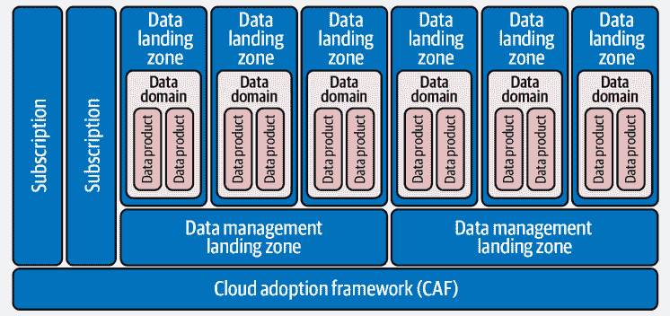

图 3-19. 大型企业可能需要不同的管理着陆区

每个着陆区都会引入管理和集成开销，因此你应当有意识地决定额外的复杂性是否合理。例如，在组织的（元）数据不得被组织外任何人查看的情况下，或组织的不同部分使用其自身独特的工作方式、政策、安全标准、数据管理方法等来管理基础设施不同部分的情况下，添加另一个管理着陆区可能是有意义的。当你拥有管理组织不同部分数据的不同 MDM 服务时，也可能希望使用这种拓扑。

如果你决定使用这些部分中描述的扩展机制，你的架构和组织可以无限制地逐步增长。你可以通过添加更多着陆区或领域来扩展，并可以通过提供多个蓝图来管理复杂性和成本。让我们通过一个具体示例来探索这是如何工作的。

## 实际着陆区示例

在第 2 章中，我们讨论了业务能力和领域。我们以虚构的公司 Oceanic Airlines 为例，学习如何组织能力和设定边界。了解如何使用领域拓扑和数据着陆区来设计大规模架构后，对于这家假设公司而言，使用着陆区的潜在架构会是什么样子？让我们通过拆解图 3-20 所示的设计来探索这一点。


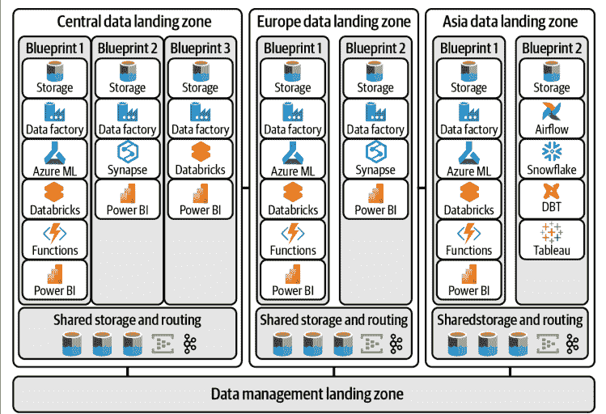

## 图 3-20. 大洋航空的多着陆区架构

正如你所见，我们有三个数据着陆区和一个数据管理着陆区。实施多个数据着陆区的动因是，大洋航空决定采用地理逻辑分组对其领域进行聚合。各领域分布于全球不同区域，为了保证低延迟和稳定性，每个领域都希望其数据尽可能靠近其地理位置。因此，该公司设立了三个着陆区：一个用于美国（“中央”）数据着陆区，一个用于欧洲，另一个用于亚洲。


图 3-20 灵感来源于阿玛迪우스的实际数据架构实施案例。该企业通过基础设施配置平面扩展了其架构，各领域可借此自助配置共享或使用数据所需的基础设施。添加新数据领域的整个过程仅需几分钟，只需填写一份简单表格即可。更多信息可在微软客户案例中找到。

在此架构中，每个数据着陆区均配备带有共享存储服务的中心层。在此采用集中化而非分散化的理由是，大洋航空更看重成本控制和更强的数据一致性，而非灵活性和敏捷性。公司运营区域内的许多领域都会执行跨领域活动，例如数据查找和数据质量验证。在领域之间交换大规模历史数据集通常是必要的。此外，这些数据集有时需要在地理位置之间分发。在领域之间分发数据时拥有一个中心逻辑实体，可解决这些分发问题。

为了满足其领域的各种复杂需求，大洋航空决定为每个单独的着陆区开发多个蓝图。每当有新领域进入数据着陆区，就会选择一个蓝图并创建新架构。每个蓝图都充当参考设计，可作为初始需求的基线。领域不需要的服务将被禁用。此外，中央团队可根据特定领域需求增强蓝图。例如，如果缺少特定服务或组件，可将其添加到用于创建该特定实例的蓝图中。所有蓝图均托管在由中央平台团队管理的代码仓库中。该团队负责监督哪些领域出于何种目的使用哪些蓝图。

每个蓝图都提供一组可重复的自定义服务。这些蓝图之间存在差异。例如，在亚洲，有些团队接受过不同服务的培训。为满足这些需求，创建了一个蓝图 2，使用与组织其余部分不同的服务和工具。

最后，大洋航空采用通用架构来倡导一致的治理。所有蓝图实例都使用监控、成本管理、安全性和控制策略。相同类型的策略适用于所有数据着陆区，且它们都连接到底层数据管理着陆区。这意味着领域团队会自动遵循相同的审计、控制和数据治理标准。例如，通过将所有数据服务连接到中央数据目录，计算治理会自动得到强制执行。

## 总结

数据之旅既是组织之旅，也是技术之旅。理想情况下，你应在首批工作负载和用例推出之前很久，就开始制定战略，包括领域的治理模型。本章讨论的拓扑为你开启数据雄心提供了起点。但在开始实施之前，还需做出一些考量。适合你的方案取决于你组织的条件。对于规模较小或成熟度较低的组织，考虑到需要管理的复杂性水平，集中式数据管理方法通常更合适。在这种情况下，我建议从更简单、更集中的方法着手，并为未来更多的联邦化和分散化做好准备。对于拥有工程能力的大型组织，研究本章概述的不同领域拓扑是有价值的。

为贵公司的之旅，请记住，向完全面向领域的架构过渡是一场涉及许多细微差别、权衡和考量的文化转变。这一过渡还要求你建立一种新文化。真正优秀的数据工程师少之又少，因此你需要尽早开始寻找“数据冠军”、“数据啦啦队”和“鼓舞人心的领导者”，他们应有可证明的业绩记录。为加速你的数据着陆区计划，请寻找在该特定领域有经验的人员。

你需要在内部投入，并培训现有人才库，使其成为同时具备 IT 和业务知识的数据专业人员。你需要“布道者”来与 C 级管理层建立关系并寻找高层赞助商。寻找可以成为其他利益相关方关键沟通者的大使。改变组织文化需要你建立变革论证。开始为你的组织做好准备，以应对数据世界的变化以及这些变化对数据管理的影响。这意味着大量的游说和“拯救灵魂”，但也意味着在事情朝错误方向发展时要坚持立场。

联邦化并不意味着你需要过度配置服务和资源。你可以在领域之间共享服务，以使架构更具成本效益，或在领域之间强制执行标准工作方式。实施数据管理架构将需要与贵组织的（云）基础设施团队密切合作。许多公司经历漫长而昂贵的流程，却未能交付任何价值，有时经过多年努力也是如此。情况不必如此！考虑使用所有主要云提供商提供的蓝图和着陆区，采取循序渐进的方法。这将使你能够以快速、安全、有效和标准化的方式上手新的数据领域。在开始你的之旅时，使数据平台团队和云团队保持一致，或创建一个虚拟团队。这将避免不同团队之间不断的交叉沟通。

对于你的第一个着陆区，识别一个规模较小但视野宏大的项目来验证概念。力争在 8 到 16 周内交付。它不必完美或可投入生产。邀请关键利益相关方和大使来展示进展并进行评审。定期获取他们的反馈，以避免出现大的意外。不要试图预测一切，而是在取得进展的过程中汲取经验。将这些经验反馈到迭代和演进的设计中，如果反馈如此指示，不要害怕后退并改变方向。

你的数据着陆区（及其对应蓝图）将不断演进。制定广泛且全面的设计目标，并使着陆区设计成为一个活的实体，而非固定的工件。明确且透明地说明消费者开箱即可获得什么至关重要。要警惕什么构成核心，并在审查和添加新需求时谨慎行事。还要为安全性和合规性提供基础护栏。着陆区可用于隔离：在其中使用标准化服务管理数据的边界。我建议从基线环境开始使用，而不是从头构建环境。在你的之旅初期，不要引入过多自定义。为了保持架构的可扩展性，应追求简单性和标准化。大力强调自动化。如果无法自动化，请考虑不要使用。

在下一章中，我们将重新乘坐直升机，降低到数据被创建的应用程序和系统层面。我们将更深入地探讨数据产品的概念，因为你可能在数据社区中遇到不同的定义，并了解数据产品管理。在那见！


# 数据产品管理

你可能正在思考“数据产品”这个术语——它只是另一个流行语吗？在本章中，我们将消除混淆，讨论数据产品究竟是什么。我将介绍你向其他领域提供大量数据所需的所有关键信息。我们将从该术语的消歧开始，因为从业者对其有许多不同的解释和定义。接下来，我们将探讨命令查询责任分离（CQRS）模式，以及它为何应影响你的数据产品架构设计。我们将讨论数据产品的各种设计原则，你将了解为什么一个设计良好、可集成且读取优化的数据模型对你的消费者至关重要。然后我们将探讨数据产品架构：它们是什么，如何设计，通常需要哪些能力，以及元数据的作用。我会尽可能通过一个实际示例使其具体化。到本章结束时，你将很好地理解数据产品架构如何帮助将海量数据提供给数据消费者。

## 什么是数据产品？

让数据生产者对其负责，并分散数据提供方式，是实现可扩展性的好方法。Dehghani 使用“将数据作为产品”这一短语，并引入了“数据产品”的概念，但两者之间有很大的区别。_将数据作为产品_描述了一种思维方式：数据所有者和应用团队必须将数据视为一个他们负责的完整产品，而不是其他人管理的某个过程的副产品。这关乎数据提供者应如何将数据消费者视为客户并提供令人愉悦的体验；数据应如何定义和塑造，以提供最佳的客户体验。

_数据产品_不同于“将数据作为产品”的思维方式，因为它涉及架构。在数据社区中，你会看到关于数据产品如何与架构相关的不同期望和解释。一些从业者表示，数据产品不仅仅是包含特定限界上下文中相关数据的数据集；它还包含收集和提供数据所需的所有必要组件，以及转换数据的元数据和代码。这种解释与 Dehghani 将数据产品描述为架构量子，即“网格上的一个节点，封装了其功能所需的三个结构组件，提供对领域分析数据作为产品的访问”相一致。根据 Dehghani，这三个组件是代码、数据和元数据，以及基础设施。因此，她的焦点显然在解决方案架构上，该架构可能包括获取、转换、存储、管理和共享数据所需的所有组件。

一些从业者对数据产品有不同的看法。例如，Accenture 将数据集、分析模型和仪表板报告称为数据产品。这种观点与 Dehghani 的观点有显著不同，因为它关注数据的物理表示，并不一定包含任何元数据、代码或基础设施。因此，在设计架构之前，我们首先需要就数据产品的通用术语达成一致，并确定必须包含或不包含的内容。

## 将代码、数据、元数据和基础设施合并在一起的问题

在理想世界中，数据和元数据被打包并一起作为数据产品交付。ING Tech Group Services 首席信息架构师 Ferd Scheepers 在 2022 领域驱动设计欧洲大会上就元数据管理主题发表了演讲。在此次演讲中，他解释说，元数据对于数据管理至关重要，因为“元数据是提供其他数据信息的数据”。为了强调其重要性，他以荷兰的花卉分销为例进行了类比。

阿尔斯梅尔鲜花拍卖是世界上最大的鲜花拍卖。从周一到周五，每天约有 4300 万朵鲜花和 500 万株植物被出售。全球各地的交易者每个工作日都参与拍卖。到达后，鲜花被贴上标签并送往指定设施。对买家而言，整个过程无缝衔接：你可以在线下订单，提交数量，并提供价格和目的地。故事的精彩之处在于，拍卖完全由元数据驱动。所有鲜花箱都配备了条码，其中包含其内容的重要信息，例如原产国和城市、数量、起拍价、重量、生产日期和过期日期、生产商姓名等等。当鲜花被出售时，还会添加另一个带有运输信息的条码：买方所有权详情、目的地、运输指示等等。如果没有元数据，鲜花拍卖将无法运作。

在鲜花拍卖中，鲜花和元数据始终一起管理和分发，因为物理对象之间是相互连接的。但是，在数字世界中，情况并非如此！让我提供一些示例来使这一点更清晰。如果你使用中央数据目录来管理和描述所有数据，那么数据和元数据是分开管理的。在此示例中，所有元数据都位于你的数据目录中，而所有物理数据都存储在其他地方，可能分布在许多不同的位置。对于管理数据提取和加载过程的元数据驱动摄取框架，也适用同样的分离。此类框架在开始处理数据之前，不会从数百个数据产品容器中爬取元数据。作为架构组件的元数据驱动摄取框架，通常在独立数据库中管理元数据，该数据库与数据本身分离。它使用这些元数据来控制数据提取、组合、转换和加载的过程及其依赖关系。

血缘和数据质量信息也是如此。如果相关元数据要打包在数据产品容器本身中，你将需要在所有数据产品之间执行复杂的联邦查询，以端到端监督血缘或数据质量。或者，你可以将所有元数据复制到另一个中央位置，但这将极大地使你的整体架构过于复杂。对于具有多个物理表示的同一语义数据，你将如何处理安全性、隐私分类、敏感性标签或所有权信息呢？如果你将元数据和数据紧密粘合在一起，那么当数据产品被复制时，元数据也会被复制，因为两者都位于同一架构中。然后，所有元数据更新都需要在多个数据产品容器上同时执行。这是一项复杂的工作，要求所有这些容器始终可用和可访问。你可以实现一个覆盖架构来异步执行这些更新，但这又将极大地使你的整体架构过于复杂。

总而言之，将数据产品视为将代码、数据和元数据以及基础设施粘合在一起的容器，这实际上过于天真了。数据产品的定义需要修订，以更好地反映当今数据平台运作的现实。

### 作为逻辑实体的数据产品

如果之前的定义不够好，我们应如何定义数据产品？我坚信，管理数据和技术应从不同的架构视角进行：一个解决管理数据的问题，另一个解决管理底层技术架构的问题。图 4-1 展示了这可能是什么样子。

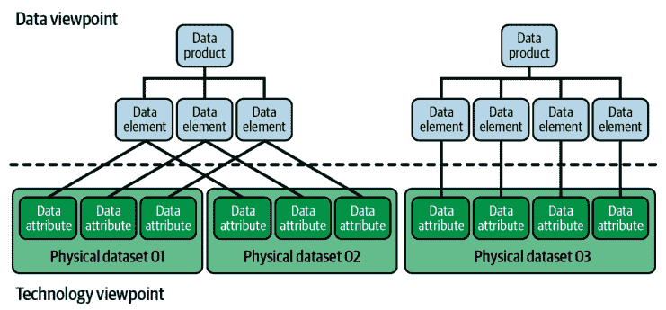

图 4-1. 用于管理数据和技术的独立视角

为何要将管理数据和技术的问题分离？首先，因为你可以使架构更具成本效益，并减少管理基础设施复杂性的开销。你能够实现使用“数据产品架构”的场景，其中多个“数据产品”得到管理。

其次，将数据和架构分离，更好地支持同一（语义）数据需要分发的场景。例如，在执行跨领域数据验证或丰富时，可能需要分发数据。为了同时支持多个用例，有时也需要复制和预处理数据；例如，将完全相同的数据以 Parquet 和 Delta Lake 文件格式存储。当你这样做时，你会复制数据而不改变底层语义。此场景在图 4-1 中体现：物理数据集 01 和 02 共享相同的语义，各个物理数据属性链接到相同的元素。

第三，你避免了数据和元数据之间的紧密耦合。想象一下，数据和元数据始终一起存储在同一容器中。如果所有者、业务实体或分类发生变化，那么所有数据产品架构中所有相应的元数据都必须随之更改。除此之外，你如何确保一致的数据所有权？如果你复制元数据，则存在数据所有权发生变化的潜在风险。对于在不同位置具有不同物理表示的同一语义数据，这不应该是可能的。

分离数据和元数据改变了数据产品的定义：数据产品是一个描述用于消费的数据的自治逻辑实体。从这个逻辑实体，你可以绘制与底层技术架构的关系——即，到读取优化和面向消费者的物理


数据资产存储于此。数据产品本身包括逻辑数据集名称；与源域的关系、唯一数据元素和业务术语的描述；数据集的所有者；以及对物理数据资产（实际数据本身）的引用。它在业务上具有语义一致性，但在物理层面可能具有多种不同的形状和表示形式。这些变化要求数据产品定义为与技术无关。此元数据出于灵活性考虑保持抽象。


在第 9 章中，我将通过展示数据产品管理元模型的截图，使数据产品的逻辑视图具体化。如果你不想等着了解它的工作原理，我建议你阅读第 266 页上的《企业元数据模型》，然后再回来继续阅读此处。

当你将数据产品定义为逻辑实体时，你可以描述、分类、标记或链接数据（例如，链接到域、数据所有者、组织元数据、流程信息和其他元数据），而无需具体说明实现细节。在数据产品之下一层是数据元素：作为物理数据、接口元数据、应用元数据和数据建模元数据链接点的原子信息单元。要描述物理数据，你需要技术元数据，其中包括架构信息、数据类型等等。

既然我们已经清楚地了解了数据产品是什么，那么让我们继续探讨影响其设计和架构的因素。我们将从 CQRS 开始，然后研究读取优化建模和其他设计原则。在完成所有这些之后，我们将稍微放宽视角，来审视数据产品架构。

## 数据产品设计模式

改变数据产品的定义并不意味着我们应该放弃将数据作为产品来管理的概念。应用所有者和应用团队必须将数据视为他们负责的自包含产品，而非由他人管理的某个流程的副产品。数据产品是专门为数据消费者创建的。它们具有定义好的形状、接口以及维护和刷新周期，所有这些都有文档记录。数据产品包含通过接口在服务级别目标（SLO）中与下游流程共享的已处理域数据。除非另有要求，你的（技术）应用数据在可供消费之前，应经过处理、成型、清洗、汇聚和（去）规范化，以满足约定的质量标准。

在第 1 章中，你学习了限制数据传输、设计事务系统以及处理大幅增加的数据消费等工程问题。从繁忙的运营系统中提取大量数据可能有风险，因为负载过大的系统可能会崩溃，或变得不可预测、不可用，甚至更糟，数据损坏。这就是为什么制作数据的只读且读取优化版本，然后将其提供供消费，是明智之举。让我们来看看一种常用的设计模式：CQRS。

## 什么是 CQRS？

CQRS 是一种基于为高强度读取制作数据副本的应用程序设计模式。

操作命令和分析查询（通常被称为 *写入* 和 *读取*）是非常不同的操作，在 CQRS 模式中被分别处理（如图 4-2 所示）。当你检查繁忙系统的负载时，很可能会发现命令端使用了大部分计算资源。这是合理的，因为对于成功的（即持久的）写入、更新或删除操作，数据库通常需要执行一系列步骤：

- 1. 检查可用存储量。
- 2. 为写入分配额外存储。
- 3. 检索表/列元数据（类型、约束、默认值等）。
- 4. 查找记录（如果是更新或删除）。
- 5. 锁定表或记录。
- 6. 写入新记录。
- 7. 验证插入的值（例如，唯一性、正确类型等）。
- 8. 执行提交。
- 9. 释放锁。
- 10. 更新索引。

与写入相比，读取数据库所需的计算资源更少，因为需要执行的任务更少。为了优化，CQRS 通过使用两种模型将写入（命令）与读取（查询）分开，如本图所示。分离后，它们必须保持同步，通常是通过发布带有更改的事件来实现。图 4-2 中的“事件箭头”（闪电图标）对此进行了说明。

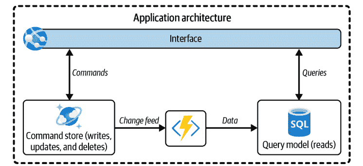

Figure 4-2. 使用 CQRS 的应用程序通过两种不同的数据模型分离查询和命令：用于事务的命令模型和用于读取的查询模型

CQRS 的一个好处是，你不必为写入和读取使用同一类型的数据库。你可以让写入数据库保持客观上的复杂，但针对读取性能优化读取数据库。如果你对不同用例有不同要求，可以创建多个读取数据库，每个数据库都针对正在实现的特定用例拥有一个优化的读取模型。不同的要求还允许你在读取存储之间拥有不同的数据一致性模型，尽管写入数据存储保持不变。

CQRS 的另一个好处是，不需要同时扩展读取和写入操作。当资源不足时，你可以扩展其中之一。不使用单一模型同时服务于写入和读取的最后一个主要好处是技术灵活性。如果你需要读取能够非常快速地执行，或者需要不同的数据结构，你可以为读取存储选择不同的技术，同时仍遵守命令存储所需的 ACID 数据库属性（原子性、一致性、隔离性和持久性）。

虽然 CQRS 是一种软件工程设计模式，可以帮助改进特定（可能更大）系统的设计过程，但它应大大启发你的数据产品架构设计和愿景。架构的未来模型必须是：每当其他应用程序想要高强度读取数据时，每个应用程序至少创建或使用一个读取数据存储。这种方法将简化架构的未来设计和实现。它还提高了高强度数据消费的可扩展性。

- 1. CQRS 的一个缺点是它使事物更加复杂——你需要通过额外的层来保持两个模型同步。这也可能产生一些额外的延迟。


CQRS 与 *物化视图。*<sup>2</sup> 有着密切关系。数据库中的物化视图是数据的物理副本，由底层表不断更新。物化视图常用于性能优化。查询不是从底层表中查询数据，而是针对物化视图中存在的预计算和优化的子集执行查询。底层表（用于写入）和物化子集（用于读取）之间的这种隔离，与 CQRS 中看到的隔离相同，微妙之处在于两组数据都位于同一个数据库中，而不是两个不同的数据库。

## 将读取副本作为数据产品

使用副本作为读取数据的来源并非新鲜事。事实上，从副本、拷贝、数据仓库或数据湖的每一次读取都可以被视为某种形式的 CQRS。在通常促进和管理面向事务的应用程序的在线事务处理（OLTP）系统与运营数据存储（ODS，用于运营报告）之间拆分命令和查询也是类似的。在这个示例中，ODS 是 OLTP 系统数据的复制版本。所有这些模式都遵循 CQRS 背后的哲学：从运营数据库构建读取数据库。


Martin Kleppmann 使用“将数据库内外颠倒”模式，这是 CQRS 的另一种体现，强调通过事件流收集事实。我们将在第 6 章中探讨这种模式。

数据产品架构也应遵循 CQRS 哲学。它们采用数据复制副本的位置，用于允许数据消费者高强度读取。它们受到高度治理，并从域和底层应用程序继承其上下文。从高层次来看，这意味着每当数据提供者和数据消费者想要交换数据时，如图 4-3 所示，就必须使用数据产品架构。


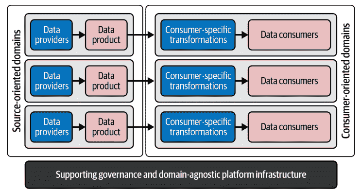

图 4-3. 数据提供者和数据消费者的去中心化协作

请注意，数据产品位于左侧，靠近数据提供者，而转换步骤靠近数据消费者。这种定位源于向消费者提供数据的统一方法。设计不再使用单一的统一数据模型，而是改为向所有消费应用程序提供经过清理并可直接使用的领域数据版本。此数据并非旨在提供行为或功能。因此，与运营数据相比，该数据的性质不同：它经过优化，以实现高强度可读性，使每个人都能快速将数据转化为价值！

## 数据产品的设计原则

创建经过读取优化且用户友好的数据是前进的方向。这听起来很简单，但在实践中往往比预想的更困难。具体来说，你需要考虑数据应如何捕获、结构化和建模。当你需要与多个团队反复并行构建数据产品时，困难就会出现。你希望高效地完成此任务，避免出现每个新数据消费者都导致新开发数据产品，或者出现研究复杂数据结构和解决数据质量问题的长周期的情况。你希望获得最大可重用性和易于使用的数据！本节介绍了一套在开发数据产品时有帮助的设计原则。警告，列表很长。

### 面向资源的读取优化设计

不断重新训练的分析模型会持续读取大量数据。这会影响数据产品设计，因为我们需要针对数据可读性进行优化。一种最佳实践是在设计 API 时参考面向资源的方法。面向资源的 API 通常建模为资源层次结构，其中每个节点要么是简单资源，要么是集合资源。为方便起见，它们通常分别称为资源和集合。

对于数据产品，你可以采用同样的面向资源方法，按主题领域对数据进行逻辑分组和聚类，每个数据集代表一组同质数据。这种设计会导致数据产品中的数据被预计算、反规范化和物化。在使用端，这会带来更简单、更快速的下游使用，因为不需要执行计算成本高昂的连接操作。它还缩短了查找正确数据的时间，因为相关的数据在逻辑上被放在一起。

将面向资源的设计应用于数据产品时，因此，高度规范化或过于技术化的物理数据模型必须转换为更可重用且逻辑有序的数据集。结果是更反规范化且读取优化的数据模型，类似于 Kimball 星型架构或 Inmon 数据集市。这还意味着必须抽象掉复杂的应用程序逻辑。数据必须以足够的粒度级别提供给其他域，以尽可能多地满足消费者。对于任何关联的数据产品，这意味着交叉引用和外键关系必须在整个数据产品集中保持一致。例如，使用端不应为了连接不同的数据集而操作键！使用这种方法构建数据产品，因此意味着各域拥有语义逻辑，并负责数据如何转换以提高可读性。不过，说了这么多，让我们来看看一些其他最佳实践和设计原则。

### 数据产品与数据金库

你可能会想知道是否可以使用 Data Vault 模型设计数据产品。Data Vault 是一种用于构建数据仓库的数据建模设计模式。³ 它通过解耦实体并添加其他关系，旨在提供灵活性、可维护性和可扩展性。由于其相当复杂，未接受过该技术培训的“局外人”难以理解数据。此外，它会使你的架构变得更慢且更昂贵，因为细粒度数据建模的方法论通常与大型云供应商的底层分布式存储架构相矛盾。它要求许多消费者经过连接和集成数据的迭代。

图 4-4 将 Data Vault 架构与简单的星型架构进行了比较。简而言之，Data Vault 方法论使用集线器、链接和卫星替代实体，以支持不断变化的业务需求。

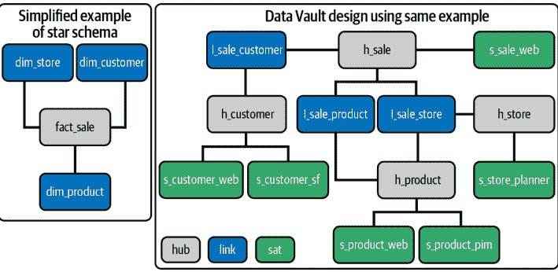

图 4-4. Data Vault 方法论与简单星型架构的对比（来源：PhData）

### 数据产品数据不可变

数据产品数据是 *不可变* 的，因此是 *只读* 的。为什么你的读取（只读）数据存储必须是不可变的？此属性保证我们可以反复重新生成相同的数据。如果使用只读设计，对于相同的领域数据，将不存在不同版本的真相。遵循此原则的数据产品架构不会创建新的语义数据。真相只能在黄金源应用程序中修改。

### 使用通用语言

了解数据的创建背景至关重要。这时就需要用到通用语言：一种由利益相关者和设计人员商定的、用于满足设计需求的构建型形式化语言。通用语言应与域保持一致——即业务功能和目标。域的背景决定了数据产品的设计。一种常见的实现方式是建立数据目录，在其中存储所有这些信息以及来自域的信息。发布背景并向域透明地明确定义，使每个人都能看到并同意数据的来源和含义。

某些组织要求域在其数据产品的物理数据集中使用对人类友好的列名。只要提供从物理数据模型到概念数据模型的映射，这并非必需。这种链接使你的域能够将通用语言中的业务概念转换为物理数据。

### 直接从源捕获

在我之前的职位中，我了解到企业通常有很长的数据链，数据在系统之间传递。对于数据管理，这可能是一个问题，因为来源不够清晰。因此，你应该始终从源系统捕获数据。使用来自黄金源的唯一数据保证了数据访问和数据管理有一个真相来源。这意味着数据产品是明确且独立的：它们属于单个域，这意味着它们是隔离的，不能与其他域的应用程序具有直接依赖关系。此设计原则还意味着，域不允许封装来自其他域（拥有不同数据所有者）的数据，因为这会模糊数据所有权。

### 清晰的互操作性标准

定义如何将数据产品提供给其他域非常重要。数据产品可以作为数据库、标准化文件格式、图、API 端点、事件流或其他形式提供。在所有情况下，你都应该标准化接口规范。如果所有域都定义自己的一套标准，数据消费将变得极其困难。因此，标准化至关重要。这要求你明确定义不同的分发类型（例如，面向批量、API 和事件）、元数据标准等。要具体说明数据产品架构的样子；例如，批量数据产品以 Delta 格式发布，并且必须在数据目录中注册。

### 不允许原始数据

数据产品与原始数据相反，因为暴露原始数据需要所有消费域进行返工。因此，在任何情况下，你都应该封装遗留或复杂的系统并隐藏技术应用程序数据。如果你坚持要提供原始数据（例如用于研究分析），请确保默认情况下将其标记为临时数据。原始或未经更改的数据不带任何保证。


## 系统能否构建暴露原始数据的接口？

考虑允许应用程序同时提供原始数据和针对消费优化的数据。这种方法有利于需要即时访问的数据科学家和消费者。持有原始数据的接口应标记为私有且不提供任何保证。它们绝不应被用作生产数据管道。

如前所述，第2章中讨论的“无原始数据”原则也适用于外部数据提供商：即在企业生态系统逻辑边界之外运行的外部方。它们通常在独立的、非受控的网络位置运行。请要求您的生态系统合作伙伴遵循您的标准，或通过中间域进行调解：一个充当中介的消费域，通过抽象复杂性并保证稳定安全的消费来实现。

## 不要迎合消费者

同一数据产品可能会被不同领域团队重复用于广泛的用例。因此，您的团队不应将数据产品迎合（个别）数据消费者的特定需求。主要设计原则应是最大化领域生产力并促进消费和重用。

另一方面，数据产品可以且确实会根据用户反馈进行演进。在这里您应谨慎！团队可能会很诱人地采纳消费者的特定要求。但如果消费者将业务逻辑推入生产领域的数据产品中，就会与提供方形成针对变更的严格依赖。这可能会在领域团队之间引发激烈的跨团队协调和待办事项协商。此处建议引入一个治理机构，负责监督数据产品不是为特定消费者创建的。该机构可以介入指导领域团队、组织入驻和知识分享会议、提供实用反馈，并解决团队之间的问题。

## 将业务逻辑外包的危险

让我分享一个个人故事。在我之前的职位中，会计主管提议将国际财务报告准则（IFRS）会计规则作为所有数据产品的组成部分。他假设汇总计算结果比自己计算一切更容易。有多个充分的理由说明您绝不应将业务逻辑外包给其他领域。首先，这假设其他领域对您的领域有深入了解。当业务逻辑需要更新时，还要求所有领域同时进行变更。在拥有几十个甚至上百个领域的环境中，您将如何管理？您可能需要一支咨询大军来编排和管理所有这些活动。正确的方法是将业务逻辑保留在其应有之处。对于IFRS，这意味着要求其他领域向会计部门交付其正确计算所需的信息。该信息应保留提供领域的原始上下文，从而允许其他领域也能消费这些数据。

## 缺失值、默认值和数据类型

我曾就如何解释缺失、低质量或默认数据经历过激烈的争论。例如，假设运营系统的Web表单要求提供用户出生日期，但用户未提供该数据。如果没有提供指导，员工可能会填入随机值。这种行为可能使消费者难以判断数据是否准确或是否包含默认值。提供清晰指导，例如始终将缺失的出生日期默认设为荒谬或未来的值，如9999-12-31，可使客户识别数据确实缺失。

您还可能希望引入关于数据类型或必须在整个数据集中保持一致格式的数据的指导。例如，指定正确的小数精度可确保数据消费者无需应用复杂的应用逻辑即可使用数据。您可以在系统或领域级别设定这些原则，但我也看到大型企业为所有数据产品提供关于必须使用哪些数据格式和类型的通用指导。

## 语义一致性

数据产品在所有交付方式中必须在语义上保持一致：批处理、事件驱动和基于API。在我看来这听起来显而易见，但我今天仍然看到组织为面向批处理、事件和API的数据提供单独的指导。由于所有分发模式的数据来源相同，我鼓励您使所有模式的指导保持一致。我将在第7章中再次回到这一点。

## 原子性

数据产品属性必须是原子的。它们代表最低粒度级别并具有精确的含义或语义。也就是说，不应能够将其分解为其他有意义的组件。在理想状态下，数据属性与数据目录中的业务项一对一关联。其好处是数据消费者不必拆分或连接数据。⁴ 使用原子数据的另一个好处是，任何策略规则都可以与数据解耦。例如，如果法规迫使您重新考虑敏感标签，则无需重新标记所有物理数据。借助良好的元数据模型和原子数据，任何更改都应自动从业务元数据继承。

4 信不信由你，我曾见过一个旧版应用程序，其中多个客户值被用双管道操作符连接到一个字段中，例如 Firstname||Middlename||Lastname。

## 兼容性

数据产品应保持稳定并与操作/事务应用程序解耦。这需要一种检测架构漂移并避免破坏性变更的机制。它还需要版本控制，在某些情况下，还需要独立管道并行运行，为数据消费者提供从一个版本迁移到另一个版本的时间。

保持数据产品兼容的过程并不像听起来那么简单。它可能涉及在旧数据产品和新数据产品之间移动历史数据。这一练习可能是一项复杂的工作，因为它涉及映射、清理和提供默认逻辑等ETL任务。

## 抽象易变参考数据

您可能希望提供关于如何将复杂参考值映射到更抽象的、对数据产品友好的参考值的指导。这需要针对敏捷性错位采取细致方法：如果消费方的变更速度较快，您的指导原则必须是复杂映射表由消费方维护；如果提供方的变更速度更快，指导原则是应要求数据产品所有者将详细的本地参考值抽象或汇总为更通用（粒度更低）的、与消费者无关的参考值。该指导还暗示消费者可能需要执行额外工作，例如将更通用的参考值映射到消费者特定的参考值。

## 新数据意味着新所有权

任何因业务转型（使用业务逻辑的语义变更）而创建并分发的数据都被视为新数据，并归创建领域所有。本章讨论的数据分发原则应适用于任何共享的新创建数据。

> 将基于用例的集成数据分类为（与消费者对齐的）数据产品从根本上是错误的。如果您允许特定用例的数据被其他领域直接消费，那些领域将高度依赖于底层消费用例的实现细节。因此，请始终创建额外的抽象层，并将您的用例与其他消费者解耦。这种将消费者特定数据转化为新数据产品的方法，允许您的领域与其他领域独立演进。

分发新创建数据时的一个顾虑是可追溯性：了解数据发生了什么。为缓解透明度风险，请要求数据消费者对其获取的数据以及应用于数据的一系列操作和转换进行编目。这种血缘元数据应集中发布。我将在第10章和第11章中再次回到这一点。

## 数据安全模式

为了数据安全，您需要为数据提供商定义指导。这应包括以下内容：

- 关于为过滤和行级访问封装元数据的指导。通过随数据一起提供元数据，您可以创建策略或视图，以根据消费者是否有权查看这些行来隐藏或显示某些行数据。
- 关于用于列级访问和动态数据掩码的标记或分类的指导。这些标记或分类用作策略或视图的输入。
- 关于将数据高效地存储在单独表中以提供粗粒度安全性、提升性能并便于维护的指导。

我们将在第8章中更多地讨论这些话题。

## 建立元模型

为了妥善管理数据产品及其对应的元数据，我强烈建议您创建一个一致的元模型，在其中定义实体（例如数据领域、数据产品、数据所有者、业务术语、物理数据和其他元数据）之间的关系。5 在使用元模型时，最好使用数据目录来强制捕获所有必要的元数据。例如，每次在目录中实例化新数据产品时，都可以触发工作流，首先要求数据提供商提供描述，并将数据产品连接到数据所有者、源应用程序、数据领域等。接下来，目录可能会要求提供商将所有数据产品元素链接到业务术语和技术（物理）数据属性。然后，它可能会运行自动化测试以检查这些物理位置是否可寻址，并要求提供分类和使用限制信息。


## Allow Self-Service

数据产品关乎数据民主化。为改进数据产品创建体验，请考虑构建数据市场，并提供用于可发现性、管理、共享和可观察性的自助服务功能。例如，允许工程师使用数据目录的 REST 接口，以便自动注册数据产品。如果做得当，工程师可以将数据产品注册作为其持续集成/持续交付（CI/CD）流水线的一部分。第 9 章将对此主题提供更多指导。

## Cross-Domain Relationships

在运营世界中，系统常常相互交织或紧密连接。想象一个客户可以通过其下单的订单系统。这样的系统很可能会保存来自客户数据库的数据。否则，它将无法将订单与客户关联起来。

如果各领域独立于其他领域开发数据产品，消费者如何识别某些数据是否属于同一组或存在关联？为了管理这些依赖关系，请考虑使用目录或知识图谱，描述数据集之间的关系，并引用数据产品之间的连接键或外键。

在提供跨领域关系管理指导时，重要的是数据始终保持面向领域。数据与数据所有权之间的对齐必须牢固，因此在任何数据交付到其他领域之前，都不应执行跨领域集成。

## Enterprise Consistency

强去中心化会导致数据在各个领域内形成孤岛。这引发了对数据可访问性和可用性的担忧，因为如果所有领域都开始单独提供数据，消费端整合和组合数据将变得更加困难。为了克服这些顾虑，您可能希望通过提供指导来引入一些企业一致性，用于包含企业参考值（货币代码、国家代码、产品代码、客户细分代码等）。如果适用，您可以要求数据产品所有者将其本地参考值映射到企业列表中的值。

有些数据从业者会争辩说，使用企业参考值不符合真正的数据网格实现。这在某种程度上是正确的，但如果没有任何参照完整性，您将在所有领域中看到协调和集成的重复工作。请注意，我并不是建议您构建一个规范的企业级数据模型，如大多数企业数据仓库架构中所见，而只是提供一些参考数据作为指导。所产生的一致性在许多领域依赖相同参考值的大型组织中可能很有帮助。

相同的指导也适用于主识别号，它们将主数据和本地系统的数据联系在一起。这些数据元素对于追踪哪些数据已被主数据管理以及哪些数据属于同一组至关重要，因此您可以要求本地领域在其数据产品中包含这些主标识符。第 10 章将在此领域提供更多最佳实践。

## Historization, Redeliveries, and Overwrites

为了满足消费者的需求，数据提供商通常需要在其原始上下文中保留历史数据。例如，消费者可能需要这些数据来执行回顾性趋势分析并预测接下来会发生什么。为了做好这项工作，我建议根据系统设计、数据类型以及数据应如何历史化以供后续分析来制定指导。例如，包含主数据的数据集应始终转换为缓慢变化维度。我们将在第 122 页的“数据历史化”中更详细地探讨处理历史数据的问题。

## Business Capabilities with Multiple Owners

当业务能力共享时，我建议定义处理共享数据的方法论。这可能涉及在数据产品中使用保留列名来定义所有权，物理创建多个数据产品，或在数据产品中嵌入元数据。

## Operating Model

数据产品开发的成功需要一个运营模型，以确保有效的数据管理、标准和最佳实践的建立、性能跟踪以及质量保证。典型的数据产品团队通常包括支持架构师、数据工程师、数据建模师和数据科学家。此团队必须获得足够的支持和资金，以构建并持续改进其数据产品。此外，必须有一个组织机构，在整个组织中制定和监督构建数据产品的标准和最佳实践。我发现，当组织开发运营手册（描述公司所有目标、流程、工作流、权衡、清单、角色和职责的文档）时最成功。此类运营手册通常托管在开放存储库中，允许每个人参与贡献。

建立良好的标准和最佳实践包括定义团队如何衡量性能和质量，以及设计必要服务如何为每种消费模式相互配合，以便它们可以在所有数据产品中重复使用。为确保数据产品满足消费者需求并持续改进，团队应衡量其活动的价值和成功程度。相关指标可能包括给定数据产品的消费者数量、未解决和未关闭的质量问题、满意度评分、投资回报率或启用的用例。

既然我们已经探讨了将数据视为产品进行管理所需思维转变的基础，那么让我们来解决架构师最常遇到的问题：创建数据产品的良好策略是什么？是应该由集中提供的平台来促进，还是必须由各领域自行满足需求？

## Data Product Architecture

要显著降低架构的复杂性，您需要在集中化和去中心化之间找到合适的平衡。谱系的一端是完全联邦和自治的方法，允许每个领域托管其自身架构并选择其自身技术栈。然而，这可能导致数据产品、接口协议、元数据信息等的泛滥。这也使得数据治理和控制变得更加困难，因为每个领域都必须精确实施集中纪律，例如归档、血缘、数据质量和数据安全。在各个领域内部解决所有这些能力将是一项挑战，并将导致碎片化、孤岛式的复杂性。

谱系的另一端是联邦且集中治理的方法，不是单一孤岛，而是多个平台实例或着陆区蓝图共享相同的标准基础设施服务。标准化组件和共享基础设施降低成本、减少接口数量并改善控制。理想情况下，多个数据产品架构将托管在相同的平台基础设施上，但在逻辑上相互隔离。

## High-Level Platform Design

让我们详细剖析构建数据产品所需的架构和组件。将数据作为产品暴露，使数据消费者能够轻松跨多个领域发现、查找、理解并安全访问数据。话虽如此，数据产品分发的共同平台功能的主要重点应放在捕获数据、将数据转换为读取优化版本以及安全地向其他领域提供数据上。任何用于开发数据驱动决策用例的分析或报告功能都将稍后添加到架构中；这些内容将在第 11 章中讨论。

更深入地讲，至少，您的数据产品架构应具备以下能力：

- 通过输入端口进行数据捕获、摄入和上架的能力
- 通过输出端口为多样化领域提供或供应数据的能力


- 用于记录、发现、监控、保护和治理数据的元数据能力
- 用于开发、部署和运行数据产品代码的数据工程能力
- 数据质量和主数据管理能力
- 用于提供统一数据购物体验的数据市场能力

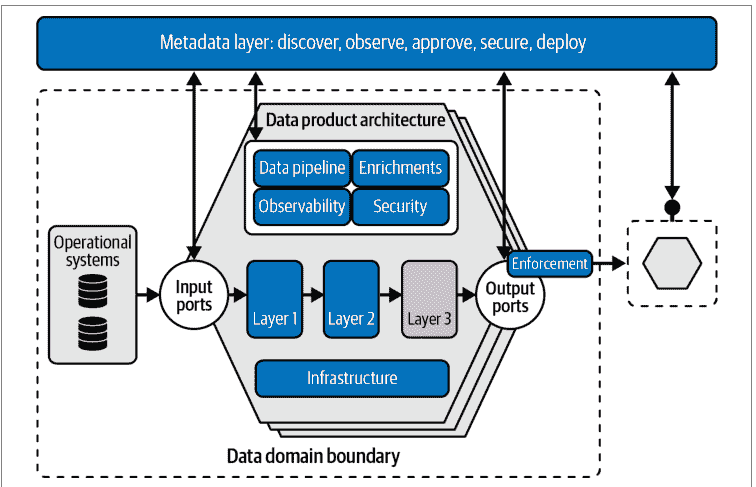

## 图 4-5. 示例数据产品架构

图 4-5 是数据产品架构的逻辑设计，演示了数据如何被捕获、转换并提供给其他领域。我们将逐个深入探讨各个组件，但首先我将提供高级概览。在顶部，有一个元数据层，它提供有关可用数据、其属性及其与其他数据管理领域关系的洞察。该层内包含用于编排、可观测性、合同管理等的元数据仓库。这些是你数据市场与数据产品架构之间的关键连接点。

当你使用共享基础设施时，不同的数据产品架构是隔离的，不会在领域之间直接共享。每个数据产品架构及其责任都归数据提供者所有。数据提供者（即领域）拥有自己的数据产品架构实例和自己的管道，并对数据的质量和完整性负责。

构建共享平台和数据产品架构的关键在于提供一组中央基础组件和与领域无关的组件，并做出各种设计决策，以便将重复性问题从领域中抽象出来，使数据管理不再成为挑战。在接下来的章节中，我将基于实地观察，重点介绍最重要的注意事项。

## 用于捕获和引入数据的能力

数据引入是成功构建数据架构的关键第一步。然而，在大规模使用数据时，提取源系统数据的过程仍然是最具挑战性的问题之一。这需要考虑多个方面。

### 数据摄取方式

首先，你应确定数据必须交付或同步的速度。大致来说，有两种可选场景：

### 批处理

仅需定期获取数据的消费者可以使用批处理，批处理是指一次性转移大量数据的过程。批次通常是存储为文件的包含数百万条记录的数据集。我们为何仍需要批处理？在许多情况下，这是收集数据的唯一方式。大多数重要的关系型数据库管理系统（RDBMS）都具有批处理组件，以支持以批次移动数据。数据对账（即在此移动过程中验证数据的过程）常常是一个问题。⁶ 验证你是否拥有所有数据至关重要，尤其是在金融流程中。此外，许多系统非常复杂，包含大量表格，而结构化查询语言（SQL）是选择和提取其数据的唯一合适方式。

### 实时数据摄取

渴望增量或近实时数据更新的消费者最适合使用事件驱动或基于 API 的摄取。此类处理能让我们相对快速地收集和处理数据，非常适合数据量相对较小、对数据执行的计算相对简单且需要近实时延迟的用例。许多用例可以通过事件驱动摄取来处理，但如果完整性和大数据量是主要关切，大多数团队会回退到传统的批处理。我们将在第 6 章中更多地关注这一点。

尽管实时数据摄取开始流行，但仅流式（Kappa）架构永远无法完全替代所有用例中的批处理。在大多数企业中，我预计两种摄取方式将并行使用。

### 复杂的软件包

对于所有数据引入，认识到专业软件包的多样性很重要。许多软件包极难解释或访问。数据库架构通常极其复杂，引用完整性通常通过应用程序而非数据库以编程方式维护。某些供应商甚至保护其数据，使其只能通过第三方解决方案的支持来提取。

在这些复杂情况下，我建议你针对每个源系统评估是否需要通过额外服务来补充架构，以实现数据提取。此类服务可能会隐藏这些复杂的源系统结构，并保护你免受冗长且昂贵的映射练习的影响。它们还能保护你免受紧密耦合，因为通常复杂供应商产品的数据架构并不由你直接控制。如果供应商发布产品版本升级且数据结构发生变化，那么你的所有数据管道都将中断。简而言之，第三方组件值得投资。

### 外部 API 和 SaaS 提供者

外部 API 或 SaaS 提供者通常也需要特别关注。我曾审查过需要完整数据集，但 SaaS 提供者仅通过 API 提供相对少量数据的情况。其他提供者可能会应用限流：对请求数量的配额或限制。还有些提供者对每次调用都收取昂贵的费用。在这些情况下，我建议要么获取支持从 API 提取数据的工具，要么构建一个定期获取数据的自定义组件。

设计得当的自定义实现可能会首先将所有 API 调用路由到你的数据产品架构。如果最近发出过相同请求，结果将直接从数据产品架构提供。否则，将触发 SaaS 提供者的 API，结果会返回，同时也存储在你的数据产品架构中以备后续调用。通过此模式，最终可以填充完整的数据集以供消费者使用。

### 血缘与元数据

对于所有数据提取和引入组件，密切关注数据血缘提取很重要。组织需要知道提取了哪些数据，以及对数据应用了哪些转换。标准化以及确定连接器如何与数据血缘仓库集成是一项重要工作。你应提前进行此调查，以便知道哪些会集成，哪些不会。由于血缘与转换框架和 ETL 工具有紧密依赖关系，事后添加血缘可能很困难；最好在开始实际实施之前进行选择、测试、验证和标准化。

## 数据质量

数据质量是另一项重要的设计考量。当数据集摄取到数据产品架构中时，应验证其质量。这方面有两个层面。

首先，你应验证数据的完整性，将其与已发布的架构进行比较。这样做是为了确保新数据质量高并符合你的标准和期望，否则采取行动。这一第一道防线由数据所有者、数据管家和数据工程师负责。这些团队成员负责创建和源数据。由他们确保数据符合监管机构或数据消费者规定的数据质量要求。

其次，有些质量检查本质上更具联邦性。此验证较少依赖单个数据产品团队，因为其他团队定义什么是良好的数据质量。此类数据质量检查通常异步运行，并标记和/或通知相关各方。联邦控制通常是功能检查：完整性、准确性、一致性、合理性等。数据完整性和联邦数据质量是两个不同的学科，有时各自拥有元数据仓库，用于存储架构元数据或功能验证规则。在这种情况下，各自拥有自己的标准平台服务。

对于你的平台设计，在数据产品架构中使用共享基础设施的一个好处是，你可以利用大数据的能力进行数据质量处理。例如，Apache Spark 提供了分布式处理能力，可处理数亿行数据。要高效使用它，你可以使用框架来记录、测试并对数据进行画像分析，以进行数据质量管理。例如，Great Expectations 和 Soda 是许多大型组织使用的开放式数据质量标准。在共享基础设施上管理数据质量的另一个优势是，你可以执行跨领域引用完整性检查。源系统通常引用其他应用程序或系统的数据。通过交叉检查引用的完整性并比较不同数据集，你将发现之前未知的错误和相关性。

当数据质量监控正确实施时，它不仅能检测和观察数据质量问题，而且成为整体数据质量控制的一部分


## 数据历史化

正确管理历史数据对于企业至关重要，因为如果没有这一点，他们将无法查看随时间的变化趋势并对未来进行预测。管理历史数据时也应考虑标准。本节提供一些背景，并探讨几种不同的表示方法和管理此数据的方法。

组织历史数据是数据仓库的一个关键方面。在此语境下，你经常会听到 *非易失* 和 *时变* 这两个术语。非易失意味着当新数据添加到其中时，之前的数据不会被删除。时变意味着数据在一定时期内保持一致；例如，数据每天或按某个其他周期性加载，并且在此期间内不会变化。

数据产品在存储和管理大量历史数据方面发挥着重要作用。但在去中心化架构中，你将如何解决这个问题？与数据仓库不同的是，数据产品保留数据的原始上下文。不需要转换为企业数据模型，因为数据产品与领域对齐；原始（领域）上下文不会丢失。这是一大好处：这意味着领域可以为其自身运营用例（例如机器学习）“自用”自己的数据产品，同时向其他领域提供数据。因此，领域有内在需求去关心其拥有的数据。最终，这种使用自身数据产品的做法将提高质量和客户满意度。

7 关于如何将 Azure Synapse Analytics 和 Microsoft Purview 集成在一起，使用 Great Expectations 智能处理和验证数据的讨论，请参阅我的博客文章 "使用 Azure Synapse Analytics 和 Azure Purview 的现代数据管道"。

虽然数据产品架构是一种与技术无关的概念，但许多此类架构可能会使用低成本分布式文件系统（例如数据湖服务）来构建。这意味着更新和覆盖主数据、事务数据和参考数据需要不同的数据处理方式。因此，我建议考虑以下一种或多种方法，每种方法都涉及在投资和管理传入数据与数据消费便捷性之间的权衡。每种方法都有其优缺点。

### 时间点

管理历史数据的第一种方法是将原始数据作为历史参考进行存储，通常不可更改。可以将其视为一个数据被通过复制活动摄入的水库。在这种仅插入的方法中，建议在逻辑上对数据进行分区，例如，使用日期/时间逻辑分隔（参见图 4-6）。8

| ID | 姓名 | 电子邮件 | 交付日期 |
| :--- | :--- | :--- | :--- |
| 1 | John Snow | john.snow@example.com | 1-1-2019 |
| 2 | Brian Stark | brian.stark@example.com | 1-1-2019 |
| 1 | John Snow | john.snow@example.com | 2-1-2019 |
| 2 | Brian Stark | brian.stark@example.com | 2-1-2019 |
| 3 | Elis Smith | elis.smith@example.com | 2-1-2019 |
| 1 | John Snow | john.snow@example.com | 3-1-2019 |
| 2 | Brian Stark | brian.stark@example.com | 3-1-2019 |
| 3 | Elis Smith | elis.smith@example.com | 3-1-2019 |

数据被处理并存储到渐变维度（type 2），允许用户选择特定值

| ID | 姓名 | 电子邮件 | 开始日期 | 结束日期 |
| :--- | :--- | :--- | :--- | :--- |
| 1 | John Snow | john.snow@example.com | 1-1-2019 | |
| 2 | Brian Stark | brian.stark@example.com | 2-1-2019 | 2-1-2019 |
| 3 | Brian Stark | | 3-1-2019 | |
| 3 | Elis Smith | elis.smith@example.com | 2-1-2019 | |

图 4-6. 使用全维度快照或渐变维度（类型 2）进行分区时数据的示例

8 分区是一种常见技术，用于将文件或表组织成不同的组（分区），以提高可管理性、性能或可用性。它通常在数据属性上执行，例如地理属性（城市、国家）、基于值的属性（唯一标识符、细分代码）或基于时间的属性（交付日期、时间）。

仅管理全量快照很容易实现。在每个 ETL 周期中，整个输出都作为不可变快照存储。之后，可以使用存储新数据的位置来替换表架构。容器是所有这些时间点快照的集合。一些从业者可能会认为这种方法会导致数据重复。我不认为这是一个问题，因为如今云存储相对便宜。全量快照也有助于重新交付，或者重建包含随时间所做所有更改的集成数据集。如果源系统发现交付了错误数据，可以再次提交数据，它将覆盖分区。


仅在提供的数据已经包含所有所需历史数据时，使用时间点表示方法可能才合适——例如，如果数据以已包含所有记录开始和结束日期的方式提供。

对全量数据集进行快照的一个缺点是，（回顾性）数据分析更加困难。如果没有开始和结束日期，特定时期之间的比较会很成问题，因为消费者需要处理和存储所有历史数据。例如，处理三年的历史数据可能需要按顺序处理上千个文件。数据处理可能会占用大量时间和计算能力，具体取决于数据大小。因此，建议还考虑区间方法。

### 区间

管理和呈现历史数据的另一种方法是构建历史数据集，其中所有数据都会被比较和处理。例如，您可以使用 *渐变维度*（SCDs）9 创建数据集，这些维度显示随时间的所有变化。此过程需要 ETL，因为您需要获取现有数据交付并将其与任何以前的交付进行比较。比较后，记录会被打开和/或关闭。在此过程中，通常会将结束日期分配给更新的值，并将开始日期分配给新值。为了进行比较，建议排除所有非功能数据。10

9 渐变维度是在数据仓库中随时间存储和管理当前数据和历史数据的一种维度。数据管理和数据仓库中的维度表可以通过多种方法进行维护，这些方法称为类型 0 到 6。不同的方法由 Kimball Group 描述。

10 例如，在您的处理框架中，可以在属性级别使用 exclude_from_delta_processing 参数来排除参与比较的数据。


## 我可以使用数据虚拟化来设计我的数据产品吗？

我一直等到历史化讨论才提及数据虚拟化。出于多种原因，数据虚拟化与数据产品创建并不理想：

- 数据虚拟化不利于数据生命周期管理。它无法将无关数据从底层系统中移出。它要求所有历史数据都留在 OLTP 系统中，从长远来看，这使得数据虚拟化成为一项昂贵的解决方案。
- 数据虚拟化层会导致更紧密的耦合。¹¹ 如果源系统发生变化，数据虚拟化层也会立即需要进行相应更改。视图或额外层可以提供帮助，但任何更改仍然需要源系统所有者与维护数据虚拟化层的工程师之间进行协调。
- 数据虚拟化依赖于网络。在存在大量网络和跳数（经过额外网络设备）的分布式环境中，预计延迟会增加。此外，还存在耦合，因此如果网络故障，虚拟化层就会失效。
- 数据虚拟化受限于底层支撑技术，该技术通常是 RDBMS。虽然数据虚拟化可以读取许多数据库系统，但通常它不允许你创建文档、键/值、列式和图数据库端点。
- 对于密集型和重复性查询，数据虚拟化使用更多的计算能力，因为转换是在查询数据时实时执行的。缓存技术可以减轻这种影响，但在使用经过预处理以供消费的数据时，所需的计算能力始终会更大。

结论：可以虚拟化对数据产品的访问，但你不应该仅使用数据虚拟化引擎来设计和开发数据产品。

比较间隔并构建历史数据的方法有助于更高效地存储数据，因为数据经过处理、去重并合并。如图 4-6 所示，右侧的缓慢变化维度占据的行数减少了一半。因此，查询数据（例如使用关系型数据库）会更加容易且快速。清理数据或删除单个记录（如为符合 GDPR 合规性所需）也会更容易，因为你不必再处理之前交付的所有数据集。

然而，缺点是构建缓慢变化维度需要更多的管理。所有数据都需要处理。底层源数据的变化需要在发生时立即检测并处理。这种检测需要额外的代码和计算能力。另一个需要考虑的是，数据消费者通常有不同的历史化要求。例如，如果数据每天处理一次，但消费者需要按月表示，那么他们仍然需要执行额外的处理步骤。

此外，重新交付过程可能很痛苦且难以管理，因为错误的数据可能会被处理并成为维度的一部分。可以通过重新处理逻辑、额外版本或有效日期来修复，但仍然需要额外的管理。这里的陷阱是，正确管理数据可能成为中央团队的责任，因此这种可扩展性需要大量的智能自助服务功能。

为所有消费者构建用于通用消费的历史数据的另一个缺点是，消费者在选择中省略列时，可能仍然需要进行一些处理。例如，如果消费者进行更精细的选择，他们可能会得到重复记录，因此需要再次处理数据以进行去重。为了可扩展性并帮助消费者，你还可以考虑混合两种方法，保留完整维度快照并提供“历史数据即服务”。在此场景中，一个小型计算框架提供给所有消费者领域，通过该框架，他们可以根据所需的范围（每日、每周或每月）、时间跨度、属性和数据集来安排创建历史数据。在公共云上使用短生命周期处理实例，你甚至可以使其具有成本效益。这种方法的最大好处是，你在重新交付方面保留了灵活性，但不需要工程团队来管理和准备数据集。另一个好处是，你可以根据每个人的需求定制时间跨度、范围和属性。

### 仅追加

某些数据交付方式最适合使用仅追加方法。使用此方法，你只从应用程序数据库加载新增或更改的记录，并将其追加到现有记录集中。这适用于事务性数据和基于事件的数据，我们将在第 6 章中讨论。仅追加方法通常与变更数据捕获结合使用，通过识别和捕获标准表、目录表和视图中所做的更改来建立变更流。

### 历史化与流式摄入

实时数据摄入通常有两种不同的处理方式。在第一种场景中，转换在数据到达时即时发生，结果会被直接追加，例如追加到 NoSQL 数据库中。整个过程通常需要几秒钟或几分钟。主要目标是尽快提供数据。在第二种场景中，实时数据会定期处理，例如以微批的形式。这里的主要目标是合并并历史化所有数据，以便下游可以以更快的间隔消费数据。合并数据时需要考虑处理延迟，因为处理需要时间。

### 定义你的历史化策略

数据产品的正确历史化方法取决于数据类型、消费者要求和法规。所有历史化和构建数据产品的方法都可以结合使用，你可以针对不同种类的数据采用不同的方法。例如，主数据可以从应用程序交付，并使用缓慢变化维度风格构建。参考数据可以使用快照轻松处理，而你可能希望通过仅追加交付来处理同一系统中的事务性数据。你可以保留所有交付的完整快照，同时也构建缓慢变化的维度。

要在数据产品开发和设计中取得成功，全面的策略是关键。最佳实践应着重于如何在每个领域中分层数据并构建历史。这种分层策略可能包括开发和维护脚本和标准服务，例如变更数据捕获服务。¹²

这里概述的最佳实践旨在提供见解，同时也用于展示数据产品管理是一项艰巨的工作。在下一节中，我们将深入探讨开发架构时的某些解决方案设计方面。我们将使用真实示例来完成，并考虑我们已经讨论过的内容。

### 解决方案设计

现在你已经熟悉了一些最佳实践和设计原则，是时候进行一些更实际的操作了：使用解决方案和服务在复杂的应用程序数据之上构建读取优化的抽象。组织开发数据产品所应用的技术和方法通常因企业而异。这也是一个难以解决的主题，因为没有平台或产品可以管理完整的数据产品生命周期。描述所有不同的端到端数据产品架构实现方式将需要另一本书，因此，我将相反地在讨论具体示例之前关注关键考虑点：

¹² 我的一篇博客文章中有一个简单的示例脚本，用于使用 Spark 池以 Delta 格式处理 SCD 表。

- 云已成为大规模数据处理的默认基础设施，因为它相对于本地环境具有显著优势。所有主流云平台都提供一组自助式数据服务，足以启动任何实现。

- 数据湖服务是各类组织的热门选择。随着数据量日益增长，将数据放入例如 HDFS 兼容的云对象存储中，是使架构具有成本效益的绝佳方式。此类服务的优势包括存储与计算分离，以及通过使用轻量级查询服务减少数据重复。¹³

- 一个常用的技术栈是使用 Spark、Python 和笔记本处理数据。这种模式的动因包括广泛活跃的社区、开源带来的优势和强大的互操作性，以及对从数据工程到数据科学等各种用例的广泛支持。虽然 Spark 是 ETL 和机器学习的绝佳选择，但它并未针对低延迟交互式查询进行优化。使用笔记本时还需要考虑的一点是，要关注重复性活动，例如数据历史化、技术数据转换和架构验证。使用笔记本的常见最佳实践是设计通用流程和元数据驱动框架，并使用可配置的流程处理目标、验证、安全性等。¹⁴

- 对于数据转换和建模，许多组织会通过 dbt 等额外服务来补充其架构。尽管可以使用带自定义代码的 Spark 进行数据转换，但公司通常觉得大型项目可以通过模板化和编写配置来更好地简化。模板工具和笔记本都是可行的选择，也可以互相补充。我看到很多公司首先使用笔记本处理数据验证、技术转换和历史化，然后使用 dbt 等工具集成其数据。

- 需要编排和工作流自动化来管理从摄入到数据服务的整个过程。尽管标准化是可观测性的关键，但最佳实践是让每个团队有自由发展其本地知识并追求本地优先事项。另一个最佳实践是集成

¹³ 通过分离存储和计算，可以根据弹性工作负载自动扩展基础设施。
¹⁴ 请参阅我的博客文章“为 Azure Synapse 和 Azure Purview 设计元数据驱动的处理框架”以了解此概念的详细信息。


你的 CI/CD 和工作流程，但请为每个应用程序或数据产品保持独立的流水线。

- 选择任何工具时，我建议搜索 *现代数据栈*。有许多可供选择的流行选项，从开源到闭源解决方案不等。

- 元数据管理服务（如数据目录和数据血缘工具）通常位于数据产品架构之外。这些服务由中央机构作为通用服务提供。第 9 章将深入讨论相关注意事项。

关于数据产品设计的一个常见问题是数据湖和数据网格的概念如何关联。乍一看它们可能似乎矛盾，但数据湖的底层技术补充了数据产品设计的愿景。因此，在数据网格中使用数据湖技术没有任何问题。

另一个经常被问到的问题是每个领域是否拥有选择其自身现代数据栈的自主权。爱好者们迅速在微服务和数据网格架构之间划等号，并主张完全自主权使每个领域能够做出自身最佳的技术选择。然而，许多组织失败是因为领域团队做出了截然不同的决策。想象你有 25 个“自主”团队，全都使用各自的工具和工作方式实现其数据产品架构。如果所有工具都不同，你将如何收集血缘、数据质量指标、监控统计数据以及主数据管理的结果？当每个团队使用自己的标准时，如何实现平台间的互操作性？我将在本章末尾解答这些问题，但需要注意的是，身份、治理和互操作性是任何联合模式的基石。牺牲这些支柱中的任何一个，你很快就会得到许多点对点解决方案，这些方案在架构上成本高昂且难以治理。自主权始于企业架构（中央层面），并需要标准化。灵活性关乎松耦合和消除依赖。自主权不应导致组织混乱、技术无序扩散、成本激增，或这些情况的组合。

## 现实世界示例

在本节中，我将带你了解创建数据产品架构的一个现实世界示例。该示例不会太复杂，尽管它包含后续讨论和评估所需的基本要素。假设该数据产品架构是为一个组织设计的，该组织中大约一半的领域本质上是操作性和事务性的。这些系统被标记为黄金源，是数据摄入的起点。其他领域是消费驱动的；数据必须提供给它们。

有关本示例的详细演练（包括屏幕截图和逐步说明），请参阅我的博客文章“使用 DBT 构建奖牌湖仓架构”。

如果我受委托为这个组织在 Azure 上设计数据产品架构，我可能会提出如图 4-7 所示的解决方案。我的起点是为我的第一个领域预配数据登陆区和一些带有标准化服务集的资源组：Azure 数据工厂 (ADF)、Azure 数据湖存储 (ADLS) 和 Azure Databricks。随后，我将使用类似 ADF 的服务来收集和采集数据。在可能的情况下，我将使用预构建连接器。或者，我会要求应用程序所有者将其数据导出并暂存在中间位置。例如，这些可以是 Blob 存储帐户，随后将从中提取数据以供后续处理。

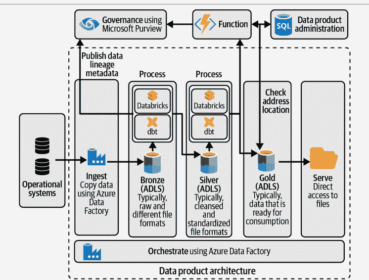

图 4-7. 使用湖仓设计的简单数据产品架构：它包含用于数据摄入、数据产品创建和数据治理的服务

我将使用 ADLS 在我的数据产品架构中存储数据。对数据进行分组的常见设计模式是使用三个容器：15

### 青铜层

可能采用多种格式和结构的原始数据。

### 白银层

经过过滤和清洗的数据，使用标准化的面向列的数据文件格式存储。

### 黄金层

针对读取进行优化、可供其他领域使用的数据。一些组织将这些面向读取优化或面向消费者的数据集称为数据产品。

配置数据湖后，我将通过创建第一个数据管道来继续此练习。首先，我将使用复制活动将数据复制到青铜层。该层中的数据使用 Parquet 格式存储，因为不需要版本控制。对于数据历史化，使用 YYYYMMDD 分区方案。较旧版本的数据会保留下来，以供临时分析或调试之用。

接下来，我将添加另一个管道活动来执行笔记本并向 Databricks 传递参数。16 Databricks 将使用动态笔记本验证数据，然后删除任何现有架构，并使用 YYYYMMDD 分区位置创建新架构。

对于白银层，我偏好的文件格式是 Delta，它提供快速性能和防损坏保护。启用保留期，以便在需要回滚更改并将数据恢复到以前版本的情况下使用——对于每个修改数据的操作，Databricks 都会创建一个新表版本，默认存储 30 天的历史记录。为了从青铜层选择数据并使用类型 2 缓慢变化维（SCD）表设计进行转换，我更喜欢使用 dbt。在将数据移动到白银层时，我应用有限的转换，仅选择功能数据。在选择任何数据之前，我会执行一组测试，以确保数据质量高且符合完整性标准。关于此层的最后一点说明：如果我有不同的来源，我将这些视为单独的数据馈送。所有数据的集成和组合将在后续层中处理。

15 如果你计划设置数据湖，“数据湖搭车者指南”是一个提供指南和最佳实践的绝佳资源。

16 Microsoft 与 OpenLineage 项目共同开发了解决方案加速器。这个开源连接器将 Azure Databricks 中 Spark 操作的血缘元数据传输到 Microsoft Purview，使你能够查看表级血缘图。该项目托管在 GitHub 上。

为了将数据移动到黄金层（在那里数据将被集成并变得面向消费者可用），我需要编写业务逻辑来将所有对象映射到用户友好且可消费的数据集。同样，我使用 dbt 模板来完成此操作，为每个逻辑数据实体创建模板和 YAML 模型。每个模板定义需要应用的选择、连接和转换，并写入唯一文件夹（例如，客户数据、订单数据、销售数据等）。每个输出在逻辑上围绕主题领域对数据进行集群。数据被物化，文件格式再次为 Delta。

最后，我将在 ADF 中保存并调度我的管道。对于所有单独的步骤，我将添加额外步骤来捕获加载日期/时间、进程 ID、处理的记录数、错误或成功消息等等。

对于每个额外的领域，我将重复所有这些步骤。因此，每个领域将在其自身特定领域的数据产品架构中存储其数据产品，管理其自己的数据管道，并使用相同的分层来构建数据产品。一旦我有能力以受控的方式大规模执行此操作，我将开始对此设计添加变体。例如，我可能会有几个输出端口，利用相同的语义数据为不同的消费者提供不同的表示。

对于架构的治理、自助服务和安全部分，我建议使用 Azure SQL 数据库、Azure Functions 和 Microsoft Purview（统一数据治理服务）的组合。这些组件可以部署在数据管理登陆区，并用于编目和监督所有数据产品。

对于发布数据产品，我会要求所有领域通过声明式函数（作为其 CI/CD 管道的一部分）发布其数据产品。例如，该函数可以从黄金层获取 dbt YAML 规范作为输入，并将这些规范存储在 SQL 数据库中。接下来，该函数将验证提供的位置和架构信息是否代表数据产品的统一资源标识符 (URI) 和结构。如果是，它将再次调用以将所有信息发布到目录中。此最终调用使数据对其他消费者公开可用。

为了向消费者提供数据访问，我建议使用自助式数据发现和访问。在后台，这将为单个数据产品创建访问控制列表 (ACL)。ACL 不太适合精细的列级或行级过滤，但就本现实世界示例而言，它们足够了。更复杂的场景将在第 8 章中讨论。


这个现实示例已为教学目的进行了简化。实际上，数据产品管理更为复杂，因为需要考虑安全性、用户画像、复杂查找、数据摄取和服务差异以及不同的数据丰富场景等因素。例如，可能存在针对数据归档、令牌化或在特定时间范围内访问数据的具体限制。

让我们快速回顾本示例的关键点。首先，我们快速搭建了数据产品创建的基础。我们让域对其管控下的数据生命周期负责，并负责将应用程序捕获的原始数据转换为外部各方可使用的形式。其次，可以通过添加更多带有额外数据产品架构的域来轻松扩展架构。第三，我们应用了多个数据网格原则，例如面向域的数据所有权、数据即产品思维、自助式数据平台和联邦计算治理。在下一节中，我们将把注意力转向扩展时必须考虑的众多问题。

## 与存储帐户对齐

必须关注数据产品数据与存储帐户的对齐。在上一节的示例设计中，我决定让单个域的多个数据产品数据集共享一个数据产品架构。另一种方案是让每个数据集与专用的存储帐户和用于数据处理的 Spark 池对齐。这种设置将数据、代码、元数据和必要的基础设施绑定在一起，与数据网格中的数据产品概念更为接近。它简化了访问管理并实现了自动化，因此你可以随时预配处理群集和存储帐户。例如，如果你的 Silver 层是临时的，可以在不再需要时将其删除。另一方面，紧密关联数据产品和基础设施会显著增加基础设施开销以及需要管理的管道数量。例如，这可能会导致大量需要管理、保护、扫描和监控的权限以及网络和服务终结点，或者产生复杂的存储帐户网络，因为数据产品通常源自相同的底层数据。因此，你需要权衡希望将数据产品与基础设施对齐的紧密程度。

让多个域共享同一个存储帐户怎么样？这也是可能的，但多个域共享底层存储基础设施需要不同的容器和文件夹结构。这是我在小型组织中经常看到的一种模式，因为集中式存储管理减轻了管理负担以及移动和保护数据时常见的其他问题。另一方面，这要求所有域共享相同的限制和配置项，例如 ACL 和 IP 地址规则。如果你需要地理冗余和灵活性能，这可能也不是最佳方法。17 同样，你需要考虑权衡。

或者，你可以通过实施混合方法（同时使用域本地存储帐户和中央存储帐户）来在本地对齐数据和中央对齐数据之间取得平衡。在这种情况下，每个域使用一个内部专用存储帐户，在其中完成所有特定于域的处理（例如，在 Bronze 和 Silver 层中）。此类帐户仅供内部使用，不会向任何其他域公开。在这些域本地存储帐户旁边，还有一个中央共享存储帐户，用于将数据产品的最终产出（在 Gold 层中创建）分发到其他域。此共享存储帐户通常由中央部门管理。这种设计的理由是为域提供灵活性，同时保持对所有数据产品数据交换的监督。

## 与数据管道对齐

另一个重要考虑是数据管道与数据产品的对齐。如前所述，数据管道是移动和转换数据的一系列步骤。它通常使用元数据和代码（如元数据驱动的摄取框架中一样）来确定对哪些数据执行哪些操作。在之前的示例中，我们为所有数据产品使用了同一条管道，但一些实践者主张为每个数据产品使用专用管道。那么问题是，哪种方法更适合你的情况？

要回答这个问题，请考虑数据产品及其相应数据管道的粒度。假设你对某个应用程序的数据进行批处理，并从中构建多个粗粒度数据产品（数据集），每个数据产品使用自己的数据管道。多个管道很可能会处理相同的底层源系统数据，因为数据产品的输入数据经常重叠。这意味着某些处理步骤可能会重复，从而使维护更加困难。此外，以不同间隔通过不同管道移动特定部分的数据会导致完整性问题，这使得消费者日后难以合并数据。

为数据产品和数据管道构建过于细粒度的设置同样具有挑战性。如果底层源系统生成数百个小型数据产品，每个数据产品都有自己的数据管道，则排查问题和监督依赖关系将很困难：可能会观察到复杂的重复处理步骤网络。此外，消费者使用数据也会很困难，因为他们需要集成许多小型数据集。引用完整性也是这里的一个重大关注点，因为许多管道预计会在略有不同的间隔运行。

总而言之，为每个数据产品设置专用管道通常不是理想方案。推荐的最佳实践是创建一条管道，使用适当的一系列步骤获取整个应用程序状态，对其进行复制，然后将数据转换为用户友好的数据集。

## 数据服务功能

让我们转到数据产品架构的服务端，了解需要在那里提供哪些组件和服务。对于从输出端口提供数据，18 有不同的数据处理维度，这些维度会影响数据产品架构的工程设计方式。数据产品架构的设计在很大程度上取决于消费域的用例和要求。在许多情况下，你处理的数据并非对时间敏感。有时回答问题或满足业务需求可以等待几个小时甚至几天。但是，也有一些用例需要在几秒钟内交付数据。


数据产品管理不应与数据价值创建（例如通过商业智能和机器学习应用程序）混淆。尽管存在重叠，但在消费者方面，你通常会看到数据使用方式的高度多样化。因此，必须将数据产品创建与数据价值创建分开管理。

近年来，可用的存储和数据库服务种类大幅增加。传统上，事务性和操作型系统旨在实现高完整性，因此使用符合 ACID 且是关系型的数据库。但是，非 ACID 兼容的无模式数据库（例如文档或键/值存储）也很流行，因为它们为了更快的性能而放宽了更强的完整性控制，并允许更灵活的数据类型，例如来自移动设备、游戏、社交媒体渠道、传感器等的数据。数据的大小可能会产生影响：一些应用程序存储相对少量的数据，而其他应用程序可能依赖于太字节的数据。

17 地理冗余是通过将关键组件或基础设施（例如服务器）分布在不同地理位置的多个数据中心来实现的。例如，对于云存储，你可以在常规硬盘和更快的固态硬盘之间进行选择。

18 数据网格的建议是使用高度标准化的接口共享数据产品，提供对数据的只读和读取优化访问。这些接口也称为输出端口。


## 为什么有这么多不同的数据库？

在选择数据库时，需要考虑许多因素和权衡。除了数据结构外，你还需要在一致性、可用性、分区容忍性以及用于更好性能的缓存和索引方面评估需求。存储和检索数据的方式有多种：小数据块、大数据块、已排序的数据块等。分布性和一致性的权衡会影响性能，持续监控和分析等功能亦然。最后，还有非功能性需求需要考虑，例如厂商锁定、支持、兼容性和查询语言。结论是，没有任何数据库能同时在所有维度上表现出色。请选择最符合你需求的解决方案。

使用数据产品架构的优势在于，你可以针对各种用例的特定读取模式添加多种设计。19 你可以复制数据以支持不同的数据结构、速度和容量，或者为相同数据提供不同的表示形式。你可以为临时、探索性或分析性用例提供基于文件的端点，为促进更复杂、不可预测的查询提供基于关系的端点，为需要进行大量聚合的数据消费者提供基于列的端点，或为需要更高速度和半结构化数据格式（JSON）的数据消费者提供基于文档的端点。你甚至可以使用图数据库以节点和关系对数据产品进行建模。

当提供不同端点或输出端口时，所有端点都必须在同一个数据治理伞下进行管理。责任归属于同一提供领域。可重用和读取优化数据的原则也适用于所有数据产品变体。此外，上下文和语义应保持一致；例如，“客户”或“客户名称”的概念应在所有提供的数据中保持一致。所有属于同一数据提供者的数据产品都必须使用相同的通用语言。我们将在第7章中探讨如何跨所有端点和其他集成模式确保语义一致性。

## 数据服务

当放大审视用户与应用程序与数据产品架构的交互时，你通常会发现需要提供大量的数据访问模式。这些模式可能包括临时查询、直接报告、构建语义层或立方体、为其他应用程序提供开放数据库互连（ODBC）、使用ETL工具进行处理、数据整理或数据科学处理。为了支持这些，必须为你的数据产品架构提供足够的性能和安全功能。


对于所有数据消费服务，你希望在数据访问和生命周期管理方面保持一致。这就是数据契约的用途；我们将在第8章中讨论这些内容。

分布式文件系统，例如基于云的对象存储，在存储大量数据方面具有成本效益，但通常不足以支持临时查询和交互式查询。许多供应商已认识到这一问题，并提供SQL查询引擎或轻量级虚拟化层来解决它。允许直接针对数据产品执行查询的好处是，数据不需要重复，这使得架构更便宜。这些工具还提供对数据的细粒度访问，并使运营数据存储过时。处于产品架构中的数据成为运营报告和临时分析的候选对象。数据可视化选项是很好的解决方案，但仅适用于简单的报告用例。如果这不够，请考虑替代方案，例如复制数据。

### 文件操作服务

在讨论数据复制和数据消费时，某些领域的用例或应用程序仅接受扁平文件（例如CSV文件）作为输入。对于这些情况，请考虑构建一个文件操作服务，该服务会自动屏蔽或剥除消费者不得查看的敏感数据。就像所有其他消费端点一样，此服务必须连接到中央安全模型，该模型规定所有数据消费都必须遵守数据契约（参见第236页“数据契约”）。它还规定必须自动应用过滤器，并且始终基于元数据分类和属性。我们将在第8章中更详细地讨论这一点。

### 去标识化服务

在直接使用数据产品进行数据探索、数据科学、机器学习以及与第三方共享数据时，保护敏感数据免受消费者访问非常重要。借助令牌化、哈希、扰乱和加密等安全方法，你可以使用规则和分类来保护数据。取决于你如何设计数据产品架构，可以应用以下方法：

- 在消费期间运行时保护数据。这种技术在不更改存储数据的情况下保护敏感数据，但仅在查询数据时生效。例如，Databricks使用名为动态视图函数的功能来在访问数据时隐藏或掩码数据。
- 在数据进入数据产品架构之前混淆或掩码敏感数据（例如，使用令牌化）。去标识化匹配则在消费阶段进行。
- 为每个项目复制和处理数据。你可以通过定义使用哪些分类以及哪些掩码和过滤规则来自定义保护。

数据安全依赖于数据治理。这两个学科将在第8章中深入讨论。

### 分布式编排

最后一个需要设计考虑和标准化的方面是支持团队在实施、测试和编排其数据管道方面。构建和自动化这些数据管道是一个迭代过程，涉及数据提取、准备和转换等一系列步骤。你应该允许团队测试和监控其所有数据管道和制品的质量，并在部署过程中支持代码更改。这种端到端交付方法很像DataOps，因为它带有大量的自动化、技术实践、工作流、架构模式和工具。

在标准化工具和最佳实践时，我建议组织设立一个集中式或平台团队，通过为调度、元数据管理、日志记录指标等任务提供能力来支持其他团队。该团队还应负责监督端到端监控，并在管道长时间损坏时介入。为了抽象来自不同数据提供者的依赖关系和时间间隔差异的复杂性，该团队还可以设置一个额外的处理框架，例如，可以在具有依赖关系的多个来源可以合并时通知消费者。

### 智能消费服务

基于所有这些不同的能力，你还可以通过一个层（网格）扩展数据产品架构，以便在数据消费时应用智能数据转换，例如自动画像、过滤、模式对齐、组合等。这将使数据消费者能够定义所需数据，并接收已建模成所需形状的数据。这种智能服务通常还用于部署隐藏复杂逻辑并向业务用户展示用户友好型表示的语义层。它大量使用元数据，包括许多特定于数据治理的其他服务。

一种前瞻性的方法是使用即将出现的技术（如语义知识图谱和机器学习）来为你的网格提供动力。虽然这一趋势相对较新，但我在第9章中提供了若干为实施这种方法做准备的建议。

### 直接使用注意事项

一个艰难的设计考虑是数据产品是否应能够充当消费领域的直接来源，或者这些领域是否需要提取和复制数据。我在此讨论持久化数据转换，指的是将数据写入并存储在数据产品架构边界之外的新位置（数据湖或数据库）的过程。避免创建不受控的数据副本是首选的，但可能存在更适合在靠近或位于消费应用程序内部的位置提供副本的情况。例如：

- 如果数据产品用于创建新数据，从逻辑上讲，这些数据需要存储在新位置并需要不同的所有者。
- 如果你想降低整体延迟，复制数据以便在本地（更靠近消费应用程序的目标）可用可能更好。我们将在第6章中更深入地探讨这一点，你将学习如何创建完全受控、分布式的物化视图。
- 直接和实时数据转换可能太重，以至于降低用户体验。例如，针对数据产品的查询可能需要很长时间，导致用户感到沮丧。提取、重组和预处理数据或使用更快的数据库引擎可以缓解这种沮丧。
- 当消费应用程序的重要性极高，以至于需要解耦以避免数据产品架构故障时，复制数据可能是有意义的。

在所有这些情况下，我建议实施一种企业架构控制形式，以规定针对每个数据产品采用哪种方法。请注意，复制的数据更难清理，并且很难了解数据的使用情况。如果数据可以在没有限制或管理的情况下复制，则可能会被进一步分发。另一个潜在问题是遵守GDPR或CCPA等法规；我们将在第11章中更详细地讨论这一点。

### 入门

向数据所有权和数据产品开发过渡对许多团队来说可能是一项文化和技术挑战。例如，并非所有团队都拥有必要的知识，看到数据的价值，或愿意投资于数据。如果你想


遵循数据产品开发的自然演进，请参考以下最佳实践：

- 从小处着手。激发一些兴趣，并从一两个团队已接受数据产品开发理念的领域开始。在扩大规模之前，先展示成功。

- 为贵组织创建一致的数据产品定义。将其与用于元数据管理的元模型保持一致。

- 治理很重要，但要循序渐进。保持微妙的平衡以鼓励生产力。专注于所有权、元数据和互操作性标准等基础要素。在可能的地方，与行业标准和最佳实践保持一致。

- 您的首批数据产品应为其他领域树立榜样。制定验收质量和设计标准，并专注于数据集设计。面向资源的 API 设计是构建高质量数据产品的一个良好起点。

- 不要试图一次性构建一个支持所有用例的平台。起初，您的平台通常只支持一种数据摄取和消费类型：例如，批量数据移动和 Parquet 文件作为消费格式。

- 允许集中化与去中心化并存。您最初的数据产品部署不必立即颠覆组织结构。在将工程师与领域对齐，或应用软对齐让工程师与学科专家合作之前，暂时保持集中。在开始阶段，领域特定数据集可以在中央团队的支持下创建。

当您刚开始时，要循序渐进。在进入下一阶段之前，先学习和迭代。集中化与去中心化并非非黑即白；相反，这是一个包含细微差别和定期评估的持续校准过程。

## 总结

数据产品是管理领域与应用程序之间依赖关系方式的重大变化。每当跨越功能问题或限界上下文的边界时，团队都应遵循统一的数据分发方式：将数据作为数据产品服务于其他团队。这种工作方式很重要，因为共享依赖越少，团队之间所需的协调就越少。

在本章开头，我区分了“将数据视为产品”和“数据产品”的概念。回顾一下，将数据视为产品是您在大规模管理数据时应用的思维方式。它关乎建立信任、确立治理以及应用产品思维；它是照顾您最看重的数据，并将原则付诸实践。这是您的领域团队需要具备的思维方式。他们必须对自己的数据负责，在源头修复数据质量问题，并以对大量受众有用的方式提供数据。与其让中央团队吸收所有变化并集成数据，不如让您的领域团队将物理数据模型封装在其领域边界内。这与将原始数据抛过篱笆，让消费者自行解决数据质量和建模问题恰恰相反。您的领域团队应以提供一流用户体验的方式对数据进行建模和提供。

数据产品是一个您需要自行解密的概念。我的建议是，首先在组织内标准化关于数据产品管理的谈论方式，因为所使用的语言和定义可能存在差异。考虑将数据产品定义为逻辑构造，而非纯粹关注物理表现或底层技术架构的观点。在某个时候，您可能会为组织引入语义模型，从而使您的数据产品成为图形表示，您可以从中绘制与领域、数据所有者、源应用程序和物理表示的关系。这可能听起来有些过于概念化，但当您阅读第 9 章时，以这种方式管理数据产品的益处将变得更加清晰。

数据产品存在一个注意事项。它们很可能会遭遇类似于微服务架构中出现的问题，即数据过于细碎和分散，必须从数百个不同的位置提取。解决这些问题的办法是建立良好的标准和一个监督所有数据产品创建活动的中央机构。必须制定数据交换的互操作性标准。对变更以及数据建模和提供方式需要协调。不幸的是，这些活动并不容易。如您所学，数据产品开发与数据仓库有着强烈的关联，后者包含许多学科，例如数据建模（使数据保持一致、可读、可发现、可寻址、可信和安全）。其中一些活动可能很复杂，例如我们在本章中讨论过的历史化方面。

数据产品和将数据视为产品的思维方式关乎提供数据。消费数据是下一个阶段。虽然某些活动和学科可能会重叠，如您将在第 11 章中了解到的，提供数据和消费数据的关注点并不相同。通过将数据作为产品进行管理，并将数据产品作为领域接口提供，您消除了依赖关系，并更好地隔离了具有不同关注点的应用程序。这很重要，因为共享依赖越少，团队之间所需的协调就越少。

数据产品架构应基于组织需求进行协作式设计。向领域团队提供通用蓝图。允许其他团队贡献或暂时加入平台团队。例如，如果需要新的消费模式，请将其作为可重用的模式或组件可持续地交付。捕获和登录数据也是如此。在扩展和构建现代数据平台时，将需要许多额外的自助式应用程序组件：这些组件可能包括集中管理的 ETL 框架、变更数据捕获服务和实时摄取工具。

最后的重要提示：如本章所讨论，数据产品旨在使数据可用。我们尚未讨论如何使数据可用并将其转化为实际价值。这一方面的动态与数据产品创建不同，并将在第 11 章中讨论。

在下一章中，我们将探讨 API 架构，它用于服务通信，以及用于分发少量数据以支持实时和低延迟用例。

# 服务和 API 管理

大多数组织不想要数据网格。相反，他们想要一个 *数据和集成网格*：一种全面管理分析和运营两个平面的统一方法。为什么？因为对齐这两个平面可以带来显著的收益。运营数据架构与分析数据架构形成对比，因为运营平面处理命令，并需要对小型数据集进行可预测性和实时处理，而分析平面侧重于数据读取，并需要复杂的数据分析，这使用大型数据集，且对时间要求不那么苛刻。然而，在域模型、如何将 API（如数据）视为产品，以及如何设定应用程序和域之间的边界方面，存在大量重叠。无论您是通过运营透镜还是分析透镜来查看架构，您的业务能力都是相同的。提供这些能力的应用程序背后有管理它们并确保其保持运行的团队。团队用于开发的语言也是相同的。最终，影响应用程序设计的独特上下文与影响您的数据产品和 API 设计的上下文是匹配的。此外，API 管理中向松耦合应用程序和自治敏捷团队的转变，与支撑向数据网格架构转变的基础相似。因此，为数据管理和 API 管理应用类似的最佳实践是有道理的。

本章涵盖 API 管理、面向服务架构（SOA）以及许多其他实时集成和数据模式。并非所有数据从业者都熟悉 API 管理，因此在第一部分中，我会让您快速了解 SOA 和 API 的相关内容。数据管理领域可以从 API 管理中学到很多东西！接下来，我们将探讨过去十年的一些最佳实践，以及构建复杂集成层时出现的可扩展性问题。最后，我将在领域驱动设计与数据产品管理之间划出类比，并探讨在此背景下如何管理 API。在本章结束时


本章，你将掌握用于构建分布式和实时软件系统可扩展性的现代面向服务架构。你还将了解这种架构如何融入更大的图景，并与我们在第 4 章中讨论的数据产品架构相关联。

在开始讨论 API 管理之前，你可能会好奇，为什么一本关于数据管理的书里会有一章讲 API 和服务管理。首先，API 对于提供对最准确、最新数据的访问至关重要。API 与数据产品不同，因为数据产品是数据的副本，其本质总是异步的。API 至关重要的另一个重要原因是，它们是实时分析服务（例如机器学习服务）的操作接口。它们还用于集成运营系统和分析系统，这是我们在第 1 章中讨论过的一个话题。最后，在设计复杂的数据管理生态系统时（例如，集成数据目录或提交数据合同信息），API 和集成模式起着重要作用。

## API 管理简介

在深入探讨 API 之前，让我们先讨论 API 和 SOA 的基础知识，以及一些集成挑战。

API，或 *应用程序编程接口*，是允许应用程序、软件组件和服务直接通信的机制。需要相互访问数据或实时启动流程的运营系统、事务系统和分析系统是 API 模式的典型示例；与云公司、外部公司和社交网络的交互也是如此。当公司希望为数字渠道提供丰富的用户体验时，API 也可以发挥作用。例如，一家旅行社可能希望其网站用户能够查看可用航班和航空公司运营商的实时信息和时刻表。

大多数 API 通信是同步的，并使用 *请求/响应模式*，即（服务）请求方向应答系统发送请求，该系统接收并处理请求，最终返回响应消息。请求方在继续其操作之前会等待此回复。交换的数据量通常较小，这使得低延迟用例所需的实时通信成为可能。相反的模式是异步数据通信，继续处理不需要立即响应。传输的数据可以在不同的不同步或间歇间隔内传递。API 也可以异步使用，并与事件驱动处理相结合。例如，通过向 API 发出 HTTP 调用发送的消息可以被放入消息队列中以供以后处理。这种订阅模式称为 *发布/订阅*，或简称 *pub/sub*。

在本章中，我专注于同步请求/响应通信。在第 6 章中，我将讨论事件驱动处理、排队和异步通信，以及这些模式如何与 SOA 和 API 重叠。

API 管理与面向服务架构（SOA）有着密切的关系。SOA 是一种现代的软件开发和应用连接方法；该概念十多年前提出，如今已被广泛使用。尽管一些架构师和工程师称其已过时，并宣称“SOA 已死”，但由于微服务、机器学习和实时决策、业务流程管理、云 API、开放 API 和 SaaS 等趋势，它实际上比以往任何时候都更加活跃。

### 什么是面向服务架构？

当你开始阅读有关 SOA 的内容时，你会遇到关于它是什么的许多不同意见。确实，作者和开发人员 Martin Fowler 曾表示，他发现无法描述 SOA，因为这个术语对不同的人意味着许多不同的事情。

对我来说，SOA 是一种通过（基于 Web 的）服务实现应用程序之间通信的设计模式。它涉及以服务或 API 的形式公开业务功能。SOA 还用于抽象和隐藏应用程序的复杂性，因为采用这种方法，应用程序（及其复杂性）会退居幕后。取而代之的是提供业务功能。


> The Open Group 在 2009 年的一篇白皮书中引入了面向服务架构这一术语，该白皮书最终成为《SOA Source Book》。The Open Group 将 SOA 定义为“支持服务导向的一种架构风格。服务导向是一种以服务和基于服务的开发以及服务的结果为思考方式的方法。”

在 SOA 中，应用程序通信通过标准化协议（例如 SOAP 或 JSON）以及常见的软件架构样式（例如接下来的侧边栏中介绍的 REST）来实现。SOA 支持实时同步通信（等待回复以便继续）和异步通信（不等待）。

SOA 还解耦并为应用程序和域设置清晰的边界。它允许应用程序独立更改，而无需同时更改其他应用程序。因此，SOA 可用作开发应用程序更快以及维护复杂应用程序环境的策略。

## 资源与操作

表述性状态传输（REST）是一种架构样式，用于定义一组约束和抽象原则，以供用于创建 Web 服务。¹ REST 中的一个关键概念是资源，即任何足够重要、可以被抽象并本身作为一个事物来引用的内容。资源可以是任何可以被唯一标识的对象或信息来源，例如客户、合同、账户、订单或产品。对于 RESTful API，HTTP 协议设定了用于与这些资源交互的操作，这些操作反映了 CRUD（创建、读取、更新、删除）数据库操作：

- **POST**
  创建方法，用于创建新资源。
- **GET**
  读取方法，用于检索一个或多个或所有资源。
- **PUT**
  用于更新或替换任何现有资源的方法。对于仅更新资源中的特定字段，PATCH 更常用。
- **DELETE**
  用于删除特定资源的方法。

REST 是 API 的架构样式，而 CRUD 是操作数据的交互样式。

一些架构师和工程师认为，SOA 关乎提供业务功能或流程，而与数据关系不大。从某种意义上说这是合理的，但重要的是要认识到，核心元素始终是数据。如果网络数据包不携带任何信息，通信就永远无法建立。因此，SOA 与数据密切相关。

其他架构师和工程师认为，SOA 仅用于运营和事务系统的范围内。我不认为这准确，因为 SOA 是连接运营世界和分析世界中应用程序的架构，可实现实时连接。例如，考虑一个作为实时终端向消费者提供服务的机器学习模型。为此，你需要服务间连接，因此也需要 API 连接。

SOA 的另一大突破是抽象：功能和数据如何被服务封装。应用程序不再直接相互调用或呼叫，而是通过明确定义的服务接口使用标准互操作性模式来交换数据或提供功能，如图 5-1 所示。服务提供者应用程序内部的复杂性和数据保持隐藏，不再是服务消费者的关注点。²

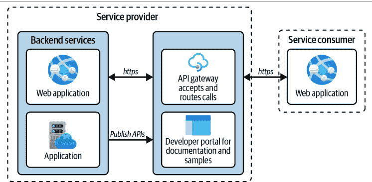

### 图 5-1. 与 API 的创建和使用相关的概念摘要

与直接调用应用程序不同，SOA 中应用程序的集成由 API 管理服务管理。在此示例中，API 调用通过 API 网关进行。API 接口通常具有不同的结构并隐藏内部应用程序的复杂性。因此，数据会被转换。

### SOA 术语

SOA 中服务提供者和消费者的角色与前几章中使用的数据提供者和消费者角色相似：

- 服务提供者是提供服务以公开功能和数据的应用程序。
- 服务消费者是使用该服务并接收请求数据的应用程序。

为简单起见，本章我将使用服务提供者和服务消费者，但在未来章节中，我会切换回数据提供者和数据消费者。

¹ Roy Fielding 在他的 2000 年博士论文《基于网络的软件架构的架构样式与设计》中定义了 REST。


SOA 的初衷是使 IT 环境更加灵活，并提供应用程序之间的实时通信。在 SOA 出现之前，大多数企业应用程序通信是通过直接客户端/服务器调用进行的，例如远程过程调用 (RPC)。³

直接应用程序间通信的缺点在于，它涉及与底层应用程序运行时环境的耦合。例如，希望通过 RPC 方法进行通信的应用程序需要相同的客户端/服务器库和协议。这不利于实现良好的应用程序多样性，因为并非所有库和协议都可用于所有语言。另一个缺点是兼容性。版本管理更难以处理；如果某个应用程序方法发生变化，另一个应用程序也必须立即进行相应更改，否则可能会出现故障。最后一个缺点是可扩展性：随着应用程序数量的增加，接口数量会迅速变得难以管理。在构建应用程序间的点对点接口时，通常也会出现同样的问题。

这些缺点是工程师和架构师开始基于更高级的抽象，并采用应用程序前端、服务、服务存储库和服务总线等关键概念来开发新软件架构的主要原因。在这种模型中，应用程序及其应用程序特定协议被隐藏，并通过使用 HTTP 等标准 Web 协议的服务来暴露其功能和数据。应用程序之间的通信和集成通过服务总线来处理。用于促进（企业）应用程序之间这种形式通信的技术和方法的实现，称为企业应用程序集成 (EAI)。

## 企业应用程序集成

21 世纪初，随着 Web 使用量的增长，企业服务总线 (ESB) 作为一种新的企业应用程序集成平台（也是 SOA 的一部分）出现，用于处理不同应用程序和软件包之间的集成。它在传统面向消息的中间件 (MOM)⁴ 和客户端/服务器模型之外增加了新功能，例如：

- **编排服务**
  将多个细粒度服务组合成单个高阶复合服务

- **基于规则的路由**
  基于指定条件接收和分发消息

- **转换为标准消息格式**
  将一种特定数据格式转换为另一种格式（这也包括数据交换格式转换，例如从 SOAP/XML 到 JSON）

- **为灵活性进行调解**
  支持同一接口的多个版本以实现兼容性

- **为连接性进行适配**
  支持多种系统以与后端应用程序通信，并将数据从应用程序格式转换为总线格式

ESB 通过使用总线和适配器，使企业能够更快地交付服务，从而促进敏捷性和灵活性。它将传统应用程序转变为具有易于使用接口的现代应用程序。ESB 还通过提供抽象并处理调解来解耦应用程序。适配器连接应用程序和 ESB，并处理它们之间的协议转换。

为促进 ESB 的实施，许多软件供应商开始通过现代化其应用程序设计，使其应用程序和平台为 SOA 做好准备。基于万维网联盟 (W3C) 标准的标准化服务接口应运而生，例如简单对象访问协议 (SOAP)，默认消息格式为可扩展标记语言 (XML)。

## WSDL、XSD 和服务存储库是什么？

基于 XML 的通信通常由 WSDL、XSD 和服务存储库支持。Web 服务描述语言 (WSDL) 也是用 XML 编写的，是一种用于描述 Web 服务及其操作的标准。它指定了方法、位置、数据类型和传输协议。它简化了集成和软件开发工作，因为开发人员只需拥有提供的 WSDL 即可完全开发一个 Web 服务。

WSDL 文档与另一个基于 XML 的文档（称为 XSD (XML Schema Definition) 文档）相关联。XSD 文档描述架构，即定义 XML 文档结构的规范。它们可用于确保给定的 XML 文档有效，并遵循架构中规定的规则。

XML 文档通常存储在服务存储库中。这通常是一个基于 XML 的注册表，用于发布有关可用和可访问 Web 服务的信息。服务存储库还会跟踪版本、文档和策略。

SOAP 之所以流行，是因为它使用超文本传输协议 (HTTP) 进行网络通信，并且具有与用于构建网站的超文本标记语言 (HTML) 相似的坚固结构。相同的 HTML 和 HTTP 标准过去和现在仍然是当今互联网通信的基础。基于这些通信标准，ESB 充当转换和集成代理，在服务提供者和服务消费者之间提供通用连接。


> 在 SOA 中，ESB 可能会变成复杂的单体架构。我将在第 155 页的“与企业数据仓库架构的类比”中再次讨论此问题，以进行与企业数据仓库的比较。

除了转换消息格式并为应用程序提供现代通信外壳外，ESB 在需要更复杂协作的情况下还提供多种通信变体。其中两种是服务编排和服务编舞。我将在下一节详细讨论这些内容，因为它们使 SOA 变得更加复杂和具有挑战性。

## 服务编排

在 SOA 中，当多个服务被组合时（这可能是为了效率、可维护性或协调），服务提供者和服务消费者的角色有时会变得模糊。集成通常很复杂，并且可以以不同方式发生。我们将探讨的第一种模式是 *服务聚合*，即将多个服务组合、封装并在一起，并作为单个更大的服务公开。这可以减少管理的痛苦，并满足（一个或多个）服务消费者的需求。在此场景中，聚合器负责协调、调用和组合不同的服务。

服务聚合需要 *服务编排*，即协调和执行任务以组合和集成不同的服务。5 这通常是出于技术原因而进行的，例如合并、拆分、转换、检查和丢弃数据。服务编排过程可以是短期运行的，在需要跨服务的简单服务流时进行相当直接的组合。⁶ 例如，为了获取客户的所有合同，必须先调用另一个客户的产品服务。它也可以是长期运行的，将服务组合成更复杂的流程，该流程需要决策逻辑和不同的执行路径。虽然服务编排并不明确说明持续时间，但人们主要在长（更）长期运行的服务上下文中使用该术语。服务编排需要一些消歧义，因为它可以出于不同原因而进行。

## 是应该使用 ESB 进行编排，还是在消费方进行编排？

组合和集成服务有两种方法。第一种是使用 ESB 的聚合服务，允许消费者通过单个调用检索所有数据。ESB 扮演编排者的角色，并承担随之而来的所有繁重工作。因此，在此场景中，ESB 成为单点故障。

替代方法是让消费方应用程序扮演编排者的角色。在此情况下，应用程序必须管理调用顺序并合并（集成）结果。

两种方法都有利弊。让 ESB 处理编排的好处在于，它促进了编排或业务逻辑的可重用性，并使数据消费更加容易。一个缺点是，ESB 必须在合并所有逻辑方面提供足够的性能。一个更大的缺点是，服务提供者的角色变得更加模糊，因为服务充当了不同服务之上的门面。聚合服务通常组合来自不同所有者的不同服务，因此没有一个真正的所有者可以保证聚合服务的完整性。

让消费方应用程序处理编排具有灵活性的优势，但效率较低，因为每个消费者都需要自己实现此功能。

编排的另一个常见原因是业务流程管理 (BPM)。此情况下的流程包含业务逻辑，通常是长期运行的。管理一系列步骤所需的协调要求存储每个步骤的进程状态（状态），并因此在数据库中持久化。长期运行的业务流程是可中断的，可以等待其他流程（或人工任务）完成。它们通常是异步的，因此对于这类流程

³ RPC 类似于客户端/服务器模型；它是一种模式，允许一个程序使用和请求位于网络上另一个系统中的另一个程序的应用程序功能。RPC 不使用消息，而是使用接口描述语言 (IDL) 进行客户端和服务器之间的通信。IDL 解释器必须在两端实现。

⁴ 中间件，或面向消息的中间件，是支持分布式系统之间发送和接收消息的技术和产品的统称。ESB 可以被视为中间件：它用于路由消息并支持对这些消息的可靠处理。

5 有些人也使用术语 *服务组合*。服务可组合性原则鼓励以一种方式设计服务，使其可以在多个解决方案中轻松重用，这意味着现有服务可以用于创建新服务。虽然服务组合表示服务被组合这一事实，但它并未详细说明如何执行此操作。

⁶ 服务流（也称为 *微流*）是不可中断的，通常在单个线程和仅一个事务中运行。它们持续时间较短，并且通常仅使用同步服务。进程状态通常不会持久化。


服务编排模式通常配合可视化且直观的 BPM 软件，用于管理复杂的工作流和长时间运行的进程。


BPM 软件的进程层保存了应用程序和服务之间所有数据交换流的信息：序列信息、依赖关系、状态、任务、规则、等待时间等。您绝不应在这样的进程层中存储应用程序数据；这是一个常见错误。BPM 软件并非用于管理应用程序数据。使用 BPM API 启动进程并检索工作流状态信息。不要用它来存储关于客户、产品或合同的数据，因为它不是为此目的设计的。

BPM 通常用于需要跨不同领域的各种应用程序编排（长时间运行的）进程时。它帮助各领域将业务流程与业务应用程序逻辑分离。然而，在应用程序边界内编排进程和数据时，最好在应用程序本身内单独完成。

当 BPM 管理长时间运行的进程时，处理性质通常是异步的。BPM 管理所有依赖关系，跟踪每个进程的单独状态，并知道何时触发、检索和存储数据。因此，用于调用或呼叫进程的 API 有时被称为进程 API。

服务编排常被错误地与其他类型的编排混淆。在面向服务架构的语境下，编排是指调用和执行为交付端到端服务所需的操作性和功能性进程。通常，这种形式的编排使用应用程序 API，并可由 BPM 软件管理。

以下是其他编排形式的一些示例，包括调度、自动化配置和协调：

- 操作系统中进程的调度（例如，类 Unix 系统中的 cron）。
- 应用程序边界内进程和任务的调度（例如，内置/原生应用程序调度程序）。
- 用于自动化数据处理的数据编排（例如，数据移动、数据准备和 ETL 进程）。Apache Airflow 是此类活动的常用工具。
- 基础架构的调度和编排（例如，预配虚拟机、关闭系统等）。

另一种编排形式是持续集成/持续交付（CI/CD）：监控、构建、测试、发布和集成软件的自动化过程。这种编排形式通常使用并结合其他编排形式。

## 服务编舞

另一种模糊服务提供者和消费者角色的模式是 *服务编舞*，它是指将进程交互和业务逻辑全球分布到独立方之间，这些方协作以实现某些业务目标。在服务编舞中，决策逻辑是分布式的；每个服务观察环境并自主行动。没有集中式编排器，如同 BPM 那样，也没有一方完全控制其他方的进程。每个方负责整体进程的自身部分。如您在图 5-2 中所见，在服务编舞中，请求在不同的服务提供者和消费者之间以一种乒乓球式的方式来回传递。控制服务之间交互的逻辑位于中央平台之外。服务本身决定下一步调用谁以及调用的特定顺序。

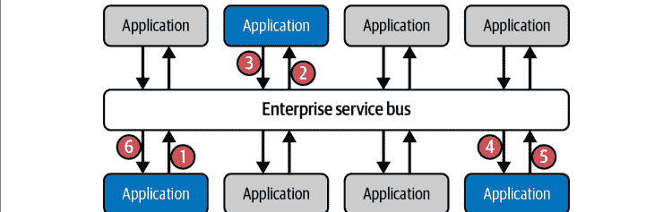

图 5-2。服务编舞是一种去中心化的服务参与和通信方法

服务编舞、聚合和编排也可以结合使用。多个服务和进程可以集中管理，而其他服务可以独立触发其他聚合服务中的工作流。在所有情况下，服务提供者和消费者的角色都被模糊化，因为没有一个域可以保证交互的整体完整性。

> Martin Fowler 在其帖子“事件协作”中，为需要通信并依赖其他应用程序信息的应用程序提出了一种有趣的模式。应用程序不再在需要数据时发出请求，而是在事情发生变化时引发事件。其他应用程序监听这些事件并做出适当反应。这与我们将在第 6 章讨论的事件驱动架构非常一致。

在过去的几个部分中，我主要通过进程交互和聚合的视角关注服务。在下一节中，我们将通过观察服务运行的上下文，探索区分服务的另一种方式。

## 公共服务和私有服务

服务针对许多不同的目标。因此，许多人将 SOA 服务分为不同类型，例如公共和私有。^7 公共服务，有时也称为业务服务，提供特定的业务功能。它们是必需的，并有助于解决特定的业务问题。这些服务通常将数据或逻辑分组，并以对业务有意义的方式进行表示。其他服务，有时称为进程服务，启动进程、触发业务工作流或涉及行为方面。业务服务往往是抽象的，是特定业务功能的权威，并且跨应用程序边界运行。

私有服务，或技术服务，是不一定代表业务功能的服务。它们用作内部逻辑的一部分，并提供技术数据或基础架构功能，例如按原样公开数据库表。私有服务可以作为公共服务的输入。在这种情况下，它们通常被包装到另一个服务中，该服务最终将交付业务功能。


有些人使用基础架构服务或平台服务等术语，这些服务将基础架构问题从各领域中抽象化。这些服务通常在整个组织中标准化，并涉及适用于所有领域的功能，例如身份验证、授权、监控、日志记录、调试或审计。

一般来说，私有服务的耦合度较高，因为它们不够中立且不抽象到业务问题。有些人认为这些服务不应发布到中央存储库或在各领域之间共享，因为它们不适合广泛受众，且仅在应用程序边界内运行。

## 服务模型和规范数据模型

连接不同应用程序时，工程师和开发人员需要对不同服务提供的数据模型和业务功能有共同的理解。这就是服务模型和规范数据模型的用途。服务模型描述服务接口的外观，以及数据及其实体、关系和属性的建模方式。根据其丰富程度，它还可能包括定义、与其他服务的依赖关系、版本号、语法、协议以及其他信息，例如应用程序所有者、生产状态等。

服务模型的目标是提供信息，使使用和集成服务变得更容易。它通常与平台无关，并不试图描述系统。服务模型在不同范围内使用，并以不同格式存在。有些仅存在于文档中，描述最常用的上下文；另一些则作为代码存在于工具中，描述数据及其所有属性和协议。

*规范数据模型*与服务模型不同，其目标是以标准化和统一的方式定义服务和语言。虽然服务模型更贴近应用程序，但规范模型用于对齐和标准化各种服务模型。有些人希望在所有服务中应用统一，使用全局架构。因此，规范模型往往庞大且复杂。

## 与企业数据仓库架构的类比

ESB、聚合、服务分层和中央规范数据模型的组合使得传统 SOA 实现比必要的更加复杂。确实，它们面临着与企业数据仓库架构许多相同的挑战。

### 规范模型大小

首先，相似之处在于使用规范模型的规模。许多组织试图使用单一的企业级规范模型来描述 *所有* 服务。企业级规范模型要求所有参与的不同团队和各方之间进行跨协调。在这种方法中，服务通常最终会拥有大量可选属性，因为每个人都坚持要反映自己的独特需求。最终结果是一个庞大的接口模型，它妥协以包含所有人的需求，但又不针对任何人；它如此通用，以至于没有人能确切地了解服务交付或执行的内容。企业数据仓库也存在类似问题，如第 14 页“企业数据仓库：单一真理来源”中所述。

### ESB 作为旧版中间件的包装器

下一个相似之处是服务的分层和聚合，这在大型旧版中间件平台和 ESB 中很常见。许多此类架构至今仍然存在；它们承担了大部分消息路由、集成、转换和进程编排，包括管理和持久化进程状态。一些企业使用更现代的技术封装这些旧版中间件系统。复杂性被抽象化，为更现代的通信铺平了道路，例如使用 JSON 代替 RPC。然而，为古老的中间件穿上新外衣增加了复杂性，因为你在层层叠加。


(图 5-3)。这可能意味着即使是很小的变化也会导致其他变化的连锁反应。

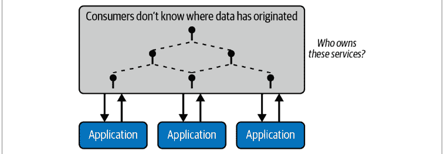

图 5-3. 在其他服务之上构建服务会降低透明度

在不经意之间，服务调用就变得复杂起来。服务被调用时，往往不知道数据到底来自哪里，或者正在启动哪些其他服务或进程，而且通常没人愿意对这些服务承担责任。BPM 也常出现同样的情况：技术编排和流程编排被混在一起，或者所有域和流程逻辑被集中在一起，使得难以掌握哪些流程是相关的。

## ESB 管理应用程序状态

我想指出的最后一个相似之处是，ESB 已成为多个应用程序的状态（数据）存储。[8] ESB 不再在应用程序或业务流程管理能力中处理状态，而是被用来编排长时间运行的业务流程，或者更糟的是，持久化属于应用程序的状态。ESB 变成了一个数据库。这种方法的风险是紧密耦合。如果 ESB 出于任何原因宕机，状态将丢失，所有流程可能都会失去其实际状态。另一个潜在风险是应用程序发生变化时：如果状态也需要变更，且所有应用程序都依赖于 ESB 中持久化的状态，则需要仔细的跨团队协调才能安全地完成所有变更。原则上，ESB 应该是无状态的，仅用于临时会话管理和缓存除外。

[8] 状态管理是指对应用程序状态的管理，例如用户输入、流程状态等。

## API 管理的现代视角

ESB 集成平台使 SOA 变得比应该的更加复杂。企业将 ESB 中的“E”字面理解，并实施单体架构来处理所有服务集成。中央团队规定了什么是良好的服务可重用性和设计，而沉重的跨团队沟通阻碍了创新和团队敏捷性。

与此同时，随着微服务的兴起，应用程序和设计的模块化也在发生变化，今天使用现代服务构建 API 变得极其快速和容易。考虑到数字生态系统、云、SaaS 和 API 经济，API 边界已经扩展到企业之外。现代数据库和应用程序原生支持 RESTful API。毫不奇怪，需要一种对 SOA 的新视角。

## 联邦责任模型

基于这些趋势和打破基于 ESB 的集中式架构的需求，我们的新 API 架构应该是什么样子？不再使用集中式模型，构建和暴露服务的责任将交还给底层域。就像数据产品管理一样，你应该遵循联邦模型：各个域可以按自己的速度发展，而不会阻碍其他域。

在此联邦运行模型中，业务逻辑、流程执行、数据持久化和上下文验证的责任也交还给各个域。必须不鼓励将 ESB 用作（集中式）集成平台；聚合和编排只应在域的边界内进行。联邦模型也影响 API 设计：数据产品创建中的相同用户友好型设计原则也将适用于此。同样，API 像数据产品一样，必须使用域语言进行开发。

对于 API 管理，我们可以制定一些额外原则：

- 使用 REST 资源模型（如下侧边栏所述）而非复杂系统来暴露业务功能或数据。这需要大量工作，重点在于理解业务概念及其属性、正确命名关系、相应设计架构、确保身份和唯一性正确，等等。

- 尽可能靠近数据进行优化，并避免在 API 层进行沉重的编排。例如，如果应用程序和 API 部署在本地，请使用自托管的 API 网关实例。[9]

[9] Azure API 管理文档概述了管理自托管实例的一些额外注意事项。

- 将域逻辑保留在域内。

- 使用适当的粒度为消费者构建服务。[10]

- 简化并使用现代社区标准。

- 仅允许在域（限界上下文）的边界内进行服务编排（将多个 API 端点合并为一个）。

- 一致地使用域标识符，以便域可以识别资源之间的互连。

## 资源导向架构

在软件工程中，有一种称为 *资源导向架构*（ROA）的模式。ROA 是一组针对 RESTful 架构的特定准则。数据被建模为同主题领域或资源的集合，因此逻辑上属于同一组的内容会被分组到一个集合或资源中。每个资源都是一个可以使用 URI 标识的实体。例如，资源 *客户* 用于返回关于客户的所有相关信息，可能包括姓名、地址和联系信息。此模式中的数据资源是面向名词的，并且也应该是可自发现和自解释的。（相比之下，SOA 通常是面向动词的。）

遵循这些准则将有助于使您的 API 架构可扩展。它允许各个域保持解耦，同时利用其他服务而无需进行太多重复工作。为了便于这种工作方式，必须考虑一种更轻量级的集成服务。

## API 网关

随着 RESTful API 和应用程序现代化趋势的发展，应用程序之间的通信和服务集成开始发生变化。REST 在第 146 页“资源和操作”中介绍，是一种用于现代 Web 应用程序以实现无状态通信的架构模式。它基于简单性：资源（表示相关信息的简单块）由统一资源标识符（URI）标识，并可以通过超媒体链接连接。[11] 它还使用带有统一接口方法的 HTTP。RESTful API 由于其互操作性和灵活性而变得流行，并被用于网站、移动应用、游戏等。


RESTful API 通常使用 CRUD（创建、读取、更新、删除）操作，这些操作映射到数据库或数据存储库中要执行的基本操作。您通常直接处理记录或数据对象。另一方面，REST 在资源表示上进行操作，每个资源都由一个 URL 标识。这些通常不是数据对象，而是复杂的高级抽象。

例如，一个资源可以是客户的合同。这个资源不仅仅是“合同”表中的一条记录，还包括与“客户”资源、合同附着的“协议”以及可能的其他内容之间的关系。

随着 RESTful API 的普及，消息格式和协议也开始发生变化。SOAP 协议及其相对较大的 XML 消息格式，已变为 JSON，因为其简洁轻量的语法而更快。此外，JSON 消息可以轻松缓存或存储，例如在键值数据库中。这意味着 API 和集成平台可以存储之前请求过的数据，然后按需提供这些数据。


在某些情况下，RESTful API 可以通过额外的层或中介进行模糊化，以执行指令而不向消费者暴露其在层次结构中的位置。这通常是提供增强可扩展性（缓存和负载均衡）和安全性的要求。

现代应用程序以及协议和消息设计的变化也开始影响 API 架构。一种更轻量级的集成组件应运而生，即 API 网关。API 网关没有适配器的开销或 ESB 的复杂集成功能，但仍然允许封装，并提供管理功能来控制、保护、管理和报告 API 使用情况。它通常是 API 管理软件的一部分，包含两个组件：开发者门户，用于让开发人员访问文档、代码示例和可用 API 列表；以及 API 网关组件，用于接受 HTTP 调用并将其路由到底层服务或应用程序。对于 API 网关本身的部署，可以使用不同的方法。较小的组织通常在数据中心边缘或云中部署单个 API 网关实例。较大的组织通常在多个位置（域团队、组织部门或区域内）部署多个实例。

[10] Filipe Ximenes 和 Flávio Juvenal 撰写了一篇关于如何通过 RESTful API 表示格式正确、链接和版本化的资源的博客文章。[11] HATEOAS（作为应用程序状态引擎的超媒体）用于链接 REST 资源。您可以在 REST API Tutorial 网站上找到相关教程。


## API 作为产品

随着新的解耦模式被澄清，我们可以审视 ESB 的角色。仅在需要重负载处理时才会用到 ESB；对于所有其他用例，API 网关定位更好。因此，ESB 将仅用于解决旧系统现代化和繁重技术集成的问题。通过劝阻使用集中式集成层，我们迫使各领域更加审视地看待其应用程序以及服务和数据的暴露方式。鼓励各领域将其 API 视为其产品来看待和管理。这意味着几个需要考虑的事项，我们将在后续章节中进行探讨。

## 复合服务

在领域边界内将 API 作为产品来管理时，必须特别关注设计复合或聚合服务。12 复合 API，如图 5-4 所示，是指在一次调用中通常执行一系列 REST API 请求的 API。例如，当消费者需要从两个系统获取组合数据时（比如说，客户和订单），就可能需要这样做。在构建聚合数据的复合服务时，应努力将尽可能多的集成和转换逻辑推送到消费者端。这迫使消费领域对任何特定于消费者的业务和集成逻辑承担责任。例如，当复合服务涉及复杂的业务逻辑时，可以通过在领域边界内部署额外的组件或微服务来处理。因此，拥有业务逻辑和相应上下文的一方，也是必须拥有组件和相应 API 的一方。在这种协作模型中，API 网关在 API 调用的路由流程中角色有限。它仅验证请求和来源是否有效。

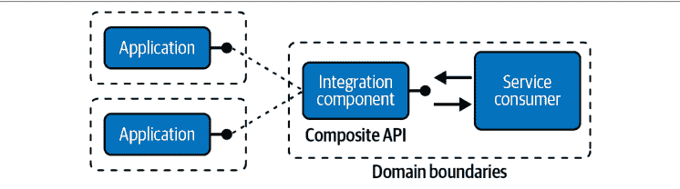

图 5-4. 使用复合服务时，集成和转换逻辑被推送到消费端

12 Azure 文档包含一个使用 Lua 的网关聚合 NGINX 服务的具体简单示例。

当多个领域参与复合服务时，必须仔细注意一致性、完整性和安全性。在中央仓库中注册每个底层服务至关重要，这样各领域就知道他们可能与其他领域存在哪些依赖关系。说到这一点，我不鼓励在其他复合服务之上构建复合服务，因为编排可能会最终演变成一个 API 之间相互调用的混乱网络。就安全性而言，应将规则结构和决策逻辑尽可能靠近源头领域。其他领域不应能够推翻它或给予本地规则更高优先级。

### API 合同

当多个团队在同一个 API 上工作时，至关重要的是所有团队都要就规格和设计达成一致。API 或服务合同就是用来做到这一点的。13

API 或服务合同是一份记录 API 设计方式（结构、协议、版本、方法等）的文档，可用于在服务提供者和服务消费者之间建立协议。14 创建 API 合同的常见标准是 OpenAPI 规范（以前称为 Swagger 规范）。以代码形式记录这些合同的好处在于，人类和系统都可以解释这些规格。服务提供者还可以从服务消费者处获取测试流程，以便对任何更改进行测试，验证服务是否中断。

### API 可发现性

就像数据产品的目录一样，我建议使用服务注册表或开发者门户来跟踪服务。服务注册表是一种将所有关键 API 信息存储在中央仓库中的工具。它促进服务复用，并提供关于所有权、版本控制、变更、用途等基本信息。

## 微服务

现在，我们已经通过推动服务与领域的解耦来打破复杂且紧密集成的面向服务架构，准备好迎接新趋势：微服务。我们在第 2 章中提到过这一点，但它是将应用程序分解为更小、更易管理的部分的有用模式。有些人喜欢使用“松耦合服务”这一术语，这立即显示了它与 SOA 的重叠之处。

13 Azure API Management DevOps 资源工具包是一个出色的仓库，其中包含使用 Azure API Management 设置 API DevOps 的示例。

14 Martin Fowler 深入探讨了消费者驱动合同所提供的优势。

### 函数

函数即服务（FaaS），或简称 *函数*，是微服务架构的另一种设计模式。这是一种相对较新的云计算服务类别，通过该类别，单个函数（操作或业务逻辑片段）被部署和执行。FaaS 允许工程师开发、运行和管理应用程序功能，而无需处理通常与此过程相关的构建和维护基础设施的复杂性。在这种计算模型中，函数是按需启动的，采用按使用付费的许可证。这种隐藏基础设施的模式也称为 *无服务器*。15

每个函数通常都有一个与该函数对应的 API。此模型中的 API 用于调用或唤醒函数。这些函数及其相应 API 的指导原则与其他 API 相同。在领域边界内部使用时，允许直接消费函数。当跨越领域边界时，无服务器 API 必须在 API 仓库中拥有、签订合同并进行注册。

尽管函数通常由 API 网关伪装，但与事件驱动架构（我们将在第 6 章讨论）存在显著重叠。无服务器函数通常异步运行，因为它们可能较慢。在云计算中，绝大多数快速资源都保留给昂贵的或计算密集型的应用程序。剩余的“便宜”计算资源分配给无服务器函数。因此，它们的响应时间不太具有可预测性。异步函数可以使用消息队列来存储其结果，并等待其他进程（函数）来获取它们。

### 服务网格

在第 2 章中，我们讨论过使用服务网格进行微服务之间的通信。抽象地说，服务网格的工作方式类似于 API 网关，尽管存在一些细微差别。两者都处理解耦、监控、发现、路由、身份验证和限流。主要区别在于内部服务间通信。服务网格内的通信不会被路由到外部，而是停留在微服务运行所在环境的内部服务边界内。

就像 API 网关一样，服务网格是使用两个服务实现的：控制平面和数据平面。*控制平面*是您在其中定义路由、策略、安全性等的服务。*数据平面*是发生路由并强制执行策略和安全性的服务。

要了解微服务架构如何融入更全面的 API 架构，请查看图 5-5。在此图中，我们看到三种不同的 API 模式：

- 顶部是现代应用程序，可以通过 API 网关直接暴露。在这种模式中，应用程序使用现代通信协议，例如 REST/JSON。
- 中间是旧版应用程序，需要通过 ESB 进行额外解耦。ESB 服务可以被封装到 API 网关中。
- 底部是微服务。微服务通过服务网格进行内部通信。需要对外部暴露的 API 通过 API 网关进行解耦。

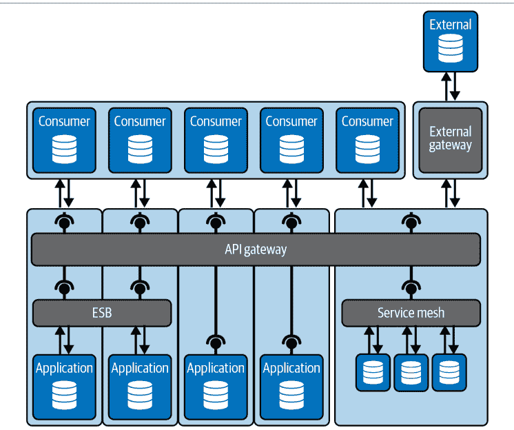

图 5-5. API 架构不排斥微服务，微服务也不排斥 API 架构


## 微服务领域边界

你可能会疑惑是否总是需要同时部署服务网格和 API 网关。截至目前，最佳实践是将两者并行使用，因为二者在架构上存在差异。服务网格是专门用于仅在微服务架构中管理服务间通信的基础设施层。它通常以微服务的形式实现。你可以使用它来实现企业级解耦，但我不推荐将其作为唯一选项，因为并非所有领域都使用微服务。将使用微服务的领域与未使用微服务的领域解耦的一种务实方案是部署一个作为独立组件运行的 API 网关。

管理微服务时的另一个关注点是围绕服务提供方和消费方微服务所设置的逻辑边界。如果大量微服务运行在同一平台上，划定逻辑界限非常重要。服务范围划分与拆分非常重要，因为这有助于领域管理其复杂性及与其他领域的依赖关系。领域驱动设计模型用于设置服务边界。如果有界上下文发生变化，边界也随之变化，并且服务必须进行解耦。

遵循此逻辑时，你最终可能需要对一个微服务进行两次解耦。第一次解耦发生在领域边界内部，属于内部服务间通信层面：一个微服务与同一领域内的另一个微服务进行解耦。第二次解耦发生在领域间通信层面：希望与不同领域中微服务通信的微服务需要再次解耦。在第一种情况下，微服务 API 的设计可能更偏向技术层面。这些 API 并非用于与其他领域直接共享，也不会发布到服务目录中。在领域间通信的情况下，API 必须针对消费者进行优化，因此必须遵循读取优化设计原则。

设置这些领域边界时，你可能会观察到，这与数据产品管理以及不同领域之间的数据共享方式存在显著重叠。内部的业务逻辑和数据应保持内部，不应向其他领域暴露。在所有其他情况（即跨领域边界时）中，许多不同的原则都会发挥作用，并应应用于 API 的设计与注册方式。

## 生态系统通信

在第 1 章中，我提到许多组织正在探索新的基于 API 和 Web 的商业模式。各行各业的公司都得出结论，他们必须与其他数字公司紧密合作，以扩展、创新、颠覆，或者至少保持竞争力。预计这一趋势将持续下去，并将迫使你的架构在消费者与服务的 *internal* (service) 通信与 *external* (service) 通信之间做出清晰的划分。16 这有三个重要原因：

- 组织内部使用的语言受公司控制，但在外部情况往往并非如此。API 的设计格式和结构通常由其他各方或法规规定。例如，经过修订的支付服务指令 (PSD2) 迫使欧洲银行业的银行严格按账户、对手方、交易等组织其 API。因此，在复用现有内部服务时，通常需要额外的翻译。

- 暴露在公共 Web 上的 API 需要额外关注，因为外部各方并不总是值得信赖或已知。为了安全地保护你的 API，它们需要被监控、限流，并配备身份服务提供商以实现安全访问。

- 你可能希望根据商业协议进行限流（限制调用次数）。商业提供的外部 API 通常有消费计划，并根据 API 调用次数计费。API 监控可能有所不同，因为你需要区分不同的 API 用户。

外部和公共 Web 服务通信可能需要在架构中增加一个额外的 API 层，该层位于内部服务与外部消费者之间。它需要执行两种类型的中介：外部服务提供商与内部企业环境之间的中介，以及企业环境内部自身的中介。

内部和外部抽象能否在同一 API 层中实现？从技术角度，你可以使用单个 API 来路由内部和外部流量。但此处的一个重要考量因素是你的 API 商业策略。开放 API 的成功取决于其吸引外部开发者的能力。使用它们的目标是开发开发者和用户真正想要使用的有价值应用程序。额外的抽象层将允许更快的创新，因为它将减少与内部环境的耦合。

16 此处，internal 并不指内部应用程序 API。在此情况下，*internal* 是指组织或企业边界内。

将内部企业通信与外部流量分开的另一个原因是外部环境的不同安全控制。外部流量通常需要额外的日志记录、DDoS 防护、不同的身份提供商等等。

预计外部 API 和生态系统通信将对你的 API 策略产生重大影响，因为它们要求你区分内部和外部服务通信。将影响你架构的另一个目标是渠道通信，它涉及提供丰富的客户体验。我们将在接下来讨论。

### 体验 API

API 还用于通过基于 Web 或全渠道提供丰富的客户体验，在这些渠道中，通信与客户进行，内容也提供给其他业务方。在这种场景下，此类 API 与其他 API 有所区别，因为它们用于与最终用户的直接通信，因此应得到不同对待。在此情况下，这更多关乎人机交互而非系统与系统之间的交互。这种交互可以通过网站、移动设备、聊天机器人、游戏、视频和语音识别系统进行。由于在线渠道通常是公司的商标，提供出色的用户界面和体验至关重要，这需要架构中额外的组件来进行权限检查、请求处理和验证、状态管理、缓存、Web 安全等等。这些组件通常属于“数字体验”领域。

将这些组件放在靠近最终用户的不同领域中进行管理，其原因在于，改善用户体验本身就是一项专门的活动。Web 应用程序安全（如表单验证）与 API 安全不同。用户体验还需要快速，这会极大地改变 API 交互和缓存的方式。向服务器端资源发送大量 API 调用会显著拖慢用户体验。一个简单的国家选择列表，最好存储在靠近最终用户的专用（缓存）组件中，而不是每次需要时都通过 API 网关从网络获取。你希望减少调用次数，并在检索内容时更高效。这意味着你需要用一组额外的功能来扩展架构。

### GraphQL

提供统一 API 体验的典型组件是 GraphQL 服务。GraphQL 作为现有 API 之上的额外层运行。它使用查询语言，从多个 API 中选择你想要的精确字段。GraphQL 可以成为从不同系统实时提取大量数据的一个良好解决方案。


GraphQL 允许 *架构联邦*，即将您的架构组织为单个数据图，以便为查询所有后端数据源提供统一接口。同样，不要陷入创建企业数据模型或中央网关模型的陷阱。如果您想了解更多有关此内容的信息，我鼓励您阅读 Thomas Frisendal 编著的 *与旧版数据和 Neo4j 的 GraphQL 数据可视化设计：实用入门*（Apress 出版）。

API 架构中的 GraphQL 服务只能在单个域内部署，或作为域间通信的功能进行部署。在后一种设置中，应遵循第 2 章讨论的所有原则：所有 GraphQL 端点都应遵循相同的设计和治理原则。

## 前端后端

改善用户体验并满足前端客户端需求的另一种方法，是使用额外的层或额外的组件来处理与用户界面和体验相关的逻辑。17 您可以针对特定前端优化此层。例如，移动应用或单页应用可能需要不同的优化，并与基于桌面的 Web 流量需要不同的组件。您可能希望在此层中使用 GraphQL。

如前所述，有各种模式和注意事项可用于让各领域通过 API 进行交互。为了帮助您了解并展示多个方面如何结合在一起，在下一节中，我将介绍一个高级 API 架构，说明不同领域如何交互。在我们走完此示例后，我们将简要了解元数据在 API 管理中的作用。

## 实际示例

未来几年，企业将交付数不胜数的新应用程序。API 是这些应用程序的核心。API 提供了现代的“前门”，并实现应用程序之间的丰富集成。为确保可扩展性，您应该在架构中应用面向领域的设计。理想情况下，每个团队负责其应用程序，并交付一组 API 以便其他领域能够无缝使用。

您在图 5-6 中看到的架构使用了本章讨论的几种模式。对于域 A、B 和 C，原则是相同的。它们各自使用 API 网关来发布其 API。这些 API 网关处于 API 治理的控制之下，确保遵循所有安全标准和其他原则。

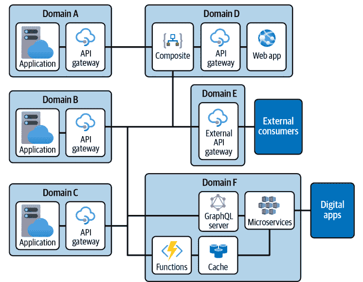

图 5-6. 示例 API 架构，展示不同域如何提供和利用来自其他域的 API


此处描述的架构为了说明进行了简化。在现实中，将会有防火墙、负载均衡器、应用程序网关、虚拟网络等等。

域 D、E 和 F 是消费域。它们使用 API 来交付价值或与其他各方促进协作创新。如图 5-6 所示，每个域以不同的方式利用 API。例如，域 D 开发了一个组合 API，以将一系列请求作为单个请求来执行。新创建的端点由该域本身在基于 Web 的应用程序中使用。域 E 使用外部 API 网关模式。这个额外的层用于为外部消费者转换和保护 API。域 F 是一个较大的域，为在线客户提供丰富体验。它可能提供虚拟代理、聊天机器人、分析服务等功能。域 F 的架构采用带有缓存的微服务设计，用于存储会话状态信息。同一存储还用于使用来自其他域的信息来丰富数据。有些函数会调用其他 API，然后将结果存储在缓存存储中。这种方法允许更丰富的客户体验。最后，使用 GraphQL 服务来缩小到其他域的请求范围。

虽然架构看起来简单，但至关重要的是，必须遵循迄今阐述的所有架构原则和指南。例如，所有域边界必须明确设置，复杂逻辑必须隐藏在 API 网关之后。在逻辑应在的位置管理逻辑也是如此。在组合 API 的情况下，需要逻辑来构建 API 调用序列。由于这涉及特定业务知识，最好在拥有该知识的域的边界内管理此组合组件。发布和注册 API 时也必须应用相同的原则；这将加速采用并简化学习。

## 元数据管理

元数据管理是 API 管理的一个重要方面。随着 API 数量的增加，支持各域查找服务至关重要，这能提高可重用性。最佳实践是将所有 API（包括属性和描述）发布到中央仓库或开发门户中。商业 API 管理平台通常拥有此类仓库，但如果您不想使用商业供应商，开源 API 管理解决方案也可行。OpenAPI.Tools 维护着一个高质量、现代开源工具的长列表。使用 OpenAPI Initiative 的厂商中立格式来描述 API 也是个好主意。许多组织使用此标准来构建、记录、版本控制和测试 API。

## 微服务和元数据

您是否需要元数据来了解微服务的相关洞察？绝对需要！数千个微服务可以在大规模平台上运行。了解谁拥有哪个服务、它做什么以及它生成什么数据非常重要。为了让微服务能够自我声明，您可以考虑向运行时添加元数据标签，或在微服务部署后调用 API。为方便团队，您可以将 API 调用作为容器基础镜像的一部分。帮助团队的另一种方式是提供代码片段或骨架模板。

在部署了多个 API 网关、ESB 和服务网格的分布式环境中，跟踪所有 API 尤其重要。只有当每个集成功能都连接到中央仓库时，这才可行。这样您就能知道哪些服务属于哪些域，以及哪些域正在交互。拥有这种洞察对于管理整体格局是一大优势。

## 面向读取的 API 服务于数据产品

API 并非孤立存在；它们也可以在数据产品架构中使用。例如，您可以使用它们来提供对只读数据的实时访问，实现 CQRS（有关详情，请参见第 104 页的“什么是 CQRS？”）模式以用于实时通信。您甚至可以在同一边界内将强一致性数据读取与最终一致性数据读取分开。让我来解释一下这是如何工作的。在这种设计中，API 网关充当路由器，将 API 调用分发到业务系统或数据产品架构。为了具体说明，在这样的设计中，所有最终一致性的读取请求（例如“GET rest/v1/resources/1”）都将路由到读取存储。所有命令（例如“POST rest/v1/resources”）都将路由到命令存储。您的消费者在使用此类设计时，不会注意到区别。他们只需要知道通信端点。智能路由发生在提供域内部。

一种替代的数据产品设计是部署面向读取的微服务，这些微服务充当缓存，数据可直接从中消费。在此类设计中，每个微服务在其自身数据存储中保存特定的数据产品，并通过 API 端点提供服务。您可以将其与面向资源的架构类比，其中每个微服务为特定资源缓存数据。同样，API 网关对所有命令和查询进行区分。使用面向读取微服务的这种设计与数据网格架构对数据产品的构想相似。

如您在第 4 章中所学，使用 CQRS 可以大大改善架构的可扩展性和性能，优化以更高效地处理查询。这在分布式环境中也适用，其中业务系统位于网络的一侧，查询部分位于另一侧。当查询负载非常高时，CQRS 是应对读取密集型数据挑战的唯一方法。

## 总结

在快速变化的企业格局中，您可以将 API 管理和本章描述的最佳实践视为刷新 API 策略的一种方式。面向服务的架构的基本原理依然存在，但拥有更清晰的职责、现代模式和原则、与数据管理更强的一致性以及更灵活的架构。当您计划过渡到 API 优先策略时，请考虑采用以下最佳实践：

- 构建 API 策略，并将其与业务架构对齐。审查每个业务能力内的使用情况，并显示哪些业务能力与哪些其他业务能力集成。


- 开发您的 API 的设计和结构是一项重要的架构活动。在为与其他领域协作定义 API 时，请将 API 设计与数据产品设计保持一致。请记住，API 和数据产品的底层应用数据库始终是相同的！
- 将面向内部应用开发的 API 指南与面向与其他领域协作的 API 指南分开。例如，内部 API 可以是技术性的，而提供给其他领域的 API 应该是稳定的、自解释的且易于使用的。
- 为平台和服务设定标准，并使其与 API 所扮演的范围和角色保持一致。例如，面向外部服务消费者的 API 必须发布在更符合加强安全性要求的不同 API 网关上。
- 发布 API 设计的指南和最佳实践。让您的 API 社区成为此内容的所有者。
- 关注微服务架构。考虑添加边界，而不是让团队面对数百个服务的复杂性。
- 高度关注复合 API，因为它们可能会使您的架构变得复杂且紧密耦合。

由于其 REST 设计，使用 API 也是将所有数据分布式化的绝佳方式。您可以同时部署多个 API 网关和服务网格，每个团队或领域可能使用其自身的 API 网关来提供其服务。您可以通过使用元数据存储库来保持控制，该存储库包含有关哪些服务可用以及它们如何被消费的信息。

API 架构的模块化和请求/响应模型还允许针对特定用例构建高度模块化的微型解决方案。这使架构具有高度可扩展性。需要注意的是，您必须遵循第 2 章中为领域架构讨论的相同设计原则。API 应该被视为用于实时生成、发送和接收数据的产品。它们必须有所有者，并针对可读性和易于使用进行优化。它们应该使用领域的通用语言，不应包含来自其他领域的业务逻辑。

在下一章中，我们将专注于异步消息传递和事件驱动通信，并看看可以从中学到什么教训。在那里见！

# 事件和通知管理

事件驱动的数据架构是新的范式。借助这些架构，组织可以将其业务转变为实时、数据驱动的体验。但虽然它们功能强大，也过于复杂。它们需要许多服务、额外的组件和框架。它们也不是解决每种类型问题的方案。在实施任何类型的事件驱动通信时，讨论这些注意事项是值得的。

在本章中，我们将专注于事件和通知管理。这些是复杂的领域，因为它们与 API 管理和数据产品架构设计重叠。我们将研究异步通信、事件驱动架构、现代云技术、一致性模型、事件类型等内容。到本章结束时，您将很好地理解事件驱动架构可以为组织带来什么，以及涉及的权衡。

在开始前，我想提几点。首先，并非所有数据从业者都熟悉事件驱动架构。我将解释一些基础知识，并专注于数据管理背景下的事件分发。其次，事件驱动架构可能会变得复杂；对此主题的完整讨论很容易填满一整本书。我将关注关键方面，并使用参考示例来演示治理模型和最重要的注意事项。

1. 如果您想了解更多有关事件驱动架构的信息，Ben Stopford (O'Reilly) 编写的《Designing Event-Driven Systems》是一个很好的资源。

## 事件简介

在讨论架构和治理之前，我想研究事件数据、它的样子，以及为什么异步通信会产生影响。事件数据是关于在某个时间点发生的更改的信息（一个 _事件_）。事件数据提供竞争优势：更快的结果使洞察更相关，更高的响应能力带来更高的客户满意度。无需等待分钟或小时，您可以立即做出反应。欺诈可以在发生的那一刻被检测到。您可以看到网站访问者来自何处，与他们互动，并在他们浏览您的网站时改善他们的客户体验。以事件流形式交付的数据对组织可能具有巨大的价值，其来源差异巨大，从物联网 (IoT) 设备到智能手机点击、游戏内玩家活动、社交网络以及传统操作系统的更改。

与以离线批次或响应 API 请求（实时）交付的数据不同，事件数据侧重于与事件交互和对事件做出反应。它关乎 _异步_ 连接应用程序和系统。事件数据强调高吞吐量，可以是无状态或有状态的。它允许您交换关于在特定时间点发生的更改的信息，并在位置之间移动应用程序状态，从而实现分布式、最新的物化视图。

事件驱动架构通常使用事件流平台，这些平台在数据流经平台时处理正在传输的入站事件。这些软件平台有不同的“面”，并支持各种功能。例如，它们允许您：

- 通过执行实时 ETL 和数据集成过程来操作事件流
- 通过分析事件窗口来检测模式或相关性，从而运行实时分析
- 实时存储数据并在存储位置之间移动数据
- 触发函数并向其他系统发出更新

这与数据产品的存储方式和 API 的使用方式有一些重叠。因此，这些事件驱动模式需要非常好的数据管理。例如，一个事件可能会触发大量消息或对许多不同服务的调用。从数据管理的角度来看，您希望能够跟踪所有这些的响应。

## 通知与携带状态

事件有多种形状，其中一些与数据分发和管理有更多重叠。分发事件的一种方法称为事件携带状态转移。使用这种方法，事件本身携带与更改相关的完整状态，因此消费者拥有所需的所有信息，无需在收到事件通知后单独请求状态。消费者甚至可以使用这些事件来构建其自身的数据本地副本。示例 6-1 显示了针对“添加客户”事件的这种情况可能是什么样子。事件也可以以同时包含旧数据和新数据的方式构建，因此，例如，对于“更新客户”事件，消费者可以准确地看到更改了哪些信息。

### 示例 6-1. 携带与客户更改相关完整状态的事件示例

```
{
  "id": "321125215",
  "firstName": "Adolfo",
  "lastName": "Prosacco",
  "gender": "male",
  "birthday": "1997-05-01",
  "address": {
    "streetAddress": "17795 Louisiana 182",
    "city": "Baldwin",
    "state": "Louisiana",
    "postalCode": "70514",
    "country": "United States"
  },
  "phoneNumber": [
    {
      "type": "home",
      "number": "(813) 872-1350"
    },
    {
      "type": "mobile",
      "number": "(202) 555-0154"
    }
  ]
}
```

另一种方法是仅发送关于事件的通知，而不包含完整状态。在这种情况下，事件只包含最少量的信息：对已更改状态的引用。尽管示例 6-2 已被过度简化，但很明显，此类事件的消费者需要回调生产者以检索有关更改的更多信息。


## 示例 6-2. 表示客户变更通知的事件示例

```
{
   "tid": "321125215"
}
```

通知的意图是促使消费者做出反应并执行某些操作。有人可能会认为，从数据管理角度来看，这类事件不太有趣。但是，从企业集成角度来看，当事件跨越领域边界时，您肯定希望设定遵循的标准。

## 异步通信模型

请求/响应与事件驱动通信之间的关键区别在于数据传输的对话性质被颠倒了。使用事件时，是倾听而非发言。这也是复杂性所在，因为大多数用户不熟悉这种行事方式。如果我们选择一个链接，我们期望新页面立即显示。如果我们拿起电话开始说话，我们期望线另一端的人能听到我们。同步通信（发出请求并给出响应）感觉更自然。


流式客户端通常会与平台打开连接并等待内容被推送和传递。在此通信模型中，连接的生命周期有限，在此期间可以交换数据。此期间结束时，所有连接必须关闭并清理资源。比反复打开和关闭连接更高效的通信形式是尽可能长时间地保持连接打开。这种技术称为长轮询。

响应式通信需要一种不同的思维方式：你等待别人联系你，然后采取行动。应用程序和集成平台可以通过事件做同样的事情，将事件或消息发送到消息队列，并等待另一个应用程序来获取它。这种松散耦合消除了等待对方立即响应的依赖性。因此，异步通信使您的架构在等待可行的情况下更具弹性。

接下来，我们将探索事件驱动架构的样子，并研究生成、分发和消费事件的一些不同模式。

## 现代事件驱动架构是什么样的？

事件驱动架构（EDA，事件在应用程序之间分发的架构）可以根据您的需求以不同方式实现。² 此外，许多平台和服务提供不同的功能集。有些服务高度专业化并排除某些功能，而其他服务则尽可能全面。让我们讨论一些变体；它们将帮助您理解事件驱动消息传递和数据分发的工作原理。

### 消息队列

跨应用程序共享事件的一个广为人知的方法是使用消息队列。³ 顾名思义，消息队列只是一个队列，事件或消息可以在其中停留，直到被处理。它们在消息处理中已使用多年，可用于促进不同的通信样式。一个常见的示例是点对点消费模型，其中发布者将消息发送到队列，订阅者从队列中拉取它们。消息队列有时也称为消息代理，可以以高速运行。为确保消息仅被处理一次，它们在消费者确认收到后会被删除或标记。

消息队列通常用于事务性或高完整性事件处理——例如，当每条消息仅被处理一次或按特定顺序（通常是先进先出）处理很重要时，或者当需要交付保证和死信队列（用于存储未送达的消息）等功能时。

### 事件代理

跨应用程序共享事件的另一种方法是使用事件代理。事件代理是一个轻量级中间件，允许应用程序之间直接通信，即使它们使用不同语言编写或使用不同协议实现。事件代理通常验证、存储、路由并直接将事件传送到其他目的地，充当应用程序之间的中介。如图 6-1 所示，它们有多种类型。

2 Clemens Vasters 在异步消息传递和事件主题上托管了一个出色的存储库，包含大量演示文稿、示例、链接和文档。
3 消息队列可用于实现中介者拓扑模型：一种使用中心协调来管理事件处理的架构设计。

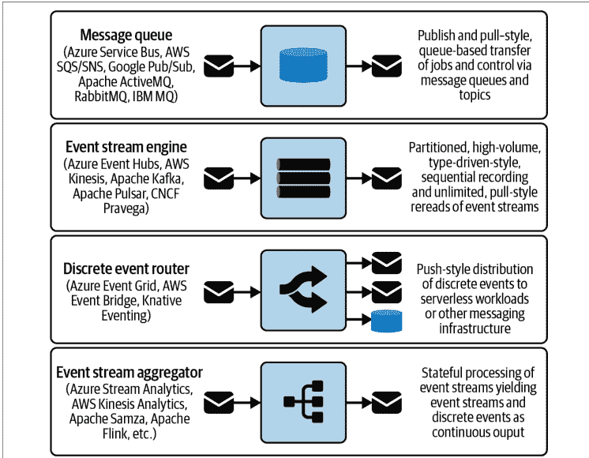

### 图 6-1. 不同的事件传递模式


像图 6-1 中提到的事件驱动平台和服务会将事件组织在一起，类似于文件在文件系统文件夹中的组织方式。它们各自为事件分组所用的结构使用不同的名称。例如，Apache Kafka 使用 *topic* 一词。Azure Event Hubs 使用 *event hub* 一词。Amazon Kinesis 使用 *stream* 一词。从抽象层面来看，这些名称都指代同一种模式。关键在于将逻辑上属于同一组的事件分组在一起。

大多数类型的事件代理与消息队列不同，它们在应用程序之间提供直接的数据管道或事件流。有些仅在服务之间路由事件，而其他一些可能会汇总并从经过的事件中学习。与事件流路由器不同，事件流聚合器会检查事件的内容。第三种事件代理是事件流引擎，它通过使用分布式存储功能来捕获持续的数据流。为提供可靠且有保证的消息传递，某些引擎依赖于消息队列，该队列存储并排序事件，直到消费应用程序可以处理它们为止。

## 事件处理样式

不同的 EDA 拓扑具有不同的事件处理样式，具体取决于其复杂性和用例。多种样式可以在同一架构中组合。

简单事件处理（SEP）是最简单的处理样式，因为它涉及处理与特定且可测量的条件变化直接相关的事件。过去的事件不会影响当前事件的处理。不会触发复杂的工作流。一个实际示例是传感器在发生变化时提交事件。

事件流处理（ESP）同时处理多个事件（消息）。与 SEP 相比，区别在于过去事件的状态可能会影响未来事件的处理方式。一个实际示例是股票交易，您分析一流定价数据并决定是买入还是卖出股票。

复杂事件处理（CEP）是最复杂的事件处理形式，因为需要进行分析以发现模式，从而确定是否发生了更复杂的事件。考虑的事件可能会在一段时间内进行评估，甚至可能来自多个来源。例如，您可以将多个流合并为一个流，然后在流上应用聚合操作来计算运行计数、平均值或总和。您还可以执行高级窗口操作，例如滑动和滚动窗口函数。实际示例包括实时欺诈检测、基础设施监控和告警、更新低延迟仪表板等。

## 面向服务架构与事件驱动架构

SOA 与 EDA 有何不同？或者这些架构样式是相同的？两者都旨在提高敏捷性，并倡导服务协议、服务可发现性、服务可重用性、服务抽象性和服务可组合性的设计原则。重大区别在于，EDA 通过允许数据复制来允许一定程度的数据不一致，而在 SOA 中，不一致性通过服务隔离来避免。SOA 倡导松散耦合原则，这意味着每个服务都是一个隔离的实体，对其他共享资源（如数据库、旧版应用程序或 API）的依赖有限。SOA 更侧重于命令，而 EDA 则强调事件。

实现事件驱动架构很复杂，涉及的内容远不止部署消息队列或事件代理。全面的 EDA 需要许多其他服务和组件来创建、收集、转换、存储和消费事件。为了更好地理解事件驱动架构的工作原理，我们将在接下来的部分中深入探讨不同领域。首先，我们将讨论 the

提供方一侧并了解事件是如何生成的。接下来，我们将切换到消费方一侧。最后，我们将连接两侧并了解如何大规模管理事件。

## 事件生产者

事件提供方一侧的源系统（通常称为*事件生产者*或*发布者*）通常不会自行流式传输数据或生成事件。在许多场景中，需要额外的集成组件来从数据源收集数据并执行协议转换或其他集成，例如将消息转换为正确的格式，或对其进行过滤、聚合或增强。事件创建可能发生在两个不同的级别：在应用程序或数据库中。有几种场景和选项可供选择。让我们看看一些众所周知的场景及其最佳实践。

### 应用程序生成的事件

在大多数情况下，应用程序不会自动生成事件和通知。因此，为了分发事件，您（作为开发人员）需要自行修改应用程序架构。根据您所面临的情况和应用程序，这些修改可能简单也可能复杂。让我提供几个例子。

对于生成或发送事件，通常需要额外的客户端库。例如，如果我正在开发一个使用 Express 编写的 Node.js 应用程序，需要将事件提交到 Kafka，那么最合理的选择是使用 KafkaJS 客户端库。但如果我需要将应用程序连接到 Azure 事件中心，那么我可能会使用另一个客户端库：适用于 JavaScript 的 Azure 事件中心客户端库。总之，您使用的语言、框架和中间件之间存在依赖关系。

发射或收集事件的另一种方法是直接捕获服务之间的流量。现代应用程序或 Web 服务可以这样设计，即事件直接由前端、用户界面或底层应用程序组件生成：例如，浏览器中的事件（如查看网页和将产品添加到购物车）可以通过 API 直接收集。⁴

事件还可以通过解析日志（如访问日志和服务器日志）来生成。在这种情况下，任何异常都会产生一个事件。在许多情况下，就像 Node.js 示例中一样，您将依赖额外的组件来启动并运行事件发布。

请记住，对于没有任何 API 开发的复杂或旧式应用程序，事件收集可能会出问题。假设您正在使用例如用 Visual Basic 6 编写的应用程序。您需要对应用程序进行现代化改造，或者使用底层数据库作为集成点。

### 数据库生成的事件

通过读取对应用程序数据库所做的更改来生成事件，是使用 API 或服务的替代方案。5 读取更改可以通过轮询、触发器或变更数据捕获（CDC）来完成。如您所想象，这种事件分发模型与事件携带状态转移有更紧密的关系。就像应用程序生成事件的场景一样，可能需要更多组件和进一步的工作。

第一种方法是使用数据库连接器的基于轮询的方法。通过反复运行查询（通常通过 Open Database Connectivity 或 Java Database Connectivity），将数据库表映射到消息队列或事件流。每次向表中插入新记录或更新行时，都会从表中获取该记录并将其传输到消息队列或事件流中。基于轮询的方法相对容易设置，但由于不断查询，可能会对数据库产生更高的负载。轮询的另一个缺点是，您可能需要对应用程序和底层数据库设计进行更改。例如，先决条件可能是一个额外的 updated_at 列，这是检测需要从数据库中获取哪些新行所必需的。

轮询的替代方案是使用基于触发器的方法生成事件。触发器是一段过程代码（如存储过程或数据库钩子），仅在特定事件发生时执行。例如，您可能有一个在每次向表中添加数据时执行的触发器。然后，此触发器会将记录移动到事件表或更改源，或者调用函数将数据发送到另一个组件。触发器的一个问题是，在数据库负载较重时可能会运行缓慢。另一个缺点是，并非所有数据库都支持触发器。

捕获状态的另一种方法是使用 CDC。6 这通过使用专用数据库工具并读取数据库事务或审计日志中的每一个更改来实现。基于 CDC 的工具对数据库的利用较少，因为它们不直接查询数据库，但在许多情况下需要其他商业或第三方组件。

直接从应用程序数据库捕获数据并不容易。许多应用程序是为操作工作负载设计的。它们使用复杂且高度规范化的
5 这种状态形式也称为资源状态，即服务器上资源在任一时点的当前状态。一些工程师区分应用程序状态（存在于客户端）和资源状态（存在于服务器）。
6 有关将 CDC 与 Azure SQL 和 Debezium 配合使用的示例，可以在 Microsoft 文档中找到。
数据结构以保证完整性。在这种情况下，可能需要更多的转换或抽象。您可以采用的一种最佳实践是使用视图或将处理后的数据版本写入另一个（临时）表。然后，您可以从这个新位置读取数据。采用这种方法时，您将禁止自己在后续阶段实时执行复杂的数据操作。

从这些不同的示例中我们可以得出什么结论？每个应用程序都有其独特的特征，可能需要定制解决方案或第三方组件。因此，对于数据管理，应用程序集成团队和开发人员与中央平台团队密切合作制定标准和最佳实践非常重要。例如，如果没有可用的连接器，那么中央平台团队应通过构建连接器并将其提供给其他领域团队来提供支持。

## 事件消费者

现在让我们切换到事件消费者一侧。在这里，变化取决于用例要求。消费模式很重要，因为它们直接影响其他领域的体验。在本节中，我将讨论几个（但绝非全部）场景。

使用消息队列或事件代理的头号原因，也是到目前为止最简单的用例，是通过中间通信层将一个提供方与一个消费方解耦。生产者发布消息，消费者为消费工作负载消费这些消息。一个实际示例是网站活动跟踪用例，它将事件发送到营销应用程序，以跟踪哪些客户访问了哪些网站。

一种简单的变体是多个消费者从单个生产者的同一事件流中消费。在此场景中，每个消费者维护自己的消息偏移量。这种模式称为扇出交换（fanout exchange）。一个实际示例是客户管理系统，它将所有客户更改分发到多个下游应用程序。

更复杂的情况是，操作系统希望通过使用一些云功能来增强其内部架构。为此，可以在云中部署基于函数的服务，并通过事件调用。该函数处理消息，存储结果（也许通过调用其他服务对其进行增强），然后将其发送回操作系统。这种模式也称为绞杀者模式（strangler pattern）。在此示例中，支持的函数或应用程序组件可以被视为（无服务器）微服务。

高级场景是使用流处理引擎或分析平台，分析来自多个事件提供方的聚合事件流并查找模式。将检查事件，某些事件的发生


在特定时间窗口内或在数据集中匹配到的事件可以触发另一个事件（也许会启动自动化操作，或通知一个或多个其他系统此次发生）。如前所述，在将数据存储到数据库之前查询和分析数据的模式被称为 *复杂事件处理*。许多高级流处理平台通过支持窗口函数（tumbling、hopping、sliding、session 等）来允许你执行分析。

7 Microsoft 对 Azure Stream Analytics 窗口函数有很好的介绍。

## 事件流处理与复杂事件处理

事件流处理与复杂事件处理之间的差异已由 Srinath Perera 在 Quora 上很好地解释。CEP 被视为 ESP 的一个子集（参见图 6-2）。根据你正在处理的问题和用例，其中一种可能更可取。

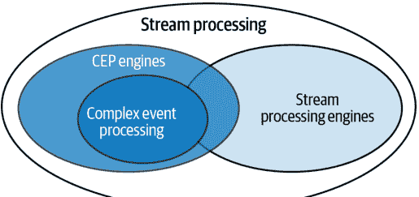

*图 6-2. 复杂事件处理是流处理的一个子集*

如果你需要分析按时间排序的单个事件序列，或需要创建处理图，则使用 ESP。但是，如果你需要并行分析事件，并使用更高级的查询语言，则使用 CEP。流处理引擎更侧重于查询数据（过滤、验证顺序等），CEP 引擎则更强调复杂分析，例如比较时间窗口、比较并查找不同事件之间的相关性等。

然而，正如图中中心的重叠部分所暗示的，这些差异正在逐渐消失，因为越来越多的流处理引擎正在借用 CEP 的功能。

另一种场景，以及使用流处理平台的不同方式，不是响应或监听事件，而是转移应用程序状态。在状态转移中，主要目标是保持数据同步，而不是对事件采取行动。这两个目标也可以混合；例如，事件携带状态转移模式通常与 CQRS 结合使用，我们在第 4 章中介绍过该模式。

从这些不同的示例中我们可以得出什么结论？首先，事件可能在应用程序之间通信，也可能在单个应用程序内部通信。因此，你需要考虑领域边界和可重用性等问题。其次，事件可用于分析或运营目的。分析事件或机器学习模型做出的预测可能会流回事务系统，用于运营决策。第三，每个用例都有独特的特征，可能需要定制解决方案。因此，你可能需要通过额外组件来补充架构，并为此创建指导。

现在，让我们稍微放宽视角，审视如何最好地支持事件生产者和消费者。

## 事件流处理平台

事件流处理平台是事件驱动架构的一个组件，可以由许多其他（子）组件组成（例如 CEP 引擎和事件代理）。事件代理至关重要，因为它们管理事件提供者和消费者之间不同的交互方式。事件流处理平台的核心组件专注于移动和处理事件或数据流。这包括接收消息并将其路由和发送到多个消费者。事件流处理平台与（例如）API 平台的不同之处在于，它们能够存储大量数据（状态），并通过其分布式功能防止数据丢失。随着数据流的到来，平台可以对其进行转换、组合、过滤或聚合。某些平台还提供复杂事件处理功能，因此你可以在消费者端或在流处理平台内进行分析。

正如你所见，需要处理众多的复杂性。在本节中，我将阐述连接不同领域的事件驱动架构内部通常包含的内容。我们将从一个简单的示例开始，并逐步展开。

## EDA 参考架构

为了仅在生产者和消费者之间分发事件，我建议使用流处理服务的轻量级架构。图 6-3 是一个示例设计，展示了一种无服务器的事件驱动架构，它接收事件流，使用函数对其进行处理，并将最终结果路由到其他代理以供下游消费。


图 6-3. 使用 Azure 事件中心和 Azure Functions 连接事件生产者和消费者的参考架构

查看此设计时，你可能首先会问，为什么在事件生产者和消费者之间有两个流处理服务和一个函数。首先，最重要的是，我建议通过一组事件代理来解耦提供者和消费者，因为并非所有事件生产者都能保证稳定交付并提供用户友好的事件。想象一下直接从 Web 应用捕获消息的情况。在这种情况下，某些领域可能会对其应用程序设计进行颠覆性更改。这些领域需要将事件映射回原始结构以保证稳定消费，或提供调用同一产品不同版本的方式。借助额外的流处理服务，领域可以发展并进行突破性更改，而无需与所有现有消费者测试兼容性。此外，你可能会遇到事件以对消费者来说过于原始或技术性的格式到达的情况。这个额外层允许提供者与消费者解耦。包含一组额外的事件代理还能实现未来场景，即消费者分布更广，可能位于多个区域。而不是要求所有消费者跨网络收集事件，你可以通过在每个区域设置一个事件代理，将数据更贴近消费者。


对于使用 Kafka 并需要转换服务的架构，我建议你查看 Decodable 或 ksqlDB，它们为在 Kafka 管道中转换数据提供 SQL 接口。

在图 6-3 中，你会看到接收、检查和路由事件的函数。这些函数不维护状态。这种模式的优点是你可以进行额外验证。例如，你可能希望对事件主体进行功能验证并检测任何潜在的重复项（使用我们尚未讨论的组件）。此外，你可能希望重新构建消息以提高可读性，或者在生产者进行颠覆性更改时将其映射回原始形式。函数允许你执行这些操作，而无需预配额外基础架构。

为了使你的架构更具自助服务能力，你可以考虑一种路由和映射由元数据驱动的设计。例如，可以添加一个配置存储，其中包含元数据，指示哪些事件流与哪些其他事件流相关。然后函数在处理事件时将从此存储中读取。你甚至可以通过实现一个小型控制框架来扩展此方法，以决定消费者允许查看哪些消息或属性。此外，你可能希望使用架构注册表来补充你的架构，以实现治理。此类注册表允许你在技术上验证消息，或根据某些业务标准（例如领域边界）将类似架构在逻辑上分组。

## 数据产品创建

让我们通过允许事件持久化，以便日后可以与批量数据处理相结合，来对我们最初的参考架构进行迭代。在图 6-4 中，我们添加了一个数据产品架构，用于持久化较长时间的数据。这样做的动机是允许为数据产品创建进行实时数据摄入。

使用此设计可以实现两种模式。第一种选择是在摄入时直接捕获事件。当你希望将事件与以不同速度到达的其他数据集成，或者计划进行临时分析或想要调试此数据以供未来分析时，这可能很有用。在此情况下，事件与提供应用程序的内部架构保持一致。你会希望制定原则，避免将此数据直接分发到其他领域，因为其结构可能对下游消费者来说过于原始/技术性。


图 6-4. 添加数据产品架构以支持事件持久化


为了保持简单，我在下一次迭代中将移除数据产品架构。不过，在实际中，我预期现代且全面的架构将结合本章讨论的所有功能。

将实时事件数据历史化的第二种方法是接入消费层。从逻辑上讲，此时数据已被建模成其他下游域消费的用户友好型格式。将流处理与数据产品架构的消费层相结合，能让各域更快地看到数据产品变化。因此，与每天（如批处理那样）不同，各域能够按小时或每15分钟更新其数据产品。8

## 事件存储

在下一次迭代中，我们将向架构添加事件存储，如图 6-5 所示。事件存储只是一个在事件驱动架构中存储事件的数据库。在执行查找或执行复杂查询时，该组件很有帮助。例如，设想一种消息必须与其他数据（如参考数据）进行丰富化的情况。事件存储将是检索这些其他数据的理想位置。


图 6-5. 向架构中添加事件存储

事件存储为查询数据提供了灵活性，并使信息能够存储更长时间。它们可以定位于提供端，扮演读取或命令存储的角色，也可以定位于消费端，扮演可查询数据库的角色。

事件存储中的消息在被消费后不会被删除。实际上，事件存储只是一条消息列表，随时可以从头开始读取——任何消费者都可以决定下一个处理哪个项目。这种机制支持这样一种场景：多个消费者可以各自以自己的速度处理消息。如果某些消费者想要重新开始或重新处理某些消息，由于事件存储，这也是可能的。在重放事件时，您可以修复、操作或丰富它们。例如，如果发现错误，您可以应用追溯性修复，然后将所有事件作为新事件重放。这种回放模式也可用于合并不同的事件流。

事件存储的一个不错选择是 NoSQL 数据库，例如 Azure Cosmos DB，如图 6-5 所示。NoSQL 数据库（尤其是文档存储）在处理、处理和存储非结构化数据方面更具灵活性。它们是无模式的，这意味着不会对进入数据库的任何数据强制执行数据结构。您可以使用关系数据库，但这要求您在任何数据进入数据库之前先预先定义关系数据模型。您也可以根据不同需求使用不同类型的事件存储。例如，您的架构可能包含关系型、NoSQL 和图数据库，以满足多样化的需求。

事件存储，就像我们在前一节中研究的数据产品架构一样，可以定位于架构的不同一侧。让我们来找出原因。

当我们将事件存储定位于架构的数据生产端时，它们保留的数据更接近某个域内部应用架构的形态。我们甚至可以将事件存储作为运营架构的一部分，例如，将它们用作 CQRS 的读取存储。在这种情况下，事件存储将扮演只读副本的角色，并可针对更快的数据读取进行优化——因此，您不再从运营数据库读取数据，而是从事件存储读取。这种应用设计将使您的应用程序更快且更灵活；例如，您可以独立缩放读取存储或命令存储，而无需同时缩放两者。

您还可以在运营架构中使用事件存储作为命令存储。这支持命令溯源，即在处理任何命令之前先将其持久化。这样做可以让您重放系统的完整状态。它允许您审计消息，查看发生了什么的轨迹，并在命令被处理前对其设置控制。

当将事件存储定位于架构的数据消费端时，您可以让消费者直接与另一个域的数据进行交互，而无需向运营应用发起回调。例如，这可以允许消费者执行复杂查询，而无需将其通过网络发送。您还可以允许各域根据自身需求塑造事件，对其进行转换并存储在其自己的事件存储中。

像 Cosmos DB 这样的现代 NoSQL 数据库提供的一个重要功能是变更源。此功能是事件驱动架构的关键推动因素，因为它支持更多设计模式；例如，您可以在每次数据进入数据库时触发一个函数。这意味着，您不再使用 worker 进程从数据库读取新数据，而是可以在数据进入数据库时即时验证或解析它。这种机制类似于将 ksqlDB 与 Apache Kafka 一起使用。

将云原生 NoSQL 数据库用作事件存储有利有弊。一方面，您用响应式能力增强了架构。您可以更轻松地处理事件并拥有可查询的事件存储。这是一个重要优势，因为它有助于保持架构的整体简洁性。另一方面，这些高性能数据库通常价格昂贵。这可能成为许多用例的阻碍。

我们可以用例如 Kafka 来替换云原生 NoSQL 数据库吗？可以，但 Kafka 并非旨在永久存储消息。与 Azure 事件中心一样，它更适合需要处理高数据摄入吞吐量，并将消息分发到多个消费者组（这些组希望以自己的速度消费这些消息）的用例。

在下一节中，我们将探讨一些更复杂的用例，这些用例依赖于具有分析功能的快速数据摄入和处理能力。

## 流分析

为了支持分析用例（复杂事件处理），您需要向架构添加额外组件。具体取决于用例要求，这些组件可能包括实时分析、可视化等组件。其中一些组件也具有分布式处理架构，以便它们能够处理大量数据。下面是几个示例场景：9

- 您分析并将事件直接推送到报告数据集中，以提供实时仪表板体验。一个实际示例可能是一个实时报告，显示在四小时时间范围内尝试从不同地理区域登录的所有员工。
- 您分析事件以用额外数据进行补充。例如，您可能先将事件路由到欺诈检测模型，为每个事件打分，然后再将这些事件路由回事件驱动架构以进行下游消费。
- 您通过从其他数据库读取信息来分析事件。例如，当客户申请新信用卡时，您可以查询其提供的身份证明是否仍然有效。
- 您在时序数据库中处理数百万条传感器数据记录，但在这样做之前，您首先想要清理消息并正确地为其添加时间戳。
- 您使用地理空间算法处理交通数据。为此，您将所有事件推送到高性能处理平台，例如 Databricks。

一个包含启用流分析组件的修订后解决方案设计可能如图 6-6 所示。流处理服务可以为事件生产者和消费者都带来巨大价值。可能性是无穷无尽的！

为了更好地管理您的架构，我建议使您的服务和平台与域无关。这一原则意味着，所有分析组件以及随之而来的相应业务逻辑，都必须定位于架构的提供端或消费端。您可以通过额外的分析服务来补充架构，但仅限于与域无关的功能，例如通用数据质量分析服务。


图 6-6. 向参考架构添加流式分析组件

关于事件驱动架构的讨论，我们可以得出什么结论？首先，有许多东西需要管理：用于分发事件的事件代理、用于查询数据或排队的事件存储、用于数据产品的摄取管道，以及将数据转化为价值的分析组件。如果您在架构中包含这些组件，就需要为各领域提供有关所有这些组件的指导。其次，您了解到存在两种边界：应用程序组件之间的内部应用程序事件流，以及不同领域中应用程序之间的通信。对于这两者，您都需要制定治理。

## 治理模型

让我们退后一步，看看事件提供者和消费者的治理模型。您的事件驱动架构应遵循用于向其他领域提供数据产品和 API 时所采用的同一模型。所有事件流（如事件流和队列）必须归事件提供者（数据提供者）所有。在跨领域共享服务，并将其用于应用程序内部和领域间通信时，事情可能会变得棘手，因为我们不希望其他领域的消费者拾取内部通信渠道。为避免这种情况，我建议在内部应用程序事件流和领域间事件流之间实行严格隔离。您可能还记得，我们在使用本地化存储解决方案将数据摄入数据产品架构的讨论中提到过这一点。

内部应用程序事件流和领域间事件流可以通过多种方法隔离。一种最佳实践是通过多个服务实现隔离：例如，登录区域中的服务保持与领域无关，用于领域间分发，而操作账户或订阅中的服务用于应用程序的内部架构。或者，您可以部署并共享一个专用平台，例如在数据管理登录区域中。在这种情况下，隔离的工作方式不同。使用专用事件流或事件中心是一种方法，或者您可以使用命名约定（例如，通过使用前缀将域名嵌入或将其作为队列或事件流名称的一部分）。另一种更严格的方法是使用消费者组、证书或多个集群来隔离事件流。

用于内部通信（例如两个应用程序组件之间）的事件允许是技术性的；它们不需要（目前）针对业务用途进行调整。这些事件的流称为 *internal streams* 并被视为应用程序或领域逻辑的一部分。这意味着它们只能由生成事件的应用程序领域消费，而不会被其他领域直接消费，尽管进入内部流的事件可以作为有意义的业务流的输入。您也可以对这些流的元数据政策宽松一些。例如，内部流可以在队列或事件流注册表中以较少的细节列出。¹⁰

¹⁰ *registry* 是注册所有队列和事件流的中心位置，包括所有权、版本控制、架构元数据和生命周期管理。

相比之下，领域间流只允许由其他领域消费。这些流也称为 *business streams*，已准备好进行业务消费，因此针对读取进行了优化。它们是解耦的，这意味着它们与先前版本保持兼容，并且在注册表中列出的详细信息多于内部流，以供数据消费者使用。它们应遵循第 2 章中的所有数据管理原则。

在接下来的章节中，我将介绍一些关于转向事件驱动架构的其他最佳实践。

## 事件存储作为数据产品存储

如果数据长期存储，流式平台能否用作数据库并充当数据产品存储？完全可以。借助事件溯源、状态存储以及现代流式平台的回放功能，可以创建持续注入新鲜数据的联合数据产品。消费者可以使用回放方法生成数据副本，即从头（第一条消息）到尾（最后一条消息）重新读取所有事件。回放后，他们可以使用流式处理将其数据副本实时保持最新。这种方法可以通过 CDC 来实现，即从应用程序事务日志中读取所有更改。

在长期持久化数据时，应确定在什么条件下流可以具有长期或无限（永久）的数据保留期。在没有监控的情况下实施更长的保留期存在一个风险，即架构可能会变得昂贵。您还可能违反保留和数据生命周期管理政策（例如 GDPR）。因此，需要一种控制形式。您可以设定的一项原则是仅允许保留最新或唯一的消息。作为替代方案，您可以将消息卸载到数据产品架构，使用更便宜的存储选项。

## 事件存储作为应用程序后端

中央流式平台能否用作应用程序后端？例如，Kafka 能否用作应用程序数据存储？理论上这是可能的，但我通常不建议这样做。

有几个原因。首先，流式处理本质上是异步的。对于没有延迟要求的应用程序，这不会成为问题，但仍需删除保留限制；否则，应用程序数据可能会丢失。其次，您会在应用程序与企业数据分发目的之间创建紧密耦合。这是两种不同的关注点，它们的治理不应混为一谈。

如果您确实决定将流式平台用作应用程序的后端，我建议就如何处理此类情况制定明确的治理。一种方法可能是为每个领域明确界定此模式的范围。另一种方法是为特定领域启动更多平台。将流式平台用作后端最大的风险是创建集成数据库。

同样的原则也适用于从其他流派生的流。允许其他消费者直接消费这些事件流，可能会导致事件流叠加、彼此指向的混乱网络。这些“意面式”轨迹通常源于缺乏控制和政策来指导团队使用平台。一个良好的原则是，强制消费者首先将事件摄入其应用程序，然后再将其立即摄入回流式平台。

## 流式处理作为运营支柱

在第 1 章中，我讨论了事务系统和分析系统协同工作得更紧密的趋势。事件流式平台是连接这两种系统的解决方案。其组件可实现以下功能：

- 通过一个内存系统扩展运营系统，该系统跟踪所有历史数据。每当运营系统需要更多历史背景来做出决策时，流式平台都会提供该历史数据。
- 通过实时决策逻辑扩展运营系统。例如，当客户购买新产品时，会查询财务系统以检查任何未结余额；流式处理用于促进此过程。
- 使用命令溯源来持久化命令并重放系统的整个状态。这允许例如将丢失的订单重新添加到列表并在以后执行。


在大规模构建运营异步消息传递系统时，您可能会遇到这种情况：系统在临时负载尖峰期间接收数据的速度高于其处理速度。这种问题称为背压，如果处理不当，可能导致资源耗尽，甚至在最坏的情况下导致数据丢失。处理此问题有不同的策略。添加额外资源是一种解决方案。另一种解决方案是在队列上设置限制，丢弃或将超过限制的消息存储在其他地方。

同一架构可用于构建一个由多种技术组成后端的运营系统。在此，流式处理可支持在不同数据库之间保持数据同步，或组合和集成数据。基于微服务的架构也通常依赖事件驱动架构。事件流式处理是允许微服务相互通信的模式之一。

## 保证与一致性

流式处理比批处理更复杂。如果批处理出错，您可以通过重新投递所有数据并重新运行批处理来解决问题。处理流式处理中的故障和不一致性需要牢记一些其他注意事项。

## 一致性级别

首要考虑事项是您希望在应用程序中应用的一致性级别（数据的完整性和准确性）。流式处理中有两种一致性类型：


## 最终一致性

该模型保证所有数据最终都会在平台中体现，尽管可能需要一些时间来传播。最终一致性是一种弱保证，可用于不关键的数据。

## 强一致性

该模型保证所有事件按顺序处理。平台确认对数据所有副本的任何更新都已传播；一旦任何实体或节点进行更新，所有副本都会被锁定，直到它们被更新。

提供强一致性可能很困难。如果事件速度过高，以至于流处理平台勉强跟上，那么设计系统以确保所有消息都能正确接收可能具有挑战性，甚至不可能。因此，强一致性施加的设计约束对于各种用例来说是不可接受的，使得最终一致性成为唯一可能的方法。在这些情况下，您可能需要采取额外措施以确保其正确。例如，可以使用额外数据库来持久化所有数据，并偶尔进行对账，以确保所有数据已正确同步。您还可以使用额外工具（如 CDC）来确保所有更改都被正确传递，或者可以构建额外服务，通过读取、验证和重新传递缺失消息来确保一致性。

## 处理方法

在最终一致性和强一致性模型中存在不同的处理方法。至少一次处理确保消息不会丢失，但不保证所有消息都是唯一且仅被传递一次。存在重复项以及事件被多次处理是可以接受的。

精确一次处理（也称为仅传递一次模型）保证每个事件被精确且仅传递一次。没有消息丢失，也没有重复项。实现此模型可能需要额外的重新传递模式。一些工程师使用额外标识符来验证每条消息的唯一性。

最后一种模型称为最多一次或无保证处理。在此场景中，不保证所有消息都会被正确传递。允许消息丢失或被多次传递。

您可以根据用例的要求和其他约束组合不同的模型。例如，最终一致性模型可用于初始传递消息而不确认收据，并且可以偶尔比较所有消息，删除重复项并重新传递缺失的消息，以确保它们已被精确且仅传递一次。

## 消息顺序

流处理的另一个典型挑战是消息顺序。在某些情况下，消息需要严格按顺序排列，例如按创建顺序。Kafka 允许您这样做，但仅限使用一个分区。如果您需要更多分区以实现可扩展性，则顺序必须基于消息中的附加属性，例如 row_no。这可能需要传递方在传递中进行一些调整。另一种方法是消费所有消息并在消费方对其进行重新排序。

## 死信队列

一些流处理平台有死信队列，这是用于未成功传递消息的附加队列。这些消息可能包括超过大小限制的消息、使用不正确消息格式的消息、发送到不存在的事件流的消息，或在设定时间范围内未被处理的消息。在这些情况下，消息不会从系统中删除，而是被放入死信队列。通常，开发人员需要手动检查出了什么问题。通常，问题在于提供应用程序的变更未经过彻底测试；在这种情况下，有问题的消息需要移动到原始队列或再次提交到原始队列。11

11 有关此主题的更多信息，请参阅 Ning Xia 的博客文章 “构建可靠的重新处理和 Apache Kafka 死信队列”。

## 流媒体互操作性

对于发布者和订阅者之间的接口，您需要做出一些技术和设计决策。一些平台规定提供应用程序必须如何连接到平台以及必须使用什么协议。其他平台更加开放，支持更广泛的消息协议，以允许多种编程语言之间的透明交互。一种中立且流行的选择是使用一种协议，该协议使用接口描述语言（IDL）对消息进行编码，用于数据格式和类型验证。

另一个选择是查看支持数据序列化的框架。数据序列化框架在接口之间移动数据时，在兼容性、版本控制和可移植性方面发挥着重要作用。从这些角度来看，这些框架负责将数据一致地翻译为标准化数据格式。翻译后，许多系统、编程语言和其他框架可以开始使用该数据。这些序列化框架还通过压缩和安全性（加密）等功能改进数据处理。这使得序列化非常适合将数据分发到数据产品架构。流行的序列化框架和协议选项包括 Apache Avro、Protocol Buffers、Apache Thrift、MQTT 和 AMQP。

从流处理平台生产和消费消息的另一种方式是使用支持 JSON 和 XML 消息的 RESTful API。12 这是在线渠道或 Web 环境的不错选择。JSON 的优势在于无模式且灵活，但它有一个主要缺点：它不强制执行兼容性，因为它不强制执行架构编码。因此，在消息灵活性和强制执行之间需要进行权衡。

## 治理和自助服务

事件驱动架构带有额外的元数据功能和要求。其中最重要的是事件流注册表（或架构注册表），用于以下目的：

- **所有权注册**

事件始终有所属。注册表跟踪事件所有权，还可以用于将消息队列和事件流分类为内部或域间。

- **架构文档管理**

建议管理所有消息的架构布局和文档。对于 XML 和 JSON，这些在逻辑上是 XML 或 JSON 架构。序列化格式（如 Avro）使用其自己的 IDL。记录和维护事件的建议是查看 AsyncAPI，这是一项开源倡议，旨在改善当前的事件驱动架构状态。为了统一管理所有架构和文档，首选方法是使用类似注册表的工具。

- **版本管理**

架构必须进行版本控制。如果未进行版本控制，将出现可能直接影响事件消费者的破坏性变更。对于管理架构版本，注册表是首选解决方案。

- **血缘**

不幸的是，事件血缘可能很复杂，并取决于所使用的流处理引擎。根据您的情况，您可能需要进行一些自定义编码或实现；例如，作为目录或数据治理解决方案的一部分调用 API。

通过自助服务改进目标操作模型时，EDA 的元数据变得至关重要。例如，您可能希望允许域自行重置其偏移量或预配队列和事件流，并自动批准这些请求。或者，您可能希望域自行设计自己的 REST 代理模板，并使用正确的安全策略自动部署它们。您还可以启用域在将消息传递给不同消费者之前应用数据过滤。我的建议是逐个启用这些模式，同时牢记自助服务。

## 总结

哇，关于事件的内容真多！我希望您现在能认识到它们的力量，但也能看到随之而来的复杂性。通过事件，我们可以连接应用程序、联合数据、数字化流程，并改善内部和外部通信。它们使我们能够了解系统如何相互反应，这有助于我们改善日常业务运营。

正如您所看到的，流处理很复杂。要持续捕获数据并将流摄入平台，您需要用许多额外组件来丰富架构。鉴于环境的复杂性和多样性，您最终可能会使用许多不同的工具集、框架和额外服务，例如，确保精确一次处理。我的建议是慢慢构建并制定几条基本规则：

- 标准化您为域团队提供的服务和平台。取得良好的平衡；有些工具和服务更专业，而其他工具和服务则尽可能全面。良好的架构是相互独立且共同穷尽的，因此它既全面，又不会在服务提供的功能之间有太多重叠。

- 为事件处理设定标准：事件按定义是不可变的，因为它们代表已经发生的事情。

- 让事件生产者负责数据摄取：他们的角色是保证“至少一次”传递。另一方面，消费者应保证“最多一次”传递。

- 隔离事件流：每个服务必须拥有来自特定域的事件流。

- 在跨域边界移动数据时，倡导最终一致性。

- 谨慎处理业务逻辑。尽可能保持用于域间通信的平台和服务与实现无关。

- 努力在内部应用程序和域间分发之间实现清晰的分离。跨越时应用前几章的所有原则。


边界。例如，在跨越边界时，你的消息应基于领域的通用语言。

- 从一开始就关注自动化。假设事件分发成功，你将需要管理数百个甚至数千个事件流。为了使架构可扩展，请为所有事件定义架构，并采用合同优先方法。

- 隔离事件、通知、查询和命令。你可能希望为每种制定原则：例如，查询必须保持系统状态不变，或者命令必须创建、更新或删除一些数据。命令必须明确保持在事务边界内。将处理命令的关注点分布到多个应用程序中的最大风险之一是，一致性或事务完整性不再能得到保证。此外，命令可能会被拒绝或进入死信队列。如果发生这种情况，你可能希望得到通知。

- 考虑在服务之上构建包装器，以简化工程师的复杂任务。

审视这些原则时，还有一条最后的说明需要你考虑：基于事件的架构很复杂，只有在为组织带来显著价值时才有用。我经历过许多情况，其中使用了事件驱动通信，但并不需要速度。因此，作为组织，你可能希望围绕验证流式处理不是虚假需求制定一些原则。业务价值应证明所增加的复杂性是合理的。

在本章中，你学习了关于连接应用程序以及如何在它们之间分发数据的大量知识。在下一章中，我们将重新乘坐直升机，爬升到更高一级，以便俯瞰所有数据分发和应用集成模式。我们将从过去三章的简要回顾开始，连接各个方面。之后，我们将探讨面向变更的企业架构。请注意，我们将在不同主题之间快速切换。这可能会引起颠簸。祝飞行愉快，旅途愉快！
