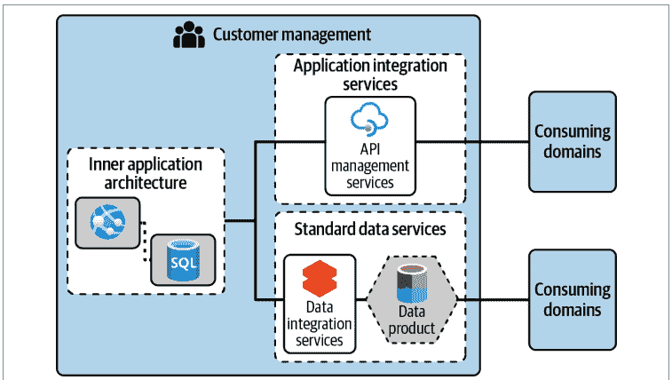
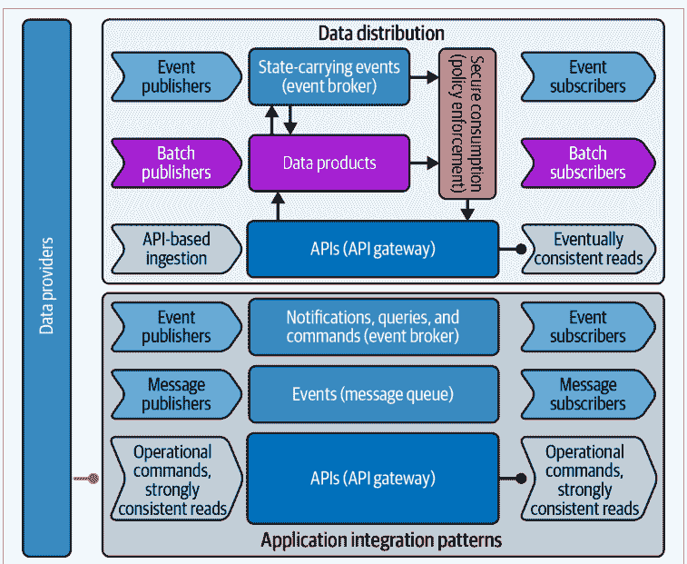
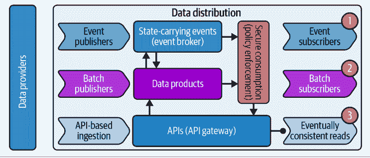
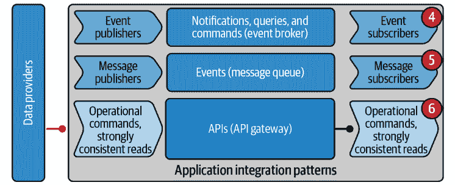
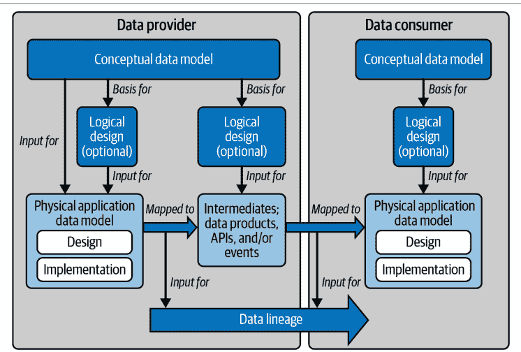
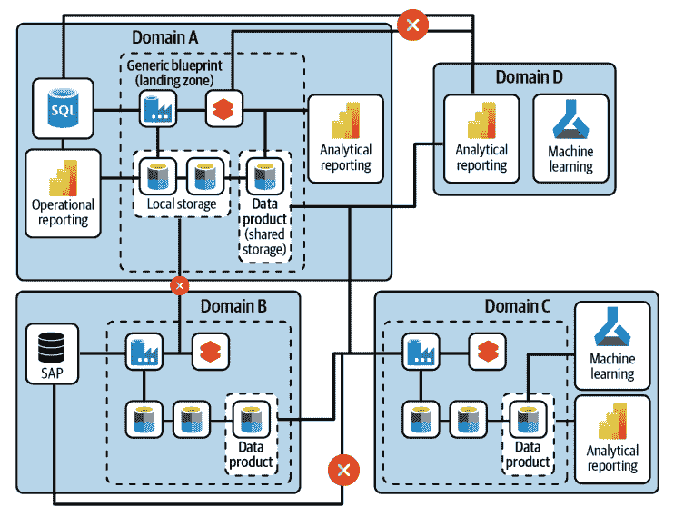
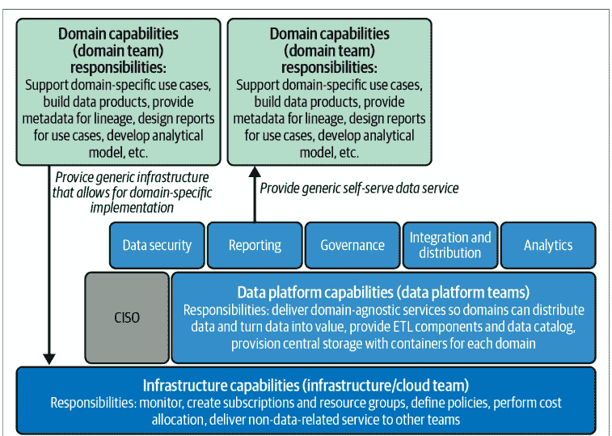
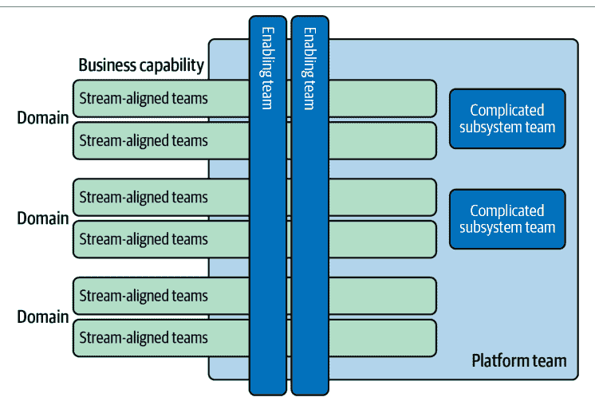

# 连接各点

是时候进行一段短暂的间奏了。前三章篇幅较长，内容密集。你了解了连接应用程序的数据分发和集成模式。我们深入探讨了各种模式和管理不同架构的注意事项。你还了解了采用更统一或更全面的方法来管理数据和集成。

现在，我将连接各点，并讨论将架构作为一个整体来管理，首先简要回顾跨领域互操作性、数据分发和应用集成。从那时起，我们将在不同主题之间跳转：选择一种集成模式而非另一种时应评估的标准，你可以进行哪些组合，以及在哪些场景下效果最好。你会发现，在文档、设计、治理、元数据管理、安全性等方面的最佳实践有很大重叠。接下来，我们将转换思路，探讨如何激励、推动并指导变更。我们将从如何正确管理跨领域边界开始，讨论一个具体的解决方案设计。然后，我们将探讨如何追求发现和语义一致性，以及如何在这样的架构过渡中正确引导团队。最后，我们将研究组织转型：领域团队和平台团队应如何交互，以及你可以从中吸取哪些教训。本章结束时，你应该对管理大规模数据分发和集成环境有扎实的理解。当我们开始通过增加更多数据管理领域来扩展环境时，这些知识将很重要。

随着本章的推进，我将分享更多关于在面向变更的架构设计中企业架构应扮演的角色的个人经验。作为首席架构师，我负责定义技术设计标准、指南和未来状态架构。我还主持架构评审委员会（ARB）来管理企业架构治理流程。我的经验告诉我，你可以利用这个机构与利益相关者建立联系，并为必须完成的工作创造热情。此外，我对组织环境中的所有力量和周围环境有很好的概览。所以，继续阅读时，期待更多示例！

## 跨领域互操作性

在过去，数据和集成的分类很简单：运营侧和分析侧之间有明确的区分。运营侧专注于事务处理、流程集成和共享功能（业务逻辑）。分析侧专注于在不同（分析）应用程序之间共享相同的应用程序数据。每个侧都有自己的架构，导致模式、用例、指南、人物角色和技术方面的差异。我认为这种差异是一个问题，因为维护应用程序的人通常与构建数据产品和 API 的人是同一群人。为了说明我的观点，请看图 7-1。数据产品源自的底层架构与 API 访问资源的架构是相同的。

图 7-1. 数据产品和 API 的底层内部应用架构是相同的

用于应用程序开发输入的上下文或通用语言也是如此。数据产品、API 和 事件 都从同一领域上下文中继承其语言。因此，考虑到重叠，将运营平面与分析平面分开管理是否仍有意义？我主张采用更全面的方法来管理两者，这始于协调管理数据和集成的关注点。在我们深入探讨共同管理数据产品、API 和 事件 的概念之前，先快速回顾一下迄今为止所学的内容。

## 快速回顾

在第 2 章中，我们开始从高层概览领域如何与其他领域通信。你了解到，内部领域和应用程序复杂性必须对其他领域隐藏，并且领域应公开标准接口以简化他人的工作。在第 3 章中，你了解了领域拓扑，并发现领域可以通过着陆区和蓝图获得支持。

在第 4 章中，你了解了当今的数据驱动世界以及对读取优化数据的强劲需求。数据产品就是为此而生：它们可以高效地反复读取相同的数据。你还了解了 CQRS 以及仅为读取制作数据副本的方法，该副本会同步更新。这意味着你不会提供事务应用程序中所见的最准确数据，但它允许数据消费者进行高强度读取。

接下来，在第 5 章中，你了解了 API 管理。API 旨在用于实时同步通信，可用于旧系统与现代应用程序之间的通信。这是你需要用于事务查询或强一致（准确）数据的模式。

最后，在第 6 章中，我们探讨了事件驱动架构，通过该架构可以实时转换数据并通知其他应用程序有关更改。事件流不是对话，而是一个向监听器发送数据的单向通信通道。与其问“我可以从应用程序中请求或拉取哪些数据？”，该模式是“哪些经过的数据对我有用？”通过流式处理，你可以快速响应数据。

尽管数据产品、API 和 事件 的底层架构不同，而且大多是为不同目的构建的，但它们也相互重叠并可以结合。一方面，这很好，因为它提供了灵活性；但另一方面，这使得为工程师和架构师开发设计变得更加困难，因为需要权衡许多权衡和注意事项。在下一节中，我将提出一种设计，为开发有效的解决方案设计提供最佳实践。之后，我将分享作为大型企业的首席架构师工作时在这方面学到的一些经验教训。

## 数据分布与应用集成

在将数据平台和集成服务与您的领域对齐时，我建议就何时应考虑不同模式制定架构指南。为此，我建议为数据和集成项目创建一份战术蓝图，如图 7-2 所示。该图汇总了前几章讨论的所有主要模式。不同的模式相互补充；我们稍后将详细讨论此问题。

图 7-2. 每个企业集成中间件实现都提供一组设计模式，以解决复杂的数据和集成挑战

如您所见，有一种用于数据分布的架构，另一种用于应用集成。这是因为这两种架构传统上关注不同的问题。数据分布是关于使数据可用，在应用程序之间移动数据。另一方面，应用集成是关于集成和连接应用程序，包括应用程序组件。数据分布和应用集成在组织管理方式上有所不同。应用集成作为 DevOps 的一部分进行管理，DevOps 专注于企业软件开发。数据集成由 DataOps 处理，DataOps 更侧重于数据的管理和编排。

当深入研究数据分布和应用集成时，应根据您的用例或工作负载的特征考虑不同的模式。在接下来的章节中，我将通过更深入地讨论数据分布和应用集成模式如何协同工作，进一步阐述图 7-2。我们将从数据分布开始，然后查看应用集成。之后，我们将探讨如何最好地管理数据分布与应用集成之间的重叠部分。

## 数据分布模式

一般来说，当您需要合并和分析数据时，会使用数据分布模式——例如，在开发数据密集型应用程序、执行数据可视化或临时查询、开发机器学习模型、构建数据挖掘应用程序等场景中。这些模式也可用于为事务处理移动批量数据，例如当应用程序需要处理一系列订单或发票时。所有这些用例的共同点是，可以通过使用最终一致性读取来进行扩展。这意味着您使用应用程序数据的副本（即所谓的数据产品）。

在为您的用例考虑数据分布模式时，有两个问题需要考虑。首先，您应该评估进行操作更改到其在读取中反映之间可接受的延迟。例如，需要每日结束数据的应用程序与要求在一分钟时间窗口内交付数据的应用程序有不同的要求。其次，您应该评估是否需要定期（例如，每月末）对账或审计。如果需要此过程，我建议使用面向批量的数据处理模式（图 7-3 中的模式 2），因为它通常更便宜且更容易实现。批量数据处理在处理一段时间内收集的大量数据时非常高效。

当需要速度时——例如，当对操作系统的更改和分布式数据必须在几分钟或几秒钟内反映给消费者时——则应考虑近实时模式。您可以为这些用例使用基于 API 或基于事件的摄取和消费。选择是微妙的，因为可能存在与您要从中收集数据的应用程序底层设计的依赖关系。当提供者或消费者希望启动摄取或消费时，基于 API 的模式（图 7-3 中的模式 1）可能是正确的解决方案。当状态转移是响应式时，基于事件的模式（图 7-3 中的模式 3）可能是一个不错的选择；例如，使用变更数据捕获时。

图 7-3. 数据分布模式

如图 7-3 所示，基于 API 和基于事件的摄取还可以补充数据产品创建和基于批量的消费。例如，想象一下，您使用流式平台传输应用程序状态，以同时填充多个数据产品。在构建跨多个网络或云位置的分布式数据产品架构时，此模式很有用。在分发对缓慢变化维度（SCDs）的更新时，您也可以结合数据产品和事件。处理 SCDs 时，您可以例如使用变更源（change feed）检测数据中进行了哪些更改，并为这些更改生成事件。您了解的另一种模式组合是混合数据产品和 API，以将查询流量路由到数据产品，将命令流量路由到操作系统。这种命令查询责任分离（CQRS）模式对于降低 API 调用给操作系统造成的负载很有用。这里的关键收获是，不同的数据分布模式可以相互结合以互补，为数据消费创建一套全面的工具包。

## 应用集成模式

现在让我们转到应用集成架构，该架构适用于速度和更强一致性至关重要的情况。如前所述，应用集成模式专注于使各个应用程序（每个都为其特定目的而设计）能够紧密协作，以解决特定用例或业务问题，例如执行事务、订购产品或在操作过程中验证客户准确性。在这些情况下，您希望直接从系统记录中检索信息。API（图 7-4 中的模式 6）正是擅长这一点的地方。它们是强一致性读取和直接调用命令（即同步通信）的好选择。这种模式可实现两个应用程序之间的直接通信，API 网关位于这些应用程序之间，作为调解的薄层。

图 7-4. 应用集成模式

对于异步用例，请考虑不同的模式：事件代理和消息队列（图 7-4 中编号为 4 和 5）。为什么更喜欢异步通信而非同步通信？因为它使您的架构更具弹性且更具成本效益。异步通信并非在每个场景下都有效，但当没有时间紧迫性时，它相对于同步通信具有多项优势：

- 网络问题，例如高延迟和低吞吐量，对异步通信没有或只有最小影响。
- 异步通信具有弹性；如果负载增加，可以更轻松地进行扩展。
- 异步通信使应用程序通信对临时网络故障更具鲁棒性。
- 使用异步通信，您可以实现重要功能以提高弹性，例如重试机制、回退场景以及停止级联效应的熔断器。

异步通信也有几个缺点。因为通信不是实时发生的，所以如果出问题，调试和调查会更加困难。当请求/响应调用失败时，您通常会立即注意到。更何况，如果异步系统长时间故障，它可能会产生自己的一套新问题。异步通信还可能需要额外的应用程序组件。例如，您可能希望保护异步消息流，并使用死信队列或熔断器来避免丢失消息的风险。

- 熔断器是一种用于检测故障的设计模式。它封装了防止故障不断重复的逻辑。

API和事件也可以组合用于应用程序集成目的；例如，在API因太多并发请求而被淹没的情况下。这可能导致服务失败，因为过载阻止了它们及时响应请求。要解决此问题，您可以组合API和事件来创建一个充当缓冲区的队列，用于保存发送到API网关的请求。此模式也称为*基于队列的负载平衡*。

设计良好的应用程序集成方案是一项复杂的任务，因为可能存在多种可能的“正确”和互补的解决方案。这通常是在不同维度之间进行权衡：性能、可维护性、灵活性、成本、弹性等等。这些考虑可能要求您深入了解正在尝试解决的业务问题。

虽然数据产品、API和事件用于促进不同的场景和用例，但在同一边界内使用所有这些模式时，领域上下文存在重叠。我们在审查图 7-1 时已经发现了这一点，其中同一应用程序同时用于数据分发和 API 连接。这一观察自然过渡到语义一致性和可发现性的话题。

## 一致性和可发现性

在协调所有集成和数据服务时，您还希望保障数据和应用程序集成的一致性。这要求所有领域记录其应用程序数据和接口模型。不仅必须描述良好，最重要的是，所有数据属性*必须*连接到业务数据字典中的同一组元素。

捕获上下文和含义很重要，因为不同领域之间的数据和集成服务可能存在语义混淆。术语可能有不同的含义，因此将每个数据元素与正确的领域相关联并了解其含义、来源以及物理存储位置至关重要。在本节中，我将分享一些关于此的最佳实践。但首先，我想提醒您不同模型之间的关系。

在第 1 章中，我介绍了设计的三个阶段，每个阶段都由一个数据模型表示：概念模型、逻辑模型和物理模型。概念设计表示业务的实体和元素；逻辑应用程序数据模型是整个应用程序（包括其数据存储）的表示，包含实体、实体名称、关系和属性；而物理应用程序数据模型描述实际实现的设计。在理想情况下，每个层都继承自上一层，形成链接模型，因此每个人都了解业务概念如何转化为现实世界的实现。

在实践中，许多工程师跳过逻辑建模步骤。有些工程师认为这适得其反，因为当今大多数模型使用 NoSQL 架构设计或非规范化数据结构。尽管它们的受欢迎程度有所下降，但逻辑模型作为“现代”数据建模实践的一部分正在重新出现。要了解有关逻辑建模的更多信息，请阅读 Joe Reis 和 Matt Housley 编写的《数据工程基础》（O'Reilly 出版）。

将三模型方法投影到数据提供者和消费者时，如图 7-5 所示，概念模型是第一（顶层）模型：它们用于组织业务上下文。业务词汇表可以是此类模型的起点。逻辑模型源自概念模型。它们表示逻辑设计；例如，数据库设计和接口模型。

在提供者端，您可以看到应用程序和接口都基于领域的概念数据模型。在数据分发过程中，上下文（例如业务术语）不会改变。向其他领域提供数据时的唯一区别是，暴露的内容通常是整个业务上下文的一个子集。预期共享的上下文子集在数据提供者的所有底层层中都是相同的，如图 7-5 所示。

图 7-5。理想情况下，概念、逻辑和物理数据模型的属性都已连接；因为数据产品中的数据源于提供者端，其属性也将链接到提供者的概念数据模型。

如果存在，逻辑模型通常存储在数据建模或设计工具中。最好为每个实现提供到概念数据模型的实体或业务术语的链接。描述实际实现设计的物理应用程序模型和接口模型，应存储在创建这些设计的环境中。如果设计缺失，我建议您扫描数据源并捕获名称、文件大小、列等技术元数据。例如，您可以将所有这些信息存储在数据目录中。

连接数据模型时，必须注意相同的语义数据可能有多种表示形式。如果发生这种情况，领域应将所有技术属性映射到相同的相应业务元素。例如，数据产品可能在不同的文件格式中存储相同的语义数据。

在消费者端，您也有概念、逻辑和物理模型。与提供者端的一个区别是不存在接口模型，因为数据直接转换并集成到目标应用程序设计中。另一个区别是上下文已更改，因此与提供者端相比，各种类型的模型预计将具有更新和丰富的对象。

在理想状态下，所有模型都已连接。我的建议是，将概念数据模型中的所有业务概念和关系集中捕获并存储在数据目录或知识图中，将它们链接到数据产品、API 和事件的逻辑实体元素（可以存储在另一个存储库中），最后根据物理接口模型的（架构）元数据验证一切。连接模型没有简单的解决方案。为了达到理想状态，您需要选择或开发工具，并合并和集成元数据。您可能希望从目录、存储库或文档门户开始；在进一步推进时，应以一致性为目标，并寻求跨所有架构模式的上下文中异同点的洞察。为此，您需要将数据建模存储库和数据、API 及事件的目录更紧密地结合在一起。

如果您认为集成元数据过于复杂，可以先使用数据目录务实地开始，并继续将目录中的元素直接链接到物理层上的属性。这种方法将提供一些关于哪些实现输入了哪些业务上下文的洞察。随着进度的推进，请考虑为您希望与已管理的元数据相关联的数据管理信息设计语义模型。第 9 章提供了关于此主题的更多信息和示例。

正如您所了解的，数据发现和语义捕获是复杂的主题。为了避免陷阱，请考虑以下建议：

- 选择正确的数据建模方法对于元数据收集和端到端洞察至关重要。因此，请考虑与数据产品和集成团队共同制定数据产品建模和元数据标准。此练习的一部分是选择相应的工具。此外，请考虑建立内部社区，分享关于如何实践数据建模的经验和技巧。

- 为了实现模型之间的一致性，请考虑对元数据实施数据质量控制。例如，根据应用的控制和数据治理程度，您可以验证所有物理属性是否已映射到业务术语。如果不是这种情况，您可能希望阻止提供者发布数据或接口。此外，您可能希望报告覆盖率，以显示哪些领域做得好或不好。

- 不要等太久才设计您的数据管理元模型。这将帮助您了解实体应如何分组以及如何相互关联。它还将帮助您选择合适的工具。例如，一些公司完全依赖逻辑设计来进行元数据驱动的应用程序设计自动化部署。此类组织可能需要更高级的工具或与其他元数据服务更好的集成。

- 考虑安全和隐私问题。出于合规原因，您可能需要对敏感数据进行分类和标记，并实施基于策略的强制执行。第 8 章将提供关于这些主题的更多注意事项。

- 就您的数据建模和发现能力进行沟通并保持透明。重要的是要提供关于数据发现如何工作以及如何帮助其他领域更快地查找和使用数据的教育。演示和培训课程至关重要。指南和实施工作簿对成功也至关重要。

- 为数据管理信息模型的元素考虑一个定义良好的分类法。如果经常使用的术语（如 _实体_ 或 _属性_）的定义含糊不清，这不会促进一致性，并使团队成员之间的沟通变得困难。

问题通常不在于数据本身的可用性，而在于数据质量和结构、缺少上下文信息等问题，这些问题可能会影响您的领域团队提供真实业务价值的能力。为避免这些陷阱，请提前制定数据建模、数据发现和语义一致性的策略和最佳实践；建立明确的治理，界定谁负责维护哪些元数据；建立验证元数据质量的控制流程；并建立一个流程，以确保所有数据建模元数据保持最新。

如前面的建议所表明的，标准化、企业指导以及向域团队进行一致的沟通是您架构的重要方面。这自然引出了本章的第二部分，我将在其中分享作为企业架构师所获得的最佳实践。

## 为变革提供启发、激励与指导

实施变革并选择合适的模式并非易事。因此，为了支持您的域团队开发解决其问题的方案，我推荐以下最佳实践：

- 考虑为您的域架构师提供设计会议支持，他们可以在会议中提问并微调其设计。与企业架构师、解决方案架构师、技术架构师和业务代表等其他参与者紧密协作来组织这些会议。数据和集成是复杂的主题，并非每个人都能对现有和未来的情况进行准确评估。组织随到随用的会议，指导、培训和辅导架构师提升技能。

- 考虑开发一份包含架构师和开发者可供选择的模式的手册。对于每种模式，描述其特性、成熟度阶段、推荐的技术服务、注意事项以及优缺点。您还可能希望为不同角色开发不同版本的手册。例如，应用开发者的需求可能与必须监督更大范围架构的企业架构师不同。

- 发布一份可用的获批技术服务和产品的官方列表。将这些服务和产品中的每一个与您手册中的模式关联起来。

- 考虑调整企业架构控制流程，以确保架构师做正确的事情。作为一名企业架构师，我曾建议在解决方案意图模板中增加一个数据与集成章节。² 通过此调整，所有域架构师都必须在其解决方案提案中描述其数据和集成模式。这些提案随后提交给架构设计机构（一支具备相关技能和经验的专家团队，用于批准这些提案或引导架构师朝正确方向发展）。

2 解决方案意图是规模化敏捷框架的一部分；它描述了解决方案的当前和不断发展的需求、设计以及意图（或更大的目的）。

- 设立能力中心以共享设计决策和实现说明。此类能力中心应专注于辅导和实施活动，并提供清晰的文档、用例示例、说明和代码示例。例如，Zalando 的 API 指南文档是一个活跃的开源文档，可指导开发者并使他们更容易协作。

在为变革进行架构设计时，您会遇到平台和服务尚未准备好进行（稳定）消费和使用的情况。在这种情况下，考虑短期决策的长期影响很重要。例如，与大型复杂解决方案相比，简单的新解决方案日后可能更容易迁移。尽量做出日后不会后悔的决策。您还可能遇到需要例外情况或并非非黑即白的情况。我们将在下一部分中了解其中的一些情况。

## 设置域边界

在尝试决定哪种数据分发和应用集成模式最适合您的需求时，域边界设置得清晰很重要，如第 2 章中所讨论。然而，设置精确的边界并非易事，因为这需要达成共识。决定将某些业务逻辑和抽象放在哪里也可能很困难，因为某些功能和数据转换并不清楚地属于提供方或消费方类别。您的决策应基于知识、经验和常识。

让我们先从您必须设定的明显原则开始。在第 2 章中，您了解了解耦业务能力：在限定上下文内允许紧密耦合，但跨越域边界时，所有接口都必须解耦。图 7-6 展示了一种将所学内容付诸实践的解决方案设计。在此图中，您看到四个域在分发数据。其中两个与源系统对齐，两个与消费方对齐。请注意，我们使用来自数据登陆区的通用蓝图来提供标准化服务。这使得数据分层方式和数据产品的组织方式保持一致。这种设计对数据进行分层，使域在管理作为数据产品创建输入的本地数据方面具有灵活性。然而，数据产品本身是通过集中管理的存储服务分发的。

让我们进一步放大，看看还能做出哪些观察。

图 7-6. 显示域边界、允许什么集成以及必须禁止什么的解决方案示例

对于域 A 和域 B，请注意，其他域不得直接访问运行中应用程序的内部架构。不允许分发数据产品架构中的原始输入数据。接下来，请注意，有两种报告类型：运营报告和分析报告。运营报告直接使用运行系统来获取对最新、最准确数据的洞察。它通常延迟较低且数据量不大；系统的主要目标是运行。另一方面，分析报告可以更深入地组合和查询数据，因为数据已经被复制。

域 C 是消费方：它使用其他两个域的数据产品。它还使用来自通用蓝图的数据服务。这是因为需要额外的转换步骤。数据提供方的数据产品不满足域 C 的精确要求，因此数据首先进入该域的数据产品架构，在那里被定制为消费方特定。域 D 是另一个直接使用数据产品的消费方。其架构看起来很简单，因为它具有虚拟化数据访问，可以在不复制数据的情况下整合数据。

在讨论提供方或消费方特定的转换时，一个难题是如何管理必须映射到另一端参考数据的业务逻辑或参考数据。例如，如果参考值详细且经常更改，数据消费方将难以跟上变化。对参考数据的每次更改都会影响数据消费方。因此，提供方和消费方必须就适当的粒度级别达成一致。数据提供方可能需要抽象或汇总详细的本地参考数据，使其成为更通用、与消费方无关的版本，该版本更稳定且变化不那么频繁。

在设置边界时，还要注意您为域团队提供哪些服务和平台。域内边界和跨域边界的指导会有所不同。让我举两个例子。首先，API 网关可用于促进应用程序组件之间以及跨域之间的通信。网关甚至可以是同一产品或 API 管理平台。然而，跨越域边界时，互操作性会有所不同。在应用程序边界内，您可以放宽原则，因为依赖关系范围明确。例如，您可能允许 API 具有技术性、缺少版本且不使用适当的响应代码。另一方面，在跨越域边界时，您的接口必须解耦并针对轻松消费进行优化，因为跨域依赖关系更难以管理。其次，您可以为内部架构设计和开发允许更大的灵活性和更多技术选择（例如，附加服务和产品）。例如，您可能允许将特定软件套件附带的 API 网关产品用于内部应用程序通信，但不允许在与其他应用程序对接时使用。

## 异常处理

是否存在不应该为域或应用程序使用标准化集成服务的情况？是的，但只有一个。关于使用点对点接口进行跨域互操作性的规则的唯一例外是延迟关键型应用程序，如果它们通过中间集成组件（例如 API 网关）进行解耦，则无法满足延迟要求。例如，在银行业，对支付处理速度有严格要求。总处理时间通常必须低于 100 ms。在这个时间范围内，需要检查许多事项：付款是否唯一？我们是否正在处理同一笔付款两次？账户持有人是否有资格提交付款？付款可能是欺诈性的吗？接收方是否被允许接收此付款？如果通信应用程序通过例如 API 网关进行解耦，域间延迟将增加，100 ms 的时间限制可能会被超出。点对点连接解决了这个问题。但是，即使您需要打破这一条规则，我建议您遵守设定的所有其他标准。因此，如果需要血缘元数据，请不要允许

偏离这一原则的点对点解决方案。API 设计和文档亦然；即使没有 API 网关，各个领域仍有义务履行其数据管理职责。

向全面的集成和数据架构过渡并非易事。这需要许多不同的团队密切协作并做出正确的选择。在下一节中，我将回顾涉及的参与者及其交互方式。

## 组织转型

数字化转型很难，因为它需要对技术、流程、文化和组织对齐进行变革。这是一个以人员和实践为核心、将技术作为推动变革的催化剂的演进过程。实施数据管理能力也是如此。它始于一个愿景，一幅拥抱更完整、更全面方法来推动变革的全面图景。在制定这一愿景和整体抽象设计时，通常由首席数据官牵头。设计完成后，实施可以启动，作为正式项目或计划开始。

在项目层面，实际落地数据管理能力时，通常涉及三个参与者：

- **领域团队**

领域团队通常由业务所有者（数据、领域或产品所有者）、应用所有者、软件开发人员和数据工程师组成。这些团队应就各自的需求进行清晰沟通。根据组织规模及其技术专长程度，团队的自主程度可能会有所不同。除少数例外外，领域团队负责维护其业务应用程序、数据库和数据管道，并交付或消费正确的数据集。

- **中央数据平台团队**

中央数据平台团队专注于发展核心数据能力。它通常既是开发团队，也是运营/站点可靠性团队。中央数据平台团队的主要职责是为领域团队提供数据驱动的能力。它还应交付最佳实践、支持、CI/CD 能力、自动化测试能力、预配工具以及 ETL 组件等管道工具。

- **中央基础设施（云）团队**

中央基础设施团队负责管理物理硬件并评估支持各个组织单元的所有技术服务。在向云过渡期间，该团队的角色发生变化：它是主要的推动者，负责评估服务并将其提供给其他团队。此外，该团队负责通过制定企业策略来确保所有解决方案都具备设计合规性。

图 7-7 考察了这三个参与者之间的关系。在底部，你可以看到中央基础设施团队。回顾一下，其职责是为组织中所有参与者提供一套广泛的通用基础设施相关服务。当数据平台团队开始构建数据平台时，它将与基础设施团队密切合作以启用数据相关服务。基础设施团队将关注成本、审计、控制、可维护性等方面，3 而数据平台团队则专注于将通用服务转化为易于使用的自助式数据管理能力。平台团队有时扮演经纪人的角色并原样重新交付这些服务，但更常见的是，平台团队集成、修改或组合服务，旨在提供更好的体验。

图 7-7. 运营模型，展示领域团队、平台团队和基础设施团队如何协同工作

3 基础设施团队也可能自行使用服务，例如，用于监督和控制所有 IT 服务。该团队使用的服务有时被称为 IT4IT 服务。

在图 7-7 的顶部是领域团队。其职责是基于其领域专长提供领域专业知识，并构建支持业务流程和目标的服务。领域团队既可以与中央基础设施团队交互（例如，当他们需要预配虚拟机时提出通用 IT 请求），也可以与中央数据团队交互（当他们需要机器学习等数据服务以用于其业务解决方案时）。

企业架构师是跨团队交互的驱动力：他们知道如何“乘坐电梯”；4 他们保持顶层（定义业务战略的地方）与引擎室（构建软件的地方）之间的连接，并发现并消除潜在障碍。与领域架构师通过引入相关领域经验来领导领域团队不同，企业架构师通常具有更广泛的范围：他们连接业务与技术之间的各个点。

我经常被问到，基础设施团队和数据平台团队是否需要是独立的部门或逻辑单元。我不觉得这有必要。基础设施和数据是两个不同的关注点，完全可以分开管理。然而，当两个团队密切协作时，交付速度通常会大幅提升。你甚至可以考虑创建一个虚拟团队，由基础设施团队和数据平台团队的资源组成。

如图 7-7 所示，数据平台团队（中心）的能力可以分解为多个类别：安全、报告、治理、集成与分发、分析。所有这些领域都必须覆盖。在进一步扩展时，我建议通过在它们周围设置一些边界来管理这些学科。每个学科可能成为各自独立的业务能力（或领域），拥有自己的产品所有者、资源、应用程序和流程。你甚至可能希望使用本书中讨论的模式和原则来对它们进行解耦。关于此图的最后一点，重要的是要意识到，一些功能（如安全性和运营）贯穿所有层面，因为这是每个人的职责，需要思考这些问题。

现在你知道主要参与者是谁了。但是，他们在实践中如何协作来构建下一代数据架构？为了深入了解复杂数据平台的交付模型，让我们来看看团队拓扑。

## 团队拓扑

团队拓扑是“组织业务和技术团队以实现快速流动的领先方法，为组织设计和团队交互提供了一个实用的、逐步的、适应性模型。”在同名书籍中，Matthew Skelton 和 Manuel Pais 分享了使用四种不同团队拓扑构建复杂解决方案的见解：5

- 面向流的团队与工作流保持一致，通常源自业务领域的一个细分领域。这些团队频繁与其他类型的团队交互并得到它们的支持。
- 赋能团队帮助面向流的团队克服障碍，提供咨询服务并检测能力缺失的情况。
- 复杂子系统团队通过处理复杂任务来协助其他团队，通常在需要大量数学/计算/技术专长的情况下。
- 平台团队是其他团队类型的集合，提供内部产品以加速面向流的团队的交付。

我们如何将这些团队拓扑映射到前一节讨论的模型上？在图 7-8 中，你可以看到协作是如何进行的。

图 7-8. 团队拓扑方法，展示领域（面向流）团队、赋能团队、复杂子系统团队和平台团队如何协同工作

5 Thoughtworks 也推荐使用团队拓扑来交付数据网格。

让我们从领域团队开始。在 Team Topologies 中，领域团队是面向交付流的团队。如您所学，它们通过将数据转化为数据产品，再将数据产品转化为价值，来专注于业务价值。为此，它们使用，例如，数据管理服务来集成数据或开发数据流水线。这些服务由数据平台和基础架构团队提供，这两个团队大致对应 Team Topologies 中的平台团队。简单来说，这个团队的目标是提供出色的服务，以赋能其他团队利用数据取得更多成就。理想情况下，面向交付流的团队应该能够相互独立、并行工作，每个团队专注于特定的业务能力。

将另外两个角色映射到 Team Topologies 时界限并不清晰，这更多取决于您的视角。中心数据平台团队既可以被视为面向交付流的团队，也可以被视为平台团队。从数据管理或基础架构角度来看，数据平台团队的行为像是一个面向交付流的团队。它从（云）基础架构团队获取服务，并利用这些服务来开发数据管理能力。然而，当从领域（面向交付流）团队的视角来看时，数据平台团队更像是一个平台团队。起初，数据平台团队使用通用的基础架构服务。它在这些服务中加入一些独门技术，将其转化为数据管理能力，并提供给领域团队。

其他拓扑呢？图 7-8 展示了穿梭于面向交付流（领域）和平台团队之间的使能团队，以及置于一旁的复杂子系统团队。这是因为在数据管理的语境下，通常存在几个需要深厚专业知识的领域。这些包括：

- 用于构建复杂数据流水线、维护脚本、执行代码、执行工程活动等的集成服务
- 用于保护和管理数据的安全性和治理服务
- 用于使数据保持一致且质量高的主数据管理和数据质量服务
- 用于将数据转化为价值的消费服务（例如，商业智能和机器学习服务）

如果面向交付流的团队或平台团队试图自行处理这些复杂主题，将需要投入大量工作。因此，为了效率，我建议将这些问题交给使能团队：由在该领域拥有高水平专业知识并具有强烈协作精神的个人组成的团队。使能团队支持其他团队并提供培训和指导。它们也是面向交付流团队和平台团队之间的纽带。如果不将这些团队纳入您的组织，例如，可能会出现平台团队需要出席每一次关于数据治理的会议的情况。

随着数据平台的发展，将复杂子系统团队纳入您的组织也往往变得必要。大型系统（例如复杂的数据管理平台）可能包含复杂的子系统（例如，使用机器学习的数据引入系统），这些系统需要拥有深厚知识和经验的专家来构建和运营。提供这些团队可以让面向交付流的团队将那些它们缺乏专业知识或能力来处理的活动委派出去。

最后，请注意，不同类型的团队之间没有严格的资源边界。您很可能会遇到一种情况：一个团队依赖另一个团队来交付价值。例如，为了有效构建其数据产品，一个领域团队可能需要来自另一个团队的数据建模服务，但该服务尚未可用。在这种情况下，您的团队可以选择等待或轮换团队成员。这种轮换或借用资源的模型，也称为 *内部开源*，基于开源开发模型。它有助于加快交付速度，并使组织内部的知识更具韧性。

## 组织规划

为了协调所有活动，确保规划调配得当非常重要。为此，通常存在两种节奏。

首先，有 *冲刺* 和 *冲刺评审*。冲刺是 Scrum 框架的一部分。冲刺是一个为期几周的固定时期，团队在此期间专注于实现目标。每个冲刺结束时都会举行冲刺评审会议，每个团队会审查其成果，并修订下一个冲刺的规划和目标。在此过程中，团队可以向其他团队请求支持，建立合作伙伴关系，以确保下一个冲刺的目标得以实现。在这种节奏下，团队之间的交互通常是一对一的。

其次，有更大规模的会议，其中交互是多对多的。在一系列冲刺之后，还有一个活动，通常称为计划增量（PI）规划。⁶ 在这次面对面的活动中，所有团队聚集在一起，分享他们对下一系列冲刺的目标和抱负。这项活动有时会持续一整天。在此期间，团队通常会向他人展示他们的工作，并给予和接收反馈。从某种意义上说，这也是一种社交结构，对个人和集体都有回报，所以当有超过一百人出席并供应蛋糕时，请不要感到惊讶！在我之前的工作中，担任首席架构师期间，我也将这些 PI 规划会议用于推介未来架构、影响听众以及收集架构设计反馈的论坛。

6 关于 PI 规划的更多信息，请参阅敏捷规模化框架。

新架构的交付并非易事。它涉及规划、执行、协调和组织变革。未来状态架构和图表很重要，但它们对变革起辅助作用。在涉及组织分解和交付方法论（例如拓扑和 Scrum）时，架构师必须被视为引导和促进团队实施的领导者。他们必须监督和支持；他们必须务实且现实，同时制定愿景。最重要的是，他们必须激励每个人跟随。

## 总结

从集中式模型转向分散式模型，对当今的数据驱动型企业来说是一项巨大的变革。支持联邦所需的新工作方式预计会造成摩擦。这意味着，在实施和交付新架构时存在风险。我建议从基础活动开始。从业务能力入手：划定您的领域（面向交付流）团队，并使其与组织保持一致。分散式架构需要对您的领域有良好的概览。接下来，您可以开始构建架构。为此，您的中心基础架构和数据平台团队必须密切协作。采取循序渐进的方法；从一开始就高度关注元数据管理，并实施适当程度的自动化和自助服务能力。在这些早期阶段，您的企业架构师起着至关重要的作用。他们负责监督、沟通、引导并连接组织的不同部分。早期阶段的成熟度和成功与否将决定您是否能够向前推进。

在奠定基础后，随着更多领域被纳入产品，您的计划可以增长。通过考察需求，考虑您希望首先提供哪些模式。接下来，确定如何通过从众多可选技术中使用技术来促进这一点。力求标准化，同时尽量保持灵活。将您的服务置于基础架构和平台团队的控制之下，以避免技术泛滥和成本激增。利用社区会议与您的团队保持联系，展示成功，并接收反馈。

本章对数据分发和应用集成模式进行了高空俯瞰，并概述了本书中描述的组织转型所涉及的不同元素和角色。在接下来的章节中，我们将保持相对较高的层面，尽管不时会深入探讨一些复杂主题。我们将从数据治理和数据安全开始。接下来是元数据管理和主数据管理。之后，我们将驱直升机俯瞰架构的消费端。系好安全带，准备起飞！

