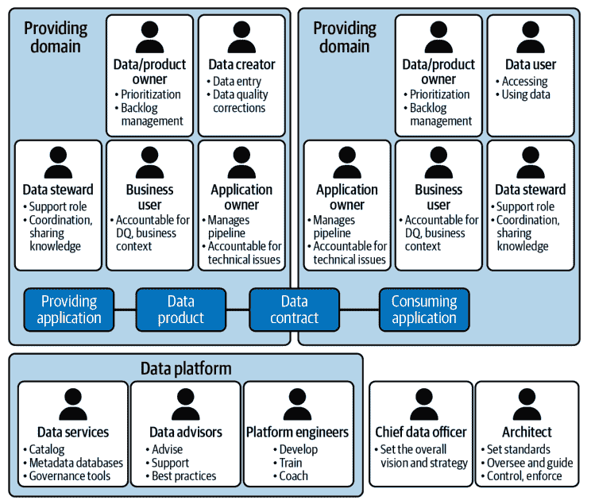
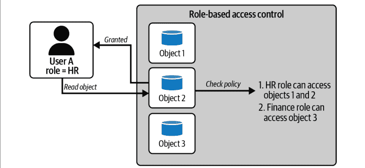
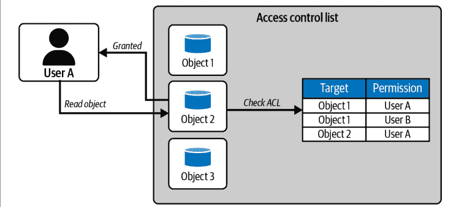
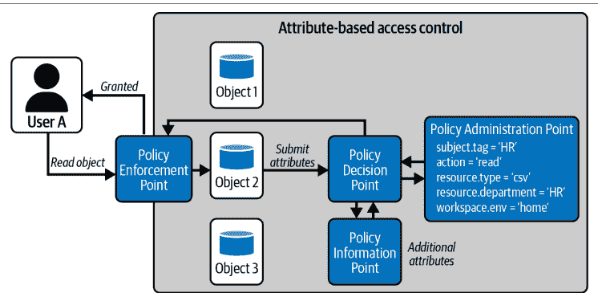
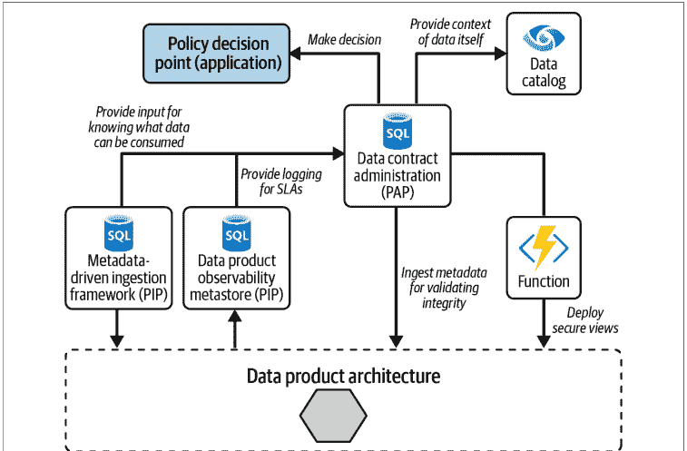
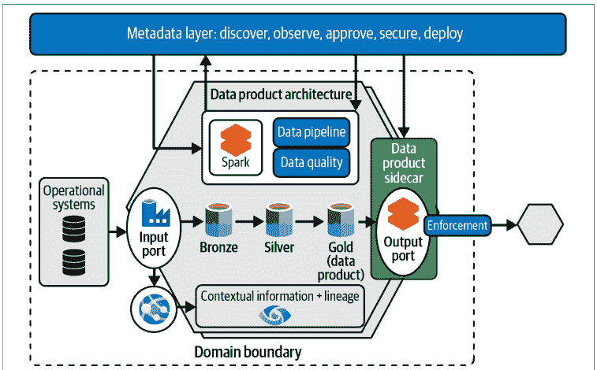
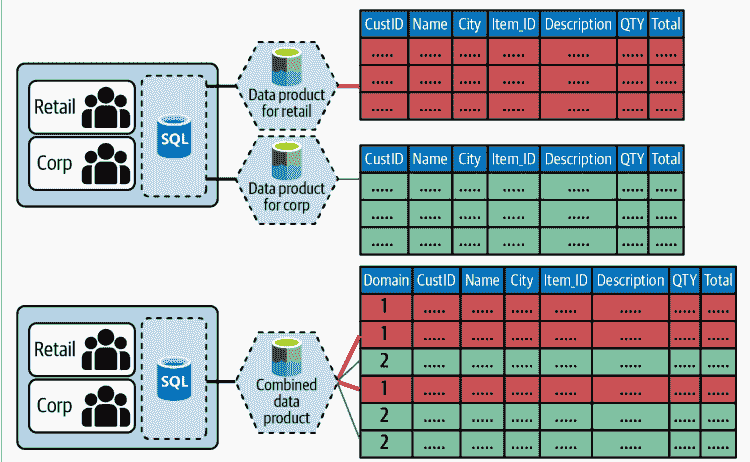
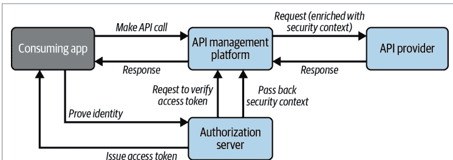

# 数据治理与数据安全

本章主要介绍数据治理和数据安全。为何将这两个话题放在一起讨论？因为它们相互重叠，且有一个共同的目标：数据治理决定数据代表什么以及可以用于什么，而数据安全则确保只有授权方能够访问数据（符合其预定用途）。

在架构的所有区域统一应用安全性需要标准化和元数据管理。需要指定数据所有者、设定分类，并维护各方之间的合同。所有这些信息都应集中存储在统一模型中。我们将在本章中解决其中许多问题，剩余的内容将在第 9 章中介绍。

## 数据治理

你可能会疑惑，为什么甚至需要数据治理。数据治理通常被视为一种限制性、官僚主义和控制性的流程。难道它会拖慢你的数据雄心吗？这些是合理的问题，而且确实，在小型公司或初创企业中，通常没有正式的数据治理；它是在日常活动中隐式完成的。在小型组织中，大多数应用程序和数据由少数个人拥有和管理。数据量和种类相对有限，因此找到所需数据并获得问题解答所需的时间很少。通常你只需要询问身边的同事，如果他们不知道答案，可能就在几个办公桌之外。

当公司开始发展时，问题随之而来。部门之间的沟通协作时间增加，更多人有不同的关注点，知识分散，决策时间变长，职责变得模糊，数据质量问题得不到跟进，等等。随着数据消费和使用水平的提高，组织、问责制和透明度变得更加紧迫。此外，公司还面临着新法规的挑战，例如 GDPR 和 CCPA。这些法规要求对数据使用进行完全控制，了解数据的分布方式和位置，并明确界定职责。这些法律要求你识别并清楚记录数据存储在哪里、数据源自何处、数据用于什么、如何使用，以及由谁管理。在同时运行成千上万个应用程序和数据库的情况下确保合规，显然是一项复杂的工作。简而言之，数据治理的需求显而易见。

然而，数据治理的问题在于，大多数计划和流程都完全无效。数据治理解决方案通常由一大套复杂的政策和指南组成，这些政策和指南侧重于控制数据，而非使用数据。当这些政策实施后，在数据被“治理”或“置于控制之下”之前，不允许任何人查看或使用数据。

组织通常尝试使用复杂的工具来实施数据治理。这些工具往往配置复杂，且难以与其他解决方案集成。此外，实施基于规则的工作流和审计追踪，并事后上传必要的文档，都是漫长的过程。通常，人们对数据治理缺乏热情；他们根本看不到其价值。那么，了解这些挑战后，我们应该如何做出不同的改变，以及如何使数据治理更加务实和有效呢？让我们来找出答案。

## 治理框架

制定有效的数据治理方法始于重新思考组织文化、设计、运营模式和角色。到目前为止，我们一直在使用抽象概念，例如数据域，但现在我们将定义一个更具体的框架，包括特定的角色和职责、政策和标准以及工作指令，以确保数据的可用性、易用性、完整性和安全性。让我们从角色开始。

### 角色

必须理解，数据治理对每个组织来说都是独特的。治理应根据你的具体需求量身定制。因此，整体数据治理框架中的名称和关键活动在不同企业之间可能有所不同；每个组织对这些角色的结构和命名略有不同。话虽如此，以下是数据治理组织中最常见角色和职责的高级别概述：

### 首席数据官

首席数据官负责整体数据战略和数据管理实践。此人制定愿景、方向和标准。此角色也可能被称为数据治理负责人或数据管理负责人。

### 数据所有者

数据所有者（有时也称为数据受托人或流程所有者）是组织中负责相关数据，并妥善管理相应元数据的个人员工。这包括监督数据质量、定义、分类、数据可用于的目的、标签等。分布式生态系统中的问责制不仅限于企业数据。数据所有者有时也是产品所有者，因此也可能负责管理团队内的优先级和积压列表。

### 业务用户

业务用户是较高级别的决策者，通常是产品所有者或业务代表，与业务团队合作处理需求，并与治理团队合作处理数据管理政策、流程和要求。业务用户也可以被视为战略家，其角色是将业务需求转化为高级解决方案。

### 应用程序所有者

应用程序所有者（有时也称为数据保管人）维护应用程序及其接口的核心。应用程序所有者负责业务交付、功能和服务，以及应用程序信息和访问控制的维护。

### 数据用户

数据用户是组织内打算为特定目的使用数据，并负责设定要求的个人员工。

### 数据创建者

数据创建者是与应用程序和数据所有者（们）达成一致创建数据的内部或外部方。

### 数据管理员

数据管理员确保遵守数据政策和数据标准。他们通常是特定类型数据的主题专家。

定义好的数据治理角色对于每个数据治理计划至关重要，在相应层级分配所有权也至关重要。这确保每个人的职责都清晰，从而取得最佳效果。

在研究这些角色时，你可能会疑惑，为什么既有数据所有者又有应用程序所有者。为什么不只有一个所有者？将这些角色分开，而不是将其作为一个复合角色（如数据网格理论所建议的），有很多充分的理由。首先，应用程序可能会被不同的领域共享和使用。在第 2 章中，你还了解了共享业务能力，这些能力通常集中实施，使用即服务模型，并提供给组织的不同部分。这需要更细粒度的所有权，因为所有权活动必须由不同的人执行。其次，负责纠正或监督数据质量的人通常不是构建数据管道的人。这是两个不同的专业领域：拥有数据通常需要深入了解业务背景，而拥有应用程序则需要技术工程技能。

### 创建框架

在大型企业中，前一部分强调的角色通常是联邦制的：每个领域都有正式的数据所有者以及应用程序所有者和数据管理员等支持角色。实施这些角色以及数据民主化和联邦责任的过程，对企业来说涉及重大的组织变革。为了支持这一转型，我建议将所有角色汇集到一个正式的制品中：一个作为所有数据治理活动基础的框架。该框架必须定期审查和更新，并应与前面概述的角色保持一致。

当然，如前所述，该框架将包含远不止角色的内容。你应该用职责、标准和程序来扩展它。图 8-1 展示了不同治理角色如何根据面向领域的工作方式精神，被分组并在域导向的工作精神下共同管理：使用联邦数据领域团队和集中式数据治理团队。对于每个角色，你都可以看到一系列活动和职责列表。

在图 8-1 的顶部，你可以看到图表被分解为领域：专注于业务特定部分的跨职能团队。在这些领域内，不同角色相互作用以实现价值创造的目标。对于这些活动，不同的利益相关方正在共同工作：数据所有者、应用程序所有者、数据创建者、数据管理员等。

在领域下方，角色专注于提供使能（中心）服务并指导组织。在这个层级上，你会发现开发平台并定义全球政策（例如互操作性、元数据、安全性和文档标准）的架构师、顾问和工程师。




图 8-1. 一个高层次的数据治理框架，通过使用不同角色将组织拆分为领域团队

本治理框架中定义的不同角色并非孤立存在。通常需要密切协作。例如，一个领域的业务用户可能会联系另一个领域的数据所有者来请求数据。如果该数据通常不作为数据产品提供，数据所有者应验证其是否可以提供。如果可以，他们应联系相应的应用程序所有者，开始构建接口并启动提供数据的流程。之后，不同团队成员应就该数据将用于什么目的达成共识，并应在数据合同中记录该协议。

为方便将活动分配给角色并确保组织内每个人步调一致，建议在框架中正式描述所有活动和职责。例如，框架可能包含关于数据质量要求以及监控数据、纠正数据和后续处理时间的详细说明。

框架本身应该如何结构化？在与不同组织合作的过程中，我见过许多不同的表现形式。例如，框架可以是一个分节的正式 Word 文档（执行摘要、治理结构、角色描述，以及数据质量、隐私管理、安全性、合规性等方面的流程），或者是一系列 Wiki 页面，其中包含与数据创建和管理生命周期中不同活动（验证和修复数据质量问题、报告数据血缘等）相对应的描述和图表。

在图 8-2 中，您可以看到我曾与之合作的一位客户的示例。该框架捕捉了每个角色在端到端数据管理的不同阶段所负责的活动。此处对职责和活动进行了高层次描述，但为确保所有角色都遵循正确流程，我建议为每个角色提供更详细的剧本和/或指南。

### 图 8-2. 示例框架

| 数据创建 | 数据产品创建 | 数据发布 | 数据请求 | 数据使用 |
|---|---|---|---|---|
| • 协调解决数据质量问题<br>• 修复（功能）数据缺口 | • 与数据消费者协调数据需求 | • 提供使用策略和限制<br>• 补救约束 | • 批准数据使用<br>• 进行定期审查（每季度）数据合同并签字 | • 收集和协调使用反馈 |
| • 维护和描述应用程序数据模型<br>• 处理应用程序更改 | • 与数据工程师密切协作开发数据管道<br>• 提供技术元数据 | • 为数据产品创建提供元数据<br>• 实施满足 SLA 的控制措施<br>• 提供血缘 | • 与数据消费者应用程序所有者协作处理技术要求<br>• 修复问题 | • 收集使用反馈<br>• 修复应用程序问题 |
| • 协调解决数据质量问题<br>• 修复数据缺口 | • 提交业务术语和定义<br>• 将业务术语链接到技术术语<br>• 对敏感数据分类 | • 改进文档<br>• 共享知识<br>• 与数据所有者共同定义策略 | • 通过向数据所有者提供反馈来实现一致的数据使用 | • 指导、培训数据使用方的数据用户 |
| • 支持缺口和数据质量问题的解决<br>• 共享需求 | • 提供反馈 | • 提供反馈 | • 为数据合同提供数据使用信息<br>• 协调数据使用约束 | • 提供反馈<br>• 与数据所有者和其他数据用户共享知识 |

您可能希望引入一个成熟度模型，不同级别表示数据生命周期各阶段的绩效和成熟度。例如，第 0 级可能表示没有领域团队成员接受过培训，并且没有进行任何数据治理活动。第 1 级可能表示团队成员已接受过一些培训并了解基础知识，但正在进行的治理活动有限。第 2 级及以上可能表示日益提高的成熟度，其中第 5 级对应所有团队成员都有强烈的承诺，正确且高效地管理数据。

您应该定制治理框架以适应组织的特定需求。您可以随意将其设计得复杂或简单，只要有效即可。最后一个建议：关注数据管理的组织方面，而非技术方面。

## 治理机构

为了使数据治理成功，您需要有一个治理机构（有时称为*数据治理团队*），以确保框架正确实施。该团队成员通常负责以下活动：

- 监督流程和标准的遵守情况
- 确保流程和文档保持最新
- 建立培训和意识计划
- 提供所有领域中所有数据治理领域当前总体成熟度水平的透明度
- 为新个人分配角色
- 执行定期审查
- 编制审计报告以确保合规性
- 确定改进领域
- 定义新标准和策略
- 定义数据管理所需的架构要求

除数据所有者和数据管理员外，治理机构通常还包括更高级别的代表，例如来自其他业务部门的数据架构师或经理。机构成员通常向首席数据官汇报。

当数据治理机构分配不同角色时，在框架中仔细描述其相关责任和任务非常重要。特别是，数据所有者、数据用户、应用程序所有者和数据管理员应了解自己的职责以及对等方的职责。这些任务集还包括一系列流程（我将在下一部分介绍）。总体职责通常在*责任分配*（RACI）矩阵中概述，该矩阵列出了所有不同的任务、角色和职责以及每个任务的责任人。

角色、框架和治理机构是数据治理的基础，在集中监督与职责和活动的适当分配之间取得平衡，并确保职责清晰且不重叠。还需要什么才能使数据治理更有效？

## 流程：数据治理活动

数据管理是根据提供的指南，执行治理框架中识别的所有活动的实践工作。就此而言，治理机构必须确保整个组织的数据管理得当。在联邦或大规模组织中，治理机构可以承担略有不同的角色：它负责定义领域内什么构成良好的数据治理。这种文化转变也需要思维转变。团队不应执行所有数据治理活动，而应专注于辅导和培训其他用户。为支持这种转变，您应为联邦团队必须执行的所有流程编写指南和剧本。以下是需要涵盖的一些最重要领域：

- 定义数据目录元数据填充流程
- 识别数据源并分配应用程序和数据所有权
- 根据适用法规（例如处理个人身份信息（PII）的 GDPR）定义正确数据处理策略
- 定义数据创建和分发时的质量控制级别（包括可接受的离群值级别），分配数据质量职责，并监控后续跟进
- 定义数据血缘的粒度以及需要提供血缘的应用程序类型
- 建立用于使用、标记、贴标签和保护数据的中央分类方案和存储库
- 研究新法规对数据管理的影响
- 与企业架构保持一致，以确保策略深入嵌入架构中
- 确定必须在中央层级进行主数据管理的数据
- 设置数据生命周期管理策略，包括报告和仪表板等其他信息资产
- 定义常见数据格式（如 XML、Parquet 和 JSON）的架构识别要求和协议标准
- 确定定义元数据、数据类型和格式以及其他约定（例如使用蛇形命名或驼峰命名）的命名指南
- 确保领域团队正确提供元数据
- 致力于营造数据意识文化，包括奖励数据管理员，并在某些情境下提高对伦理和机器学习使用的意识


- 定义数据应保留的时长
- 监控并指导用户，确保数据模型得到正确维护
- 为数据建模、开发本体论、维护业务词汇表等制定方法论和最佳实践
- 维护数据目录及其元模型，确保所有信息资产都有完善描述
- 识别与数据管理纪律的偏差，并处理相关风险
- 制定数据接入与消费的原则
- 开发其他指导、政策和框架，例如用于随机审计 SQL 查询日志或处理外部数据
- 指导组织围绕护栏举行圆桌讨论，并制定和实施规则、原则及自动化方案

初始规划时，最好从这些活动中选取一个子集，而不是全部。为了使规划和实施治理的工作更易管理且切实可行，还需要有意识地决定不做什么。根据亲和力选择目标活动——即看起来相互契合，并作为第一步合理的活动。同时还要考虑基于依赖关系必须组织的内容；也就是说，按什么顺序做什么。最后，请注意，在推进下一代数据架构建设的过程中，您还需要实施其他活动，例如定义指标和审查政策。

## 使治理既有效又务实

在明确角色、框架和流程后，下一步应专注于使治理既有效又务实。基于我的经验，我可以分享以下建议：

## 尽早争取高层支持

获得高层对您想要实现的目标的支持是重要的第一步。许多数据治理计划是自底而上推动的，或者在企业数据平台实施之后才启动。从一开始就建立领导层支持，可以避免围绕授权、职责范围和资源不足的常见挑战。

## 与其他大型计划配合

检查是否可以将您的雄心与其他大型转型计划相契合。与其强行推进，不如利用已经启动的计划。在我之前的工作中，该组织将数据治理目标与遵守外部法规相关的计划相结合。通常，这些计划已有充足预算并获得全组织关注。

## 确保数据治理为所有人带来明确价值

做好数据治理可以让工作更轻松。例如，它通过确保每个人都了解敏感数据存放在何处来降低风险。它还能促进自助式数据发现和便捷的数据访问。

## 信任本地团队

在大型组织中，需要转变思维，因为没有人能够监督和管理所有数据。一旦边界清晰，并且您确信各领域拥有所需的技能、服务和控制，就允许每个领域在您设定的信任边界内管理其数据。

## 关注上游数据质量

如果在源头（即靠近提供端执行的提供应用程序和流程）修复质量问题，问题将不再在其他地方出现。

## 野心要现实，放弃“所有数据都必须正确”的信念

关注消费者及其用例，并确定对他们而言“良好质量”意味着什么。

## 不要将数据治理视为一次性改进

数据治理永远不会结束。如果您想减轻负担，就对其进行自动化；也就是说，将其计算化。

## 为数据治理团队配备高技能软件工程师

有效的治理在很大程度上依赖于自动化数据管理任务。例如，数据产品只有在自动验证后才能发布。同样，与其手动编目数据产品，不如让平台中的服务对敏感数据进行画像分析。

## 对核心数据管理原则保持严格

数据治理的主要目的是奠定基础。因此，要对基线和标准保持严格。建议的方法是从关键原则入手，例如直接从源头捕获数据、不允许分发您不拥有的数据、以及在没有所有者的情况下不共享任何数据。接下来，考虑您的访问模型。基于计算的访问模型通常在消费端的计算层应用数据访问和权限。该模型依赖于委托信任模型：提供方管理员授予消费方管理员访问权限，然后由消费方管理员向其消费者授予访问权限。另一种选择是数据中心的访问模型，其中授权在数据所在地（例如数据湖）针对消费群体强制执行。

## *分享进度。*

展示您所做工作的影响至关重要，因此要致力于透明度和清晰沟通。这可能包括分享确认信息、展示路线图、收集诚实反馈以及庆祝关键里程碑。

## *根据业务价值衡量成功。*

展示影响有助于留住高层管理的关注和支持。请考虑使用指标跟踪您的结果：例如，展示解决了多少个数据质量问题，以及数据在更大范围组织中的可用性如何。

## *找到合适的平衡点，并循序渐进。*

根据各领域的要求调整治理级别，因为并非所有领域都面临相同水平的监管压力。如果您有一半的数据风险较低，就不必在其周围设置太多限制和程序。关注关键数据元素，例如客户地址，并在扩大规模时循序渐进。通过实践学习，并在可能的地方务实地改变流程！

## *开展一致的沟通。*

数据治理的某些部分对所有组织都标准，但许多部分取决于组织的工作方式及其自身的组织架构。数据治理包含大量行话；为了正确连接团队并帮助他们协作，请考虑列出经常使用的重要治理术语和定义。还要清楚地传达数据治理的益处。这有助于减少对变革的抵触，并确保员工从一开始就参与其中。

## *以智能方式管理元数据。*

许多活动集中在 Excel 电子表格中手动描述元数据。情况不一定非得如此！请考虑在数据目录中自动记录元数据，或对集成服务进行标准化，以便更容易地捕获数据血缘。

## *将数据治理纳入规划、执行和协调的常规节奏中。*

您的数据治理团队应了解其他团队的进展和潜在挑战。它们应采取支持性方法。例如，如果共享或消费数据的流程耗时过长，团队应使服务更具自我解释性或支持自助式服务。

## *让治理变得有趣。*

寻找在组织中激发对治理热情的方式。例如，您可能能够为某些工作角色创造新机会，或允许初级员工通过演示和示范练习沟通。或者，您可以通过随到随谈的会议、博客文章或在 PI 规划会议期间提供特别奖励来提高意识和兴奋度。

一旦提升了热情水平，您的下一项任务就是有效支持所有活动。为此，您的数据治理团队需要充足的设备，尤其是工具和元数据存储库。

### 数据治理支持服务

如前所述，围绕数据提供透明度和信任很重要。建立这种信任需要数据治理团队和其他团队通过工具和平台集中提供元数据——即关于数据的数据。这里的复杂性在于，用于数据治理的元数据通常分散在各处：它仅在特定平台或工具的上下文中可用。[^1] 因此，您需要一项总体策略，以更精确地识别和分类应用程序、数据和数据所有者，以及一套包含支持应用程序和存储库的架构。

要使数据治理成功，它需要以下应用程序或功能的支持：

- **数据目录**

  数据目录通常是一份存储业务术语、所有者、来源、血缘、标签、分类等元数据的清单。现代数据目录通常与许多其他数据管理和搜索工具结合，因此可能包括用于存储元数据的扫描器或知识图谱。第 9 章的大部分内容致力于为这些主题提供更多指导。

- **应用程序存储库**

  这是一个独立的中央存储库或 IT 服务管理系统，用于跟踪所有唯一应用程序及其所有者。此外，该存储库还可以保存有关生产状态、供应商产品以及基于现有控制措施的应用程序机密性、完整性和可用性评级的信息。您也可以使用第三方软件组件（如 ServiceNow）作为该存储库。

- **唯一数据元素列表**

  这是一个独立存储库或目录中的区域，用于维护组织中所有唯一数据（包括其所有权）的概览。如前所述，数据在第 7 章中按逻辑数据集级别注册，因为一个应用程序中可以有多个数据所有者，且多个物理数据集可能源自同一应用程序；因此，数据集与应用程序之间的关系是多对多关系。

[^1]: 第 9 章的大部分内容致力于解决元数据分布问题。


跟踪唯一数据的存储库还可以跟踪各个数据元素的分类，例如个人数据及其用途、企业数据使用情况以及数据使用限制。

## 数据合同应用程序 (DCA)

这是一个独立的应用程序，用于注册数据所有者、用户和消费者之间的所有数据合同，包括数据共享的目的、保障措施、修改条件、担保、隐私限制、有效期等。DCA 在安全架构中扮演着重要角色，将在本章第二部分中讨论。正如您将在后面了解到的，DCA 充当策略管理点 (PAP) 或策略信息点 (PIP)，用于提供信息以评估并作出授权决策。我们将在第 241 页的“数据安全”中进一步讨论这些组件。


如果您不构建 DCA 而直接使用第三方供应商的数据安全应用程序，您将与该特定供应商紧密耦合。许多安全应用程序仅在孤岛中工作或支持的技术很少。如果您希望对所有数据有一个全面、中立的安全视图，您必须解耦！

## 元数据存储库

元数据存储库是数据库及相关工具，可帮助用户查找和管理有关数据的信息。您也可以使用第三方软件组件或任何自建解决方案作为元数据存储库。第 9 章提供了关于维护元数据的更具体指导。

## 知识图谱

知识图谱是使用图结构数据模型或拓扑来集成数据的知识库。对于数据治理，这可能对于查看和发现关联及关系非常重要。第 9 章提供了更多指导。

## 数据扫描器和分析工具

需要扫描器和分析工具来处理和检查数据，以收集数据质量级别、架构信息以及转换和血缘信息等信息。更高级的数据目录将这些功能纳入其默认产品中，但也有专门用于扫描和分析的产品。

所有这些与数据治理相关的应用程序或功能应协同工作，以提供所有数据的集成视图。您可以使用商业工具或自建应用程序，并可以将特定部分外包给针对某些任务优化的工具。

需要特别关注的一个组件是 DCA。在职责在各领域之间分布的联邦架构中，更难以监督依赖关系并获取数据使用情况的洞察。数据合同正是发挥作用的地方。

## 数据合同

一个 _数据合同_ 是数据提供方与数据消费方之间关于允许消费哪些数据、用于什么目的的正式协议。为什么数据合同很重要？它们提供了谁拥有哪些数据产品的洞察，支持设定标准并有信心地管理数据管道，并提供哪些数据产品正在被谁、用于什么目的消费的信息。简而言之：数据合同对于强大的数据管理至关重要！

我建议您从两个角度审视数据产品分发和使用问题。首先，存在技术问题，例如数据管道处理以及关于数据稳定性的相互期望。其次，存在业务问题，例如就数据共享目的达成一致，这可能包括使用和隐私目标及限制。通常，每个维度都有不同的角色参与。对于技术问题，通常依赖应用程序所有者和数据工程师。对于业务问题，通常依赖数据所有者、数据用户和数据管理员。

数据合同类似于数据交付合同或服务合同。它们很重要，因为当数据产品变得流行并被广泛使用时，您需要实施版本控制并管理兼容性。这是必要的，因为在更大或分布式的架构中，更难以监督更改和依赖关系。访问或消费其他应用程序数据的应用程序始终会遭受耦合问题，这意味着存在高度的相互依赖性。例如，对数据结构的任何颠覆性更改都可能直接影响其他应用程序。在许多应用程序相互耦合的情况下，有时会发生级联效应。即使对单个应用程序进行微小更改，也可能同时导致许多其他应用程序进行调整。因此，许多架构师和软件工程师试图避免构建耦合架构。

数据合同是解决此技术问题的方案。数据合同保证接口兼容性，并包括服务条款和服务级别协议 (SLA)。同时，它为组织提供了透明度。示例 8-1 展示了如何将数据合同实现为元数据记录。

数据合同描述了允许消费哪些数据。它可能包含有关使用的额外详细信息（例如，数据是否仅允许用于开发、测试或生产），以及关于质量、交付或接口的元数据。它还可能包含正常运行时间、允许的错误率和可用性的详细信息，以及折旧、版本号等。

## 示例 8-1. 包含数据合同信息的示例元数据记录

```json
{
"@AgreementId": "1342",
"contactPoint": {
"ConsumerId": "894",
"fn": "Marketing Department",
"hasEmail": "mailto:email@example.com"
},
"ApplicationId": "201",
"Description": "<p>This data contract captures the usage of marketing
data within the domain of HR. Usage of this data is limited to the HR department only,
as the data may contain sensitive information about employees and customers.</p>",
"DataRequestType": "dcat:FlatFile",
"IssuedDate": "2022-11-26",
"StartingDate": "2022-12-01",
"ExpirationDate": null,
"scope": [
"DEVELOPMENT"
],
"purpose": [
"HR_ONLY"
],
"dataElements": [
"fd11d32f-4944-4bd5-a36d-d0f891e649",
"345f0539-f3c7-4547-a2ab-cf6b66c675ce",
"ff0fe9c26-0f96-4370-8e39-7d78827f6e88",
"7ca735c1-20dd-43f1-a7a9-e5719340e4fa",
"3b7c7926-7d39-4257-8029-dacc9ee22ecf"
],
"ApprovalDate": "2022-11-27",
"ApprovalFlag": true
}
```


示例 8-1 为实体使用全局唯一标识符 (GUID)，而不是使用定义文件或数据源位置的路径。我使用 GUID 的动机是，数据产品可能会被复制，并且随着数据动态处理和在文件夹中组织，地址位置可能会发生变化。GUID 将解决这些问题，因为它们保持稳定，并链接到数据实际存储的位置。

我在各个组织中看到，数据合同通常作为元数据驱动的摄取或数据质量控制框架的一部分来实现。² 在这样的设计中，数据合同通过检测突破性更改来确保稳定数据交付的完整性。例如，它们可以作为测试模板存储在代码仓库的执行过程中，并在数据管道中发挥重要作用（验证架构、数据类型、文件格式等）。

2 关于数据合同的精选博客、视频、工具及其他资源列表可在 AltimateAI 的 GitHub 仓库中找到。

我还见过一些组织将数据合同与数据产品架构分开存储；例如，在集中式数据合同存储库或数据目录中。示例 8-1 很好地适应了这种方法。分开存储数据合同通常需要更多实现工作，因为需要在合同中描述的内容与实际数据产品架构中对数据集的验证方式之间进行转换。

对于分布式架构，您应该在不同领域之间标准化数据管道框架。在这种方法中，领域遵循一种共同的工作方式。它们自己处理数据，这意味着控制权和责任留在领域内。但是，框架和合同元数据仍受中央治理。如果您正在考虑这种模式，请从基础开始，例如管理架构验证和数据目录信息。作为这项工作的一部分，启动您的流程，并使用诸如 Great Expectations 或 dbt test 之类的库实施控制，以将技术数据质量验证作为数据合同创建过程的一部分。接下来，建立控制和工作流，以允许数据提供方和消费方之间进行握手，例如，当测试模板作为拉取请求提交时，领域需要签署批准。


数据可观测性是指组织充分了解其数据资产中数据健康状况的能力。它关注数据的新鲜度、完整性、卷、血缘和质量，以及所有这些维度的趋势。预计数据合同将通过定义数据消费和使用模式来与此对接。

要继续扩展，您需要将可观测性引入您的数据。您可以通过捕获数据管道的统计信息来实现这一点。您可以使用相同的合同存储库或数据库来存储这些信息。需要这些关于可观测性的输入，以查看所有管道的整体新鲜度、健康状况和状态。

## 使用协议

使用协议是数据合同的重要组成部分。如前所述，它们涵盖使用和隐私目标及限制。它们与接口无关，可以作为数据安全控制的输入，提供数据可以合法使用的目的的洞察。这些协议可能包括，例如，有关应将哪些过滤器或安全保护应用于数据的详细信息，或对共享已消费数据或任何新创建结果的限制。


使用协议还可防止数据使用方面的沟通误解。在共享数据之前，各领域应讨论数据共享和数据使用问题。当他们达成协作共识后，应将该共识记录在数据共享协议中。这些协议可能还涵盖功能数据质量、历史化、数据生命周期管理和进一步分发等方面。达成共识的这种方法不仅从监管角度很重要，还能为您的组织创造价值。

您的使用协议中（以及数据合同一般情况下）的属性，应清晰映射到业务数据目录中的元素，后者包含有关数据如何使用的附加信息。因此，请始终确保提供语义上下文，并在数据属性与业务术语之间创建链接。这样，使用者就能了解从业务需求到实际实现的转换过程是如何进行的。根据这对您的重要程度，您可以考虑实施策略以确保这些关系得到遵守——例如，只有在数据产品属性与业务术语关联时，才能将其纳入合同。相同的策略也可能适用于上下文变更，例如关系和定义的调整。

最后一点：关于合乎道德的使用和进一步分发的协议通常比较宽泛，因为这些方面很难自动化或强制执行。不过，您可以通过定期审查协议是否得到遵守来实施审计框架。

## 开始使用的最佳实践

您该如何开始使用数据合同？请循序渐进。这主要是一个组织挑战。不要一次引入太多变更。数据合同是一种文化转变；用户需要熟悉它们，并理解数据所有权的重要性。过渡还需要在元数据属性过少和过多之间找到平衡点。我推荐以下过渡流程：

- 1. 首先，确保所有权已设置且技术数据管道稳定。如果它们不稳定且会发生意外和破坏性变更，则您的任何用例都无法进入生产环境。

- 2. 建立流程。不要把事情复杂化。例如，您可以先从在 Microsoft Forms 等工具中设计的简单表单或模板开始。应使用清晰、简洁、易于理解的语言起草。接受手动流程。限制初始元数据要求。第一阶段旨在启动文化转变并收集要求。您将进行迭代，直到元数据要求稳定下来。

- 3. 建立第一套流程后，尝试使用基于 Web 的应用程序、数据库和/或消息队列取代手动表单。在此期间，中央数据治理团队仍会监督事务。数据访问通常较粗，因此请标准化容器、文件夹或文件。尝试使用 REST API 自动预配数据访问策略或访问控制列表。例如，每次数据所有者批准时，都会调用 Webhook，触发另一个函数来调用目录、请求 URI 并更新访问权限。

- 4. 接下来，通过将数据合同转换为单元测试或数据验证来添加自动化。因此，每次添加数据合同时，都会执行部署后流程；例如，您可以向函数发出 API 调用以自动添加测试模板，或者以一种方式修改数据摄取框架，使其检索数据合同并将其用作架构验证的输入。

- 5. 您的下一阶段是实施更强大的审批处理工作流。从这一点开始，让您的数据所有者或数据管理员牵头。您的中央数据治理团队现在将退居二线进行监督，对所有数据合同进行定期审查。到这一阶段，您还应建立并运行数据目录，显示所有可供使用的数据产品。改进您的数据安全性和执行能力。通过自动部署动态视图，允许对列和行筛选器进行更细粒度的选择。考虑使用动态数据掩码等技术来防止滥用。对于细粒度数据访问，请要求数据提供商为其数据产品补充用于筛选的额外元数据。这意味着在创建数据合同时，您应询问数据提供商哪些列与筛选相关。

- 6. 在旅程结束时，一切都将是自助式和完全自动化的。这包括自动化安全执行和用于预测数据审批的机器学习。例如，安全视图将在批准后自动部署。

数据合同是一种相对较新的数据管理方法。它们很重要，因为它们提供了对依赖项和数据使用情况的透明度。请从小处着手，首先关注技术稳定性和标准化。通过经验教训流程进行迭代。数据治理至关重要，但过多会造成开销。请慢慢建立并实现自动化。

由此可见，数据治理对数据安全至关重要，我们将在下一节讨论数据安全。数据安全需要一个稳健的治理框架和元数据基础才能运作。如果您的领域不承担数据所有权，且不准确描述和分类数据，那么保护最敏感的数据将是不可能的。

## 数据安全

如第 1 章所述，数据安全涵盖所有涉及保护数据的活动：人员、流程和技术。特别是，将 PII、个人健康信息、银行信息和知识产权信息等敏感数据防止落入犯罪分子、黑客、攻击者和竞争对手手中至关重要。

挑战在于数据是易变的，并且如今不再维护在单个单体系统中。它是去中心化的，分布在许多系统和环境中，这使得更难控制用户在获得数据后会做什么（例如，将其与其他来源的数据合并并进行不道德的分析）。此外，在不知道数据完整上下文的情况下，很难保障数据安全：在重组的背景下，HR 数据的含义和价值与组织公司外出或庆祝活动的背景不同。

一个更大的问题是大公司正在处理的大量数据。联合数据可能是一个熔炉：各种数据源以及所有者和使用者的需求和要求都汇聚在一起。各个来源及其对应的数据元素具有不同的上下文、质量级别、分类、目的绑定、所有者、评级等等。新来源、数据产品和用例不断添加。描述、治理和保护所有这些数据需要安全规则和策略的爆炸式增长。

企业组织内的数据安全通常由专门的安全部门执行，该部门由首席信息安全官（CISO）领导。CISO 是高级管理人员，负责建立和维护企业的愿景、战略和流程，以确保信息资产和技术得到充分保护。他们与企业架构和数据治理代表密切合作，确保将安全愿景和目标正确地纳入整个企业。

## 当前的孤岛式方法

大多数企业已实施的内容与专家所倡导的内容之间存在巨大差距。许多咨询公司使用 _数据中心安全_ 这一术语，以强调安全应关注数据本身，而不是网络、服务器或应用程序。但是，在实践中，当前的安全实施主要关注孤岛——数据仓库和数据湖——因为大量可用数据和用户可以进行的无数组合意味着高风险，需要额外关注。

对于基于 API 和事件驱动的架构，许多公司的安全模型使用不同的流程、分类、工具和功能来实现。在这些架构中，安全通常关注端点，而不是数据


穿过这些平台流动。数据分类及其周围上下文对运营用例的作用微乎其微。在我看来，以数据为中心的安全模型应关注信任边界并利用底层治理元数据，因此这是我们接下来要研究的内容。

## 信任边界

在联邦架构中，您的域边界应作为信任边界运行。具体来说，这意味着在域本身内部存在一定程度的信任。因此，在某种程度上，域本身可以决定设置哪些安全模型、如何对内部数据进行分类、可以使用哪些数据以及由谁使用。这种信任存在是因为在域内，上下文是已知的。可以假设，在域边界内操作的每个人都对该处管理的数据所附带的风险和威胁有良好理解。

跨域移动数据时，适用不同的规则，因为信任级别发生了变化。这部分是因为其他域在域外原始上下文之外使用数据时，更难理解涉及的潜在风险。此外，数据可以被复制、操纵并与其他数据组合，而源域对此一无所知。这可能会引发隐私风险被放大的情况。因此，在域边界的边缘（数据产品、API和事件的接口）管理安全很重要。管理信任边界的推荐方法是执行以下一组操作：

- 实施数据分类和目的方案，以便域知道必须为哪些数据提供哪种级别的保护。
- 为跨越信任边界的数据建立数据合同。这提供了关于数据用于何种目的以及已应用的保护级别是否足够的透明度。
- 设置监控，并确保提供关于哪些数据跨越信任边界移动的洞察。此原则要求您的数据治理或目录解决方案中存在血缘关系。
- 实施策略和控制，自动强制执行基于身份的访问控制、静态和传输中数据加密、密钥管理服务的使用、安全日志和审计服务的使用、用户双因素身份验证，以及针对未授权用户的数据模糊或屏蔽，等等。

最终，您信任边界边缘的所有安全控制都应基于您设置的信任级别，对所有类型的数据分发保持一致。要达到这种成熟度水平，您的组织将需要中央安全服务、跨域治理和强有力的指导。在所有边缘实现高度控制并不容易。它要求团队和专家始终如一地正确分类数据，因此您需要一个中央分类方案。此外，您需要就这些分类发挥作用的数据使用方案达成一致。您还需要实施一个将所有这些信息作为输入的统一数据安全模型。我们将在下一节中研究所有这些方面，然后通过一个务实的示例使其具体化。

## 数据分类和标签

分类和标签是数据管理的一个重要方面：它们用于将数据聚类到相关类别中，以便更高效地使用和保护。在基本层面上，分类过程使数据更易于定位和检索；然而，在更高级的层面上，分类被用作安全、合规和监管的输入。例如，安全分类可以作为设置用户允许查看内容限制的输入。最好将数据分类列表集中维护，且不应过长。

> 非结构化数据（如文档、图片和日志文件）是否也必须分类？是的！您不应只对结构化数据进行分类。非结构化和半结构化数据可以使用相同的方案进行分类。

安全分类可能包括个人姓名、社会安全号码、宗教、性别、员工信息、商业公司信息或信用卡号等标记。要使用这些分类配置自动标记规则，您可以使用高度机密、机密、一般和公开等标签。例如，自动标记规则可能规定，所有标记为信用卡号分类的数据都应自动标记为高度机密。

## 保护个人数据和合规性

成功管理个人数据和用户同意的关键是结合数据治理、安全性和主数据管理。数据治理专注于管理流程、分类和标签。这使您可以查看哪些数据是敏感的并且应给予额外关注。数据安全专注于限制数据访问。正如您将在第10章中学到的那样，主数据管理专注于与匹配和识别数据相关的规则。借助这一学科，您必须能够唯一标识客户并知道已给予何种类型的同意。因此，遵守GDPR和CCPA等法规并非关注数据管理的某一单一领域；合规之路始于端到端、集成的愿景。因此，数据目录编制必须从源头开始，而不是作为ETL后的活动。

使用标签的好处是您的策略规则与数据本身解耦。例如，如果法规要求您对个人身份信息（PII）给予额外关注，则无需重新标记所有数据；借助良好的分类方案，限制将自动继承。


> 大型企业承认，在高度分散的环境中保护个人身份信息（PII）实在太复杂或容易出错，这并不罕见。承认这一点的企业通常会强制执行：所有提取的标记为PII的源数据必须被模糊处理、掩码、加密或类似处理。

分类很重要，因为它们在用于自动限制数据访问的控制策略中发挥作用。当数据至关重要且伴随更高风险时，这变得尤为重要。因此，对于所有数据产品（即数据访问的主要入口），所有数据元素都应进行分类。[^3]

[^3]: 在对物理数据（例如行）进行分类时，分类（或指向分类的链接）会被封装在数据本身中。

### 数据使用分类

为了更好地控制数据使用、安全性和可发现性，请考虑使用数据使用分类将数据使用限制在特定场景或用例中。同样，此列表最好集中维护，不应“过度分类”。如果列表太长，用户将难以选择。数据使用分类的示例如下：

- **DATA_SCIENCE**
  用于研究和在数据中发现洞察

- **AD_HOC_USAGE**
  用于非重复性工作，例如实时生成报告

- **HR_ONLY**
  用于人力资源工作

- **FINANCIAL_REPORTING**
  用于生成财务报表和风险报告

- **DQ_INVESTIGATION**
  用于数据质量研究和调查

数据使用分类会影响用户可以看到和对数据做什么。例如，想象一种情况：您维护一个将数据使用分类和数据分类相结合的参考表。此类表可用作数据合同流程的输入。在该示例中，HR_ONLY可用于为属于人力资源部门的所有员工加载数据白名单，允许他们查看标记为机密或高度机密的数据。

标签和分类对于大规模管理安全至关重要。在下一节中，我将提出一个统一的数据安全框架，其中标签和分类将作为做出安全决策的输入。

## 统一数据安全

实施数据安全的推荐方法是从一开始就将安全要求纳入您的数据平台和服务中。成功应对安全风险要求您关注两个控制级别。第一级是数据安全控制，包括数据访问、数据掩码、数据加密、数据使用监控和身份提供程序。第二级（基础设施级别）关注隔离、网络加密、防火墙等。出于数据管理目的，我们仅关注第一级。

数据安全控制中最基本的是访问控制。访问是指查看或检索存储在数据库或应用程序中的数据的能力。有几种流行的数据访问控制模型用于确定谁有权访问数据，包括访问控制列表（ACL）、基于角色的访问控制（RBAC）和基于属性的访问控制（ABAC）。让我们来研究这些模型，并确定何时以及如何使用它们。

大多数公司从ACL和RBAC开始。RBAC（也称为基于角色的安全性）是一种将系统访问限制为授权用户的机制。如图8-3所示，该模型的理念是每个用户（员工）都被分配到带有权限和限制集合的角色中。只有当分配的角色具有正确的权限时，用户才能访问数据并执行操作。

RBAC的主要缺点是“角色爆炸”的风险。在任何大型组织中，不同部门、子部门和职能的人员都会有大量不同的角色。管理所有这些角色可能会变得复杂：如果您不想使用粗粒度角色模型，最终可能会得到成千上万个不同的角色。RBAC的另一个问题是它是静态的，无法考虑用户位置、时间和设备信息等上下文信息。

RBAC通常与ACL相辅相成。使用ACL时，权限直接附加到您正在管理的对象上。例如，图8-4显示了一个用于管理计算资源访问权限的ACL权限表。它指示操作系统哪些用户可以访问对象，以及他们可以执行哪些操作。每个用户都有一个条目，该条目与每个对象的安全属性相关联。




图 8-3. 使用 RBAC 限制系统访问



图 8-4. 使用 ACL 确定安全主体（用户、组、服务主体或托管标识）是否有权限执行操作

ACL 更适合在单个用户级别实施安全性，以及针对低级别数据，而 RBAC 更适合组织范围的安全系统，由监督管理员管理。例如，ACL 可以授予对特定对象的写访问权限，但无法确定用户可能如何更改该对象。

ABAC 是一种更高级的安全方法，用于解决 RBAC 和 ACL 的一些缺点。其策略结合了不同的属性。这些策略可以来自数据本身（例如分类和元数据属性），也可以来自系统的上下文和用户（角色、地理位置、设备属性等）以及要对数据执行的操作（读取、插入、更新或删除）。

图 8-5 显示了如何结合不同属性以做出更复杂决策的示例。



图 8-5. 使用 ABAC 进行访问控制

ABAC 附带推荐架构，如图 8-5 所示，包含以下四个组件：

### 策略执行点 (PEP)

PEP 负责保护数据。它检查数据请求（查询）并生成授权请求，该请求将发送到策略决策点以进行验证和批准。

### 策略决策点 (PDP)

PDP 是 ABAC 的核心组件。它根据所有属性上定义的安全策略验证传入请求。PDP 根据策略返回批准或拒绝决策。然后它将其决策及批准或拒绝的原因告知 PEP。

### 策略信息点 (PIP)

PIP 允许 PDP 使用外部源数据，例如调用身份提供程序的用户属性。

### 策略管理点 (PAP)

PAP 是一个用于管理所有企业安全策略的存储库。典型的 PAP 还提供监控和日志记录，并具有用户友好的界面。

为了举例说明 ABAC，假设您有敏感的人力资源数据，并使用元数据属性进行分类：员工信息标记。如果非人力资源员工尝试访问带有此标记的数据，PDP 将返回拒绝。属性也可以在 ABAC 中组合。例如，人力资源示例可以扩展到考虑用户尝试访问数据的环境：在家工作时可能会收到不同于企业环境中的响应。

## 身份提供程序

在联邦或分布式环境中使用 RBAC 或 ABAC 时，身份提供程序 (IDP) 发挥重要作用。IDP 是用于从用户检索属性的外部源。它们以服务形式提供用户身份验证，通常用于处理其他系统（例如网站、CRM 应用程序和文件服务器）的登录流程。最著名的 IDP 实现基于 Microsoft Active Directory (AD) 或 OpenLDAP。

就身份验证而言，目前有两种流行的开放协议：安全断言标记语言 (SAML) 和 OpenID Connect。SAML 基于用于交换授权和身份验证数据的 XML 标准。OpenID Connect 的工作方式与 SAML 类似，但更加开放，并被微软、Facebook、Google、PayPal 和 Yahoo 等大公司使用。OAuth 有时也在此上下文中提及，但它仅用于授权过程，而不用于身份验证。您将在该领域经常听到的另一个概念是单点登录 (SSO)。正如其名称所示，使用 SSO，用户只需使用智能卡或凭据（如用户名和密码）进行一次身份验证，然后即可访问多个应用程序，而无需再次进行身份验证。

## 现实世界示例

在本节中，我们将通过讨论解决方案设计来使安全架构具体化。图 8-6 是基于我们在第 4 章中讨论的数据产品架构构建的架构的上半部分。它包含了解决大局所需的所有元数据和安全组件。

您在图 8-6 中看到的组件仅代表完整架构的一半。另一半（下半部分）在图 8-7 中可视化。在此设计中，对数据产品的安全访问被虚拟化。关于消费者被允许消费的内容的信息来自上层安全架构。



图 8-6. 安全组件如何协同工作以大规模提供数据安全性



图 8-7. 已更新的数据产品架构

在图 8-6 中，每个安全组件都发挥关键作用，并预期与其他组件及底层数据产品架构紧密协作。让我们来看看架构的两个部分如何相互连接：

- 数据合同管理应用程序（如图 8-6 所示）存储数据提供方和数据消费方之间关于可以出于何种目的消费哪些数据的所有正式协议。在此架构中，此组件充当 PDP 和 PAP。
- 元数据驱动的摄取框架（图 8-6）管理 ETL 过程。它了解数据必须提取、合并、转换和加载的依赖关系和顺序。在此架构中，它扮演 PIP 的角色，通过共享哪些数据产品已准备好进行消费。
- 数据产品可观察性存储（图 8-6）了解此架构中所有数据产品的健康状况和状态。它通过提供更多上下文来扮演 PIP 的角色。同时，它提供作为 SLA 输入的信息。
- 数据产品侧车（图 8-7）是一个访问层，用于实施安全功能（例如 PEP）。它从架构上半部分的 PDP 和 PAP 接收其信息。
- 图 8-6 和 8-7 中显示的数据目录存储其他上下文信息：例如业务术语、血缘、标签和分类等元数据。在数据产品架构中，它通过扫描数据和收集元数据来扮演目录的角色。在安全架构中，它通过提供数据信息来扮演 PIP 的角色。
- 数据管道（图 8-7）是一个编排组件，带有服务，按元数据驱动的摄取框架中描述的顺序端到端处理数据。它使用 DCA 组件和数据质量框架（例如 Great Expectations）来检测允许哪些突破性更改。例如，如果没有任何数据产品受到任何数据消费的影响，您可能允许发生破坏性更改。
- 数据强制执行组件（图 4-3）允许访问和查询数据。它通常还记录谁访问了数据的信息。如果您使用 RBAC、ABAC 或 ACL，则通常使用 SSO 令牌，您可以在日志文件中找到该令牌。这种审计数据允许您进行分析的分析；即，确定哪些产品真的很火、由谁使用以及如何使用。这些信息可帮助您对数据资产进行优先级排序和排名。

安全组件彼此紧密交互，因此接下来我将解释数据上线（摄取）和消费的过程。在逐步介绍每个步骤时，我将引用组件并解释它们在架构中的作用。到下一节结束时，您将很好地了解这些组件如何协同工作。

## 典型安全流程

提供数据的第一步是上线数据并提供元数据信息。在此步骤中，我们期望每个新数据集都在数据目录中注册，并使用元数据驱动的摄取框架设计管道。随着数据移动到数据产品架构，我们期望目录对其进行剖析和扫描。此步骤也是所有者通过将业务术语链接到物理数据来描述其数据的起点。在上线过程中，还应对数据及其用途进行分类并自动添加标签。

这些上线过程可以借助机器学习或剖析系统的支持来加速，以自动分类数据。⁴ 此类系统可以自动检测社会安全号码、信用卡号码、客户姓名和地址等项目。随着您提供更多元数据，AI 和机器学习模型会变得更加智能，通过提供建议来加速过程，并提高分类的可靠性。

4 有关 Purview 自动分类过程的工作原理示例，请参阅 Microsoft Purview 文档。

同样重要的是，要为操作用例保留安全上下文，因为这些数据可能在操作分析中发挥作用。这意味着本地域数据（如敏感度标签、国家/地区、域范围等）必须是数据的一部分，或在上线过程中提供。如果不将此上下文附加到数据，以后将很难实施更精细的安全规则。数据分类和描述后，可以对其进行认证，以指示其已准备好使用。

下一步是数据消费，这始于数据合同，其中数据所有者和数据使用者就将消费哪些数据、用于何种目的以及筛选条件达成一致。如果没有此协议，数据消费不应可能。


> 数据合同仅在用户尚未拥有访问权限时适用。如果用户已获准出于特定目的查看数据，则应自动授予访问权限，无需遵循协议流程。

建立合同后，下一步是收集信息以用于做出正确决策。此步骤取决于您想使用的信息，可能更复杂，因为它可能涉及多个子步骤：


- 1. 收集消费方 PIPs 的属性。PIP 提供关于组织内用户、应用程序、部门、组、角色、目的、开始日期、最后成功登录日期等信息。所有这些信息都将用作下一系列任务的输入。这些属性的收集可以通过例如复合 API（按顺序调用其他 API 的组件）来抽象和完成。

- 2. 收集关于数据本身的信息：分类、标签、文件和容器位置、生产就绪状态、数据是原子访问还是与其他数据集合并等。例如，如果你使用 Microsoft Purview，你会查询 REST API 以获取消费者请求对象的更多信息。

- 3. 可能会收集目标应用程序和消费用例的元数据（在图 8-6 中未显示），例如消费应用程序的附加评级或分类、生产状态和运行时详细信息。例如，如果消费应用程序运行在开发或测试环境中，你可以限制数据的使用。

- 4. 可选地，查询周围的元数据存储（未在图 8-6 中显示）以获取先前数据库访问时间、遥测数据、员工数据或基础设施信息（本地或云）等信息。⁵ 例如，数据访问工作流可以通过调用员工管理系统来获取信息。如果该系统表明员工最近终止了雇佣合同，你可以决定不授予访问权。

- 5. 将所有收集的信息合并并提交给 PDP 以部署策略。

这里描述的过程可以被视为一种高级的未来状态场景，其中大量元数据用于做出复杂决策。在设计和实施安全架构的初期阶段，我预期决策将简单和实际得多。例如，你可以从标签、生产或测试状态以及过滤信息入手。随着进展，你可以逐渐通过添加更多信息来扩展这一点，以做出更复杂的决策。在下一阶段，例如，可能会排除不安全环境或使用标签和数据使用分类的组合。更进一步，你可以考虑使用基于机器学习的服务，训练模型来做出推荐或决策，而不是让数据所有者或安全官员这样做。


另一种方法是创建由相应数据所有者创建的安全组，这些安全组对数据资产具有特定的访问级别，然后与权利生命周期管理引擎共享。⁶ 这通常是你 IDP 的一部分，用于管理多阶段审批工作流、过期设置、外部用户的条件规则等。权利引擎将多个数据资产安全组合并为访问包，在目录中供消费者发现和请求。这种方法无论访问点如何都能有效管理权限，因为它利用凭据直通并形成消费合同。

在解决方案层面，情况可能有所不同。取决于架构的设计方式，强制执行可能以不同方式发生，因为存在不同的技术选项和可能的组合。例如，PAP/PDP 可能是一个自研的 Python 和 SQL 应用程序，其中包含数据合同记录和用于决策及部署安全视图和/或策略的业务逻辑，也可能是商业供应商提供的服务。PEP 的设计也可能不同。例如，如果你的数据产品架构使用 Databricks SQL 或 Azure SQL，你可以开发一个小型部署框架来生成 GRANT USAGE ON SCHEMA 或 CREATE SECURITY POLICY 语句，以在运行时强制执行数据库级行级安全性 (RLS) 和列级安全性 (CLS)。基础服务将因此拦截所有经过的请求，并根据定义的策略对其进行验证。如果数据产品架构使用基于 Hadoop 的平台，你可以将 PAP 的策略转换为 Apache Ranger。如果你使用第三方工具，则需要在该解决方案内管理策略。

与在数据上部署视图或安全层不同，你还可以选择为每个新用例使用开源库或像 Privitar 这样的第三方工具来复制并去标识化数据。典型的方法是保留数据产品的多个（原始和去标识化）版本。去标识化的版本可以是供所有消费者使用的通用集，也可以专门为每个消费者创建。这种方法的缺点是需要管理更多存储。

你可以单独使用其中任何一种方法，也可以将它们组合使用。只要你解耦数据共享存储库和消费层，就有灵活性使用任何想要的解决方案。你可以支持多种消费模式，同时对所有数据一致地应用相同的安全模型。

## 让我们看看其他几个场景：

- 按照工作流自动部署面向消费者的“视图”或“策略”。根据合同规定，某些数据可以被隐藏、过滤、掩码或打乱。对于这种功能，你的数据产品架构应与其他组件协同工作。例如，实现行级安全的简便方法是直接在视图的 WHERE 条件中嵌入安全谓词。

- 强制执行实时发生，使用第三方解决方案。当使用 SSO 进行身份验证的用户或应用程序尝试访问数据时，查询会被拦截，做出决策，然后返回数据（或不返回）。

- 针对特定目的（临时报告、数据探索），只能授予对特定工具的访问权限或设置过期时间。例如，数据处理工具可以仅在特定情况下并在有限时间内获取数据访问权限。

- 数据可以专门针对某个项目或用例进行复制和预处理。在处理步骤中，数据可以被掩码、隐藏、过滤掉、标记化或打乱。此场景非常适合非常大的数据集。

策略实施并授予数据访问权限后，在消费方的旅程继续，我们会看到应用程序和功能。当消费者成为数据提供者时，本节描述的整个流程周期将结束，所有步骤必须重复。

涉及的组件数量、元数据量和步骤数量起初可能令人难以承受，因此我建议慢慢构建你的安全架构。考虑以下建议：

## 关注域内及跨域边界的安全。

采用这种双向方法，域间数据访问是粗粒度的，并通过数据产品上的合同进行处理。例如，跨域时，资源通过具有只读权限的安全端点挂载。然后，对于域内部的安全，通常有另一种模式来限制用例或项目级别的数据访问。此级别的安全通常是细粒度的，并由域本身处理。

## 循序渐进。

首先从基础入手，收集最重要的元数据，创建有限的一组分类，以及只有一个或少数几个消费模式。随着逐步进展，用更高级的功能和元数据进一步扩展架构。最后，使其成为完全自助服务，以便进一步扩展。

7 如果你有兴趣了解如何在 Azure Synapse Serverless SQL 池中实现行级安全，请查看 Jovan Popovic 关于此主题的博客文章。

## 尽可能自动化。

尽量使数据接入和消费过程尽可能简单和自动化。起初，过程可能是手动的，元数据可能存放在 Microsoft Forms 或 Excel 中。但随着进展，尽可能自动化所有内容。

## 标准化授权和数据访问。

将你的安全实践与企业范围内的数据管理工作流保持一致，以使数据广泛可用并简化数据民主化的过程。

## 选择合适的工具。

设计安全架构很困难，因此请考虑使用具有既定（经过验证）模式的开箱即用服务。

## 从一开始就实施指导。

如果没有提供良好的数据产品管理指导，则更难以允许细粒度数据访问。

关于最后一点，当业务能力共享时，考虑如何处理所有权和管理数据产品很重要。你需要向团队提供什么指导？我们在第 43 页的“共享功能”中已经讨论过这一点，但这里可以应用不同的技巧。一种方法，如图 8-8 顶部所示，是通过为不同所有者创建多个数据产品来物理拆分数据。当数据所有权和使用是粗粒度时（即数据仅与少数所有者关联，请求数据的消费者通常请求与某个所有者对应的所有数据），此方法通常效果最好。

另一种方法，如图 8-8 底部所示，是在数据产品创建过程中封装安全元数据。此元数据用于安全性和自定义演示，后者通常需要对数据进行选择（动态虚拟视图）。例如，当消费者请求数据产品时，会设置 WHERE 子句以过滤掉消费者不允许查看或使用的数据。




图 8-8. 解决共享数据所有权的不同方法

封装元数据以实现安全的方法在数据安全性粒度细时最有效——也就是说，当你拥有许多所有者和复杂的安全场景需要管理时。为解决开销问题，建议实施数据所有权委托模型，以降低要求所有数据所有者单独批准请求的负担。例如，如果消费者请求一个拥有 20 个所有者的单个数据产品，只需一个数据所有者给予批准。

本讨论侧重于保护数据产品架构，但安全性并不止于此。在接下来的章节中，我们将探讨与保护 API 和事件驱动架构相关的特定问题。

## 保护基于 API 的架构

保护 API（例如在 SOA 中）很复杂，因为通信是实时进行的。安全性通常发生在两个层面：API 层和 API 提供方。

安全性的第一级在 API 层实现，使用 API 网关、企业服务总线和服务网格。如图 8-9 所示，API 消费者首先必须通过调用特定的授权服务来证明其身份。成功识别后，将提供身份令牌或访问令牌（以及可选的刷新令牌），允许 API 消费者使用该令牌进行授权的 API 调用。⁸ API 网关作为 API 管理平台的一部分，拦截这些请求并验证访问范围和令牌是否仍然有效。为了定期验证令牌，它可能会直接查询授权服务器。存储在 API 管理平台中的 API 策略应源自数据协议应用程序。要么从该应用程序中提取并转换为 API 安全策略，要么 API 策略决策端点充当数据协议应用程序。在此模型中，API 网关实际上是您的 PEP。



图 8-9. 授权流程，显示消费者在成功身份验证后如何进行 API 调用；在此设计中，授权服务器可能是 API 管理平台的一部分，也可能是第三方服务。

安全性的第二级在数据提供方一侧实现。在此模型中，API 提供方使用 API 消费者和 API 网关提供的上下文来确定是否返回数据以及返回哪些数据。API 网关可能会将额外的上下文（元数据）添加并传递给 API 提供方：有关域、首次身份验证时间等信息。一些 API 管理软件提供商引用映射模板来从其他服务传入或检索额外的上下文。如果您的 API 网关不支持此行为，您也可以考虑构建小型微服务来提供此丰富的上下文，充当轻量级代理。此模型中的 API 提供方也可能将数据协议应用程序用作其 PDP，联系它以确定消费者是否有访问权限。或者，他们可以使用本地上下文和业务规则来做出决策。


在使用 API 网关和提供方的混合体系时，所述身份验证模型存在变体。在某些情况下，身份提供方未与 API 网关解耦，而是被直接调用。对于某些 API 调用或范围，可能会从其他授权端点获取额外信息，或需要组合访问令牌。

在 API 管理中，跨域安全性很困难，因为通常需要从其他域获取额外的上下文。如果您访问一个系统（例如订单管理系统），当实际安全信息存储在另一个系统（例如客户系统）中时，该系统如何知道您是否有权检索请求的信息？对于此类场景，有几种不同的方法值得考虑：

- API 消费者“缓存”额外的上下文，并在调用下一个 API 时使用它。以客户和订单管理系统为例，API 消费者将首先调用客户系统，该系统将返回委托列表。下一次调用将使用订单管理系统的 API 检索数据，并将该列表作为调用此 API 的额外上下文提交。此模型是首选方法，但仅在所有域都在同一信任边界内运行时才有效。

- API 网关知道，对于某些 API，需要进行额外调用以提供上下文。例如，Apigee 将此称为 *服务调用策略*。在此示例中，API 网关调用并收集来自其他域的上下文，并进行一些轻量级编排。通常，此方法比前一种方法更安全，因为您可以在客户端操作事物；因此，使用此方法还取决于消费域是否完全受信任。此方法的一个好处是 API 网关可以缓存上下文，因此如果进行另一次调用，就不必再次检索上下文。缺点是当安全属性发生变化时，API 网关可能会提供错误的上下文。因此，在动态环境中，最好在每次 API 调用时刷新上下文。通常，域知道哪种方法最适合特定用例。

- 域使用来自 API 消费者的标识令牌来检索额外上下文。在此模型中，API 网关充当中间人。在此方法中，所有相关域都必须使用同一身份提供方。仅当令牌不经常刷新时，此模型才有效；如果在每次 API 调用后都会传回新令牌，则此模型无效。

- 域在接收到 API 调用后直接调用其他域以检索必要的上下文。这里的缺点可能是 API 调用来回跳转的乒乓效应。此方法并非错误，但不如使用 API 网关可取。

您对安全模型的偏好将取决于您使用的技术以及您拥有的信任级别。我见过一些大型企业通过在架构中部署专用安全产品或组件作为额外层，将安全层与 API 架构分离。

延迟也会影响您偏好的安全模型。如果 API 请求必须在短时间内处理，额外的安全层可能会造成问题，因为网络中的每个跳转通常都会增加等待时间。直接调用域可能是唯一的解决方案，尽管我通常将其视为一种例外而非最佳实践。

API 安全中常见的挑战是需要集成视图并必须结合各种数据和集成逻辑。例如，可能需要多次调用不同的后端服务才能持续以某种形状提供数据。在这种情况下，组合服务（将多个服务组合起来并将其公开为新服务）可以帮助避免可能影响性能的消费者和提供方之间的频繁交互。对于此类服务，严格遵循数据治理非常重要。

在这种情况下，第一条规则是所有本地数据和安全规则仍归原始提供方所有。因此，数据和规则不允许被聚合器更改。第二条规则是聚合服务拥有所有宏观规则的所有权，包括任何新创建数据的规则。9 这些宏观规则——例如，特定的数据组合不允许被消费——只能由聚合服务本身创建和维护，因为它是存储数据组合的唯一位置。最后一条规则是，数据消费者负责提供（聚合）服务提供商获得授权所需的任何上下文。由于宏观规则可能很复杂，可能需要大量上下文。

## 保护事件驱动架构

流式处理和事件驱动架构中的基于策略的访问控制很复杂，因为目前没有现成的安全框架可用。例如，Kafka 仅支持 RBAC，不提供使用属性组合的基于策略的消息过滤。因此，如果您想要细粒度的 ABAC 安全模型，您将不得不用额外组件补充它，或者自行构建。

9 或者，您可以将宏观规则存储在中央安全元数据存储中，该存储保存所有策略和属性。在此设置中，聚合服务不再是 PAP。


一种方法是构建一个策略执行层，该层使用微服务读取事件，获取数据协议应用或策略引擎的指令并加以应用。输出的事件被存储到新的面向消费者的主题中。在事件驱动架构中，事件在进入时首先存储在内部主题中。如果希望更长时间保留应用程序状态，这些主题可能会被压缩。下一步是将所有安全策略和相关元数据带到事件流平台。最后一步是构建一个基于策略的消息过滤框架，其中微服务读取传入数据，将其与策略中的数据关联，过滤掉数据，并为仅允许消费者看到的数据配置面向消费者的主题。此过滤框架还可以（可能）在策略决策需要时关联其他上下文中的数据：例如，从数据产品架构中检索特定金融交易的客户服务方。

这些示例的关键要点是，有许多选项，而且这些选项也与上下文相关。设计和嵌入安全性需要深入思考使用哪些组件以及如何将它们应用到整体架构中。

## 总结

没有适当的数据安全，数据治理就不可能成功。反之亦然；这两个领域紧密交织在一起。

有效的数据治理是建立现代数据实践的关键成功因素。为了遵守法规，定义所有权并为血统、分类、用途和描述设定标准非常重要。对于这些任务，识别组织中所有应用程序和独特（黄金）来源也是关键。为了使数据治理可扩展，需要识别相关角色和职责并正确分配。从小处着手，力求快速见效。例如，先从一小组用例开始。对于每个用例，都需要数据产品。对于每个数据产品，确保在数据和应用程序层面建立所有权。在开发第一批数据产品时，确保您的数据平台团队建立数据目录，以提供数据和用途的透明度。除此之外，从一开始就要收集元数据。在奠定基础后，逐步采用并专业化 DataOps 实践。

实施数据治理在很大程度上是一种组织变革，因为文化可能是巨大的障碍，也可能是催化剂。如果没有开放性或改变的意愿，您的雄心将会落空。为了克服这一点，您必须营造兴奋、活力和势头。多年来我了解到，过渡在很大程度上关乎沟通、透明度和赢得数据倡导者（以身作则的领导者）的支持。

对于数据安全，创建一个能有效支持数据请求完成过程的端到端框架非常重要。这个框架是数据产品分发和消费的增强安全模型的起点。它必须是整体架构中合理的一部分。随着进展，可以慢慢用更多元数据、分类、标签、属性等对其进行扩展。为了进一步扩展，可以使用机器学习使其变得智能。

在接下来的章节中，我们将重点介绍元数据管理、主数据管理以及将数据转化为价值。
