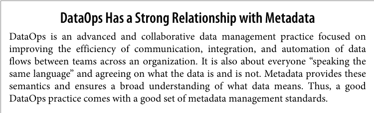
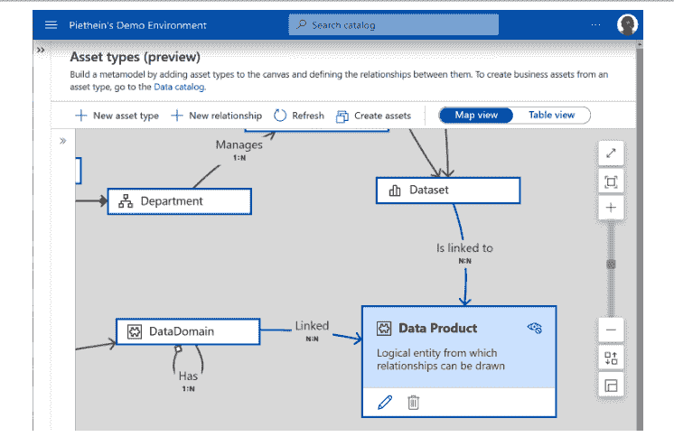
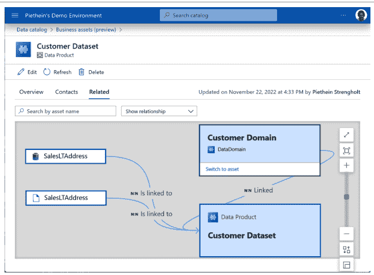
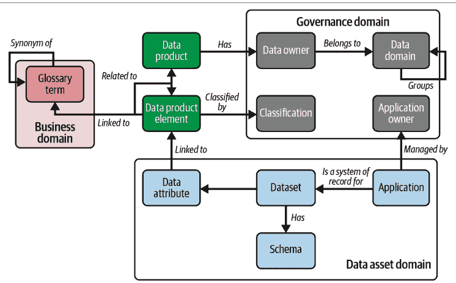
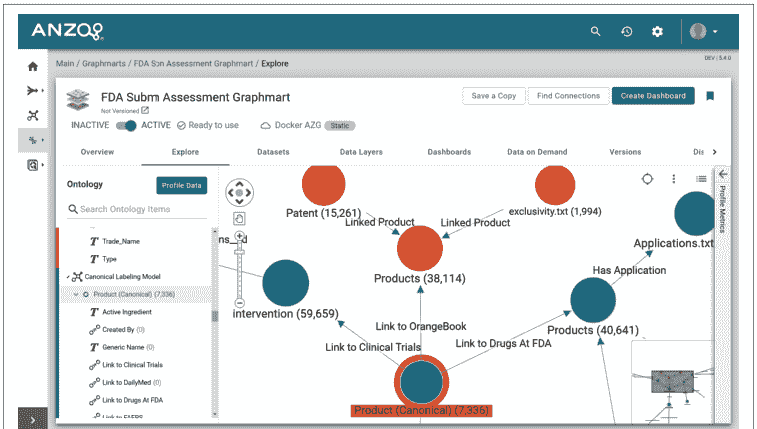
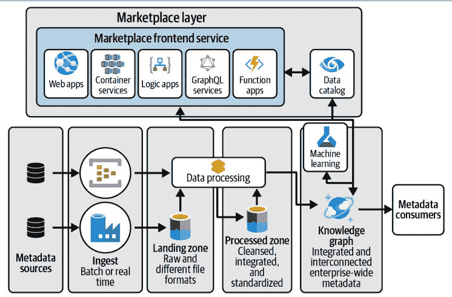
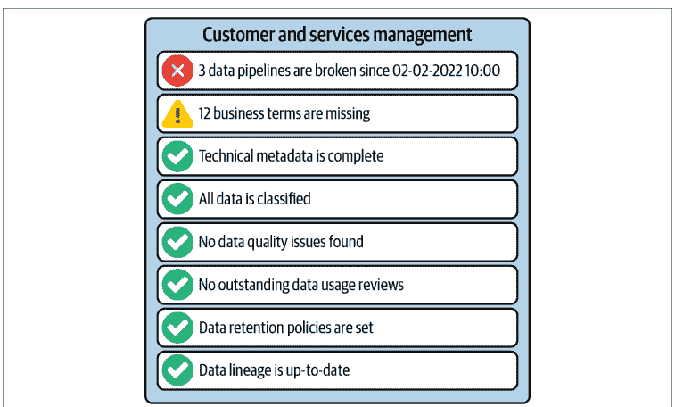

# 使用元数据实现数据民主化

我们许多人都见证了 OpenAI 的强大。未来，元数据和人工智能将交汇。您认为当这个强大的 AI 开始更多地了解元数据时，它能做什么？影响可能是巨大的。它可能改变我们目前进行数据集成的方式；AI 模型将能够解释语言、预测并编写代码。AI 可能能够修复数据质量问题，或根据血统提供关于如何最好地组织和构建数据景观的建议。首席数据官需要为这些趋势做好准备。正如他们将了解到的，元数据将处于一切的核心。

在本章中，我们将更深入地了解元数据在现代数据架构中的作用以及如何对其进行管理。正如您所了解到的，元数据描述了新架构的所有相关方面。它将一切联系在一起，是为大型企业提供所需洞察、控制和效率的关键。

元数据难以管理，因为它分散在许多工具、应用程序、平台和环境中。通常，大量组织化的元数据存储库在大型数据架构中共存。大多数元数据也与特定供应商产品紧密耦合。由于其数量庞大且多样性高，元数据通常需要在管理之前得到适当的选择、组织和集成。本章的一部分将专门介绍良好企业元数据模型的核心要素。

良好的元数据管理策略是有机增长的。它从简单且小规模开始，首先识别最重要的领域。它还通过服务和清晰的流程来支持。

要开始，了解不同的元数据类别是有好处的：

### 业务元数据

描述用于治理、查找和理解数据的所有方面。一些众所周知的示例包括业务术语、定义、数据所有权信息以及关于数据用途和来源的信息。

### 技术元数据

描述设计时数据的结构方面。一些众所周知的示例包括架构信息、关于数据格式和协议的信息，以及加密和解密密钥。

### 运营元数据

描述运行时数据的处理方面。一些众所周知的示例包括进程信息、执行时间、关于进程是否失败的信息以及作业 ID。

### 社交元数据

描述与最终用户相关的数据方面。一些众所周知的示例包括使用和用户跟踪信息、搜索结果数据、筛选和点击、观看时间、配置文件点击、评论、评分和评论。

元数据也是新兴设计概念（例如数据网格和 AI 支持的数据治理）的基础。例如，Gartner 展望了使用指向实际数据本身的知识图谱的愿景。这个知识图谱辅以一个智能引擎，该引擎使用 ML 自动创建协调和集成的数据集，可能还包括数据虚拟化。为了构建如此先进的解决方案，您需要自动化元数据的收集、发现、维护和使用，使其成为架构不可或缺的一部分。因此，我们还将在本章中探讨集成模式，并讨论为什么某些元数据必须集中持久化。

> 为了避免重复造轮子，最好尽可能多地复用集成模式。

最后但同样重要的是，我们将探讨数据民主化以及元数据如何用于推动数据治理。为了促进这一点，元数据在企业层面必须无处不在，并且对所有人开放和可访问。这是您将拥有的唯一中央数据模型。

## 元数据管理

元数据的概念和元数据管理应用的原则要古老得多，但*元数据*这一术语（定义为“关于数据的数据”）是在 1990 年代创造的。在这个时代，许多供应商通过提供更好地管理数据库数据和数据模型的工具来搭上元数据的便车。这些工具中的大多数还提供正向工程功能，以自动生成应用程序数据模型。在这种方法中，用于描述概念和依赖关系的概念和逻辑应用数据模型被用来自动生成物理应用数据模型，包括表、列、外键关系和数据类型。此外，这些工具允许您处理操作方面并确定哪些数据应处于活动状态，哪些数据应被归档。

在大数据和替代技术（例如 NoSQL 和高级分析）时代，元数据管理变得更加动态和多样化，具有不同的元数据形式和形状。随着大数据的出现，我们看到了数据目录的兴起，因为它们使监督大量数据成为可能。此外，当今变化的步伐和解决方案的多样性与传统架构相比完全不同。

当今元数据无处不在：在应用程序、数据库、数据集成技术、主数据管理、云基础设施、分析服务等方面。因此，它也更加孤岛化：每个平台和工具可能都有自己的数据库来管理元数据。

这种分散使得使用元数据更加困难。在分散和联邦环境中，难以监督数据所在的位置、数据如何移动以及数据的含义。解决这个问题需要您跨不同维度连接元数据：需要一个企业范围的元数据视图。

我的经验是，在整个企业中集成、自动化和整合元数据的过程需要标准化、深思熟虑的选择以及精心设计的程序。拥有不兼容元数据功能的技术激增将破坏创建强大数据管理能力的雄心，因此必须做出战术选择来弥合各种解决方案、应用自动化并确定哪些元数据最相关。我建议关注三个主要目标：

- 设计企业元数据模型，作为元模型实现的输入，以表示企业的所有领域及其属性和关系。
- 定义关键元数据集合并确定收集元数据的最佳架构方法。为此，我提出了一种新架构：元数据湖。
- 通过知识图谱和自助服务功能（例如目录和数据市场门户）实现元数据的民主化和价值交付。

## 企业元数据模型

在以下各节中，我将更详细地讨论这些目标中的每一个。

元数据管理通常增长缓慢。它应当得到合适的蓝图、清晰的流程以及正确选择的构建块的支持。您的元数据蓝图是一个集成且统一的模型，适用于所有数据管理学科和技术。关键不在于聚焦于狭窄的目录或商业元数据解决方案，而在于看到更广阔的图景，并识别企业元数据模型中的核心实体。

我并非要求您构建企业数据库模型，而是要思考什么将您的组织联系在一起。问问自己哪些业务元数据是关键的。哪些技术元数据对互操作性至关重要？您的域由什么组成，您如何跟踪它们使用的应用程序？哪些流程和流捕获数据？应用程序和数据库模型或架构在哪里创建和维护？团队需要中央提供哪些信息，以便数据治理部门能够正确地开展工作？在回答了这些问题之后，您需要为每个元数据领域绘制内容生命周期并确定所有依赖关系。您最终将得到一个与供应商无关、统一的元数据模型，它连接许多实体，例如组织单位、域、业务流程、技术组件、数据产品等等。

在构建元数据模型本身时，我建议最初保持抽象，不要快速引入过多变化和复杂性。从基础开始：域、应用程序列表、权威数据源（黄金源）、数据库和架构元数据、数据所有权、血缘和安全。通过缓慢扩展范围，您可以控制元数据管理。重要的是要注重连贯性，并确保所有元数据都可以集成。

## 元模型的实际示例

对于您的元数据管理，我鼓励您使用数据治理解决方案来实现元模型。¹ 您可以将其视为蓝图或地图，使用关系和参考点来便于导航。它告诉您数据是如何分组、组织和映射到其他区域的；例如，您的数据如何在业务流程中使用，哪些项目受到数据的影响，以及最终数据如何融入您业务的日常运作。总而言之，元模型是重要的工件，因为它们可以帮助您为数据目录添加丰富的业务上下文并进行管理。

要举一个简单的元模型示例，让我们考虑第 2 章中讨论的大西洋航空公司（Oceanic Airlines）的客户管理域。想象一下，扫描数据源后，我们已对两个物理数据集进行了目录编目。假设我们希望通过将此目录化数据与流程、部门、业务线、数据所有者和数据产品等概念关联来对其管理。这将如何工作？

图 9-1 展示了一个使用 Microsoft Purview 创建的元模型示例；它只是一个图表或地图，显示您可以关注哪些元数据领域。元模型由逻辑实体及其之间的关系构成。

图 9-1. Microsoft Purview 如何管理元模型

¹ 元模型是管理一组模型的模型。语义模型（描述模型中项目的基本含义及其之间关系的模型）通常是元模型的一个强有力的起点。

在截图中，您可以看到数据产品被定义为逻辑实体。您还可以看到数据产品与其他实体有关系：数据域和（物理）数据集。

让我们通过展示如何使用此地图来管理元数据，使其更具体。图 9-2 展示了逻辑实体如何在实践中实例化和使用的示例。在这里，我们使用蓝图实例化了一个“客户数据集”资产。该实体继承数据产品的所有属性，因此您必须提供名称、描述、数据所有者等等。接下来，您使用地图作为指南来定义它与其他实体的关系。

图 9-2. Microsoft Purview 如何可视化业务实体

在图 9-2 中，您可以看到客户数据集实体与多个项目相关：客户域业务实体（基于数据域的逻辑实体）以及数据集的两个物理表示。其中一个以 Parquet 格式存储，另一个以 CSV 格式存储。一旦在元模型中记录所有这些信息，每个人都能判断出存在客户域和客户数据集，并且同一数据有两个物理表示。

在这个示例中，您了解到关系源自元模型的设计。如果要在设计中添加更多关系，可以添加更多线条。此处展示的示例相对简单，但成熟的元模型通常非常大。它们可以跨越许多数据管理及其他领域，涵盖许多项目和关系，并且可以使用外部内容进行丰富。

元模型可以被视为您企业元数据模型的一个实现。您可以使用该模型作为起点，但在数据治理解决方案中对元模型的实际实现可能会有所不同。例如，它可能仅包含您在概念级别定义的完整需求集的一个子集，或者您正在使用的工具可能会施加约束，要求您以某种方式调整元模型。在下一部分中，我们将更仔细地了解元数据模型的一些基础元素。

## 数据域和数据产品

在您的企业元模型核心，存在着数据域和数据产品。图 9-3 展示了这可能是什么样子，使用了第 4 章中数据产品的定义。在该章中，您了解到数据产品是逻辑实体，代表了需要管理和治理的最重要类型的价值。它们可以（如您在前面部分中看到的那样）链接到（物理）数据对象，以及应用程序、流程、所有者、业务术语、使用条款等等。

图 9-3. 数据产品的元模型设计

为了使这些信息可搜索且可跟踪，我建议在数据目录中构建和维护元模型及其相应的元数据。

数据域是管理数据的边界。您应将它们与价值流和业务能力保持一致。数据、流程、人员和技术汇集在这些实体中，因此就像数据产品一样，数据域通常与其他实体有许多关系。

管理数据产品的推荐方法是首先在元模型中将数据产品定义为逻辑实体。您可能希望将其扩展或关联到图 9-3 中所示的另一个名为 *数据产品元素* 的实体。数据产品元素是通往术语表术语和技术数据属性的链接销，这些术语和属性通常是直接链接的。因此，这是提供灵活性的另一种抽象。考虑到业务术语和数据属性通常是直接链接的，您如何设计和实现这些元素？有两种常见方法。

有人可能会认为，每当数据产品链接到术语表术语，并且该术语表术语与数据属性有关系时，该术语就代表一个“数据产品元素”。在这种情况下，需要一个功能来快速在目录中过滤和搜索这些元素。因此，您希望快速看出哪些业务术语仅用于共享上下文，哪些术语表术语包含关系并因此表现得像数据产品元素（链接销）。

另一种方法是在元模型中创建另一个名为“数据产品元素”的逻辑实体。在这样做时，我建议配置该实体，使其不需要描述，并且始终需要与物理属性建立关系。在这种情况下，描述是从您连接的业务术语继承而来的。以这种方式实现元模型的好处是，您可以将数据产品元素扩展为链接到更多实体。因此，这种方法允许创建更丰富的上下文。与此同时，它会增加管理开销。

接下来，我们将了解不同类型的数据模型（概念型、逻辑型和物理型）如何适配您的元数据模型。

## 数据模型

数据模型需要特别关注，因为对其进行逻辑排序和分组是一项困难的练习。不仅存在不同类型/级别的模型，而且在每个级别中，还有成熟度、深度和复杂程度各异的模型。除此之外，任何给定级别内的模型之间存在关系，不同级别的模型之间也存在关系。因此，在我们进入最佳实践之前，让我们

另一视角审视不同类型的数据模型以及如何从中提取元数据。

## 概念数据模型

在最高层级上是 *概念数据模型，*² 它们可能被设计为分类法、本体学或分类体系。它们总结了关键业务概念，并从业务角度传达数据的意义和目的。你可以保持这些模型的抽象性，但我的建议是用定义、属性和依赖关系来丰富所有业务术语。定义应该是领域特定的，兼顾数据提供方和消费方的边界上下文，并帮助组织更好地理解特定上下文中的数据含义。

概念数据模型或术语表还可以包含并捕获用于使上下文更清晰的概念，但这些概念在应用程序或数据库设计中目前不发挥直接作用。它还可能包含代表未来需求但尚未进入实际设计的概念。让你的团队了解这些方面是个好主意，以免他们遗漏有用的术语。

概念数据模型通常采用用户生成的术语表形式，但其大小和表示方式没有固定规则。它们可以是抽象和高层级的，也可以是详细的，仔细描述属性、依赖关系、关联和定义。概念数据模型或术语表不仅限于描述单一领域；它可以跨越多个领域，从而涉及无数应用程序和多个数据库。

从领域角度看，多个应用程序可以协同工作以完成特定业务需求。这意味着概念数据模型或术语表与数据属性之间的关系通常是一对多。此规则的例外是共享业务能力和/或共享信息领域，例如主数据管理和企业范围上下文；对于这些情况，术语表与数据属性之间的关系通常是多对多，并且也跨越多个领域。

### 为什么概念数据模型经常缺失

概念数据模型经常缺失有几个原因。一个原因是概念模型经常被隐式创建——例如，作为白板上的草图或文档中的内容——但没有以数字形式存储。概念模型也经常与其他数据模型混淆。许多业务用户和 IT 专业人员不熟悉它们。其他人认为概念数据建模过于抽象或困难。拥有概念建模专业知识和深厚知识的人很少。

由于缺乏用于记录这些模型并将其映射到所有应用程序的良好且易于使用的工具，捕获这些模型也很困难。大多数工具只覆盖狭窄的技术范围。Protégé 是一种流行的开源工具，用于使用 OWL 构建概念数据模型。其主要缺点是，在没有充分培训的情况下，它的使用相当复杂。

概念数据模型经常缺失的另一个原因是人们质疑创建它们的附加价值。在敏捷开发流程中，或在时间压力下，我看到人们决定完全不捕获任何隐式的想法或概念。在这种情况下，业务用户、开发人员和工程师走捷径以按时交付应用程序。

你有多种方式来组织术语表中的业务术语和定义。例如，你可以创建与业务领域对齐的单独术语表，并/或可能使用父子层次结构。当同一术语在不同领域或团队中具有不同含义，或当你希望将术语表的管理控制权交给不同领域的专家时，这种逻辑分段非常有用。引入命名标准或术语模板可能会有所帮助，以确保一致性并捕获有关业务元数据的其他信息。术语表术语之间也可以存在关系，例如首字母缩写、相关术语和同义词。定义这些关系有助于避免混淆，识别同义词可以让你剔除重复术语并标准化为仅一个，从而降低管理开销。

概念数据模型清楚表明的一点是，知识是重叠的。这是可以预期的，因为上下文领域可能重叠、跨越其他领域，或在较大领域的范围内进行管理。因此，在这个概念层级上的组织方式与我们管理和查看解决方案空间的方式非常不同，在解决方案空间中，构件（应用程序、数据库、文件、文件夹、表等）是具体的。为了设计这些解决方案构件，我们使用逻辑数据模型和物理数据模型。在这些较低层级上，我们也倾向于使边界更加严格。

## 逻辑数据模型

在概念数据模型下方一层的是 *逻辑数据模型*³。这些模型是我们开始看到解决方案设计的地方，它们从概念模型逻辑演化而来。在这里，抽象业务术语被转换为实体和属性，并捕获关系。有时可以追溯性地恢复这种类型的元数据，因为从概念到逻辑设计的转换可以从数据建模工具（如 SqlDBM 或 erwin Data Modeler）中检索。

## 物理数据模型

在最低层级上是 *物理数据模型*：指定数据确切位于哪些数据库、应用程序等中的架构。有三种方式可以用物理数据模型的信息来填充你的数据目录：

- 你可以使用连接器（或代理）来扫描你的应用程序、数据库、报表等，并自动将元数据上传到目录中。
- 你可以从数据建模工具或框架中手动提取元数据，然后使用 API 将其上传或摄入到目录中。
- 你可以在目录本身中手动记录该信息（即提供元数据）。

安全性、完整性和性能要求在数据库架构设计中起着重要作用。在逻辑层级上，你可能定义两个对象（作为逻辑表），但出于性能原因，这两个对象的所有属性可能都存储在同一个（物理）表中。因此，物理数据库设计可能与逻辑模型相当不同。这也意味着，同一个逻辑应用数据模型可以用于创建物理设计的完全不同的实现。例如，你可以使用相同的逻辑模型来实现事务系统或报告系统，但每个系统都会使用其自身的物理设计。

## 局限性与最佳实践

所有这些模型及其之间关系的困境在于，并非所有工具都已覆盖所有服务和数据库类型。大多数目录提供用于元数据发现的扫描器，允许你将物理模型逆向工程为逻辑模型，并最终转化为概念模型。以这种方式将业务术语链接到技术属性，可以让你更快地找到数据，并且通过用机器学习等分析扩展此方法，你可以更好地预测用户想要看到的内容，或发现数据中隐藏的价值。但是，缺点是这些扫描器并不覆盖所有解决方案。

同样的覆盖范围问题也适用于数据建模工具。在撰写本文时，没有数据库建模工具支持所有数据库。⁴ 此外，自动正向工程仅适用于某些数据库类型。

鉴于这些限制，我建议标准化你使用的服务、数据库类型、扫描器和数据建模工具。如果从你的数据源中提取元数据很困难或不可能，请使用你的中央元模型，将物理数据模型的更高级别或抽象版本存储在数据目录中。这至少可以让团队了解正在管理哪些元数据。

收集数据模型元数据的另一种方法是众包，它利用大众智慧，通过易于使用、直观的工具扩大收集缺失信息的过程。这种包容性方法为所有处理数据的人提供了一个单一的入口点，用于提供有关该数据的信息。众包可用于链接、注释以及提供其他上下文信息，例如描述、评分、评论等等。

扫描、导出和众包元数据的方法可以结合和混合使用。例如，扫描、收集和生成初始概念模型的自底向上方法，可以通过允许数据和应用所有者进行手动改进来最终确定最终结果，从而得到补充。

捕获应用程序和数据库元数据的主要好处是，业务术语及其转换为底层数据库设计对组织来说变得清晰明了。这应该使技术团队能够快速评估并响应新需求，并解决围绕数据的问题。它还允许他们重用现有知识，并有助于数据迁移和集成项目。

此外，链接来自数据建模和设计的所有元数据，可以实现智能集成和消费。如果业务元数据与技术元数据相关联，你就知道物理数据对象及其数据属性存储在哪里。这使你能够自动提取这些数据，并结合和集成它们，

并将其提供给消费者。这种方法也被称为 *基于本体的数据集成*。

如果数据建模元数据已过时，您的数据网格雄心将会失败。缺乏准确的元数据使得自动化或智能数据集成变得不可能，因为关于数据含义、业务概念的翻译以及数据的物理表示、可用性和可寻址性的重要信息缺失。

## 数据血缘

血缘信息涉及数据的来源及其随时间的流向。这是关键知识，因为它能提供对应用依赖关系及数据如何流经信息供应链的可见性。它还允许进行调试或深入了解转换逻辑。基于您检测到的关系、统计数据和变化，您还可以潜在地使用血缘来确定源系统中的数据质量对不同数据消费者的影响。

要捕获血缘，您可以应用与数据模型相同的导出方法。数据目录自带的扫描程序通常开箱即用地提供此行为：它们会爬取并自动提取属性级的血缘，包括转换详细信息。您还可以在运行和执行代码时收集血缘；例如，在您的 Spark 笔记本运行时，您可以使用 API 或软件开发工具包 (SDK) 捕获此信息。或者，您可以手动提供血缘，或许从另一个来源上传它。

血缘在元数据管理和数据治理中往往起着关键作用。因此，设定血缘捕获的原则和标准非常重要。例如，如果一个团队使用非传统的 ETL 工具或编程语言，他们可能需要投资于定制功能，以将血缘带到目录或存储血缘元数据的仓库中。

## 其他元数据领域

让我们来看看一些可能带来价值的其他类型的元数据：

### 应用程序元数据

为了支持您的 IT 流程和应用程序开发，您拥有一个 IT 管理系统，它维护着组织中所有唯一应用程序的完整列表。这些信息对您的用户可能很有相关性，因为它能提供有关应用程序所有权、所用技术、运营事件等的洞察。

### 协作元数据

通过协作交付的社交元数据可以增加很大的价值。通过使数据可见、共享知识并允许用户协作，您可以建立一个社区。协作元数据的示例包括反馈表单、评分、投票、书签和评论。

### 数据质量元数据

关于数据质量的元数据是许多关键业务流程和分析模型的先决条件。它沿着不同的数据质量维度进行衡量，例如准确性、时效性和完整性。这些指标和评分通常与所监控物理数据属性的属性相关联。

### 业务架构元数据

为了给数据提供上下文，将元数据链接到业务架构非常重要。您可以通过业务能力、分部和部门等组织结构、流程、应用程序和通用应用程序功能来实现这一点。这些信息将使您能够将数据与领域驱动设计模型相关联，并识别哪些数据位于哪些流程背后。

### 技术元数据

技术元数据包括您想要链接到相关技术的所有元数据：服务器平台、应用程序、数据流、数据存储、基础设施等。了解技术平台与业务能力之间关系的这些信息，有助于 IT 部门了解在公司进行系统升级和变更时，维护、版本和供应商管理以及问题管理对数据管理的影响。

### 接口元数据

接口元数据包括接口设计、版本号、血缘、交付模式、计划等等。这些元数据的可用性有助于您的开发人员和数据工程师了解接口的工作方式、有哪些数据可用，以及每个接口背后有哪些有趣的趋势。接口元数据还允许他们测试和验证兼容性，这确保数据消费者可以安全地订阅。

### BI 和 ML 元数据

我想提及的最后一个领域是随商业智能和机器学习服务而来的元数据：报告元数据、模型管理元数据等等。这些元数据还可能包括血缘，显示数据从源到报告经过一系列作业或小型转换的移动，或者不同模型训练所使用的数据集的信息。捕获这些信息可以深入了解用于各个报告度量和数字的细粒度数据。

正如您所看到的，元数据及其管理可以为您的组织带来很大的价值。您管理得越高效，元数据产生的洞察就越多。它可以通过加快开发时间和减少维护来帮助您降低成本。它还可以帮助合规并确保整体架构的安全性。组织元数据是一项艰巨的任务；现在，让我们来看看元数据湖如何提供帮助。

## 元数据湖架构

如果您希望在数据管理方面取得成功，就需要拥有一个元数据湖，或 *元数据湖*：一种统一的存储库，用于存储和管理各种元数据，这些元数据可用于为数据管理提供洞察。元数据湖不仅允许业务用户查看有哪些数据可用。它也是使首席数据官能够将数据管理提升到新水平的东西。它使数据管理部门能够监督数据发现、血缘、数据使用、数据质量、数据可观测性等等。让我们来看看元数据湖的一些关键架构组件。

### 目录的作用

元数据湖架构的关键组件之一是数据目录。简单来说，数据目录是管理一组元数据的存储库或清单。数据目录通常与数据管理和搜索服务相结合。它使数据分析师和其他用户能够轻松找到所需的数据。它还可以提供信息，以评估数据是否适合预期和未来的用例。

> 对于任何计划实施数据目录的人来说，Ole Olesen-Bagneux (O'Reilly) 所著的《企业数据目录》是必读之作。

然而，问题在于数据目录往往功能不足，原因多种多样。首先，它们缺乏自动化控制和主动强制执行的能力。其次，它们通常缺少与其他元数据收集服务的基本集成，或者缺乏通过扫描其他来源来智能发现和摄取元数据的强大功能。这会导致用户需要承担所有手动元数据输入的繁重工作，并且还存在元数据变得过时或无效的风险。最后，目录宣传的是供应商眼中的数据管理。这种观点可能与您的不一致，因为组织如何进行数据治理很大程度上取决于其内部组织方式。数据治理的要求通常非常特定于公司，且差异很大。

填充数据目录通常是一项复杂的工作。您为此需要的模式与我们在第 4、5 和 6 章中讨论的相同。

鉴于数据目录的局限性，您应该如何对待它们？我建议从广阔的角度看待数据目录。将其定位为元数据管理架构中的一个组件，并辅以其他服务来弥补其弱点。发挥其优势和您喜欢的功能，但不要试图将自己适应供应商的愿景。这说起来容易做起来难，可能只有大型企业才能做到，因为它们拥有额外投资的资源，以有效解决其所选产品的不足。小型企业可能无法付出额外努力，因此可能需要一定程度的符合性。您可能需要调整流程或工作方式，以充分实现数据目录的潜力。以下是一些需要牢记的最佳实践：

- 首先，通过列出您现在和将来想要管理的元数据来定义元数据策略。确定高优先级活动，并标准化元数据对象之间的关系。此外，将您的数据治理角色与目录中必须执行的关键活动、授权模型和任务相协调。

- 对于面向领域的工作方式，明确范围，授权所有权，并将您的业务元数据和技术元数据与您的数据领域相协调。技术元数据用于组织数据资产和源。您可以对这些元数据进行聚类，设置边界，并将其与特定领域相协调。这意味着由特定领域团队管理的源系统和数据产品的技术元数据被聚类在一起并由该团队管理。您也应该对业务元数据这样做：在您的术语表中创建单独的术语表或层次结构，并将这些与您的领域相协调。此外，要求您的领域负责链接术语表术语和技术属性。这会创建关于数据所有权的透明度，并改善您的数据语义。

- 始终从协调数据所有权开始。作为一名企业架构师，我帮助制定了一项原则：新数据接入的工作流程必须始终从定义所有者开始。这可以避免在没有明确所有权的情况下共享数据。您可以为语义发现引入类似的原则；如果链接到术语表术语已过时，不要允许发布或共享数据产品。

- 为企业数据和主数据管理创建特殊条目。了解哪些数据属于主数据管理范围非常重要。这包括就受 MDM 约束的数据的业务术语达成共识，以及与领域数据的关系。因此，您需要就针对“黄金源数据”管理而强制执行的业务规则和政策达成一致。

- 定义并实施元数据生命周期管理政策。元数据管理不是一次性活动，因此请开发一个流程，以便随着元数据集合的增长为您的组织提供支持。

- 对标签和分类要严格且保持一致。如果您计划在自动数据强制执行和安全流程中使用这些内容，则需要保持对领域所使用标签和分类的控制。

- 关注数据血缘。由于工具和服务之间的互操作性常常缺失，因此这尤其困难。因此，建议就向团队提供哪些转换服务做出一致的选择。

- 在扫描所有数据和仅扫描相关数据之间取得平衡。扫描所有数据将导致压倒性的复杂性，且无法清晰了解什么重要、什么不重要。

元数据管理以及数据目录的成功实施和正确使用都是艰巨的任务。考虑采用自上而下的方法，引起人们对这些活动重要性的重视。清楚地传达您的雄心、目标、进度、里程碑和障碍。为您的数据管理愿景营造热情，并获得他人的支持。这将使用户更有可能帮助确保元数据完整且高质量。此类元数据可以为搜索、维护和自动交付等高级服务奠定基础——这引出了 metalake 架构的第二个关键组件：知识图谱。

## 知识图谱的作用

知识图谱作为数据管理的关键推动因素，正在获得越来越多的关注。知识图谱表示现实世界概念及其关系的集合。它集成并链接来自不同来源的数据，并将这些数据表示为互连实体的网络。这种网络结构对于导航、搜索和回答复杂查询特别有用。对象和资源相互链接的方式与万维网的工作方式类似：超文本链接可以将任何事物与任何事物链接。超链接可以引用另一个页面、网页的特定部分、图片，甚至文件。搜索引擎在观察超链接时，可以通过这些资源之间的关系轻松地在所有这些资源中导航。

知识图谱具有巨大的潜力。除了解决当今数据目录的不足之处外，当与 AI 相辅相成时，它们便成为面向未来的数据管理技术。

## 技术和标准

2000 年，万维网发明者之一 Tim Berners-Lee 发表了一篇文章，构建在“任何事物都可以相互链接”的理念之上。通过将语义 Web 框架扩展到当前互联网标准，任何数据都可以跨应用程序、企业和社区边界共享和重用。⁶ 多种技术可实现数据的语义编码，例如：

### 资源描述框架 (RDF)

RDF 是一种用于以图形形式表示资源信息的技术框架。它允许数据分布式和去中心化，但同时可以使用 HTTP 协议来查询和粘合数据。RDF 的数据模型是一种无模式设计，由三元组集合组成，可以轻松扩展和表示。

### Web 本体语言 (OWL)

OWL 是一种为 RDF 添加本体功能的规范。它精确定义了使用 RDF 编写有效本体所需的内容。OWL 还提供有用的表达式和注释，以便将数据模型带入现实世界。它被认为是一种概念建模语言，但由于它链接和关联数据集，因此也是一种逻辑数据模型。关于 OWL 本身的一个有趣之处在于，它可以具有 RDF 表示形式，从而允许数据的含义成为其描述的数据集的一部分。

### SPARQL 协议和 RDF 查询语言 (SPARQL)

SPARQL 是用于检索和操作存储在 RDF 中的数据的查询语言。它可以联合查询跨多个数据源的数据，因此可以将多模型图数据库纳入其中，以针对单一集成后端支持多种数据模型。

### 形状约束语言 (SHACL)

SHACL 是一种用于描述和验证 RDF 图的语言。使用 SHACL，您可以将形状图和数据图作为输入，并相互验证这两者。

### 简单知识组织系统 (SKOS)

SKOS 是一种常用数据模型，用于通过 Web 共享和链接知识组织系统。它可以用于定义知识组织系统，例如同义词典、分类方案、主题词表系统和分类法。

⁶ 语义 Web 是指 W3C 关于链接数据 Web 的愿景。语义 Web 技术使人们能够在 Web 上创建数据存储、构建词汇表，并编写处理数据的规则。

语义 Web 标准是基于本体的互操作性和 Web 内容发布的新的事实上的标准。Meta、Google、Microsoft 和 Amazon 等大型技术公司已采用并应用其原则和方法论。其妙处在于，同一组语义 Web 标准也可以应用于数据管理，更具体地说，是元数据管理。

通过结合基于本体的管理功能，您可以创建一个开放的、覆盖整个企业的元数据驱动型知识图谱。这本质上是一个数据库，用于表示和组合组织的（领域）知识和关系。它是企业元数据模型中描述的所有内容的引用集合。此存储库可以包含您能收集的尽可能多的相关元数据，并可通过上下文和语义信息进行丰富。

此愿景的惊人之处在于，您还可以将知识图谱直接连接到您的数据或元数据（取决于您如何看待）。这样，您可以根据自定义本体自动填充和创建图，或查找相应数据。只要遵循 RDF、OWL 和 SPARQL 等行业标准，查询和组合分布式数据就可行。使用这种方法，您可以在一处查看所有与数据相关的信息，例如语义、来源、血缘、数据生命周期阶段、所有权和相关法规，所有这些都相互链接，以便进行深入分析。添加和连接的越多，您的知识图谱就越强大。

剑桥语义学（Cambridge Semantics）等公司已经在致力于结合元数据和数据的知识图谱的愿景。它们收集和分析各种形式的元数据，转换这些信息，并构建数据集成骨干。在下一节中，我将通过提供示例使其具体化。

## 数据 Fabric 示例

数据 Fabric 是一种使用基于网络且由元数据驱动的架构来管理数据的新兴方法。此架构中的元数据旨在灵活、可重用、可发现、智能且经过增强。如果您正在考虑构建数据 Fabric，那么评估 Anzo 非常有价值，Anzo 是一个结合知识图谱、虚拟化引擎和报告解决方案的平台。该平台符合构建集成数据层（Fabric）的愿景。它使用 Graphmarts，即可以连接、共享、发现并协作增强的（物理）数据集合。对于数据的发现和设计，该平台利用

7 同义词典是一种按同义词和相关概念分组列出单词的参考工具。

通过扫描获取元数据。扫描完成后，系统会要求数据专家和数据工程师提供额外信息，并通过创建关系来关联实体。Graphmarts 创建完成后，用户可以向其 Graphmarts 添加数据层，用于数据清洗、转换、关联和访问控制，以迭代方式动态增强内存图。

图 9-4 展示了如何管理 Graphmarts 和数据层。妙处在于，您可以将元数据和源映射到图层中，并在此基础上构建另一系列图层。例如，您的第一层图层可以是“源图层”，直接将您的源和元数据作为输入。构建第一层图层的元数据可能来自您提供的本体（OWL 文件），也可能来自扫描发现的元数据。您的第二层图层通过连接实体并使用 SPARQL 进行改进来扩展第一层图层。这些即为数据层。随后，您可以添加另一系列图层，用于创建专为数据消费者设计的投影。这些图层也称为数据层，但专为使用语义层的消费者设计。在所有图层之间存在着关系。描述应用的转换步骤序列的配方以 RDF 格式存储为本体。它们包含对描述每个图层内容的其他本体的引用。

图 9-4. Anzo 可视化并关联图中实体的截图：这些模型代表您可以针对其执行查询的数据集

这一愿景的先进之处在于，您还可以在分布式模型下构建知识图谱，其中部分由域维护，另一部分（中央部分）在中央或企业级别维护。此中央部分构成了您模型的核心。当然，在实现中央模型时，为最重要的元数据对象及其相互关系设置企业级标准非常重要。

在实现分布式设计时，您的域可以扩展中央元数据模型，而不会影响核心模型。例如，市场营销域团队可以将其自身的特定于域的实体或属性添加到此模型中，以满足其所需的上下文和数据。他们甚至可以将其模型公开，供其他用户或消费者使用。只要底层数据存储库可访问且资源（数据）位置的关系已嵌入，一切都可以轻松地一起扩展、组合和查询。

## 元数据管理的数据网格

您可以进一步扩展使用语义 Web 标准进行元数据管理的愿景，并将其全部关联到您的企业元模型。您的元模型随后成为位于知识图谱之上的语义层，所有重要元数据均存储于其中。您可以使用此语义层进行导航、搜索和回答复杂查询。换句话说，您可以像使用知识图谱查询常规数据一样查询元数据。例如，通过这种方法，中央数据隐私分类可以链接到概念术语，并且由于您拥有指向应用程序数据端点的底层链接，因此您知道哪些数据属性是敏感的。

知识图谱被视为实体及其属性的巨大语义网，可让您根据实体之间的语义相似性找到最匹配的实体。您还可以允许域使用特定于域的词汇表、分类法或本体来扩展其域特定知识图谱，如图 9-4 所示。尽管基于本体的方法难以实施，但其影响可能巨大：它可以大大提升数据景观的整体一致性，并促进数据消费和生产力；它可以彻底改变用户与复杂数据表示的交互方式；它可能会自动生成用于自然语言处理、推荐和搜索算法的本体、分类、图关系或嵌入式。因此，为这项数据网格发展做好准备很重要。

数据网格背后的技术利用推动 Web 发展的相同开放标准。因此，内部知识及其关联的数据含义对每个人都变得可访问。大型科技公司通常将此技术与人工智能、机器学习和 NLP 集成。您甚至可以将此愿景与数据集成或数据安全等学科相连接：例如，您可以根据提供的语义上下文和关系自动集成和转换数据，或者根据记录在某个知识图谱中的流程描述动态更改数据访问。

作为一种智能且由元数据驱动的架构，数据网格是大规模管理元数据的绝佳方案。在使用基于知识图谱的方法进行元数据管理时，我建议循序渐进。不要试图创建只有少数技术人员能理解的包含所有连接的巨大图表。应缓慢构建，并使业务用户也能访问该模型，以便每个人都能从新洞察中受益。在最终状态下，您可以将高级算法和额外工具应用于知识图谱，以实现智能数据消费、提升整体质量并发现隐藏模式。

## Metalake 解决方案设计

在设计知识图谱架构时，请考虑镜像我们在前面章节中讨论的模式。元数据与常规数据一样，通常需要在其进入知识图谱以用于元数据管理目的之前，对其质量进行验证，并将其清洗和集成到其他元数据中。为了快速入门，请重复使用数据产品架构中的蓝图和服务。图 9-5 清楚地展示了与第 4 章中某些模式的重叠。在此之上，还叠加了来自 API 架构的若干服务，用于前端服务与存储元数据的底层服务之间的实时通信。

图 9-5. Metalake 解决方案设计，展示了如何利用知识图谱为数据市场提供支持——市场前端服务用于可视化端到端的数据管理洞察

您的数据目录与知识图谱之间存在着紧密关系；大部分元数据由您的数据目录管理。两者之间的区别在于，您的知识图谱更加灵活、更易于适应且范围更广：它覆盖更广泛的元数据，并可以集成来自许多不同来源的元数据。另一方面，数据目录的范围仅限于为了数据使用和数据管理目的而查找和搜索数据。

我预计下一代数据目录将大不相同。到某个时候，数据目录将成为具有许多周围服务（用于可视化、工作流管理、集成等）的开放且可互操作的知识图谱平台。

在成功设计知识图谱并开始使用它来管理数据管理元数据后，您还可以使用它来监控企业架构的成熟度。例如，使用第 2 章中 Oceanic Airlines 的业务能力模型，图 9-6 显示了如何指示组织内每个业务能力的数据管理成熟度级别。

| 业务领域 | 项目 1 | 项目 2 | 项目 3 | 项目 4 | 项目 5 | 项目 6 |
| :--- | :--- | :--- | :--- | :--- | :--- | :--- |
| 客户与服务管理 | ✅ 机票与销售 | ❌ 客户管理 | ✅ 折扣与忠诚度 | ✅ 预订与佣金 | ✅ 广告营销 | ✅ 预订与规划 |
| 员工与人事管理 | ✅ 招聘 | ✅ 人事管理 | ⚠️ 事件处理 | ✅ 飞行员管理 | ✅ 行李处理与失物招领 | ✅ 乘务长管理 |
| 航空飞行管理 | ✅ 飞机维护 | ✅ 燃料优化 | ✅ 飞行优化规划 | ⚠️ 物流与规划 | ✅ 发动机与备件 | ✅ 飞行计划管理 |
| 支持服务管理 | ✅ 资产与租赁 | ⚠️ 财务 | ✅ 信息技术 | ✅ 排放与费用 | ✅ 收入与税收 | ✅ 法规程序管理 |

图 9-6. 通过数据管理视角展示每个业务能力成熟度的业务能力模型

如果出了问题，你可以下钻查看数据集数量、数据质量问题和消费者数量。图 9-7 展示了关于域健康状态的报告可能是什么样子。这些统计数据仅为示例；你拥有的元数据越多，能提供的洞察就越多。用于显示此类可视化效果的检索信息可能来自不同的地方；元数据可以来自你的目录、知识图谱、其他元数据仓库，或这些来源的组合。

你的知识图谱在为架构提供洞察方面具有巨大潜力，但事情不应止步于此。知识图谱是构建数据市场的强大解决方案。如图 9-5 顶部所示，市场通常是一个外观和体验吸引人的轻量编排层。它作为组织内部数据使用的一站式商店和数据治理的中心枢纽。它使用存储元数据的仓库：你的目录、知识图谱以及任何其他相关元数据仓库。你可以通过调用目录和/或知识图谱的 API 来收集这些元数据。

图 9-7. 显示数据管理特征的业务能力报告

取决于你希望知识图谱变得多么智能，你还可以使用额外的分析和供应功能对其进行扩展。让我分享我在一些大型企业中见证的几个示例：

- 市场可能基于某些关联的可衡量 KPI 对数据产品进行评分。例如，与评级、数据质量、数据管道成功率、数据新鲜度和使用统计相关的 KPI 之和，可能会暗示哪些数据产品适合作为数据消费者进行数据分析准备的输入。
- 市场可能会自动进行数据产品事件分析，并在数据消费者可能受影响时主动通知他们。
- 市场可能包含通过自助服务渠道自动为客户创建和发布数据合约的功能。
- 市场可能会与报告或开发环境（例如 Jupyter Notebook）集成，以便更好地进行数据探索。
- 市场可能会使用机器学习为新加入的数据产品提出数据质量规则和架构元数据建议。
- 市场可能能够进行直观查询，这些查询可以通过多个数据源的综合来解决。潜在地，它可能具有调用数据虚拟化或转换引擎的功能，以转换和聚合数据。
- 市场可能包含用于快速处理全文搜索的搜索引擎。
- 当某些元数据缺失时，市场可能会强制不共享数据。例如，如果业务术语与技术属性之间不存在关联，数据可能对外部消费者不可见。
- 市场可能会成为奖励系统，激励域和用户积极参与。
- 市场可能包含用于快速发现数据的功能；例如，显示数据集的前 100 条记录。

未来的数据市场很可能是多种产品的组合。它们可能最初是数据产品目录，但预计会随着时间的推移而扩展更多工具和服务。数据市场在成长过程中也可能经历各种成熟度周期。在这方面，我们可以观察哪些最佳实践？以下是一些建议：

- 遵循循序渐进的方法，从少数用例和元数据来源开始，慢慢扩展到其他数据域和元数据领域。
- 双向集成你的数据市场、知识图谱和数据目录。例如，你可以使用数据目录创建数据合约，但在数据产品架构中执行数据访问权限管理。这需要你紧密集成多个元数据组件。
- 促进所有各方丰富元数据。考虑用额外预算奖励团队。
- 基于角色和数据域定义协作治理模型，为所有利益相关方明确职责和功能。
- 定义一个元模型来管理组织数据的所有知识和上下文。此元数据应与目录中使用的模型紧密对齐。
- 创建仪表板、指标和警报来监控元数据质量。开发反馈循环以在源头改进元数据质量。

如你所见，成功构建数据市场在平台创建、组织和流程方面是一项重大挑战。然而，它将为实现数据策略中定义的目标带来大量好处。

## 总结

如果数据是业务用户的燃料，那么元数据就是首席数据官所需的数据。有了元数据，CDO 可以监督并深入了解组织数据管理能力的整体健康状况和状态，并将其提升到最高效率水平。

正如你所发现的，元数据将一切联系在一起。验证数据的完整性和质量、将数据路由到新位置或在新位置复制数据、转换数据以及了解其含义——所有这些都依赖于元数据。元数据管理不仅仅是关于大数据、商业智能和分析。它还与应用程序集成、面向服务、微服务和 DevOps（包括持续集成和部署）相关联。

你还了解到，元数据必须与分析相结合，以持续改进你的数据管理能力。通过使用知识图谱和机器学习，你可以检测数据点之间的新模式和关系。借助合适的一组服务，你可以为建模数据、提高数据质量和自动分类数据提供更好的建议。这种智能是数据网格的缺失部分。因此，你的下一代架构是混合型的：既是数据网格，也是数据织构。

元数据还对于通过自助服务门户实现数据民主化至关重要。为了推动数据消费，你应该引入一个数据市场，用户可以通过它直观地探索可访问的数据。你可以只提供少量数据产品来启动数据市场，然后通过加入更多域来随架构增长而扩展它。考虑使用额外服务（例如用于直接查询和处理数据产品的虚拟化）来丰富你的数据市场架构。这将提供更丰富的体验并吸引更多用户。最终，你的数据市场也是连通的。它不仅促进了数据的价值，还是监督整个企业的透镜。

构建数据市场不仅仅是关于元数据。它还涉及结构、文化和人员。你需要赋予用户信任，提供培训，并致力于提高意识。这些文化方面的要求较少僵化的治理，但这些活动的规模不容低估。当你的用户得到正确培训后，他们将成为宝贵的资源：他们各自拥有或使用数据景观的特定部分，并仔细维护和优化这些部分；他们相互帮助并提高彼此的有效性。

在下一章中，我们将讨论主数据管理。你将学到，通过对数据进行主数据管理、整理和重新发布，可以将部分企业一致性重新引入架构。
