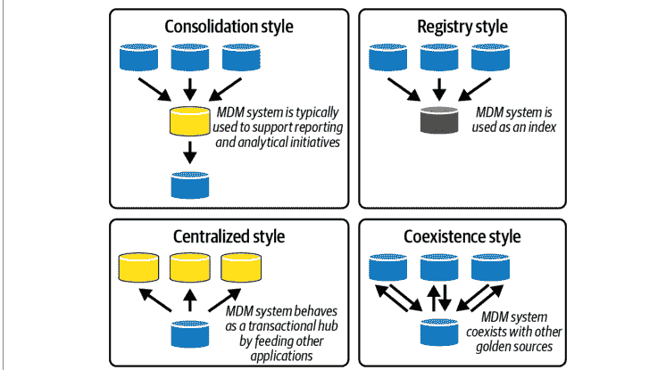
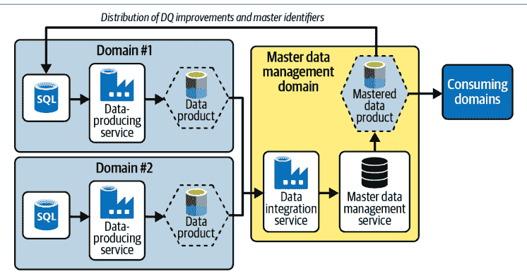
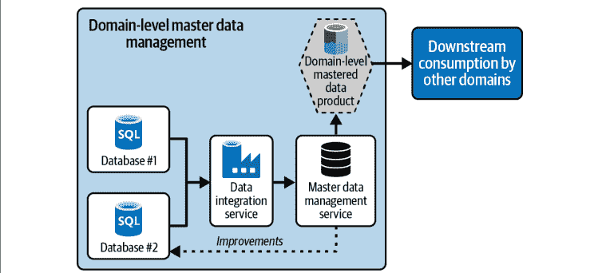

# 现代主数据管理

在这本书的第一版中，我对数据和主数据管理（MDM）提出了以下建议：“如果数据快速且流动，将其拆分为较小的片段并交由各域管理。如果数据稳定且确实重要，请考虑使用 MDM。”三年后，我仍坚持这一建议。为什么？因为在高度分布式环境中，应用程序通常相互交织。在前几章中，我们讨论了企业需要管理和分发数据的规模。大型组织通常拥有众多域，每个域都拥有其数据资产的所有权，并负责向数据消费者共享可复用的数据产品。这种联邦制提高了速度，但出于几个原因令人担忧：

- 域往往只关注自己的数据产品，而不关注如何与其他产品协同工作，这可能会使消费者难以合并来自多个域的数据。
- 如果每个域都在构建自己的数据转换代码，那么就会有大量重复劳动，这会使架构昂贵且低效。
- 多个域出于性能原因拥有来自其他域的数据汇总或副本，这会导致数据重复和复杂性增加。
- 域之间的上下文可能存在不一致，因此数据质量水平也存在差异。

为了解决数据可复用性和一致性的挑战，我们需要将 MDM 的规范添加到架构中，并确保在源系统的根源上解决数据质量和不一致问题。正如第 1 章中所述，MDM 是关于管理和分发关键数据，以确保一致性、质量和可靠性。这一点很重要，因为不一致或错误的数据可能导致信誉受损以及收入和利润下降。其他正在推动的趋势包括

MDM的需求包括安全、欺诈检测以及GDPR和CCPA等法规。管理主数据低效可能导致无法发现欺诈或招致监管机构的处罚。

> 很容易陷入企业数据统一的陷阱：扩大范围和掌握过多数据需要付出更多努力来整合、治理和协调数据。使用元数据来决定包含哪些内容。分析数据血缘、数据模型和数据合同可以揭示各领域之间的重叠和共同关注领域，从而确定哪些数据应纳入MDM范围。通常，仅在单个领域内使用的数据元素不应纳入MDM范围。然而，由众多领域共享的数据元素则是候选项。

在展示如何在大型生态系统中应用MDM之前，需要说明的是，MDM不能——或者说不应该——用主要专注于数据集成（ETL）的技术来解决。它比这复杂得多。现代MDM技术栈涵盖许多方面，包括以下内容：

- 数据质量管理，例如检测处理、更正处理和后续管理
- 自动匹配与合并规则管理，用于处理数据重复
- 位置/本地化处理，用于管理地理限制和影响
- 数据丰富管理，用于补充缺失或不完整的数据
- 同意管理，例如数据法规和用途管理
- 数据治理管理，例如用于审批流程以及就数据质量、规则、本地化、数据访问等所做决策的工作流和生命周期管理
- 数据源管理与集成功能，例如使用新创建的MDM记录更新源系统数据

## 揭秘主数据管理

大多数组织都有共享具有共性数据元素的系统。以“客户”和“产品”为例：同一主数据的多个版本很可能存储在组织的不同部分，分布在许多应用程序和系统中。这种重叠不仅低效，还可能导致不一致。客户的姓名拼写可能不同；地址可能不同；每个客户在每个系统中可能都有自己的唯一ID编号。每份数据副本可能属于不同的部门或领域。如果客户数据发生变化或需要合并，你将如何在存在这些差异的情况下识别出谁是同一客户？正是在此时，MDM派上用场。MDM通过将经过整治的数据版本分发到各个应用程序和系统，专注于检测和解决数据不一致问题。

1 在实际操作中，你会发现许多数据元素（例如，“客户”）甚至没有可以轻松拼接在一起的唯一且连贯的标识符。MDM也可以解决这个问题。

MDM可以通过多种不同的方法和范围来实现。在以下部分中，我们将探讨一些可能的实现风格和数据集成选项，然后转而设计MDM解决方案。

### 主数据管理风格

要成功管理主数据和参考数据，你需要设计并实施MDM解决方案。Lyn Robison为Gartner撰文，识别出四种MDM风格：整合、注册表、集中式和共存（参见图10-1）。

图10-1. Gartner对四种主数据管理实现风格的抽象比较

让我们逐一深入了解这些风格：

### 整合式风格

整合式风格与数据仓库有很多重叠：它将主数据和其他数据整合到单一存储库或中心中，称为主数据存储或MDM中心。中心使用数据集成模式，持续从运营系统中拉取主数据，以提高质量并管理治理。来自此整合存储库的数据可供下游应用程序使用。这种风格通常用于分析、商业智能（BI）和报告。不会努力清理或改进黄金源系统中的数据。对数据所做的改进仅限于中心，因此只有使用该数据的应用程序受益。

### 注册表式风格

实现起来最容易的MDM风格是注册表或存储库风格。注册表通常是一个简单的交叉引用表，可提供有关已去重对象以及它们之间发现了哪些关系的直接洞察。它使用内部参考系统和本地标识符（例如客户标识符）链接回原始数据源。

这种风格对黄金源应用程序没有影响。每个源系统仍然控制其自身数据，并保持为黄金源。由于没有数据从注册表分发回源系统，因此也不会对数据质量产生直接影响。

### 集中式风格

在集中式风格中，主数据存储作为所有运营和分析系统的主数据中央存储库。它收集、链接、清理、匹配和丰富数据，然后立即将增强后的数据发布回各自（事务性）源系统。

关于这种风格最大的担忧是，它需要侵入黄金源系统以进行双向同步：应用程序需要符合使用主数据存储作为其后端。这种一致性模式可能很难实施，因为应用程序设计并不总是可以更改。例如，现成产品通常无法修改。另一个担忧是紧密耦合：如果你想出于任何原因更改集中式存储库，你也被迫更改所有其他系统。虽然商业MDM厂商会告诉你这是管理良好且受治理的主数据的最佳方法，但我建议你认真考虑任何其他方法。

### 共存式风格

共存式风格用于主数据无法集中使用且必须在整个企业中多个位置分发的场景。在这种风格中，改进会回到原始系统，因此更新在黄金源系统中执行。共存是最复杂的实现风格，因为必须实施复杂的数据集成模式来进行分发，并确保黄金源系统和主数据存储中的数据一致性。

这四种实现风格并非互斥。例如，你可以从注册表风格开始，然后转为共存。你还可以针对不同数据集使用不同风格。你可能选择使用整合式风格管理报告结构，但使用共存式风格管理客户数据。在实施风格时，还可以混合不同产品的实现。重要的是要注意，实施风格不应由技术驱动，而应由组织和数据需求驱动。话虽如此，并非所有MDM厂商都允许你轻松在不同风格之间切换或混合使用。你需要谨慎选择供应商，并考虑可能要采用哪种风格（或哪些风格）。

## 数据集成

数据集成是实现MDM的基础。许多MDM实现必须同时支持批处理和实时处理；在事务系统中，处理通常实时进行，而分析系统通常专注于用于大量数据的批次。MDM必须建立在我们迄今用于分发和集成数据的同一基础上。在这种模式中，MDM同时扮演数据消费者和提供者的角色，从源系统收集数据并将其分发到源系统。

分发MDM数据时，必须在数据一致性和延迟之间取得平衡。根据你面临的情况，可能会采用不同的实现和集成设计。

如果用例是操作性的或需要低延迟，请使用API或事件。微服务的一种方法是使用状态存储：你不一次移动数百万条记录，而是使用事件驱动架构，将MDM记录作为流式数据库暴露给使用应用程序。这样一来，某个领域的微服务可以由该领域开发的多种服务和一个负责MDM数据的面向读取的微服务组成。

将MDM用于关键且时间敏感的操作路径可能很复杂。例如，如果订单管理系统接收到订单并在MDM系统中查找客户，你需要确保关键的匹配和合并进程在毫秒级完成。

实现MDM状态存储的一个选项是使用NoSQL数据库，它会持续接收源系统的数据。在数据库中，状态存储会跟踪哪些新创建的数据可以链接到全球识别编号。为了简化此过程并提高质量，你可以将机器学习功能扩展到状态存储。拥有一个包含所有事件（例如，创建、更新、

删除) 提供重放整个数据积压的能力。一般而言，这简化了对数据模型中不可避免的变更的管理，因为你正在使用一种范式，如果需要，它允许你重放所有数据，而无需源系统参与。话虽如此，重要的是不要混淆角色和职责，最好将此事务日志与你的 MDM 解决方案分开保存（同时确保你的 MDM 平台可以使用事件流式思维来工作）。

对于可容忍较高延迟的用例，你可以使用数据产品架构分发主数据。但是，重要的是不要在 MDM 中心与提供和消费应用程序之间建立点对点连接。如果你这样做，就会存在数据不一致的风险。例如，数据消费者可能会直接从 MDM 中心接收新记录，而数据产品尚未更新，可能无法反映 MDM 中心中使用的数据。如果 MDM 中心始终使用数据产品，你就永远不会出现这些不一致，因此一个好的原则是使用消费者用于分析工作负载的相同数据产品来为你的 MDM 环境提供数据。

## 设计主数据管理解决方案

实施 MDM 的流程始于识别在哪些应用程序和系统中创建和维护了什么独特且可信的数据。来自金色源系统的金色数据集是基础。由于数据在每个应用程序中的存储方式不同，因此了解每个上下文以及哪些业务规则、格式和参考范围会影响那里的主数据非常重要。

下一步是设计一个协调数据并使其保持一致的 MDM 解决方案。你可以选择供应商提供的解决方案，也可以自行设计。MDM 领域的一些流行供应商是 CluedIn、Profisee、Informatica 和 Tamr。

MDM 的设计与实现与数据建模和数据集成关系密切：识别重叠的数据属性，并通过 ETL 过程将数据协调并建模为适当的数据模型，是 MDM 解决方案整体设计的重要组成部分。根据你选择的风格和解决方案类型，涉及的数据建模和数据集成工作量可能会有所不同，集成模式和架构也是如此。例如，共存风格更多地依赖于实时处理，并使用基于 API 和事件驱动的架构，而整合方法可以仅使用来自你的数据产品架构的批处理数据来构建。

你需要建立治理，确保数据所有者和应用所有者对以下事项达成一致：

- 必须应用哪些法规（例如，某些法律不允许合并不同的客户数据集）
- 将被主数据管理的数据范围
- 清理、匹配、合并、链接和整合的规则²
- 中央主数据存储可以作为权威来源的数据使用分类（参见第 244 页的“数据使用分类”），以及数据消费者必须回退到其本地（原始）源系统的情况
- 要实施的数据质量规则和流程
- 改进是否应该交付回原始源系统，如果是，交付速度有多快以及使用什么数据集成技术（预期批处理、API 和流式处理的变体和组合）
- 新创建的数据由谁拥有（领域团队或中央团队）
- 哪些用户有权批准或拒绝提议的变更
- 主数据定义，应存储在数据目录等中央元数据存储库中

完成这些步骤后，你可以开始制定如何将数据分发回原始源系统和其他应用程序的策略。

### 域导向型主数据管理

虽然许多 MDM 解决方案可以同时管理参考数据和主数据，但我建议明确划分这两者的管理方式。参考数据是用于定义、分类、组织、分组或分类其他数据的数据（或值层次结构，例如产品和地理层次结构之间的关系）。相比之下，主数据是对企业绝对至关重要的核心数据。每种类型通常以不同的方式管理，并带有其自身的数据分发方法。

### 参考数据

实现领域间数据一致性的一种方法是，要求你的领域在分发数据产品时，使其符合中心管理的参考数据。货币代码、国家代码和产品代码是应提供的常见参考数据示例。例如，此数据可以发布在主数据存储或中央存储库中。当你的任何领域向其他领域分发数据产品时，它们应该使用来自企业参考数据的标识符来对数据进行分类。本地数据与企业数据的映射使其他领域能够快速在数据产品中识别主数据。

² 企业很少能第一次就正确制定匹配和合并规则。在合并和链接过程中，你也会出现过拟合和欠拟合的情况。拥有一个敏捷的 MDM 系统来允许你对规则进行迭代非常重要。

要求领域使其数据产品符合企业参考数据，听起来与数据网格方法相矛盾。在某种程度上这可能是事实，但如果法规迫使我们在某些数据维度上保持一致，那么主数据管理是正确实现这一目标的唯一方法。

当然，如果领域要将本地参考数据映射到中心管理的参考数据，他们需要知道应该将什么映射到什么——例如，国家代码的 alpha-2 代码（如 US）和数值（如 840）是否应始终映射到标准的 alpha-3 代码（如 USA）。³

在要求你的领域使其数据产品符合企业参考数据时，你可以遵循不同的方法。一种选择是提供中央服务，以便领域在构建数据产品时可以发现、理解、选择和纳入企业参考值。例如，你可能有一个数据目录，它引用了一个托管所有参考数据的中央存储帐户。采用这种方法，领域自行执行映射活动，在分发任何数据产品之前，使用同步的企业参考数据副本查找参考值。此集成过程可以从完全自动化到手动不等。

另一种选择是提供中央 MDM 服务，以便领域可以在 MDM 解决方案内管理本地到企业的映射。在此情况下，每次发布数据产品时，都会运行一个后处理活动来检查不一致性，并使用企业参考数据丰富数据产品。这种方法前期实现可能需要更多工作，但它消除了在所有各自领域内为此构建解决方案的需要。它还保证了更好的质量，因为映射在中央级别得到验证。

你可以同时使用这两种方法将参考数据添加到数据产品中。也就是说，一些领域可能会自行进行映射，而其他领域则依赖于中央管理的服务。在这种情况下，中央治理机构应监督整个企业的参考数据管理，以确保实现标准化、质量和运营效率的目标。

³ 值得一提的是，许多这些参考代码可以使用外部服务自动更正，即使它们格式不同。许多编程语言也内置了此功能。

## 主数据

对于主数据，数据分发和集成的方法不同，因为结果可能向不同的方向流动。

### 主识别号码

主数据的第一个重要方面是主识别号码，⁴ 它们将主数据与来自你的领域的数据关联起来。这些数据元素对于追踪哪些数据已被主数据管理以及哪些数据属于同一组至关重要。识别唯一数据并分配主标识符只能集中完成，而不能在系统内本地完成。它要求将不同系统中的主数据汇集到 MDM 解决方案中。图 10-2 展示了这一过程在实践中的工作方式。

图 10-2. 通过 MDM 进行主数据管理和分发的解决方案设计

识别和维护这些关系不仅对于了解哪些数据已被主数据管理很重要，而且对于了解哪些数据可以快速链接到其他数据也很重要。如果运营系统中的本地（领域）键发生更改，将一切联系在一起的唯一元素将是主标识符，因此你还应该从你的 MDM 解决方案向你的本地领域构建反馈循环。一种选择是让领域在查找表中维护本地标识符和主标识符之间的关系，该表可能存储在 MDM 解决方案本身内。对于金色源，你

might want to implement a principle of routing master identification numbers back to the underlying domain.

## 应用键与代理键

Data engineers have two choices for unique identifiers: you can use a unique, existing business identifier or application key, or a unique system-generated surrogate key that is immutable and will never be duplicated. The benefit of using a surrogate key is that it has no semantic meaning. MDM assigns a surrogate key to every master record to help you recognize groups of master data.

When using application keys, you have to remember that a key that is unique in the source system may not be unique across all systems. For example, take a system that uses seed identity keys starting from 1 and going up. You might say this is a bad practice—clearly, if there are other systems in the organization that use the same approach, the identifiers will not be unique across systems—but there are many systems that do actually work like this! Using a random GUID removes this problem. Thus, a business identifier by itself is often not enough to uniquely identify an object when we’re bringing data together from multiple systems.

Now imagine the following situation: you ingest data from an operational application into your MDM system, and the MDM system generates a new random GUID for it. Then, someone decides to wipe all data from the MDM system and ingest the data again. A new GUID would be generated for each record. What happens if the data that was in the system was already being used and referenced out in the business? MDM can address this problem by using deterministic GUIDs, where the same input data from the same location will yield the same GUID every time.

When distributing master identifiers, it’s recommended that you not extrapolate the MDM master identifiers to all source systems, which can create consistency issues between domains. Thus, only applications or systems that are subject to master data management should obtain the master identifiers from the hub. Systems that aren’t subject to MDM should use their own local (domain) identifiers.

## MDM 域和数据产品

When integrating, cleansing, and harmonizing data and storing it in a master data store, you generally create new MDM domains. These domains create uniform sets of data for certain subject areas. Well-known examples are customers, products, geographical locations, finance and risk data, and employee data. Master data from these MDM domains is expected to find its way (back) to other domains. It’s distributed as data products, in the usual manner (as described in Chapter 4). A general recommendation is to distinguish regular data products from master data products because master data products use regular data products as input for master data management. You could do this, for example, by using a data catalog.

Note that you might not need to distribute master data products to all domains. You might have a set of domains within the boundaries of a certain scope that need to conform to using master data, while domains outside that scope don't.

## 域级 MDM

When you look for overlapping data, you'll likely discover various degrees of overlap. Some data is generic and spans many domains. Other data might span only two or three domains. You can draw distinctions about the amount of data overlap and its importance by implementing domain-level MDM. To do this, you create partial views of your master data within specific scopes. To distinguish the importance and amount of overlap, I recommend using the following classifications:

- **企业数据**：具有企业级范围和适用性的数据。它可以在多个域、所有域甚至企业外部使用。企业数据既包括主数据也包括参考数据，其一致性非常重要。
- **域数据**：由部分但非所有域共享的数据。对重叠域的管理很重要，但没有企业重要性，也没有任何监管重要性。域数据通常在几个域内管理和维护，而不是在全球层面。
- **本地数据**：仅在单个本地域或系统内使用的数据。它不会被任何其他域共享或使用。

Figure 10-3 shows an example of managing master data within the boundaries of a domain. As you can see, the overlap with a data product is significant. Instead of only using ETL, MDM and ETL are used for creating new data products.

With an approach like this, you can support your domains by providing MDM services to them on an as-a-service basis. We'll look at this next.

Figure 10-3. Mastering and distributing data within the domain itself (this form of MDM is aligned with domain data, while the previous example you saw is aligned with enterprise data)

## MDM 与即服务的数据质量

To successfully implement MDM within your enterprise and domains, I recommend offering MDM capabilities to the domains as a service. MDM solutions are often complex and can be hard to implement. Abstracting away the infrastructure and providing MDM services to your domains in this way can simplify usage tremendously. If you’re using a central solution, I recommend segregating the domains (or groups of domains) from one another. If all master and reference tables are stored centrally, you can distinguish them using, for example, a catalog and metadata, and classify which datasets are enterprise and which are domain data.

The same applies for data quality services, such as profiling, matching, standardization, and validation functionality. With this model, quality measures and controls become transparent, and domains don’t have to implement these solutions themselves. A recommendation that applies here is to make it part of your data pipeline solution. So, bake it into your data product architecture as a standard service or component.

Master and reference data management are ways of achieving higher levels of consistency and reuse in your organization, but there are different approaches as well. In the next section, I’ll discuss how these approaches may overlap in integration and data distribution, as seen in MDM.

## MDM 与数据策展

Master data management overlaps with the discipline of _数据策展_: the process of collecting data from diverse sources and integrating it so that it becomes more valuable than its independent parts. We’ve already touched upon the creation of new data in Chapter 2 when discussing constructor domains, which are data-consuming domains that also act as providers by creating and distributing new data products. This can be seen as a form of data curation.

Data curation removes repeatable integration work from other teams, which can be important for enterprises. Within large organizations this process is typically combined with DataOps, a methodology to create and deliver automated, integrated, and trusted data pipelines. Although data curation overlaps with MDM, it’s important to clearly show the differences and formulate some strong principles around each of them. In the next sections, I’ll highlight some different approaches to creating and managing curated data.

> DataOps 与 MDM 之间存在大量重叠，但它们针对不同的角色（DataOps 的数据工程师和 MDM 的数据管家）。DataOps 的目标是构建自动化管道，通过代码解决数据质量问题。MDM 提供一种操作流，当发现无法（或可能不应）通过代码管理或自动化的问题时，会介入人工处理。

Both MDM and curated data creation aim to deliver value and make data consumers’ lives easier. They share techniques like ETL, data cleansing, data science, and meta-data management (capturing lineage, describing data models, etc.).

As you’ve learned, at its core MDM consists of the processes used to collect, link, cleanse, integrate, match, enrich, and distribute (master) data. During these processes, duplicates are typically removed and inconsistencies in the data are corrected. MDM also has a strong focus on entity consolidation (creating one entity out of several similar or identical entities) and cluster reduction (creating a single golden record). The results MDM produces are authoritative sources of master and reference data. Unique data is typically detected centrally and the output persisted in a new physical location, since it includes many improvements. Most importantly, _不会使用不同的上下文创建新数据_. Facts, such as quantitative information, remain in their own context, although improvements are made for correctness and consistency.

## MDM 与数据仓库和湖仓的关系

在上一段中，我提到了“权威来源”。你可能会好奇，通过 MDM 产生的结果之所以具有权威性，其原因是什么，相比之下，比如说，你的数据湖仓中的 Gold 层或数据仓库中的维表。答案在于 MDM 系统包含金色记录，以及它们的血缘和所有关于它们如何到达该点并形成的历史记录。Gold 层和维表仅存储来自 MDM 系统本身的金色记录的输出。这就带来了另一个问题：你的 MDM 系统是否直接写入你的维表或 Gold 层？答案应该是不！你的 MDM 系统应该向数据仓库团队可用于填充维表的源提供数据，并且在现代湖仓中经典的“奖牌”架构中，它应该在 Silver 层和 Gold 层之间扮演过渡角色。在 Gold 层中，数据倾向于组织在可直接消费的“项目特定”数据库中；MDM 数据为该层提供输入。

数据整理与 MDM 不同，因为它不明确说明现有数据是否会被修改或创建新数据。这意味着数据的语义上下文可能会被更改。数据整理不明确说明数据是持久化还是即时创建。例如，整理后的数据可以从基于在一个或多个数据库表上运行的查询的数据库视图中交付，或者由在运行时执行的代码生成。整个数据整理过程也可以是元数据驱动的，意味着你使用元数据生成整理后的数据。这暗示了与元数据管理的强关系，因为这些活动的很大一部分涉及组织元数据（架构、表和列信息、查询、连接和过滤器等）。

让我们来看看在企业范围内强制实施一致性的几种不同方法。每种方法都有其优缺点。

### 知识交换

实现更高语义一致性的一种方法是交换知识。通过这种方法，你可以在多种方式之间在各个域共享知识。关于数据的信息可以随数据本身一起交付，通过提供额外的元数据文件或将元数据封装到数据中。或者，你可以将信息维护在中央存储库中，例如数据目录。元数据可能包含关于特定数据实体的信息，包括它们的位置、注释、属性、关系和语义含义。如果实体是等效的，可以使用标签或注释使其明确。这应当使信息交换更容易。

正如你在第 9 章中学到的那样，构建知识的过程可以通过不同方式加速。数据专家通常与主题专家或领域专家合作来描述数据。另一种方法是众包：邀请用户社区或公众提供上下文。扫描器和注释工具也可使用；这些工具通常使用算法检测重复项、对数据进行分类或评级，并预测哪些数据属于同一组。

### 集成视图

*集成视图* 是在执行时使用相同的 SQL 语句重新创建数据的预定义查询。这种确保一致性的方法在 MDM 和 EDW 架构中都很常见。集成视图有时也被称为*虚拟表*，因为感觉就像在查询表，但实际上保存的是视图下的查询。

与前一种方法（通过元数据提供语义一致性）的区别在于，视图可以包含业务逻辑。它们甚至可以创建或生成新的数据元素。这些变化不仅仅是语法翻译；它们也可能是上下文转换。另一个区别是数据可以被复制：视图可以被物化，这意味着结果被复制和持久化。这对于提高查询性能尤其有用。

视图还可以与元数据结合。例如，它们可以从元数据生成，并且在元数据更改时自动更改。

### 可重用组件和集成逻辑

促进数据协作和可重用性的另一种方法是*代码共享*。这里共享的不是整理后的数据，而是用于生成输出的底层代码（模板、代码片段和脚本）。这些代码存储在中央开放存储库中，包括版本控制，允许 DevOps 团队贡献并改进已发布的内容。

这种模式的好处是业务逻辑仅在域内应用，这允许团队根据自己的情况修改和优化此逻辑。此外，社区改进所重新生成的输出会进入中央代码存储库。这种模式的一个缺点是一致性，因为允许团队修改代码会使比较团队之间的结果更加困难。

### 通过集成中心重新发布数据

多家数据库供应商主张，数据整理可以通过封装原始来源来完成。通过这种方法，领域团队将数据提取并加载到集成平台，然后重新发布或分发它。在此过程中，语义上下文可以被更改，因此可以对现有数据集应用转换和增强。还可以创建新的数据集。

虽然这种信任特定域的模式看起来优雅，但它涉及多种风险和挑战：

- 可追溯性和版本控制，以便你知道数据发生了什么，是一个问题。为了缓解缺乏透明度的风险，请数据整理人员对其获取的数据以及应用于数据的一系列操作和转换进行编目。这些元数据应当集中发布。

- 可能会出现数据质量和治理问题。将数据固定在中心引入了改进永远无法回到原始黄金源系统的风险。这将阻止事务和操作流程从数据改进中受益。还有所有权问题的潜在风险，因为原始数据所有权通过新的数据所有权被模糊。

- 操作系统可能通过中心扩展新功能和应用程序组件，这意味着流程和数据的过渡完整性跨越了操作系统和中心。确保事务一致性变得更加困难，因为数据不仅传播得更广，还被优化以适应其他用例和消费者的需求。如果设计不当，可能会出现差异，中心与操作系统之间可能会创建层次依赖，并且可能会出现封装来自过渡系统和中心的数据的服务。最终结果可能是紧密耦合的架构。

以这种方式通过重新发布数据提供企业级语义一致性只有在以下情况下才有效：为数据模型、血缘和文档；数据清洗规则；以及确定数据是否被捕获并分发回平台的数据治理流程制定了明确的标准。在下一节中，我们将探讨一种替代方法：使用聚合。

## 通过聚合重新发布数据

MDM 活动（例如收集、清洗、集成和协调数据）与创建整理后的数据以与其他域共享的聚合域活动重叠。当试图通过对活动进行聚类并将职责分配给域来解决重叠问题时，最好关注域之间的协作模型。让我们用一个例子来说明这一点。

假设你有三个数据需求重叠的用例。不同的协作模式（如图 10-4 所示）可以在不同团队内部和之间应用。

### 分道扬镳

尽管存在重叠和相关成本，但有时分道扬镳并保持敏捷更好。

### 伙伴关系

在伙伴关系模式中，集成逻辑在域之间进行协调，这需要巨大的承诺！

如果一个域强大且愿意承担数据及下游消费者需求的所有权，可以使用客户/供应商模式。

从众模式可用于使所有域完全符合某些要求。

图 10-4. 具有共享数据需求的域的不同协作模式

让我们探讨不同的方法：

- 当需要高度灵活性和敏捷性时，可以使用分道扬镳模式。当从建模角度共享很少或没有内容，限制了可重用性，并且重复成本可接受时，这也是一种有效的选择。

- 当存在大量重叠时，团队可以使用伙伴关系模式来满足所有各方的共享开发需求。所有团队都必须愿意合作并尊重彼此的需求。所有团队都需要做出重大承诺，因为没有团队能够自由更改共享逻辑。通过这种方法，数据工程团队既是数据消费者也是数据提供者：他们将数据捕获、提取并加载到数据存储中，并重新发布或分发它。

- 如果一个团队愿意承担数据及下游消费者需求的所有权，可以使用客户/供应商模式。这种模式的缺点是可能存在利益冲突，迫使下游团队协商交付物和日程优先级。

- 从众模式可用于使所有域完全符合所有要求。当集成工作极其

复杂，当（分布式）协调不是所期望的，或使用供应商软件包时。

本节讨论的模式在跨领域数据集成或协调需求存在显著重叠时尤其重要。在这种情况下，可以将通用、可重复的集成逻辑分离出来，并将其作为新创建的数据产品（聚合）分发回去。

## 数据治理建议

如前所述，MDM 与数据策划之间存在大量重叠。不过，两者也存在重要差异，因此从治理角度来看，应分开管理。在 MDM 中，数据通常出于一致性原因进行调整。MDM 不应改变含义并创建新数据，因此数据用户和治理机构始终可以追溯到数据所有者和原始黄金源系统。另一方面，数据策划可能导致新的数据所有权，因为它可能涉及从现有数据中创建或派生新数据。因此，数据策划与领域更紧密地对齐，并在领域内执行。

创建策划数据的各种方法与数据民主化密切相关，我们在第 9 章中讨论过这一点。联邦方法正在从中心化数据管理团队转向去中心化团队。透明已应用的集成逻辑，并允许团队将数据分发回其他团队，可以极大地改进和完善数据的质量和解释，从而改善决策。然而，对于委派和确定范围，需要一个中央机构来监督数据的整体管理。

只有当所使用的数据一致且正确时，用户才能做出正确的决策。通过 MDM，您可以确保企业级的数据一致性和质量。

话虽如此，找到正确的平衡很重要。主数据或参考值领域过多会导致过多的跨领域对齐。根本没有企业数据会使任何结果都无法比较。因此，请考虑本章开头的话：如果数据快速且流动，将其分解为更小的片段并交给各领域。但如果数据稳定且真正重要，请考虑使用 MDM。为了了解真正重要的事物，您的数据血缘会有所帮助：它指向您已使用且处于使用关键路径上的资产。最重要的是，您需要对主数据采用敏捷方法，认识到这些资产可能跨越许多领域，并且这些资产本身以及它们所属的领域可能会随时间变化。这导致认识到，试图预先精确定义 MDM 信息模型的外观通常会导致大量返工，因为您的数据资产在不断发展。

以平衡方式开始使用 MDM 的实用方法是实施存储库。这是管理组织主数据的最简单方法。有了存储库，您无需调整领域系统来了解哪些数据质量低下或需要对齐。借助存储库帮助您获得这些信息，您可以更快地交付价值。

另一项建议是在与各领域达成协议后，对齐您的流程和治理。考虑专门为 MDM 制定数据合同，就所有相关领域的时间表和审查达成协议。另外，确保您处理元数据。编目您的主数据，以便各领域可以轻松识别哪些数据受主数据管理约束。另外，确保血缘关系，显示这些数据如何在您的数据管道中流动。

随着您进一步推进，当元数据质量较高时，考虑使用机器学习来预测重叠将发生在哪里以及应在企业级管理哪些数据。模型可以学习和预测哪些数据很重要。我尚未看到任何公司达到这一阶段，但在我看来，这将是可能达到的最高成熟度水平。

## 总结

主数据管理的重要性是显而易见的：只有当所使用的数据一致且正确时，用户才能做出良好的决策。MDM 确保企业级的一致性和质量——这两个领域高度交织，以至于许多解决方案特意同时针对两者。它以多种方式解决可用性和效率问题：

- 通过添加主数据产品 这确保了企业范围的一致性，并避免了多个领域为协调和数据质量构建自己的数据转换逻辑。您可以在不同级别应用主数据创建：在企业级（当数据真正重要并跨越整个组织时），以及在领域级（当数据在某些但并非所有领域之间共享时）。这些范围有时会重叠；例如，某些领域可能同时使用领域级和企业级主数据产品。

- 通过为数据产品创建引入参考数据 这种方法要求各领域符合集中管理的参考数据，但解决了解释本地参考数据和组合数据的问题。

- 允许各领域充当领域聚合器的角色 虽然数据策划可以用于将数据转换为新上下文，但管理可重复集成逻辑的更好方法是将其作为新创建的数据产品进行分发和共享。

在组织中开始实施 MDM 的实用方法是从最简单的实现样式：注册表开始。使用这种样式，您可以快速交付价值，通过了解哪些数据需要对齐或质量不佳，而无需调整任何运营系统。

下一步应设定明确的范围。不要通过选择 _所有_ 数据而陷入企业数据统一的陷阱。从为组织增加价值的主题开始，例如客户、合同、组织单元或产品。只选择最重要的字段进行主数据管理。属性数量应为几十个，而不是几百个。达成协议后，对齐流程和治理。让所有人都明确时间表和审查协议。同时处理元数据，以便编目主数据，用户知道哪些源系统的哪些数据元素是候选项，以及这些元素如何在数据管道中流动。

最后一步也是最终目标，是实现共存，其中改进直接流回原始源系统。这一步最困难，因为它需要对架构进行许多更改。源系统需要能够处理来自主数据存储的主数据更正和改进。这些更改需要相应地分发，使用集成架构的模式。

我们还讨论了通过策划数据创建来改善整个企业的数据一致性。为此，有效的沟通模型和数据治理至关重要。当数据重用得到推广时，组织会变得更加高效。这就是为什么许多公司采用基于社区的方法、开放数据模型和数据市场（在第 9 章中讨论）。现在我们将重新登上直升机，探讨集成数据在将数据转化为价值时所发挥的作用。请注意，下一章将是一次颠簸的旅程，伴随着大量的上下文切换；我们将上下飞行，进进出出。所以，系好安全带，把座椅放回正位。祝旅途愉快！
