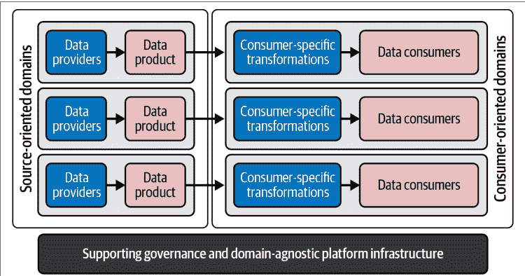
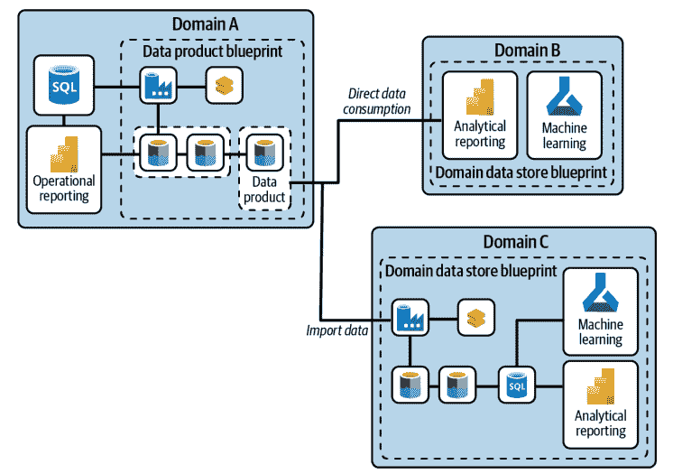
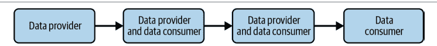
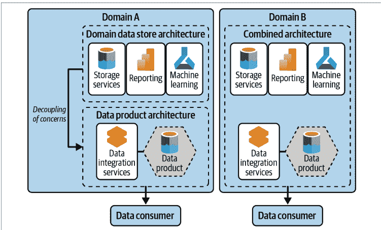
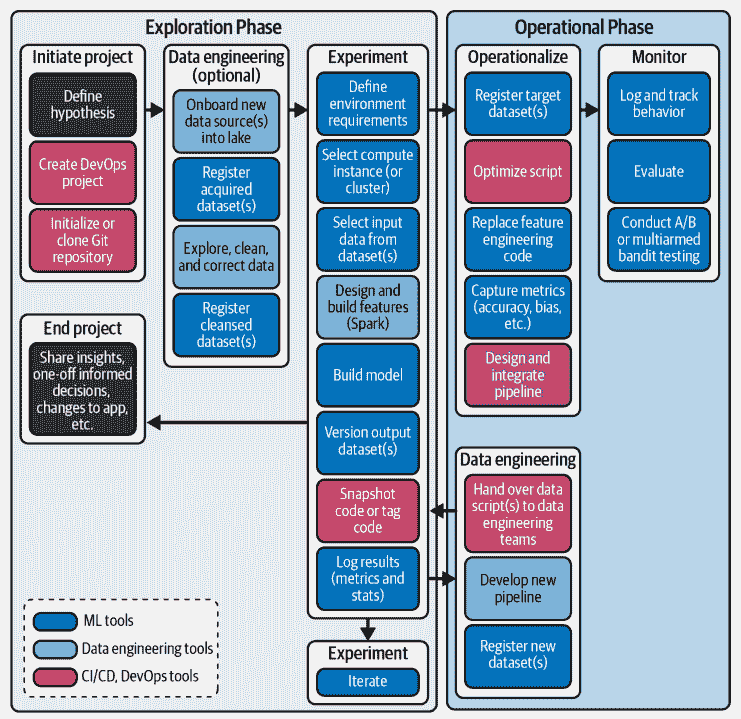

# 将数据转化为价值

在本章中，我们将讨论大多数人最喜欢的数据管理部分：使用智能服务（例如商业智能和高级分析）将数据转化为价值。我们将通过更多地关注架构的消费端来实现这一点，同时牢记我们已经涵盖的关于架构数据提供端的一切。您了解到，要以安全和受控的方式（具有适当的治理和安全性）使数据可用，需要集思广益。

让我立即摊牌：在消费端，用例通常需要从不同领域和数据产品中组合数据。这种交互在技术和组织层面都很复杂。因此，我主张以不同于数据产品的方式管理面向消费者的数据。这里的核心问题是将数据集合在一起，并为不同的业务用例进行组合。这关乎将数据转化为价值，并使用可能针对特定用例的服务。因此，本章的大部分内容将致力于此主题。

数据消费端也是架构中最复杂的部分，因为每个业务问题都有其自身独特的上下文和要求。消费端涉及大量的工具、学科、角色和活动，这使得标准化变得困难。

业务要求始终是第一位的。将数据转化为洞察或行动需要了解信息流，并利用这些知识识别业务机会。用例可能始于一次性项目，但理想情况下，您将基于关键数据开发可维护的解决方案，为组织提供持续价值。根据您的业务要求，您可能会使用不同的技术、工具和框架。

您还需要考虑非功能性要求。需要许多不同的数据库技术来容纳大量复杂的用例。根据

针对正在讨论的用例，你可能会选择其中一项或多项。此外，
你对数据进行转换的类型和速度各不相同，还有针对并行化的优化以及消费模式，所有这些都会影响
你的最终结果。最后，还有用于交付商业价值（可操作的洞察）的不同商业智能和机器学习模式，这些模式复杂且
包含许多组件。本章将探讨所有这些主题。

为了应对上述所有挑战，我建议创建标准化、可复用的模式
和构建模块。这种方法与管理数据产品架构的方式类似。然而，对于数据消费，你需要定义不同的模式，
制定管理自助服务数据和托管数据的原则，并在选择数据存储、构建管道以及使用商业智能和机器学习服务方面
明确考虑因素。本章将详细拆解的消费架构建立在第2章讨论的数据基础之上，并与第8章讨论的治理模型协同工作。

## 将数据转化为价值的挑战

我曾多次目睹这种情况：在缺乏特定分析能力且需要更快速度的情况下，业务用户开始自行购买和部署自己的工具。他们创建点对点接口，并将分析工具直接连接到数据仓库和运营系统。他们还开始将数据直接抽取、转换和加载到自己的自管理业务环境中。随着新用例和机会不断涌现，越来越多的此类工具被引入以解决单一问题，而不考虑相关问题。不可避免的结果是：架构变得复杂、昂贵且难以管理。

为了防止业务用户将你的数据管理架构引向混乱，你需要创建受控环境，这些环境与底层数据管理服务深度集成，并支持许多业务域的联邦模型，同时以自助服务的方式满足不同受众和用户群体的需求。我们将探讨这是如何运作的——但首先，让我们回顾一下我们已涵盖的内容以及本节将重点关注的架构部分。

迄今为止，我们大多专注于使数据准备就绪并可供消费。在第4章中，我们讨论了数据产品的设计与管理。在随后的章节中，我们继续探索数据的分发与管理，深入研究了API和事件管理、元数据、主数据管理、治理和安全等领域。所有这些主题都属于数据提供方的范畴，位于图11-1所示架构的左侧。

## 图 11-1. 数据提供方与数据消费方的去中心化协作

在图11-1所示架构的右侧是面向消费者的域。正如你在第2章中所学，这些域消费由提供方域提供的数据，并根据需要进行转换以适应其业务需求。面向消费者的域是独特的上下文。因此，这种特定于消费者的转换步骤_始终_是必需的。数据消费者是自己用例的专家，因此他们负责这一步骤；他们设定需求，并知道为了什么商业（分析）目的必须整合哪些数据。他们如何处理这个问题？

数据消费及其伴随的转换通常从数据复制开始。然而，这并不总是必要的。确实，在大型架构中，你希望限制相同数据的副本数量，因为维护这些副本可能成本高昂且困难。安全是一个问题，数据可能会发生变化或过时。因此，作为消费者，你的首要考虑应该是能否直接使用数据提供方的数据产品，而无需复制或持久化它们。

如第4章所述，数据产品的设计目的是向消费者反复提供大量不可变数据。由于其底层的性能和访问模式，它们可用于在查询时直接检索数据（例如，用于报告、即席分析、分析或自助服务活动）。在直接数据消费模式中，数据被读取但不会创建新数据。消费型应用程序直接将数据产品用作其源，可能基于相似数据元素之间的映射执行一些轻量级集成任务。它们可能会更改上下文并临时创建新数据，但不需要将这些结果存储到其他地方。这种直接使用模型的优点是不需要创建新的（复杂的）数据模型。你无需将数据抽取、转换并加载到新数据库中。转换是实时发生的，但这些结果不需要一个永久的新存储位置。

为了支持这种直接读取消费模式，底层数据产品架构必须提供足够的性能。然而，问题是消费者的需求可能会超过你的数据产品架构所能提供的。例如，需要处理的数据量可能超过数据产品平台所能处理的量。在这种情况下，一个解决方案可能是将（历史）数据逐步移至新位置，对其进行处理，并为后续消费预先优化。当多个数据产品需要组合和协调时，你也可能会遇到问题。这通常需要许多结构更改、任务编排，或首先将数据更紧密地聚集在一起。让用户在所有这些任务完成之前等待才能呈现数据，会对用户体验产生负面影响。在其他情况下，明确需要创建新数据；例如，当使用复杂的业务逻辑生成新的商业洞察时。为了保留这些结果以供后续分析，你需要将这些信息保留在某个地方。与直接使用数据产品不同，在这种情况下，你需要使用不同的数据消费模式：创建领域数据存储。

## 领域数据存储

新创建的数据应与域管理数据产品的方式相同来管理，这引发了两个问题。首先，我们应该如何称呼管理新创建数据的架构？一些从业者使用 _数据应用程序_ 和 _分析应用程序_ 这两个术语，但在我看来，这些术语可能指代任何事物；它们仅仅描述了数据产品被消费和集成的架构。例如，分析应用程序可以是任何类型的业务应用程序。

第二个问题是如何称呼这些新创建的数据。有些人也使用 _数据产品_ 这一术语来指代在架构消费端创建的数据集，但我认为这种用法具有误导性。正如我们所见，数据产品具有某些通用特性：它们继承底层提供方域的通用语言；在创建后保持稳定和兼容；它们与应用程序解耦；它们设计用于高强度读取。这些特性与面向消费者的域的一般运作方式形成对比。为特定用例转换的数据与该用例紧密耦合：它不一定需要稳定，并且应采用最能补充用例要求的结构和形状。其设计可能取决于所使用的支持系统和数据库技术的具体细节（面向行的数据库、时序数据库、列式存储等）。¹

一些组织使用 *面向消费者的数据产品* 这一术语来指代专门针对独特业务需求的数据。只要你严格定义该数据的范围和目的，这个术语可能有效。然而，在随意使用中，它可能会被缩短为仅“数据产品”，导致混淆，因为区分被模糊化了。

总而言之，构建和提供数据产品不同于为商业用例消费和集成数据。所使用的服务和技术可能存在一定重叠，但底层关注点不同。提供数据——即创建数据产品——是关于为他人提供数据。它需要遵守既定原则，以保证稳定、便捷且安全的消费。消费数据是关于利用数据来创造价值。它涉及数据驱动的决策，这可能需要许多额外的工具和服务。消费和转换后的数据可能成为创建数据产品的候选对象，但这并不意味着将数据转化为价值就等同于将数据作为产品来管理。

为了便于管理该数据及其相关服务和商业用例应用程序，我提出了一个新的构建模块：*领域数据存储*（DDS）。如同第4章中的数据产品一样，我主张从两个视角来处理数据及其相应架构（技术服务）的管理。技术视角解决消费、集成和使用数据所需的底层解决方案架构。在此层级，你会发现ETL、BI、ML和其他服务，以及数据库等产品。第二，数据视角解决消费后和新创建的数据。在此层级，你可以将数据分类为以下几种之一：

### 已复制的数据

与原始数据产品数据具有相同语义的数据，尽管它可能经历过一些技术或结构变更。²

### 集成数据

已被消费、组合并转换到新上下文中的数据。³ 它专门为消费用例而设计。

1 多语言持久化是用于描述使用多种数据存储技术的解决方案的术语。
2 在我之前的工作中，我使用了 *句法* 和 *语义* 数据变更这两个术语。句法数据变更不改变数据的含义，尽管其呈现方式可能不同。语义数据变更改变上下文，从而改变含义。
3 领域内的一些工程师使用 *烹饪数据* 这一术语，以明确表明数据已被处理。

## (新建) 数据产品数据

此集成数据将提供给其他领域消费。此数据与数据产品数据相似，因此遵循第 4 章中关于以产品方式管理数据的所有原则。与消费方的数据产品不同，此数据已经经过了我们描述的结构性变更，并在完成所有这些步骤后进行共享。

你可以使用元模型来对数据进行分类，并为每种类型设置原则。例如，对于新建数据，必须始终存在血缘。

正确分类数据很重要，因为不同类型适用不同原则。例如，集成数据绝不应直接与其他领域共享，因为它与底层用例紧密耦合。毋庸置疑，任何破坏性更改都将直接影响数据消费者。因此，当此类数据必须与其他领域共享时，它首先必须成为新的数据产品。

为了整体管理消费方（包括技术和数据），我建议使用 DDS。如图 11-2 所示，DDS 类似于数据产品存储。其作用是存储和管理促进消费者用例所需的新建数据。

DDS 导入和存储数据，如图 11-2 中领域 C 所示，仅在消费者无法直接使用其他领域数据产品时才必要。领域的底层技术按用例选择，依据成本、敏捷性、知识和技能，以及性能、可靠性、数据结构、数据访问和集成模式等非技术要求。

DDS 本身就是一种架构。与数据产品架构类似，DDS 通常以蓝图形式提供，你可以使用这些蓝图为领域团队快速启动环境。蓝图可能会部署一组可用于数据分析和数据科学的服务。它还可能包含 ETL 服务、调度工具、CI/CD 服务等。团队不需要的任何服务都应明确禁用。

重要的是要了解，DDS 可以同时扮演数据消费者和数据提供者的角色。在这种情况下，DDS 在消费者角色下，会消费、集成并转换所消费的数据，生成新的集成数据。作为提供者，它会将新建的数据产品提供给其他数据消费者。此过程如图 11-3 所示。

图 11-2. 领域数据存储

图 11-3. 消费者可以转变为提供者，这可能导致数据消费和进一步分发的链条

将应用程序分类为黄金数据源（参见第 26 页的“黄金数据源”）或 DDS 是至关重要的，因为这样做能明确独特真实数据的责任归属和来源。这也能保证数据在整个分发链中保持唯一且不变。请注意，应用程序有时可以同时是两者，具体取决于其扮演的角色。例如，当应用程序消费其他领域的数据时，你可以将其分类为 DDS，但如果同一应用程序生成新数据，那么它将为新建数据扮演黄金数据源的角色。

在消费、组合、集成和分发数据时，你需要对 DDS 的大小和范围做出某些决策。我们将在下一节中探讨这些方面。

## 消费者对齐用例的粒度

为避免 DDS 数量过多或过少，你需要确保 DDS 的界限线已明确设定，并且每个用例或一组用例仅消费和集成其所需的数据。确定逻辑 DDS 边界的适当范围、大小和位置很困难，在跨领域分发数据时会带来挑战。通常，限界上下文是面向主题的，并且与业务能力和价值流保持一致。理想情况下，领域和 DDS 的边界应保持一致，但并非总是如此：一个非常大的 DDS 可能用于多个用例（即多个领域），或者一个大型领域可能包含用于该领域不同用例的多个 DDS。

因此，在定义领域的逻辑边界时，将子领域分组为更大的领域，然后分解 DDS 设计，可能具有价值，以简化更大范围内的数据建模活动和内部数据分发。例如，如果价值流边界内的多个领域紧密协作，那么在 DDS 架构边界内将它们逻辑地聚合在一起可能会有所帮助。同一原则可能也适用于要求彼此数据一致的用例。在可能的情况下分解领域同样重要，特别是当领域很大或子领域需要通用可重复的集成逻辑时。在这种情况下，创建一个通用子领域可能会有所帮助，它以一种方式提供集成逻辑，使其他子领域能够标准化并从中受益。一条基本原则是保持子领域之间的共享模型小，并且始终与通用语言保持一致。

4 领域驱动设计使用“共享核心”术语来表示域模型的一部分在不同团队或子领域之间共享。共享核心集成策略可以减少重复和开销。

在设计分析架构时，重要的任务是仔细考虑 DDS 的逻辑角色。这需要同时考虑业务和技术粒度：

- 首先从上到下分解业务问题：分析最高层级的功能上下文、范围（即限界上下文）和活动。这些必须划分为更小的功能区域、用例和业务目标。此练习需要良好的业务知识以及高效划分业务流程、领域、函数等方面的专业知识。最佳实践是将业务能力用作参考模型，并查找通用术语（通用语言）和重叠的数据需求，例如共享集成逻辑。

- 接下来，考虑你的技术目标以及如何实现它们。这些包括可重用性、灵活性（易于适应频繁的功能变更）、性能、安全性和可扩展性。关键在于做出正确的权衡。两个业务领域可能使用相同的数据，但如果它们的技术要求冲突，分离关注点可能更好。例如，如果一个业务任务需要密集地聚合数据，而另一个只需要快速选择单个记录，那么即使它们使用相同的数据，将它们分开可能也更可取。同样，如果一个用例要求每天更新数据结构，而另一个期望它们至少保持一个季度的稳定，你也应该考虑将它们分开。

然而，事情并未到此结束。例如，如前所述，你还需要考虑数据可重用性问题。相同的集成数据可能被多个用例所需。当领域更大并由多个（重叠的）子领域组成时，在业务边界内组织内部数据可能会变得更加复杂。在这种情况下，DDS 可能会成为不同领域区域的集合体：某些区域在多个子领域之间共享，而其他区域则专门映射到一个领域。让我尝试通过使用奖牌架构的示例来具体说明这一点。对于大型领域，你可以围绕一个 DDS 的各个区域划定边界。在这个 DDS 中，前两个区域（Bronze 和 Silver）可以在多个子领域之间共享，因此清洗、纠正和构建历史数据等任务会为所有子领域共同执行。对于第三个区域（Gold）中的转换，情况变得更加复杂，因为数据需要针对每个子领域或用例保持特定。因此，会存在共享的管道以及特定于某个用例的管道。包括所有管道在内的整条数据链都属于一体，因此可以被视为一个巨大的 DDS 实现。⁵

> 构建共同的集成模型，然后为消费者引入特定的选择和设计，这一想法并不新鲜。分层是数据仓库的核心概念。在为更大的领域应用分层时，DDS 的区别在于明确的范围。在 DDS 中，边界已明确设定：而不是集成所有数据，你只会为特定的业务目的选择和消费数据。

正确指导消费方是成功实现联邦架构的关键要求之一。如果不向领域团队提供架构指导，你就有可能看到跨多个领域出现重叠和重复的活动，针对相同的集成挑战出现不同的解决方案。

5 在数据产品开发以及（提供）领域边界的建立中，也可以观察到类似的分层，如第 4 章所述。然而，数据产品架构与 DDS 架构之间存在明显差异。在数据产品架构中，有强烈的源系统对齐。在 DDS 中，你看不到这种对齐，因为集成活动通常跨越多个来源。

在合并数据时。因此，我建议将数据消费端与您的数据产品和主数据管理活动共同管理。

## DDS 与数据产品

数据产品的目标是提供数据。DDSs 的目标则相反：消费数据并将其转化为价值。它们关乎制定业务决策，由报告和机器学习服务等功能支持。DDSs 消费的数据也不同于数据产品架构通常管理的数据。DDSs 中的数据已针对当前用例进行结构化和优化。每个业务问题都是独特的，可能涉及不同的目标用户群、不同的业务需求和不同的非功能性需求。

不过，在分发新创建的数据方面，DDSs 与数据产品可能存在一些重叠。我们已经讨论过，DDSs 可以扮演数据消费者、提供者，或者有时两者兼有。也就是说，DDSs 可能会与其他应用程序共享新创建的洞察和数据。为促进这一点，您需要仔细考虑如何使架构的数据提供端和消费端保持一致。如图 11-4 所示，您可以选择两种设计模式：

- Domain A 使用一种架构专门用于消费和使用数据，另一种架构用于数据产品开发。
- Domain B 使用一种组合架构，同时支持数据价值创建和数据产品开发。

图 11-4. DDSs 和数据产品可以一起管理，也可以独立管理

如果 DDSs 旨在专门用于分析用例来消费和使用数据，则必须使用单独的架构来共享新创建的数据（即，在构建新数据产品时）。在这种情况下，DDS 架构需要另一套包含新服务的蓝图。使用两个独立蓝图管理 DDS 的动机是解耦使用数据和共享数据的关注点。使用此选项时，分析用例的内部架构与创建和共享数据产品的架构是隔离的。

如果 DDSs 的设计包含数据产品架构，则可以使用相同的架构来消费数据并直接与其他消费者共享新创建的数据。如果您按这种方式设计蓝图，那么在用于数据消费和共享的底层服务方面将产生协同效应。例如，您可以使用相同的 ETL 框架，或共享计算资源来转换数据，以实现消费和共享新创建数据这两个目标。另一方面，由于两者都在同一架构内管理，因此更难识别数据副本和新创建的数据。所以，存在需要缓解的耦合风险，例如，通过使用元模型（第 9 章中讨论过）。

因此，您的蓝图设计将在很大程度上受到您关于 DDSs 和数据产品是一起管理还是独立管理这一选择的影响。此外，您的蓝图可能会根据您为将数据转化为价值所涉及的活动所需提供的内容而有所不同。分析用例是独特的，可能需要不同的服务。例如，仅利用报告服务的用例所需的蓝图与利用机器学习功能的用例不同。

对于 DDS 内部管理的数据，我建议根据几项基本原则区分数据产品数据和集成数据。如您所学，集成数据是指已被消费、组合并转换为新上下文的数据。输入数据和原始数据来自其他地方，因此血缘关系是一个更大的问题，因为它显示了与其他领域的所有依赖关系。数据所有权的工作方式也不同，因为数据创建和质量的责任在集成领域之外。因此，分发集成数据需要获得原始数据所有者的批准。复制的数据也是如此：其源头在其他地方，因此您需要跟踪其血缘关系。您还需要小心管理重叠的集成问题：引入主数据管理，或考虑使用第 10 章中讨论的任何聚合模式。

范围划分和解耦原则也适用于 BI 和分析服务。例如，如果一个域想要向另一个域暴露其分析模型，则必须使用适当的集成模式将其解耦。同样的耦合问题也适用于新创建的数据。分发集成数据会创建新的依赖关系，因此请考虑将数据拆解为小的、高度聚焦的部分，每个部分仅解决一个特定问题。将共享的领域模型限制在最低限度。不要创建所有团队都依赖的分布式单体；要求明确设定范围。如果数据密集重用，它就必须成为主数据管理学科的一部分，如第 10 章中讨论过。

## 最佳实践

在企业规模交付价值时最大的问题是，用例高度多样且散布在整个组织中。它们都试图解决业务问题的各个方面，面向不同的受众。用例场景广泛，需要大量各种数据存储和服务来促进它们。例如，一个用例可能需要快速到达的数据用于流分析，而另一个用例可能需要缓慢到达的历史数据用于报告。其他用例可能专注于流程挖掘、图像识别或人工智能。一些用例是描述性或诊断性的，只回顾过去，而另一些是预测性或规定性的，窥探未来。随着数据消费者需求的不断多样化，不可能为所有用例强制执行统一的工作方式和通用解决方案设计。然而，在业务需求、目标受众和操作模型、数据库和工具等非功能性需求以及数据管道和数据模型方面，始终可以遵循一些最佳实践。我们将在本节中逐一探讨。

## 业务需求

您的起点始终应是业务需求。您的用例主要取决于业务团队所看到的问题和机遇。例如，有些项目可以通过货币化洞察、提高客户满意度或通过了解市场趋势获得竞争优势，为组织增加新收入。其他用例可能以风险、财务、成本降低、情感分析、群体和追踪分析、以及通过流程挖掘和更好洞察来提高运营效率为中心。还有一些用例只需要更准确的数据，以做出更好、更可预测的业务决策。对于所有业务用例，推荐的方法是制定长期业务计划。因此，关注长期价值增量。不要陷入用一次性解决方案解决临时问题的境地。

仔细考虑任何新服务的必要性；它们可能昂贵且难以维护、控制、保护等。如果确实需要新服务，请启用它并在启用任何其他服务之前评估其使用情况。在所有情况下，都要注意重叠的服务。

在分析和所需资源方面，实施用例是一项具有挑战性的任务。为做好准备，请与业务团队举行头脑风暴会议，然后组织和聚类所有输出。创建商业模式画布可以是一种很好的方式，用于突出哪些业务用例可能使用哪些工具和服务来释放什么价值。您可能希望将所需利益相关者、所需数据源、与任何现有用例的连接、涉及的参与者和交互以及实施的时间表和成功标准等信息添加到其中。

您的业务需求还将决定您需要获取的数据量。例如，如果您要基于波动大且变异性高的数据开发机器学习算法，您可能需要比低变异性的简单模型多得多的数据。6

分析完业务需求后，您需要确保目标和宗旨定义明确、详细且完整。理解它们是解决方案的基础，需要您澄清需要解决什么业务问题、需要哪些数据源、哪些解决方案需要投入运营、必须执行什么数据处理（实时或离线）、完整性和关键性要求是什么，以及结果是否会被其他受众重用。

### 目标受众和操作模型

制定分析用例的重要下一步是确定您需要谁以及他们的职责应是什么。有许多与将数据转化为价值相关的角色。这些角色可以以多种方式定义，也很容易被误解。因此，将这些角色作为数据治理框架的一部分是普遍的最佳实践（参见第 224 页的“治理框架”）。以下是有关如何定义不同人物角色的一些建议：

- *域负责人*

  高级别决策者，通常是产品负责人或业务代表，与业务用户合作处理需求，并与治理团队合作处理数据管理策略、流程和要求，如第 8 章中所述。

## 应用程序所有者

负责应用程序或技术方案的设计，包括所有开发、安全以及应用程序和数据维护活动。

## 分析师或主题专家（SME）

负责定义业务需求、数据用途、谁可以访问数据，以及数据如何与他人共享。根据需要与域所有者和其他数据所有者协作，并支持业务使用数据。数据分析师或 SME 通常被称为“高级用户”，因为他们知道如何使用工具分析数据，但不一定是数据科学家或商业智能专家。

## 数据工程师

负责收集、集成和丰富数据。数据工程师起着重要作用，使数据分析师和数据科学家能够妥善开展工作。他们维护数据管道，并经常使用 SQL 和 Python 等语言。

## 数据科学家

统计学家，通常具有计算机科学或数学背景。数据科学家精通算法、机器学习和深度学习。他们通常熟悉业务并关注市场趋势。其最终目标是发现模式和相关性，并根据数据做出预测。他们经常使用 Python、Scala、R 和 Java 等语言。

## 报告构建者

负责为其他用户设计和构建报告和仪表板。报告构建者通常具备出色的商业智能技能。

根据业务问题的规模和复杂性，这些角色中的一些或全部将在跨职能（域）团队中协同工作。此类团队的最佳规模通常被认为与 DevOps 团队相当：5 到 10 人。创建小型独立团队并不意味着它们不能共享人才，但应明确界定职责所在。拥有专注于明确界定和范围化目标的小型团队可以实现扩展，因为许多团队可以同时推进业务的不同方面。所有团队成员都必须对业务挑战、相应解决方案和所需数据有良好的理解。

## 非功能性需求

非功能性需求可能决定软件系统或产品成败。这些包括成本、可扩展性和性能、延迟、维护便利性、一致性、安全性和治理、写入和读取特性、数据量、多样性和速度等。每一项都会在某个方向上指导你。

核心问题通常是应该使用什么类型的数据库技术或数据存储。选择最佳数据存储取决于许多标准。没有银弹。有时这也是个人偏好和经验的问题。以下问题值得考虑：

- 您的数据结构如何？结构会影响预处理步骤、执行的清洗类型、建模步骤、存储类型等。如果从一开始就不了解这一点，将导致时间浪费和结果不正确。

- 您的查询是否可预测？这会对您的实现产生重大影响。如果可以预测查询，例如，您可以使用缓存、索引或预优化数据进行优化。

- 您使用哪些类型的查询？简单查找、聚合、连接、数学运算、文本搜索、地理搜索或其他复杂操作？例如，关系型数据库通常更擅长连接。

- 当前、历史和归档数据的要求是什么？是否需要保留所有数据？

- 您希望如何在优化完整性与性能之间取得平衡？例如，您的应用程序设计是必须强制执行强一致性，还是最终一致性就足够了？如果完整性很重要，RDBMS 通常能更好地强制执行一致性。

- 在优先处理读取、摄取或完整性方面，您可以做出哪些权衡？不同的数据模型具有不同的特征。例如，Data Vault 在设计上灵活且可处理并行加载；但是，读取数据的性能开销更大。

- 您的数据库将执行哪些操作？某些类型的操作可能会占主导地位。分布式文件系统非常适合追加操作，但不适合（随机访问）插入操作。另一方面，关系型数据库在这些方面表现出色。

- 数据输入和输出的量是多少，速度如何？一些 NoSQL 数据库在批量数据摄取方面表现不佳。对于高速数据摄取（消息传递和流式处理），归一化数据模型和 ACID 一致性模型可能会因为完整性和锁定控制而降低性能。

- 您需要哪些数据访问协议？一些数据库仅可通过 SQL、ODBC/JDBC 或本机驱动程序访问，而其他数据库仅允许通过 RESTful API 访问。

- 您需要多大的灵活性来调整或更改数据结构？NoSQL 数据库可以很好地处理不断变化的数据结构，因为它们可以是无模式的。

- 您需要多大的可扩展性和弹性？一些系统支持动态水平扩展。

- 支持哪些数据库方言和语言？您的工程师是否已经熟悉这些？学习难度如何？

- 您的供应商是否要求特定的存储解决方案？供应商的要求可能会限制您的选择。

其他考虑因素包括成本、开源标准、功能、与其他组件的集成、安全性（例如访问控制）、隐私、数据治理以及开发和维护的便利性。

考虑您希望向组织提供多少种及何种类型的数据存储。您可能希望定义一组可重复使用的数据库技术和模式，作为蓝图的一部分，以确保充分发挥每个数据存储的优势。例如，任务关键型和过渡性应用程序可能只能采用强一致性模型，或者商业智能和报告可能只能使用提供快速 SQL 访问的存储。努力提供全面的选项列表，但限制重叠！您不希望最终出现几十种不同的数据库技术。

此外，将数据库选择与其他工具和服务保持一致。例如，某些 ETL 框架与某些类型的数据库配合使用效果更好。在开发蓝图时，也要考虑这些因素。最后，您可能希望在不同的云环境之间进行选择。您可能最终会得到一份几项技术服务的列表，这些服务将满足大多数用例。考虑开发流程图或决策树，以支持您的团队做出正确决策。

## 数据管道和数据模型

将数据转化为价值的另一重要步骤是构建数据管道，以选择数据并将其全部汇集到目标解决方案中。这里的关键点是，所有数据都已不可更改地持久化存储在数据产品存储中，因此不一定需要制作额外副本。这意味着您要么按常规计划直接获取数据，要么等待数据提供商通知您何时可以开始处理。当数据被拉取过来时，通常需要进行数据转换，因为您正在将数据从一个上下文移动到另一个上下文。对于这种上下文转换，您需要 ETL 工具（我们稍后将讨论）。

对于实时摄取，管道的工作方式不同，因为您需要包含一种捕获和存储实时消息的方法。您可以选择将传入的消息存储在文件夹或数据库中以供进一步处理。另一种选择是使用缓冲区或额外的应用程序组件，或使用流式处理平台的集成功能，这些功能允许您分析、操作和分发消息。有关此主题的更多信息，请回顾第 6 章。

请注意，根据您的用例要求，可能存在许多变体。例如，为了稍后进行分析，最好在数据摄取时将其存储下来，在转换或应用目标语义之前保留数据。为了更快的处理，您可以结合 ETL 批处理和流处理。为了满足不同用户的需求，您还可以使用包含不同数据存储技术的多语言设计。同样，查看您的用例要求，并做出有意识的选择。

构建数据管道是整个项目中最复杂的部分。从小处着手，保持灵活性。大多数项目失败发生在工程师试图“一口吃成胖子”并一次性建模所有数据时。另一个常见错误是在未仔细考虑需求的情况下立即跳入技术并开始编写代码。在开始构建之前，请仔细考虑所有功能性和非功能性需求，并解决基本问题。有哪些可重用任务？处理所有数据的最佳顺序是什么？是否存在依赖关系，或者某些处理步骤可以同时完成？数据将如何查询？

> 数据科学家喜欢提到他们所说的“80/20 法则”：数据科学家有 80% 的宝贵时间花在查找、清洗和整理数据上，只剩下 20% 用于实际开发。没有一种算法能直接使用原始数据并为您提供最佳模型。

我建议将数据管道构建为一系列隔离的、不可更改的转换，这些转换可以轻松重复使用和组合。在这种情况下，输入、转换逻辑和输出必须彼此明确分开。为了获得可重现的输出数据，我建议对所有管道进行版本控制。为了更好地利用现代基础设施的弹性以实现更好的性能，您可能希望将管道设计为并行运行。在涉及复杂数据转换和处理时，使用内存分布式处理引擎（如 Apache Spark）有时是更好的选择。另一个考虑因素是在开发友好的生态系统中，使用模板或高级编程语言编写转换逻辑。这种方法可以遵循编写和共享高质量代码的最佳实践来支持。

## SQL 与 NoSQL 管道

SQL 管道通常更擅长处理和执行复杂查询，但也需要更好地了解表之间的关系。因此，SQL 管道可能需要更多的验证步骤以及转换和更新逻辑，因为数据必须被解析为正确的（限制性）结构。

另一方面，NoSQL 管道可以更简单、更灵活。它们可以在无需定义结构的情况下立即动态创建数据。它们也更容易扩展，查询通常运行更快，因为不涉及连接许多表。数据可以更轻松地进行水平复制，但查询和集成它可能更加困难。

关于数据质量，你可以在一定程度上依赖数据产品中的验证，但这并不意味着管道中不需要额外的验证。消费者对数据质量的看法各不相同，因此管道需要扩展以解决常见的 ETL 问题，这些问题通常涉及约束、完整性、正确性和清洁度。此外，必须小心处理安全和隐私问题。因此，在导入和处理数据之前，预计需要额外的步骤。

此外，我建议将所有 ETL 工具和框架分类在一个统一的组合中，并附带最佳实践和注意事项。提供灵活性，但通过限制选项来标准化。例如，当数据移动和转换相对简单时，基于 GUI 或模板的框架最适合使用。另一方面，面向编程的语言可能最适合需要复杂转换或机器学习的场景。

最后，必须设置整个管道以提供血缘的元数据，以便可以追踪和理解管道中每个特定步骤以何种方式变更了哪些数据。这需要对数据产品等提供透明的反向指针。文件和事件名称、业务键、源系统标识符等必须在中央工具中可用，以确保所有转换步骤的正确性和完整性。你可能希望使用数据目录将所有集成架构串联起来。我还建议团队在构建数据管道时制定严格的原则，例如，确定在什么条件下必须将血缘集中交付。这些血缘要求还可能对你提供的 ETL 工具施加限制，因为并非所有 ETL 工具都能完美集成所有血缘解决方案。

## 界定 DDDs 所扮演的角色

为下游消费持久化数据可能有多种原因。让我先提供一些示例，然后我将分享一些关于 DDDs 的最佳实践：

### 分析数据存储

分析数据存储（或文件存储）应用于集成和合并用于分析工作负载（如机器学习）的数据。其目的是为准确的模型开发提供高质量数据。分析数据存储中的数据通常被扁平化和反规范化。

### 报告存储

报告存储用于商业智能或维度报告。数据通常被建模为事实（度量）和维度，用于另一种上下文。最流行且最简单的设计选择是星形或 3NF 模式。

### 聚合存储

如第 10 章所讨论，当领域有重叠的数据要求时，最好集中一些业务逻辑并创建一个新的聚合数据产品供各领域使用。当一个领域可以分解为多个子领域且数据要求高度重叠时，聚合数据存储也是一个良好的设计选择。

### 第三方或 SaaS 解决方案

你的一些用例可能位于架构的逻辑边界之外。对于这些情况，你将需要连接器和一个存储，用于在向外部消费者提供数据之前提取和准备数据

### 操作消费者

操作消费者类似于 OLTP 系统，但有一个细微的差别：它们不仅创建数据，还从其他领域消费和集成数据。

### 数据仓库或数据湖

当消费者需要将其他领域的大量（历史）数据合并和集成到更易于使用的通用格式中时，他们可能需要数据仓库或数据湖服务。

对于所有用例，标准化你希望为不同领域团队提供的工具和服务。考虑对支持不同场景的蓝图进行对齐。例如，仅分发新创建数据的聚合存储不需要任何商业智能或机器学习服务。这种场景最适合使用仅包含一些轻量级集成服务的更简单的蓝图来促进。界定数据存储并对团队可以选择的蓝图达成一致，有助于降低整体复杂性。对于联邦方法，始终以通用蓝图作为起点。也就是说，每当领域想要消费数据或构建用例时，选择一个通用蓝图，尽可能最小地对其进行调整以适应领域的要求，然后部署它。

对于你的蓝图，还应考虑与数据产品架构对齐，因为重叠部分很大。例如，你可能希望标准化从现代数据栈中选择的服务或使用数据湖服务时应用的分层。此外，标准化软件开发方面，包括代码部署自动化、编排以及用户可以部署的框架、库和工具。最后，你还希望标准化数据建模和设计的不同方面，例如粒度7、命名标准、物化、权限、数据规范化技术等。组织所有这些内容的典型方法是使用内部开源或建立一个中央专业知识中心8。

> 你注意到我使用了多少次 "standardize" 这个词吗？向联邦架构的过渡始于制定标准。

不同的数据存储以不同的方式内部管理和组织其数据。一种常见的策略是分离（逻辑上或物理上）摄取、清理、策展、协调、服务等问题。在现代数据存储或数据湖服务中，这可能涉及使用不同存储技术的各种区域，例如文件夹、存储桶、数据库等。区域还允许你隔离问题或目的，因此一个存储可以用于用例消费，而另一个可以用于数据产品的维护和分发。对于所有存储和区域，范围必须非常明确。它们不应跨越多个界定上下文。每个领域在其自己的边界内运行，在该边界内，它会消费、集成和创建新数据。再次，考虑将分区作为蓝图设计的一部分。

7 关系的粒度定义了关系中每一行代表什么。在像 products 这样的表中，粒度可能是单个产品，因此每个产品都在自己的行中，每个产品正好一行。通过确保粒度清晰，你可以明确指定表记录包含什么内容。这使用户了解哪些数据可以合并。

8 Nick Tune 在他的博客文章中谈到了内部开源，内容关于如何更好地管理和消除跨团队依赖。

### Inmon 与 Kimball 与 Data Vault

在设计数据仓库或数据湖时，消费侧应该使用哪种数据建模技术？嗯，这很大程度上取决于你的解决方案的特征和要求。对于基于云的数据仓库，我通常偏好宽表、嵌套表、反规范化表，因为这种设计能更好地利用云厂商提供的基础设施。此外，使用这种表可以避免昂贵的计算连接以及计算节点之间的数据混洗，这可能会导致查询运行缓慢。另一方面，如果你面临复杂的集成挑战，那么 Data Vault 等设计可能更合适。例如，如果许多数据源使用相同的业务概念，这些概念相关且需要集成在一起，那么你可以通过集线器、链接和卫星表更轻松地分离问题。此外，Data Vault 的优势在于在加载过程中减少表之间的依赖关系，并通过仅应用插入操作来简化摄取过程，插入比更新或合并加载更快。结论：每个领域应该选择最符合其用例要求的数据建模方法。

虽然所有数据驱动的决策解决方案都预期是专门为每个用例设计的，但你可能会注意到，BI 工具和 ML 服务是常见的共同点。在接下来的部分中，我们将更仔细地研究每个部分。

### 商业智能

商业智能工具帮助企业以更结构化的方式查看数据，同时提供深层解读。它们允许通过交互式数据访问和分析进行决策。对于报告和仪表板服务等 BI 工具，有一些额外的考虑因素需要权衡，以确保你为企业提供正确的价值。

### 语义层

最根本的问题是，你是否希望使用语义层对 DDS 进行抽象，以便以易于理解的方式向用户展示可用数据，从而实现轻松且一致的使用。语义层是数据的业务表示，帮助最终用户使用常见的业务术语自主访问数据。它们通常是报告服务的一部分，由 BI 开发人员构建和维护，由

商务用户。使用语义层进行商业智能和其他形式的数据消费有多种好处：

- 语义层使用户能够轻松查询数据并进行正确的组合。通常用户无需担心连接操作。关系是预定义的，可帮助每个人进行正确的组合，避免错误的计算或解释。字段命名、格式和配置保持一致。例如，金额可以自动求和，或者日期字段可用于面向时间的计算。
- 语义层中的数据经过优化（预集成、聚合和缓存），以供消费，从而提高整体性能。这带来了更好的、更快速的用户体验。
- 底层数据存储是解耦的，这意味着其数据结构的变更不一定会立即影响所有报告和仪表板。
- 语义层可以具有额外功能，例如版本控制、行级安全性和监控。
- 语义层可以使用一种称为 _数据虚拟化_ 的技术构建。这向数据消费者隐藏了技术实现细节。

语义层可用于促进不同类型的数据集成场景。领域可以直接使用它们，用于已与特定分析用例对齐的数据模型。领域还可以将它们用作其他语义模型的输入：因此，一个领域使用另一个领域的语义层作为其自身语义层的输入。在这种情况下，语义模型通常需要进行一些调整，或者与另一个领域的数据组合。总之：语义层可用于生成策划数据，这意味着数据的语义上下文可能会发生变化。这也可能意味着数据的所有权会发生变化。

大多数 BI 工具允许您以两种不同的方式构建语义层。第一种选项是使用专有的内存或缓存模型。使用此模型时，底层数据存储中的数据会按计划传输到缓存层（刷新）。这通常会导致数据重复；存在额外的数据延迟，因为底层数据存储可能比缓存层更及时。

第二种选项是利用底层数据存储。在这种模型中，查询会被传递到底层数据源，因此语义层只是一个直接联合查询的元数据层。此选项更适合实时和操作报告，因为数据库会在几秒钟内更新，意味着延迟更小。缺点是数据必须针对报告结构进行建模和优化，通常是维度数据模型。

语义层确实有缺点，必须谨慎使用。对于简单的报告和可预测的查询，添加额外层的开销并非必要。另一个问题是，高级工具可以轻松提取和持有大量数据，这最终会使语义层变得昂贵。另一个复杂因素是管理报告与底层（共享）数据模型之间的重叠，这些模型可能会组合来自不同来源的相同数据。随着您的环境增长，报告的复杂性也随之增加，与共享数据集的关系数量也随之增长。设置清晰的边界并将其与您的能力相匹配。只有在共享（或复合）模型稳定且真正重要时才使用它们。

构建语义层和报告解决方案的挑战在于，您需要清楚想要从数据中提取什么洞察。您需要预先了解业务问题、组织目标和数据来源。在许多情况下，您首先会想要评估、探索和发现可以从数据中提取哪些可操作的模式。这就是自助式数据发现和数据准备工具如此受欢迎的原因。

## 自助式工具和数据

自助式功能（如数据发现、准备和可视化工具）旨在通过提供易于使用、直观的自助式功能，加速从数据中获取价值的过程，用于探索、组合、清理、转换和可视化数据。数据准备背后的理由是，数据变得更加用户友好，并可以更轻松地用于报告和分析——即，它更适合进一步的处理和分析。数据分析师和科学家可以自行执行这些活动，而无需任何编程或复杂的 IT 技能。11 某些 BI 和数据分析工具带有机器学习算法，用于推荐甚至自动化和加速数据准备。

> 有些人将数据发现和数据探索这两个术语混用，但它们并不相同。数据发现是更广泛的术语，用于描述在数据目录中搜索数据，然后在数据中发现模式和趋势的迭代过程。它通常是在执行数据分析之前的第一步。数据探索旨在更深入地了解数据中的内容及其特征。

赋能数据专业人员自行将数据转化为价值会影响您的架构设计和蓝图，因为数据管理和最终用户工具需要集成且可访问。数据专业人员根据其技能和所需工具进行细分。这种细分和对自助式的关注会影响标准化。如果有几十种工具可用，将难以集成和应用自动化。因此，成功实施自助式功能需要精简具有重叠功能的商业智能和分析工具数量，并以满足企业特定需求的标准化解决方案为目标。它还要求您清楚地区分托管数据和自助式数据：

- 托管数据用于持续的业务需求，因此其性质稳定、自动化且标准化。它必须满足您的所有数据治理标准。
- 自助式数据用于临时和一次性分析，因此其性质是临时的。

自助式流程通常始于试图了解数据中包含什么、存在哪些可能的关系以及数据如何用于不同的业务目的。通过手动分析、组合和调整数据，您可以验证一般假设。这些活动还可以包括对数据进行实验。一旦您的发现和探索活动的结果明确，就该将价值运营化，这意味着在托管（生产）环境中使用真实数据构建受管理的数据管道（模型和 ETL）。自助式还可以帮助希望快速回答单个特定业务问题的业务用户。这被称为临时分析。

在自助式活动和受管理的生产工作负载之间，业务用户到数据工程师必须始终有适当的交接。自助式通常通过创建语义层或仅由业务用户运行的项目来实现。这意味着 IT 被移除为中间人；它允许业务用户推动自己的分析。就此而言，IT 的角色应专注于将自助式功能作为平台交付。此环境中的数据可能是临时的，且只能在严格条件下允许导出。自助式活动也可以通过策略进行管理。我看到许多组织配置轻量级、精简的发现环境，最终用户无法在其中编排数据管道或使用 Spark。

为防止用户复制数据并将结果本地化，请将自助式功能配置到（临时）工作区层（此外还有铜层、银层和金层）以供自助式发现。某些组织甚至允许工作区层中的数据被其他领域发现；但是，由于处于工作区层，它会被标记为未经认证。这种方法使组织中的高级用户能够快速发现和共享洞察，而无需经过所有验证、正式批准、文档等。

与自助式数据不同，托管数据可以直接卸载到自助式环境中。相反（将自助式数据移入托管环境）是禁止的，因为托管数据绝不允许依赖人工干预。自助式环境与 IT 托管环境之间的过渡应当平滑。

11 Sean Kandel 等人撰写了一篇关于名为 Wrangler 的数据准备工具的有趣科学论文。

负责维护 IT 的用户应当与使用自助式探索环境的人员密切协作。例如，工程师可能会审查自助式工作，甚至帮助构建一些示例 ETL 脚本，这些脚本首先在自助式环境中进行测试，最终会进入托管环境。

商业智能（包括托管数据和自助式数据）支持决策制定；然而，为组织需求找到合适的平衡至关重要。不存在万能的解决方案，因此建议遵循一些通用的最佳实践。

## 最佳实践

为确保从商业智能投资中获得最大价值，请考虑以下关键行动：

- 就您的 BI 策略做出有目的性的决策。确定自助式 BI、托管自助式 BI 和企业 BI 的理想平衡。12 将这些模型的所有权和管理与您的领域保持一致。

- 开发剧本和设计模式以帮助用户。例如，将数据加载到 BI 工具中的最佳方法是什么？报告是否应直接将数据加载到报告环境中，还是应先创建数据库，然后让所有报告连接到该数据库？由于没有固定答案且有许多设计决策需要做出，建议编写剧本：即针对特定情况被认为最合适的一组规则或建议。

- 考虑设立卓越中心 (COE)：一个中央团队，负责定义全公司范围的标准流程、培训、指南、最佳实践、支持等更多内容。与不同业务领域的利益相关者交谈，了解哪些做法目前运行良好，哪些做法不利于数据驱动的决策。

- 使用不同的成熟度级别来指导商业智能可用的条件。例如，级别 1 侧重于新的、未文档化且没有任何流程纪律的用例。对于此级别，可能只有少数正式流程存在。级别 2 侧重于可重复或受管理的用例。必须建立治理模型，且所有用户都应经过认证。级别 3 适用于创造巨大业务价值的关键用例。在此级别上，必须有自动化和监控。

- 建立由公认专家组成的冠军网络，他们不断在组织内部与其他人员构建和共享知识。

12 Microsoft 在 Power BI 文档中描述了商业智能内容可拥有和管理的三种主要策略。

- 要求各领域提供其提供数据的示例报告。这不仅意味着数据集和用例连接在 BI 层中可供使用，以便消费者发现并请求访问，而且通过查看仪表板，用户可以快速了解数据的含义、如何连接等。

商业智能是创建所有相关业务数据的整体视图的一种方式。同时，商业智能通常涉及回顾过去，试图弄清楚发生了什么。它可能涉及分析，但要真正预测接下来会发生什么并做出自动化决策，我们需要研究高级分析。

## 高级分析 (MLOps)

_机器学习_、_人工智能_ 和 _认知计算_ 是流行的术语。它们相互重叠并相互补充。人工智能是机器以“智能”方式工作并执行通常由人类完成的任务时的总称。机器学习是人工智能的一个子领域，广义定义为机器学习模仿智能行为的能力。例如，机器学习模型可以根据过去的行为预测您点击链接或购买某物的概率。认知计算是人工智能的另一个子领域；它更侧重于人脑的工作方式，可用于例如将语音翻译为文本或识别和分类图像中的项目。

虽然这些服务用于训练和开发准确模型变得越来越易于使用，但将其部署到生产环境中——尤其是大规模部署——是一项重大挑战。13 原因包括：

- 模型强烈依赖于数据管道。使用数据准备环境中的离线数据很容易，但在生产环境中一切都必须自动化：必须保证数据质量，模型必须自动重新训练和部署，并且在使用新数据后必须需要人工审批来验证准确性。

- 许多模型是在孤立的数据科学沙箱环境中构建的，未考虑可扩展性。不同的框架、语言、从互联网拉取的库以及自定义代码通常都混合在一起。在拥有不同团队且没有适当交接的组织结构中，很难将所有内容集成到生产环境中。

> 13 Google 研究人员 D. Sculley 等人撰写了一篇论文，描述了机器学习系统中的隐藏技术债务。通常，现实世界 ML 系统中只有很小一部分由 ML 代码组成。所需的周围基础设施通常非常庞大且复杂。

- 在生产环境中管理模型是一码事，因为在生产环境中一切都需要持续监控、评估和审计。在进行实时决策时，您需要保证评分效率、准确性和精度。您不希望出现两天后才发现所有客户都获得了免费促销的情况。

为克服管理分析服务的挑战，出现了新的协作和沟通实践。

大规模管理机器学习很困难。ML 生命周期包含许多复杂任务，包括数据收集、数据准备、模型训练、模型部署、模型监控和可解释性。它还需要各种用户群体之间的协作：业务用户、数据工程师、应用程序开发人员、机器学习专家和平台工程师。一种工作方式框架，通常称为 MLOps（“机器学习”和“运营”的合成词），可以帮助组织简化将机器学习模型部署到生产环境，然后维护和监控它们的过程。

MLOps 解决了数据科学家和运营专业人员之间的协作和沟通问题，以帮助管理生产 ML 生命周期。它与 DevOps 重叠，尽管在生产环境中部署软件与将分析模型部署到生产环境有根本区别。这是因为软件通常是静态的，而 ML 数据会不断刷新。这意味着分析模型必须使用最新数据不断重新训练、重新校准和重新部署。

良好的 MLOps 流程可以与联邦式工作方式完美对齐，从而很好地定位于数据网格架构中。它使您能够通过使用标准流程来管理端到端活动，从而大规模运营。这样的框架也很有帮助，因为流程中的每个阶段可能涉及多个复杂阶段。为了帮助您端到端管理 ML，我将概述一个 MLOps 参考流程，我将在后续章节中更深入地讨论它。图 11-5 显示了机器学习项目的整个生命周期。每个阶段包含不同的阶段，而每个阶段又包含多个步骤。

### 图 11-5. 端到端管理机器学习项目的推荐 MLOps 流程

从图 11-5 左侧的探索阶段开始，我们启动项目并明确业务需求。接下来，我们进行迭代，测试不同的算法和参数。这通常需要进行特征创建的数据工程活动。14 在证明项目价值后，我们可能会进入新阶段：将模型部署到生产系统。此阶段有时称为“生产化”或“运营化”。15 这是流程中最复杂的部分；它涉及许多活动，并需要自动化机器学习管道来管理所有

14 特征创建或特征工程是一种机器学习技术，利用数据创建训练集中不存在的新变量。

15 有些数据科学家将 operationalization 缩写为 “o16n”。

步骤，从数据收集到数据验证、模型训练、模型验证和模型部署。

取决于您的具体用例，您的机器学习项目可能会有所不同。例如，您可能在同一个管道中训练、评估和部署多个模型，或者您的项目可能是一次性分析，分析见解会与业务共享，但不会在生产环境中部署模型。您的起点也可能不同；例如，如果数据尚未可用，您首先需要经历数据收集和加载的步骤。

为了帮助您更好地了解 MLOps 的内容，我将详细讨论每个步骤。在此过程中，我将分享最佳实践并描述每个阶段的交付成果。最后，我将讨论一些变体和例外。

## 启动项目

MLOps 项目的第一阶段（图 11-5 中的“启动流程”步骤）专门用于了解您的业务需求和数据需求，并规划后续阶段将要执行的实施和开发工作。它为后续阶段奠定了基础。您首先定义业务目标并制定成功标准，这些标准定义了在什么条件下您将进入下一阶段。对于团队成员之间的协作，我建议使用 DevOps 工具。例如，您可以使用看板来管理和跟踪项目生命周期中的活动。这些活动之一可能是识别您的数据源并确定是否已经开发了数据产品。

启动机器学习项目时的一个良好做法是创建一个新的代码仓库，用于存储和管理所有（未来的）工件。一个通用的最佳实践是将用例相互隔离，因此每次创建新的 ML 项目时，都应该创建一个新仓库。为高效地完成此操作，请考虑标准化代码模板——这将允许代码重用，并缩短项目启动时或新团队成员加入项目时的爬坡时间。

当您启动新项目时，通常会生成几个工件：

- 覆盖业务需求、成功标准、伦理困境等的项目文档或 wiki
- 必须应用的数据源列表和其他要求
- 保存初始活动的团队看板
- 使用模板加速项目开发的新代码仓库

这些工件可帮助您的项目团队跟踪进度。它们还可以帮助为其他未来项目共享洞察。一旦业务目标明确，您将进入下一阶段：实验与跟踪。

## 实验与跟踪

在您定义目标和抱负并设置好项目后，就可以进行实验了。在此过程中，我建议跟踪所有实验结果。因此，每次训练和运行模型时，都应该捕获所有参数、指标、算法和其他工件，以及输出。这使您能够执行以下操作：

- 收集并组织进行实验所需的所有要素。
- 使用保存的实验数据复制任何结果。
- 记录随时间、数据、框架、模型、用户等的迭代改进。
- 向监管机构证明模型是如何开发的、选择了哪些算法，以及输入使用了哪些数据集。

对于实验跟踪，有许多工具可供选择。一个流行的框架是 MLflow；它是免费且开源的，被许多大型供应商使用，包括 AWS、Databricks、Google 和 Microsoft。

执行实验时，第一步是确定您需要哪些计算基础设施和环境。16 一个通用的最佳实践是从头开始，使用干净的开发环境。跟踪每次实验中您所做的一切工作，对版本进行管理并捕获所有输入和输出，以确保可重复性。密切关注所有数据工程活动。其中一些可能是通用步骤，也适用于其他用例。最后，您需要确定在生产环境中用于项目的实施集成模式。这应为以下之一：

## 模型即 API

在这种方法中，模型作为 Web 服务部署，以便其他应用程序和流程可以使用。必须进行 API 调用才能从模型获得预测。

## 模型即批量输入/输出

在这种方法中，模型使用输入批次并输出小型批次或预测批次。带标签的数据块或子集用于训练、预测和生成建议。输入和输出通常由一组文件组成（例如，CSV 或 Parquet 文件）。

## 模型即流

在这种方法中，模型以响应式方式与数据流交互，其中数据分段按增量到达。如果需要额外数据，可以允许模型直接读取 DDS 的数据库。模型还可以生成和发布新事件。

在项目的实验阶段，拥有手动流程是常见的。您的目标是通过验证假设来确认您的假说。在本阶段结束时，项目可能会作为一次性练习结束，其中共享所学内容。或者，您可能会看到可持续的业务价值。在这种情况下，您的下一步将是持续交付价值。您将通过自动化数据收集、数据验证、模型训练、模型验证和部署的整个流程来实现这一点。在我们讨论完数据工程活动后，您将了解更多相关信息。

到实验阶段结束时，您将拥有多个新的交付成果。这些可能包括：

- 涵盖模型操作化结果和标准的项目文档。该文档还包含模型报告：对于每个尝试过的模型，都会生成一份基于标准模板、提供实验详细信息的报告。
- 分析工作区中的新对象：17 环境、模型、数据集和实验，包括所有日志和指标。
- 功能报告：一份包含用于生成新功能的代码指针的文档。您可能希望分类哪些代码是通用的且可用于其他用例，哪些功能是在潜在的个人敏感数据上训练的，等等。18
- 用于新项目的更新代码仓库或代码模板。
- 可进行的其他改进列表（例如，环境调整或新的计算基础设施选项）。

17 工作区是管理您工件的顶级资源。

18 功能是输入数据中的数据列。例如，如果您试图预测某人的年龄，您的输入功能可能包括身高和发色等。标签是最终输出：12 岁、78 岁等等。

## 数据工程

在实验和模型开发期间，您可能遇到了数据质量问题或缺失数据。将任何此类问题报告回源系统或数据所有者非常重要，因为您不希望这些问题在其他地方出现。另一项建议是开发数据管道，以自动化使用数据产品在生产环境中重新训练模型的过程。为此，您可能需要实施一些数据漂移检测（模型性能下降）和架构更改的控制措施。完成后，一旦您的数据管道构建完成，就应该将新创建的数据集作为机器学习环境中的官方工件进行注册。这将加速模型开发，并消除处理配置（例如文件夹位置和用户凭据）的痛苦。

数据工程阶段的另一部分是开发特征存储。特征存储是一个集中式仓库，用于标准化模型训练和部署的功能定义、存储和功能。19 这有几个重要好处：

- 它使创建功能的过程更加简化和高效，因为开发人员可以发现和重用功能，而不是重新创建相同或相似的功能。
- 它通过降低复杂性和提高性能来降低成本。例如，假设您有一个计算成本高昂且用于多个机器学习项目的功能。与其使用转换函数并将转换后的功能存储在多个训练数据集中，不如将其存储在共享仓库中，这样更高效且更易于维护。当预处理或构建功能需要很长时间，或者功能是时间依赖的或依赖于其他功能时，情况也是如此。

完成数据工程阶段后添加到工件列表中的新交付成果可能包括：

- 更新的解决方案设计。这是您架构的图表或描述，包括源、数据管道、集成模式等。
- 用于数据收集和清理的新或更新的数据管道。
- 包含所有生产就绪工件的更新代码仓库。
- 报告回数据所有者的数据质量问题或差距记录。

## 模型运营化

为了在生产环境中进行快速、可靠的部署，你需要使用机器学习流水线来自动化整个端到端过程。这部分通常是最困难的，因为它涉及许多额外步骤，并增加了与生产应用程序集成的约束。让我们来看看这些步骤中的几个：

- 将所有硬编码的命令行语句、文件位置、用户凭据等替换为参数和参数项。
- 删除所有通用数据工程步骤，将其移交给数据工程团队，以嵌入到数据产品流水线中。
- 为数据和模型实施持续且自动化的测试、训练和部署。
- 为推理端点创建单元测试和集成测试，以增强调试能力并加快部署时间。
- 添加用于收集其他指标的语句：特征、模型准确率、可视化内容、记录计数等。
- 实施 A/B 测试或影子测试，并在部署到生产环境前验证偏差和准确性。
- 与其他团队或团队成员分享经验教训和最佳实践。
- 将模型与其余应用程序集成。例如，你可能需要创建一个复合服务，用于合并和集成来自不同来源的数据。
- 考虑使用用于互操作性和环境迁移的框架，例如使用 ONNX 等标准。这使开发者能够在多种环境、技术栈和编程语言中托管输出。它甚至允许开发者团队使用不同的机器学习框架来组合机器学习模型。
- 将模型本身的信息添加到中央模型目录中。例如，你应当注明是否使用了任何区分性特征，或者是否使用了可个人身份识别的数据进行训练。

与其让数据科学家花费大量时间和精力来设置环境，我建议定义标准环境、语言和库，以便数据科学家能够高效工作。另一个建议是设计运行时平台始终保持无状态。理想情况下，它们不应长期持久化数据，尽管可以创建临时数据或保留引用数据。它们必须使用的任何数据都应来自输入文件夹，并写回到输出文件夹。这一点很重要，因为这意味着你可以轻松替换模型，而无需移动或迁移任何数据。

在此阶段结束时，你的制品列表将更长。新的交付成果可能包括：

- 更新的工作区对象：模型、流水线、指标、新数据集等
- 包含所有生产制品的更新代码仓库
- 显示模型和系统健康状况及关键指标的状态仪表盘
- 包含部署详情的最终建模报告
- 最终解决方案架构文档
- 用于数据收集和清洗的新或更新的数据流水线
- 对其他应用程序进行调整，以便与机器学习应用集成
- 更新的代码模板
- 最终项目文档

## 例外情况

如你所见，MLOps 是一个复杂的过程。为了更进一步增加复杂性，有几个因素可能会导致你的通用架构出现变化。例如：

- 流水线可以设计为在重新训练后需要人工审批，或者在数据质量达到特定阈值时自动停止。
- 模型重新训练可以通过多种方式触发：更新模型的新发布流程、业务事件、新数据到达、手动触发等。模型部署流水线还可以与数据工程流水线紧密耦合，以便在新数据到达时自动重新训练和部署模型。
- DDS 的设计和结构可根据你的要求而有所不同。你可能希望使用多语言数据库设计来验证不同的数据结构和读取模式。
- 为了监控模型的偏差、公平性和质量，你可以捕获输出并自动检查异常结果。在这种情况下，多个模型可以同时运行。
- 可解释性可能要求你自动对所有训练数据和模型进行版本控制和打标签。
- 模型的输出可以以多种不同的方式提供服务，包括通过包含多个评分结果在一个集合中的批处理、通过分析其他事件生成的事件，或通过 API 端点（即请求/响应 Web 服务）。
- 非结构化数据可能会使架构看起来不同。你可能希望使用外部服务或认知服务，或与外部各方共享数据。
- 模型可能在不同环境中部署和运行。为了实现端到端的监督，你可能需要添加一个额外的中央元数据存储库，以记录、存储、显示、组织、比较和查询机器学习过程中生成的所有元数据。
- 并非所有认知服务都可以训练或轻松自定义。例如，OpenAI 的 ChatGPT 是按原样提供的；无法更改服务的行为。这意味着可能难以检测偏差或长期监控该服务。考虑制定关于允许或需要批准的认知服务类型的原则。
- 你可能需要实现复杂的复合服务或读取存储，以首先收集和聚合数据，然后再对模型本身进行任何 API 调用。

如你所想象，这些因素在很大程度上取决于模型的业务需求以及它们如何被其他下游流程消耗或集成。分析模型实现的细节中总会存在例外和差异，但具有所有最佳实践的通用架构将帮助你实现更高的可扩展性。

## 总结

将数据转化为价值是困难的。然而，你已经看到，通过认真对待数据管理和自动化，你可以大规模地实现数据使用的民主化。在本章中，我们关注了架构的数据消费方。我们探讨了不同的消费模式（直接消费，或通过域数据存储），并介绍了构建 DDS 的最佳实践。我们学习了通过分析功能性和非功能性需求来打破数据孤岛，并将 DDS 之间的依赖降至最低。我们还涉及了自助服务和托管数据活动以及支持它们的原则。最后，我们研究了商业智能和机器学习，这是大多数数据驱动决策方案中的共同要素。如你所见，只要建立良好的流程，你就可以端到端地管理这些活动。

你还了解到，为了更快地实现价值，消除版本控制、分析监控和部署等任务中的手动工作很重要。这需要一种远超传统数据建模的不同文化。你的数据架构师需要成为训练有素且经验丰富的软件工程师。这还需要广泛采纳自动化。以下最佳实践将有所帮助：

- 指导你的团队如何管理重叠的关注点。注意设置边界：如果边界过于细粒度，可能导致重叠和重复的活动；如果边界过于粗粒度，可能会导致过多的耦合点。
- 将分析消费模式与你的落地区域对齐。开发用于实现标准且可重用功能的蓝图。将这些蓝图与你的手册和最佳实践对齐。关于将数据提供能力与数据消费能力对齐，做出简洁的选择。
- 在组织内部建立数据建模社区，以指导你的团队并确保数据转换符合公司标准。
- 关注提供方和消费方。在消费方，你通常会看到数据使用方式的高度多样化。这与提供方形成对比，提供方可以更容易地标准化。在数据消费者也是数据提供者的情况下，将这两个问题结合起来时，如果分析解决方案被归类为数据产品，你就会面临紧密耦合的风险。因此，我主张通过使用两种类型的蓝图来严格分离数据使用和数据分发：一种用于创建数据产品，另一种用于将数据转化为价值。
- 规划你的配置、工作区和域的对齐。工作区是管理机器学习等分析服务的顶级资源。从可管理性的角度来看，规划这些工作区与你的活动如何对齐很重要。例如，你可以为每个团队设置一个工作区，每个团队拥有自己的工作区实例。这种对齐的好处是所有内容都在一个地方进行管理。团队成员可以轻松访问、探索和重用结果。或者，你可以为每个项目设置一个工作区。这种方法的好处是你可以在项目级别管理成本并隔离冲突的（安全）问题。然而，资产的发现和重用可能更加困难，因为资产分布在多个工作区实例中。另一个需要考虑的是，使用更多工作区时，管理开销会变大。
- 与你的基础设施和网络团队紧密合作，了解如何集成链接服务和网络。例如，某些端点或链接服务可能需要由中央基础设施团队更改网络或 DNS 记录。对此的一个建议是应用自动化，而不是使用工单系统：监听基于云的事件，触发工作流，调用函数，并应用策略。

- 使用代码仓库将通用蓝图模板与实际实现解耦。例如，每个团队可能有自己的仓库，用于管理不同环境、自定义等方面的参数，等等。在更高级别，实施策略驱动的治理框架，通过限制资源创建或修改设置以使资源合规，来防止不合规。

遵循这些建议将使您的架构更具成本效益和互操作性。它还将帮助您以更一致的方式管理数据。我们的旅程快结束了，但现在我们将最后一次登上直升机，提速前行。在这段旅程的最后部分，我们将通过将理论付诸实践，结合迄今所学的所有内容。祝旅途顺风！
