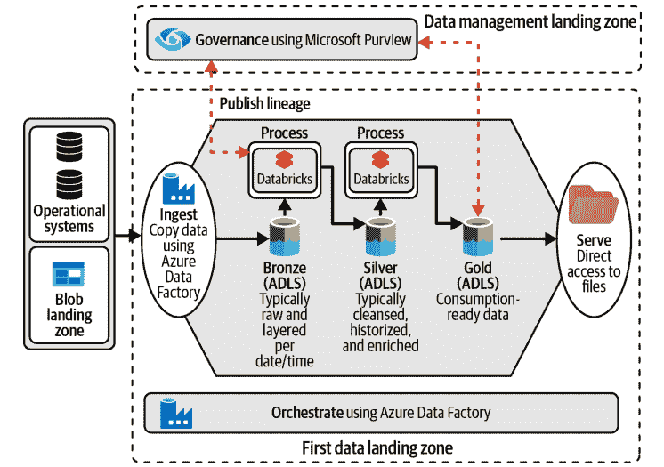
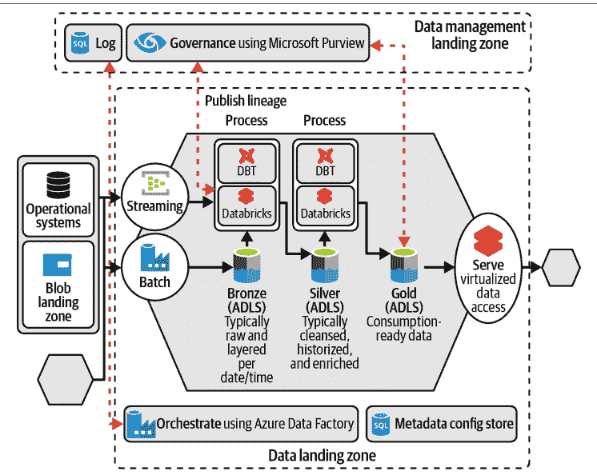
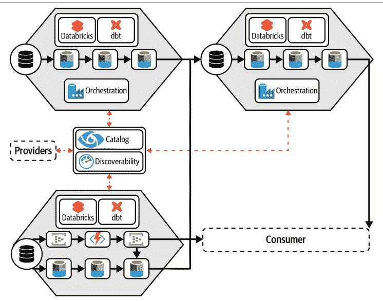
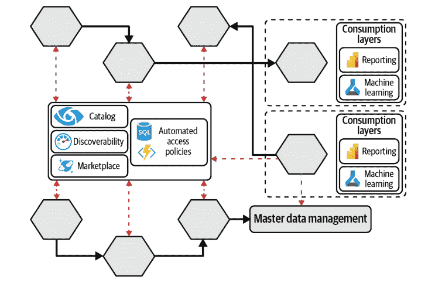
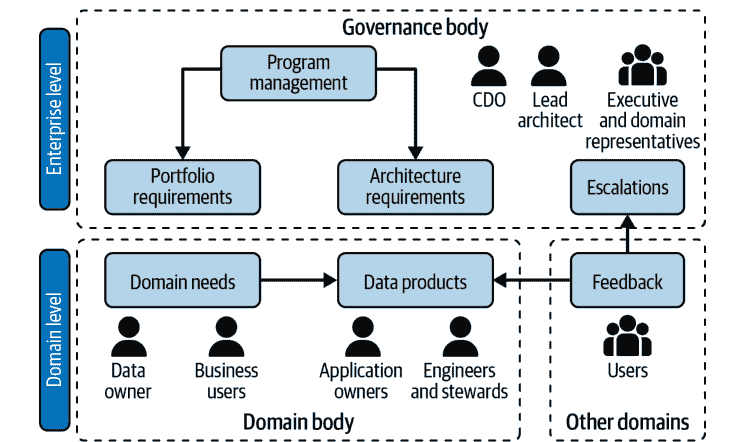
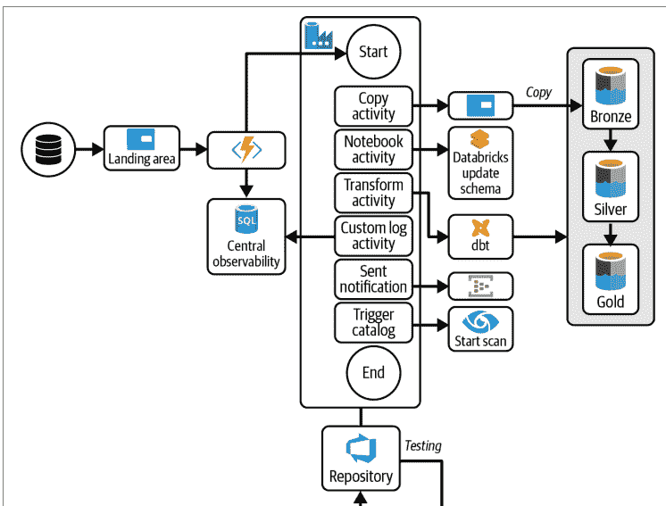
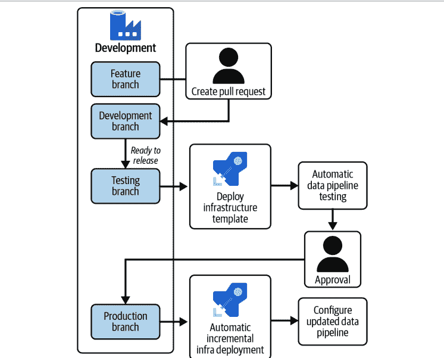

# 将理论付诸实践

我们已来到最终章节。但别难过——我们要让事情变成现实！在本章中，我们将逐步讲解实现现代数据架构的实际示例。在此过程中，我将总结本书中讨论的各种主题，并解释如何将理论转化为实际方法，概述实施各项功能所需的总体计划、阶段和顺序，以便您能够启动并运行。

我们将首先简要回顾您的数据旅程，以及您是应该采用集中式还是分散式方法。然后我们将概述实施数据架构的阶段，从制定战略方向，到奠定基础，再到专业化您的能力。我们将讨论数据驱动文化对确保项目成功的重要性，包括治理和DataOps工作方式，然后探讨企业架构师必须发挥的作用。最后，我将用一些结语结束本章。

## 回顾您的数据旅程

本书的目标是支持您踏上数据旅程。但在贸然行动之前，请确保已制定数据策略。无论您是从小规模开始，还是有大量用例需要实施，如果没有计划，如同您在第1章中所学，您注定会失败。我看到无数企业失败，是因为它们无法让所有人参与进来或阐述策略；因为它们不包括业务用户或缺乏高层领导的支持。我再怎么强调也不为过，但在开始实施任何变更之前，请确保您有宏观视野和一张清晰的地图，指引您朝着正确的方向前进。

在建立清晰阐述您的抱负和前路的愿景后，是时候进入下一阶段了。您的下一步是传达愿景、组建合适的团队、优化架构、制定执行计划、定义流程并选择用例。同样重要的是，让所有人都围绕您的目标达成一致并承诺。在开发初期，实施应从小规模开始，但同时要时刻把握全局，因为您的目标架构必须涵盖所有用例。您需要数据治理能力来实施角色、流程、策略、程序和标准，以管理您最关键的数据。您需要主数据和数据质量管理能力来确保一致性和可信度。您需要元数据来追踪血缘、捕捉业务上下文并关联到物理数据。您需要集成和分析服务来构建数据产品并将数据转化为价值。实现所有这些目标的推荐方法是整体审视您需要的构建块。这些构建块在整个旅程中将保持稳定，而底层技术在未来几年中将不断变化。

在确定关键要素后，您必须确保自上而下的承诺。此外，与业务利益相关者沟通并互动：提高意识并激发热情。确保您的预期方法、业务目标和目标在整个组织中清晰且被充分理解。开始识别战略举措和业务用例。一个好的方法是先编制一份潜在影响最大的用例简短列表。确保每个用例都与您的数据策略以及业务策略保持一致。对于每个用例，对组织的价值应清晰明确。接下来，进行技术复杂性评估，以便您可以对数据项目进行优先级排序。按复杂性、财务成本、商业附加值、风险和运营可管理性等方面对每个用例的可行性进行基准测试。之后，选择最佳候选者开始。从易实现的项目开始：您的第一个用例不应太难实施，但同时应提供足够的价值来证明工作的合理性。它应该为组织的其他部分树立榜样。其余的用例将在以后实施。

## 集中式还是分散式？

在为潜在挑战做好准备并确定首批工作负载后，是时候开始实际实施了。此时，您还需要决定是否采用更集中式或更分散式的方法。

如果您的公司数据管理成熟度较低，初期采用集中式方法更为合适。为什么呢？复杂的转型需要文化转变、技能提升、构建成熟的自助服务能力、打破孤岛和政治边界以及知识共享。这些活动的复杂性不容低估。因此，如果您的组织尚未具备应对这些挑战的成熟度或规模，请考虑采用集中式而非分散式。随着您在旅程中取得进展、引入更多用例并增强数据管理和自助服务能力，可以允许联邦制与集中式并存。

如果您的公司已经具备较高的数据管理成熟度或采用分散式组织，则可以开始采用更分散式的数据管理方法。然而，为了协调分散式团队，您需要制定标准和原则，并为共享能力做出技术选择。这些活动需要在中央层面进行，并需要出色的领导者和优秀的架构师。我将在本章后面讨论企业架构师的作用时再回到这些要点。

除了起点之外，关于集中式和分散式还有其他需要考虑的方面。首先，您应该确定旅程终点的目标。如果您预期的最终状态是分散式架构，但决定从集中式开始，那么构建架构的工程师应从一开始就意识到这一点。在心中怀有长期愿景时，工程师可以使能力更松散耦合，从而在未来更容易实现分散式。其次，您应该确定哪些能力将保持集中控制，哪些能力计划稍后分散式。提前明确这一点将在前进过程中节省大量争论和政治内斗。

## 让其成为现实

在组织层面阐述数据策略和抱负后，您的下一步活动就是让事情成为现实！根据我的经验和客户成功案例，我的建议是采用分阶段的方法并从小规模开始：构建价值增加的假设，仅从一个或有限数量的用例开始，获得构建数据产品的经验，建立原则并解决运营低效问题，并确定对您的组织而言“恰到好处”的治理意味着什么。

请注意，此处的讨论遵循“理想路径”。因此，它不代表一个多头的、复杂的怪兽。它也不会过于深入到高度特定上下文的主题。我的目标是描述一般数据旅程的主要阶段，让您大致了解预期情况。

## 机会阶段：制定战略方向

在引入首个领域时，绘制所有业务能力、划定数据领域并使其与组织结构保持一致并非必不可少。相反，您在本阶段的目标集中在学习概念如何运作以及如何转化为实践。为此，我建议

选择一个相当简单的用例，以一两个源系统作为起点。你将使用这些源作为数据产品开发的输入，然后直接将这些数据产品交付给消费者，以将数据转化为价值。不过，目前你不需要专注于数据价值创造能力，那些会在以后实现。现在，你应该专注于新架构的源系统一侧。

这个阶段的重点是确定团队需要具备何种思维方式，才能承担数据所有权并构建第一系列数据产品。在此期间，中央团队监督其他团队，提供指导和专业知识，而领域团队编写数据管道、调试问题并在源头修复数据质量问题。在这个阶段，所有团队需要紧密协作，以了解共同需求，因为关于存储服务、ETL 工具、安全性、数据目录等的许多集体决策必须做出。

你在这个阶段的第一步将如下：

- 选择第一个用例，并识别一个适合作为构建第一批数据产品起始团队的业务团队。最好，该业务团队应具备开发第一批交付物所需的所有工程技能。如果没有，数据平台团队可以协助业务团队。
- 定义一个范围清晰但有限、最好能在几个月内完成的项目。搭建一个包含高级别代表的小型项目看板，以获得所需的自上而下支持和协调。
- 识别数据平台团队的（潜在）成员，他们将专注于整体流程。该团队将协助领域团队，后者负责构建用于生产数据产品的第一批数据管道。

从数据架构角度来看，我建议你只启动一个着陆区和一个数据管理着陆区。如第 78 页“着陆区拓扑：管理解决方案空间”中所述，所有主要云服务提供商都为这些提供了蓝图。第 3 章讨论了最佳实践和建议。接下来，仅配置捕获和存储、转换以及编目数据所需的服务。将不需要的内容搁置一旁，专注于基本内容。

对于解决方案设计，考虑采用湖仓架构。虽然这种设计在最初可能看起来像是集中化，但它带来了许多好处：这是一种经过验证、常见且广泛理解的模式，易于设置，并简化了基础架构的管理。图 12-1 展示了架构初期可能的样子。这是一个小型架构，专为单个领域设计。

图 12-1. 初期湖仓架构

当你刚开始旅程时，架构只使用少量基本服务。在初始阶段，领域数据工程师与数据平台团队成员协作。他们一起确定范围并分析构建第一批数据产品所需的服务。

这种设计的意图是为大规模构建数据产品奠定基础，支持数据所有权和带有计算式数据治理的自助服务目标。第一个领域团队、产品负责人和数据工程师紧密协作，使数据可用。他们首先从源系统提取数据并将其摄入到青铜层。为此，团队使用中央平台团队提供的集成服务。接下来，他们选择相关数据，并将其转换为多个用户友好的数据集，例如使用笔记本或数据转换服务。在这些活动中，数据可能会经过额外的层：用于中间数据的银层；用于功能内聚且可消费的数据的金层。执行所有转换后，数据目录扫描所有数据。可选地，它还可以扫描集成服务以获取血缘。扫描配置在中央级别进行，因此由中央平台团队或数据治理团队处理。最后一步是使数据可用。之后，其他团队可以将这些数据作为其分析用例的输入。

尽管图 12-1 中的三层设计很常见且众所周知，但关于每个层的范围、目的和最佳实践仍有许多讨论。我还观察到，理论与实践之间存在巨大差异。如果你想了解如何最好地实现数据架构的分层，我建议你阅读我关于奖章架构的博客文章。

不要低估组织数据目录的复杂性。在开始实现数据目录时，不要一次性扫描所有源或领域。相反，只扫描新生态系统中的领域。一次只加入一个领域，逐个进行。在实践中你会了解到，业务领域与应用领域之间的对齐取决于业务能力是共享还是独占使用。要建立良好的结构，首先要以逻辑方式划分和分组数据源及数据平台。关键点是，来自每个数据源或应用程序的每个资产只能在目录中存储在一个位置。这意味着，在技术层面，你需要将数据资产与应用领域关联。然后，在此应用领域层面，你对齐职责，将管理员、数据源管理员和策展人角色分配给分别管理数据库、应用程序、数据产品、数据管道和其他服务的人员。接下来，你需要对描述数据、应用程序和领域在业务意义上信息执行相同的分组和排序活动。通过研究业务能力并找到为共同业务目标协同工作的人员来识别你的业务领域。分配术语表所有者和数据管家角色，用于管理诸如描述和术语表术语等元数据。最后，对齐你的应用领域和业务领域，要求领域用户创建在应用领域层面管理的元数据与在业务领域层面管理的元数据之间的关系。

在你实现初始架构并将第一批数据产品作为分析用例的输入共享后，现状应如下所示：

- 存在中央运营模式。你的平台和治理团队负责制定标准和做出技术选择。
- 数据管道的配置由中央团队完成。与此同时，该团队指导和培训其他团队。
- 当缺乏数据建模指导时，数据产品可能被认为过于原始或技术化。允许这种情况发生，但在加入新的消费者之前要求进行迭代和改进。
- 数据管道通常手动触发或按固定间隔运行。
- 与源系统对齐的领域团队必须在中央目录中注册其数据产品。他们负责维护元数据（如定义），并确保其准确且最新。对于这些活动，他们需要中央团队的帮助。
- 你的团队使用单一着陆区和单一资源集。
- 数据血缘要么过时，要么孤立存在。
- 你的数据目录尚未向领域开放自助服务方式发布和维护元数据。已发布的信息有限。但这并不意味着你的团队对质量不负责任，即使过程有些手动，或通过中介/中央数据管家完成。
- 交互式查询数据的服务处于起步阶段或仍然缺失。相反，消费领域将数据复制到其自身环境。因此，数据消费者和用户的权限通常手动分配。在构建架构的初始阶段，数据访问通常是粗粒度的，在服务、容器或文件夹级别。
- 模板质量和为保护和保障架构所需和执行的加固程度可能在不同团队、承包商等之间有所不同。

在这个初始阶段，你的能力成熟度不会很高。你很可能会有许多手动流程，随着进入下一阶段，你需要将它们自动化或变成自助服务。元数据在下一阶段也变得更加重要，因为在 Excel 中可行的方法在大规模操作中将不再适用。

构建大型数据平台会给中央 IT 或云部门带来很大压力，因此在进入下一阶段之前，你需要建立平台和数据管理能力，并获得组织内这些部分的认可。可参考第 7 章以获取最佳实践。

在自下而上实现第一个用例后，是时候通过向组织其他部分展示结果来赢得首批（业务）利益相关方的支持了。不要害羞，要展示你的成功，并证明使用数据的附加价值和好处。这些活动不应被低估。它们对于从高层管理人员获得自上而下的承诺至关重要。随着进展，你的计划应成为榜样，使你能够停用和清理旧版数据管理平台或系统，并停止与新数据管理战略不一致的类似项目。完成所有这些后，你就可以为第二阶段收集新的用例需求了。

## 转型阶段：奠定基础

交付首个用例投入生产后，重点就在于规模化、增加更多数据域并优化架构。此时，保持对全局格局的清晰认识至关重要。因此，到此阶段，你的业务能力应当清晰明确，包括与人员、流程和技术的对齐。你应该知道哪个域拥有哪些应用程序，以及它们各自负责什么。你还应该了解哪些潜在的新数据产品可以服务于哪些新用例（有关此主题的更多信息，或回顾如何识别业务域，请参考第 2 章）。此外，在此期间，你将着手制定预算计划、路线图、为业务增加的价值以及运营模型。这些活动至关重要，因为你将逐步规模化。

流程很重要，但不应导致官僚主义。相反，应专注于你的用例及其交付的相应结果。大规模交付价值需要持续的关注、反思和调整循环。

在考虑高层目标状态的前提下，你的下一步是定义哪些域和落地区域拓扑最适合你的组织。对于第 3 章中讨论的任何拓扑，我建议你协调包含以下服务的蓝图：数据处理、存储和目录服务；元数据发布；策略执行；等等。接下来，你应该研究域之间的数据流量流向。根据分析结果，你需要做出几项设计决策。例如，如果许多域需要从许多其他域获取数据，那么不建议采用高度分散或精细化的域拓扑，因为这会导致复杂性和管理开销。在这种情况下，使用集中位置来管理共享数据产品的受管拓扑通常是更好的选择。如果域之间流动的数据量波动显著，你也可以实施集中管理与点对点分布式数据的混合方法。在这种情况下，你需要决定如何在域间及域内的数据库和存储帐户服务中管理数据产品。可以参考第 83 页的“组织数据产品”以了解一些最佳实践。

首批域加入后，是时候回顾初始阶段的经验教训了。你可能会发现，域团队希望更加精通且能够自主支持。你的第一批数据产品并不复杂：获取传入原始数据，将其通过几个数据管道，转换为消费者更易访问的数据。困难在于需要以受管和受控的方式反复执行此过程。为此，你需要在数据产品开发流程中添加自动化和更高级的功能。例如，你可能希望添加用于验证架构和数据质量的数据质量框架，或者为域在构建新数据产品时必须遵循的 ETL 服务设定标准。与其编写更多笔记本或使用一次性的不可复用解决方案，不如提供用于实现此标准功能的蓝图和模式。

图 12-2 展示了下一阶段架构可能的样子。在此更新的架构中，你可以看到已添加实时数据摄入功能、元数据驱动框架、日志数据库和虚拟化访问。

图 12-2. 更新的湖仓架构

接下来，你需要对数据管道进行类似改进。规模化并保持灵活性的最有效方法是使用参数化、元数据驱动的管道。因此，与其使用硬编码值重新设计并手动创建新管道（包含其自身的数据源、选择、转换和输出），不如创建一个通用且可配置的管道，该管道将在运行时从（例如）数据库或代码仓库中检索配置。这样，你的参数化工作流将使用域团队提供的元数据输入和条件。中央平台团队的角色是通过将所有内容纳入基础设施蓝图，以即服务模式提供所有这些功能。

你可能还会注意到，域团队希望团队之间有更主动的协作。他们不希望依赖中央平台团队作为中间人，在提供方和消费者之间来回传递消息，例如，当新消费者想要消费提供方的数据，或当提供方存在数据质量问题或将延迟交付数据时。相反，平台团队应实施中央监控服务和控制框架，以实现提供方和消费者之间的面向行动的交互。例如，你可能希望添加中央日志存储，或一个能够检测问题并使用警报规则、通知或事件主动通知用户的监控服务。多域架构示例见图 12-3。

图 12-3. 为支持新域的加入，请使用数据可观测性、数据质量、数据转换和自动化的标准化服务来补充你的架构

添加域时推荐的方法是先专注于架构的源系统侧一段时间，再扩展消费侧。为什么？通常，数据消费者远多于数据提供方。此外，面向消费者的分析服务复杂且备受关注。因此，在添加大量消费者之前，保证新数据产品的稳定可规模化交付至关重要。如果过快将重点转移到消费侧，你可能会看到所有团队反复试图修复相同的数据工程问题。这可能导致整个组织对架构失去信心，从而削弱你的数据雄心。因此，每迈出一步，都要确保在增加业务价值的同时，不失去业务对数据平台有效性的信心。

在我之前的工作中，我们引入了三种独特且互补的战略主题来指导执行：

- 黄金源管理，侧重于确保所有权、解决数据质量问题并弥补数据差距
- 数据市场管理，侧重于促进数据产品创建、数据共享和数据货币化
- 将数据转化为价值的管理，侧重于赋予每个人做出自主且智能的数据驱动决策的能力

通过同时逐步成熟这三种主题，我们减少了团队之间的瓶颈数量，从而实现了高度的业务满意度。

在使数据产品开发更高效之后，实施第一组计算数据治理控制。例如，在将数据首先关联到数据所有者之前，不允许共享数据。为此，你需要使用数据治理解决方案提供的工作流。此练习的目的是设置护栏，使域团队能够更自主地支持自己，同时不会无意中造成自身损害。此阶段中央团队的角色会发生变化。他们监督所需的帮助，并在必要时介入。因此，中央团队不再亲自执行所有数据治理相关活动，而是培训、指导和引导其他团队。此外，此时中央团队需要开始思考：“控制是好的；信任更好。”平台策略和审计报告充当自动化的声明式护栏。

进一步规模化时需要考虑的一点是，是否应根据团队需求启用不同的数据摄入模式和选项。例如，与其每天批量加载数据，不如提供事件驱动或 CDC 服务以更快地摄入数据，或者允许使用落地区域，在数据进入数据产品架构之前可先暂存中间数据。对于外部数据源或旧系统，这也可能是必需的。

此阶段结束时，情况应如下：

- 第 8 章中讨论的新治理模型和运营模型已定义，其中包括新的角色和职责。
- 已创建仪表板，用于显示您的领域及其对应元数据的表现情况。
- 领域团队负责数据生命周期，从头到尾（从创建原始数据的应用程序到由其他团队消费的数据产品）。他们拥有所有数据模型，并确定哪些数据适合与他人共享。
- 领域团队使用 DataOps 最佳实践来管理其数据产品。例如，这可能意味着每个团队都使用自己的独立 Git 仓库，并通过代码从中配置其 CI/CD 和数据流水线。（有关此内容的更多指导，请参阅第 365 页的“数据驱动型文化”。）
- 数据产品开发得到工具和数据建模最佳实践的支持。有关指南（例如标识符、参考数据标准，以及将数据分层并结构化到单独表格中以提供粗粒度安全性）将发布在 wiki 中，以便更好地协作。
- 开发团队可以了解流水线及其对下游消费者的影响。数据质量服务会主动在出现问题时提醒用户，从而支持开发人员。
- 手动流程和流水线已被模板和服务取代。开发人员不再将位置和参数硬编码，而是将其信息作为源代码存储在版本控制中。这些仓库还可能包含其他工件，例如测试和部署脚本、库/软件包、配置信息等。
- 已添加其他摄取模式，例如实时或事件驱动的摄取。
- 数据访问策略（规定谁可以访问哪些数据产品）以代码或配置形式存储。在此阶段，仍应预期中央团队对数据访问配置拥有完全控制权。
- 您仍然使用单一着陆区。您提供的服务变化有限。所有领域团队都使用相同的蓝图配置。
- 存在一个一致的元模型，使用数据产品和数据域。该元模型在数据治理服务中进行管理，确保所有领域团队都知道哪些数据产品由哪些领域拥有。

将新用例和领域接入架构时，很可能会遇到迁移或传统场景。例如，您可能会遇到消费者要求几年前历史数据的情况。在构建新的数据产品架构时，您会发现历史数据仅从首次将数据产品接入新架构的那一刻起可用。因此，如果您需要接入期之前的历史数据，就会出现缺口。为解决此问题，请从其他环境中提取或一次性复制历史数据。例如，如果您的数据仓库保留了过去七年的数据，则可以使用这些数据构建传统数据产品，然后将该传统数据产品与馈入新架构的传入数据相结合。这样可以让您的领域获得全景。但是，请注意，将历史数据与新数据结合并不总是那么容易；您通常需要匹配字段、删除重复项、清理数据或编写业务逻辑。

在进一步扩展时，您需要通过使各领域能够交换或直接共享数据产品来实现领域互连。为此，您需要制定互操作性标准并实现查询服务。请考虑 Parquet 或 Delta 等流行文件格式，以及（无服务器）SQL 服务，以允许其他领域访问和浏览数据产品。

## 优化阶段：专业化您的能力

在奠定基础后，是时候对优先级的业务用例进行迭代，并进一步专业化您的能力。此阶段的关键目标之一是将中央团队的所有支持活动转移至领域团队。寻找低效之处，并尝试通过自助服务和自动化来解决这些问题。为加强组织，请指导您的团队，使其在管理数据及其对应的数据流水线方面更加高效。允许他们自助接入和自助订阅数据产品。部署允许自助注册和元数据维护的服务。例如，部署可以轻松与领域的 CI/CD 流程集成的 API。

在架构的下一次迭代中，您将专注于实时数据处理、消费就绪性、安全性、MDM 和精选数据分发。请尝试使用蓝图和服务标准化架构的消费端。请记住，数据使用场景多种多样：可能存在许多变体。为保持控制，请逐步扩展，一次推出一项新服务。对于每项新服务，在将其交付给领域之前，先评估需求。图 12-4 展示了更新设计的示例。

图 12-4. 随着架构采用度的增长，将添加新服务

关于解决方案架构的一个关键点是，许多服务尚不支持联邦式工作方式。您的中央团队必须专注于通过集成服务并交付自助服务和自动化能力来弥补这些差距。他们负责在偏差、工具和技术要求之间进行仲裁。他们拥有与编程框架、ETL 服务和存储相关服务相关的所有选择。

为管理数据可重用性和一致性问题，请查找使用率最高的数据产品。您最可能遇到的情况是，多个领域抱怨数据与其他领域的数据过于难以集成和组合。因此，请查找跨团队执行的重复性协调和质量改进活动。如果您看到许多此类重叠活动，相关数据产品可能是主数据管理的候选对象。或者，您可以分离出通用（可重复）集成逻辑，并要求一个数据产品团队使用客户/供应商模型对数据拥有所有权。有关推荐方法，请参阅第 10 章。

作为数据共享体验的一部分，您的数据产品团队应能够说明哪些数据产品可用于哪些用途。领域应能够与中央治理团队紧密协作，管理其拥有的数据的数据访问控制。遗憾的是，就撰写本文时，我不知晓任何开箱即用的解决方案能为您的团队提供出色的体验。如果您想为团队提供易于遵循的工作流程和策略自动创建支持，请考虑自行构建一个小型数据合同框架，该框架使用工作流程部署面向消费者的（安全）视图。该框架可能包含对业务语义、数据质量和服务级别协议的指针。有关更多指导，请参见第 8 章。

此阶段结束时，情况应如下：

- 您的架构支持不同的数据分发和应用集成模式。最好，数据产品、API 和事件的指南应保持一致。
- 可通过自动化和基础设施即代码配置快速接入新数据领域。
- 分类和标签标准已正式化，已创建指南和运维手册，并且团队已接受培训。
- 自然语言处理和机器学习等技术已应用于支持领域进行元数据管理。
- 治理和访问控制策略已实现自动化。为此，请考虑设置一个小型工作流、应用程序以及用于注册的编程访问 API。
- 数据使用以及将数据转化为价值的流程已标准化。向领域团队提供更新的蓝图模板，他们可以从中选择适用于单个用例的内容。
- 已将主数据管理服务添加到架构中，以确保端到端和跨领域一致性。
- 通过数据治理机构优化了利益相关方之间的交互。团队定期聚集在一起进行分类处理和总体规划。
- 数据产品具有多个端点（也称为输出端口），以满足大量用例的需求。
- 已添加额外的着陆区，以应对领域团队需求相互冲突的情况。

在进一步扩展时，明确数据治理结构非常重要。因此，您需要从定义不清晰的数据角色转变为流程协调一致的清晰结构。根据组织规模，您可能拥有多个治理机构和相互交互的数据产品团队。图 12-5 展示了这种交互可能的工作方式示例。

图 12-5. 不同数据治理机构和域团队协同工作的示例

在顶层，您的治理机构负责战略监督，并协同工作以推进企业的愿景和目标。因此，关于高级设计、路线图和大型项目的决策在很大程度上依赖于新架构。在这些机构中，您通常期望来自首席数据官、首席架构师、高级域负责人和其他高管成员的代表。

在底层，您的域团队被组织在域机构中，用于管理用例和依赖项、引入新数据以及返工问题。在此过程中，他们可能会收到其他团队的反馈和需求。因此，所有机构之间存在交互。例如，一个域团队可能需要来自另一个域团队的调解，或来自项目管理团队的战略决策。

在您制定好治理结构并建立同步和协调规划及反馈循环的会议节奏后，是时候锦上添花：智能数据网格和数据市场功能了。在此处，正如您在第 9 章中所学，还有需要填补的空白，因此您要么需要等待，要么需要遵循，或者要自己使用自研应用组件来解决缺口。

## 数据驱动的文化

在反复迭代的过程中，您将开始意识到还需要一种数据驱动的文化。让业务用户参与所有讨论至关重要。他们应当看到价值，推动数据产品创建的需求，承担所有权，并遵守核心标准。这种转变需要大量的推动，并在事情朝错误方向发展时坚持立场。如果数据所有者不描述或正确分类其数据，则不允许共享。如果数据质量低于某个阈值，则阻止其分发。在保持对反馈开放并进行改进的同时，控制和指导组织。

您的工程社区也需要同样的文化转变。数据即产品的思维方式要求将数据管理和软件开发更紧密地结合在一起。这就需要 DevOps 实践和方法，例如版本控制、IaC、自动化和质量测试。让我们更详细地探讨这一点。

### DataOps

为了让您的数据产品团队取得成功，他们需要熟悉开发、构建、测试、部署、运行和监控的迭代过程。这就是“面向数据的 DevOps”（DataOps）发挥作用的地方。一个组织良好的数据团队要求工程师和开发人员承担至少以下职责：

- 使用敏捷冲刺和待办事项列表来组织工作，以便其他团队可以纳入反馈。
- 在代码仓库中管理工件，例如数据管道、代码、配置、架构元数据和文档。
- 在部署到生产环境之前，使用隔离环境自动测试和构建所有组件。
- 监控数据管道的质量和重大变更。
- 在团队之间提供持续反馈以推动改进。
- 通过添加自动化来降低低效率。
- 使用模板和代码片段来缩短上市时间。

DataOps 工作方式的好处在于它鼓励更大的团队自主权，同时促进灵活性。只要每个团队专注于自己的项目，多个团队就可以并行工作而不会互相影响。

高效且隔离的工作流是成功 DataOps 实践的重要组成部分。对于这些工作流，数据团队的职责通常归结为维护两个不同的编排器。第一个编排器是数据管道，它专注于协调数据相关的流程步骤。在构建数据产品或用例的上下文中，它将原始输入数据转换为有意义的信息，从而为企业提供价值。与管理数据管道相关的流程通常由相应域团队的数据工程师负责。根据设计，数据管道可以是包含许多步骤的长序列。图 12-6 显示了这在实践中可能是什么样子。

图 12-6. DataOps 实践示例：数据管道如何将多个活动串联在一起的示例

以下是此数据管道从端到端的步骤分解：

- 1. 收集数据。每当新数据被摄取到数据着陆区时，通常会自动触发此步骤。例如，在图 12-6 中，一个函数调用数据管道运行。同一个函数还会向中央可观察性存储提交一条记录。
- 2. 验证源位置。
- 3. 将源数据从中间着陆区复制到青铜层。
- 4. 触发笔记本以使用存储数据的最新位置更新架构和外部表。
- 5. 触发批处理作业，该作业调用所有数据质量和数据转换活动的执行。
- 6. 更新中央可观察性存储中的记录，以指示处理已完成（或已失败）。
- 7. 通知数据消费者处理已完成或已失败。
- 8. 如果处理成功，触发中央数据目录。

在设计数据管道时，需要考虑许多因素并回答许多问题。例如，数据将被推送到着陆区，还是通过访问数据库来拉取？是否需要第三方服务来捕获数据更改？是否存在特定的安全需求，要求为不同消费者以不同方式构建数据？根据特定要求，您的管道将与其他管道和此处所示的示例不同。在构建数据管道时，您还会发现某些步骤是特定的，而其他步骤是通用的，更容易使用通用组件进行标准化。例如，监控进度和记录状态是一个通用步骤，如图 12-6 所示。最佳实践是在团队之间标准化所有这些通用步骤（例如，使用通用组件或函数）。

在图 12-6 的底部，您会看到一个管理所有工件的代码仓库。该仓库维护执行整个端到端序列所需的配置和代码。它还为第二个编排器（即 CI/CD 管道）发挥至关重要的作用，后者负责协调交付新版本软件（和基础设施）所需的步骤。在管理数据平台的上下文中，此编排器在不同环境之间移动平台配置、架构信息和数据管道代码。对于 CI/CD 管道，您通常会看到团队之间在工作方式和工件部署到生产环境方面有更多标准化。

管理数据工程工作负载的常见最佳实践是为每个团队提供自己的代码仓库，并使用三个不同的分支（开发、测试和生产）对其进行配置。然后团队可以遵循经典的 Git 工作流周期进行开发：

- 1. 开发人员和工程师在功能分支中开发单个功能，并使用单元测试进行验证（例如，实现的笔记本或模板）。
- 2. 当开发人员对其结果满意时，他们会从功能分支向主开发分支或协作分支创建拉取请求。在此之后，提议的更改可以由同行评审。
- 3. 批准拉取请求后，更改将合并到主开发分支。通常，CI/CD 管道将运行另一系列集成测试和单元测试，以验证一切仍按预期工作。
- 4. 当团队验证结果后，可以将所有内容提升到测试环境，新功能可以由客户和/或最终用户进行测试。
- 5. 如果不需要其他更改且所有测试均通过，则可以批准生产环境。此后，CI/CD 流程会自动将所有更新的数据管道和配置发布到生产环境。

图 12-7 显示了您可以如何实施此方法。

图 12-7. DataOps 实践示例：CI/CD 流程如何将所有内容从开发提升到测试和生产的示例

CI/CD 方法在追求开发、测试和生产活动之间完全隔离时尤其有用。一般最佳实践是设置多个工作区并将它们与不同的代码分支对齐。在此设置中，用于配置这些工作区的基础设施模板将在团队的代码仓库中维护。此最佳实践的另一部分是设置策略，以确保域团队部署的环境符合组织的标准。此方法将潜在干扰降到最低，通常在高安全性环境中受到青睐。在

与此同时，创新工作和临时活动是解耦的，因为开发环境通常具有较宽松的政策控制。

取决于您如何设置 CI/CD 流程，环境也可以按需随时配置。例如，与其让测试环境始终保持运行，不如选择按需配置新的测试环境。当所有测试都已完成且一切按预期运行时，您可以运行清理活动以停用所有基础设施。

向 DataOps 的这种转变主要是一种文化转变。为实现这一转变，您需要一个中央团队来牵头制定标准并开发配置模板和蓝图。同一个团队还负责设置辅导、创建培训材料、组织随到随学会议等等。不要低估这些活动的重要性；它们可能需要额外的人员配备。

## 治理与素养

数据驱动的文化意味着您必须致力于治理。为此，明确定义您的角色和活动。使用 RACI 模型（如第 8 章所讨论的），以明确责任和问责在哪里。接下来，清楚地描述管理数据的实用说明。将所有内容记录在数据治理框架中。同时，也要重视数据素养，因为贵组织内并非所有领导者都能认识到数据的价值或知道如何最好地运用数据管理概念进行沟通。让它变得有趣，并激发热情。

除了架构变更之外，所有这些变化都很重要。企业架构在协调所有这些活动方面发挥着重要作用。我们将在下一节中探讨这一点。

## 企业架构师的角色

随着您在数据之旅中的推进，贵组织中企业架构师的角色将随架构本身一同发生变化。我们在第 7 章中已经讨论过其中的一些方面。企业架构师必须被视为领导者，能够指导开发团队实施未来状态架构。他们必须务实和现实，同时阐明愿景并激励每个人追随。他们必须对技术了如指掌，并在安全、云基础设施、软件架构、集成和数据管理等不同领域表现出色。企业架构师还必须对业务边界有非常深入的了解，并知道如何使用现代集成模式和业务架构将其解耦。

这一画像——战略家、技术娴熟的工程师、守护者、鼓舞人心的领导者——与建筑师仅从静态对象和图表角度思考，并通常深居 IT 部门或高踞象牙塔的传统刻板印象相去甚远。在这个新时代，建立企业架构实践需要不同的角色画像和关注领域。让我们看看还可能期望哪些变化。

### 蓝图与图表

企业架构师传统上将其工件作为形式化模型或 Visio 图表交付。在动态的大型企业时代，这种技艺已不再可扩展。在现代实践中，模型、蓝图和图表应基于基础元模型构建，使用代码仓库工具。此仓库应频繁更新数据建模和设计信息、成本信息、血缘、新应用注册、所有权注册等等。在仓库之上，应有一个可视化层，展示现代企业的样子：其设计、业务能力、领域、应用程序、数据产品等等。

### 现代技能

企业架构师的核心技能正在发生变化。与传统上将架构师视为内容专家不同，在新时代，架构师被期望成为问题解决、设计思维和创造力方面的领导者。

从专家向问题解决者的转变既需要领导力也需要创新，这通常在昂贵的战略咨询公司中可以看到。它还需要不同的框架和技术，例如设计思维、原型制作、商业模式画布建模、思维导图和用户体验设计，仅举几例。尝试设定现实目标，并仔细管理业务用户的期望。

倾听和沟通技能对现代架构师也至关重要。不要用架构特定的行话让业务利益相关者不堪重负。尝试成为——或者找到——果敢、开明、富有同理心和务实的人。最后，要有指导性。产品负责人和工程师通常需要得到指导，因为他们无法监督一切。

### 控制与治理

您的企业架构实践必须在长期目标和实用性之间找到平衡。这种需求正在导致企业架构框架（例如开放组架构框架的 TOGAF 标准）¹ 落败，因为其形式化长期存在的静态未来状态的逻辑与 DevOps 和 DataOps 的新世界不太契合。是的，您需要描绘大局，但也需要放下“执法”心态。现代企业架构师应成为社区领导者，主动定义最小可行产品，组织设计和白板会议，讨论并转译客户需求。将细节留给团队，但在出现问题时成为权威专家。

¹ 在他的书 _企业架构实践：业务与 IT 对齐的现代方法_ (SK Publishing) 中，斯维亚托斯拉夫·科图塞夫公开挑战了将企业架构视为逻辑框架的观点。相反，他建议的企业架构实践不是基于逻辑假设，而是基于对其实际运作方式的经验观察。

### 结语

未来一代的企业数据格局将以全新的方式组织。如您在本书中所学，数据在未来几年将更加分布式——数据所有权也是如此。企业需要学习如何最好地平衡集中化和分散化的要求。正如您很快就会亲身经历的那样，这种变化需要试错，并需要一种全新的数据管理愿景。

虽然 _企业架构_ 这个词对某些人来说带有负面联想，但我坚信这项职能对于推动大规模变革至关重要。企业架构植根于从初始构想一路工作到最终实施。总有必要勾勒愿景、设计抽象概念、制定策略、创造活力，并支持团队实现该愿景。大规模实施数据管理也是如此。毕竟，构建大规模数据架构的过程始于认识数据的价值。

最后的一点建议：不要紧张，飞行是最安全的旅行方式！在奇妙的数据世界中有许多乐趣等待发现。我们才刚刚开始。

- A
- ABAC (基于属性的访问控制), 245-247
  - 组件, 247
- 访问控制列表 (ACLs), 245
- 访问控制
  - 数据安全, 245
  - 基于策略的, 259
- ACID 数据库属性, 105
- ACLs (访问控制列表), 245-247
- 高级分析, 8-9, 16, 336
  - (另请参见 MLOps)
- 聚合域
  - 重新发布数据, 306-308
  - 重用数据, 46-47
- 聚合存储, DDSs, 329
- 聚合服务, 160
- Amazon Web Services (AWS), 84
- 分析师, 数据管理用例角色, 324
- 分析应用程序, 12, 314
- 分析数据架构, 31
  - DDS 角色与, 318-320
  - 与运营数据架构相比, 143
- 分析数据存储, DDSs, 329
- 分析系统, 数据处理, 295
  - 分析, 8-9
  - 元数据与, 289
  - 流式处理, 190-191
- Apache Kafka, xiii, 178, 186
- Apache Spark, 67, 121, 128
- API 网关, 158-159
  - 与服务网格相比, 162-164
  - 微服务, 162-164
  - 安全, 256
- APIs (应用程序编程接口), 144-145
  - 应用程序集成注意事项, 208
  - 架构示例, 167-169
  - 最佳实践, 170-171
  - 与数据产品相比, 144
  - 复合服务, 160-161
  - 客户体验管理, 166
  - 数据摄取注意事项, 120
  - 发现, 161
  - 事件收集, 旧版应用程序, 180
  - 联邦责任模型, 157-158
  - GraphQL 服务, 166-167
  - 内部与外部通信, 165-166
  - 管理, 157
  - 元数据管理, 169
  - 管理原则, 157
  - 微服务, 161
  - 流程, 152
  - 作为产品, 160-160
  - 面向读取, 170
  - 面向资源, 108
  - 安全, 256-259
  - 安全模型, 241
  - 服务合同, 161
- 应用程序设计原则, 26-28
- 应用程序集成, 204
  - 一致性注意事项, 208-210
  - 模式, 206-208
  - 设置域边界, 213-215
- 应用程序密钥, 300
- 应用程序元数据, 275
- 应用程序所有者, 225, 324

- 应用程序仓库，数据治理，234
- 应用程序生成的事件，180
- 应用程序间通信，缺点，148
- 应用程序
- 作为流媒体平台的后端，193
- 与域的边界，145
- 有界上下文，52
- 分类，317
- 通信，标准化协议，145
- 数据管理角色，27-28
- 数据源，26-27
- 数据存储，26
- 数据唯一性，26
- 与域解耦，52
- 旧系统，域拓扑，69
- 与业务能力链接，39-42
- 范围与边界，定义，40
- 共享业务能力，45
- 状态管理，ESB，156
- 架构量子，64，100
- 架构（参见数据架构）
- 人工智能，336
- 异步通信，176
- APIs，144
- 优势，207
- 缺点，207
- 至少一次处理方法（流处理），195
- 最多一次处理方法（流处理），195
- 基于属性的访问控制（ABAC）（参见ABAC（基于属性的访问控制））
- 身份验证
- API网关，257
- 协议，248
- 授权，API调用，256
- AWS（Amazon Web Services），84
- Azure，84
- Azure Cosmos DB，事件存储，188

# B

- 后端管理，167
- 背压，194
- 批处理，数据摄取，119
- 商业智能（BI）
- 最佳实践，335-336
- 元数据，276

- 自助服务工具，333-335
- 语义层，331-333
- 大泥球，15
- 大数据
- 数据质量处理，121
- 项目失败率，18
- 蓝图，5
- 数据生产与消费对齐，321
- 数据登陆区，95
- DDSs，316
- 元模型，266
- 有界上下文，33-34
- 业务能力，40
- 数据集成，最佳实践，53-54
- 定义域，57
- 管理依赖项，51-53
- 业务流程管理（BPM），151-152
- 违规，列表，11
- 业务活动，与第三方服务集成，13
- 业务架构
- 业务能力，与应用程序链接，39-42
- 数据架构，35
- 业务能力，36-38
- 元数据，276
- 业务能力，36-38，57
- 能力实例，42
- 复杂应用程序与，45
- 数据产品设计原则，116
- 解耦，213
- 面向域的数据管理，56
- 重复，粗粒度拓扑与，72
- 与应用程序链接，39-42
- 建模，49
- 共享能力，43-45
- 共享与通用相比，44
- 业务能力模型，37-38
- 商业智能（BI）（参见BI（商业智能））
- 业务逻辑，外包，111
- 业务元数据，264
- 商业模式画布，323
- 业务流程管理（BPM），151
- 业务需求，用例注意事项，322-323
- 业务服务，154
- 业务用户，225

# C

- 剑桥分析公司，11
- 剑桥语义公司，281
- 规范数据模型，154-155
- 规范模型，155
- 能力图谱，37-38
- 能力实例，42
- 面向域的数据管理，56

  - 目录，76
    - （另见数据目录）
    - 数据治理，234
    - 数据请求，76
    - 初始实施注意事项，354
    - 血缘元数据，114
    - 元模型搜索，270

- CDC，事件生成，181
- 卓越中心（COEs），335

  - 中央数据存储库，297
    - 语义一致性，304

- 中央分发，数据产品，66-68

  - 集中化，3，8
    - 缺点，14
    - 域，选择拓扑，77-78

- 集中式（MDM风格），294
- 集中式平台，8

  - 复杂事件处理（CEP），179
    - 与ESP相比，183

- ChatGPT，8
- 首席数据官，224
- 首席信息安全官（CISO），241
- 持续集成/持续交付（CI/CD），DataOps流程，367-369
- 首席信息安全官（CISO），241
- 客户端库，应用程序生成的事件，180

  - 云
    - 数据处理优势，128
    - 效率注意事项，10-11
    - 云采用框架，78-80
    - 云计算服务，FaaS，162
    - 集群缩减，303

- 粗粒度和部分治理域拓扑，73
- 粗粒度域拓扑，71
- 代码共享，数据策展，305
- 卓越中心（COEs），335
- 共存（MDM风格），294

  - 协作
    - 挑战，13
    - 数据治理团队，227
    - 数据货币化，28
    - 域，46

- 协作模式，共享数据，306
- 协作元数据，276
- 命令源，189
- 命令存储，189
- 共享车道模式，62
- 复杂事件处理（CEP）（参见CEP（复杂事件处理））
- 复杂子系统团队，219，221
- 复合服务，APIs，160-161
- 概念应用程序数据模型，208-210
- 概念数据模型，271-272
- 顺从模式（数据共享），307
- 整合（MDM风格），293
- 构造域，47
- 面向消费者的数据产品，315
- 面向消费者的域，27，46
- 面向消费者的登陆区拓扑，87-88
- 控制平面，162
- 控制区，80
- 核心子域，33
- CQRS数据产品设计模式，104-107
- 跨域互操作性，202-203
- 跨域安全，258-259

  - 跨职能团队
    - 数据治理，226
    - 规模注意事项，324

- 众包，元模型，274
- CRUD数据库操作，146
- 客户体验管理，166
- 客户/供应商模式（数据共享），307

- 数据
  - 应用程序，314
  - 分类，243-244
  - DDSs，315-316
  - 一致性，297
  - 消费者，27-28
  - 应用程序逻辑过滤，53
  - 数据优化，54
  - 消费，56，313
  - DDSs，315-317

- 安全注意事项，253-256
- 容器，分组数据示例，131-132
- 合同
- 最佳实践，239-240
- 数据可观测性，238
- 数据安全与，242
- 确保完整性，237
- 元数据记录，236
- 概述，236-238
- 使用协议，238-239
- 创建者，225
- 策展，303-304
- 聚合域，306-308
- 代码共享，305
- 数据治理，308-309
- 集成视图，305
- 集成中心，305-306
- 语义一致性，304
- 互操作性标准，55
- 映射，本地到企业，298
- 市场，287
- 自助服务，115
- 建模，6
- （另见数据模型）
- 最佳实践，53-54
- 消费方设计注意事项，331
- MDM，296
- 工具，274
- 可观测性，238
- 引入
- 能力，119
- 数据血缘，120
- 数据安全，251-254
- 外部API/SaaS提供商，120
- 摄取，119-120
- 登陆区拓扑，87-88
- 软件包复杂性，120
- 优化，54
- 所有权，51，56
- 数据产品设计原则，113
- DDD注意事项，51
- 面向域的，75
- 持久化，DSSs，329-331
- 作为产品，99，140
- 扩散，9
- 质量
- 架构设计注意事项，121-122

- 数据仓库，16
- 管理，7，122
- 元数据，276
- 质量，MDM服务，302
- 可读性，面向资源的设计，108
- 再发布，风险，305-306
- 数据驻留，数据登陆区与，91-92
- 可重用性，362
- 可重用性，DSSs，319
- 扫描器，数据治理，235
- 序列化，流处理，196-197
- 存储与运维，6
- 策略，19-23
- 转换，7，27
- 创造价值，312-314
- dbt，128
- 用户，225
- 虚拟化
- 缺点，125
- 中心数据登陆区，89
- 数据访问模式，选择注意事项，136-137
- 数据与集成网格，143
- 数据架构，5
- 对齐提供方和消费方，320-321
- 构建，351
- 业务架构，35
- 与应用程序链接，39-42
- 业务能力与，36-38
- 挑战，18-19
- 组成，14
- 数据湖，挑战，17-18
- 数据产品，100
- 数据策略，22
- 数据仓库，挑战，14
- 设计原则，51-54
- 提供方和消费方域的图表，312-313
- 企业架构与，58
- 中心辐射式，88
- 初始设计注意事项，351-355
- 初始实施目标，360
- 初始状态，354-355
- 大规模设计，93
- 微服务，29-31
- 迁移和旧系统场景，360
- 优化目标，363
- 优化，361-363

- 可扩展性，93
- 扩容，356-361
- 服务网格，30-32
- 单数据着陆区，80-83
  - 可扩展性，86-87
- 与软件架构相比，29-32
- 战略主题，359
- 数据泄露（参见数据泄露）
- 数据目录，76
  - （另参见目录）
  - 最佳实践，278-279
- 数据治理，234
- 初始实施注意事项，354
- 元湖，277-279
- 元模型搜索，270
- 语义一致性，304
- 数据合约应用程序(DCA)，235
- 数据托管人，225
- 数据发现，333
  - 建议，210-212
- 数据分发，204
- 数据网格，63
  - MDM
    - 主数据，299-301
    - 参考数据，297-298
- 数据分发模式，205-206
- 设置领域边界，213-215
- 数据领域，62
  - （另参见领域拓扑）
  - 功能领域，分组，90
  - 元模型，269-270
- 数据工程
  - 工作负载管理，367-368
  - MLOps，342
- 数据工程师，324
- 数据勘探，333
- 数据网架，3
- 元数据管理，283-284
  - 元湖示例，281-283
- 数据治理，5
- 数据合约
  - 最佳实践，239-240
  - 概述，236-238
  - 使用协议，238-239
- 数据整理，308-309
- 数据管理活动，230-231
- 框架，224
  - 创建，226-229
  - 文档化，228
- 角色，224-226
- 治理团队，229
- 实施建议，231-234
- 实施计算控制，359
- MDM，296，308-309
- 概述，223-224
- 结构目标，363-364
- 支持性信息，234-236
- 数据治理负责人，224
- 数据摄取模式，启用，359
- 数据集成，13，27
- 最佳实践，53-54
- 集中式平台，8
- MDM，295-296
  - 主数据，299-301
  - 参考数据，297-298
- 数据集成与互操作性，6，7
- 数据标签，数据安全，243-244
- 数据湖仓，75
  - 设计架构，131
  - 初始架构，352-354
  - MDM，304
- 数据湖
  - 集中化，18-19
  - 挑战，17-18
  - 与领域数据建模相比，54
  - 与数据网格，129
  - 数据处理优势，128
  - DDSs，329
  - 设计示例，129-131
  - 失败率，18
- 数据着陆区，79
  - 蓝图，95
  - 中心数据着陆区，88-89
  - 大规模设计，93
  - 管理开销，92，93
  - 多个，89-92
  - 单一着陆区设计，80-83
  - 可扩展性，86-87
- 数据管理，3-4，128
  - 应用角色，27-28
  - 自动化最佳实践，345-347
  - BI 最佳实践，335-336
  - BI 自助服务工具，333-335
  - 集中式方法注意事项，350-351
  - 跨领域互操作性，203
  - 数据分类，243-244
- 数据管道，设计注意事项，326-328
- 数据处理注意事项，135-136
- 数据战略概述，349-350
- 数据使用分类，244
- DDSs，角色范围，329-331
- 分散式方法注意事项，350-351
- 定义，4
- 分布式，50-54
- 事件数据，174
- 功能领域，4-7
- 黄金数据源，50
- 治理活动，230-231
- 准则，230-231
- 历史数据，89
- 着陆区，79
- 多个，92-95
- 新数据，314
- 语义层，331-333
- 利益相关方承诺，350
- 用例，322
  - 业务需求，322-323
  - 非功能性需求，324-326
  - 角色，323-324
- 数据管理知识体系(DAMA-DMBOK)，4
- 数据主控，299
  - （另参见 MDM (主数据管理)）
  - 主标识号，299-301
  - 解决方案设计，299
- 数据网格，3
  - 数据湖与之，129
  - 数据模型注意事项，53
  - 完全联邦域拓扑，62
  - 与受管域拓扑相比，66
  - 实施障碍，64-66
  - 人员要求与之，65
  - 与服务网格相比，31
- 数据模型
  - 概念型，271-272
  - 逻辑型，273
  - 元数据，270
  - 物理型，273
  - 超模型，72
- 数据所有者，225
- 数据管道，55，134
  - 创建，131
  - 设计注意事项，326-328
  - 扩容，357
- DataOps，366-367
- 数据平面，162
- 数据平台团队，220
- 组织转型，216-218
- 数据平台
  - 与集成服务对齐，204-205
  - 与粗粒度域拓扑，72
  - 实例，76
- 数据产品架构，117
- 数据接入能力，119
- 数据血缘，120
- 外部 API/SaaS 提供商，120
- 摄取，119-120
- 软件包复杂性，120
- 数据管道注意事项，134
- 数据处理注意事项，135-136
- 数据质量注意事项，121-122
- 数据服务注意事项，136-137
- 设计，127-129
- 示例设计流程，129-133
- 文件操作服务，137
- 治理，132
- 历史数据，122
  - 仅追加方法，126
  - 时点表示方法，123-124
  - 间隔处理，124-126
  - 策略，127
- 实施支持，138
- 智能消费服务，138
- 平台设计注意事项，117-119
- 保护敏感信息，137
- 安全，132
- 自助服务，132
- 自助数据发现与访问，132
- 存储帐户注意事项，133-134
- 数据产品元素，270
- 数据产品存储
  - 与 DDSs 相比，316
  - 流式平台，192
- 数据产品，31-32，99-100，141，314
  - 优势，140-142
  - 集中管理，66-68
  - 与 API 相比，144
  - 组件，100-101
  - 消费者与之，313
  - 创建，186-187
  - 将数据与架构分离，102
  - 将数据与元数据分离，102
  - 数据网格，63
  - 数据共享，362
  - 数据虚拟化，125
  - 与 DSDs 相比，320-321
  - 定义，101-103
  - 需求驱动方法，67
  - 设计模式
    - CQRS，104-107
    - 概述，103-104
    - 读取副本，106-107
  - 设计原则
    - 数据抽象，113
    - 原子性，112
    - 兼容性，113
    - 跨域关系，115
    - 数据所有权，113
    - 数据安全，114
    - 企业一致性，115-116
    - 黄金数据源，110
    - 历史数据，116
    - 不可变数据，109
    - 互操作性标准，110
    - 元模型，114
    - 缺失值，112
    - 运营模型注意事项，116-117
    - 概述，107
    - 促进复用，111
    - 面向资源，108
    - 原始数据，110
    - 自助数据市场，115
    - 语义一致性，112
    - 共享业务能力，116
    - 通用语言，109
  - 开发，最佳实践，140
  - 分发，数据合约与之，236
  - 与直接消费相比的数据重复，139
  - 粒度与性能，65
  - 逻辑实体，103，268
  - 管理，83-86
  - MDM，300
  - 元数据与之，100-101
  - 元模型，269-270
  - 发布，132
  - 面向读取的 API，170
  - 数据所有权隔离，44
- 数据提供商，27-28
- 最佳实践，53-54
- 数据科学家，324
- 数据安全，6，241
- 基于 API 的架构，256-259
- 架构示例，248-250
- 控制，245
- 数据分类，243-244
- 数据产品设计原则，114
- 数据使用分类，244
- IDPs，248
- 流程，251-256
- 孤岛方法，241
- 信任边界，242-243
- 统一框架，245-248
- 数据孤岛，50
- 数据管家，225
- 数据存储
- 应用程序，26
- 技术选型注意事项，325-326
- 数据团队，职责，365
- 数据受托人，225
- 数据使用分类，244
- 数据保险库，331
- 数据仓库
- 集中化，挑战，18-19
- 挑战，14-17
- 数据保险库，108
- DSDs，329
- 面向领域，72
- MDM，304
- 数据仓库
  - 与 SOA 实现相比，155-156
  - 与 DSDs 相比，319
  - 历史数据，管理，122
  - 工作负载要求，67
- 以数据为中心的安全，241
- 数据消费服务，137
- 数据驱动文化
- DataOps，365-369
  - 治理与素养，369
  - 概述，365
- 数据库生成的事件，181-182
- 数据库
  - ACID 属性，105
  - CRUD，146
  - 事件存储，187
  - 物化视图，106
  - NoSQL，事件存储，188-189
  - 读取 (CQRS 设计模式)，104-105

- 架构, 设计注意事项, 273
- 选择, 136
- 技术选型注意事项, 325-326
- 写入 (CQRS设计模式), 104-105
- Databricks, 131
- 数据流, xiv
- DataOps, 10
  - CI/CD流程, 367-369
- 数据策展, 303
- 数据管道, 366-367
- 数据驱动文化, 365-369
  - 元数据与, 266
- dbt, 数据转换与, 128
- DCA (数据合约应用), 235
- DDD (领域驱动设计), 32
  - 有界上下文, 33-34
  - 原则, 51-53
  - 通用语言, 34-35
- DDSs (领域数据存储), 315-317
  - 分析架构注意事项, 318-320
  - BI自助服务工具, 333-335
  - 边界, 318-318
  - 与数据产品的比较, 320-321
  - 与数据产品存储的比较, 316
  - 数据可重用性, 319
  - 与数据仓库的比较, 319
  - 角色范围, 329-331
  - 语义层, 331-333
  - 用例注意事项, 318-320
- 去中心化, 3
- 协作生态系统, 13
- 领域, 选择拓扑, 77-78
- 风险, 23
- 仅投递一次处理方法 (流处理), 195
- 设计模式
  - 数据产品, 103-104
  - CQRS, 104-107
  - 读副本, 106-107
- 设计原则
  - 数据领域, 51-53
- 数据产品
  - 抽象数据, 113
  - 原子性, 112
  - 兼容性, 113
  - 跨域关系, 115
  - 数据所有权, 113
  - 数据安全性, 114
  - 企业一致性, 115-116
  - 黄金数据源, 110
  - 历史数据, 116
  - 不可变数据, 109
  - 互操作性标准, 110
  - 元模型, 114
  - 缺失值, 112
  - 运营模型注意事项, 116-117
  - 概述, 107
  - 促进重用, 111
  - 原始数据, 110
  - 面向资源, 108
  - 自助数据市场, 115
  - 语义一致性, 112
  - 共享业务能力, 116
  - 通用语言, 109
- 确定性GUID, 300
- DevOps, 9-10
- 直接读取消费性能注意事项, 314
- 分布式应用程序, 10
- 分布式架构, 数据合约与, 238
- 分布式大泥球, 30
- 分布式数据管理策略, 50-54
- 文档和内容管理, 6
- 领域实体, 数据治理与, 364
- 领域边界, 颗粒度, 41
- 领域数据存储 (DDSs) (参见 DDSs (领域数据存储))
- 领域所有者, 323
- 领域团队, 220
  - 团队间合作, 358
  - 组织转型, 216-218
- 领域拓扑, 61, 78
  - (另请参阅 登陆区拓扑)
  - 集中式, 74-77
  - 云采用框架与, 80
  - 粗粒度, 71-73
  - 粗粒度和部分治理, 73
  - 完全联邦, 62-66
  - 治理型, 66-68
  - 实施注意事项, 95-97
  - 使用多个, 77
  - 部分联邦, 69-70
  - 问题空间, 62
  - 选择, 77-78
  - 价值链对齐, 70-71
- 领域驱动设计 (DDD) (参见 DDD (领域驱动设计))
- 领域级MDM, 301
- 面向领域的数据仓库, 72
- 领域, 14
  - 添加, 358
  - 聚合, 46-47
  - 应用程序, 解耦, 52
  - 边界, 58
  - 与应用程序, 145
  - 粗粒度拓扑与, 71
  - 微服务, 164
  - 有界上下文, 33, 41
  - 为可扩展性进行集群, 94
  - 协作, 46
  - 构造函数, 47
  - 面向消费者的领域, 46
  - 跨域关系, 115
  - 跨职能团队, 规模注意事项, 324
  - 数据治理, 226
  - 数据平台实例, 76
  - 数据产品架构, 所有权注意事项, 118
  - 数据产品, 管理, 83-86
  - 数据安全性, 信任边界, 242-243
  - 数据技术栈选型注意事项, 129
  - DDD, 原则, 51-53
  - 定义, 56, 356-357
  - 联邦, 挑战, 291
  - 集成挑战, 49
  - 隔离, 88
  - MDM, 300
  - 所有权职责, 55
  - 前提条件, 56-57
  - 点对点接口, 50
  - 与源系统对齐, 45
  - 类型, 45
  - 价值链, 70
- 荷兰税务局, 11

# E

- EDAs (事件驱动架构)
  - 与SOA相比, 179
  - 事件代理, 177-178
  - 事件消费者, 182-184
  - 事件处理, 179
  - 事件生产者, 180
    - 应用程序生成的事件, 180
    - 数据库生成的事件, 181-182
  - 事件流注册表, 197-198
  - 事件流平台, 184
  - 事件存储, 187-190
  - 示例架构, 184-186
  - 数据持久化, 186-187
  - 流分析, 190-191
  - 治理模型, 191-192
  - MDM数据集成, 295
  - 消息队列, 177
  - 概述, 177-177
  - 基于策略的访问控制, 259
  - 安全模型, 241
- ELT (提取, 加载, 和转换), 27
- 赋能团队, 219, 220
- 企业应用集成, 148-150
- 企业架构师
  - 跨团队交互, 218
  - 交付物, 370
  - 治理实践与, 370
  - 概况, 369-370
  - 技能集, 370
- 企业规范模型, 155
- 企业数据仓库, 数据分发与, 136
- 企业元数据模型, 266
- 企业参考数据, 将本地数据映射至, 298
- 企业范围内数据建模, 76
- 实体整合, 303
- ESB (企业服务总线), 148-150
  - 应用程序状态管理, 156
  - 作为旧版中间件封装器, 155
- ESP (事件流处理), 179
  - 与CEP相比, 183
- 伦理考量
  - 荷兰税务局示例, 11
  - 法规与, 11-12
- ETL (提取, 转换, 和加载), 27
  - 管道与, 328
- 事件代理, 将事件消费者与提供者解耦, 182
- 事件协作, 153
- 事件消费者, 182-184
- 事件数据, 174
- 事件交付模式, 178
- 事件处理, 179
- ESP与CEP相比, 183
- 消息队列, 177
- 事件生产者, 180
  - 应用程序生成的事件, 180
  - 数据库生成的事件, 181-182
- 事件存储
  - 命令存储, 189
  - 创建, 187-190
- 事件流处理 (ESP) (参见 ESP (事件流处理))
- 事件流注册表, 197-198
- 事件流平台, 174, 184
  - 连接事务和分析系统, 193
  - 事件存储, 187-190
  - 示例架构, 184-186
  - 数据持久化, 186-187
  - 流分析, 190-191
- 事件携带状态传输, 175-175
- 事件驱动架构 (EDAs) (参见 EDAs (事件驱动架构))
- 事件驱动通信, 与请求/响应通信相比, 176
- 事件驱动消息传递, 消息队列, 177
- 事件
  - 应用集成注意事项, 208
  - 应用程序生成的, 180
  - 异步通信, 176
  - 数据库生成的, 181-182
  - 事件携带状态传输, 175-175
  - 扇出交换机, 182
  - 通知, 175-176
  - 绞杀者模式, 182
- 最终一致性模型, 流处理, 195
- 精确一次处理方法 (流处理), 195
- 实验跟踪工具, 340
- 外部方, 28
  - 直接消费数据, 28
- 提取, 加载, 和转换 (ELT), 27
- 提取, 转换, 和加载 (ETL) (参见 ETL (提取, 转换, 和加载))

# F

- FaaS (功能即服务), 162-162
- 扇出交换机, 182
- 特征创建, 338
- 特征工程, 338
- 特征存储, 9
  - MLOps数据工程, 342
- 联邦架构
  - 消费方, 319
  - 信任边界, 242
- 联邦责任模型, API管理, 157-158
- 联邦, 挑战, 291
- 文件操作服务, 137
- 前端管理, 167
- 完全联邦域拓扑, 62-66
- 功能即服务 (FaaS), 162
- 功能域, 分组, 92

# G

- GCP (Google Cloud Platform), 资源管理, 84
- 生成式预训练变换器 (GPT), 8
- 通用业务能力, 与共享业务能力相比, 44
- 通用子域, 33
- Git工作流周期, 367
- 全局唯一标识符 (GUID), 237
- 词汇表, 用户生成, 271
- 黄金数据源, 26-27, 56
  - 应用程序, 317
  - 集中式MDM风格与, 294
  - 数据管理, 50
  - 数据产品设计原则, 110, 112
- Google Cloud Platform (GCP), 84
- 治理机构, 364
- 治理模型
  - EDAs, 191-192
  - 价值链对齐域拓扑, 70
- 治理团队, 229
- 治理型域拓扑, 66-68
- 中心数据登陆区, 88
- GPT (生成式预训练变换器), 8
- Graphmarts, 281
- GraphQL, API与, 166-167
- Great Expectations数据质量标准, 121
- GUIDs (全局唯一标识符), 237, 300

# H

- 数据管理负责人, 224
- 历史数据, 275
  - (另请参阅 血缘)
  - 数据摄取注意事项, 120
  - 数据产品架构

## H

- 仅追加方法, 126
- 概述, 122
- 时点表示方法, 123-124
- 间隔处理, 124-126
- 策略, 127
- 数据产品设计原则, 116
- 管理, 89
- 实时摄取, 127
- HTML (超文本标记语言), 150
- HTTP (超文本传输协议), 150
- 中心数据着陆区, 88-89
- 中心辐射型架构, 67, 88
- 超文本标记语言 (HTML), 150
- 超文本传输协议 (HTTP), 150

### I

- 身份提供者 (IDP), 248
- 基础设施（云）团队, 220
  - 组织转型, 216-218
- 基础设施服务, 154
- 基础设施级数据安全, 245
- 内部开源, 221
- 集成数据，管理, 321
- 集成视图，数据策展, 305
- 集成数据库, 14-16
- 集成中心，数据策展, 305-306
- 集成服务，与数据平台对齐, 204-205
- 接口元数据, 276
- 互操作性标准，数据产品设计原则, 110

### K

- 知识图谱
  - 数据治理, 235
  - 元数据, 264
  - 数据湖仓, 279
  - 设计示例, 284-288
  - 技术/标准, 280-281

### L

- 着陆区蓝图, 79
- 着陆区拓扑, 62, 78
  - （另见：领域拓扑）
  - 云采用框架, 78-80
  - 中心数据着陆区, 88-89
  - 实施注意事项, 96-97
  - 多个数据着陆区, 89-92
  - 多个数据管理着陆区, 92-95
    - 可扩展性, 93
    - 选择, 356-357
  - 单个数据着陆区, 80-83
    - 可扩展性, 86-87
    - 与源和消费者对齐, 87-88
- 着陆区
  - 连接, 92
  - 定义, 78
  - 类型, 80
- 延迟，安全模型, 259
- 旧版应用程序，领域拓扑, 69
- 旧版中间件，ESB 和, 155
- 生命周期管理，数据仓库, 16
- 血缘, 275
  - （另见：历史数据）
  - 元数据, 114
  - 元数据管理注意事项, 275
- LinkedIn, xiii
- 本地参考数据，映射到中心参考数据, 298
- 逻辑应用数据模型, 208-210
- 逻辑边界（另见：有界上下文）
- 逻辑数据模型, 273
- 逻辑实体，实例化, 268
- 长轮询, 176
- 松耦合服务, 161

### M

- 机器学习 (ML)（另见：ML (机器学习)）
- 机器学习即服务 (MLaaS), 10
- 管理区域, 80
- 映射模板, 257
- 万豪数据泄露事件, 11
- 主数据管理 (MDM)（另见：MDM (主数据管理)）
- 主数据存储, 293, 297
- 主数据，MDM, 299-301
- 主识别号, 299
- 物化视图 (数据库), 106
- 成熟度模型，数据治理框架, 228
- MDM (主数据管理)
  - 优势, 309-310
  - 数据策展, 303-304
  - 数据治理, 308-309
  - 数据集成, 295-296
  - 数据产品, 300
  - 数据选择注意事项, 308-309
  - 设计, 296-297
  - 分发和集成
    - 主数据, 299-301
    - 参考数据, 297-298
      - 面向领域的, 297
      - 主数据, 299-301
      - 参考数据, 297-298
    - 领域, 300
    - GUID, 300
    - 本地到企业数据映射, 298
  - MDM 服务, 302
  - 语义一致性, 304-305
  - 状态存储, 295
  - 风格, 293-295
  - 用途, 292
  - MDM 中心, 293
- 中介拓扑模型，消息队列, 177
- 消息代理, 177
- 消息队列
  - 事件消费者，与提供者解耦, 182
  - 事件驱动消息传递, 177
  - 消息路由，ESB, 148-149
- 面向消息的中间件 (MOM), 148
- 消息传递系统，背压, 194
- 元数据, 263, 266
  - （另见：元数据管理；元模型）
  - 分析和, 289
  - 捕获，优势, 274
  - 概念数据模型, 271-272
  - 数据模型, 270
  - 数据产品, 100-101
  - DataOps 和, 266
  - 领域所有权责任, 55
  - 出于安全目的的封装, 255
  - 知识图谱, 264
  - 血缘, 114
  - 链接, 274
  - 管理服务, 129
  - 数据湖仓, 277
    - 目录, 277-279
    - 知识图谱, 279-288
  - 微服务和, 169
  - 物理数据模型, 273
  - 存储库，数据治理, 235
  - 类型, 275-276
- 元数据管理, 7
  - API 管理, 169
  - 蓝图, 266
  - 类别, 263-264
  - 数据网格, 283-284
  - 血缘注意事项, 275
  - 数据湖仓示例, 284-288
  - 元模型，示例, 267-269
  - 元数据管理，概述, 265
  - 数据湖仓, 277
    - 目录, 277-279
    - 数据网格示例, 281-283
    - 设计注意事项, 284-288
    - 知识图谱, 279
    - 技术/标准, 280-281
  - 元模型, 266
    - 众包, 274
    - 数据分类, 316
    - 数据领域, 269-270
    - 数据网格, 283-284
    - 数据产品设计原则, 114
    - 数据产品, 269-270
    - 示例, 267-269
    - 局限性, 274
    - 搜索, 270
- 微流程, 151
- 微服务, 10
  - API 网关, 162-164
  - API, 161
  - 数据架构, 29-31
  - 领域边界, 164
  - FaaS, 162
  - MDM 数据集成, 295
  - 元数据和, 169
  - 面向读取, 170
- Microsoft Purview, 122, 128, 131, 132, 251, 252, 277
- 元模型, 267-268
- ML (机器学习), 336
  - （另见：MLOps）
  - 元数据, 276
- MLaaS (机器学习即服务), 10
- MLFlow, 340
- MLOps, 336, 337
  - （另见：ML (机器学习)）
  - 数据工程, 342
  - 数据工程交付物, 342
  - 实验和跟踪, 340-341
  - 实验交付物, 341
  - 集成模式, 340-341
  - 模型部署自动化, 343-344
  - 模型部署交付物, 344
  - 流程变体, 344-345
  - 项目流程
    - 启动, 339-340
    - 概述, 337-339

### N

- 命名空间, 30
- 无保证处理方法 (流处理), 195
- 非易失性要求, 122
  - 数据仓库, 67
- NoSQL 数据库，事件存储, 188-189
- NoSQL 管道, 328
- 笔记本，数据处理, 128
- 通知，事件, 175-176

### O

- 数据引入（另见：数据引入）
- 基于本体的数据集成, 274
- 开放数据, 13
- OpenAI, 8
- OpenAPI 计划, 169
- OpenAPI 规范, 161
- OpenAPI 工具, 169
- OpenID Connect, 248
- 运营模型，数据产品设计原则, 116-117
- 运营分析, 12
- 运营应用程序, 12
- 运营命令，CQRS 设计模式, 104
- 运营数据架构，与分析数据架构相比, 143
- 运营数据消费者，DDSs, 329
- 运营元数据, 264
- 组织转型
  - 规划活动, 221-222
  - 增量计划规划, 221
  - 所需团队, 216-218
- 概述, 291
- OWL (Web 本体语言), 280

### P

- PAP (策略管理点), 247
- 部分联邦域拓扑, 69-70
- 伙伴关系模式 (数据共享), 307
- PDP (策略决策点), 247
- 对等通信，复杂性注意事项, 65
- PEP (策略执行点), 247
- 性能
  - 数据产品粒度, 65
  - 直接读取消费, 314
- 个人数据, 12
  - 管理, 243
- 可识别个人身份信息 (PII), 244
- 物理应用数据模型, 208-210
- 物理数据模型, 273
- PI (增量计划) 规划, 221
- PII (可识别个人身份信息), 244
- PIP (策略信息点), 247
- 管道, 328
  - （另见：数据管道）
  - NoSQL, 328
  - SQL, 328
- 平台服务, 154
- 平台团队, 219
- 平台区域, 80
- 时点表示 (历史数据), 123-124
- 点对点消费模型, 177
- 点对点接口，延迟敏感型应用程序, 215-216
- 策略管理点 (PAP), 247
- 策略决策点 (PDP), 247
- 策略执行点 (PEP), 247
- 策略信息点 (PIP), 247
- 基于策略的访问控制, 259
- 基于轮询的事件生成, 181
- 多态，有界上下文, 33
- 隐私, 11-12
- 私有服务，SOA, 154
- 问题空间
  - 领域拓扑, 62
- 流程 API, 152
- 流程文档，重要性, 116
- 流程所有者, 225

- 流程服务, SOA, 154
- 产品负责人, 225
- 性能分析工具, 数据治理, 235
- 计划增量 (PI) 规划, 221
- 公共服务, SOA, 154
- 发布/订阅, API, 144
- 发布者, 点对点消费模型, 177
- Python, 128

# Q

- 查询, CQRS 设计模式, 104

# R

- RACI (责任分配) 矩阵, 数据治理, 229
- 原始数据, 数据产品设计原则, 110
- RBACs (基于角色的访问控制), 245-247
- RDF (资源描述框架), 280
- 只读副本, 数据产品设计模式, 106-107
- 面向读取的 API, 170
- 面向读取的微服务, 170
- 实时数据摄取, 119
- 参考数据和主数据管理, 6
- 参考架构, 5
- 参考数据, MDM, 297-298
- 参考实现, 5
- 注册表 (MDM 样式), 294
- 法规
  - 数据治理, 224
  - 数据仓库, 17
  - 伦理考量与, 11-12
- 远程过程调用 (RPC), 148
- 报表生成器, 324
- 报告存储, DDS, 329
- 报告与仪表板对比, 17
- 仓库
  - 集中式, 297
  - 数据治理, 234
  - 元数据, 数据治理, 235
- 仓库 (MDM 样式), 294
- 表述性状态转移 (REST), 146
- 请求/响应通信, 与事件驱动通信对比, 176
- 请求/响应模式 (API), 144
- 资源描述框架 (RDF), 280
- 面向资源的架构 (ROA), 158
- 面向资源的设计, 数据产品, 108
- 责任分配 (RACI) 矩阵, 229
- REST (表述性状态转移), 146
- RESTful API, 146, 171
  - API 网关, 158-159
  - ROA, 158
  - 流处理, 197
- 风险管理, 血缘元数据, 114
- ROA (面向资源的架构), 158
- 基于角色的访问控制 (RBACs), 245-247
- RPC (远程过程调用), 148

# S

- SaaS (软件即服务), 10
  - 数据摄取注意事项, 120
- DDS 和, 329
- SAML (安全断言标记语言), 248
- SCD (缓慢变化维度), 206
- 模式联邦, 167
  - 模式注册表, 事件流处理, 197
- 架构
  - 数据库设计注意事项, 273
  - 稳定性, 54
- Scrum 框架, 221
- 安全, 11-12, 241
  - (另请参阅 数据安全)
  - 个人数据, 243
  - 敏感信息, 137
- 安全断言标记语言 (SAML), 248
- 安全上下文
  - 数据引入, 251
  - 预配置, 251
- 安全组, 数据访问, 253
- 自助数据发现和访问, 132
- 自助工具, BI, 333-335
- 语义一致性, 7
  - 代码共享及, 305
  - 集成视图, 305
  - 重新发布数据, 306
- 语义层, BI 考量, 331-333
- 语义建模, 建议, 210-212
- 敏感信息, 安全考量, 137
- SEP (简单事件处理), 179
- 分离方式模式 (数据共享), 307
- 无服务器执行模型, 162
- 服务聚合, SOA, 150-153
- 服务编舞 (SOA), 153-154
- 服务组成, 150
- 服务消费者, SOA, 147, 150
- 服务契约, 161
- 服务流, 151
- 服务集成, 155
- 服务水平目标 (SLO), 103
- 服务网格
  - 与 API 网关对比, 162-164
  - 数据架构, 30-32
  - 与 数据网格 对比, 31
- 服务模型, 154-155
- 服务编排, 150-153
- 服务提供者, SOA, 147, 150
- 服务注册表, 161
- 服务仓库, 150
- 面向服务的架构 (SOA) (另请参阅 SOA (面向服务的架构))
- SHACL (形状约束语言), 280
- 共享业务能力, 43-45
  - 与通用业务能力对比, 44
- 共享基础设施, 数据产品架构
  - 优势, 117
  - 数据质量处理, 121
  - 领域隔离, 118
- 共享内核, 318
- 孤岛, 数据安全, 241
- 简单事件处理 (SEP), 179
- 简单知识组织系统 (SKOS), 280
- 简单对象访问协议 (SOAP), 149-150
- 单一数据登陆区设计, 80-83
  - 替代配置, 82
  - 可扩展性, 86-87
- 单点登录 (SSO), 248
- SKOS (简单知识组织系统), 280
- SLO (服务水平目标), 103
- 缓慢变化维度 (SCD), 206
- SME (主题专家), 324
- 面向服务的架构 (SOA)
  - 与 EDA 对比, 179
  - 功能和数据的封装, 146
  - ESB, 148-150
  - 实施挑战, 155-156
  - 概述, 145-148
  - 公共和私有服务, 154
  - 服务编舞, 153-154
  - 服务编排, 150-153
    - 优缺点, 151
    - 术语, 147
- SOAP (简单对象访问协议), 149-150
- 社交元数据, 264
- 软件架构, 5
- 软件即服务 (SaaS) (另请参阅 SaaS (软件即服务))
- 软件开发, 10
- 软件包, 数据摄取注意事项, 120
- 基于软件的服务, 9
- 解决方案架构, 服务, 362
- 解空间, 39
- 单一登陆区设计, 81
- SOR (系统原记录), 27
- 与源系统对齐的领域, 27, 45
- 源系统对齐登陆区拓扑, 87-88
- SPARQL (SPARQL 协议和 RDF 查询语言), 280
- 冲刺, 组织变革, 221
- SQL 管道, 328
- SSO (单点登录), 248
- 标准化
  - 数据网格领域, 64
  - 数据质量控制, 122
  - 支持团队, 138
- 状态管理, 156
- 状态存储, MDM 数据集成, 295
- 存储帐户, 133-134
- 存储服务, 共享, 84-85
- 绞杀者模式, 182
- 流处理
  - 一致性考量, 194
  - 数据序列化, 196-197
  - 死信队列, 196
  - 事件流注册表, 197-198
  - 互操作性考量, 196-197
  - 消息顺序, 196
  - 方法, 195-195
  - 原则, 198-199
  - RESTful API, 197
  - 验证需求, 199
- 流对齐团队, 219, 220
- 流分析, 190-191
- 流式架构, 基于策略的访问控制, 259
- 流式平台
  - 作为应用程序后端, 193
  - 作为数据产品存储, 192
  - 强一致性模型, 流处理, 195
- 子领域, 限定上下文, 33
- 主题专家 (SME), 324
- 订阅者, 点对点消费模型, 177
- 超模型, 72
- 支持子领域, 33
- 代理键, 300
- Swagger 规范, 161
- 同步通信, 176
  - API, 144
- 系统原记录 (SOR), 27

# T

- 团队管理, 最佳实践, 212-213
- 团队拓扑, 218-221
- 团队
  - 协作, 219
  - 协调, 352
  - 跨职能
    - 数据治理, 226
    - 规模考量, 324
  - 跨团队交互, 218
  - 数据, 职责, 365
  - 领域, 领域间协作, 358
  - 效率考量, 361
  - 治理, 229
  - 组织变革, 216-218
- 技术债务, 16
- 技术元数据, 264
- 技术服务, SOA, 154
- 技术元数据, 276
- 开放组, 145
- 随时间变化的需求, 122
  - 数据仓库, 67
- 事务性应用程序, 12
- 事务性系统, 数据处理, 295
- 基于触发器的事件生成, 181
- 信任边界, 数据安全, 242-243

# U

- 通用语言, 34-35, 54
  - 数据产品设计原则, 109
  - DDD 考量, 51
- 统一数据安全框架, 245-248
- 唯一数据标识符, 300
- 非结构化数据, 安全分类, 243
- UpGuard, 11
- 使用协议, 238-239
- 特定用例数据, 消费考量, 113
- 用例
  - 数据管理, 322
    - 业务需求, 322-323
    - 数据管道设计注意事项, 326-328
    - 非功能性需求, 324-326
    - 角色, 323-324
  - DDS, 角色范围, 329-331
  - 实现, 323
- 用户同意管理, 243
- 用户生成的术语表, 271

# V

- 验证, 数据质量, 121-121
- 价值链对齐领域拓扑, 70-71
- 价值链, 70
- 价值流, 36
- 虚拟表, 305

# W

- Web 本体语言 (OWL), 280
- Web 服务描述语言 (WSDL), 149
- WSDL (Web 服务描述语言), 149

# X

- XML 文档, 服务仓库, 150
- XML 架构定义 (XSD), 149
- XSD (XML 架构定义), 149

# 关于作者

**Piethein Strengholt** 担任微软荷兰分公司的首席数据官。在这个令人兴奋的角色中，他担任大型企业 CDO 高管的对等方，是推动社区增长并与产品团队保持一致的驱动力。Piethein 也是一位多产的博主，经常就数据管理领域的最新趋势发表演讲，包括数据网格概念、数据治理和大规模策略。他与家人居住在荷兰。

# 封面说明

*大规模数据管理* 封面上的动物是欧洲绿壁蜥（*Lacerta viridis*），分布于欧洲东南部。欧洲绿壁蜥喜欢栖息在茂密的树篱和灌木丛中，可以在那里捕捉昆虫和小型无脊椎动物，并轻易晒太阳。

欧洲绿壁蜥的喉部长有蓝色鳞片，在雄性身上尤为明显。它们有时会吃水果、鸟蛋、较小的蜥蜴和老鼠。这些蜥蜴可以长到 16 英寸长，尾巴占其长度的三分之二。如果捕食者抓住欧洲绿壁蜥的尾巴，它可以自断尾巴逃脱，之后再重新长出。

这些蜥蜴的保护状态为“无需关注”。O'Reilly 封面上出现的许多动物处于濒危状态；它们都对世界至关重要。

封面插图由 Karen Montgomery 绘制，基于 *自然史百科全书* 中的一幅黑白雕刻。封面字体为 Gilroy Semibold 和 Guardian Sans。正文字体为 Adobe Minion Pro，标题字体为 Adobe Myriad Condensed，代码字体为 Dalton Maag 的 Ubuntu Mono。
