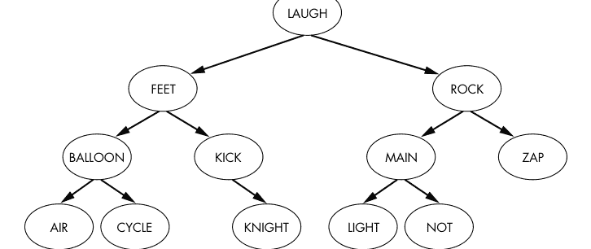
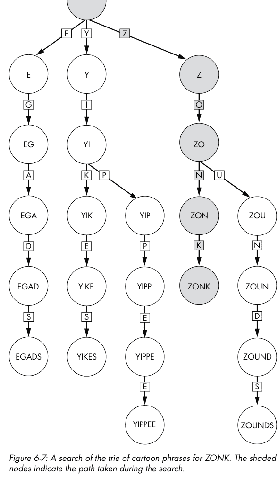
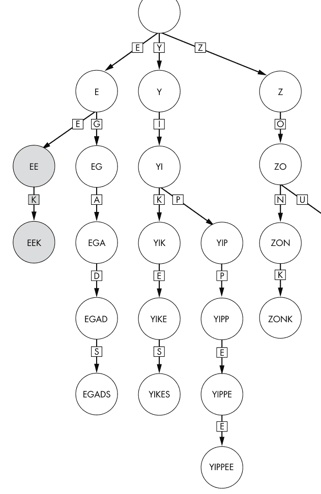
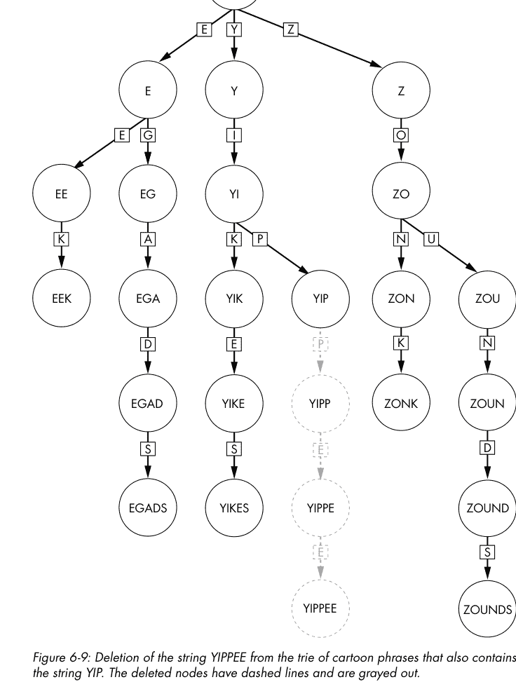

## 字符串的二叉搜索树

在考虑是否可以改进算法时，我们首先应该了解当前方法的局限性——否则，就没有理由构建更复杂的数据结构。因此，在深入研究特定于字符串的数据结构之前，我们将先检查二叉搜索树在用于存储字符串时存在哪些不足。首先，让我们看看二叉搜索树如何用于这种搜索。

### 树中的字符串

二叉搜索树可以存储的不只是数字，还可以存储任何可排序的东西，从鞋子（按尺寸或气味排序）到僵尸电影（按票房收入或恐怖程度排序）再到食物（按价格、辣度或在未来24小时内导致呕吐的可能性排序）。二叉搜索树就是这样多才多艺。我们只需要能够对项目进行排序。

要在二叉搜索树中存储字符串，我们可以按字母顺序对元素进行排序。例如，图6-1中二叉搜索树的每个节点都是一个单独的字符串，将其子树划分为在字典中在其之前和之后的那些字符串。我们重用了二叉搜索树中的大于和小于符号，其中 X < Y 表示字符串 X 在字母表中出现在字符串 Y 之前。



我们搜索字符串的二叉搜索树的方式与搜索数字时相同。例如，要在图6-1中找到字符串 LIGHT，我们从根节点开始。然后我们将目标值与节点的值进行比较，使用字母顺序，并沿着左分支或右分支向下进行：

- 1. LIGHT > LAUGH: We proceed down the right branch.
- 2. LIGHT < ROCK: We proceed down the left branch.

entire target against the value at the node. We need additional information, the placement of the character that we are checking for at this level. We can track this additional state by passing the index to check into our recursive search function and incrementing it with each level of recursion.

The trie wrapper allows us to hide both the reference to the root node and the initial counter required by the recursive function, simplifying the code seen by the trie’s users:

```
TrieSearch(Trie: trie, String: target):
    return TrieNodeSearch(tr.root, target, 0)
```

This wrapper guarantees that subsequent search function is called with a non-null node and the correct initial index.

The code for recursively searching a trie is a bit more complex than the code for searching a binary search tree, because we must deal with target values of different lengths:

```
TrieNodeSearch(TrieNode: current, String: target, Integer: index):
    ① IF index == length(target):
        IF current.is_entry:
            return current
        ELSE:
            return null

    ② Character: next_letter = target[index]
    ③ Integer: next_index = letterToIndex(next_letter)
    TrieNode: next_child = current.children[next_index]
    ④ IF next_child == null:
        return null
    ELSE:
        return TrieNodeSearch(next_child, target, index+1)
```

This code starts by checking the length of the target string against the current depth in order to determine whether the target should be located at this level ①. If the index is equal to the length of the string (and thus one past the last character in the string), the code then checks whether the current node is itself a valid entry. This check is particularly necessary when the search terminates at an internal node, since we need to confirm that this node represents a valid entry in its own right, not just the prefix of another entry.

If the code has not reached the end of the target string, it continues the search by examining the next character in our target ②. We can define a helper function to map the character to the correct index in the array ③. The code then checks whether the corresponding child exists ④. If there isn’t a corresponding child, the code returns null, confident that target is not in the trie. If there is a corresponding child, the code follows that branch.

For an example of this search procedure, consider a trie of exclamations like YIKES and ZOUNDS from a recent episode of our favorite

To check whether this week’s episode contained our all-time favorite cartoon word, ZONK, we can simply search the trie. We start at the top of the trie and take the corresponding branches for each character, as shown in Figure 6-7.



Figure 6-7: A search of the trie of cartoon phrases for ZONK. The shaded nodes indicate the path taken during the search.


由于前缀树只包含带有数据的节点，我们可以通过留意死路来确定某个字符串是否不在前缀树中。例如，我们知道ZIPPY并没有出现在该剧集中，因为在前缀Z之后我们遇到了一条死路。对于前缀ZI，没有任何分支。如果某个自以为是的人声称他们最喜欢的台词中包含感叹词ZIPPY，我们可以通过一次简单的搜索证明他们错了。

乍一看，添加大量内部节点似乎会增加搜索的成本。然而，这种新结构实际上极大地改善了我们的搜索。在目标字符串的每个字符处，我们在当前节点中执行一次查找，检查该字符是否已有对应的子节点，然后进入相应的子节点；因此，查找和比较的次数与目标字符串的长度成正比。与二叉搜索树不同，成功的前缀树搜索所需的比较次数与前缀树中存储的字符串数量无关。即使我们在前缀树中放入整本字典，要检查字符串EGADS，也仍然只需访问六个节点。

当然，与计算机科学中的一切一样，这种效率并非没有代价。我们在内存使用上付出了相当大的代价。不再是每个字符串存储一个节点和指向两个子节点的指针，我们现在是字符串中的每个字符存储一个节点，并存储大量指向潜在子节点的指针。重叠的前缀有助于降低每个字符串的内存成本。如果多个条目共享同一前缀，例如图6-6中ZOUNDS和ZONK的ZO，那么这些条目会共享这些初始重叠字符的节点。

### 添加和删除节点

与二叉搜索树一样，前缀树是动态数据结构，会随着我们添加或删除节点而自适应，从而能够准确地表示变化中的数据。向前缀树中添加字符串的过程与向二叉搜索树中添加数据的过程非常相似。我们像搜索该字符串一样沿树向下前进。一旦遇到死路，我们就可以在该节点下方创建一棵子树，以容纳该字符串中的剩余字符。与二叉搜索树中的插入不同，我们在插入单个条目时可能会添加多个新的内部节点。

顶层Trie函数通过使用（非空）根节点和正确的初始深度调用递归搜索函数来设置插入：

```
TrieInsert(Trie: tr, String: new_value):
    TrieNodeInsert(tr.root, new_value, 0)
```

我们不需要将根节点的创建作为特殊情况处理，因为我们在创建前缀树本身时就已经分配了一个初始根节点。



图 6-8：将EEK添加到卡通短语前缀树中。新节点以阴影显示。

由于删除需要从根节点到单个叶节点进行一次往返，因此成本同样与目标字符串的长度成正比。与搜索和插入一样，成本与前缀树中存储的字符串总数无关。



图 6-9：从同时包含YIP的卡通短语前缀树中删除字符串YIPPEE。被删除的节点使用虚线表示并置灰。

### 为什么这很重要

我们现在可以看到前缀树如何解决我们之前提出的二叉搜索树问题：二叉搜索树的搜索成本取决于单词的数量和长度。在本章的简短示例中，前缀树并没有提供太多优势。事实上，额外分支带来的开销可能会使它们比二叉搜索树或有序列表效率更低。然而，随着我们添加越来越多的字符串，以及具有相似前缀的字符串数量增加，前缀树会变得越来越划算。这有两个原因：第一，前缀树中查找的成本与条目数量无关；第二，字符串比较本身可能很昂贵。在二叉搜索树中，这两个因素会叠加，因为我们在每个节点上都要付出比较两个字符串的成本。

例如，在现实世界中，我们可以在文字处理器中使用前缀树来跟踪词典中的单词。每个节点上的辅助数据可能包括定义或常见拼写错误。当用户输入和编辑时，程序可以高效地检查每个单词是否在词典中，并高亮不在词典中的单词。该程序极大地受益于自然语言中共享前缀和字符数量有限的特点。

例如，如果我们正在撰写一篇关于百科全书历史的深入文章，我们不想付出过高的代价将encyclopedia与相邻的单词encyclopedias、encyclopedic、encyclopedist等进行比较。请记住，如图6-10所示，比较两个字符串字母顺序的算法包括遍历这些字符串，并逐字符比较。尽管程序一旦发现不同的字符就会停止，但比较相似前缀的成本会累积起来。在活动的文字处理器文档中，我们可能需要不断修改单词集合。每次插入或编辑都将需要在我们数据结构中进行一次查找。

| E | N | C | Y | C | L | O | P | E | D | I | C |   |
| --- | --- | --- | --- | --- | --- | --- | --- | --- | --- | --- | --- | --- |
| = | = | = | = | = | = | = | = | = | = | = | > |   |
| E | N | C | Y | C | L | O | P | E | D | I | A | S |

图 6-10：昂贵字符串比较的示例。等号表示两个单词中字符相同的位置，大于号表示第一个不同之处。

前缀树的一个更好的用途可能是跟踪结构化标签——如序列号、型号或SKU代码——这些标签通常格式化为较短的字母数字字符串。例如，我们可以创建一个简单的前缀树来存储按序列号索引的产品注册信息。即使考虑到已售出数十亿产品，所有操作的成本也与序列号的长度成线性关系。如果我们的序列号包含结构，例如表示设备型号的前缀，那么我们可以通过限制初始节点的分支因子来实现进一步节省（因为许多字符串会使用相同的前缀）。辅助数据可以包括设备购买地点或时间的信息。

比任何特定应用更重要的是，前缀树展示了我们如何利用数据内部的进一步结构来优化操作成本。我们调整了二叉搜索树的分支结构，以利用字符串的顺序特性。这一改进再次说明了本书的一个核心主题：我们经常可以利用数据中固有的结构来提高算法效率。

描述，给你留下了一份按排名排列的咖啡清单供尝试。你从列表顶部选择最有希望的品牌，购买它，然后回家细细品味。

第二天，你回到Dynamic Selection Coffee咖啡馆，想尝试列表上的第二项，却发现在菜单上又增加了两种咖啡。当你问咖啡师为什么做出这样的改变时，他们指了指店里的招牌，招牌上写着Dynamic Selection Coffee提供不断扩展的咖啡选择。他们的目标是最终提供超过一千种咖啡。你既兴奋又恐慌。每天你都需要对新咖啡进行优先级排序，并将它们插入到你的列表中，以便知道接下来该尝试哪种咖啡。

从优先列表中检索条目的任务是计算机程序中经常出现的问题：给定一个条目列表及其关联的优先级，我们如何高效地按优先级顺序检索下一个条目？通常，我们需要在动态环境中执行这种检索，因为新条目随时会到达。我们可能需要根据优先级选择要处理的网络数据包，根据常见拼写错误在拼写检查中提供最佳建议，或者在最佳优先搜索中选择下一个选项。在现实世界中，我们可能会使用自己的心理优先队列来决定接下来执行哪项紧急任务、看哪部电影，或者在拥挤的急诊室中先看哪位患者。一旦你开始留意，优先级检索无处不在。

在本章中，我们将介绍优先队列——一类用于从集合中检索优先条目的数据结构，然后讨论实现这一有用工具的最常见数据结构：堆。堆使优先队列的核心操作变得极其高效。
