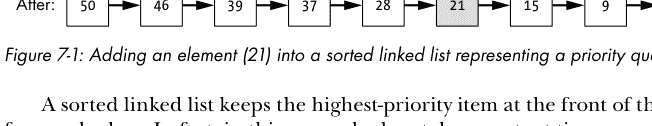
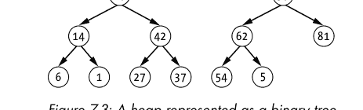
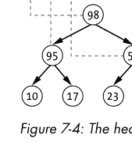

## 优先队列

优先队列存储一组条目，并允许用户轻松检索优先级最高的条目。它们是动态的，允许插入和检索交替进行。我们需要能够从优先任务列表中添加和删除条目。如果我们只能使用固定的数据结构，作者可能会整天查看他的静态列表，并反复执行优先级最高的任务“获取早晨咖啡”。如果没有在任务完成后将其删除的能力，它就会一直停留在作者列表的顶部。虽然这可能会让作者度过愉快的一天，但不太可能是富有成效的一天。

在最基本的形式中，优先队列支持几个主要操作：

- 添加一个条目及其关联的优先级分数。
- 查找优先级最高的条目（如果队列为空，则返回null）。
- 删除优先级最高的条目（如果队列为空，则返回null）。


我们还可以添加其他有用的函数，让我们能够检查优先级队列是否为空，或返回当前存储的项目数量。

我们根据手头的问题设置项目的优先级。在某些情况下，优先级值可能是显而易见的或由算法决定的。例如在处理网络请求时，每个数据包可能带有明确的优先级，或者我们选择先处理最旧的请求。然而，决定优先处理什么并不总是简单的事。当优先考虑下一次要尝试的咖啡品牌时，我们可能希望根据价格、可用性或咖啡因含量创建优先级——这取决于我们计划如何使用优先级队列。

使用原始数据结构（如排序链表或排序数组）实现优先级队列是可能的，但并不理想，新项目会根据其优先级插入到列表中。图 7-1 显示了将值 21 添加到排序链表中的示例。



图 7-1：将一个元素（21）添加到表示优先级队列的排序链表中

排序链表将最高优先级项目保存在列表前端以便快速查找。事实上，在这种情况下，查找时间与优先级队列的长度无关为常数时间——我们只需查看第一个元素。不幸的是，添加新元素可能代价高昂。我们每次添加新项目时可能需要遍历整个列表，花费的时间与优先级队列的长度成正比。

作者使用这种排序列表方法的现实版本来整理他的冰箱，按过期日期递增的顺序将物品从前到后存放。最近的物品始终是最高优先级，即最快过期的物品。检索正确的物品很容易——只需拿取前面那个即可。当存放用于早晨咖啡的牛奶或奶油时，这种方案特别有益：没有人希望在早晨前几个迷糊的时刻阅读过期日期。然而，将新物品插入旧物品后面可能需要时间并需要大量移动。

同样，我们也可以在未排序的链表或数组中维护优先级队列。新增操作很简单——只需将元素标记到列表末尾，如图 7-2 所示。


图 7-2：将一个元素（21）添加到表示优先级队列的未排序数组中

不幸的是，我们现在在查找下一个元素时付出了高昂的代价。我们必须扫描整个列表以确定哪个元素具有最高优先级。如果我们要删除它，还需要移动所有元素以填补空隙。这种方法相当于扫描作者冰箱中的全部物品以找到最接近过期的那件。这对于只有几盒牛奶的冰箱可能可行，但想象一下在大型超市中翻找每一件食物或饮料的开销。

将优先级队列实现为排序列表可能比使用未排序列表更好，反之亦然，这取决于我们计划如何使用优先级队列。如果添加操作比查找操作更常见，我们更喜欢未排序列表。如果查找操作更常见，我们应该付出保持元素排序的成本。就冰箱而言，查找操作远比添加操作常见——我们使用一盒牛奶的频率远高于购买新盒牛奶，因此将牛奶保持在排序顺序是有利的。当添加和查找都很常见时，挑战就出现了；优先考虑其中一个操作会导致整体效率低下，因此我们需要一种能够平衡其成本的方法。一种巧妙的数据结构——堆——帮助我们解决了这个问题。

### 最大堆

最大堆是二叉树的变体，它在节点与其子节点之间保持特殊的顺序关系。具体来说，最大堆根据最大堆属性存储元素，该属性规定树中任何节点的数值都大于或等于其子节点的数值。为简单起见，我们在整章中通常使用更通用的术语堆和堆属性来指代最大堆和最大堆属性。

图 7-3 显示了根据最大堆属性组织的二叉树的表示。



除了优先级低于其父节点之外，左右子节点之间没有特殊的偏好或顺序。相比之下，想象一个精英咖啡爱好者导师计划——咖啡相关知识改进协会。每个成员（节点）同意指导最多另外两个咖啡爱好者（子节点）。唯一条件是每个被指导者必须不比其导师更了解咖啡——否则，指导将是浪费。

计算机科学家 J. W. J. Williams 最初将堆发明为一种新排序算法——堆排序——的组件，我们将在本章后面讨论。然而，他认识到堆是其他任务的有用数据结构。最大堆的简单结构使其能够高效地支持优先级队列所需的操作：（1）允许用户高效查找最大元素，（2）删除最大元素，以及（3）添加任意元素。

堆通常被可视化为树，但通常用数组实现以提高效率。在本章中，我们并行呈现这两种表示，以便读者在它们之间建立心理联系。然而，实现时并不要求我们使用数组。

在基于数组的实现中，数组中的每个元素对应树中的一个节点，根节点位于索引 1（我们跳过索引 0 以保持与堆常见约定的兼容）。子节点索引相对于其父节点的索引定义，因此索引为 i 的节点，其子节点位于索引 2i 和 2i + 1。例如，索引为 2 的节点，其子节点位于索引 2 × 2 = 4 和索引 2 × 2 + 1 = 5，如图 7-4 所示。



图 7-4：堆在二叉树中的位置对应于数组中的索引位置。

同样，我们将节点的父节点索引计算为 Floor(i/2)。这种索引方案允许算法基于父节点 trivially 计算子节点的索引，并基于子节点计算其父节点的索引。

根节点始终对应于最大堆中的最大值。由于我们将根节点存储在数组中的固定位置（索引 = 1），我们始终可以在常数时间内找到该最大值。这只是一个数组查找。数据本身的布局因此解决了必要的优先级队列操作之一。

由于我们将在优先级队列中添加和删除任意元素，为了避免不断调整数组大小，我们希望预先分配一个足够容纳我们预期添加的项目数量的数组。记住第 3 章中动态调整数组大小可能很昂贵，需要创建新数组并复制值，在这种情况下会浪费堆的宝贵效率。相反，我们可以最初分配一个大数组，跟踪数组中最后一个已填充元素的索引，并将该索引称为数组的虚拟末尾。这使我们可以通过简单地更新最后一个元素的索引来追加新元素。

```
Heap {
    Array: array
    Integer: array_size
    Integer: last_index
}
```

当然，这种整体分配的成本是可能未使用的内存块，如果我们的堆没有增长到预期大小。

使用数组表示树型数据结构本身就是一个有趣的步骤。我们可以使用紧凑数组和数学映射来表示堆，而不依赖指针，从而以更少的内存存储堆。通过维护从节点索引到其子节点的映射，我们可以重新创建树型数据结构而无需指针。正如我们下面将看到的，这种基于数组的表示对于堆是可行的，因为该数据结构始终保持近乎完整且平衡的树。这导致了一个没有间隙的紧凑数组。虽然我们也可以对其他树（如二叉搜索树）使用相同的数组表示，但这些数据结构通常在整个过程中存在间隙，并且需要非常大（并且可能大部分为空）的数组来存储具有深分支的树。

#### 向堆添加元素

向堆添加新元素时，我们必须确保结构保持堆属性。正如你不会指派一位受勋将军向一位新上任的中尉汇报一样，你也不会把高优先级的堆节点放在低优先级节点之下。我们必须以这样的方式将元素添加到堆的树结构中：添加之下所有元素的优先级小于或等于新节点。同样，新添加之上的所有节点的优先级应大于或等于新节点。

数组实现堆的精妙之处在于它在以紧凑数组存储节点的同时保持了这一属性。在之前的章节中，向数组中间添加节点代价高昂，需要将后续条目向下移动。幸运的是，我们每次向堆添加新元素时无需支付这种线性成本。相反，我们通过先破坏堆属性，然后沿着树的单个分支交换元素来恢复它，从而添加元素。

换句话说，要向堆添加新元素，我们将其添加到树的底层第一个空位。如果该新值大于其父节点的值，我们将其向上冒泡，直到它小于或等于其父节点，从而恢复堆属性。堆本身的结构使我们能够高效地做到这一点。在堆的数组实现中，这对应于将新元素追加到数组末尾并向前交换。

考虑图 7-5 中的示例，该图以数组和树两种形式显示了堆在每一步的结构。图 7-5(a) 显示了在添加新元素之前堆的状态。在图 7-5(b) 中，我们将新元素追加


<!-- no content -->
