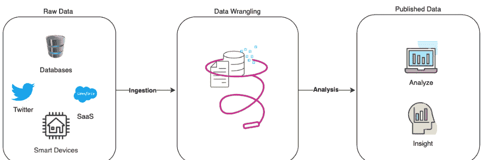
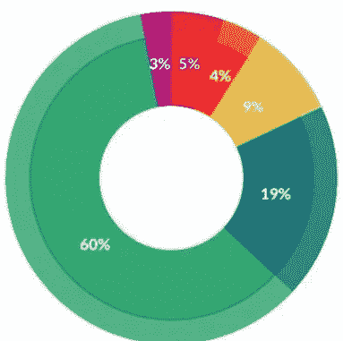
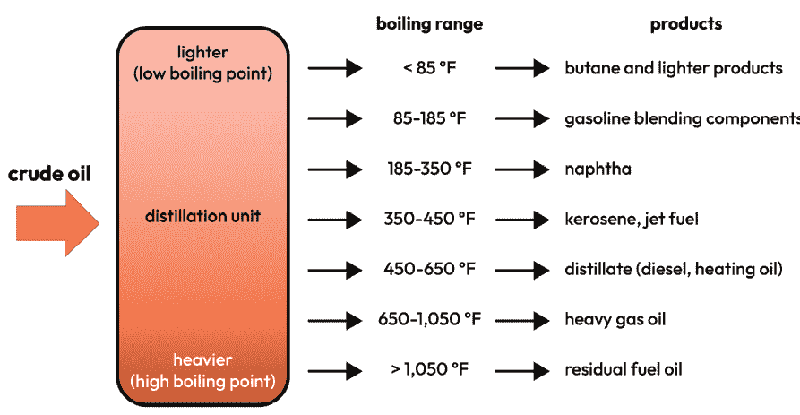
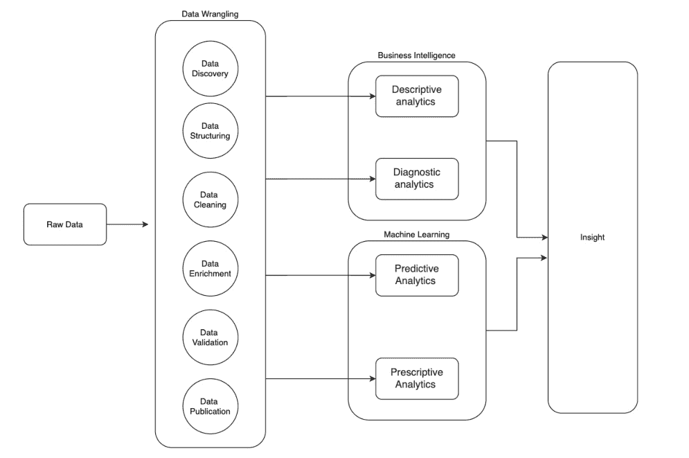
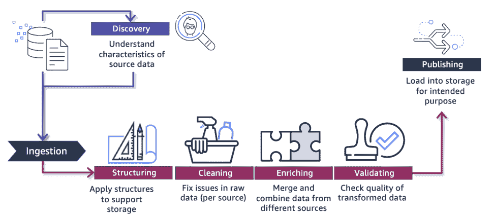

## 开始数据整理

在本<|message|> 书的引言部分，我们列出了组织如何使用数据为客户创造价值的用例。除此之外，组织还会收集大量其他数据，以便了解客户的财务状况，这有助于他们与利益相关者分享，包括用于安全、系统健康检查的日志数据，以及用于客户 360 等用例所需的客户数据。

我们讨论了所有这些用例以及如何从不同数据源收集数据以解决它们。然而，从收集数据到解决这些业务用例，一个非常重要步骤是清理数据。这就是数据整理发挥作用的地方。

在本章中，我们将学习数据整理的基础知识并涵盖以下主题：

- 介绍数据整理
- 数据整理涉及的步骤
- 数据整理的最佳实践
- 在 **亚马逊网络服务 (AWS)** 中执行数据整理的可用选项

### 介绍数据整理

为了使组织能够以数据为驱动为客户提供价值或做出更明智的业务决策，他们需要从不同的数据源收集大量数据，例如点击流、日志数据、交易系统和平文件，并将它们存储在不同的数据存储中，例如数据湖、数据库和数据仓库作为 **原始数据**。一旦数据存储在不同的数据存储中，就需要对其进行清洗、转换、组织并从不同数据源进行连接，以为下游应用程序提供更有意义的信息，例如机器学习模型提供产品推荐或查找交通状况。或者，它可以被业务或数据分析使用，以提取有意义的业务信息：

图 1.1：数据管道

### 数据分析的 80-20 法则

当组织从不同数据源收集数据时，最初并无多大用处。据估计，数据科学家花费约 80% 的时间来清理数据。这意味着他们只有 20% 的时间用于分析并从数据科学流程中获得见解：

### 数据科学家花费最多时间的工作

- 构建训练集：3%
- 清理和整理数据：60%
- 收集数据集：19%
- 挖掘数据模式：9%
- 优化算法：4%
- 其他：5%

图 1.2：数据科学家的任务分配

现在我们了解了数据整理的基本概念，我们将学习它为什么至关重要，以及它带来的各种好处。

### 数据整理的优势

如果我们回到石油的类比，当我们第一次提取它时，它是原油的形式，并无多大用处。为了使其有用，它必须经过炼油厂，在那里原油被放入蒸馏装置。在这个蒸馏过程中，液体和蒸汽根据沸点分离成称为馏分的石油组分。重馏分在底部，而轻馏分在顶部，如下所示：

### 原油蒸馏装置及产品

| 沸点范围 | 产品 |
|---|---|
| < 85 °F | 丁烷及更轻的产品 |
| 85-185 °F | 汽油调和组分 |
| 185-350 °F | 石脑油 |
| 350-450 °F | 煤油、喷气燃料 |
| 450-650 °F | 馏分油（柴油、取暖油） |
| 650-1,050 °F | 重质燃油 |
| > 1,050 °F | 残余燃料油 |

图 1.3：原油加工

下图展示了石油加工如何与数据整理流程相关联：

图 1.4：数据整理流程

数据整理带来许多优势：

- **增强数据质量：** 数据整理有助于提高数据的整体质量。它涉及识别和处理缺失值、异常值、不一致和错误。通过解决这些问题，数据整理确保用于分析的数据准确可靠，从而产生更稳健、更值得信赖的结果。
- **提高数据一致性：** 原始数据通常来自各种来源或以不同格式存在，导致命名约定、测量单位或数据结构不一致。数据整理允许您标准化并协调数据，确保数据集的一致性。一致的数据使信息的集成和比较更容易，促进有效的分析和解释。
- **提高数据完整性：** 不完整的数据在分析和建模期间会带来挑战。数据整理方法允许您通过应用诸如插补等技术来处理缺失数据，其中缺失值根据现有信息进行估计或填充。通过适当处理缺失数据，数据整理有助于确保更完整的数据集，减少潜在偏差并提高分析的准确性。
- **促进数据集成：** 组织的数据通常分散在多个系统和来源中，使集成成为复杂任务。数据整理有助于从各种来源合并和集成数据，使分析人员能够使用统一的数据集。这种集成促进了数据的整体视图，使全面分析和洞察成为可能，而这些在处理碎片化数据时可能无法实现。
- **简化数据转换：** 数据整理提供工具和技术将原始数据转换为适合分析的格式。这种转换包括数据规范化、聚合、过滤和重新格式化等任务。通过简化这些流程，数据整理简化了数据准备阶段，为分析人员节省时间和精力，使他们能够更专注于实际分析和解释结果。
- **实现有效的特征工程：** 特征工程涉及创建新的派生变量或转换现有变量以提高机器学习模型的性能。数据整理为特征工程提供了基础，通过以允许有意义转换的方式准备数据。通过执行诸如缩放、对分类变量进行编码或创建交互项等任务，数据整理有助于导出信息丰富的特征，增强模型的预测能力。
- **支持数据探索和可视化：** 数据整理通常涉及 **探索性数据分析 (EDA)**，分析人员在正式建模之前获得数据见解并了解数据模式。通过清理和准备数据，数据整理能够进行有效的数据探索，帮助分析人员发现关系、识别趋势并使用图表、图形或其他视觉表示来可视化数据。这些探索步骤对于形成假设、做出数据驱动的决策和有效传达见解至关重要。

现在我们已经了解了数据整理的优势，让我们了解数据整理流程涉及的步骤。

### 数据整理涉及的步骤

与原油类似，原始数据必须经过多个数据整理步骤才能变得有意义。

在本节中，我们将学习数据整理涉及的六步流程：

- 1. 数据发现
- 2. 数据结构化
- 3. 数据清洗
- 4. 数据丰富
- 5. 数据验证
- 6. 数据发布

在开始之前，了解这些活动可能不需要按顺序执行，或者在某些情况下，您可能会跳过其中任何一步是很重要的。

此外，请记住这些步骤是迭代的，并且因不同角色而异，例如数据分析师、数据科学家和数据工程师。

例如，数据工程师的数据发现可能与数据分析师或数据科学家的数据发现含义不同：

图 1.5：数据整理过程的步骤

让我们详细了解这些步骤。

## 数据发现

数据整理过程的第一步是数据发现。这是数据整理中最重要的步骤之一。在数据发现中，我们熟悉我们作为原始数据所拥有的数据类型，我们希望用该数据解决的使用案例是什么，原始数据之间存在什么样关系，数据格式会是什么样的，例如 CSV 或 Parquet，可用于存储、转换和查询此数据的工具有哪些，以及我们希望如何组织这些数据，例如按文件夹结构、文件大小、分区等，以便于访问。

让我们通过一个示例来理解这一点。

在此示例中，我们将尝试了解数据发现如何根据角色而变化。假设我们有两位同事，James 和 Jean。James 是数据工程师，而 Jean 是数据分析师，他们都在一家汽车销售公司工作。

Jean 是组织的新人，她需要分析南加州的汽车销售数量。她已联系 James 并要求他提供来自生产系统的销售表数据。

这是 Jean（数据分析师）的数据发现流程：

- 1. Jean 需要确定生成销售报告所需的数据（例如，销售交易数据、车辆详细信息数据、客户数据等）。
- 2. Jean 需要找到销售数据所在的位置（数据库、文件共享、CRM 等）。
- 3. Jean 需要确定她需要多少数据（过去 12 个月、过去一个月等）。
- 4. Jean 需要确定她将使用哪种工具（Amazon QuickSight、Power BI 等）。
- 5. Jean 需要确定数据的格式，以便与她拥有的工具兼容。
- 6. Jean 需要确定她打算将此数据存储在哪里——在数据湖（Amazon S3）中、她的桌面上、文件共享、沙箱环境等。

这是 James（数据工程师）的数据发现流程：

- 1. 哪个系统请求了数据？例如，Amazon RDS、Salesforce CRM、生产 SFTP 位置等。
- 2. 数据将如何提取？例如，使用 Amazon DMS 或 AWS Glue 等服务或编写脚本。
- 3. 调度会是什么样？每天、每周或每月？
- 4. 文件格式会是什么样？例如，CSV、Parquet、ORC 等。
- 5. 数据将在提供的存储中如何存储？

## 数据结构化

为了更好地为客户服务，组织必须从不同的数据源收集前所未有的大量数据，且数据种类各异。在现代数据架构中，大多数情况下数据存储在数据湖中，因为数据湖允许你存储各种类型的数据文件，无论是结构化数据、非结构化数据、图像、音频、视频或其他内容，且其原始形式形状和大小各不相同。当数据处于原始形式时，它缺乏明确的结构，而这种结构是将其存储在数据库或数据仓库中或用于构建分析和机器学习模型所必需的。此时，它尚未针对成本和性能进行优化。

此外，当你处理诸如点击流和日志分析之类的流数据时，并非所有数据字段（列）都用于分析。

在数据整理的这个阶段，我们通过执行分区和转换文件类型（例如，将 CSV 转换为 Parquet）来尝试优化原始数据集，以获得成本和性能方面的优势。

再次，让我们考虑我们的朋友 James 和 Jean 来理解这一点。

对于数据分析师 Jean 而言，数据结构化意味着她希望直接查询数据或将数据存储在 BI 工具的内存存储中，在 Amazon QuickSight 的情况下称为 SPICE 层，这提供了更快的数据访问。

对于数据工程师 James 而言，当他从生产系统提取数据并希望将其存储在 Amazon S3 等数据湖中时，他必须考虑文件格式会是什么样。他可以按地理区域，例如县、州或地区，或按日期进行分区——例如，year=YYYY、month=MM 和 day=DD。

## 数据清洗

数据整理过程的下一步是数据清洗。前两个步骤让我们了解数据看起来如何以及如何存储。在数据清洗步骤中，我们开始处理原始数据，使其有意义，以便我们可以定义未来的使用案例。

在数据清洗步骤中，我们通过执行以下操作使数据有意义：

- 删除不需要的列、重复值，并填充空值列以提高数据的就绪程度
- 执行数据验证，例如识别必填列（如姓名、姓氏、SSN、电话号码等）的缺失值
- 验证或修复数据类型以更好地优化存储和性能
- 识别并修复异常值
- 删除垃圾数据或不需要的值，例如特殊字符

James 和 Jean 都可以执行类似的数据清洗任务；然而，其规模可能有所不同。对于 James，这些任务必须针对整个数据集执行。对于 Jean，她可能只需要对来自南加州的数据执行这些任务，粒度也可能有所不同。对于 James，也许仅限于南加州、北加州等地区，而对于 Jean，可能是城市级别甚至邮政编码级别。

## 数据丰富

直到数据清洗步骤，我们主要是在单个数据源上工作，并使其对未来使用有意义。然而，在现实世界中，大多数情况下，数据是分散的并存储在多个不同的数据存储中，为了支持构建个性化或推荐解决方案或构建客户 360 或日志取证等用例，我们需要从不同的数据存储中连接数据。

例如，要构建客户 360 解决方案，你需要来自 **客户关系管理 (CRM)** 系统、点击流日志、关系数据库等的数据。

因此，在数据丰富步骤中，我们构建流程，将原始数据与从不同来源获得的相关数据进行增强。

## 数据验证

在计算机科学中有一个非常有趣的术语，称为 **垃圾进，垃圾出 (GIGO)**。GIGO 的概念是，有缺陷或损坏（垃圾）的输入数据会产生有缺陷的输出。

换句话说，输出的质量取决于输入的质量。因此，如果我们提供糟糕的数据作为输入，我们将得到不准确的结果。

在数据验证步骤中，我们通过执行各种数据质量检查来解决这个问题：

- 数据准确性的业务验证
- 验证数据安全
- 验证整个数据集中的结果一致性
- 通过验证以下数据质量检查来验证数据质量：
  - 记录数
  - 重复值
  - 缺失值
  - 异常值
  - 不同的值
  - 唯一值
  - 相关性

数据清洗和数据验证之间存在很多重叠，是的，这两个过程之间有很多相似之处。然而，数据验证是在结果数据集上进行的，而数据清洗主要是在原始数据集上进行的。

## 数据发布

完成所有数据整理步骤后，数据就可以用于分析以解决业务问题。

因此，最后一步是将数据发布给最终用户，并提供所需访问权限和权限。

在此步骤中，我们主要关注数据如何向最终用户公开以及最终数据存储在哪里——即在关系数据库、数据仓库、数据湖中的 curated 或用户区域，或通过安全文件传输协议（SFTP）。

数据存储的选择取决于最终用户希望通过何种工具访问数据。例如，如果最终用户希望通过 BI 工具（如 Amazon QuickSight、Power BI、Informatica 等）访问数据，关系型数据存储将是理想选择。如果由数据科学家访问，理想情况下应存储在对象存储中。

我们将在本书后面学习有关可用于存储原始数据和整理后数据的不同类型数据存储的知识。

在本节中，我们通过朋友 James 和 Jean 了解了数据整理过程的各个步骤，以及这些步骤如何根据角色而有所不同或相同。现在，让我们了解数据整理的最佳实践。

## 数据整理的最佳实践

有许多方法和工具可用于执行数据整理，具体取决于数据整理的方式和执行者。例如，如果您正在处理实时用例，例如提供产品推荐或欺诈检测，您在执行数据整理时选择的工具和流程将与您希望构建 **商业智能 (BI)** 仪表板来显示销售数据的情况大不相同。

无论您希望解决哪种用例，都可以应用一些标准最佳实践，这将有助于作为数据整理人员让您的工作更轻松。

### 确定业务用例

建议您在编写第一行代码之前就确定要用于数据整理的服务或工具。识别业务用例非常重要，因为它将为数据整理流程奠定基础，并使识别您希望使用的服务的工作变得更容易。例如，如果您有一个业务用例，例如分析小型组织的 HR 数据，您只需要从包含 10,000 条记录的小型数据集中连接几列、删除几列、删除重复项、删除 NULL 值等等，并且只有少数用户会访问整理后的数据，那么您无需花费大量资金去寻找市场上花哨的数据整理工具——您只需使用 Excel 表格即可完成工作。

然而，当您有业务用例时，例如处理从不同合作伙伴收到的索赔数据，您需要处理半结构化文件（如 JSON）或非结构化数据集（如 XML 文件）以提取仅几个文件的数据，例如其索赔 ID 和客户信息，并且您希望执行复杂的数据整理流程，例如连接、使用正则表达式查找模式等等，那么您应该考虑编写脚本或订阅任何企业级工具来完成您的工作。

### 确定数据源并获取正确的数据

在确定业务用例后，确定解决它所需的数据源非常重要。识别此来源将帮助您选择需要带来数据的服务类型、频率和最终存储。例如，如果您希望构建信用卡欺诈检测解决方案，您需要实时引入信用卡交易数据；即使是清理和处理数据也应实时进行。机器学习推理也需要在实时数据上运行。

同样，如果您正在构建销售仪表板，您可能需要从 CRM 系统（如 Salesforce）或事务性数据存储（如 Oracle、Microsoft SQL Server 等）引入数据。

在确定正确的数据源后，从这些数据源中引入正确的数据非常重要，因为它将帮助您解决业务用例并使数据整理过程变得简单。

### 确定您的受众

在执行数据整理时，一个重要方面是确定您的受众。了解您的受众将帮助您确定他们希望消费哪种类型的数据。例如，市场营销团队可能与数据科学团队或企业高管的数据整理需求不同。

这也将让您了解您希望在哪里展示数据——例如，数据科学家团队可能需要在对象存储（如 Amazon S3）中获取数据，业务分析师可能需要在平面文件（如 CSV）中获取数据，BI 开发人员可能需要在事务性数据存储中获取数据，而业务用户可能需要在应用程序中获取数据。

到此为止，我们已经介绍了数据整理的最佳实践。接下来，我们将探讨 AWS 中可用于执行数据整理的各种选项。

## AWS 上可用于数据整理的选项

根据客户需求、数据源和团队专业知识，AWS 提供了多种数据整理选项。在本节中，我们将介绍 AWS 上最常见的选项。

### AWS Glue DataBrew

2020 年发布，AWS Glue DataBrew 是一款可视化数据准备工具，可让您轻松清理和规范化数据，以便为分析和机器学习做好准备。该服务提供的可视化 UI 允许没有编码或脚本经验的数据分析师完成数据整理的各个方面。它附带丰富的常用预建数据转换操作，可简化这些数据整理活动。与任何 **软件即服务 (SaaS)** ([https://en.wikipedia.org/wiki/Software_as_a_service](https://en.wikipedia.org/wiki/Software_as_a_service)) 类似，客户可以在无需配置任何服务器的情况下开始使用 Web UI，并且只需为所使用的资源付费。

### SageMaker Data Wrangler

与 AWS Glue DataBrew 类似，AWS 还提供 SageMaker Data Wrangler，这是一款基于 Web UI 的数据整理服务，更面向数据科学家。如果主要用例是构建机器学习管道，则应优先选择 SageMaker Data Wrangler。它直接与 SageMaker Studio 集成，其中使用 SageMaker Data Wrangler 准备的数据可以输入到数据管道中，以构建、训练和部署机器学习模型。它附带预配置的数据转换，用于用均值或中位数插补缺失数据、独热编码，以及为机器学习准备数据所需的时间序列特定转换器。

### AWS SDK for pandas

对于拥有强大的数据集成团队并具备编码和脚本经验的客户，AWS SDK for pandas ([https://github.com/aws/aws-sdk-pandas](https://github.com/aws/aws-sdk-pandas)) 是一个很好的选择。它建立在其他开源项目之上，提供抽象函数来执行典型的数据整理任务，例如从各种数据库、数据仓库和对象数据存储（如 Amazon S3）加载/卸载数据。AWS SDK for pandas 简化了与常见 AWS 服务（如 Athena、Glue、Redshift、Timestream、OpenSearch、Neptune、DynamoDB 和 S3）的集成。它还支持常见的数据库，如 MySQL 和 SQL Server。

### 摘要

在本章中，我们了解了数据整理的基础知识、其重要性、数据整理的步骤和最佳实践，以及数据整理步骤如何根据角色而变化。我们还讨论了 AWS 中可用的不同数据整理选项。

在接下来的章节中，我们将深入探讨这些选项中的每一个，并学习如何使用这些服务执行数据整理。
