## AWS Glue DataBrew 简介

上一章讨论了组织如何向现代数据架构转型。现代数据架构的一个关键方面是为组织中的每个个人提供数据访问权限。这促进了数据驱动的决策，从而使用户更有能力、提高生产力，并最终带来更高的利润以及更大的客户和员工满意度。

本章重点介绍 **亚马逊网络服务 (AWS)** Glue DataBrew 及其在数据整理中的应用。以下主题将被涵盖：
- 使用 AWS Glue DataBrew 的好处
- 开始使用 AWS Glue DataBrew
- 使用 AWS Glue DataBrew

### 为什么使用 AWS Glue DataBrew？

拥有合适的工具是使组织实现数据驱动的关键因素之一，而 AWS Glue DataBrew 就是这样一种工具。它是 AWS Glue 家族的一部分，该家族于 re:Invent 2020 推出。

最初，AWS Glue 于 2017 年 8 月推出时，面向的是编写 Apache Spark 代码的开发人员和数据工程师。其目标是为他们提供一个平台，该平台提供计算和存储资源来运行他们的 Spark 代码。这使他们能够利用 Apache Spark 的速度和易用性，Apache Spark 对于大规模数据处理而言比 Hadoop 快 100 倍，同时还能利用云的优势，例如弹性、性能和成本效益。

随着公共云的采用不断增加并变得更加主流，AWS Glue 不断发展以满足企业不断变化的需求。最初，它主要用作 ETL 工具，但此后已扩展成为更全面的数据治理工具。此次扩展包括添加 Python 引擎、Glue Data Catalog、Glue 爬虫和 AWS Glue Studio 等功能。此外，用户角色已从仅限开发人员扩展到现在包括数据分析师、业务分析师、产品经理和数据科学家等业务人员。

尽管增加了新功能，包括用于编写 Glue ETL 作业的 UI 体验以及 2021 年引入的 Glue Studio，但人们普遍要求更易于使用。虽然

这些功能主要面向使用 Apache Spark 执行 ETL，但仍需要一定程度的编码或脚本知识。

业务用户需要一种能够消除数据生产者与数据消费者之间、开发人员与业务用户之间延迟的工具。他们寻求一种易于使用的工具，例如 Microsoft Excel，而无需学习 Scala、PySpark、Python 或 SQL 等编程或脚本语言。通常，在企业中，业务用户严重依赖 BI 开发人员构建基于不同 KPI 的仪表板，以便他们做出关键的业务决策并识别任何异常。然而，对 KPI、数据源甚至数据进行微小更改可能需要一周或更长时间。

除了易用性之外，客户还需要一种可扩展的解决方案。虽然 Microsoft Excel 是最好的数据整理工具之一，但它缺乏可扩展性。虽然它非常适合包含数千条记录的小型数据集，但在数据增长到数万或数百万条记录时就会遇到困难。

根据与各种规模组织的互动，从希望建立数据驱动文化或实现 **数据即服务 (DaaS)** 的小型初创企业到大型企业，最大的挑战是如何提供安全且高质量的数据访问。客户希望使用一种工具来执行数据整理，而无需将数据下载到本地机器，这会带来重大的数据安全风险，并可能导致数据质量问题，尤其是在生命科学或政府和金融机构等垂直领域。虽然 AWS Glue 能够构建 ETL 管道，但执行数据分析需要从数据湖（Amazon S3）或数据仓库（如 Amazon Redshift 或 Snowflake）将数据下载到本地桌面，从而导致数据安全和质量风险，或者使用第三方工具，这会带来数据安全风险，因为数据必须通过互联网从 AWS 云传输到第三方工具，从而增加成本。

例如，许多数据隐私法律，如欧盟 **通用数据保护条例 (GDPR)**、**加州消费者隐私法案 (CCPA)** 和 1996 年的 **健康保险流通与责任法案 (HIPAA)**，现在限制了公司对客户数据的使用、存储位置以及可使用的工具。例如，携带不应超出国家边界的数据的笔记本电脑旅行或使用不符合 HIPAA 要求的工具可能会给组织带来法律和财务挑战。

处理大数据时面临的挑战之一是保持数据质量。例如，与 Spark 相比，Excel 等工具在处理云中的大型数据集时可能无法提供相同水平的精度。此外，市场上很少有工具提供基于开源技术（如 Apache Spark）构建的易于使用的 UI。

这就是 AWS Glue DataBrew 的用武之地。它是 AWS 提供的一种无代码/低代码、Serverless 可视化数据准备工具，使数据专业人员（如数据分析师、业务分析师、BI 开发人员和数据科学家）能够在无需编写任何代码的情况下执行数据整理。它提供 300 多种即用型转换，以自动化数据整理流程，包括数据发现、结构化、质量检查、清理、验证、异常检测和 **个人身份信息 (PII)** 识别。这可以将为分析和机器学习准备数据所需的时间减少多达 80%。

AWS Glue DataBrew 的一个关键特性是其无服务器特性，通过消除管理资源配置、扩展、高可用性和服务器维护等基础设施任务的需求来提供敏捷性。AWS Glue DataBrew 基于开源 Apache Spark 构建，提供 Spark 的扩展性和速度，而无需许可成本。它特别适合数据存储在数据湖（如 Amazon S3）中的大数据项目。

除了无服务器之外，AWS Glue DataBrew 还提供高级数据分析、可视化数据血缘、与数据管道的集成以及为高级机器学习用例准备数据的能力。

下图说明了 DataBrew 在高层的工作原理。

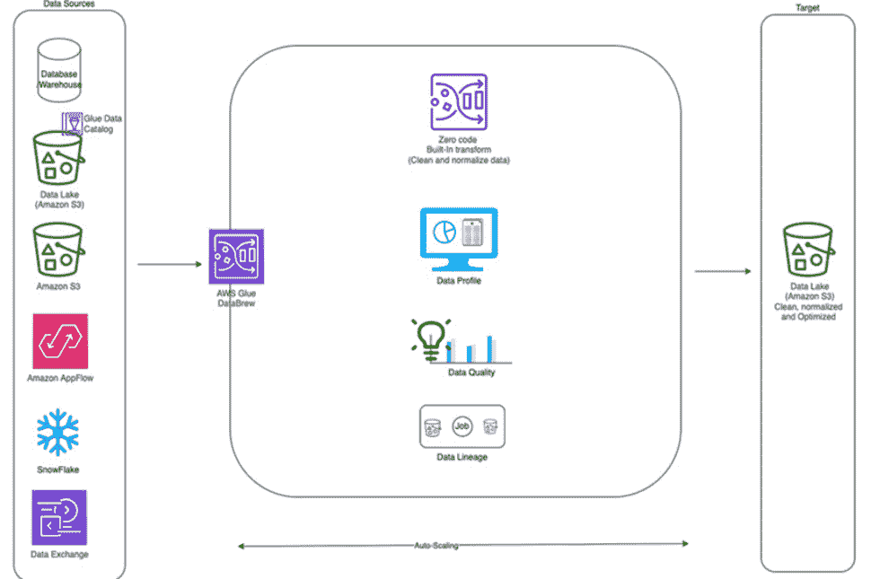

图 2.1：DataBrew 高层工作原理

为了为在 AWS Glue DataBrew 上构建数据整理解决方案奠定基础，让我们首先深入了解其基本构建块。

## AWS Glue DataBrew 的基本构建块

以下是 DataBrew 的核心构建块：

- **Projects：** 在 DataBrew 中，项目包含探索、理解、合并、清理和标准化数据的所有必要组件。创建项目会建立一个工作区，存储有关您的数据、应用于数据的转换以及转换数据的计划作业的信息。
- **DataBrew datasets：** 使用 DataBrew 数据集，您可以从各种数据源创建新数据集。这些来源包括从本地机器上传的文件、存储在 Amazon S3 数据湖中的数据、由 AWS Glue 爬虫在 AWS Glue 数据目录中抓取的元数据，以及通过 Amazon AppFlow 从不同 SaaS 数据源（如 Datadog、Salesforce 和 Marketo）获取的数据。此外，AWS Data Exchange 提供对大量第三方数据产品的访问，并使其可用于 DataBrew。

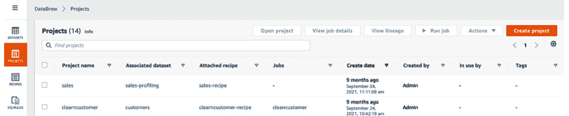

图 2.2：AWS Glue DataBrew 控制台中的项目列表

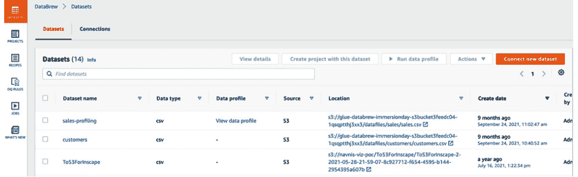

图 2.3：AWS Glue DataBrew 控制台中的数据集列表

## 连接到新数据集

- 文件上传
- 数据湖/数据存储
  - Amazon S3
- 数据库连接
  - Amazon Redshift
  - JDBC
- AWS Glue 数据目录
  - 数据目录 S3 表
  - 数据目录 Redshift 表
  - 数据目录 RDS 表
  - 所有 AWS Glue 表
- 其他
  - Amazon AppFlow
  - AWS Data Exchange
- 外部数据连接
  - Snowflake

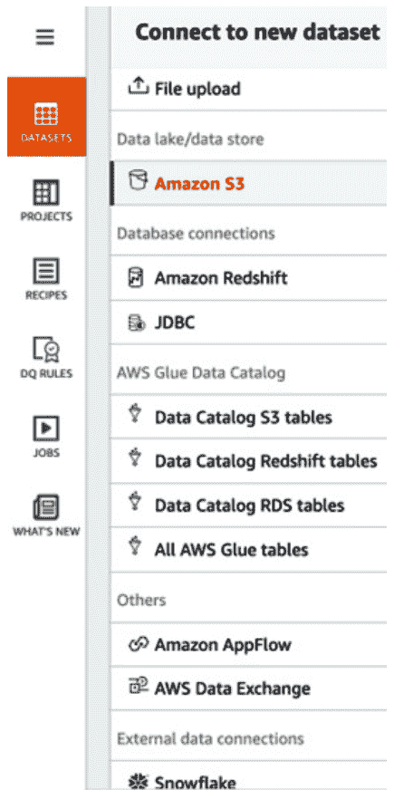

图 2.4：AWS Glue DataBrew 控制台中的数据源列表

**Recipe**：在 AWS Glue DataBrew 中，配方是在项目中工作时创建或修改的一组转换步骤。您可以将配方作为独立实体发布。已发布的配方仅包含转换步骤，而不引用原始数据。您可以通过以 YAML 或 JSON 格式下载来共享已发布的配方。配方可以有多个已发布版本，您可以从项目中发布。您还可以拥有同一配方的多个工作副本，因为您会通过多个草案进行进展。

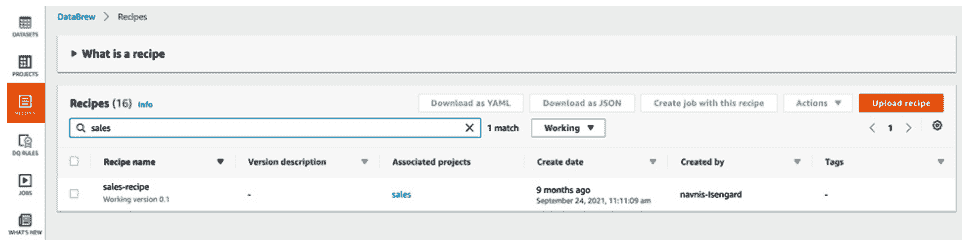

图 2.5：AWS Glue DataBrew 控制台中的配方列表

- **Job：** 在 AWS Glue DataBrew 中，作业是一组可以在数据集或项目上执行的操作。有两种类型的作业可用：
  - **Recipe jobs：** 配方作业在数据集或项目上运行配方中的所有转换，并以不同的文件格式生成输出，可以保存到同一或外部 AWS 账户中的 Amazon S3 存储桶
  - **Profile jobs：** 配置文件作业检查数据集以提供有关相关性、值分布、列统计信息等的信息

对于配方作业，您可以定义作业输出设置，例如文件类型和输出对象的 Amazon S3 路径。您还可以压缩输出。此外，您可以为作业关联一个计划，并选择作业运行的频率和时间。AWS Glue DataBrew 提供多种调度选项，包括 `cron` 设置。

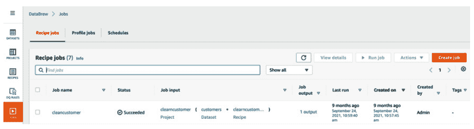

图 2.6：AWS Glue DataBrew 控制台中的作业列表

- **DataBrew data lineage：** 数据血缘使您能够轻松跟踪和可视化数据集的来源、事件和目标，从而清晰了解数据所走的路径。

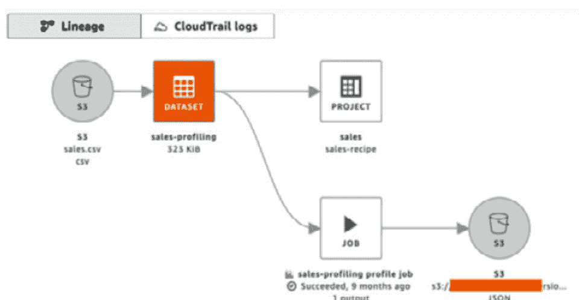

图 2.7：AWS Glue DataBrew 控制台中的数据血缘可视化

- **数据剖析：** 数据剖析是 Glue DataBrew 提供的最重要功能之一。其核心在于，AWS Glue DataBrew 使用户能够轻松为其数据集创建全面的数据画像。通过 AWS Glue DataBrew 运行数据画像作业，用户可以获得有关其数据当前形态的宝贵信息。这包括对内容上下文、数据底层结构以及各种数据元素之间复杂关系的深入理解。

通过先进的算法和智能分析，AWS Glue DataBrew 画像会细致检查每个数据点，提供描述性统计、数据分布洞察和数据质量评估。它们帮助数据专业人员识别潜在异常、缺失值和不一致之处，使其能够做出明智决策并采取必要措施改善数据质量。

AWS Glue DataBrew 画像还提供可视化和直观的仪表板，以易于理解的格式呈现数据画像。这使用户能够更高效地把握复杂模式、发现趋势并从数据集中提取有意义的洞察。

凭借用户友好的界面和强大的功能，AWS Glue DataBrew 画像使数据专业人员能够释放数据集的隐藏潜力。通过利用数据画像得出的洞察，他们可以做出明智决策、提升数据质量并为其组织带来影响深远的结果。

根据《哈佛商业评论》的一份报告，只有 3% 的公司数据达到基本质量标准，平均而言，47% 的新创建数据记录至少存在一个关键错误（即影响其工作）。

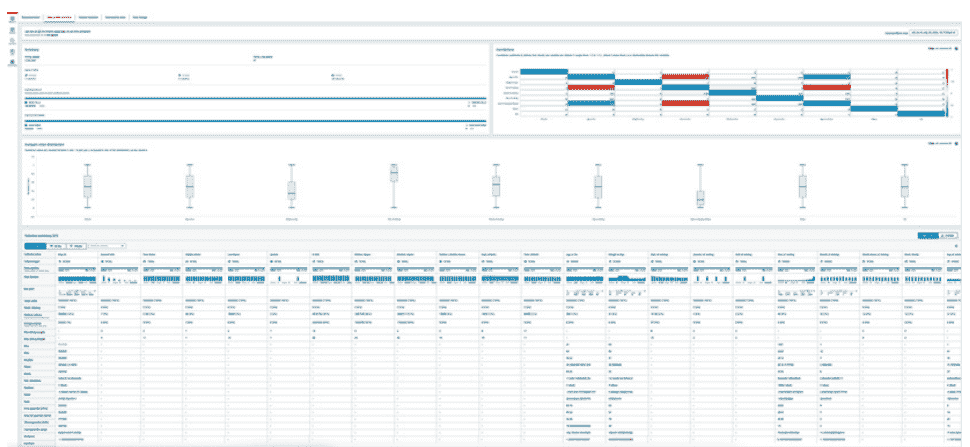

图 2.8：AWS Glue DataBrew 控制台中的数据画像可视化

现在我们已经了解了 AWS Glue DataBrew 的基础知识，让我们开始使用它来完成各种任务。

## 开始使用 AWS Glue DataBrew

学习任何服务或工具最有效的方法之一是通过实践经验或从示例中学习。我们将采用相同的方法。在本指南及后续教程中，我们将使用 AWS 控制台学习 AWS Glue DataBrew 作为数据整理工具。使用 AWS Glue DataBrew 的第一个要求是数据。我们之前讨论过数据是新石油，但在原始形式下，它几乎没有价值。在继续之前，了解任何服务的定价模式至关重要。

## 了解 AWS Glue DataBrew 的定价

需要注意的是，AWS 服务的定价因区域而异且可能发生变化。本节将讨论 us-east-1 区域的定价。AWS Glue DataBrew 包含多个组件，例如项目、数据集、作业和配方。

让我们从数据集开始。当您从不同的数据存储中引入数据时就会创建数据集，包括 S3、AWS Glue Data Catalog、Redshift、Snowflake、Amazon AppFlow 和 AWS Data Exchange。客户使用 AWS Glue DataBrew 连接器（如 JDBC 驱动程序）不会被收费（JDBC 驱动程序是一种允许 Java 应用程序连接和与特定类型数据库交互的软件组件）。然而，客户需承担 Glue Data Catalog 的费用，该费用非常低。例如，您可以免费存储多达一百万个对象。如果存储超过一百万个对象，您将被收取超出部分每 100,000 个对象每月 1.00 美元的费用。AWS Glue Data Catalog 中的对象是表、表版本、分区或数据库。

每月对 AWS Glue Data Catalog 的前一百万次访问请求免费。如果每月超过一百万次请求，您将被收取超出前一百万次后每百万次请求 1.00 美元的费用。常见请求包括 CreateTable、CreatePartition、GetTable 和 GetPartitions。

接下来是项目，这里就变得有趣了。Glue DataBrew 的费用主要来自 DataBrew 交互式会话。DataBrew 交互式会话在 DataBrew 项目中的数据加载后启动。客户按使用的会话总数计费，按 30 分钟为增量计算。

当您与 Glue DataBrew 项目交互时，例如通过 UI 或 DataBrew API/CLI/SDK 添加配方或过滤数据，您将启动一个会话。即使您什么都不做，会话仍保持活动状态，但在当前 30 分钟周期结束时会自动关闭。如果您要休息或不使用它，关闭会话很重要。会话费用为 1.00 美元。

例如，假设您在上午 09:00 启动一个交互式会话，工作到 09:20，然后休息，随后在 09:30 启动另一个会话，接下来一小时努力工作，完成所有工作后再次休息。第二天查看 AWS 账单时，您会看到账单增加了 3.00 美元，即使第一个会话只有 20 分钟长。

在另一种情况下，假设您打开一个项目 2 分钟后关闭，5 分钟后再次打开同一项目工作 10 分钟后关闭，并在 30 分钟内重复相同活动五次；费用仅为 1 美元。这是因为每次打开会话时，AWS Glue DataBrew 都会分配资源以提供更快的访问并减少为每个项目分配资源的延迟。

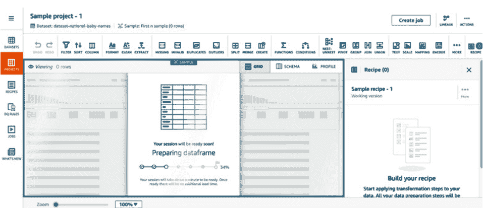

图 2.9：Glue DataBrew 交互式会话启动

AWS Glue DataBrew 作业也会影响定价。当您创建数据集时，您将无法查看数据画像概览。要生成数据画像概览，您需要运行数据画像，这会为您创建一个 AWS Glue DataBrew 作业。在接下来的章节中，我们将了解在运行作业之前可用的各种配置选项。然而，就定价而言，需要注意的一个重要配置选项是为作业分配多少个节点。该选项可在“高级作业设置 - 可选”下找到。请注意，该选项称为可选，因为 AWS Glue DataBrew 的默认配置为五个节点。

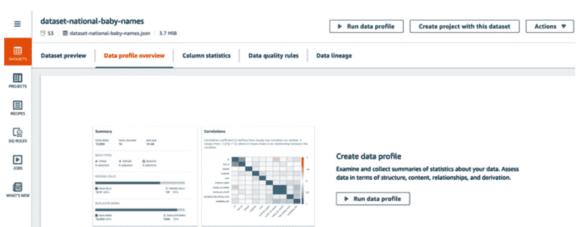

图 2.10：创建数据集时的数据画像概览部分

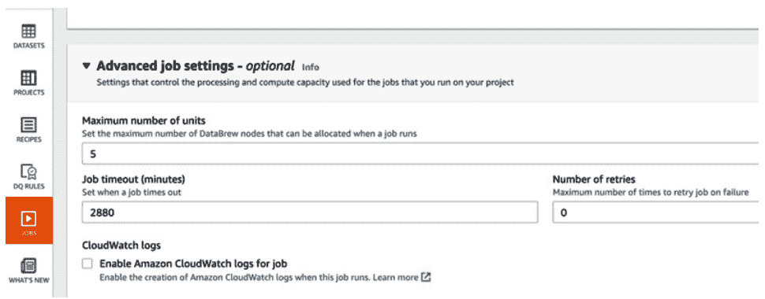

图 2.11：带默认配置的高级作业设置

要确定 AWS Glue DataBrew 作业的成本，运行作业所使用的节点数是关键因素。每个节点包含四个 vCPU 和 16 GB 内存，按每小时每个节点 0.48 美元的费率收费。然而，AWS Glue DataBrew 作业按最少一分钟计费。为了说明，假设一个作业运行 20 分钟，使用 10 个节点。成本计算如下：

1 node/hour = $0.48

10 nodes/hour = $0.48 x 10 = $4.80/hour

由于 AWS Glue DataBrew 作业按最少 1 分钟计费，我们可以将 20 分钟转换为一小时的三分之一。因此，最终费用为 $4.80 x 1/3 = $1.60。当您针对样本数据集为项目构建配方完毕，并准备将同一配方应用于整个数据集时，可以使用该配方创建作业。现在我们已经介绍了 AWS Glue DataBrew 的定价方面，让我们继续使用 Glue DataBrew 执行一些数据整理任务。

## 使用 AWS Glue DataBrew 进行数据整理

在本节中，我们将探讨如何利用 AWS Glue DataBrew 执行各种数据整理任务，包括以下内容：

- 数据发现
- 数据结构化
- 数据清洗
- 数据丰富
- 数据验证
- 数据发布

在开始之前，第一步是识别数据源、获取数据集并使其可用于数据整理。

## 识别数据集

为了演示数据整理步骤和任务，我们将使用通过互联网上可用的 Random HR Data Generator Excel 宏生成的人力资源数据。我们将使用 500 万条记录的样本，包含以下属性：

```
Emp ID, Name Prefix, First Name, Middle Initial, Last Name, Gender, E Mail, Father's Name,
Mother's Name, Mother's Maiden Name, Date of Birth, Time of Birth, Age in Yrs., Weight in Kgs.,
Date of Joining, Quarter of Joining, Half of Joining, Year of Joining, Month of Joining, Month
Name of Joining, Short Month, Day of Joining, DOW of Joining, Short DOW, Age in Company
(Years), Salary, Last % Hike, SSN, Phone No., Place Name, County, City, State, Zip, Region, User
Name, Password.
```

识别数据集后，下一步是从互联网下载它。

目前，AWS Glue DataBrew 支持 CSV、TSV、JSON、JSONL、ORC、Parquet 和 XLSX 格式。

## 下载样本数据集


我们将使用可在互联网上获取的合成人力资源数据集，可从 https://eforexcel.com/wp/downloads-16-sample-csv-files-data-sets-for-testing/ 下载。

然而，在真实的生产环境中，数据通常从各种来源提取，例如网络、SFTP、数据库和物联网传感器，并使用诸如 AWS Glue（将在下一章介绍）等服务摄取到数据湖（S3）或其他数据存储中，例如文件共享、数据库和数据仓库。

例如，下面的架构演示了如何使用带有 Python 引擎的 AWS Glue 将数据从 FTP 位置带入并存储到 Amazon S3 中。

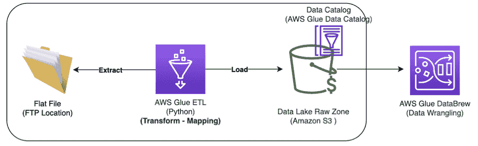

图 2.12：从 FTP 位置获取数据的管道

下载数据后，下一步是将数据集上传到 Amazon S3。为此，请按照以下步骤操作：

- 1. 进入 AWS 控制台。
- 2. 如果您已有 S3 存储桶，请在存储桶列表中搜索它。否则，创建一个新的存储桶。
- 3. 单击 **Upload** 按钮。
- 4. 单击 **Add Files**，或直接从本地计算机拖放文件。
- 5. 单击 **Upload**。

您可能已经注意到我的 Amazon S3 存储桶名称带有 `raw-` 前缀。该前缀用于区分数据湖中数据处理的各个阶段。在原始层中，数据以其原始形式原样存储。这使我们能够拥有单一事实来源并将数据用于未来的用例。我将在后续章节中介绍有关数据湖及其最佳实践的更多细节。

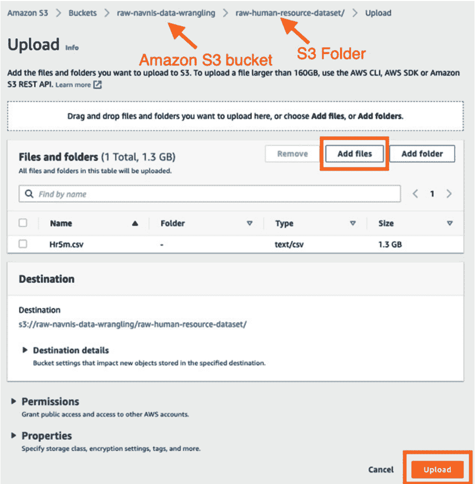

Amazon S3 > Buckets > raw-navnis-data-wrangling > raw-human-resource-dataset/ > Upload

## 上传信息

Amazon S3 存储桶

S3 文件夹

将要上传到 S3 的文件和文件夹添加进来。要上传大于 160GB 的文件，请使用 AWS CLI、AWS SDK 或 Amazon S3 REST API。了解更多

将要上传的文件和文件夹拖放到此处，或选择添加文件，或添加文件夹。

## 文件和文件夹（共 1 个，1.3 GB）

此表中所有文件和文件夹都将被上传。

| 名称 | 文件夹 | 类型 | 大小 |
|---|---|---|---|
| Hr5m.csv | - | text/csv | 1.3 GB |

## 目标

目标
s3://raw-navnis-data-wrangling/raw-human-resource-dataset/

目标详细信息
影响存储在指定目标中的新对象的存储桶设置。

权限
授予公共访问权限和对其他 AWS 账户的访问权限。

属性
指定存储类别、加密设置、标签等。

图 2.13：Amazon S3 数据湖文件夹结构

在 Amazon S3 存储桶的原始层上使数据可用后，下一步是创建 AWS Glue 数据集。在 DataBrew 中，数据集由有关数据的收集的元数据组成。数据可以直接连接或导出到文件，并从 Amazon S3 或本地驱动器加载：

要创建 DataBrew 数据集，请按照以下步骤操作：

- 1. 进入 AWS Glue DataBrew。
- 2. 在左侧单击 Datasets，然后单击 Connect new dataset。
- 3. 提供数据集名称（例如，raw-human-resource）并选择人力资源数据集已上传到的 S3 存储桶，如下图所示：

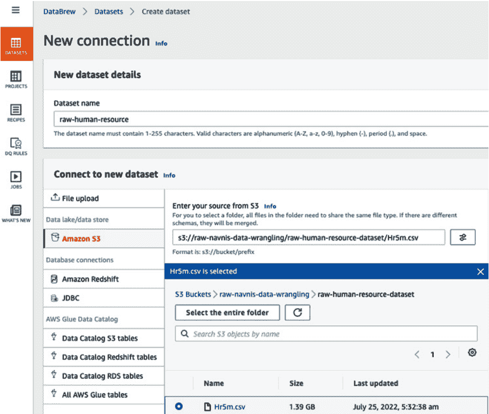

图 2.14：AWS Glue DataBrew 控制台中的 Amazon S3 作为数据源

- 在 **Additional configurations** 下，选择 **CSV** 作为文件格式，选择 **Comma (,)** 作为分隔符（因为这是 CSV 文件的默认值），并在 **Column header values** 下保持选中 **Treat first row as header**。

DataBrew 具有一个有趣的功能，即在创建数据集之前可以预览数据，这有助于数据发现。单击 **Preview data** 以执行一些数据发现。

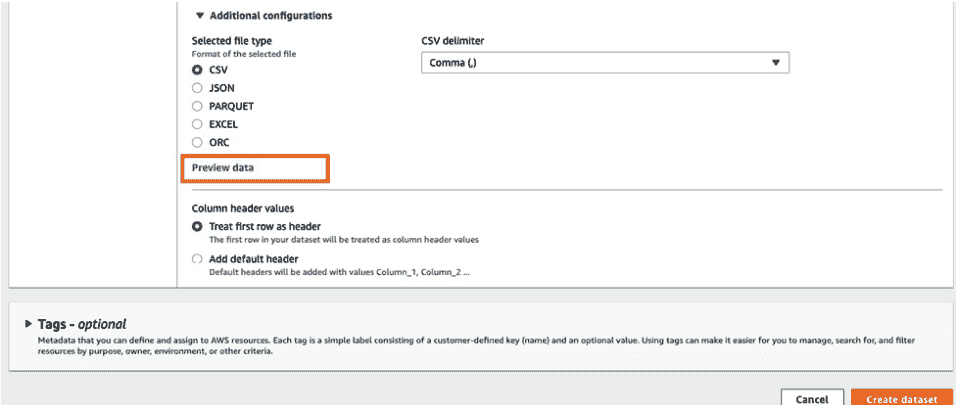

图 2.15：AWS Glue DataBrew 控制台中的预览数据选项

预览数据部分允许用户查看数据和数据结构的外观。

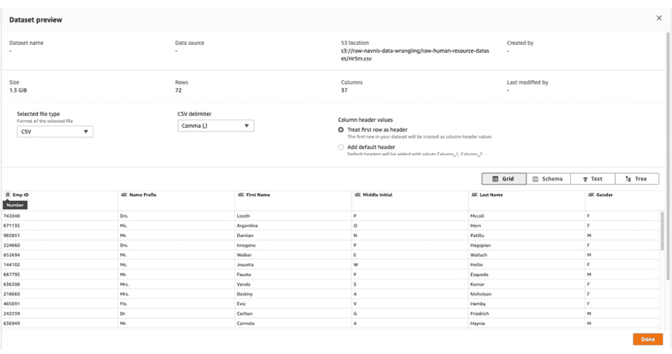

图 2.16：AWS Glue DataBrew 控制台中的数据集预览

在审查完数据集后，单击 Create dataset。

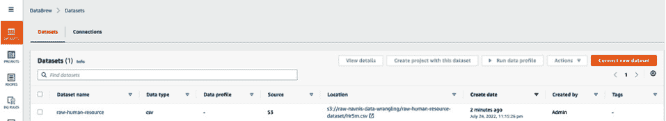

图 2.17：AWS Glue DataBrew 控制台中的数据集

数据集现在已准备就绪，可以执行数据发现。

## 数据发现 – 为数据集创建 AWS Glue DataBrew 配置文件

要为数据集创建 AWS Glue DataBrew 数据配置文件，请按照以下步骤操作：

- 1. 选择作业名称，例如 `raw-human-resource-profile-job`。
- 2. 为作业运行样本选择 **Full Dataset**。
- 3. 选择要存储配置文件 JSON 格式输出的 S3 位置，该输出可用于自动化数据质量检查和 PII 识别等任务。
- 4. 将其余选项保持为默认值。
- 5. 在 **Permissions** 下，选择 **Create new IAM role** 并为角色提供名称，例如 `human-resource`。
- 6. 单击 **Create and run job**。
- 7. 等待数据配置文件生成。

数据配置文件创建后，您可以在摘要部分中查看它，其中提供了有关数据集的有用信息，包括以下内容：

- 数据集的大小，可作为良好的数据质量检查，以确保在摄取过程中没有发生数据丢失
- 数据集的数据类型，包括整数、双精度和字符串列的数量
- 任何重复行或缺失单元格，有助于识别数据质量问题

在提供的示例中，数据集有 500 万行，且没有缺失单元格或重复行，表明数据质量很高。查看数据配置文件可以为比较源系统中的数据与目标系统中的数据提供参考点。

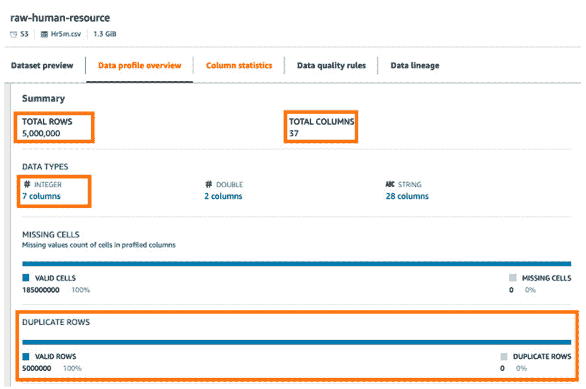

图 2.18：AWS Glue 控制台中的数据配置文件概览

## 相关性

相关系数（r）衡量两个变量之间的关联程度，范围从 -1.0 到 +1.0，0 表示变量之间没有关系。基于 r 的值可以做出以下解释：

- 恰好为 -1：完美的负（向下倾斜）线性关系
- -0.70：强负（向下倾斜）线性关系
- -0.50：中等负（下坡）关系
- -0.30：弱负（下坡）线性关系
- 0：无线性关系
- +0.30：弱正（向上倾斜）线性关系
- +0.50：中等正（向上倾斜）线性关系
- +0.70：强正（向上倾斜）线性关系
- 恰好为 +1：完美的正（向上倾斜）线性关系

在给定的相关系数图中，入职年份和公司年限变量之间存在强关系，但方向相反。这意味着如果一个变量增加（例如
入职年份相对于 2022 年从 2018 年变为 2016 年），另一个变量就会减少（即，公司年限也减少两年）。

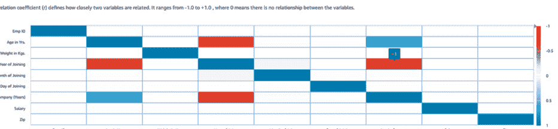

图 2.19：相关系数

公司年限（以年为单位）与年龄（Age in Yrs.）之间的相关系数为 +65，表明这两个变量之间存在正相关。这意味着如果某人年龄较大，他们可能在公司工作的时间更长，因此是任职时间更长的员工。然而，需要注意的是，这种相关系数并不总是适用于所有情况，其他因素也可能影响员工在公司的任职时间。

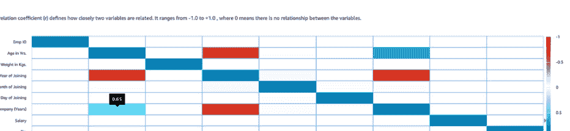

图 2.20：相关系数

## 值分布

数据集的值分布表明数据的分布情况如何，是数据倾斜的良好指标。例如，如果我们考虑薪资列，它似乎分布均匀，这是数据集分布良好的积极指标。

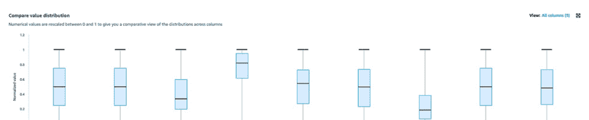

图 2.21：值分布


## 列摘要

配置文件中的列摘要部分提供了有关其特征的宝贵信息，包括其分布、缺失值、唯一值、不同值、中位数、最小值、众数、异常值和偏度。理解这些数据值有助于特征工程。例如，偏度是一种判断数据是否倾斜的方法。它告诉我们数据与完全平衡的差异程度。如果偏度为正，则意味着右侧数据更多，使该侧的尾部更长或更厚。如果偏度为负，则意味着左侧数据更多，使该侧的尾部更长或更厚。如果偏度为 0，则意味着数据完全平衡。

例如，检查 `Ages in Yrs.` 列的摘要可以让你很好地了解公司员工的年龄。员工的最低年龄约为 21 岁，最高年龄为 60 岁，平均年龄为 40.50 岁。

数据集预览 | 数据概要 | 列统计 | 数据质量规则 | 数据血缘

所有列 ABC 字符串 # 整数 滚动到列

| 列名 | 年龄（岁） | 体重（公斤） | 入职日期 |
|---|---|---|---|
| 列类型 | # 双精度 | # 整数 | ABC 字符串 |
| 数据质量 基于列类型的有效性 | 100% 有效 0% 无效 | 100% 有效 0% 无效 | 100% 有效 0% 无效 |
| 分布 | 不同值 3,901 唯一值 0 总计 5,000,000 | 不同值 51 唯一值 0 总计 5,000,000 | 不同值 14,190 唯一值 37 总计 5,000,000 |
| 箱线图 | 最小值 21 中位数 40.52 均值 40.51 众数 40.35 最大值 60 | 最小值 40 中位数 57 均值 60 众数 53 最大值 90 | |
| 总有效 | 5000000 (100%) | 5000000 (100%) | 5000000 (100%) |
| 总缺失 | 0 (0%) | 0 (0%) | 0 (0%) |
| 不同值 至少出现一次的值 | 3901 (0%) | 51 (0%) | 14190 (0%) |
| 唯一值 仅出现一次的值 | 0 (0%) | 0 (0%) | 37 (0%) |
| 最小字符串长度 | - | - | 8 |
| 最大字符串长度 | - | - | 10 |
| 最小值 | 21 | 40 | - |
| 最大值 | 60 | 90 | - |
| 中位数 | 40.52 | 57 | - |
| 均值 | 40.506538418001554 | 59.9984636 | - |
| 众数 | 40.35 | 53 | - |
| 标准差 | 11.258119343446145 | 13.723381321879272 | - |
| 异常值 | 0 values | 0 values | - |
| 偏度 | -0.0012041797308987197 | 0.5996861383853106 | - |
| 总和 | 202532692.09000778 | 299992318 | - |
| 第一四分位数（25%） | 30.75 | 50 | - |
| 第二四分位数（50%） | 40.52 | 57 | - |
| 第三四分位数（75%） | 50.26 | 70 | - |

图 2.22：AWS Glue DataBrew 控制台中的数据概要

## 数据清洗和丰富 – AWS Glue DataBrew 转换

要在 DataBrew 中创建项目，该项目是数据探索、清洗和规范化信息的集合，请按照以下步骤操作：

- 1. 进入 DataBrew 控制台并选择 **Projects**。
- 2. 单击 **Create project**。
- 3. 为项目输入名称，例如 `basic-transform-human-resource-project`。
- 4. 保留默认的配方名称。
- 5. 选择 **My datasets** 并选择上一节中创建的 `raw-human-resource` 数据集。
- 6. 保留默认的采样大小 **500**。
- 7. 在 **Permissions** 下，为角色名称选择在数据概要部分下创建的 IAM 角色。
- 8. 单击 **Create project**。

要为项目构建配方，请在 AWS Glue DataBrew 交互式会话中打开项目并按照说明创建一组数据整理步骤或操作。

常见的数据整理任务之一是将多个列合并为一个，例如合并姓名或日期列。要在 AWS Glue DataBrew 中执行此任务，请使用 **MERGE** 转换，它允许您合并多个列并创建单个列。

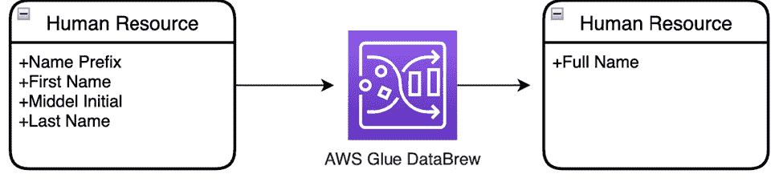

图 2.23：合并列

要执行此任务，请按照以下步骤操作：

- 1. 打开上一步中创建的 `basic-transform-human-resource-project` 项目。
- 2. 在顶部菜单中单击 **MERGE**。

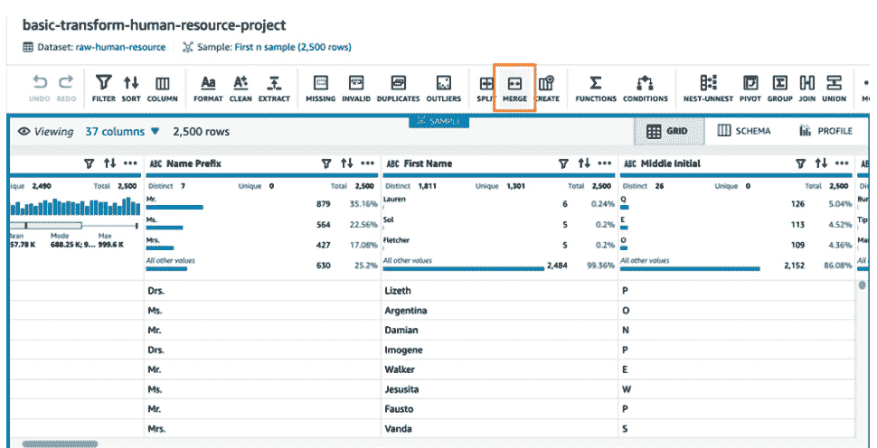

图 2.24：MERGE 选项

- 3. 将 Name Prefix、First Name、Middle Initial 和 Last Name 选择为源列。
- 4. 添加空格作为分隔符。
- 5. 提供新的列名，例如 Employee_Full_Name。

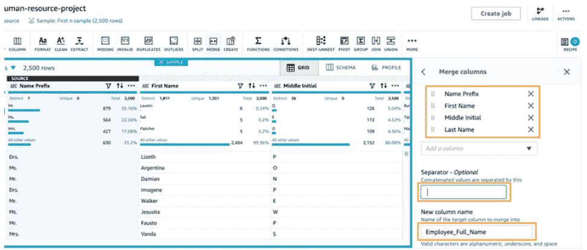

图 2.25：合并列列表

- 6. 单击 Apply。

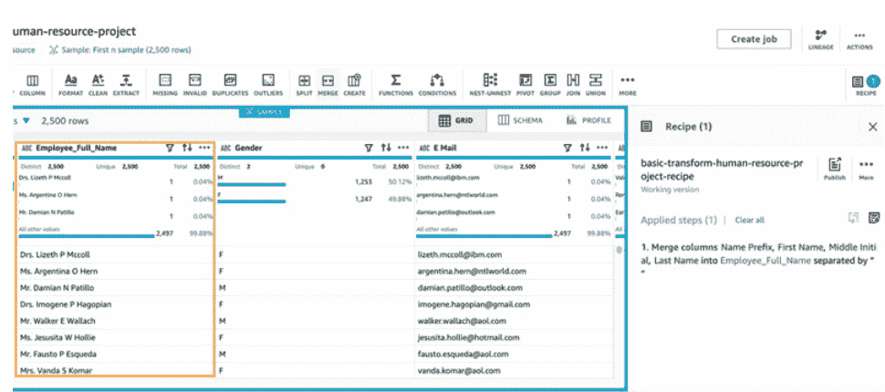

图 2.26：合并列输出

- 7. 删除不需要的列。

要删除列，请转到 COLUMNS 图标并单击 Delete。从下拉菜单中选择要删除的列，然后单击 Apply。删除诸如 Short Month、DOW of Joining 和 Short DOW 之类的列。

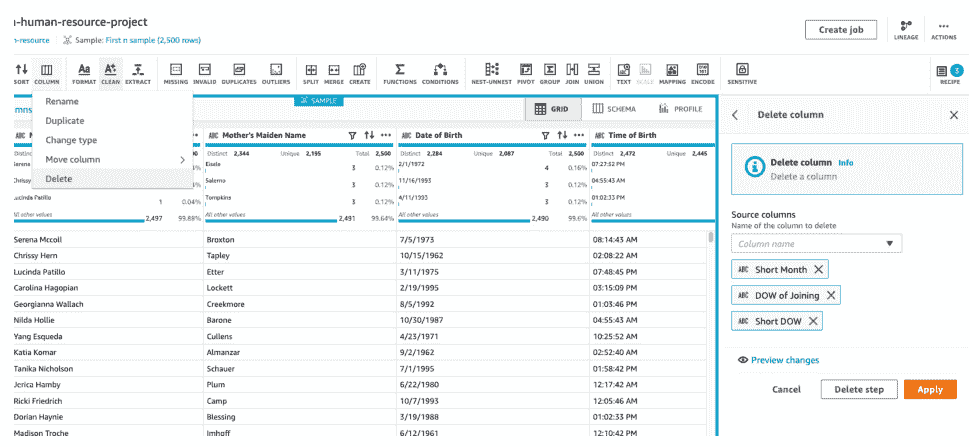

图 2.27：AWS Glue DataBrew 控制台中的删除列选项

- 8. 格式化日期列。

AWS Glue DataBrew 根据数据类型提供各种数据格式选项，包括以下内容：

- 字符串格式化：
  - 转换为大写
  - 转换为小写
  - 转换为首字母大写
  - 转换为句子大小写
- 数字格式化：
  - 小数精度
  - 千位分隔符
  - 缩写数字
- 日期时间格式：
  - ISO
  - US
  - UK
- 电话号码

为说明，假设我们想将 `Date of Joining` 列的格式从 `mm/dd/yyyy` 更改为 `month*dd,*yyyy` 以使其更易读。要执行此操作，请按照以下步骤操作：

- 1. 选择 `Date of Joining` 列上方的省略号（点点点）。
- 2. 选择 **Format**。
- 3. 选择 **Date-Time Formats**。
- 4. 从出现的菜单中选择 `month*dd,*yyyy`。
- 5. 单击 **Preview** 以查看新列。
- 6. 如果您对更改满意，请单击 **Apply**。

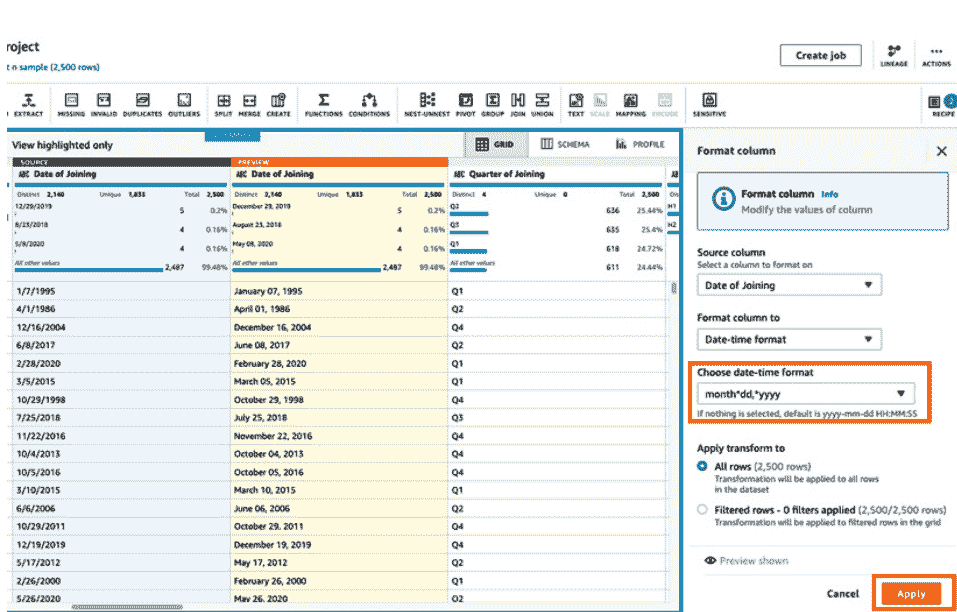

图 2.28：AWS Glue DataBrew 控制台中的数据格式化

- 9. 重命名列。

在数据集分析期间，发现某些列名（例如 Phone No.）以点结尾。为了解决此问题，应重命名列。要更改列名，请选择列并单击三个点，然后选择 Rename 选项。

要更新列名，请选择新名称。例如，Phone No. 可以更改为 Phone。选择新名称后，单击 Apply。

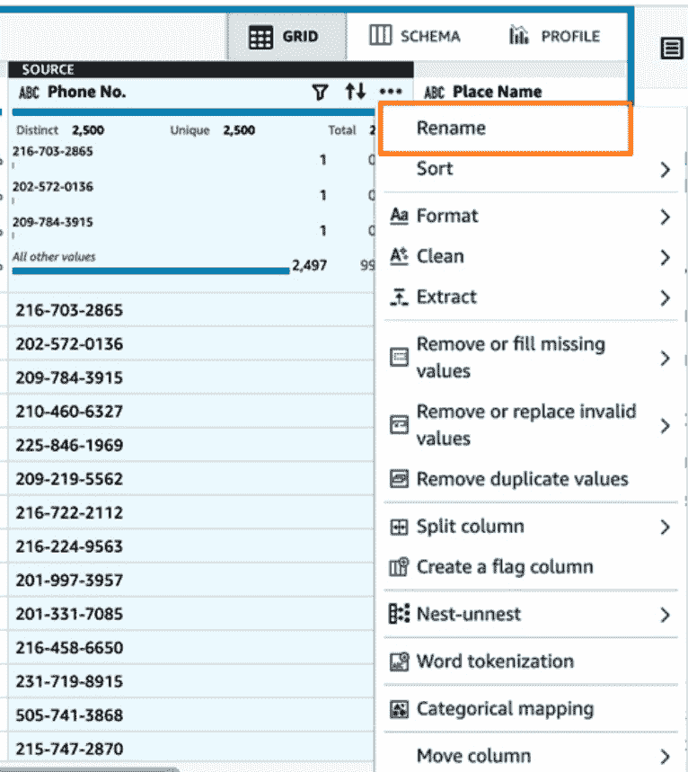

图 2.29：AWS Glue DataBrew 控制台中的重命名列

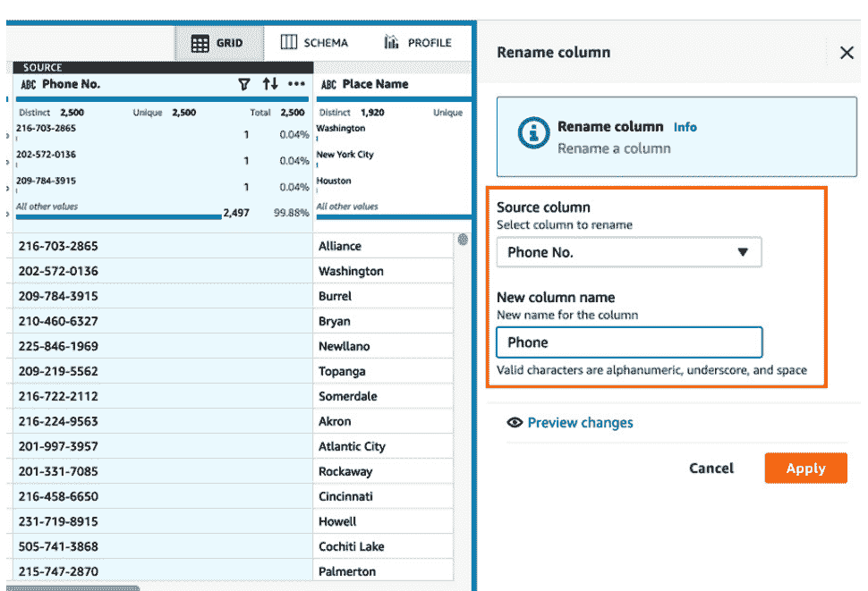

图 2.30：AWS Glue DataBrew 控制台中的重命名列选项

- 10. 隐藏敏感列。

AWS Glue DataBrew 提供了一个非常有用的功能，即隐藏敏感列。当构建诸如 DaaS 之类的解决方案、启用自助服务或在内部或外部共享数据时，此功能特别有帮助。在所有此类情况下，隐藏敏感数据都是关键要求：

- 1. 要隐藏敏感列，首先查看数据集并识别包含敏感信息的列，例如社会安全号码、电话号码、用户名和密码。识别后，您可以使用 AWS Glue DataBrew 中的 SENSITIVE 图标来选择并从这些列中隐藏值。
- 2. 要执行数据隐藏，请选择 SENSITIVE 图标并选择 Redact values 选项。然后，选择源列并将其他选项保持为默认值（即使用隐藏符号 #），然后单击 Apply。

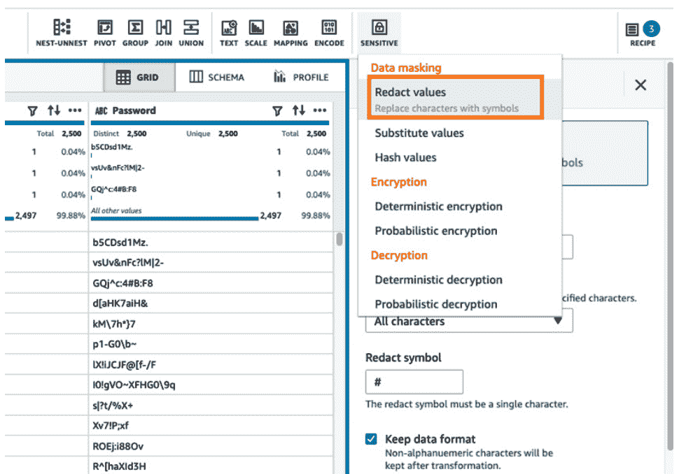

图 2.31：AWS Glue DataBrew 控制台中的敏感列 Redact values 选项

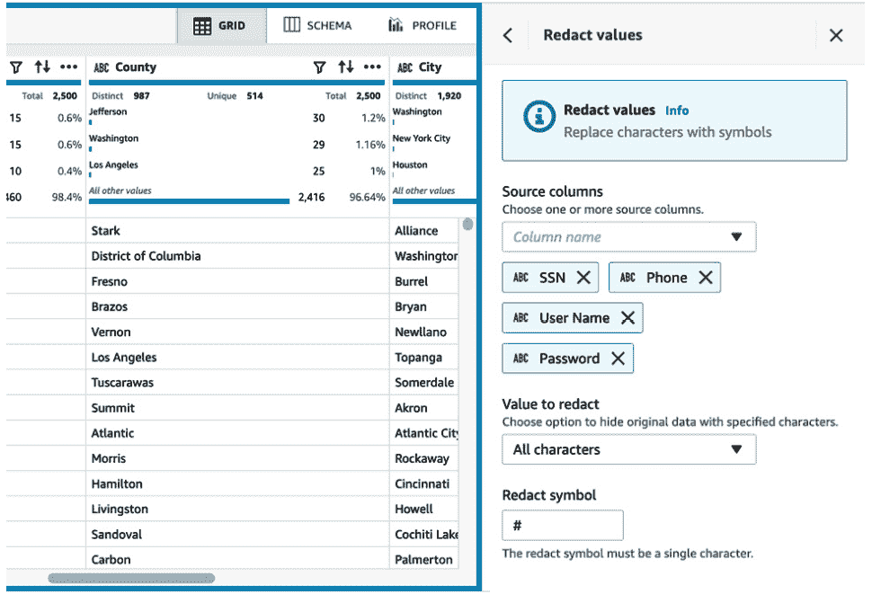

图 2.32：AWS Glue DataBrew 控制台中的敏感列 Redact values 选项

应用配方后，您将能够看到哈希列。

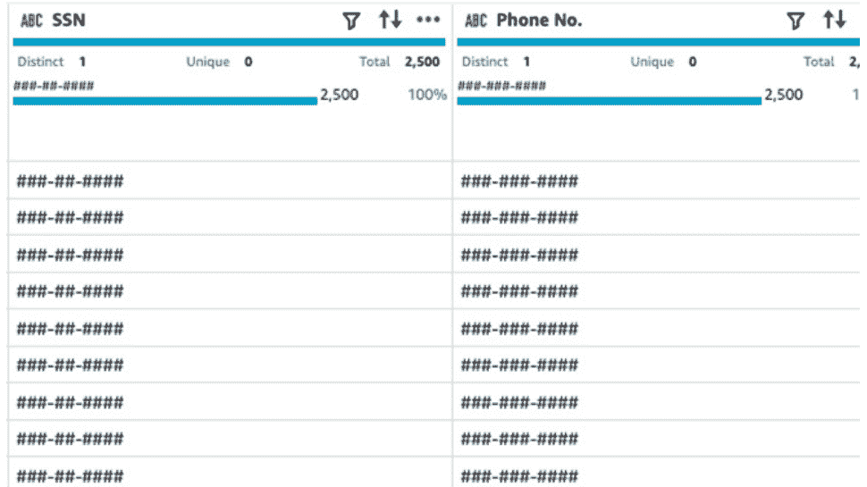

图 2.33：AWS Glue DataBrew 中的敏感列隐藏

- 11. 执行确定性加密。

要执行确定性加密，请按照以下步骤操作：

- 1. 单击 **SENSITIVE** 图标并导航到 **Encryption** 部分。
- 2. 选择 **Deterministic encryption**。

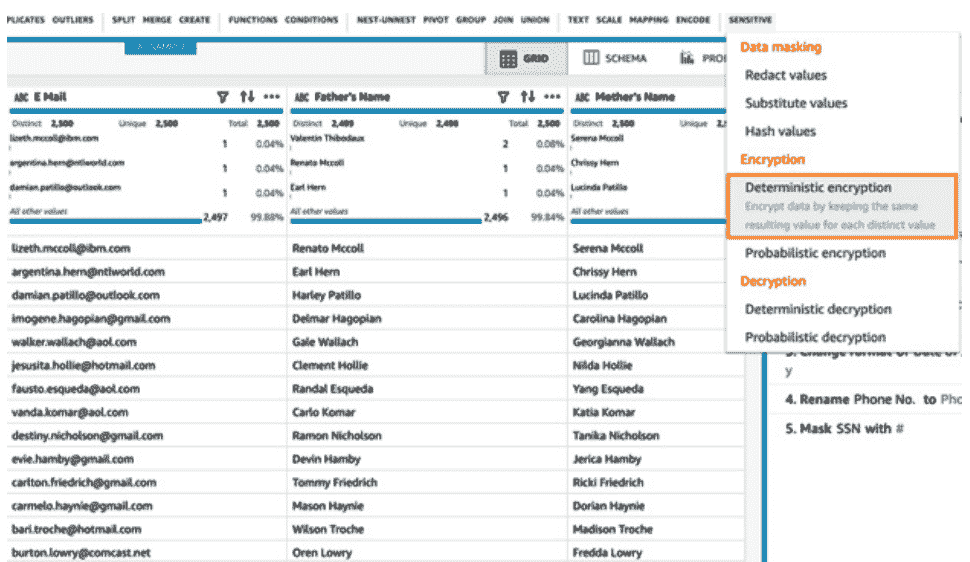

图 2.34：AWS Glue DataBrew 控制台中的敏感列 Deterministic encryption 选项

- 3. 选择要加密的列，例如 `Employee_Full_Name`、`E Mail` 和 `Date of Birth`。
- 4. 选择 `secret` 选项并选择默认的 DataBrew 密钥。
- 5. 单击 **Apply**，您将能够看到加密的数据。


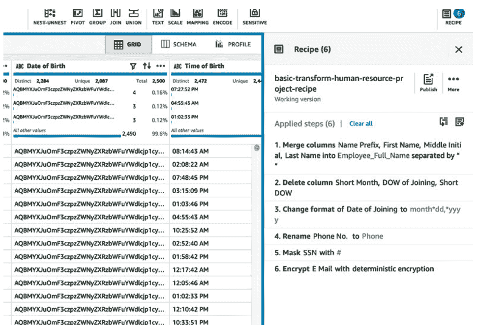

图 2.35：AWS Glue DataBrew 控制台中敏感列的确定性加密输出

## 12. 按性别分组。

首先，按性别对数据进行分组。然后，我们可以分析工资在男性与女性之间的分布情况。

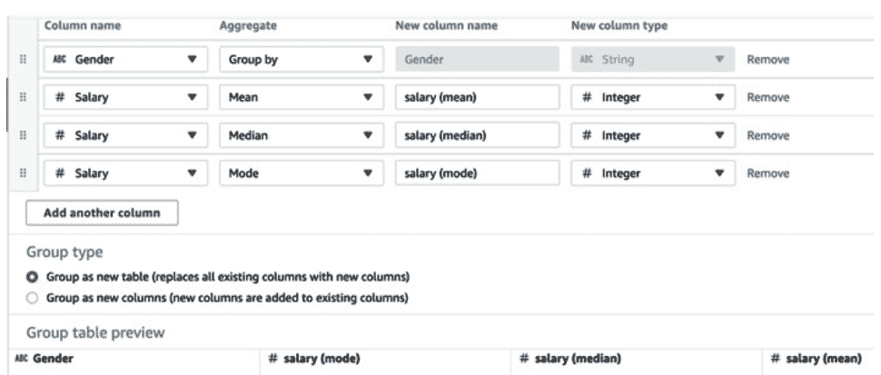

图 2.36：AWS Glue DataBrew 控制台中的分组输出

## 13. 连接数据集。

连接数据集涉及基于公共键合并两个或多个表。它是数据整理过程中的关键步骤，可实现数据丰富。

AWS Glue DataBrew 支持多种类型的连接，包括以下内容：

- **Inner join**：这是 Glue DataBrew 中的默认连接类型。它返回基于连接键在两个表中均具有匹配值的记录。


图 2.37：内连接维恩图

- **Left join**：它返回左表中所有记录以及基于连接键从右表中匹配的记录。


图 2.38：左连接维恩图

- **Right join**：它返回右表中所有记录以及基于连接键从左表中匹配的记录。


图 2.39：右连接维恩图

- **Outer join**：它返回表 A 和表 B 的所有行，无论连接条件如何。


图 2.40：外连接维恩图

- **Left excluding join**：它返回表 A 的所有行，排除满足连接条件的行。


图 2.41：左排除连接维恩图

- **Right excluding join**：它返回表 B 的所有行，排除满足连接条件的行。


图 2.42：右排除连接维恩图

- **Outer excluding join**：它返回表 A 和表 B 的所有行，排除满足连接条件的行。


图 2.43：外排除连接维恩图

每种连接类型对结果数据集都有不同的影响。了解这些差异非常重要，以便为数据分析需求选择合适的连接。

要在 AWS Glue DataBrew 中执行连接，请按照以下步骤操作：

- 1. 打开您的项目并单击 **JOIN** 图标以访问连接选项。


图 2.44：AWS Glue DataBrew 中的 JOIN 选项

- 2. 选择要连接的数据集。如果您只有一个数据集，可以通过将数据集与其自身连接来执行自连接（或自内连接）。

- 3. 选择要连接的连接类型和列，然后单击完成。您的项目现在将具有连接后的数据集。


图 2.45：AWS Glue DataBrew 中的连接选项

现在您已经了解如何使用 AWS Glue DataBrew 执行数据转换，可以自行尝试其他转换。下一步是学习如何使用 AWS Glue DataBrew 执行数据质量检查。

## 数据验证 – 使用 AWS Glue DataBrew 执行数据质量检查

本节将重点介绍如何使用 AWS Glue DataBrew 结合实际示例执行数据验证和质量检查。

在本第一个示例中，我们将学习如何使用 AWS Glue DataBrew 识别和纠正数据质量问题。但首先，让我们简要讨论数据质量问题以及为什么需要解决它们。正如我们在上一章中讨论的，组织正努力成为数据驱动的，对于此类组织而言，解决其面临的任何数据质量挑战或拥有处理数据质量问题的必要工具和流程至关重要。

根据 KPMG 的一份报告，77% 的首席执行官担心其组织是否跟上新技术，并且在未来三年中，数据和分析将成为投资的重点领域。此外，84% 的首席执行官担心他们基于其关键业务决策的数据质量。数据质量差不仅仅是技术问题，因为它会对企业产生重大影响。根据 Gartner 在 2018 年的研究论文，组织认为数据质量差平均每年造成 $15 million 的损失。

由 Zillow 提供的热门消费工具 Zestimate 由人工智能驱动，用于估算房屋价值，是数据质量问题的典型例子。Zillow 采用了独特的算法，每周多次定期更新其房产价值数据库。这些算法考虑了来自公开数据和用户提交数据的<|message|>

完成数据配置文件作业并返回到 **数据质量规则** 部分后，选择 `raw-human-resource` 数据集以在 AWS Glue DataBrew 控制台中查看 53 条生成的数据质量建议。虽然并非所有建议都可能有用，但建议审查所有建议并将相关建议添加到规则集中。

从建议列表中，选择了以下数据质量建议并将其添加到规则集中：

- 1. 检查数据集中是否存在重复行。
- 2. 确保所有列均无缺失值（0% 缺失值）。
- 3. 验证 `Age in Yrs.` 列中的值介于 21 和 60 之间。
- 4. 确保 `Quarter of Joining` 列仅包含来自列表 `["Q3" ,"Q2" ,"Q1" ,"Q4"]` 的值。
- 5. 验证 `SSN` 列的长度为 11 个字符。
- 6. 确保 `Phone No.` 列的长度为 12 个字符。

这些建议是数据质量规则建议的一部分。要使用 Glue DataBrew 控制台创建自定义数据质量规则，请继续阅读。

为了使用 Glue DataBrew 控制台创建自定义数据质量规则，我们必须首先定义要构建的规则。以下是我们想要创建的一些规则：

- 1. **验证行数**：我们已下载包含 5 百万条记录的数据集。让我们验证计数是否匹配。
- 2. **员工 ID、电子邮件地址和 SSN 应该是唯一的**：这些值应始终唯一。
- 3. **员工 ID 和电子邮件地址不应为空**：通常我们不希望这些值为空。
- 4. **员工 ID 和员工年龄（年）不应有负值**：我们希望验证这些列中的值为正。
- 5. **SSN 数据格式应为 (xxx-xx-xxxx) 格式。**

让我们开始构建数据质量规则：

- 1. 验证行数。

要检查总行数，让我们执行以下步骤：

- 1. 创建新规则。
- 2. 为规则命名（例如，`Row count == 5 million`）。
- 3. 将数据质量检查范围选择为 **每个列的单独检查**。
- 4. 将规则成功标准选择为 **所有数据质量检查均满足（AND）**。
- 5. 将数据质量检查选择为 **行数**。
- 6. 将条件选择为 **等于**。
- 7. 输入 **5000000** 作为值。

## 规则 1

启用规则

规则名称

row count == 5 million

数据质量检查范围 信息

每个列的单独检查

规则成功标准

所有数据质量检查均满足（AND）

数据质量检查 信息

### 检查 1

数据质量检查

Number of rows
检查数据集的总行数。

条件

等于

值

5000000

图 2.49：数据质量检查

2. 要验证指定列是否仅包含唯一值，请按照以下说明操作：

- 1. 单击 **添加规则**。
- 2. 为规则输入名称，例如，**检查列中的唯一值**。
- 3. 将数据质量检查范围选择为 **所选列的通用检查**。
- 4. 对于 **规则成功标准**，选择 **所有数据质量检查均满足（AND）**。
- 5. 在 **所选列** 下选择 **Emp ID**、**E Mail** 和 **SSN** 列。
- 6. 在 **检查 1** 下，在 **数据质量检查** 下选择 **唯一值**。
- 7. 在 **条件** 下选择 **等于**。
- 8. 为 **值** 输入 **100**，并从下拉菜单中选择 **%(百分比) 行**。

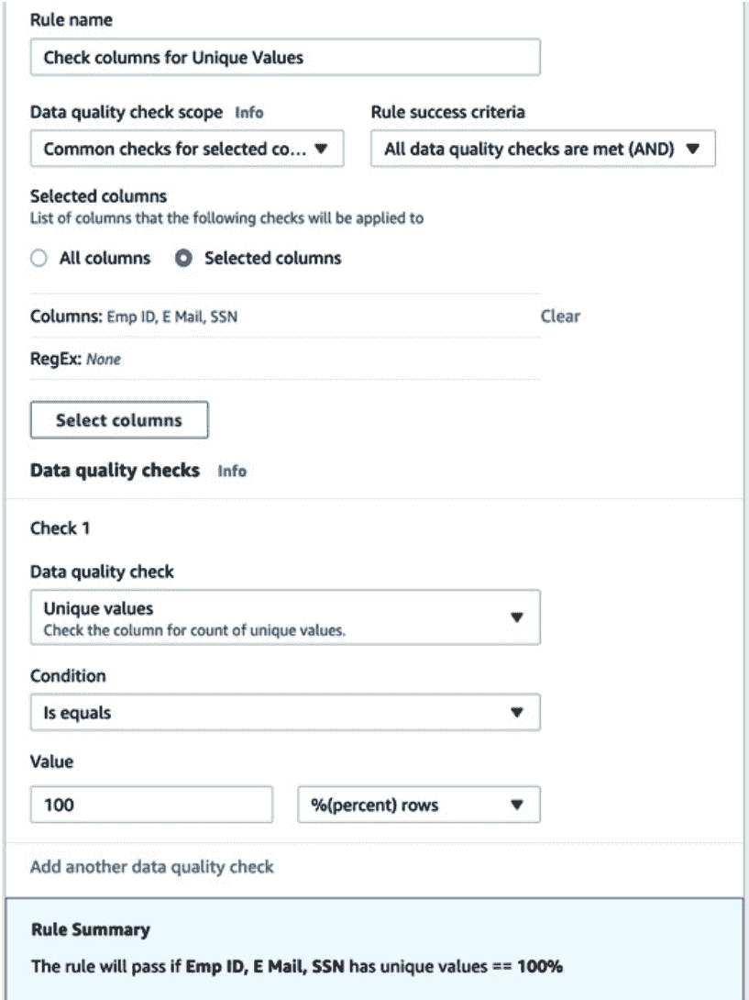

图 2.50：数据验证

3. 为确保员工 ID 和电子邮件地址不为空，请按照以下步骤操作：

- 1. 选择添加另一条规则。
- 2. 为规则输入名称，例如检查空员工 ID 和电子邮件。
- 3. 对于数据质量检查范围，选择所选列的通用检查。
- 4. 对于规则成功标准，选择所有数据质量检查均满足（AND）。

- 5. 在 **所选列** 下选择 **Emp ID** 和 **Email**。
- 6. 对于 **数据质量检查**，选择 **值未缺失**。
- 7. 对于 **条件**，选择 **大于或等于**。
- 8. 输入 **100** 作为阈值并从下拉菜单中选择 **%(百分比) 行**。

4. 为确保员工 ID 和年龄列仅包含正值，请按照以下步骤操作：

- 1. 单击 **添加另一条规则**。
- 2. 为规则输入名称，例如 **检查员工 ID 和年龄是否为正值**。
- 3. 将数据质量检查范围选择为 **每个列的单独检查**。
- 4. 将规则成功标准选择为 **所有数据质量检查均满足（AND）**。
- 5. 对于第一次检查，将数据质量检查选择为 **数值**。
- 6. 从下拉菜单中选择 **Emp ID**。
- 7. 将条件选择为 **大于或等于**。
- 8. 将值选择为 **自定义值** 并输入 **0**。
- 9. 单击 **添加另一个质量检查** 并对 **Age in Yrs.** 列重复步骤 5-8。

5. 验证 SSN 数据格式。

## 按照以下步骤检查 SSN 数据格式：

- 1. 单击 **添加另一条规则**。
- 2. 为规则输入名称，例如 **验证 SSN 格式**。
- 3. 将数据质量检查范围选择为 **每个列的单独检查**。
- 4. 将规则成功标准选择为 **所有数据质量检查均满足（AND）**。
- 5. 在 **检查 1** 下，将 **数据质量检查** 选择为 **字符串值**。
- 6. 从下拉菜单中选择 **SSN**。
- 7. 将 **条件** 选择为 **匹配（RegEx 模式）**。
- 8. 输入 RegEx 值 `^\d{3}-\d{2}-\d{4}$` 以验证 SSN 格式。

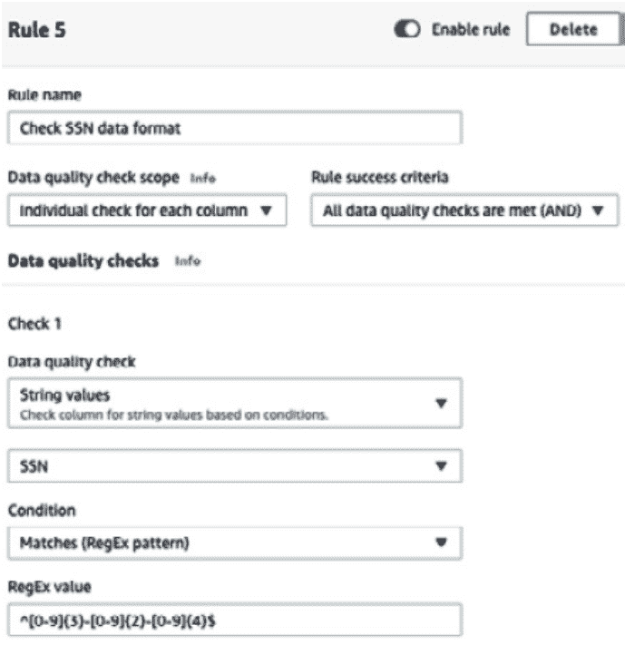

图 2.51：验证 SSN 格式

下一步涉及通过将规则集应用于之前创建的配置文件作业来执行数据质量检查。要使用默认选项运行作业，请确保选择了在上一节数据配置文件生成期间创建的角色名称。

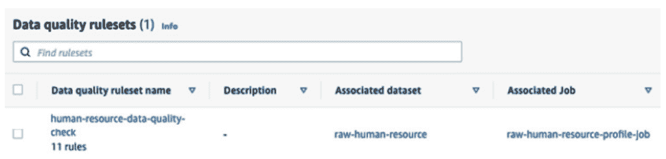

图 2.52：检查角色名称

单击运行作业，将出现一个新的弹出窗口。重要的是根据用例决定是针对完整数据集还是自定义样本运行作业。如果是关键任务应用程序，建议选择完整数据集。


图 2.53：运行配置文件作业

运行作业后，请等待其完成。需要注意的是，保持默认选项至关重要。

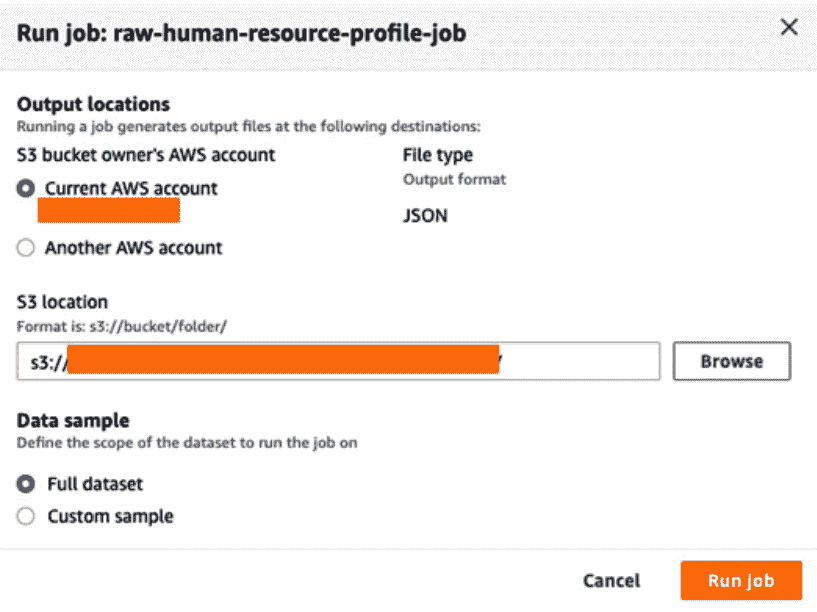

图 2.54：检查数据质量规则验证结果

等待作业完成后，通常需要约 17 分钟（但可能有所不同），下一步涉及检查数据质量规则验证的结果。

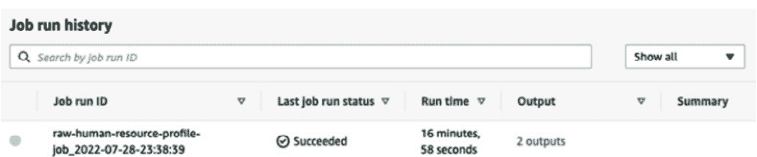

图 2.55：作业执行摘要

为此，请按照以下步骤操作：

- 1. 转到 DataBrew 控制台上的作业页面并选择配置文件作业选项卡。
- 2. 等待配置文件作业状态更改为已成功。
- 3. 作业完成后，选择查看数据配置文件。

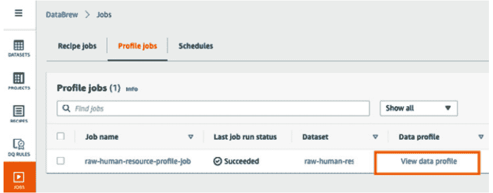

图 2.56：查看数据配置文件

4. 单击数据质量规则选项卡以查看所有数据质量检查的状态。

在此平台上，您可以查看所有数据质量检查的状态。幸运的是，在我们的案例中，只有一条数据质量规则失败，其余均成功。

根据数据质量检查，我们发现 Emp ID、Email 和 SSN 存在重复值。为确认这一点，请导航到列统计选项卡并选择 Emp ID 列。

向下滚动到顶部不同值部分。只需查看此表，我们就发现 Emp ID 的重复值数量很大。同样，您将能够识别 Email 和 SSN 的重复值。

## 顶部不同值

配置文件返回数据集中前 50 个不同值和前 50 个异常值

有效异常值

| 值 |  | 计数 | 百分比 |
|---|---|---|---|
| 562509 |  | 22 | <1% |
| 804085 |  | 22 | <1% |
| 932654 |  | 21 | <1% |
| 762430 |  | 21 | <1% |
| 238565 |  | 20 | <1% |
| 963422 |  | 20 | <1% |
| 869424 |  | 20 | <1% |
| 322108 |  | 20 | <1% |
| 566820 |  | 20 | <1% |
| 其他 |  | 5 M | 99% |

图 2.57：顶部不同值

下一步是解决数据质量问题。为此，第一步是创建项目。

要创建项目，请按照以下步骤操作：

- 1. 转到 DataBrew 控制台并选择 **项目**。
- 2. 单击 **创建项目**。
- 3. 在 **项目名称** 下输入项目名称（例如，`human-resource-project-data-quality-check`）。
- 4. 在 **选择数据集** 下，选择 **我的数据集**。
- 5. 选择 `raw-human-resource` 数据集。
- 6. 将采样大小保持为默认值。
- 7. 在 **权限** 下，在 **角色名称** 下选择之前为我们的 DataBrew 配置文件作业创建的 IAM 角色。
- 8. 单击 **创建项目**。

项目创建后，将启动 Glue DataBrew 交互式会话。现在，让我们从 Emp ID 列中删除重复值。

为此，请按照以下步骤操作：

- 1. 选择 **Emp ID** 列。
- 2. 单击 **更多选项** 图标（三点），以查看此列的所有可用转换。
- 3. 选择 **删除重复值**。


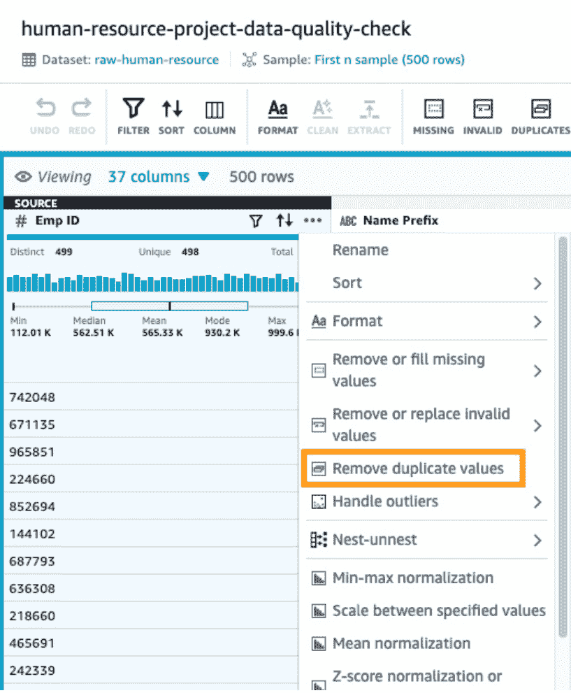

Figure 2.58: 删除重复值选项

4. 对 SSN 和 E Mail 列执行类似步骤。

你可能已经注意到为我们创建了三个新配方。然而，当配方在 Glue DataBrew 交互式会话中应用时，它仅应用于数据样本。

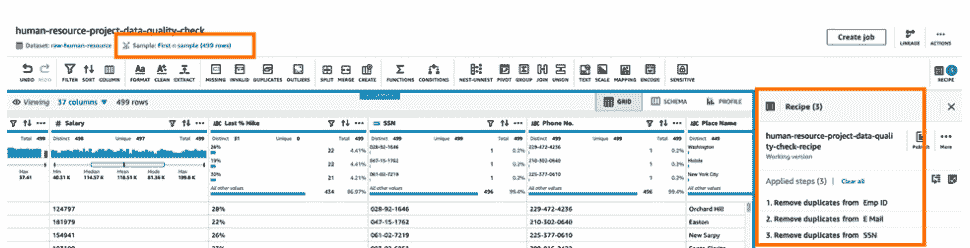

Figure 2.59: Glue DataBrew 会话样本

下一步是创建作业以将这些配方应用于整个数据集。为此，我们需要创建一个新作业。

## 数据发布 – 修复数据质量问题

下一步是创建 DataBrew 作业以对完整数据集运行这些转换：

- 1. 在项目详细信息页面，选择 **创建作业**。
- 2. 在 **作业名称** 下为作业输入名称（例如，**human-resource-after-dataquality-fix**）。
- 3. 在 **作业输出设置** 下，选择 **CSV** 作为最终存储格式的文件类型。
- 4. 在 **S3 位置** 下输入输出的 S3 存储桶位置（例如，`s3://navnis-data-wrangling-curated/human-resource/`）。
- 5. 选择 **无** 作为压缩类型。

等待作业完成：

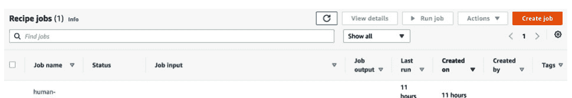

Figure 2.60: AWS Glue DataBrew 控制台中的作业列表

## 使用已更正数据集验证数据质量检查

现在，我们需要使用已更正的数据集验证数据质量检查。以下是需要遵循的步骤：

- 1. 第一步是从已更正的数据集创建数据集（你可以遵循前面概述的步骤）。

Figure 2.61: AWS Glue DataBrew 控制台中的数据集列表

2. 接下来，我们需要针对数据质量检查运行数据质量规则。请遵循以下步骤：

### 关联数据集信息

将数据集与此规则集关联。要添加数据质量规则，请使用数据集架构、配置文件和建议。

选择数据集

curated-human-resource

浏览数据集

查看关联数据集详细信息

Figure 2.62: 选择数据集

- 3. 选择 DQ Rules 并选择你之前创建的规则集。
- 4. 在操作菜单上选择 Duplicate。
- 5. 在关联数据集中浏览新创建的数据集。
- 6. 点击末尾的创建规则集。
- 7. 选择新创建的数据质量规则集并点击使用规则集点击配置文件作业。
- 8. 遵循之前描述的步骤创建新的配置文件作业。

### 数据质量规则集 (2) 信息

| 数据质量规则集名称 | 描述 | 关联数据集 | 关联作业 | 创建日期 |
|---|---|---|---|---|
| curated-human-resource-data-quality-check 11 rules | - | curated-human-resource | - | 几秒前 August 4, 2022, 12:00:26 am |

Figure 2.63: AWS Glue DataBrew 控制台中的数据质量规则集列表

完成后，你将能够验证数据质量。你会看到除 Check total record count 之外的所有规则都已通过，因为你删除了重复值。

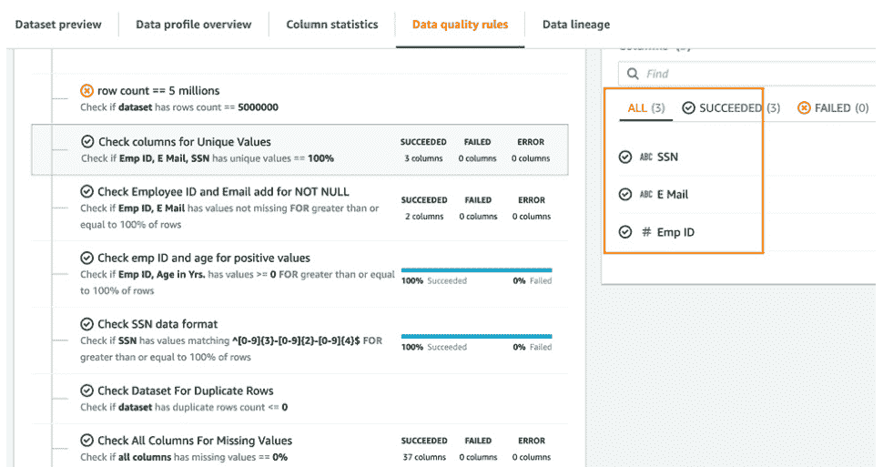

Figure 2.64: 在数据集上应用配方

在列统计页面中，在 Emp ID 列的顶部不同值下，你可以看到不同值。同样，你也可以看到 SSN 和 E Mail 列的不同值。

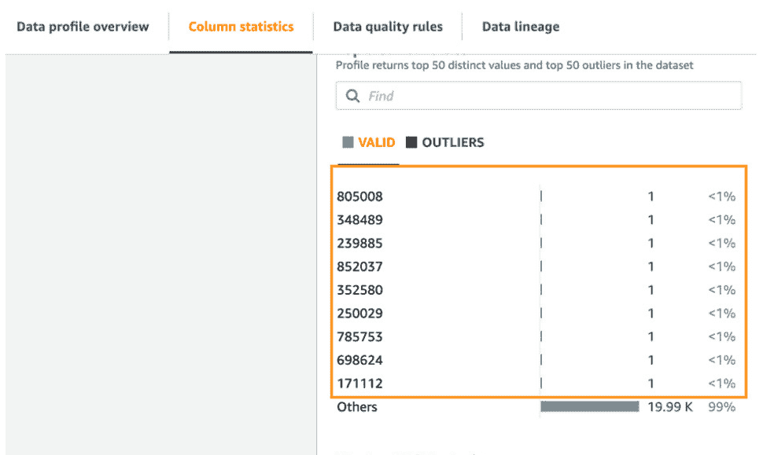

Figure 2.65: 列的不同值

最后，你可以在 AWS Glue DataBrew 控制台中看到修复问题后的数据质量检查信息。

数据配置文件概览
列统计
数据质量规则
数据血缘

配置文件返回数据集中前 50 个不同值和前 50 个异常值

查找

有效异常值

| 值 |  | 计数 | % |
|---|---|---|---|
| 805008 | | 1 | <1% |
| 348489 | | 1 | <1% |
| 239885 | | 1 | <1% |
| 852037 | | 1 | <1% |
| 352580 | | 1 | <1% |
| 250029 | | 1 | <1% |
| 785753 | | 1 | <1% |
| 698624 | | 1 | <1% |
| 171112 | | 1 | <1% |

其他 19.99 K 99%

查看前 50 个不同值

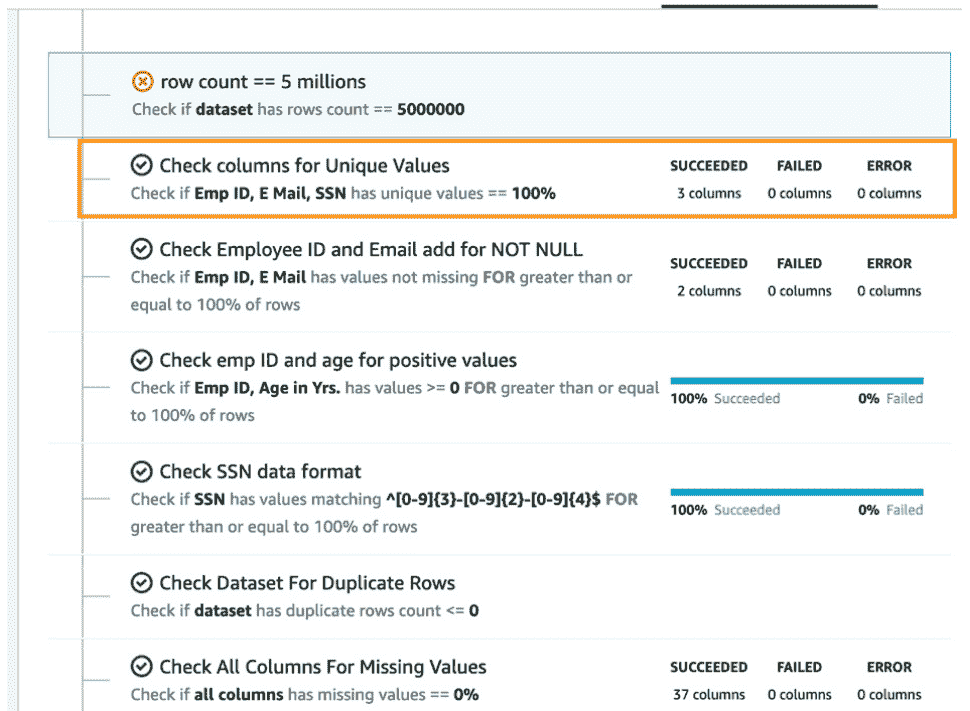

Figure 2.66: 修复问题后的数据质量检查信息

在本节中，我们了解了 Glue DataBrew 如何协助识别和解决数据质量问题。尽管所介绍的技术是手动的，但需要注意的是，实际上最好实现事件驱动的数据质量检查。这种方法涉及在问题出现时自动识别任何数据质量问题，例如缺少有效的社会安全号码或员工 ID，并采取适当措施，例如提醒业务或应用程序所有者，让他们验证数据并实施必要的修复。

## 使用 Glue DataBrew 进行事件驱动的数据质量检查

在此架构中，每当文件上传到 Amazon S3 时，EventBridge 规则就会触发 Step Functions 状态机。

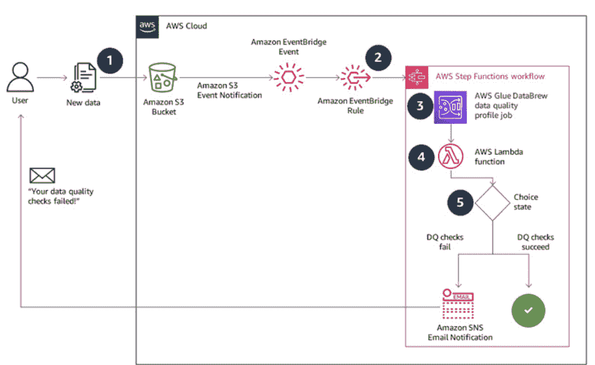

Figure 2.67: 事件驱动的数据质量检查

状态机启动配置了数据质量规则集的 DataBrew 配置文件作业，并将结果输出存储在 Amazon S3 中。Lambda 函数用于从 Amazon S3 读取数据质量结果并向状态机返回布尔响应。函数在规则集中的一个或多个规则失败时返回 `false`，并且在所有规则成功时返回 `true`。如果布尔响应为 `false`，状态机会向 Amazon SNS 发送电子邮件通知并以失败状态结束。相反，如果布尔响应为 `true`，状态机会以成功状态结束。下一步是学习如何使用 AWS Glue DataBrew 识别 PII 数据。

## 使用 AWS Glue DataBrew 进行数据保护

组织面临的挑战不仅限于数据质量，还包括识别和保护个人信息。数据泄露的新闻很常见，例如 2021 年 LinkedIn 数据泄露事件，其中 7 亿用户的相关数据被发布在暗网上供出售，影响了 92% 的 LinkedIn 用户群。同样，Yahoo! 在 2017 年报告称，3200 万个账户通过基于 cookie 的攻击被访问。监管和合规要求，例如 FedRAMP、FINMA、HIPAA 和 PCI，也需要安全的数据处理和存储。AWS Glue DataBrew 提供功能来帮助您保护和遵守这些要求。

### 静止加密

静止加密是一种安全措施，涉及在数据存储在本地存储设备（如硬盘）中时对其进行加密，以防止在攻击者访问设备时未经授权访问机密信息。AWS Glue DataBrew 为 DataBrew 项目和作业提供静止数据加密支持。借助 AWS **密钥管理服务 (KMS)**，作业可以读取和写入加密数据。

要在作业中启用静止加密，请遵循以下步骤：

- 1. 转到 **作业输出设置**。
- 2. 选择 **其他配置 – 可选**。
- 3. 勾选 **启用作业输出文件加密**。
- 4. 在使用 SSE-S3（Amazon S3 管理的加密密钥）或 AWS KMS 之间进行选择。

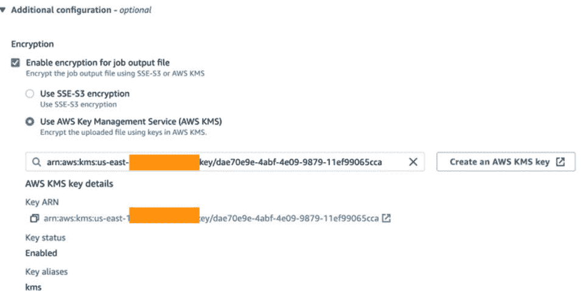

Figure 2.68: AWS Glue DataBrew 作业中的 AWS KMS 加密

### 传输中加密

传输中加密是在数据通过互联网在服务之间传输时通过加密数据来保护数据，例如使用 JDBC 连接连接数据库时。

要启用传输中加密，AWS 提供 **安全套接层 (SSL)** 加密。AWS Glue DataBrew 利用 SSL 进行 JDBC，这是 AWS Glue 的内置功能，因为它使用 AWS Glue 提供的 JDBC 连接器。

### 识别和处理 PII

数据安全的重要部分是 PII 数据的识别、删改、替换、加密和解密，例如名字、姓氏、电子邮件地址、SSN 和电话号码。当谈到大规模识别和保护敏感数据时，情况变得更加复杂。即使在识别之后，在大规模上实现敏感数据的删改、屏蔽或加密解决方案也不是一件容易的事。

你可以在数据准备步骤中使用 AWS Glue DataBrew 来混淆 PII 数据。根据你的要求，有不同的 PII 数据删改机制可用。你可以选择混淆 PII 数据以便用户无法还原，或使混淆可逆。

可以采用以下技术来屏蔽数据：

- - **替换**：这涉及用其他看起来真实的值替换 PII 数据值，例如姓名、地址和社会安全号码，用化名、虚拟地址或随机生成的标识符
- - **洗牌**：此技术在不同行之间对同一列的值进行洗牌
- - **确定性加密**：这涉及对列值应用确定性加密算法，对于给定值始终产生相同的密文
- - **概率加密**：在此技术中，对列值应用概率加密算法，每次使用时产生不同的密文
- - **解密**：这涉及基于加密密钥解密列
- - **置空或删除**：特定字段可以替换为 null 值或整个列可以被删除
- - **屏蔽**：此技术采用字符混淆或屏蔽列中的某些部分
- - **哈希**：哈希函数可以应用于列值作为屏蔽手段

让我们看一个例子来理解这一点。在数据质量部分，我们学习了如何创建数据集并对其进行分析。以下是步骤：

1. 创建一个名为 `raw-human-resource-pii-dataset` 的新数据集，参考上一节。

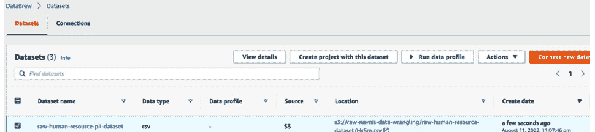

Figure 2.69: AWS Glue DataBrew 中的数据集

- 2. 选择新创建的数据集并点击 **运行数据分析**。
- 3. 在提示时创建配置文件作业。
- 4. 将作业名称和作业运行样本保持为默认值。


5. 在作业输出设置中指定您希望以 JSON 格式存储数据配置文件信息的 Amazon S3 路径。

6. 在数据集级别配置下启用 PII 统计信息，并在 PII 类别下选择所有类别。请注意，在生产环境中，您可能希望选择与您的数据相关的内容。


图 2.70：AWS Glue DataBrew 中的 PII 配置

7. 将其余选项保持为默认值。

8. 选择我们在数据质量规则期间创建的角色名称。


图 2.71：Glue DataBrew 作业中添加的角色

9. 等待配置文件作业完成。

作业完成后，您将能够在 Datasets 中的 Data Profile 概览部分看到统计信息。对于我们的数据集，它显示有 17 列为 PII。

## 个人身份信息（PII）

总 PII 列数


PII 列
17 46%
非 PII 列
20 54%

总 PII 行数


PII 行
20000 100%
非 PII 行
0 0%

图 2.72：数据集的 PII 摘要

当您向下滚动时，您会找到电子邮件、出生日期、入职日期、SSN 和电话等列，这些列的 PII 行比例为 100%。


图 2.73：各列的 PII 统计信息

现在我们已经识别出 PII 列，下一步是对 PII 列进行涂黑和加密。您可以使用 AWS Glue DataBrew 转换部分中描述的步骤执行此任务。

在对 AWS Glue 中可用的各种数据安全选项（如静态数据加密、传输中数据加密、PII 识别和涂黑）有一定了解后，下一步是学习 AWS Glue DataBrew 的数据血缘功能。

请看以下示例：

- **测试和开发环境**：在创建测试和开发环境时，通常需要使用模拟真实场景的代表性数据。然而，在这些环境中暴露敏感的 PII 数据可能会带来安全风险。通过使用 AWS Glue DataBrew 对 PII 数据进行混淆，您可以在保持有效测试和开发所需的真实性的同时确保数据隐私。
- **数据分析和报告**：在需要将数据与分析师或第三方供应商共享以进行数据分析或报告目的的情况下，混淆 PII 数据变得至关重要，以遵守隐私法规并保持保密性。AWS Glue DataBrew 可以帮助匿名化或用逼真的值替换敏感信息，使分析师能够在保护个人隐私的同时使用数据。
- **数据共享和协作**：协作项目通常涉及在团队或组织之间共享数据集。在这些情况下，必须保护敏感信息。通过利用 AWS Glue DataBrew 对 PII 数据进行混淆，您可以在保持数据完整性和实用性的同时安全地共享数据集，以便进行协作分析和决策。
- **机器学习训练**：机器学习模型通常需要大量数据集进行训练。在处理敏感 PII 数据时，混淆这些信息对于保护个人隐私至关重要。AWS Glue DataBrew 可以帮助替换或转换 PII 数据，以确保训练数据保持匿名并符合数据保护法规。
- **遵守数据隐私法规**：在医疗保健、金融或电子商务等行业运营的组织必须遵守 GDPR 或 HIPAA 等严格的数据隐私法规。使用 AWS Glue DataBrew 对 PII 数据进行混淆有助于确保遵守这些法规，通过最大限度地降低敏感信息被未经授权访问的风险。

## 数据血缘和数据发布

数据血缘和数据发布是数据管理的关键方面。数据血缘是跟踪数据从其来源到消费过程的过程，AWS Glue 提供了数据血缘功能，尽管它仍处于开发的早期阶段。与 Talend 和 Collibra 等企业工具相比，AWS Glue 的数据血缘功能与外部服务的集成有限，并且在每个阶段提供的有关数据集和配方的信息有限。尽管存在局限性，AWS Glue DataBrew 中的数据血缘功能仍然是一个有价值的补充，希望未来它能集成更多功能。


图 2.74：AWS Glue DataBrew 中的数据血缘

## 摘要

在本章中，我们探讨了 AWS 提供的无代码数据整理服务 AWS Glue DataBrew 的功能。我们学习了如何执行各种数据整理任务，包括数据发现、数据丰富、识别和涂黑 PII 以及执行数据质量检查。我们还学习了数据分析及其用途。在下一章中，我们将深入探讨 AWS Glue Data Wrangler，这是一个基于 Python 的开源数据整理选项。
