## 介绍 AWS SDK for pandas

在本章中，我们将探索 AWS SDK for pandas 包并了解其构建模块。我们将详细探讨针对各种用例安装 AWS SDK for pandas 包的不同模式，并向您展示如何进一步自定义该包以满足特定项目需求。我们还将学习该包与 AWS 服务的集成方式以及它如何以高效的方式执行常见的数据整理活动。因此，到本章结束时，您可以预期了解 AWS SDK for pandas 及其构建模块、针对不同用例的标准和自定义安装选项，以及与 Amazon S3、Amazon RDS、Amazon Redshift 和 Amazon Athena 等 AWS 服务的集成。

本章涵盖以下主题：

- AWS SDK for pandas
- AWS SDK for pandas 的构建模块
- 自定义、构建和安装 AWS SDK for pandas
- AWS SDK for pandas 的配置选项
- AWS SDK for pandas 与不同 AWS 服务的功能

## AWS SDK for pandas

AWS SDK for pandas（以前称为 AWS Data Wrangler）是一个 Python 库，它增强了 **AWS 软件开发工具包（SDK）** 的功能，并提供与 pandas DataFrame 的接口。这是 AWS 专业服务团队发起的开源项目，提供与一系列 AWS 服务的轻松集成。除了 AWS SDK 的现有功能外，与 pandas 库的集成提供了丰富的功能来执行数据整理和数据集成活动。

AWS SDK for pandas 最初被称为 `awswrangler` 包，并于 2019 年 7 月左右由 AWS 专业服务团队创建。AWS SDK for pandas 是一个在 Apache 2.0 许可证下发布的开源项目。该框架已于 2022 年 8 月进行重新品牌化，将其名称更改为 AWS SDK for pandas。然而，与该库相关的所有内容保持不变，名称更改是为了更好地与 AWS 生态系统保持一致。从现在开始，我们将在本书中使用术语 `awswrangler` 来指代 AWS SDK for pandas 库。

使用 AWS 生态系统的客户可以使用 AWS SDK 以其选择的语言通过编程方式访问服务并执行任务。截至 2022 年 10 月，AWS SDK 支持 12 种编程语言，包括 C++、Go、Python、Rust、JavaScript、Kotlin、Java、Node.JS、PHP、Ruby、Swift 和 .NET。每个 SDK 中可用的功能在 AWS 文档（https://aws.amazon.com/developer/tools/）中都有详细记录。对于使用 Python 编程语言的客户，AWS SDK for Python（也称为 Boto3）提供了与 AWS 服务交互的机制。

AWS SDK for pandas 是在 Boto3 之上创建的，并提供与 pandas DataFrame 和 AWS 服务的集成。代码库由来自 AWS 内部和外部的一组志愿者积极维护。截至 2022 年 10 月，共有约 95 次发布，平均每月超过两次，这表明不断添加功能以使该库更有用。以下图表显示了过去一年中对存储库所做的提交，这表明代码库由团队积极管理。


图 3.1：AWS SDK for pandas 仓库的代码提交

就实际用途而言，如果您使用 pandas 进行数据整理或数据集成活动，AWS SDK for pandas 将为您提供功能，可以更轻松、更高效地使用 `pyarrow` 等库，有效地 *将数据加载或读取到或来自* AWS 服务，如 S3、RDS、NoSQL 数据库和 Redshift。一旦数据在 pandas DataFrame 中可用，用户就可以利用 pandas 库的丰富生态系统对数据集执行数据整理活动。现在我们已经了解了 AWS SDK for pandas 的内容，让我们来看看构成该 SDK 的构建模块。

## AWS SDK for pandas 的构建模块

在本节中，我们将探讨 AWS SDK for pandas 库的构建模块，例如 Apache Arrow、pandas 和 Boto3。

## Arrow


Apache Arrow (https://arrow.apache.org/) 是一种内存中、列式（类似于 DataFrame 格式）的数据格式，用于许多系统和编程语言中，在现代硬件上进行高效的内存分析操作。用户可能已经了解 Parquet 文件格式，它有助于将数据以列式格式存储在磁盘上，但当数据加载到内存中时，不同的运行时会以不同的方式映射它（Spark 在从磁盘读取 Parquet 文件后将数据加载到 DataFrames 中）。因此，当数据需要在系统之间交换时，需要序列化/反序列化将其从一种格式转换为另一种格式。使用 Arrow 的一个优势是能够以列式格式在内存中存储数据，支持分析操作，并在不同的运行时环境之间高效传输数据，而无需序列化 and 反序列化数据。许多不同的项目和团队都使用 Arrow 库，例如 pandas 和 Spark。这对使用 pandas 和 NumPy 数据的 Python 开发者有益。

例如，在 PySpark 编程中，我们会在 Python UDF 与 **Java 虚拟机 (JVM)** 环境之间序列化/反序列化数据。由于 PySpark 程序是用 Python 编写的，最终会在 JVM 中执行。此过程涉及将数据转换为 pickle 格式以进行序列化和反序列化活动，这会耗费时间。使用基于 Arrow 的序列化，数据可以在 JVM 和 Python 进程之间高效、快速地移动。

> 根据 Wes McKinney 的说法，“*Apache Arrow 定义了一种二进制“序列化”协议，用于排列一组 Arrow 列式数组（称为“record batch”），可用于消息传递和进程间通信。你可以将该协议放在任何地方，包括磁盘上，后续可以进行内存映射或读入内存并发送到其他地方。Arrow 协议的设计使你可以“映射”一个 Arrow 数据 blob 而无需进行任何反序列化，因此对磁盘上的 Arrow 协议数据执行分析可以使用内存映射并几乎为零成本*” (https://stackoverflow.com/questions/56472727/difference-between-apache-parquet-and-arrow)。

## pandas

其核心，`awswrangler` 库使 pandas DataFrame 更接近 AWS 生态系统。此外，`awswrangler` 具有简化常见活动（例如列出特定时间后创建的 S3 对象）的方法，使用预构建模块基于 Boto3 功能构建。pandas 是一个为 Python 编程语言编写的开源库，为大多数数据分析工作负载提供快速且高性能的数据结构。Python 编程语言拥有大量机器学习库，而 pandas 也帮助人们使用 Python 执行数据分析活动。pandas 库 (https://pandas.pydata.org/) 可以帮助用户根据项目需求将数据转换为不同格式，并且还与多种工具具有更广泛的集成。

## Boto3

AWS SDK for Python (Boto3) ([https://boto3.amazonaws.com/v1/documentation/api/latest/index.html](https://boto3.amazonaws.com/v1/documentation/api/latest/index.html)) 为用户提供通过 Python 代码以编程方式访问 AWS 服务并执行各种操作的能力。这有助于自动化常见任务，还有助于在云中部署生产级应用程序。Boto3 使用 AWS 凭证来验证对 AWS 服务发出的 API 调用，并且访问权限基于通过 **身份和访问管理 (IAM)** 服务提供的 AWS 凭证进行限制。

Boto3 提供了用于访问 AWS 服务的高级面向对象 API（resource）和低级 API（client）：

- Clients 提供了对 AWS 服务的低级接口，其方法与服务 API 一一对应。所有服务操作都由客户端支持。响应以 Python 字典形式返回。用户需要遍历和处理响应以获取所需的属性。
- Resources 比服务客户端发出的原始低级调用提供了更高级别的抽象。要使用资源，请调用会话的 resource 方法并传入 AWS 服务名称。它们可能不具备服务的所有功能，例如低级 API，但在理解概念后使用起来更简单、更强大。
- Sessions 管理特定配置的状态，通常存储诸如用户凭证、AWS 区域以及与用户配置文件相关的其他配置等信息。这使用户可以通过使用不同的凭证连接到不同的 AWS 账户和区域来自定义代码。

### 趣闻

> *Boto 是葡萄牙语中指亚马逊河原产的一种淡水海豚的名字。该名称由原始 Boto 库的作者 Mitch Garnaat 选择，作为对该公司的引用。*

现在我们已经了解了 `awswrangler` 包的构建模块，让我们探索在各种 AWS 服务和环境中自定义和安装 `awswrangler` 的各种选项。

## 自定义、构建和安装适用于不同用例的 pandas AWS SDK

AWS SDK for pandas 可以安装在不同的编程环境中以执行数据整理活动。让我们考虑以下示例，这将帮助我们了解 `awswrangler` 在不同环境中的使用：

- 项目 A 的业务用户希望在本地机器上安装 pandas AWS SDK 并为新项目执行概念验证。用户还希望在 Amazon EC2 实例中执行相同操作，以使用来自 AWS 环境的数据测试解决方案。
- 项目 A 的 IT 人员希望在 Lambda 函数上使用 pandas AWS SDK 对低量数据执行数据整理活动。
- 项目 B 的 IT 人员希望在 Glue Python shell 上使用 pandas AWS SDK 对从源数据库提取的数据执行数据整理活动。团队预计转换将花费超过 15 分钟（Lambda 执行时间限制）。团队还有另一个消耗和转换更大数据量的数据项目，他们希望利用 Glue Spark shell 进行数据转换并使用 Glue 书签进行增量数据处理。
- 项目 B 的数据分析师希望在将数据传递给自定义 ML 模型之前执行数据整理活动。他们希望在 SageMaker 笔记本上利用 pandas AWS SDK 对数据进行探索性分析。
- 来自战略计划的项目经理希望其团队实施“大数据管道”并使用 pandas AWS SDK 进行数据准备活动。团队希望在 EMR 作业中使用 pandas AWS SDK 进行数据整理活动。

## 在本地机器或 Amazon EC2 上的标准和自定义安装

项目 A 的业务用户可以从 PyPI 或 Conda 在其本地机器或 EC2 实例上安装 pandas AWS SDK。Python 用户可以从两个流行的打包系统 PIP 和 Conda 安装包。大多数 Python 发行版都预装了 pip。pip 从 Python 2.7 开始预装，pip3 从 Python 3.4 及以上版本默认预装。

使用 PIP 的优势在于它可以在命令行中使用，并且会连同包一起安装所有必需的依赖项。以下是通过 pip 安装 awswrangler 的语法：

Python 2.x：

```
pip install awswrangler
```

Python 3.x：

```
pip3 install awswrangler
```

执行此命令时，还会安装以下附加包，这些包在 awswrangler 内部用作依赖项。然而，作为用户，我们只需要执行前面的命令，其余部分由 pip 包安装程序处理：

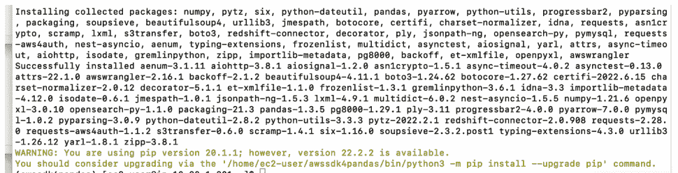

图 3.2：随 awswrangler 安装的附加包

前面的屏幕截图显示了随 pandas AWS SDK 一起安装的附加包。

安装后，您可以通过在 Python shell 中打印 awswrangler 版本来成功验证安装，如下所示。此时，我们已成功安装 awswrangler，可以开始在 Python 程序中使用它进行各种数据整理活动：

```
(dms_blog) [ec2-user@ip-10-20-1-28 ~]$ python3
Python 3.7.10 (default, Jun  3 2021, 00:02:01)
[GCC 7.3.1 20180712 (Red Hat 7.3.1-13)] on linux
Type "help", "copyright", "credits" or "license" for more information.
>>> import awswrangler as wr
>>> print(wr.__version__)
2.16.1
>>>
```

图 3.3：已安装的 awswrangler 版本

### 趣闻

PIP 是一个递归缩写，代表 PIP Installs Python。它最初于 2008 年由 Ian Bicking（virtualenv 包的创建者）作为 easy_install 的替代方案以 pyinstall 的形式引入。

## 在虚拟环境中安装 awswrangler

用户可以创建一个虚拟环境，在其中安装 awswrangler 库而不影响该机器上的现有项目。考虑一种情况，您已为另一个项目使用 pandas 版本 1.3.6，而项目代码无法与 pandas 版本 1.3.5 配合使用。现在，如果您使用 pip 命令安装 awswrangler，它将安装 pandas 版本 1.3.5，现在您机器上就有两个冲突的相同库版本，这可能导致程序崩溃。因此，最佳做法是创建 Python 虚拟环境以在具有冲突依赖项的单独项目上工作。从现在开始，我们将使用此虚拟环境来安装和修改 awswrangler 包。

您可以使用 activate 和 deactivate 命令进入 Python 虚拟环境。这允许您在不同项目之间切换并在不相互影响的情况下工作。以下屏幕截图显示了新虚拟环境和 python3 环境上安装的包。在 deactivate 命令后使用 pip3 list 命令将显示来自 python3 默认安装的库。


```
$python3 --version
Python 3.9.12
$python3 -m venv awspandas
$ls
awspandas
$source awspandas/bin/activate
(awspandas) $pip3 list --disable-pip-version-check
Package      Version
---------    -------
pip          22.0.4
setuptools   58.1.0
(awspandas) $deactivate
$pip3 list
Package            Version
------------------  -------
aenum              3.1.11
aiohttp            3.8.1
aiosignal          1.2.0
asn1crypto         1.5.1
async-timeout      4.0.2
attrs              22.1.0
awscli             1.25.50
```

图 3.4：Python 虚拟环境

## 自定义安装

开源库的一个主要优势是可以根据项目需要进行自定义并添加额外的代码段。你可以按照以下步骤执行 AWS SDK for pandas 的自定义安装，添加特定于项目需求的模块。

作为先决条件，请激活虚拟环境，并在笔记本电脑/EC2 机器上安装 `python3` 和 `git`：

- 在 Mac 上安装 **git**，可以使用 `brew` 命令
- 在 EC2 实例上安装 **git**，可以使用 `sudo yum install git`:

1. 将代码库下载或复制到本地机器或 EC2 实例：
   1. 从 `aws-sdk-pandas` 仓库复制 git 仓库 URL（https://github.com/aws/aws-sdk-pandas）。
   2. 使用该链接，将整个 git 仓库克隆到本地机器/EC2 以进行进一步开发：

```
(awspandas) $git --version
git version 2.37.3
(awspandas) $git clone https://github.com/aws/aws-sdk-pandas
Cloning into 'aws-sdk-pandas'...
remote: Enumerating objects: 13000, done.
remote: Counting objects: 100% (565/565), done.
remote: Compressing objects: 100% (264/264), done.
remote: Total 13000 (delta 388), reused 431 (delta 299), pack-reused 12435
Receiving objects: 100% (13000/13000), 8.00 MiB | 7.91 MiB/s, done.
Resolving deltas: 100% (9773/9773), done.
(awspandas) $
```

图 3.5：awswrangler git 复制

2. 进入代码库并探索代码。你可以对现有代码进行更改并为项目需求添加额外的模块：

- 在 awswrangler 的安装路径内导航并探索不同的文件夹。你应该会在名为 awswrangler 的文件夹下看到代码，并且有针对不同服务的单独文件夹。
- 为了本次学习，让我们修改 __init__.py 文件，该文件将在 Python 代码中导入 awswrangler 时执行。探索为各种 AWS 服务/awswrangler 功能导入的模块。你可以看到一条从 __metadata__.py 文件获取变量的导入语句。按如下所示在导入语句中追加一个新变量 __message__，并保存文件。

```
from awswrangler.__metadata__ import __description__, __license__, __title__, __version__,__message__
_ # noqa
from awswrangler._config import config  # noqa
```

图 3.6：awswrangler __init__.py 文件

3. 打开 __metadata__.py 文件并更改 __description__ 字段，如下所示。此外，添加另一个变量 __message__，该变量已在上一步中导入到 __init__.py 模块中，并保存文件。

```
__title__: str = "awswrangler"
__description__: str = "Pandas on AWS. Updated for custom installation."
__version__: str = "2.17.0"
__license__: str = "Apache License 2.0"
__message__: str = "This was changed as a part of Learning exercise."
```

图 3.7：awswrangler __metadata__.py 文件

3. 从本地机器或 EC2 实例上修改过的自定义代码安装 awswrangler：

- 导航到 awswrangler 代码可用的顶级文件夹。
- 执行 pip3 install . 命令，如下所示。这将使用具有自定义更改的本地代码库在你的机器上安装 awswrangler。

```
(awspandas) $cd aws-sdk-pandas
(awspandas) $ls
CODE_OF_CONDUCT.md          awswrangler               test_infra
CONTRIBUTING.md            building                  tests
CONTRIBUTING_COMMON_ERRORS.md  docs                  tox.ini
LICENSE.txt                fix.sh                    tutorials
NOTICE.txt                 poetry.lock               validate.sh
README.md                  pyproject.toml
THIRD_PARTY.txt            test.sh
(awspandas) $pip3 install .
Processing /Users/ssmsun/Documents/Initiatives/DataWranglerbook/code/aws-sdk-pandas
  Installing build dependencies ... done
  Getting requirements to build wheel ... done
  Preparing metadata (pyproject.toml) ... done
Collecting botocore<2.0.0,>=1.27.11
  Downloading botocore-1.27.82-py3-none-any.whl (9.2 MB)
     ---------------------------------------- 9.2/9.2 MB 25.5 MB/s eta 0:00:00
```

图 3.8：在本地机器上安装 awswrangler

4. 验证并开始使用 **awswrangler** 自定义安装：

- 打开一个 Python shell 并导入 **awswrangler**。
- 打印 `__message__` 和 `__description__` 变量，以查看我们是否已从本地机器/EC2 实例安装了 **awswrangler** 包，并应用了之前步骤中进行的更改。

```
(awspandas) $python3
Python 3.9.12 (main, Apr  5 2022, 01:53:17)
[Clang 12.0.0 ] :: Anaconda, Inc. on darwin
Type "help", "copyright", "credits" or "license" for more information.
>>> import awswrangler as wr
>>> print(wr.__description__)
Pandas on AWS. Updated for custom installation.
>>> print(wr.__message__)
This was changed as a part of Learning exercise.
>>>
```

图 3.9：验证带有自定义更改的 awswrangler 本地安装

5. 作为最后一步，你可以通过退出虚拟环境并使用 `pip3 install awswrangler` 命令安装 **awswrangler** 包来验证我们所做的更改仅限于我们的虚拟环境（这将从 **pypi** 远程仓库安装包，而不包含我们的自定义代码更改）：

```
(awspandas) $deactivate
$pip3 install awswrangler
Requirement already satisfied: awswrangler in /Users/ssmsun/miniconda3/lib/python3.9/site-packages (2.16.1)
```

```
$python3
Python 3.9.12 (main, Apr  5 2022, 01:53:17)
[Clang 12.0.0 ] :: Anaconda, Inc. on darwin
Type "help", "copyright", "credits" or "license" for more information.
>>> import awswrangler as wr
>>> print(wr.__description__)
Pandas on AWS.
>>> print(wr.__message__)
Traceback (most recent call last):
  File "<stdin>", line 1, in <module>
AttributeError: module 'awswrangler' has no attribute '__message__'
>>>
```

图 3.10：使用 Python 虚拟环境的多个 awswrangler 版本

我们看到了如何仅使用 `pip` 命令在本地机器/EC2 实例上安装 `awswrangler` 包。我们还从 `awswrangler` git 仓库下载了代码，对项目所需的更改进行了修改，并安装了更改后的 `awswrangler` 版本。我们还学习了如何在虚拟环境中安装包，以便为一个项目所做的更改不会与其他项目冲突。

恭喜完成此步骤！你可以在这里花一些时间玩弄该包以了解更多。一旦探索完毕，让我们进入下一节，在那里我们需要帮助一名 IT 人员使用 Lambda 函数安装 `awswrangler`。

## 使用 Lambda 函数的标准和自定义安装

对于大多数用例，包括像项目 A 的 IT 人员处理小量数据的情况，我们希望在无服务器环境中部署和执行数据集成代码。AWS Lambda 是一种无服务器的事件驱动计算服务，让你无需配置或管理服务器即可为几乎任何类型的应用程序或后端服务运行代码。Lambda 预装了各种重要的库，但用户必须在将代码部署到 Lambda 函数时，将默认环境中不可用的库与代码一起打包。

对于较小的库，用户可以将依赖项与代码一起打包并上传到 Lambda 函数。我们将看到如何创建包含 Lambda 函数依赖库的 ZIP 归档（https://docs.aws.amazon.com/Lambda/latest/dg/python-package.html#python-package-create-package-with-dependency）。为此，创建一个新的 Python 虚拟环境并在虚拟环境中安装新包。这将把依赖包安装在 `pip`

`install` 路径在你的机器上。你可以随后将这些包移动到 Lambda 函数的部署文件夹中，并将其归档为 ZIP 文件以上传到 Lambda 函数。

Lambda 函数也可以拥有层，它们以包含额外代码/库的 ZIP 文件保存。它还可以包含自定义运行时、数据或配置文件。使用 Lambda 函数中的层将减少部署包的大小，并且同一个 Lambda 层可以在多个 Lambda 函数之间共享，促进可重用代码组件。此外，这有助于在不同团队之间分离管理代码段的职责。此外，当你将代码和依赖项部署在单个 ZIP 文件中时，Lambda 函数在控制台中不可编辑，从而增加了代码维护的难度。目前，Lambda 层可以用 `.zip` 文件归档创建。

在以上所有内容的基础上，我们将在何处使用 Lambda 层？考虑这样一种情况：存在一个中央数据仓库，不同的项目团队使用 Lambda 函数作为微服务从中访问数据，并用于不同的目的。要求仅向组织内的特定用户组提供访问权限，并在访问数据时执行数据屏蔽。数据库管理员还担心太多并发用户访问数据库并留下空闲的打开连接，从而可能给数据库带来压力。各个项目团队也担心使用和维护连接仓库的数据库驱动程序，并且他们没有管理数据库连接状态、配置等的经验。理想的解决方案是创建一个访问仓库的 Lambda 层，满足上述所有要求，该层将由数据库管理团队维护，而各个团队可以利用该 Lambda 层在 Lambda 函数中开发其代码。这促进了代码重用、职责分离和更快的开发周期。

在同一上下文中，用户可以从 Lambda 层使用 AWS SDK for pandas。在 Lambda 代码中使用 AWS SDK for pandas 有两种选项。

## 标准安装 – Lambda 管理的层

在 AWS 控制台中创建一个 Python Lambda 函数，使用 Python 3.9 运行时。将 Lambda 函数概览屏幕向下滚动到页面底部，在那里你可以找到 **层** 部分：

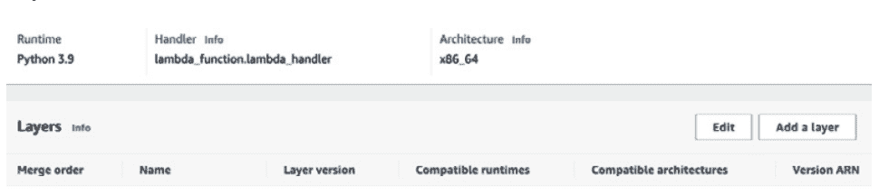

图 3.11：awswrangler Lambda 安装

然后你可以选择添加一个层；选择 AWSSDKPandas–Python39 层，如以下屏幕截图所示。版本号可能会随着 AWS 团队添加新版本而在未来发生变化。这是由 AWS 团队为你的使用而策划的层，去除了并优化了组件，从而减小了包的大小。

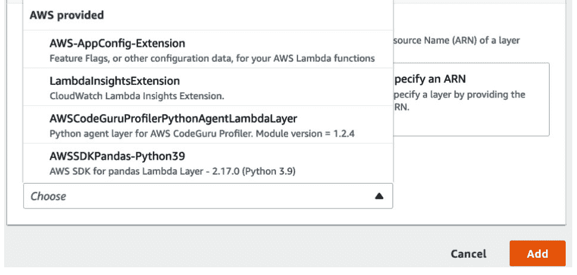

图 3.12：awswrangler Lambda 安装 – Python 3.9 的托管层选项

从 AWS 托管层使用 AWS SDK for pandas 是最简单、最容易的选择，如果你想使用一个包而无需任何自己的自定义修改。此外，请注意，在新功能在 AWS 托管层中发布或可用之前，可能存在长达一周或更长时间的延迟。现在，你也可以使用不同的 Python 版本和不同的架构创建 Lambda 函数，仍然可以利用该版本的 awswrangler。以下屏幕截图显示了在 Python 3.8 和 ARM 架构创建的 Lambda 函数中可用的 awswrangler 层。

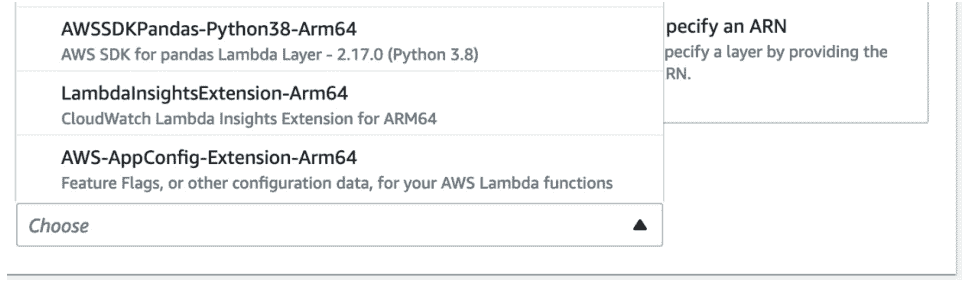

图 3.13：awswrangler Lambda 安装 – Python 3.8 的托管层选项

## 自定义安装 – 创建自定义托管层

还有一种情况，你希望使用 AWS SDK for pandas 并添加一些修改和自定义代码以满足你的需求。我们将 .zip 归档文件上传到自定义层，然后在 Lambda 函数中使用它。存在 Lambda 服务限制（https://docs.aws.amazon.com/Lambda/latest/dg/gettingstarted-limits.html#function-configuration-deployment-and-execution） – 整个 Lambda 部署包大小应小于未压缩 250 MB（压缩 50 MB）。

如以下屏幕截图所示，如果我们归档 awswrangler 库的内容，它大约为 86 MB 压缩大小，不包括实际的 Lambda 代码。这超过了 Lambda 部署包大小的限制：

```
(awspandas) $ls
aws-sdk-pandas  awspandas
(awspandas) $cd awspandas/lib/python3.9/site-packages
(awspandas) $zip -r ../../../.../awswrangler.zip .
    adding: pandas-1.5.0.dist-info/ (stored 0%)
    adding: pandas-1.5.0.dist-info/RECORD (deflated 69%)
```

图 3.14：awswrangler Lambda 安装 – 创建自定义 Lambda 包

```
(awspandas) $ls -lh
total 197032
drwxr-xr-x  29 ssm sun  staff   928B Sep 28 14:30 aws-sdk-pandas
drwxr-xr-x   8 ssm sun  staff   256B Sep 28 14:48 awspandas
-rw-r--r--   1 ssm sun  staff    86M Sep 28 16:23 awswrangler.zip
```

图 3.15：awswrangler Lambda 安装 – 验证创建的 Lambda 包

因此，我们必须以最佳方式构建 Lambda 包以上传到 Lambda 函数。幸运的是，我们有一个脚本可以帮助我们执行完全相同的活动。按照以下步骤获取一个小于 50 MB 的 ZIP 文件以上传到 Lambda 函数。

以下是先决条件：

- 我们将利用我们为本地机器/EC2 实例设置而使用的 awswrangler 本地仓库。还记得我们在 __init__.py 中对消息和描述变量所做的更改吗？我们将在 Lambda 函数中打印它们以验证我们的安装。
- 你的机器上需要运行 Docker daemon，我们将用它来构建 Lambda 层。此外，请注意，Docker 应分配足够的内存来构建代码，以避免在过程中出现内存不足错误。请注意，以下屏幕截图为 Docker 分配了 8 GB 内存以供使用，因此无论你的物理机器容量如何，Docker 都需要有足够的内存和计算资源来成功完成构建。

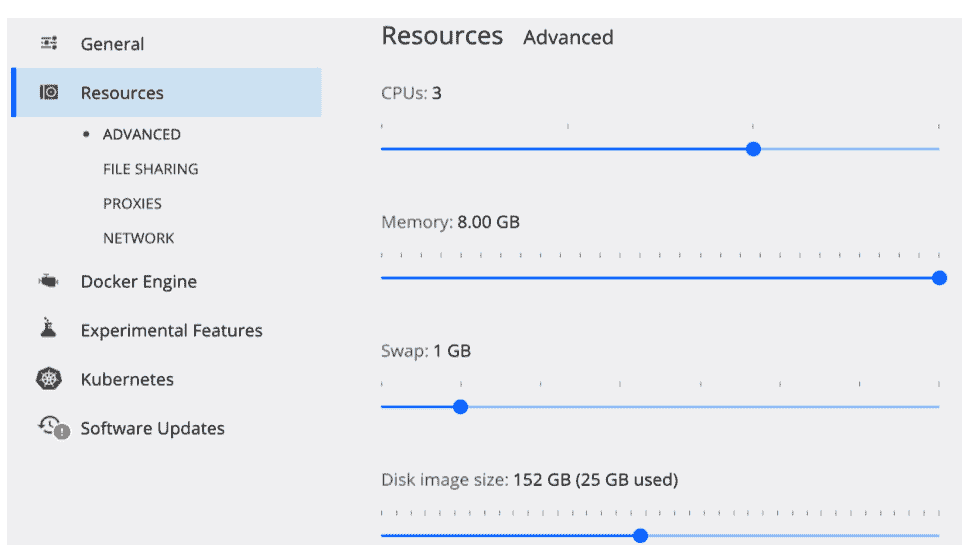

图 3.16：awswrangler 自定义 Lambda 安装 – 容器内存配置

我们现在开始，如下所示：

- 1. 进入源代码路径并执行命令来构建可以添加到 AWS Lambda 函数的 Lambda 层。现在，执行 `sh build-Lambda-layers.sh` 命令以启动 `awswrangler` 自定义构建。

```
(awspandas) $ls
build-docs.sh      build-wheel.sh      publish.sh
build-lambda-layers.sh  lambda
(awspandas) $sh build-lambda-layers.sh
++ python -c 'import awswrangler as wr; print(wr.__version__)'
+ VERSION=2.17.0
```

图 3.17：awswrangler 自定义 Lambda 安装 – 构建 Lambda 层

### NOTE

*此步骤完成需要很长时间。此代码将为 Python 3.7、Python 3.8 和 Python 3.9 发行版构建 Lambda 层。*

打开 `build-Lambda-layers.sh` 的代码，如果你计划仅在 Python 3.9 环境中部署此库，请在构建过程中注释掉 Python 3.7 和 Python 3.8 行。

```
#  Python 3.7
#  docker run \
#    --volume "$DIR_NAME":/aws-data-wrangler/ \
##    --workdir /aws-data-wrangler/building/lambda \
#    --rm \
#    awswrangler-build-py37 \
#    build-lambda-layer.sh "${VERSION}-py3.7" "ninja-build"
#fi

# Python 3.8
#docker run \
# --volume "$DIR_NAME":/aws-data-wrangler/ \
# --workdir /aws-data-wrangler/building/lambda \
# --rm \
# awswrangler-build-py38 \
# build-lambda-layer.sh "${VERSION}-py3.8${ARCH_SUFFIX}" "ninja-build"

# Python 3.9
docker run \
  --volume "$DIR_NAME":/aws-data-wrangler/ \
  --workdir /aws-data-wrangler/building/lambda \
  --rm \
  awswrangler-build-py39 \
  build-lambda-layer.sh "${VERSION}-py3.9${ARCH_SUFFIX}" "ninja-build"
```

图 3.18：awswrangler 自定义 Lambda 安装 – Python 3.9

前面的屏幕截图显示了 Python 3.7 和 Python 3.8 的注释代码段已突出显示。

- 2. 构建完成后，你应该会看到为三个 Python 版本 3.7、3.8 和 3.9 创建的压缩文件。记住将构建函数更改为你的 Lambda 应用程序使用的特定 Python 版本或版本。你可以看到压缩文件现在大约为 ~44-46 MB 大小。

```
(awspandas) $ls -lh ../dist
total 279048
-rw-r--r--   1 ssmsun  staff   246K Sep 28 22:17 awswrangler-2.17.1-py3-none-any.whl
-rw-r--r--   1 ssmsun  staff    44M Sep 30 11:41 awswrangler-layer-2.17.0-py3.7.zip
-rw-r--r--   1 ssmsun  staff    46M Sep 30 13:33 awswrangler-layer-2.17.0-py3.8.zip
-rw-r--r--@  1 ssmsun  staff    46M Sep 30 16:06 awswrangler-layer-2.17.0-py3.9.zip
```

图 3.19：awswrangler 自定义 Lambda 安装 – 验证创建的 Lambda 层

- 3. 使用 Lambda 版本 3.9 创建一个 Lambda 函数，然后在 Lambda 控制台中创建一个自定义层。


## 层版本配置

描述 - 可选

awswrangler Python 3.9 版本

上传 .zip 文件

从 Amazon S3 上传文件

上传

awswrangler-layer-2.17.0-py3.9.zip (45.7 MB)

对于大于 10 MB 的文件，请考虑使用 Amazon S3 上传。

兼容架构 - 可选 信息

为您的层选择兼容的指令集架构。

x86_64

arm64

兼容运行时 - 可选 信息

最多选择 15 个运行时。

运行时

Python 3.9

图 3.20：awswrangler 自定义 Lambda 安装 – 上传自定义 Lambda 层

4. 使用 Python 3.9 运行时创建一个 Lambda 函数并将以下代码粘贴到其中：

```
import json
import awswrangler as wr
def Lambda_handler(event, context):  # TODO
    implement
    print(wr.__version__)  print(wr.__description__)  print(wr.__message__)
    return {
        'statusCode': 200,
        'body': json.dumps('Hello from Lambda!')
    }
```

5. 将步骤 3 中创建的自定义 Lambda 层附加到 Lambda 函数。

version. 您还可以创建一个新层。

AWS 层
从 AWS 提供的层列表中选择一个层。

自定义层
从您 AWS 账户或组织创建的层列表中选择一个层。

指定 ARN
通过提供 ARN 指定层。

自定义层

由您的 AWS 账户或组织创建的、与您的函数运行时兼容的层。

awswrangler39

版本

1

图 3.21：awswrangler 自定义 Lambda 安装 – 将自定义层附加到 Lambda 函数

6. 执行 Lambda 函数并查看 **执行结果** 标签页。您应该能够看到一条消息，确认 `awswrangler` 包是从我们的自定义代码库构建的。

```
Response
{
  "statusCode": 200,
  "body": "\"Hello from Lambda!\""
}

Function Logs
OpenBLAS WARNING - could not determine the L2 cache size on this system, assuming 256k
START RequestId: 436fa52d-2b42-4ffb-96ad-fa7769981eb7 Version: $LATEST
2.17.0
Pandas on AWS. Updated for custom installation.
This was changed as a part of Learning exercise.
END RequestId: 436fa52d-2b42-4ffb-96ad-fa7769981eb7
```

图 3.22：awswrangler 自定义 Lambda 安装 – 验证 Lambda 输出

## AWS Glue 作业的标准和自定义安装

我们将查看 Project B 的 IT 人员希望在 Glue Python shell 上使用 pandas 的 AWS SDK 对源数据库中的数据执行数据整理活动的场景。Glue 作业有三种执行模式 – Python shell、Spark ETL 和 Spark Streaming ETL。Python shell 作业模式用于处理不需要 Apache Spark 环境的小规模文件处理。对于更大的数据量和分布式处理，您可以使用 Spark 作业模式，对于流式管道，您可以选择 Spark Streaming 作业模式。我们将了解如何为 Python shell 和 Spark 作业安装 `awswrangler`。

## Python shell 作业的 awswrangler 标准安装

Python shell 作业环境提供两个不同的 Python 版本，3.6 和 3.9（默认是 Python 3.6）。我们可以使用 wheel 文件将外部库附加到 Glue Python shell 作业。Wheel 文件是 Python 生态系统的一部分，有助于 Python 包安装过程，使其更快更稳定：

- AWS Glue Python 3.6 环境未预安装 `awswrangler`。在添加额外库之前，请参阅 Python Glue 作业环境中已安装的库 (https://docs.aws.amazon.com/glue/latest/dg/add-job-python.html#python-shell-supported-library)。我们必须为 Glue 作业中要使用的 `awswrangler` 版本附加 `wheel` 文件并将其附加，如以下步骤所述：
- 1. 对于 Python 3.6 作业，您可以使用以下语法从公共工件存储桶下载 wheel 文件：
  `s3://aws-data-wrangler-public-artifacts/releases/<version>/ awswrangler-<version>-py3-none-any.whl`.

```
(awspandas) $aws s3 cp s3://aws-data-wrangler-public-artifacts/releases/2.14.0/awswrangler-2.14.0-py3-none-any.whl .
download: s3://aws-data-wrangler-public-artifacts/releases/2.14.0/awswrangler-2.14.0-py3-none-any.whl to ./awswrangler-2.14.0-py3-none-any.whl
```

图 3.23：awswrangler glue 安装 – 下载 wheel 文件

### 注意

*awswrangler 从版本 2.15 开始不再支持 Python 3.6，因此如果您使用 Python 3.6 使用更高版本，将会抛出错误。*

- 2. 将 wheel 文件上传到 S3 存储桶并复制 S3 URL。创建一个 Python 版本为 3.6 的 Glue 作业，并在作业详细信息页面下的 **高级属性** 中的 Python 库路径部分提供 wheel 文件。

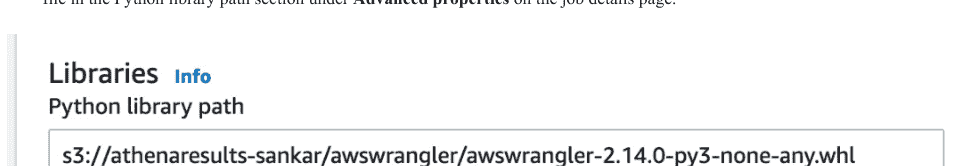

图 3.24：awswrangler glue 安装 – 上传 wheel 文件

3. 将以下代码粘贴到脚本窗口并保存作业：

```
import sys
import awswrangler as wr
print(wr.__version__)
```

- 4. 执行代码并在 CloudWatch Logs 中验证输出，检查是否 **awswrangler** 已成功加载到 Glue Python shell 作业中。

```
Successfully installed asn1crypto-1.5.1 awswrangler-2.14.0 beautifulsoup4-4.11.1 boto3-1.23.10 botocore-1.26.10 certifi-2022.9.24 normalizer-2.0.12 decorator-5.1.1 et-xmlfile-1.1.0 idna-3.4 jmespath-0.10.0 jsonpath-ng-1.5.3 lxml-4.9.1 numpy-1.18.5 openpyxl-3.0 py-1.1.0 packaging-21.3 pandas-1.1.5 pyarrow-1.22.1 ply-3.11 progressbar2-3.55.0 pyarrow-6.0.1 pymysql-1.0.2 pyparsing-3.0.9 python-utils-3.3.3 pytz-2022.2.1 redshift-connector-2.0.909 requests-2.27.1 requests-aws4auth-1.1.2 s3transfer-0.5.2 scram-1.4.1 59.6.0 six-1.16.0 soupsieve-2.3.2.post1 urllib3-1.26.12 xlsx-2.0.1 xlwt-1.3.0
```

2.14.0

图 3.25：awswrangler glue 安装 – 检查 awswrangler 是否已加载到 Glue 环境中

- Python 3.9 已预安装 **awswrangler** 版本 2.15.1。创建作业时，启用 **加载常用分析库（推荐）** 复选框。如果您想使用不同版本的 **awswrangler**，则必须像在 Python 3.6 环境中那样附加 wheel 文件。但是，如果您想使用预安装的 **awswrangler** 2.15.1 版本，请按照以下步骤操作：
- 1. 创建一个 Python 版本为 3.9 的作业并选择 **加载常用分析库（推荐）** 复选框。

### 类型

ETL 作业的类型。这会根据您选择的源类型自动设置。

Python Shell

### Python 版本

Python 3.9

加载常用分析库（推荐）

从 pypi.org 包含常用的 Python 库，如 pandas、numpy 和 s3fs。如果您加载自己的库并希望避免版本冲突，请取消选中。

图 3.26：awswrangler glue 安装 – 创建 Python 3.9 shell 作业

- 2. 粘贴在 Python 3.6 作业中用于打印 `awswrangler` 版本的示例代码。保存并执行作业。输出将显示 Python shell 作业中使用的 `awswrangler` 版本。您可以通过单击 Glue Python shell 作业中的输出日志链接来查看此信息。

```
Setup complete. Starting script execution:
----

2.15.1

No newer events at this moment. Auto retry paused. Resume
```

图 3.27：awswrangler glue 安装 – 验证 awswrangler 版本

为了使用更新版本的 `awswrangler`，请按照与 Python 3.6 shell 类似的步骤添加新的 wheel 文件。以下屏幕截图显示了将 `awswrangler` 版本 2.17 上传到 Glue Python shell 的输出，这与 `awswrangler` 2.15.1 相比是一个更新的版本。

```
pyparsing-3.0.9 python-dateutil-2.8.2 python-utils-3.3.3 pytz-2022.2.1 redshift-connector-2.0.909 requests-2.28 s3transfer-0.6.0 scramp-1.4.1 setuptools-65.4.0 six-1.16.0 soupsieve-2.3.2.post1 urllib3-1.26.12 yarl-1.8.1
```

```
[notice] A new release of pip available: 22.1.2 -> 22.2.2
[notice] To update, run: pip install --upgrade pip
```

```
Setup complete. Starting script execution:
----

2.17.0
```

图 3.28：awswrangler glue 安装 – 验证 awswrangler 版本（自定义版本安装）

## Python shell 作业的 awswrangler 自定义安装

我们将利用 `poetry` 库从我们修改过的 `awswrangler` 仓库创建自定义 wheel 文件。我们将利用我们用于

## 本地机器/EC2 实例设置：

-   您可以在 Python 虚拟环境中使用 `pip3 install poetry` 命令安装 Poetry。

-   从本地仓库执行 `build_wheel.sh` 脚本以构建 wheel 文件，如下图所示，wheel 文件将使用随 `awswrangler` 仓库提供的 `poetry.lock` 配置创建。

```
(awspandas) $poetry --version
Poetry (version 1.2.1)
(awspandas) $cd aws-sdk-pandas/building
(awspandas) $sh build-wheel.sh
+ pushd ..
~/Documents/Initiatives/DataWranglerbook/code/aws-sdk-pandas ~/Documents/Initiatives/DataWranglerbook/code/aws-sdk-pandas/building
+ rm -rf 'dist/*.whl'
+ poetry build -f wheel
Creating virtualenv awswrangler-Muv3bMem-py3.9 in /Users/ssmsun/Library/Caches/pypoetry/virtualenvs
Building awswrangler (2.17.0)
(awspandas) $ls ../dist
awswrangler-2.17.0-py3-none-any.whl
(awspandas) $
```

图 3.29：awswrangler Glue 自定义安装 – 先决条件

-   将 wheel 文件上传到 S3 存储桶，创建 Glue Python shell 作业（Python 版本 3.9），并提供 wheel 文件的 S3 位置。

-   粘贴以下代码以验证我们是否使用的是 `awswrangler` 的自定义版本：

```
import sys
import awswrangler as wr
print(wr.__version__)
print(wr.__description__)
print(wr.__message__)
```

-   执行作业并在 CloudWatch 日志中验证输出。

```
pymysql-1.0.2 pyp... python-dateutil-2.8.2 python-utils-3.3.3 pytz-2022.2.1 redshift-connector-2.0.909 requests-2.28
aws4auth-1.1.2 s3transfer-0.6.0 scramp-1.4.1 setuptools-65.4.0 six-1.16.0 soupsieve-2.3.2.post1 urllib3-1.26.12 yarl-1.8.1

[notice] A new release of pip available: 22.1.2 -> 22.2.2
[notice] To update, run: pip install --upgrade pip

Setup complete. Starting script execution:
----

2.17.0
Pandas on AWS. Updated for custom installation.
This was changed as a part of Learning exercise.
```

图 3.30：awswrangler Glue 自定义安装 – 验证 awswrangler 安装

现在您已探索了在 Python shell 中安装 `awswrangler` 的不同选项，您可以有效地将其用于所有与 Python 相关的活动。

## 在 Glue Spark 作业上标准安装 awswrangler

Glue Spark 作业可以使用 Glue 0.90（Spark 2.2）、Glue 1.0（Spark 2.4）、Glue 2.0（Spark 2.4）和 Glue 3.0（Spark 3.1）版本创建。`awswrangler` 仅支持 Glue 2.0 及之前的版本，因为它具有编译依赖项（C/C++）。默认值为 Glue 3.0，这是最新版本，您应为所有新作业使用最新的 Glue 3.0 版本，并在可能的情况下升级到它。这具有 Spark 和 AWS Glue 服务的最新功能，为运行作业提供更好、更安全、性能更强的环境。我们将使用以下步骤安装 awswrangler：

-   创建一个 Glue 3.0 作业并按如下方式提供作业参数：

```
- key: --additional-python-modules   values: pyarrow==2,awswrangler==<<version>>
```


图 3.31：awswrangler Glue 标准安装 – 作业参数配置

-   在脚本窗口中粘贴以下代码，保存作业，然后单击运行它：

```
import sys
from awsglue.transforms import *
from awsglue.utils import getResolvedOptions
from pyspark.context import SparkContext
from awsglue.context import GlueContext
from awsglue.job import Job
import awswrangler as wr
## @params:
args = getResolvedOptions(sys.argv, ['JOB_NAME'])
sc = SparkContext()
glueContext = GlueContext(sc)
spark = glueContext.spark_session
job = Job(glueContext)
job.init(args['JOB_NAME'], args)
print(wr.__version__)
job.commit()
```

-   作业执行完成后检查 CloudWatch 日志。您应该在那里成功看到 awswrangler 的版本被打印：

```
2022-09-30 16:06:07,219 main INFO Log4j appears to be running in a Servlet environment, but there's no log4j-web module available. If you support, please add the log4j-web JAR to your web archive or server lib directory.
2.17.0
```

图 3.32：awswrangler Glue 标准安装 – 验证输出

## 在 Glue Spark 作业上自定义安装 awswrangler

对于 awswrangler 的自定义安装，用户可以按照以下步骤从 wheel 文件安装自定义 awswrangler 构建，与 Python shell 作业类似：

-   这些步骤与 Python shell 作业自定义安装中的步骤类似。执行 Python shell 作业自定义安装中的步骤 1–3 以创建 wheel 文件。将您的 wheel 文件上传到 S3 位置。

-   通过将 wheel 文件位置作为作业参数的一部分提供，将 wheel 文件附加到 Glue Spark 作业，如以下屏幕截图所示。

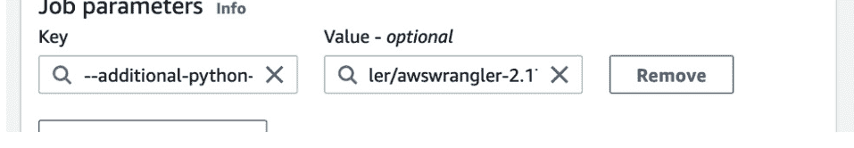

图 3.33：awswrangler Glue Spark 自定义安装 – 将 wheel 文件附加到作业

-   复制并粘贴来自之前的 Spark 程序的代码并执行 Spark 作业。验证输出日志以查看自定义库是否已安装在 Glue Spark 作业中。

```
2022-10-02 11:59:56,721 main INFO Log4j appears to be running in a Servlet environment, but there's no log4j-web module available. If you support better web container support, please add the log4j-web JAR to your web archive or server lib directory.
2.17.0
Pandas on AWS. Updated for custom installation.
This was changed as a part of Learning exercise.
```

图 3.34：awswrangler Glue Spark 自定义安装 – 验证输出

此外，您可以单击错误日志并验证日志内容，显示从 wheel 文件安装 **awswrangler**。

```
INFO 2022-10-02 11:59:54,819 26668 com.amazonaws.services.glue.PythonModuleInstaller [main] Processing ./awswrangler-2.17.1-py3-none-any.whl
Collecting boto3<2.0.0,>=1.24.11 Downloading boto3-1.24.84-py3-none-any.whl (132 kB)
132.5/132.5 kB 4.6 MB/s eta 0:00:00
Collecting progressbar2<5.0.0,>=4.0.0 Downloading progressbar2-4.0.0-py2.py3-none-any.whl (26 kB)
Collecting backoff<3.0.0,>=1.1.1 Downloading backoff-2.1.2-py3-none-any.whl (14 kB)
Requirement already satisfied: pymysql<2.0.0,>=1.0.0 in /home/spark /home/local/lib/python3.7/site-packages (from awswrangler==2.17.1) (1.0.2)
Collecting requests-aws4auth<2.0.0,>=1.1.1 Downloading requests-aws4auth-1.1.1-py2.py3-none-any.whl (1.1.2)
Collecting redshift-connector<2.1.0,>=2.0.889 Downloading redshift_connector-2.0.909-py3-none-any.whl (112 kB)
112.1/112.1 kB 3.0 MB/s eta 0:00:00
Collecting opensearch-py<3,>=1 Downloading opensearch-py-2.0.0-py2.py3-none-any.whl (204 kB)
204.6/204.6 kB 5.7 MB/s eta 0:00:00
Requirement already satisfied: pandas<2.0.0,>=1.2.0 in /home/spark/.local/lib/python3.7/site-packages (from awswrangler==2.17.1) (1.3.2)
Collecting numpy<2.0.0,>=1.21.0
```

图 3.35：awswrangler Glue Spark 自定义安装 – 在错误日志中验证输出

## 在 Amazon SageMaker 笔记本上标准和自定义安装

Amazon SageMaker 笔记本可用于交互式开发 Python 和 PySpark 应用程序的代码。

对于 SageMaker python3 笔记本，**awswrangler** 可以通过运行命令安装，如下所示。用户可以利用 Conda 和 pip 包管理系统在 Notebook 实例中安装外部库（https://docs.aws.amazon.com/SageMaker/latest/dg/nbi-add-external.html）：

```
!pip install awswrangler==<version>
```

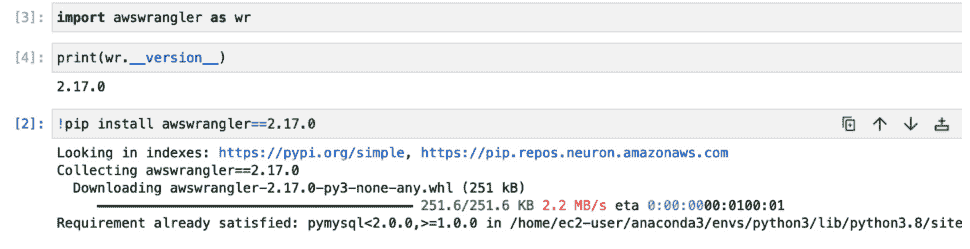

图 3.36：awswrangler SageMaker 标准安装

此外，请注意，安装仅在会话期间持久保存，如果支持 SageMaker 笔记本的 EC2 实例重新启动，您必须再次运行安装步骤。用户可以利用 SageMaker 生命周期策略在实例启动阶段在 SageMaker 上安装所需的库（https://docs.aws.amazon.com/SageMaker/latest/dg/nbi-lifecycle-config-install.html）。当开发通过 SageMaker 实例进行时，我们可以设置 SageMaker 笔记本生命周期策略以在所有兼容内核上安装 `awswrangler`。我们可以将 `pip install` 语句作为生命周期策略的一部分添加，以便在实例创建时 `awswrangler` 可以附加到内核，用户无需担心安装所需的包。

### 自定义安装

要使用自定义 `awswrangler` 包，请上传我们之前为 Lambda 函数生成的 ZIP 文件，并为简单起见将包上传到与脚本相同的目录中。如果自定义库上传到不同路径，我们需要将 `awswrangler` 源代码可用的路径包含到 `sys.path` 中。

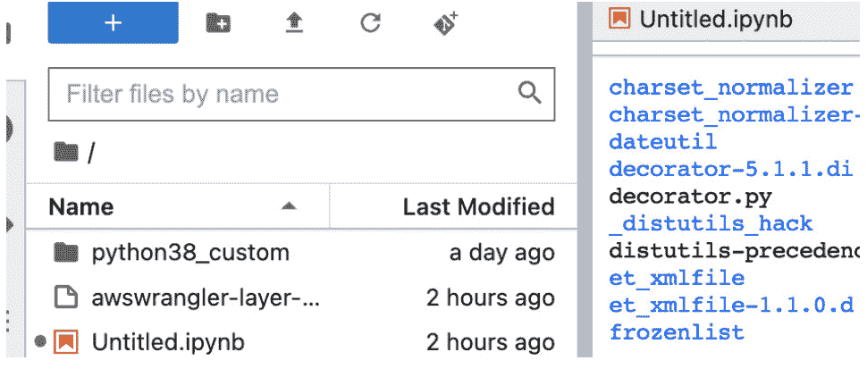

图 3.37：awswrangler SageMaker 自定义安装 – 上传自定义库

从自定义路径导入 `awswrangler`，而不是通过 `pip` 命令安装它，您现在可以验证更改是否可在笔记本中使用。


```python
from platform import python_version
print(python_version())
```

3.8.12

```python
from python38_custom import awswrangler as wr1
```

```python
print(wr1.__version__)
print(wr1.__description__)
print(wr1.__message__)
```

2.17.0
Pandas on AWS。已为自定义安装更新。
这是作为学习练习的一部分而更改的

图 3.38：awswrangler SageMaker 自定义安装 – 检查安装状态

## 使用 EMR 安装 pandas 的 AWS SDK

我们可以通过配置 bootstrap 脚本在新的 EMR 集群上安装 awswrangler。创建一个包含以下命令的 bootstrap 脚本并将其上传到 S3 存储桶中：

```bash
#!/usr/bin/env bash
set -ex
sudo pip3 install pyarrow==2 awswrangler==2.17.0
```

创建一个包含项目所需软件的 EMR 集群，如果您想使用 Jupyter notebook 交互式开发脚本，还可以启用 JupyterHub 和 Livy。我们将启动一个与此集群关联的 Jupyter notebook。您可以通过打印版本号和描述来验证 awswrangler，正如我们之前所做的那样。

```python
import awswrangler as wr
print(wr.__version__)
print(wr.__description__)
```

最后执行于 2022-10-02 21:16:49，耗时 71ms

2.17.0
Pandas on AWS。

图 3.39：awswrangler EMR 安装 – 检查安装状态

您还可以使用 sc.list_packages() 命令来列出 sparkContext 对象中的软件包，从而验证 awswrangler 的安装。

```python
[2]: sc.list_packages()
Last executed at 2022-10-02 21:14:26 in 1.31s
```

```
aenum (3.1.11)
aiohttp (3.8.1)
aiosignal (1.2.0)
asn1crypto (1.5.1)
async-timeout (4.0.2)
asynctest (0.13.0)
attrs (22.1.0)
aws-cfn-bootstrap (2.0)
awswrangler (2.17.0)
backoff (2.1.2)
beautifulsoup4 (4.9.3)
```

图 3.40：awswrangler EMR 安装 – 检查已安装的软件包

您可以在 EMR 集群上上传自定义的 `awswrangler` 软件包并安装以在 EMR 集群中使用。参考 EMR 文档 (https://docs.aws.amazon.com/emr/latest/ReleaseGuide/emr-jupyterhub-install-kernels-libs.html) 安装额外的软件包和内核。

我们花费了大量时间在不同环境中安装 `awswrangler`，以便贵组织中的不同角色能够使用 `awswrangler` 库。此外，我们还展示了如何对 `awswrangler` 进行更改并在所有环境中部署，以更适合贵组织的需求。AWS SDK for pandas 库已提供大量功能，大多数客户可以在其项目中使用官方库，因此我们提供了针对不同角色的使用方法。如果您的项目需要根据需求自定义 `awswrangler` 库，我们也展示了不同的实现方式。现在，我们将探讨如何设置配置选项，使 `awswrangler` 更符合您项目特定需求。

## AWS SDK for pandas 的配置选项

在 `awswrangler` 中配置全局变量的选项可以帮助我们使 `awswrangler` 库更符合我们的特定用例。我们将深入了解如何设置配置来自定义 `awswrangler` 的工作方式。

### 设置全局变量

`awswrangler` 中的全局配置变量可以通过两种不同的机制进行设置：

- **环境变量**：在 `awswrangler` 软件包将被执行的 operating system/kernel 环境中创建环境变量。例如，在 Jupyter notebook 中，使用 `%env` 命令为环境变量设置值。这是在 `awswrangler` 对象实例化时加载的。
- **Wrangler 配置变量**：您也可以直接使用 `wrangler` 对象为环境变量设置值。使用 `awswrangler.config.<<variable name>>` 语法为该配置分配值。

### 配置如何应用？

Python 有一个有趣的特性叫做装饰器，用于为现有代码添加功能。这也称为元编程，因为程序的一部分试图在编译时修改程序的另一部分。装饰器确保在函数被调用之前应用配置，使用 `@decorator_func` 语法在 `awswrangler` 源代码中针对不同服务。

请参考以下截图，其中装饰器函数在 Athena `read_sql_query` 函数之前应用，这将在代码中设置与 Athena 相关的全局变量。`apply_configs` 函数在 `config.py` 脚本中定义，如果需要更深入地了解，可以阅读它。

```python
@apply_configs
def read_sql_query(
    sql: str,
    database: str,
    ctas_approach: bool = True,
    unload_approach: bool = False,
    unload_parameters: Optional[Dict[str, Any]] = None,
    categories: Optional[List[str]] = None,
    chunksize: Optional[Union[int, bool]] = None,
    s3_output: Optional[str] = None,
    workaround: Optional[str] = None,
```

图 3.41：awswrangler – 一个 config.py 代码片段

`awswrangler` 软件包中提供以下类别的变量。然而，用户可以根据特定项目需求向代码添加配置变量：

- **Endpoint URL**：为 `awswrangler` 用于连接 AWS 环境的各种服务提供端点 URL。要以编程方式连接到 AWS 服务，您使用端点，它是 AWS Web 服务的入口点。AWS SDK 和 AWS **命令行界面 (CLI)** 会自动为 AWS 区域中每个服务的默认端点使用，但您可以使用此变量为 API 请求指定替代端点。一个示例是连接到特定区域或使用 FIPS 端点以使用 TLS 连接增强安全性。
- **botocore 配置变量**：这些是 boto 环境的配置参数。有关可以传递给 botocore 配置的参数的更多详细信息，请参阅 boto3 文档。boto3 配置中参数的一些示例包括区域名称、输出格式、连接超时和重试次数。有关可以配置的变量的更多详细信息，请参阅 botocore 文档 (https://botocore.amazonaws.com/v1/documentation/api/latest/reference/config.html)。
- **通用配置变量**：这些是用于影响各种服务行为的通用配置 - 例如，我们可以配置块大小参数以从 S3 读取数据。

## 与 Athena 缓存行为相关的参数

**awswrangler** 可以检索在特定时间段内已执行的 Athena 查询结果。我们可以使用配置变量来配置此行为，以在 *X* 秒或 *X* 个查询内返回预执行的数据，以便用户更快地获取有效数据。以下变量有助于配置 Athena 缓存行为：

- **MAX_CACHE_SECONDS**：**awswrangler** 可以在 Athena 的历史记录中检查此查询是否之前已运行。如果是，并且其完成时间距离当前查询小于 **max_cache_seconds**，**awswrangler** 将跳过查询执行并仅返回上次的相同结果。
- **MAX_CACHE_QUERY_INSPECTIONS**：这是将从历史记录中检查以尝试找到一些可重用结果的最大查询数。它仅在 **max_cache_seconds > 0** 时生效。
- **MAX_REMOTE_CACHE_ENTRIES**：这是将从 AWS 检索用于缓存检查的最大查询数。它仅在 **max_cache_seconds > 0** 时生效，默认值是 **50**。
- **MAX_LOCAL_CACHE_ENTRIES**：这是将本地缓存元数据的最大查询数。这将降低延迟，并使缓存中可用的查询数超过 **max_remote_cache_entries**。此值不应小于 **max_remote_cache_entries**。它仅在 **max_cache_seconds > 0** 时生效，默认值是 **100**。

## 跨不同服务使用的参数

使用 **awswrangler** 软件包与 Amazon S3 交互时使用以下参数。它们将有助于提高读写操作的性能：

- **CONCURRENT_PARTITIONING**：如果为 **True**，这将在写入分区时增加并行度（使用线程）级别。它将减少写入时间并增加内存使用量。
- **S3_BLOCK_SIZE**：此配置用于从 S3 读取文件，要么按指定的块大小读取，要么如果此变量的值设置为 **-1** 则一次性完全读取。

## 配置的常见用例

我们可以配置 **awswrangler**，使相同的设置在多个命令中重复使用，这意味着我们不必每次都输入它们。此外，当我们在多个环境中执行程序时，全局配置可以帮助我们设置默认值，从而根据特定环境自定义 **awswrangler** 执行。


考虑一种情况，我们需要在测试数据库和生产数据库上执行 Athena 查询。测试查询和生产查询之间的区域、账户和缓存因素各不相同。而不是在每次 API 调用中单独配置它们，我们可以使用全局配置一次性自定义它们。

这里的另一个优势是，您可以自定义配置变量以添加自己的变量，并进一步自定义 `awswrangler` 在您项目中的行为。

到目前为止，我们已经学习了多种安装和配置 `awswrangler` 包以满足您特定用例的方法。现在，我们将探讨各种 AWS 服务与 `awswrangler` 的集成，以及如何高效地使用这些服务。

## 使用不同 AWS 服务的 pandas AWS SDK 功能

我们现在将探索 `awswrangler` 包与 AWS 服务的集成。`awswrangler` 可与更多 AWS 服务配合使用，我们已解释了它与一些常用服务（如 Amazon S3、RDS 数据库、Amazon Redshift 和 Amazon Athena）的集成。

## Amazon S3

Amazon 的 **简单存储服务 (S3)** 是用于结构化、半结构化和非结构化数据的最大且性能最强的对象存储服务，也是构建数据湖的首选存储服务。Amazon S3 允许您以无限规模迁移、存储、管理和保护所有结构化和非结构化数据。通过 S3 数据湖，您可以打破数据孤岛、分析多样化的数据集、在一个集中位置管理数据访问并加速机器学习。Amazon S3 在设计上是安全的，按需可扩展，并且能够抵御整个 AWS 可用区故障。您可以使用 AWS 原生服务并与第三方服务提供商集成，在您的数据湖上运行应用程序。

以下是在 `awswrangler` 中与 Amazon S3 配合可用的主要功能：

- **从 S3 读取/下载数据**：我们有函数可从 S3 路径读取 JSON、CSV、Excel、Parquet 和定宽文件格式的数据到 pandas DataFrame 中。这些函数有助于将数据从 S3 位置加载到 DataFrame 中，以便使用 pandas 函数进行处理。它们还提供分区下推、加载在特定时间后修改/加载的对象（用于增量数据加载）、以可配置的块加载大文件数据以及提供数据多种格式化选项（pandas 或 PyArrow 参数）等额外功能。

要将数据从 S3 位置获取到本地路径/本地服务器，用户可以利用下载函数并在本地机器上对数据进行进一步处理。同样，如果用户想要查询 S3 对象中的数据以进行调试并了解用于目录更新的元数据，S3 Select 和 `read_parquet_metadata` 函数都会有所帮助。

- **向 S3 写入/上传数据：** 使用 `awswrangler` 库，可以将数据以 JSON、CSV、Parquet 和 Excel 等各种文件格式写入 S3。用户可以选择以各种格式在 S3 中存储数据集。这些函数还提供创建分区并更新 Glue 目录的选项，以便可以通过 Athena 和 Redshift Spectrum 查询数据。数据可以以多种模式保存，例如追加（添加新文件）、覆盖（替换目标路径下的所有文件）和覆盖分区（仅覆盖该分区中的文件）。用户可以配置 S3 函数以支持模式演进（允许缺失或新增列）并允许 Athena 的分区投影。

如果您想从本地/本地位置将数据导出到 S3，可以利用 `upload` 函数。`download` 和 `upload` 函数使用文件系统函数读取和写入数据，并使用多线程逻辑提高效率。

## Parquet 文件处理有何不同？

读取和写入其他文件格式时，`awswrangler` 使用 pandas 函数读取和写入文件。然而，对于 Parquet 文件的加载/写入，`awswrangler` 将利用 Arrow 库以实现更快的 数据加载并在内存中映射它们。请阅读介绍部分中有关使用 Arrow 库的好处以获取更多详细信息。

## 使用 awswrangler 的 Amazon S3 实用示例

让我们使用一些实际示例来进一步了解 `awswrangler` 读取/写入 S3 的概念。

我们将从最近的天气数据集中加载 CSV 数据并将其存储为 JSON 和 Parquet 格式。然后，我们将以每种格式加载数据并验证每种格式的加载时间：

- 1. 在笔记本中安装 `memory_profiler` 库以跟踪内存使用情况，以及加载和卸载数据所需的时间：

```
1]: pip install memory_profiler
Looking in indexes: https://pypi.org/simple, https://pip.repos.neuron.amazonaws.com
Collecting memory_profiler
  Downloading memory_profiler-0.60.0.tar.gz (38 kB)
Preparing metadata (setup.py) ... done
Requirement already satisfied: psutil in /home/ec2-user/anaconda3/envs/amazonei_pytorch_latest_p37/lib/python3
```

图 3.42：S3 集成 – 安装内存分析器

- 2. 我们将加载约 4 GB 数据到 pandas DataFrame 中，顺便说一下，这是一个用于执行数据加载基准测试的大型数据集。

```
(base) ssm sun038f9d355c9cf aws-data-wrangler % aws s3 ls s3://noaa-ghcn-pds/csv/by_year/202 --human-readable --summarize
2022-10-05 13:59:29  1.5 GiB 2020.csv
2022-10-05 13:57:46  1.5 GiB 2021.csv
2022-10-05 13:57:37  1.1 GiB 2022.csv

Total Objects: 3
Total Size: 4.1 GiB
```

图 3.43：S3 集成 – CSV 文件列表以了解文件大小

以下屏幕截图显示了来自 Parquet 文件（Snappy 压缩）的类似数据量的存储大小，明显更小。这展示了以 Parquet 格式存储数据集的价值，因为它能高效存储数据集，并在运行分析查询时性能非常高。

```
2ebfc_0.snappy.parquet
2022-10-05 13:57:36   4.6 KiB parquet/by_year/YEAR=2022/ELEMENT=WT10/aba894e511414a32b2b4fed17f2
2ebfc_0.snappy.parquet
2022-10-05 13:57:36   15.0 KiB parquet/by_year/YEAR=2022/ELEMENT=WT11/aba894e511414a32b2b4fed17f2
2ebfc_0.snappy.parquet

Total Objects: 383
  Total Size: 286.6 MiB
```

图 3.44：S3 集成 – Parquet 文件列表以了解文件大小

- 3. 验证以 CSV 和 Parquet 文件格式加载数据所需的时间。

Parquet 文件加载指标如下所示：

```
%time
%memit
#Load compressed parquet file of size 286MB
weather_data=wr.s3.read_parquet("s3://noaa-ghcn-pds/parquet/by_year/YEAR=202")
```

峰值内存：26221.25 MiB，增量：26067.42 MiB
CPU 时间：用户 2分19秒，系统：28.6 秒，总计：2分48秒
墙钟时间：2分26秒

weather_data.info()

<class 'pandas.core.frame.DataFrame'>
RangeIndex: 98619752 entries, 0 to 98619751
Data columns (total 7 columns):
  #   Column      Dtype
---  ---------   -----
 0   ID          string
 1   DATE        string
 2   DATA_VALUE  Int64
 3   M_FLAG      string
 4   Q_FLAG      string
 5   S_FLAG      string
 6   OBS_TIME    string
dtypes: Int64(1), string(6)
memory usage: 5.2 GB
```

图 3.45：S3 集成 – Parquet 文件加载指标

前述 Parquet 文件的指标取自 t3.xlarge 实例。类似的实例无法将 CSV 文件加载到内存中，抛出错误并卡住。由于加载 CSV 文件是内存密集型操作，我们将笔记本实例从 t3.xlarge 更改为 r5.2xlarge。更改后，CSV 文件能够加载得更快，如以下屏幕截图所示。

```
%time
%memit
#Load CSV file with 4.1GB of data
weather_data=wr.s3.read_csv("s3://noaa-ghcn-pds/csv/by_year/202")
```

峰值内存：28901.76 MiB，增量：28747.74 MiB
CPU 时间：用户 1分15秒，系统：32.1 秒，总计：1分47秒
墙钟时间：1分13秒

```
weather_data.info()
```

<class 'pandas.core.frame.DataFrame'>
RangeIndex: 98707563 entries, 0 to 98707562
Data columns (total 9 columns):
#  Column      Dtype
---  ------      -----
0  Unnamed: 0  int64
1  ID          object
2  DATE        int64
3  ELEMENT     object
4  DATA_VALUE  int64
5  M_FLAG      object
6  Q_FLAG      object
7  S_FLAG      object
8  OBS_TIME    float64
dtypes: float64(1), int64(3), object(5)
memory usage: 6.6+ GB

图 3.46：S3 集成 – CSV 文件加载指标

这本质上展示了为特定用例使用合适的计算容量以获得更好性能的优势。

前述练习还展示了以不同格式读取数据的便捷性，并突出了将数据以 Parquet 文件格式存储用于分析用例的好处。

## 其他 awswrangler S3 函数

以下是 `awswrangler` 可以执行的一些附加功能：

- **复制对象：** 我们使用 boto3 中的 `s3.copy` 函数一次复制一个对象。通常，用户会迭代函数以复制多个对象。`awswrangler` 使从一个 S3 前缀/文件夹轻松复制多个文件到另一个 S3 位置变得简单。`copy` 函数将源文件附加到新位置。合并对象函数可以根据配置参数覆盖目标位置中的文件或将文件附加到目标位置。
- **列出对象：** 此函数接受后缀和前缀参数以从 `s3` 路径过滤文件。它采用通配符字符格式进行文件列表。这是通过文件名匹配库实现的（https://docs.python.org/3/library/fnmatch.html）。在列出文件后，它还可以按时间戳过滤文件，这在从路径列出文件以进行增量数据处理时非常有利。

以下屏幕截图显示了从 S3 位置创建的在特定时间戳之后的文件列表。您可以看到该位置已有 CSV 文件，但当我们限制列表仅显示最近一分钟内更改/上传的文件时，列出对象不会列出任何文件。


```
#This filter is done after listing of files from S3 path
path="s3://athenaresults-sankar/awswrangler/data/"
wr.s3.list_objects(path)
```

['s3://athenaresults-sankar/awswrangler/data/9f41c2b191014610a9bf2791635f23a6.csv']

```
#List files created in the last 1 minute
from datetime import datetime,timezone,timedelta
wr.s3.list_objects(path,last_modified_begin=datetime.now(timezone.utc)- timedelta(minutes = 1))
```

[]

图 3.47：S3 集成 – 仅列出增量文件

在同一位置创建 CSV 文件并列出最近一分钟内创建的对象。现在，您可以看到新文件已列在 S3 路径中，而旧文件未列出。这可以帮助您识别在特定时间段后创建的新文件。

```
import pandas as pd
df = pd.DataFrame({
  "id": [1, 2],
  "value": ["ABC", "DEF"]})
wr.s3.to_csv(df=df,path=path,index=False,dataset=True,mode="overwrite")
```

{'paths': ['s3://athenaresults-sankar/awswrangler/data/c8d458b1139347f880387223f96b48e4.csv'], 'partitions_values': {}}

```
wr.s3.list_objects(path,last_modified_begin=datetime.now(timezone.utc)- timedelta(minutes = 1))
```

['s3://athenaresults-sankar/awswrangler/data/c8d458b1139347f880387223f96b48e4.csv']

图 3.48：S3 集成 – 仅列出增量文件（续）

## 挑战练习

您可以在自定义代码中使用此函数来创建增量数据处理逻辑。每次执行读取函数时，只有在上次成功运行后创建的新文件才会被处理。

## 提示

您可以使用 DynamoDB 在 ETL 作业成功完成后作为作业的最后一步存储时间戳。作业的下一次执行应为每次新执行检索最新的时间戳，并且它只应列出上次成功完成的作业运行的时间戳与当前作业运行开始时间戳之间的文件。作为作业初始化步骤（或在读取文件之前）添加锁定机制，以避免两个作业并行运行同时读取数据。DynamoDB 表应使用作业标识符和 S3 路径的组合作为主键和排序键存储状态信息，并为每个作业和 S3 路径组合存储开始时间戳和停止时间戳信息。

- **描述对象：** 用户可以为单个文件或前缀执行 boto3 `head_object` 命令（这可以通过并行线程完成以提高性能）。使用此函数的优点是它不会下载对象；相反，它只获取 S3 对象的元数据。

## 用法

*您可以使用带过滤器（时间或作业标识符前缀）的描述对象命令来识别新文件列表及其大小。这可以帮助您在作业完成后确定优化输出文件大小的范围。*

- **删除对象：** 使用此函数，我们可以使用线程并发删除大量文件，类似于其他对象。它还会捕获错误并尝试多次（五次尝试）删除文件，以避免间歇性错误。

## 警告

*权力越大，责任越大。请谨慎使用此函数，并将其与 S3 版本控制和其他功能结合使用，以避免在生产环境中意外删除。*

- **等待对象：** 等待函数每五秒调用一次，直到达到成功状态（例如 S3 对象的可用性）。在 20 次失败检查后返回错误。我们可以使用等待配置来提及在抛出错误之前等待时间和最大重试次数。使用 `awswrangler` 的优点是可以对多个等待对象进行并发执行。此用例之一是在开始作业执行之前等待触发文件在路径中可用。

- **使用 S3 Select 查询进行数据检索：** 用户可以利用 S3 Select 功能读取特定的 S3 文件并在单个 S3 对象内对数据应用过滤器。此方法目前支持 CSV、JSON、Parquet 以及具有自定义分隔符的一些文件。这种方法的优点是它使您的应用程序能够仅检索用于处理所需的数据子集。通过这种方法，我们将数据过滤部分推送到 S3，这对于某些工作负载来说要快得多（快达 400%；在某些情况下可能更慢）且便宜得多（便宜达 80%）。考虑一个包含一百万条记录的巨大压缩 ZIP 文件的示例，应用程序需要根据过滤条件处理其中仅 100 条记录。使用传统方法，整个文件将下载到客户端，然后过滤以获取数据，但使用 S3 Select，我们可以解压缩数据、过滤它，然后将其下载到客户端。

S3 Select 在存储在 CSV、JSON 或 Apache Parquet 格式的对象上工作。S3 Select 还支持使用 GZIP 或 BZIP2 压缩 CSV 和 JSON 对象，以及服务器端加密对象。S3 Select 只能针对单个文件执行，而不能针对多个文件运行（对于这种情况，AWS 服务如 Athena 和 Redshift 会提供帮助）。

在 AWS 控制台中使用时，S3 Select 仅支持 40 MB 的数据。一个用例是在开始自定义处理之前快速探索文件中的错误。我们可以使用 S3 Select 查询在开始 ETL 过程之前识别列中具有空值的记录。

以下屏幕截图显示了在 CSV 文件上使用 S3 Select 的示例：

```
%time
%memit
weather_data=wr.s3.select_query(
    sql='SELECT * FROM s3object s where s.DATA_VALUE<>"\0"',
    path='s3://noaa-ghcn-pds/csv/by_year/2022.csv',
    input_serialization = 'CSV',
    input_serialization_params={
        'FileHeaderInfo': 'Use'
    },
    use_threads=True,
)
```

peak memory: 39506.35 MiB, increment: 19722.42 MiB
CPU times: user 4min 17s, sys: 55.2 s, total: 5min 12s
Wall time: 4min 7s

```
weather_data.head(5)
```

|   | ID | DATE | ELEMENT | DATA_VALUE | M_FLAG | Q_FLAG | S_FLAG | OBS_TIME |
|---|----|------|---------|------------|--------|--------|--------|----------|
| 0 | 0 | AE000041196 | 20220101 | TAVG | 204 | H |  | S |
| 1 | 1 | AEM0004194 | 20220101 | TAVG | 211 | H |  | S |

图 3.49：S3 集成 – S3 Select 查询

查询需要四分钟才能返回结果，该查询读取 CSV 格式的 1 GB 数据，因为数据以未压缩格式存储并且需要读取所有数据，但系统之间传输的数据更少。在低带宽网络中传输大量数据时，好处会更加明显。此外，请注意，此测试是在高内存和高带宽机器上进行的，该机器可以更快地加载整个文件并在内存中快速过滤数据。因此，如果您唯一的需求是更好的性能，您还需要在使用 S3 Select 或在将整个对象读入计算层后过滤数据之前考虑数据存储格式以及机器可用的计算和内存资源。

- 在 S3 数据湖上合并数据集：merge upsert table 函数将帮助对现有文件执行 upsert 操作。此函数采用主键并执行 upsert 操作。底层逻辑是从现有表中删除具有与要加载到表中的新记录的 DataFrame 相同主键的记录。这将创建一个最终表，其中插入新记录，并且现有记录将使用最新值进行更新。

## 注意

这不是大型表的有效解决方案，因为将整个表加载到内存中不是一种高效的操作。如果您处理的是海量数据量并且使用 Apache Spark 处理数据，用户应考虑使用 Hudi、Iceberg、Delta 或 Lake Formation 受管表等事务性数据湖格式。

## Amazon Athena

awswrangler 与 Amazon Athena 具有良好的集成。它有助于将 Athena 查询的结果加载到 pandas DataFrame 中以进行进一步的数据整理活动，以便确保 awswrangler 利用

以下逻辑用于评估查询是否需要执行，或以更快的速度从之前的执行中检索结果。

以下截图展示了使用 `awswrangler` 创建 Glue 表并使用它查询表的一些简单步骤。我们可以在程序执行期间一次性设置配置变量，查询即可快速执行，无需大量参数和额外编码。

```
speed_test=wr.s3.read_parquet("s3://ookla-open-data/parquet/performance/type=mobile/year=2021/quarter=4/")
```

```
speed_test.dtypes
```

```
quadkey      string
tile         string
avg_d_kbps   Int64
avg_u_kbps   Int64
avg_lat_ms   Int64
tests        Int64
devices      Int64
dtype: object
```

```
wr.catalog.create_parquet_table(
    database='default',
    table='speed_test',
    path='s3://ookla-open-data/parquet/performance/',
    partitions_types={'type': 'string','year': 'string','quarter': 'string'},
    columns_types={'quad_key':'string','tile':'string','avg_d_kbps':'bigint','avg_u_kbps':'bigint','avg_lat_ms':'bigint'},
    description='Speed test table'
)
```

```
%time
wr.athena.read_sql_query("SELECT * from speed_test limit 1")
```

CPU 时间：用户 261 ms，系统：12.2 ms，总计：274 ms
墙钟时间：553 ms

| quad_key | tile | avg_d_kbps | avg_u_kbps | avg_lat_ms | tests | devices | type | year | quarter |
|---|---|---|---|---|---|---|---|---|---|
| 0 <NA> POLYGON((-160.043334960938 70.6363054807905, ... |  | 908 | 4915 | 72 | 5 | 1 | mobile | 2019 | 2 |

图 3.50：Athena 集成 – 在 AWS Glue 目录中创建表

以下是从 `awswrangler` 查询/表 API 调用中获取数据的步骤：

- 1. 当您在内部提交读取 SQL 表 API 调用时，表名会附加选择语句并通过读取 SQL 查询 API 调用执行。
- 2. 配置查询提交的工作方式有很多参数。我们可以使用 `params` 参数来格式化查询。
- 3. 评估查询是否在本地缓存中可用（该缓存会在每次新的查询执行时更新，默认存储 100 个查询）。此步骤还会根据配置参数查找远程缓存（Athena 服务查询历史记录）中的查询，包括过去 X 个查询或过去 X 秒。
- 4. 如果缓存步骤未命中，则查询将由 `awswrangler` 以创建表为语句（CTAS）、UNLOAD 或常规模式之一提交执行：
  - **CTAS 模式**：这是默认模式，它涉及将查询包装在 `create table as` 语句中，数据以 Parquet 格式存储在 S3 位置。此方法还会在作为输入参数提供的 CTAS 数据库中创建包含查询输出的表。然后使用 `awswrangler` S3 读取 parquet 文件 API 将 Parquet 文件加载到 DataFrame 中。此外，临时表将在查询执行结束时删除，以避免因每个查询而产生的表混乱。使用此方法处理性能必要且需要创建和删除临时 CTAS 表权限的大型数据集。
  - **卸载模式：** 此模式涉及将查询数据卸载到 S3 位置的 Parquet 文件中。之后，类似于 CTAS，我们将使用 `awswrangler` S3 读取 parquet 文件 API 将数据集加载到 pandas DataFrame 中。使用此方法处理大型数据集以及以 Parquet 格式导出到 S3 的数据。请注意，此方法在加载到 DataFrame 之前不会创建 Glue 表。
  - **常规模式：** 此模式使用 Athena 输出位置，其中结果以 CSV 文件格式保存。此方法简单，无需任何额外配置即可执行查询。使用此方法处理较小的数据集，因为它们以 CSV 文件格式存储在 S3 中。文件默认由 Athena 存储，因此不需要任何额外的存储或配置要求。

下图总结了 `awswrangler` Athena 查询执行流程：

## ATHENA 在 AWSWRANGLER 中的高层查询执行流程

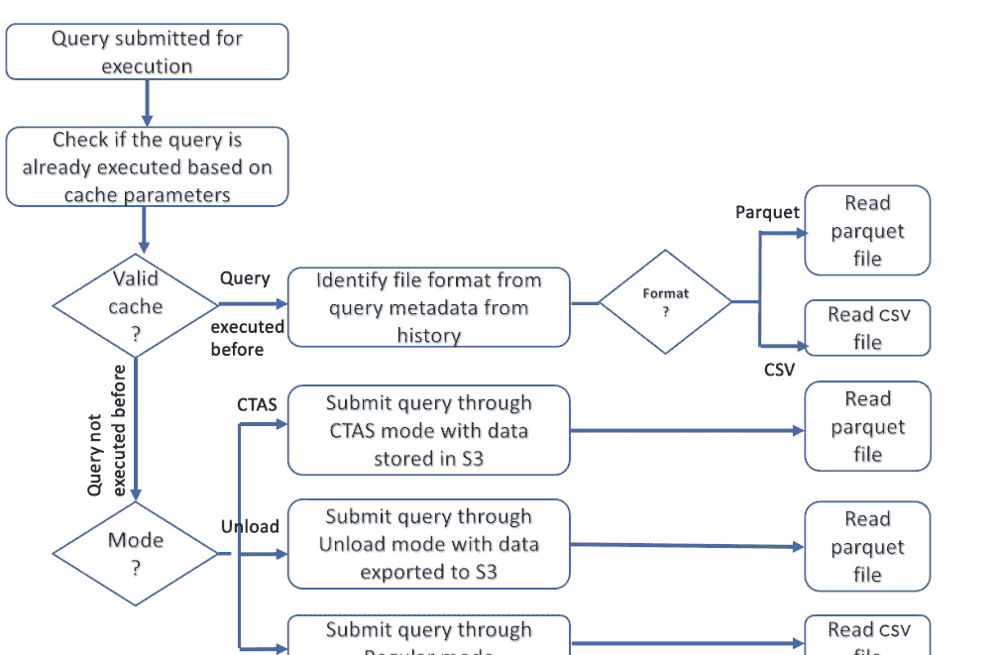

图 3.51：Athena 集成 – 查询执行工作流

## 如何利用查询元数据提升性能

pandas DataFrame 还有一个 `query_metadata` 字典，它类似于 Athena 的 `GetQueryExecution` 命令的输出，该命令检索每个查询的元数据。在以下截图中，您可以看到诸如查询开始和结束时间、结果存储位置、文件格式等信息。

```
result_type
: results.query_metadata
: {'QueryExecutionId': 'a551b95f-c7e6-4423-b3ef-a2994f05e7f6',
'Query': 'CREATE TABLE "default"."temp_table_1712a308609b46218042dcbb4286ab3d"\nWITH(\n    external_location = \'s3://aws-athena-query-results-473373155991-us-east-2/temp_table_1712a308609b46218042dcbb4286ab3d\',\n    format = \'PARQUET\')\nAS SELECT date,time,bytes,method,uri,result_type from cloudfront_logs limit 1',
'StatementType': 'DDL',
'ResultConfiguration': {'OutputLocation': 's3://aws-athena-query-results-473373155991-us-east-2/tables/a551b95f-c7e6-4423-b3ef-a2994f05e7f6'},
'QueryExecutionContext': {'Database': 'default'},
'Status': {'State': 'SUCCEEDED'},
'SubmissionDateTime': datetime.datetime(2022, 10, 4, 1, 29, 33, 922000, tzinfo=tzlocal()),
'CompletionDateTime': datetime.datetime(2022, 10, 4, 1, 29, 35, 338000, tzinfo=tzlocal()),
'Statistics': {'EngineExecutionTimeInMillis': 1289,
'DataScannedInBytes': 1495,
'DataManifestLocation': 's3://...-manifest.csv',
'TotalExecutionTimeInMillis': 1416,
'QueryQueueTimeInMillis': 106,
'QueryPlanningTimeInMillis': 156,
'ServiceProcessingTimeInMillis': 21},
'WorkGroup': 'primary',
'EngineVersion': {'SelectedEngineVersion': 'AUTO'},
'EffectiveEngineVersion': 'Athena engine version 2'}
```

图 3.52：Athena 集成 – 从 Athena 获取查询元数据

然而，我们在“Statistics”部分下还有一堆重要的属性。它们提供有关查询等待时间、规划时间、执行时间以及扫描的数据量的信息。请注意，Athena 查询是根据扫描的数据量收费的：

```
TotalExecutionTime = EngineExecutionTime(includes QueryPlanningTime) + QueryQueueTime + ServiceProcessingTime
```

以下是前述案例的一个示例 – 1,416 ms = 1,289 ms + 106 ms + 21 ms。

EngineExecution 时间为 1,289 ms，其中 Queryplanningtime 为 156 ms。因此，查询在 Athena 引擎中的实际执行时间为 1,133ms。

让我们了解前述查询中使用的术语：

- - **总执行时间**：Athena 运行 DDL 或 DML 查询所花费的毫秒数。
- - **引擎执行时间**：Athena 引擎运行查询所花费的毫秒数。查询越复杂，数据量越大，此阶段花费的时间越长。
- - **查询规划时间**：Athena 规划查询处理流程所花费的毫秒数。
- - **查询队列时间**：查询在查询队列中等待资源所花费的毫秒数。这是一个可变时间，取决于特定区域和时间点的资源可用性。
- - **服务处理时间**：查询引擎运行完查询后，Athena 处理查询结果所花费的毫秒数。如果查询在此阶段花费太多时间，我们会将大型数据集写入 S3 并尝试减少结果集的大小。

您可以使用这些指标查看每个查询花费的时间然后进行优化。但是请注意，这些指标不包括 Athena 查询引擎之外的任何网络延迟和延迟。

## Athena 缓存是如何工作的？

我们可以通过将 `MAX_CACHE_SECONDS` 变量设置为大于零来启用缓存逻辑。这将有助于减少查询执行时间（如果过去的执行结果仍然可用，则完全跳过执行并重用过去的执行结果）。

执行缓存验证时评估以下步骤：

- 1. 检查 `MAX_CACHE_SECONDS` 变量是否大于零；如果设置为零或更小，则立即返回，查询每次调用时都会执行。这对于数据更新更频繁且需要最近数据而不是较低查询执行时间的使用案例是必要的。
- 2. 使用分页从 Athena 历史日志中根据 `MAX_REMOTE_CACHE_ENTRIES` 检索查询。检查查询详细信息是否在本地缓存中可用；如果不可用，则将查询详细信息附加到本地缓存对象。本地缓存存储最近 100 个查询的数据，以便比远程缓存更快地检索数据。在此 `awswrangler` Athena 上下文中，缓存可以理解为查询元数据详细信息的存储，例如查询执行 ID 和查询完成时间。
- 3. 根据查询完成时间的经过秒数不大于 `MAX_CACHE_SECONDS` 的条件，对本地缓存和远程缓存中的查询列表进行排序。
- 4. 解析查询，以便可以与旧查询成功匹配。目前，查询被剥离空白和尾随分号，并删除前导和尾随括号，以便可以合理地匹配查询。
- 5. 如果旧查询是 CTAS（使用 `awswrangler` CTAS 模式执行），则在与新查询进行比较之前解析并获取内部查询。比较两个查询，如果匹配，则将缓存匹配返回为成功。

例如，让我们执行一个简单的查询，从示例表中提取数据，该表在 CloudFront 日志上抓取并存储在 S3 存储桶中。您可以使用任何表来演示此 Athena 缓存功能。

```
%time
wr.athena.read_sql_query("SELECT date,time,bytes,method,uri,referrer,result_type from cloudfront_logs limit 1")
CPU times: user 298 ms, sys: 12.7 ms, total: 311 ms
Wall time: 3.42 s

date    time    bytes method uri referrer result_type
0   2022-02-18 16:12:03 481 GET / - Error
```

```
%time
wr.athena.read_sql_query("SELECT date,time,bytes,method,uri,referrer,result_type from cloudfront_logs limit 1;")
CPU times: user 87.3 ms, sys: 2.99 ms, total: 90.2 ms
Wall time: 333 ms

date    time    bytes method uri referrer result_type
0   2022-02-18 16:12:03 481 GET / - Error
```

图 3.53：Athena 集成 – Athena 缓存功能


你可以看到第一次运行查询花费了 3.42 秒，而第二次查询在 ~300 ms 内运行。这相当于与初始运行相比减少了 11 倍的时间。然而，基于初始查询的复杂性，我们只需重用现有结果而不再次执行它即可节省大量时间。另外，请注意查询在表名之前有一些额外的空格以及尾部的分号，在比较查询之前会被移除。

然而，正如前面提到的，只有在执行类似查询时才会实现这些好处。请参考以下示例，其中我们仅从查询中选择了部分列。我们发现 referrer 列在我们特定的数据集中没有任何数据，并且我们希望将其从结果集中移除。如你所见，不带 referrer 列的查询需要 2.63 秒来检索数据。

```
%%time
wr.athena.read_sql_query("SELECT date,time,bytes,method,uri,referrer,result_type from cloudfront_logs limit 1")
```

CPU times: user 83.9 ms, sys: 0 ns, total: 83.9 ms
Wall time: 298 ms

| 日期 | 时间 | 字节 | 方法 | uri | 引用者 | 结果类型 |
|---|---|---|---|---|---|---|
| 0 | 2022-02-18 | 16:12:03 | 481 | GET | / | - | Error |

```
%%time
wr.athena.read_sql_query("SELECT date,time,bytes,method,uri,result_type from cloudfront_logs limit 1")
```

CPU times: user 263 ms, sys: 2.45 ms, total: 265 ms
Wall time: 2.63 s

| 日期 | 时间 | 字节 | 方法 | uri | 结果类型 |
|---|---|---|---|---|---|
| 0 | 2022-02-18 | 16:12:03 | 481 | GET | / | Error |

图 3.54：Athena 集成 – SQL 更改时 Athena 缓存功能限制

## 挑战

你可以扩展查询架构以匹配之前具有更宽数据集的查询，然后应用过滤器以获得更小的数据集。扩展以下列表中列出的高级流程。

- 1. 识别旧查询，并在比较之前将查询中的 where 子句和 from 子句拆分。
- 2. 以类似格式解析新查询并将其与旧查询进行比较。如果新查询的过滤器比旧查询多和/或列比旧查询少，我们可以使用旧查询的数据并在 pandas DataFrame 中应用过滤器并返回结果，例如以下内容：

```
Query 1: select * from hr. employee where city='NY'
Query 2: select * from hr. employee where city='NY' and join_date>'2020-10-01'
```

在这里，我们可以看到 Query 2 是 Query 1 的子集，我们可以使用已执行的数据并在 pandas DataFrame 的列上应用进一步的过滤器。

此外，改进查询匹配逻辑以提高缓存命中率有着巨大的改进空间，你所做的更新可以贡献回 AWS SDK for pandas 仓库。祝编程愉快！！！

此外，它提供了许多有用的模块，其中一些列在这里：

- **修复表**：这会运行 `MSCK REPAIR` 命令，以使用存储层中的最新数据更新表元数据。此函数执行 Hive 的元存储一致性检查 – `MSCK REPAIR TABLE <tablename>`。该命令恢复分区和与分区相关的数据，并更新表定义。这是为了查询在这些分区下可用数据而需要的。当从不更新 Glue 目录的 ETL 作业创建新分区时，这很有用。
- **等待查询**：这会每 250 ms 迭代查询状态，直到查询移动到 FAILED、SUCCEEDED 或 CANCELLED 状态之一（查询执行的最终状态）。如果你想使用更短或更长的轮询机制来验证查询执行状态，你必须自定义你的代码。

`awswrangler` 包在内部处理数据类型转换。结果文件夹中的 Parquet 文件使用 S3 读取函数读取（它反过来使用 `pyarrow` 读取 S3 对象）。Parquet 文件的数据类型转换 – arrow – `athena` 在 `awswrangler` 包内部处理。以下来自 `data_types.py` 模块的片段显示了 `pyarrow` 和 `athena` 数据类型的转换。

```
def pyarrow2athena(  # pylint: disable=too-many-branches,too-many-return-statements
    dtype: pa.DataType, ignore_null: bool = False
) -> str:
    """Pyarrow to Athena data types conversion."""
    if pa.types.is_int8(dtype):
        return "tinyint"
    if pa.types.is_int16(dtype) or pa.types.is_uint8(dtype):
        return "smallint"
    if pa.types.is_int32(dtype) or pa.types.is_uint16(dtype):
        return "int"
    if pa.types.is_int64(dtype) or pa.types.is_uint32(dtype):
        return "bigint"
    if pa.types.is_uint64(dtype):
        raise exceptions.UnsupportedType("There is no support for uint64, please consider
    if pa.types.is_float32(dtype):
        return "float"
    if pa.types.is_float64(dtype):
```

图 3.55：Athena 集成 – pyarrow 数据类型转换

## RDS 数据库

`awswrangler` 中有相当多的集成功能可用于连接关系数据库，例如 Postgres、Oracle、SQL Server 和 MySQL。除此之外，`awswrangler` 还支持基于 DataAPI 访问 Redshift 和 Aurora Serverless 数据库。

`awswrangler` 使用额外的库来连接数据库，这些库也需要安装。以下图表显示了连接不同数据库引擎所需的额外库。

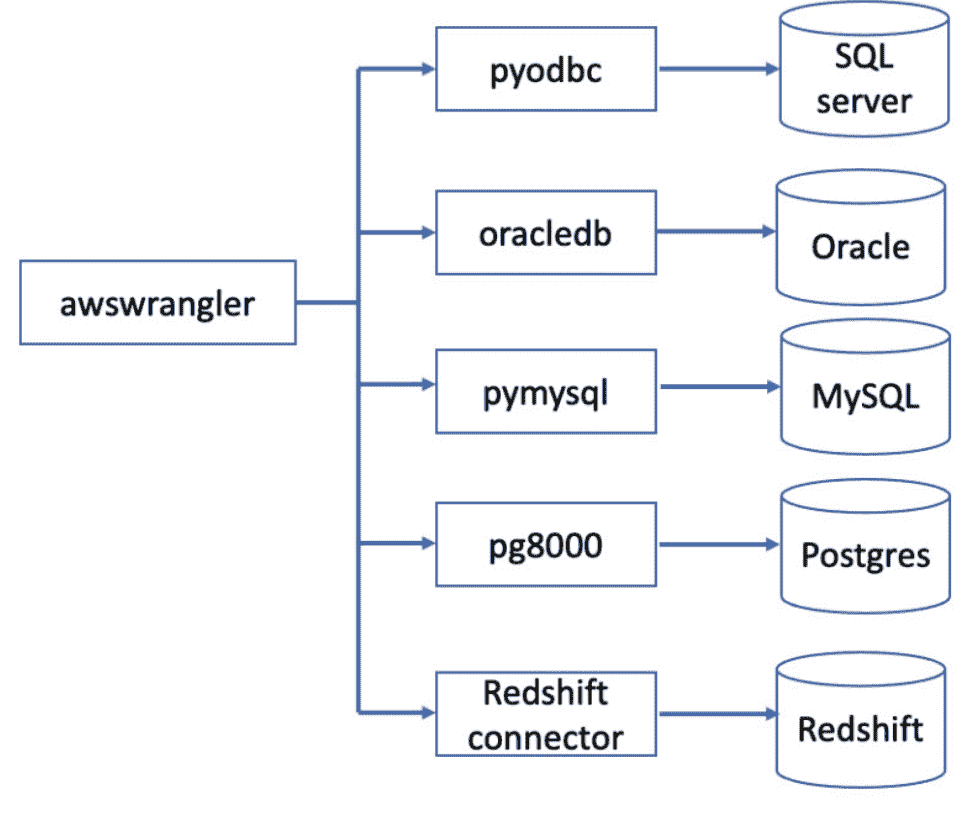

图 3.56：RDS 集成 – 数据库引擎和推荐驱动程序

我们必须确保在尝试连接到这些数据库引擎时已安装额外的 Python 库。要连接 Redshift 和 Aurora Serverless 以及 IAM 身份验证，我们可以使用 DataAPI，这也有助于更有效地管理数据库连接。

以下通用模块/功能适用于所有数据库引擎：

- **连接到数据库：** 这会检查数据库引擎是否可用额外的 Python 库，并在用于数据库连接的 Python 库缺失时提供错误。connect 模块需要现有的 Glue 连接或 secret 标识符来提供数据库登录详细信息。例如，secret 应具有以下字段以进行数据库连接：

```
{ "host":"hostname.region.rds.amazonaws.com", "username":"testuser", "password":"testpassword", "engine":"mysql", "port":"3306"}
```

awswrangler 将在内部从 secrets manager 或 Glue 连接格式化连接字符串并使用它来创建连接对象（MySQL 的情况下为 pymysql，sqlserver 的情况下为 pyodbc 等）并返回给调用代码。此连接对象可从那时起用于读取和写入数据库。

- **从数据库读取**：从数据库引擎读取有几个选项 – 从 SQL 读取和从表读取。
从表读取将创建表的 select 查询并再次调用从 SQL 读取模块。

查询通过作为参数传递给从 SQL 读取模块的连接对象进行格式化和提交。代码将使用连接对象的游标执行查询。

一旦从执行中检索到数据，它将被加载到 pyarrow 数组中，以便更快地从游标执行中的记录对象加载数据。然后我们可以快速将其转换为 pandas DataFrame 并返回给调用函数以进一步处理数据。

以下屏幕截图显示了使用 awswrangler 从 S3 加载 Ookla 速度测试数据（410 万条记录）的快速示例，笔记本和数据库的实例大小最低为三分钟。此练习的目的是展示使用 awswrangler 可以轻松加载和查询数据。

```
import awswrangler as wr
import pandas as pd
```

```
dbcon= wr.postgresql.connect("Postgres-wrangler")
```

```
#load S3 data
speed_test=wr.s3.read_parquet("s3://ookla-open-data/parquet/performance/type=mobile/year=2021/quarter=4/")
```

```
len(speed_test)

4120347
```

```
%time
wr.postgresql.to_sql(speed_test, dbcon, schema="public", table="speed_test", mode="overwrite")

CPU times: user 2min 3s, sys: 2.64 s, total: 2min 5s
Wall time: 3min 7s
```

```
%time
df_result=wr.postgresql.read_sql_query("SELECT * FROM public.speed_test limit 10", con=dbcon)

CPU times: user 0 ns, sys: 4.43 ms, total: 4.43 ms
Wall time: 5.48 ms
```

df_result
| quadkey | tile | avg_d_kbps | avg_u_kbps | avg_lat_ms | tests | devices |
|---|---|---|---|---|---|---|
| 0 0022133222330013 POLYGON((-160.032348632812 70.6399478155463, ...)) | 85 | 103 | 72 | 1 | 1 |
| 1 0022133222330201 POLYGON((-160.043334960938 70.6344840663086, ...)) | 14947 | 20624 | 70 | 1 | 1 |
| 2 0022302331031201 POLYGON((-166.1517333989438 68.8714387233513, ...)) | 13099 | 1281 | 91 | 2 | 1 |

图 3.57：RDS 集成 – 从 RDS 加载示例数据


你还可以看到，数据类型是基于 Arrow 和 pandas DataFrame 发生变化的。

Postgres 实例中的数据类型如下：

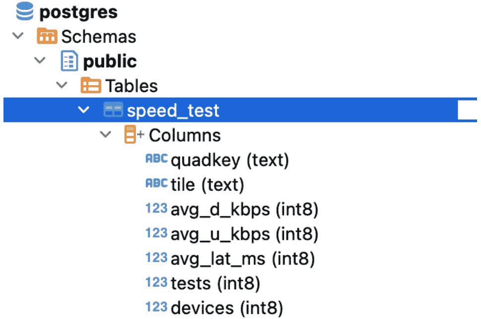

图 3.58 (a)：从 RDS Postgres 加载到 pandas DataFrame 时的数据类型转换

pandas DataFrame 中的数据类型如下：

# df_result.dtypes

```
quadkey      string
tile         string
avg_d_kbps   Int64
avg_u_kbps   Int64
avg_lat_ms   Int64
tests        Int64
devices      Int64
dtype: object
```

图 3.58 (b)：从 RDS Postgres 加载到 pandas DataFrame 时的数据类型转换

- **写入数据库**：我们可以使用每个数据库引擎模块中的 `to_sql` 函数将 pandas DataFrame 写入表。这会验证连接对象，然后在不存在时创建表（如果模式设置为覆盖，则会删除并重新创建表）。根据不同的模式，数据更新方式不同：
  - **Upsert**：这会在与匹配列列表匹配时更新特定的一组列（主要用于识别唯一记录）。这适用于存在现有表且 Column1、Column2 和 Column3 作为主键列的情况。当我们执行 upsert 时，我们会检查新记录是否与现有记录在 Column1、Column2 和 Column3 上匹配，如果匹配，则会更新其余列（或其余列的子集）。如果与 Column1、Column2 和 Column3 没有匹配，则新记录将被插入到表中。
  - **Append**：这会将新记录插入到表中。我们可以通过将记录与特定的一组列进行匹配来检查记录是否与现有记录匹配，然后在匹配时选择忽略它。如果没有匹配，则记录可以插入到表中。

我们将使用以下步骤模拟 Postgres 数据库的数据更新 + 插入（upsert）情况：

- 1. 使用 quad key 值从表中提取几条记录：

```
%%time
df_update=wr.postgresql.read_sql_query("SELECT * FROM public.speed_test where quadkey in ('0022133222330013'"
```

CPU 时间：用户 5.47 ms，系统：0 ns，总计：5.47 ms
墙钟时间：563 ms

|   | quadkey | tile | avg_d_kbps | avg_u_kbps | avg_lat_ms | tests | devices |
|---|---------|------|------------|------------|------------|-------|---------|
| 0 | 0022133222330013 | POLYGON((-160.032348632812 70.6399478155463, ... | 85 | 103 | 72 | 1 | 1 |
| 1 | 0022133222330201 | POLYGON((-160.043334960938 70.6344840663086, ... | 14947 | 20624 | 70 | 1 | 1 |

```
df_update["avg_d_kbps"]=df_update["avg_d_kbps"]+50
df_update["avg_u_kbps"]=df_update["avg_u_kbps"]+25
df_update["devices"]=df_update["devices"]+1
```

|   | quadkey | tile | avg_d_kbps | avg_u_kbps | avg_lat_ms | tests | devices |
|---|---------|------|------------|------------|------------|-------|---------|
| 0 | 0022133222330013 | POLYGON((-160.032348632812 70.6399478155463, ... | 135 | 128 | 72 | 1 | 2 |
| 1 | 0022133222330201 | POLYGON((-160.043334960938 70.6344840663086, ... | 14997 | 20649 | 70 | 1 | 2 |

图 3.59：RDS 集成 – 模拟 upsert 逻辑从现有表中提取数据

2. 更新 DataFrame 以更改这些记录的值。这两条记录用于测试 upsert 中的更新情况。

```
%%time
df_update=wr.postgresql.read_sql_query("SELECT * FROM public.speed_test where quadkey in ('0022133222330013'"
```

CPU 时间：用户 5.47 ms，系统：0 ns，总计：5.47 ms
墙钟时间：563 ms

|   | quadkey | tile | avg_d_kbps | avg_u_kbps | avg_lat_ms | tests | devices |
|---|---------|------|------------|------------|------------|-------|---------|
| 0 | 0022133222330013 | POLYGON((-160.032348632812 70.6399478155463, ... | 85 | 103 | 72 | 1 | 1 |
| 1 | 0022133222330201 | POLYGON((-160.043334960938 70.6344840663086, ... | 14947 | 20624 | 70 | 1 | 1 |

```
df_update["avg_d_kbps"]=df_update["avg_d_kbps"]+50
df_update["avg_u_kbps"]=df_update["avg_u_kbps"]+25
df_update["devices"]=df_update["devices"]+1
```

|   | quadkey | tile | avg_d_kbps | avg_u_kbps | avg_lat_ms | tests | devices |
|---|---------|------|------------|------------|------------|-------|---------|
| 0 | 0022133222330013 | POLYGON((-160.032348632812 70.6399478155463, ... | 135 | 128 | 72 | 1 | 2 |
| 1 | 0022133222330201 | POLYGON((-160.043334960938 70.6344840663086, ... | 14997 | 20649 | 70 | 1 | 2 |

图 3.60：RDS 集成 – 模拟 upsert 逻辑以更新提取的记录

3. 向 pandas DataFrame 中插入一条新记录以进行测试。该记录将用于验证 upsert 中的插入情况。

```
new_record={"quadkey":"0000000000000000","tile":"POLYGON","avg_d_kbps":50,"avg_u_kbps":25,"avg_lat_ms":5,"tests":1,"devices":1}
df_update.append(new_record, ignore_index=True)
```

| quadkey | tile | avg_d_kbps | avg_u_kbps | avg_lat_ms | tests | devices |
|---|---|---|---|---|---|---|
| 0022133222330013 | POLYGON((-160.032348632812 70.6399478155463, ... | 135 | 128 | 72 | 1 | 2 |
| 0022133222330201 | POLYGON((-160.043334960938 70.6344840663086, ... | 14997 | 20649 | 70 | 1 | 2 |
| 0000000000000000 | POLYGON | 50 | 25 | 5 | 1 | 1 |

图 3.61：RDS 集成 – 模拟 upsert 逻辑以生成要插入表中的新记录

4. 修改表以创建唯一索引，使 upsert 情况在 Postgres 中能够工作：

```
ALTER TABLE postgres.public.speed_test ADD CONSTRAINT UI_quadkey_index UNIQUE (quadkey);
```

5. 通过执行带 upsert 选项的命令来测试 upsert 情况：

```
%%time
wr.postgresql.to_sql(df_update, dbcon, schema="public", table="speed_test", mode="upsert", upsert_conflict_columns=['quadkey'],)
```

CPU 时间：用户 4.25 ms，系统：191 µs，总计：4.44 ms
墙钟时间：7.69 ms

```
%%time
df_update1=wr.postgresql.read_sql_query("SELECT * FROM public.speed_test where quadkey in ('002213322230013', '00221332223"
```

CPU 时间：用户 4.94 ms，系统：17 µs，总计：4.96 ms
墙钟时间：4.46 ms

df_update1
| quadkey | tile | avg_d_kbps | avg_u_kbps | avg_lat_ms | tests | devices |
|---|---|---|---|---|---|---|
| 0000000000000000 | POLYGON | 50 | 25 | 5 | 1 | 1 |
| 0022133222330013 | POLYGON((-160.032348632812 70.6399478155463, ... | 135 | 128 | 72 | 1 | 2 |
| 0022133222330201 | POLYGON((-160.043334960938 70.6344840663086, ... | 14997 | 20649 | 70 | 1 | 2 |

图 3.62：RDS 集成 – 验证 upsert 逻辑

这将帮助我们以简单有效的方式创建数据管道，以更新和插入现有 Postgres 表中的数据。你还可以进一步自定义此代码以满足项目需求。

在我们之前使用的 SageMaker 笔记本环境中，pg8000 库已预安装，因此在安装 awswrangler 包后我们能够成功执行命令：

```
!pip list | grep pg8000
```

pg8000 1.29.1

图 3.63：RDS 集成 – SageMaker 数据库库可用性验证

如果环境中没有 pg8000 或数据库引擎的另一个 Python 库，则需要在继续之前安装它。如果是 Lambda 函数，则通过 Lambda 层添加它。

## Redshift

`awswrangler` 模块具有可用于连接 Redshift 的附加功能；上述通用函数在 Redshift 中也存在。然而，我们还有一些特定于 Redshift 数据仓库的附加功能，如下所列：

- **连接到数据仓库：** 我们可以像其他 RDS 数据库一样使用用户名/密码连接，或者如果您具有在 Redshift 集群上获取凭据的 IAM 权限，则可以使用临时登录凭据为数据库用户名连接（https://docs.aws.amazon.com/cli/latest/reference/redshift/get-cluster-credentials.html）。
- **写入/加载数据到数据仓库：**
  - **从 pandas DataFrame 加载：** 有几种选项可以将数据从 DataFrame 加载到 Redshift 表。可以像之前对 RDS 一样使用 `to_sql` 函数。另一个选项是使用 `copy` 方法，该方法使用 S3 中的 Parquet 文件作为暂存区并利用 Redshift COPY 命令加载数据。此方法在配置方面开销更大，但在记录数量较多时更有效，因为 Redshift 并行线程加载数据。
  - **直接从 S3 文件加载：** 如果您想在不将数据加载到 pandas DataFrame 的情况下直接从 S3 将数据加载到 Redshift，则此方法更有效。此方法使用 COPY 命令将数据移入 Redshift。

使用 `copy` 命令将数据写入 Redshift 数据仓库执行的步骤如下。

复制速度测试数据并将其加载到与 Redshift 集群相同区域的 S3 存储桶中。在以下示例中，我们将数据缩小到 100,000 条记录（仍然是合理的量）以说明 Redshift 加载过程：

```
speed_test=wr.s3.read_parquet("s3://ookla-open-data/parquet/performance/type=mobile/year=2021/quarter=4/")

df1=speed_test.head(100000)

wr.s3.to_parquet(df1,"s3://REDACTED/awswrangler/data/redshift_load_speed_test.parquet")

{'paths': ['s3://REDACTED/awswrangler/data/redshift_load_speed_test.parquet'],
'partitions_values': {}}
```

图 3.64：Redshift 集成 – 准备要加载到 Redshift 的数据

**用例 1：** 在不进行任何修改的情况下将数据从 S3 迁移到 Redshift。按如下方式将数据加载到 Redshift 数据仓库：

```%time
#Method1 - Load S3 files directly into Redshift
wr.redshift.copy_from_files(path="s3://REDACTED/awswrangler/data/",
    con=con,schema="public", table="speed_test",mode="overwrite"
    ,iam_role="arn:aws:iam::473373155991:role/RedshiftImmersionRole"
    ,path_ignore_suffix=".txt")
```

CPU 时间：用户 107 ms，系统：11.1 ms，总计：118 ms
总耗时：2.86 s

图 3.65：Redshift 集成 – 将数据加载到 Redshift

查询 Redshift 中的数据并验证表是否按预期加载：

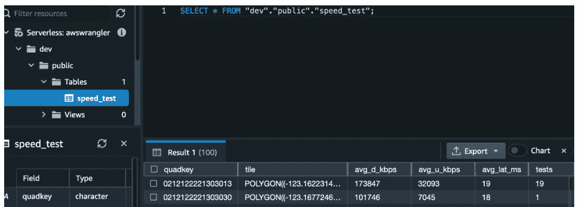

图 3.66：Redshift 集成 – 从 Redshift 查询数据

### 用例 2：通过 ETL 流程在进行一些修改后从 S3 迁移数据。将数据从 S3 文件加载到 pandas DataFrame 中，并使用 pandas 转换根据需要对数据执行 ETL 修改。

```#Usecase2 - Load S3 files into Pandas, make some changes and load it to Redshift using S3 copy command
speed_test=wr.s3.read_parquet("s3://ookla-open-data/parquet/performance/type=mobile/year=2021/quarter=4/")
```

```#Usecase2 - Perform ETL transformations
speed_test_load=speed_test.drop('tile',axis=1)
speed_test_load['newdevices']=speed_test_load['devices']+1
speed_test_load['avg_usedbandwidth']=speed_test_load['avg_d_kbps']+speed_test_load['avg_u_kbps']
```

```speed_test_load.head(2)
```

| quadkey | avg_d_kbps | avg_u_kbps | avg_lat_ms | tests | devices | newdevices | avg_usedbandwidth |
|---|---|---|---|---|---|---|---|
| 0 0022133222330013 | 85 | 103 | 72 | 1 | 1 | 2 | 188 |
| 1 0022133222330201 | 14947 | 20624 | 70 | 1 | 1 | 2 | 35571 |

图 3.67：Redshift 集成 – 在加载到 Redshift 之前转换数据

转换完成后，将数据加载到 Redshift 表中。记录集有 100,000 条记录，我们将使用 copy 函数并验证加载完成的总体时间。

```%time
#Path variable here is the S3 staging path for loading to Redshift
wr.redshift.copy(df=speed_test_load, path="s3://[REDACTED]/awswrangler/data-staging/",
    con=con,schema="public", table="speed_test_uc2",mode="overwrite",
    iam_role="arn:aws:iam::473373155991:role/RedshiftImmersionRole")
```

CPU 时间：用户 3.31 s，系统：318 ms，总计：3.63 s
总耗时：8.48 s

图 3.68：Redshift 集成 – 使用 COPY 命令从 S3 将数据加载到 Redshift

我们可以验证在上述 copy 命令中提供的 S3 路径中是否创建了暂存文件。明确地说，我们运行了两次此语句，第一次运行耗时 15 秒，第二次运行耗时 8 秒。因此，加载时间取决于多个因素，包括带宽和当时的可用容量。

用户可以从 Redshift 查询数据并验证新表，以确保所做的更改已加载到其中。

| avg_lat_ms | tests | devices | newdevices | avg_usedbandwidth |
|---|---|---|---|---|
| 22 | 1 | 1 | 2 | 400783 |
| 29 | 5 | 3 | 4 | 69938 |
| 31 | 2 | 1 | 2 | 5879 |

图 3.69：Redshift 集成 – 从 Redshift 查询加载的数据

作为此用例的一部分，我们还将探索 to_sql 函数以将数据写入 Redshift，但这将使用 INSERT 语句加载数据，并且性能不如 copy 命令。然而，此方法不会产生将数据存储在 S3 暂存路径中的开销。

```%time
#Use case – Load S3 files into Pandas, make some changes and load it to Redshift using insert command directly
speed_test=wr.redshift.to_sql(df=speed_test_load,con=con,schema="public",table="speed_test_uc3")
```

CPU 时间：用户 1 分 28 秒，系统：3.19 s，总计：1 分 32 秒
总耗时：18 分 34 秒

图 3.70：Redshift 集成 – 使用 to_sql 函数将数据加载到 Redshift

你可以看到这需要 18 分钟，远高于前两种方法。当然，此时间取决于多个因素，但此用例让你了解当数据较小时，例如引用表加载时会出现什么情况。

我们可以通过使用 chunk size 参数进一步减少加载时间。默认情况下，chunk size 配置为 200 条记录，因此记录以 200 条为一批加载。此因素可以根据运行机器的容量进行增加。以下屏幕截图显示了将 chunk size 参数设置为 2000 时的执行时间。尽管如此，与 copy 函数相比，此选项仍需要更长的时间。

```%time
#Use case – Load S3 files into Pandas, make some changes and load it to Redshift using insert command directly
speed_test=wr.redshift.to_sql(df=speed_test_load,con=con,schema="public",table="speed_test_uc3",chunksize=2000)
```
CPU 时间：用户 1 分 4 秒，系统：1.63 s，总计：1 分 6 秒
总耗时：12 分 29 秒

图 3.71：Redshift 集成 – 使用 to_sql 函数和 chunksize 参数将数据加载到 Redshift

## 从数据仓库读取/导出数据：
- 从数据仓库读取/导出数据：
  - **将数据卸载到 pandas DataFrame：** 有几种选项可以从 Redshift 导出数据。`unload` 方法会将数据从 Redshift 导出到 S3 暂存路径，然后加载到 pandas DataFrame；这被认为是在有额外 IAM 权限卸载数据的情况下的高吞吐量选项，但在大规模数据集上可以帮助性能。对于较小的数据集，用户可以直接使用 `read_from_sql` 将数据加载到 pandas DataFrame。
  - **直接将文件卸载到 S3：** 如果你想将数据从 Redshift 直接导出到 S3/数据湖而不将数据加载到 pandas DataFrame，此方法更有效。此方法使用 `UNLOAD` 命令快速将数据从 Redshift 移动到 S3。

我们将查看一些与 Redshift 数据加载场景类似的用例以更好地理解这一点。

### 用例 1：需要将 Redshift 中的数据导出到 S3 数据湖，从那里将数据与外部用户共享，并使用一周后过期的预签名 URL：

```%time
#select query helps you remove certain columns or make changes as necessary
wr.redshift.unload_to_files(sql="select * from public.speed_test",
    path="s3://.../awswrangler/data-staging/rsexport/",
    con=con,
    iam_role="arn:aws:iam::473373155991:role/RedshiftImmersionRole")
```
CPU 时间：用户 11.4 ms，系统：255 µs，总计：11.7 ms
总耗时：4.73 s

图 3.72：Redshift 集成 – 使用 unload 函数从 Redshift 导出数据

数据将被加载到配置的 S3 路径中，你可以使用 AWS 控制台中的 S3 Select 功能验证数据是否已按预期填充。此外，你可以看到 S3 路径中有多个 Parquet 文件，因为 UNLOAD 命令以并行方式从 Redshift 导出数据，从而更快地完成导出。

```
{
  "quadkey": "0022133222330013",
  "tile": "POLYGON((-160.032348632812 70.6399478155463, -160.02685546875 70.6399478155463, -160.02685546875 70.6381267305321, -1",
  "avg_d_kbps": 85,
  "avg_u_kbps": 103,
  "avg_lat_ms": 72,
  "tests": 1,
  "devices": 1
}
```

图 3.73：Redshift 集成 – Redshift 数据导出到 S3 并使用 AWS 控制台中的 S3 Select 查询

## 用例 2：Redshift 中的数据导出到 S3，然后在与特定客户团队共享之前进行转换。

我们可以使用 `unload` 命令将文件导出到 S3 暂存位置并加载到 pandas DataFrame。你还可以看到 DataFrame 的结果打印如下：

```%time
#select query helps you remove certain columns or make changes as necessary
wr.redshift.unload(sql="select * from public.speed_test",
    path="s3://.../awswrangler/data-staging/rsexport_stg/",
    con=con,
    iam_role="arn:aws:iam::473373155991:role/RedshiftImmersionRole")
```

CPU 时间：用户 13.8 s，系统：2.01 s，总计：15.8 s
总耗时：16.3 s

quadkey  tile  avg_d_kbps  avg_u_kbps  avg_lat_ms  tests  devices
0  0022133222330013  POLYGON((-160.032348632812 70.6399478155463, ...))  85  103  72  1  1
1  0022133222330201  POLYGON((-160.043334960938 70.6344840663086, ...))  14947  20624  70  1  1

图 3.74：Redshift 集成 – 从 pandas DataFrame 和 S3 暂存位置导出数据

我们可以使用 `read_from_sql` 函数直接将数据加载到 pandas DataFrame。我们可以在以下图中看到，使用直接 SQL 加载函数数据加载得更快。然而，此测试是在 t3.2xlarge 机器上进行的，你的响应时间可能会根据机器容量和其他因素而有所不同。你可以为你的特定工作负载运行此测试，并根据需要使用 `unload` 或直接 SQL 导出：

```%time
#select query helps you remove certain columns or make changes as necessary
wr.redshift.read_sql_query(sql="select * from public.speed_test", con=con)
```

CPU 时间：用户 1.2 s，系统：37.9 ms，总计：1.24 s
总耗时：5.27 s

quadkey  tile  avg_d_kbps  avg_u_kbps  avg_lat_ms  tests  devices
0  0212320201112030  POLYGON((-123.123779296875 44.0481157308235, ...))  17609  5433  51  8  4
1  0212320201112032  POLYGON((-123.123779296875 44.0441676355722, ...))  20644  10528  47  8  3
2  0212320201112033  POLYGON((-123.118286132812 44.0441676355722, ...))  89217  16508  38  7  4
3  0212320201112100  POLYGON((-123.11279296875 44.0560116957853, ...))  309396  28648  26  14  8

图 3.75：Redshift 集成 – 直接从 pandas DataFrame 导出数据

这里的经验教训是，写入 S3 是一项并行活动，但它在将数据加载到 pandas DataFrame 之前创建了额外的步骤。你应根据用例、计算/存储容量以及导出数据的大小来评估不同的导出选项。

下表将为你提供使用 `redshift-connector` 从 Redshift 加载和卸载数据时使用不同函数的总体思路：

|  | 从 pandas DataFrame 加载 | 从 S3 存储加载 | 导出到 pandas DataFrame | 导出到 S3 存储 |
|---|---|---|---|---|
| Redshift 数据 < | `to_sql` 函数 | `copy_from_files` | `read_from_sql` | `unload_to_files` |

| 1K 记录 |  |  |  |  |
|---|---|---|---|---|
| Redshift 数据 > 1K 记录 | `copy function` | `copy_from_files` | `unload or read_from_sql` | `unload_to_files` |

表 3.1：RedShift 的函数

除了使用前述的 `redshift-connector` 方法之外，我们还可以使用 Redshift DataAPI 连接到 Redshift 并通过 `awswrangler` 执行查询。

## CHALLENGE

- 你可以使用 Redshift Upsert 模式来更新现有记录并插入新记录，与我们在 RDS 中所做的类似。这将帮助你在数据管道中使用 `awswrangler` 按计划频率将数据加载到 Redshift。

## Summary

在本章中，我们学习了如何使用 AWS SDK for pandas（即 `awswrangler`）。我们探索了 `awswrangler` 库中可用的各种组件，以及它如何使 pandas DataFrames 更接近 AWS 生态系统。我们学习了如何为不同的用例和开发环境自定义和安装该库。我们还查看了 `awswrangler` 与 AWS 服务（如 Amazon S3、Amazon RDS、Amazon Redshift 和 Amazon Athena）的集成，以及 `awswrangler` 中可用的不同功能。

下一章中，我们将学习 SageMaker Data Wrangler，它有助于我们在 ML 管道中执行数据整理活动。

## Introduction to SageMaker Data Wrangler

数据处理是 **机器学习**（**ML**）不可或缺的一部分。事实上，说 ML 模型的性能仅取决于用于训练它们的数据并不夸张。根据 2016 年的 *Forbes* 调查，ML 工程项目中 80% 的时间都花在数据准备上。这是一个惊人地高的时间占比。为什么会这样？由于现实世界中数据的固有特性，数据准备既繁琐又资源密集。在 ML 中，这类现实世界的数据通常被称为脏数据、不干净数据、噪声数据或原始数据。在几乎所有情况下，这就是你开始 ML 流程时所使用的数据类型。即使在你认为数据良好的罕见情况下，你仍需确保其格式正确并进行缩放以使其有用。在这种原始数据上应用 ML 算法不会得到高质量的结果，因为它们无法正确识别模式、检测异常，或在开发和训练环境之外足够好地泛化。

在当今互联和数字化的世界中，数据的生成速度比其被消费和处理的速度更快。所产生的大量数据可以成为构建 ML 模型的真正优势，这些模型用于以前未被探索或被认为不可能的应用。然而，这也带来了一些挑战。让我们接下来看看其中的一些。

主要挑战之一是数据量。由于生成的数据量巨大，我们需要能够摄取、处理和存储相关属性的框架和工具。我们需要能够稳健运行并可自动扩展以满足数据摄取需求的工具。下一个挑战是数据质量。在现实世界中，数据几乎从不完美；你必须处理诸如不准确、不一致、缺失数据和多种数据格式等挑战，等等。在这里，我们需要能够准备和清理这些数据的工具，以便将其用作 ML 管道的输入。由于大量数据清理是可重复且耗时的，这些工具应原生支持可重用性，以便数据处理从业者能够以尽可能少的阻力有效地操作。数据从业者很少单独工作。他们通常是组织内更大团队的一部分，并且经常需要与其他跨职能团队协作。同样重要的是，他们用于数据处理的工具应支持这种协作并与组织现有的工具和存储库集成。

近年来，我们有意努力构建负责任的 ML 模型——公平且无偏见的模型。这是一个难以解决的问题。之所以在现实世界数据中难以解决的一个主要原因是此类数据中可能存在的固有偏见。这些偏见可以表现为某些类别的不平衡或代表性不足。偏见也可能由于特定数据源的选择而渗入。此外，某些数据集中的历史偏见可能会进入你的 ML 数据。检测偏见也很困难，因为它并不总是能通过标准的数据可视化和分析工具看到。你通常需要计算额外的指标来挖掘这些隐藏的偏见。这再次可能既繁琐又耗时，如果手动完成的话。即使是脚本化或编程实现，也可能出错。如果这些偏见未被检测到且未得到纠正，它们可以直接转移到在该数据上训练的 ML 模型上，从而导致现实世界的 ML 模型存在偏见。虽然重要的是要理解，在数据科学中确实存在需要偏见才能使我们的 ML 模型在现实世界中很好泛化的场景，但本书的范围不包括此内容。目前，我们将假设数据中的偏见是我们需要在数据准备过程中检测和纠正的东西。因此，我们用于 ML 的数据准备和处理工具必须能够原生地检测和修复原始数据中的这些偏见。ML 的数据准备涉及多个步骤，例如数据转换、特征工程以及数据可视化和验证。ML 的数据准备涵盖了将数据转换为可用于训练 ML 模型格式所需的一切。更具体地说，数据准备包括数据预处理和特征工程。虽然独立的数据准备工具的采用率不断增长，但数据准备仍然繁琐、耗时且复杂。这些工具中的大多数通常缺乏集成框架，而集成框架对于构建 ML 管道至关重要。将数据准备与 ML 管道集成的能力确保了这些管道是可重复、可重用和可部署的。这进一步使 ML 工程师能够构建 **ML 运维**（**MLOps**）管道。

正如你在前几章中看到的，**亚马逊网络服务 (AWS)** 提供了各种专为数据处理而构建的工具，例如 Glue 和 **弹性 MapReduce (EMR)**。虽然迄今为止我们所涵盖的所有工具都可用于 ML，但在本章中，我们将介绍 SageMaker Data Wrangler，这是一个专为 ML 而设计的工具。SageMaker Data Wrangler 是一种数据处理工具，使数据科学家能够专门为 ML 导入、转换和分析数据。SageMaker Data Wrangler 拥有超过 300 种内置转换，常用于处理 ML 数据。借助 SageMaker Data Wrangler，数据科学家可以创建自动数据编排工作流并生成数据质量洞察。使用 Data Wrangler，你可以轻松地将实验代码投入生产。无需手动筛选和翻译数百行数据准备和摄取代码，你可以直接导出准备好的数据。你可以从多个数据源导入数据，例如 **亚马逊简单存储服务 (Amazon S3)**、Amazon Athena、Amazon Redshift、Snowflake 和 Databricks，并使用超过 300 种内置数据转换和代码片段库处理数据，以便在无需编写任何代码的情况下快速规范化、转换和组合特征。你也可以使用 PySpark、**结构化查询语言 (SQL)** 或 pandas 引入自定义转换。事实上，你甚至无需导入数据集即可开始探索 Data Wrangler。Data Wrangler 的一项新发布功能使你能够通过使用示例数据集并遵循建议的操作来更快地开始试验 Data Wrangler，从而轻松首次导航产品。处理完原始数据后，你可以直接将其导出到 S3 或直接导出到诸如 SageMaker Feature Store 之类的特征存储。

Data Wrangler 支持额外的集成，允许你与 Snowflake 等其他数据存储集成，从而使数据科学家能够以更少的努力和时间完成数据准备、清理和特征工程任务。除了直接导出处理后的数据外，你还可以通过单击即可将所有数据准备工作流直接导出到笔记本中，以便轻松投入生产。将整个数据处理流程作为代码导出的能力在将数据处理与多个工作流自动化和编排工具（如 Apache Airflow、SageMaker Pipelines 和 AWS Step Functions 等）集成时非常有用。换句话说，SageMaker Data Wrangler 可以减少聚合和准备 ML 数据所需的时间，并直接使数据科学家能够花更多时间创建 ML 模型。总的来说，Data Wrangler 不仅为你提供强大的数据可视化和数据转换功能，还能让你非常快速地将工作流投入生产。正如名称所示，Amazon SageMaker Data Wrangler 是 Amazon SageMaker Studio 中的一个功能。为了明确起见，曾经存在 SageMaker Studio 之外的 Data Wrangler 开源版本，现已更名为 AWS SDK for pandas。Amazon SageMaker Studio 是一个基于 Web 的 **集成开发环境 (IDE)**，用于 ML。SageMaker Studio 提供了数据科学家构建、训练和部署 ML 模型所需的所有工具。SageMaker Studio 具有多项功能，可进行偏见检测、数据处理、**自动化 ML (AutoML)**、ML 训练、模型部署和 MLOps。因此，要从 SageMaker Studio 使用 SageMaker Data Wrangler，你必须首先确保已设置 Amazon SageMaker Studio。虽然 SageMaker Studio 提供的所有功能的详细概述超出了本书的范围，但我们在本章末尾包含了 *SageMaker Studio setup prerequisites* 部分，以便你快速设置并开始使用 SageMaker Data Wrangler。在本书撰写时，SageMaker Data Wrangler 可处理表格和时间序列数据。综上所述，Amazon SageMaker Data Wrangler 是 Amazon SageMaker 的一项功能，可通过可视化界面使数据科学家和工程师更快地为 ML 应用准备数据。Data Wrangler 将聚合和准备 ML 数据所需的时间从数周缩短到数分钟。SageMaker Data Wrangler 的核心功能包括纠正数据问题，例如数据不平衡和缺失数据，以及专门为 ML 转换数据。在下一节中，我们将介绍 SageMaker Data Wrangler 的一些核心功能。

## Data import


在使用 SageMaker Data Wrangler 处理数据之前，您首先需要将数据导入到 Data Wrangler。 使用 Data Wrangler，您可以从各种数据源连接并导入数据。 当您首次启动 Data Wrangler 时，出现的第一个屏幕会询问您是否要导入数据或使用示例数据集：

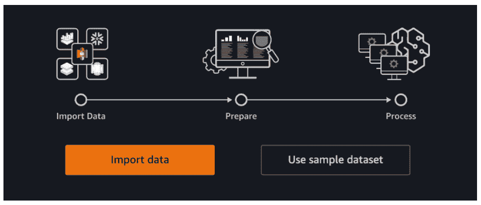

图 4.1 – Data Wrangler 导入

Amazon S3 是一种基于对象的存储服务，已迅速成为互联网的事实标准存储。 由于其每 GB 成本低且可靠性高，您可以随时随地通过 Amazon S3 存储和检索任意数量的数据。 您既可以使用控制台，也可以通过 API 以编程方式上传和访问数据，这也是在 Amazon S3 中处理数据的最常见方式。 Amazon S3 采用存储桶和对象架构。 您可以将存储桶视为文件夹，将对象视为逻辑上存储在存储桶内的文件。 SageMaker Data Wrangler 支持与 Amazon S3 的原生连接。 当您将 Data Wrangler 连接到 Amazon S3 中的数据时，它会使用 S3 Select 在实际导入之前查询和预览您的数据。 这使数据科学从业者能够获取数据的概览，包括其特征，以确保一切正常，然后再进行数据处理。 S3 Select 也非常快；事实上，它旨在将查询性能提高高达 400%，并将查询成本降低多达 80%。 它通过检索对象的子集数据（使用简单的 SQL 表达式）而不是整个对象来工作，而整个对象大小可达 5 TB。 从 Amazon S3 导入数据时，您可以选择导入同一存储桶中的单个文件或多个文件。 您还可以选择导入整个文件或作为样本导入其一部分。 然而，在处理多个文件时，您需要确保文件必须位于 S3 存储桶内的同一文件夹中，并且必须共享相同的表头或没有表头。 支持的文件格式包括 **JavaScript 对象表示法 (JSON)**、**逗号分隔值 (CSV)**、Parquet 和 **优化行列式 (ORC)**。 除了 Amazon S3 之外，Data Wrangler 还支持与 **Amazon Athena** 的原生连接以导入数据。

Amazon Athena 是一种无服务器交互式查询服务，可让您使用标准 SQL 直接在 Amazon S3 中轻松分析数据。 在 Athena 中，表和数据库是用于定义底层源数据架构的元数据定义的容器。 对于每个数据集，Athena 中都需要存在一个表。 数据库是对表的逻辑分组，并且仅保存数据集的元数据和架构信息。 使用 Data Wrangler，您可以查询 Athena 数据库并将结果导入 Data Wrangler。 与 Amazon S3 类似，从 Athena 导入数据时，您可以导入整个数据集或将数据集的一部分作为样本导入。 大型企业通常会设置数据仓库。 Data Wrangler 支持与 **Amazon Redshift** 和 **Snowflake** 等数据仓库服务的原生集成。 Amazon Redshift 是一种完全托管的、PB 级云数据仓库服务。 您可以在 Data Wrangler 中连接并查询一个或多个 Amazon Redshift 集群。 此外，Data Wrangler 提供与 Snowflake 的无缝集成，让您能够轻松准备存储在 Snowflake 中的数据以用于 ML 任务。 通过简单直观的界面，您可以在无需任何编码的情况下建立与 Snowflake 的直接连接。 此外，Data Wrangler 通过让您能够将 Snowflake 数据与存储在 Amazon S3 中的信息以及通过 Amazon Athena 和 Amazon Redshift 提取的数据相结合来促进数据集成。 如果您希望将 Databricks 用作数据源，Data Wrangler 也支持连接到此数据处理服务。 通过利用 **Java 数据库连接 (JDBC)** 导入功能，您可以从 Databricks 数据库导入数据集。 连接后，您可以指定 SQL 查询来提取所需数据，并无缝将其导入 Data Wrangler 以进行进一步处理。

## 数据编排

数据编排可以定义为从各种来源组合数据的过程，包括将其导入、转换并加载到目标数据源的步骤，其基本原则是能够以可重复和可重用的形式自动化数据准备步骤中的所有步骤，然后将其集成到整体 ML 管道中。 虽然数据编排可以在更广泛的上下文中使用，还可包括资源配置、扩展和监控，但数据编排的核心是创建和自动化数据工作流，我们将在本书剩余部分重点关注这一点。 配置、扩展和监控等其他繁重任务由 AWS 处理。 SageMaker Data Wrangler 使用数据流来连接数据集并执行转换和分析步骤。 此数据流可用于定义您的数据管道，并由数据准备涉及的所有步骤组成。 当您在 Data Wrangler 中创建数据流时，它会自动配置运行您将在流程中定义的分析和转换所需的资源。 虽然有默认选项，但您也可以根据特定的数据准备需求灵活选择受支持的实例类型。 SageMaker Data Wrangler 中的数据流创建基于 GUI。 当您首次导入数据（或使用示例数据集）时，Data Wrangler 会自动推断数据源中列的数据类型并创建新的数据帧。 数据源和数据帧都出现在 Data Wrangler 的数据流 UI 中。 Data Wrangler 允许您使用数据流 UI 轻松向数据管道添加额外步骤。 Data Wrangler 步骤可分为 transform、analysis、join 和 concatenate。 transform 步骤——顾名思义——包括对您的数据应用转换。 join 步骤包括与另一个数据集的连接操作。 concatenate 步骤，另一方面，包括与另一个数据集的连接操作。 您可以使用 analysis 步骤添加可能有助于数据准备的临时分析。 在 ML 生命周期早期花费时间进行数据准备可以显著提高模型性能，并显著减少训练时间和成本。 在大多数现实场景中，数据准备是迭代的，包括多次传递；因此，您最终会对同一数据集进行多次转换，这些转换将在数据流 UI 中堆叠显示。 您的数据流中的所有步骤都可以直接从数据流 UI（如图 4.2 所示）或表 UI 中更新或删除：

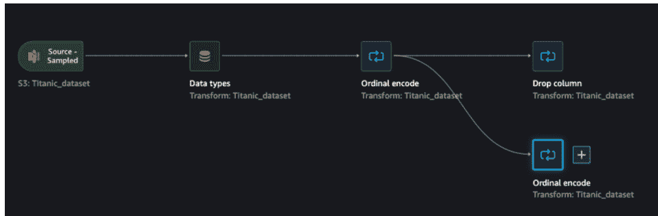

图 4.2 – Data Wrangler 数据流 UI

我们将在下一章详细介绍数据流，在那里我们将介绍创建数据流的分步示例。 您的数据流中的所有步骤都可以保存并导出为带有 .flow 扩展名的文件。 这使得该过程可重复、可版本控制，并可与整体 ML 管道集成。 此外，您还可以使用 Amazon EventBridge 和 AWS Lambda 等 AWS 服务来安排这些数据流的自动运行。 最后，由于这种编排在逻辑上与计算和存储分离，您可以通过在不使用时关闭实例来优化资源利用率，同时仍保留流程中的所有步骤以便根据需要执行。

## 数据转换

ML 的数据处理主要包括数据转换。 其核心是，SageMaker Data Wrangler 包含 300 多种内置转换，这些转换通常用于专门针对数据科学和 ML 清理、转换和特征化您的数据。 使用这些内置转换，您可以在无需编写任何代码的情况下转换数据集中的列。 除了这些内置转换之外，您还可以使用 PySpark、Python、pandas 和 PySpark SQL 添加自定义转换。 其中一些转换在原地操作，而其他转换则在您的数据集中创建新的输出列。 每当您将转换纳入数据流时，它就会在流程中引入一个新步骤。 每个添加的转换都会修改您的数据集并生成新的数据帧。 随后，您应用的任何后续转换都将在此更新的数据帧上执行。 在现实世界中，数据集通常不平衡。 这种不平衡可能表现为代表性不足的类别，有时甚至由于采样错误而完全缺失。 不言而喻，这是数据处理中必须解决的初始问题之一，并且检测和修复也可能耗时。 SageMaker Data Wrangler 包含平衡数据操作，使数据从业者能够快速平衡导入的数据集。 Data Wrangler 中的平衡操作支持标准数据平衡操作。 包括以下内容：

- **随机过采样**：此操作会随机复制少数类中的实例
- **随机欠采样**：与随机过采样类似，此操作会随机移除过度代表类的样本
- **合成少数类过采样技术 (SMOTE)**：SMOTE 利用代表性不足类别的样本来插值新的合成少数类样本

除了内置的一键式转换之外，Data Wrangler 还支持自定义转换。 自定义转换使数据科学家能够使用他们已经熟悉的包和框架来编写自定义转换操作。 这些包括通过 Python、PySpark、PySpark（SQL）或 pandas 使用定义函数。 Data Wrangler 还允许您通过在自定义转换操作的自定义代码块中导入它们来使用流行的库。 然而，使用自定义转换操作有一些限制，我们将在下一章深入介绍。 您还可以通过 PySpark SQL 实现自定义公式，以为数据集生成新的列或特征。 正如我们在数据编排部分简要介绍的那样，SageMaker Data Wrangler 数据转换还支持标准的连接和连接操作。 SageMaker Data Wrangler 也可处理非数值数据。 它包括用于独热编码、类别编码和相似性编码等内置转换。 此外，根据所处理的数据科学或 ML 问题类型，对文本进行特征化可能很有用。 Data Wrangler 转换包括将文本数据向量化的功能——即从文本数据创建有意义的数值嵌入形式向量，然后可用于执行数值操作。 另一个

在机器学习中常见的数据类型是时间序列数据。这是指按特定时间索引的数据。SageMaker Data Wrangler 转换包含许多用于处理时间序列数据的选项。这包括常用的操作，例如对时间序列数据进行分组、处理时间序列数据中的缺失值、从时间序列数据中提取特征，以及在时间序列数据中使用滚动窗口。以下屏幕截图显示了 Data Wrangler 中可用的内置转换：

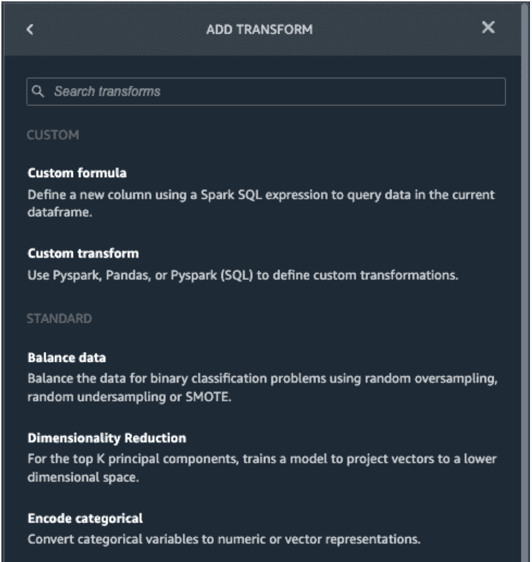

- **提取日期/时间特征**
- 将日期/时间值编码为数值和向量表示。
- **提取文本特征**
- 从自然语言文本生成向量表示。
- **格式化字符串**
- 使用标准字符串格式化操作清理和准备字符串。
- **分组依据**
- 将分组后的聚合列作为新列添加。
- **处理缺失值**
- 替换、删除或为缺失值添加指示器。
- **处理异常值**
- 删除或替换异常的数值和分类值。
- **处理结构化列**
- 展平 JSON 并对结构化数据执行其他操作
- **管理列**
- 在数据集中移动、删除、复制或重命名列。

图 4.3 – Data Wrangler 内置转换

## 洞察与数据质量

生成关于数据和质量的洞察报告是数据剖析的一部分。数据剖析是一个更广泛的术语，包括审查数据源、理解数据的结构和组成、从数据生成有用的摘要和统计信息，以及研究数据集中各种特征之间存在的固有关系等所有过程。在开始处理数据的任何步骤之前，您必须首先了解数据的状态。因此，数据剖析通常是在数据导入 Data Wrangler 后执行的首批步骤之一。Data Wrangler 提供了内置功能来生成数据和质量洞察报告。该报告可作用于您导入 Data Wrangler 的整个数据集，或在您导入数据后对数据进行采样时作用于样本。该报告可快速洞察常见的数据问题，例如数据不平衡、目标泄漏等。您还可以了解有关数据的其他信息，例如缺失值、异常值和其他描述性统计信息。除了报告可在线查看外，生成的报告还可以下载以供离线查看和分享。报告的摘要部分提供了数据的简明概述，涵盖缺失值、无效值、特征类型、异常值计数等各个方面。此外，它可能会突出显示指示数据集中潜在问题的严重警告。在生成报告时，您可以选择目标列。一旦在 Data Wrangler 中选择了目标列，它会自动生成相应的目标列分析。此外，Data Wrangler 根据特征的预测强度按降序排列特征。选择目标列时，需要指定您是处理回归问题还是分类问题。Data Wrangler 还提供有关样本的额外洞察，例如它们是否包含重复或异常记录。虽然某些重复数据可能是有效的，但它通常是数据收集或采样错误的结果。您可以使用 **删除重复项** 选项管理重复数据。Data Wrangler 使用孤立森林算法识别异常记录。这为数据集中的每条记录关联一个异常分数。洞察报告中最有趣且通常最有用的功能之一是 **快速模型**。Data Wrangler 在您的数据样本上创建快速模型，该模型提供了在您的数据上训练的模型预期预测质量的估计。对于快速模型，Data Wrangler 使用默认超参数在您的数据样本上训练 XGBoost 模型。在训练快速模型之前，它会自动将样本拆分为训练集和测试集。它执行最少量的自动数据预处理，并且为提高效率在训练上应用了提前停止。会生成模型性能摘要，其中包含指标，如准确率、F1、R2、**均方根误差** (**RMSE**) 等，具体取决于您选择回归问题还是分类问题。例如，如果您选择分类问题，将会连同摘要一起生成混淆矩阵，如下所示：

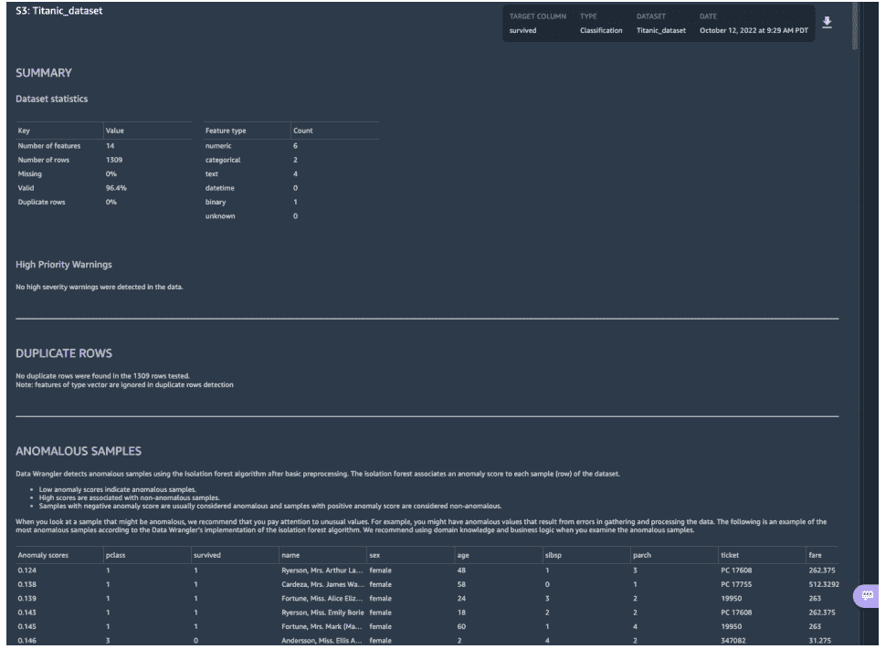

图 4.4 – 数据洞察报告

## 数据分析

与生成数据和质量洞察密切相关的是快速分析导入数据的能力。数据分析是数据剖析阶段的一部分，让您在将数据处理用于机器学习之前更好地理解数据。SageMaker Data Wrangler 包含内置分析，可帮助您在几次点击中生成可视化和数据分析。此外，您还可以使用自定义代码创建自己的自定义分析。使用数据可视化，您可以快速概览整个数据集。它提供了一种易于访问的方式来查看和理解数据中的趋势、异常值和模式。Data Wrangler 提供开箱即用的分析工具，包括直方图和散点图。您可以用几次点击创建这些可视化，并使用自己的代码对其进行自定义。除了可视化之外，在分析下，您还可以创建表格摘要。表格摘要使数据从业者能够快速汇总您的数据，并可包含数据的重要特征，例如记录数，以及描述性统计信息，例如均值和标准差。Data Wrangler 还包含专门针对数据科学和机器学习的分析。其中之一是检测数据中的多重共线性。多重共线性是指两个或多个预测变量之间存在相关性的情况。这些预测变量代表数据集中用于预测目标变量的特征。在存在多重共线性的情况下，预测变量不仅对目标变量具有预测性，也彼此之间具有预测性。Data Wrangler 提供了多种评估数据中多重共线性的方法，包括 **方差膨胀因子 (VIF)**、**主成分分析 (PCA)** 和 **Lasso 特征选择**。VIF 量化了如果预测变量相关时估计回归系数的方差被放大的程度。较高的 VIF 表明相关预测变量与其他预测变量存在强相关性，这可能会损害回归模型的可靠性。PCA 通常用于机器学习中的降维，从而实现更易于数据可视化和降噪，从而避免相关特征。同样，Lasso 特征选择可以将不太重要特征的系数降至零，从而有效地将其从模型中剔除。这有助于降低模型复杂性并防止过拟合。这些措施有助于识别和量化数据集中存在的多重共线性的程度。我们将在下一章更详细地介绍这些技术。检测时间序列数据中的异常是 Data Wrangler 提供的另一种分析，在处理此类数据时常用。时间序列数据可能包含趋势和季节性。趋势是数据中的长期变化（增加或减少）。这可以是线性的或指数的，有时方向也会改变。另一方面，季节性是序列中具有固定频率的重复周期。Data Wrangler 采用分解技术来分析时间序列数据，将其分离为预测项和误差项。预测项捕获时间序列的季节性和趋势，而残差代表误差项。在误差项中，您可以灵活定义阈值，指示残差偏离均值的标准差数量以被识别为异常。此外，Data Wrangler 提供了分解时间序列数据中季节性趋势的能力。通过使用季节-趋势分解可视化，您可以确定时间序列数据中是否存在季节性。Data Wrangler 采用的分解过程利用 **使用 LOESS 的季节-趋势分解 (STL)** 方法将时间序列分离为其不同的组成部分——即季节性、趋势和残差。为数据科学家和数据从业者提供无需编写任何代码即可快速生成这些内容的能力，显著改善了数据处理工作流程并使其更高效。以下屏幕截图显示了我们数据集的特征相关性报告：

## 特征相关性：泰坦尼克号

线性特征相关性基于 Pearson 相关性。数值到分类的相关性是通过在计算 Pearson 相关性之前，将分类特征编码为能最好预测数值特征的浮点数来计算的。线性分类到分类的相关性不受支持。

数值到数值相关性的范围在 [-1, 1] 之间，其中 0 表示无相关性，1 表示完全正相关，-1 表示完全负相关。

数值到分类以及分类到分类的相关性范围在 [0, 1] 之间，其中 0 表示无相关性，1 表示完全相关。

既不是数值型也不是分类型的特征将被忽略。

下表为每个特征列出了与其最相关的特征。我们为最多包含 20 列的数据集显示相关性矩阵

|  | 最相关的特征 | 相关性 |
|---|---|---|
| survived (数值型) | boat (分类型) | 0.950845 |
| boat (分类型) | survived (数值型) | 0.950845 |
| pclass (数值型) | boat (分类型) | 0.608416 |
| fare (数值型) | pclass (数值型) | -0.565255 |
| sex (数值型) | boat (分类型) | 0.556174 |
| age (数值型) | pclass (数值型) | -0.411391 |
| sibsp (数值型) | parch (数值型) | 0.374291 |
| parch (数值型) | sibsp (数值型) | 0.374291 |
| embarked (数值型) | boat (分类型) | 0.278391 |

相关性矩阵：


图 4.5 – 数据分析报告：特征相关性

## 数据导出

到目前为止，我们已经了解了 Data Wrangler 的功能，这些功能使您能够将数据导入 Data Wrangler 并执行分析和转换。SageMaker Data Wrangler 使您能够将这些转换的全部或部分导出为数据流。在大多数情况下，数据处理由一系列转换组成。这些转换中的每一个都可以在 Data Wrangler 中称为一个步骤。Data Wrangler 流由一系列节点组成，这些节点表示您的数据导入以及已执行的转换。如前所述，Data Wrangler 中的首批步骤之一是从受支持的数据源导入数据。因此，数据源是您数据流中的第一个节点。在上一步之后，数据流中的下一个节点是 Data Types 节点。该节点表示 Data Wrangler 已执行转换，将数据集转换为适合进一步分析和处理的格式。添加到数据流中的每个转换都表示为一个新节点，从而能够直观地表示对数据集执行的操作序列。可以将此数据流视为包含所有代码和数据转换序列的代码文件。Data Wrangler 支持将这些转换导出到多个受支持的目的地和格式，包括 Amazon S3、SageMaker Pipelines、SageMaker Feature Store 以及标准 Python 代码。对于 S3 来说，Data Wrangler 允许您将处理后的数据导出到 S3 中的存储桶位置。您可以将此 S3 位置指定为目标节点，或使用 **Export** 选项将处理后的数据或转换结果导出到 S3。除了导出的數據之外，流程本身也会保存到 S3 存储桶位置。当您选择 S3 作为目标时，您可以通过添加目标节点来实现，该节点即为 S3 存储桶位置。Data Wrangler 允许您添加多个目标节点。导出使用 Data Wrangler 作业进行，其幕后是一个 SageMaker 处理作业。创建 Data Wrangler 导出作业时，您可以指定实例数量和受支持的实例类型。Data Wrangler 还允许您导出到 SageMaker Pipelines，这是一个用于构建利用直接 SageMaker 集成的端到端 ML 工作流的 SageMaker 功能。您可以将整个流程或数据流中的某些步骤导出到 SageMaker Pipelines。Data Wrangler 将创建一个 Jupyter notebook，您可以使用它来定义、实例化、运行和管理管道。特征存储在机器学习中变得越来越重要。特征是您数据集中特定的列。特征存储包含处理后的数据以及一些相关元数据，并充当所有可供各个数据科学团队在其 ML 工作流中使用的处理后数据或特征的中央存储库。Data Wrangler 使您能够将创建的特征导出到 Amazon SageMaker Feature Store，这是在 SageMaker 中存储和发现特征的另一项服务。使用 Data Wrangler，您可以更新 SageMaker Feature Store 中现有的特征组，或创建全新的特征组。您可以使用 Jupyter notebook 或目标节点，使用数据集中的观测值更新特征组，或在 Feature Store 中创建特征组。最后，您还可以将数据流中的所有转换导出为 Python 代码，以便与任何数据处理工作流集成。由于导出的代码将引用 SageMaker 和 AWS 资源，因此您需要确保集成所使用的环境或工作流可以访问引用的 AWS 资源。

## SageMaker Studio 设置先决条件

SageMaker Data Wrangler 作为一项服务在 Amazon SageMaker Studio 中可用。虽然您仍可通过 API 使用部分 SageMaker Data Wrangler 功能，但为本书的目的，我们将从 SageMaker Studio 中使用 Data Wrangler。在本节中，我们将简要介绍 SageMaker Studio 以及如何在您的 AWS 账户中设置 SageMaker Studio 域和用户。

### 先决条件

在开始设置 SageMaker Studio 之前，有一些先决条件如下：

- 一个 AWS 账户。
- 一个带有适当策略和权限的 **Identity and Access Management (IAM)** 角色。有一个 `AmazonSageMakerFullAccess` AWS 受管策略，您可以直接使用或作为创建自定义策略的起点。

### Studio 域

您将使用 AWS 控制台创建并入驻一个 SageMaker 域。SageMaker 域包括一个 **Amazon Elastic File System (Amazon EFS)** 卷、授权的 studio 用户列表，以及各种安全、应用程序、策略和 **Amazon Virtual Private Cloud (Amazon VPC)** 配置。创建域时，您可以选择如何入驻域上的用户。您有两个选项：使用 AWS IAM Identity Center（**AWS Single Sign-On** 或 **AWS SSO** 的继任者）或 AWS IAM 作为身份验证方法。如果您将 SageMaker Studio 与现有的 SSO 集成或创建新的 SSO 设置，请选择 IAM Identity Center 选项；否则，请选择 IAM 身份验证选项。请务必记住，域创建后除非删除并重新创建域，否则无法更改此设置。使用 IAM 身份验证时，您可以选择 **Quick setup** 或 **Standard setup** 选项来入驻域。就本书的范围而言，我们将考虑使用 **Quick setup** 的 IAM 身份验证。

### Studio 入驻步骤

让我们来看一下 studio 入驻的步骤：

- 1. 登录您的 AWS 账户并导航到 SageMaker 控制台。
- 2. 从左侧的 **Control panel** 选项中选择 **Studio**，如下图所示：

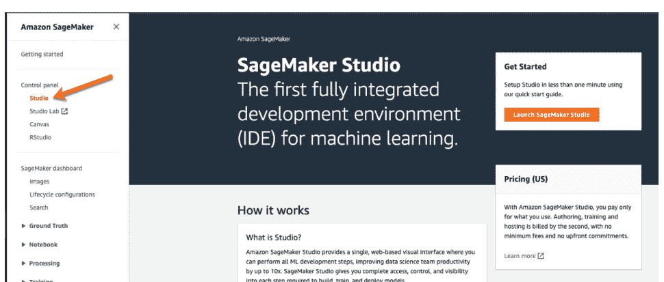

图 4.6 – SageMaker 控制台

- 3. 单击 Launch SageMaker Studio 按钮。如果是第一次使用，您将被带到 Setup SageMaker Domain 页面，其中包含 Quick setup 和 Standard setup 选项：

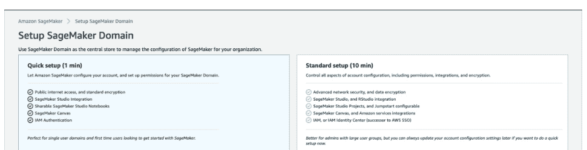

图 4.7 – 域设置选项

默认选择 Quick setup。保持不变。

- 4. 接下来，您需要为默认管理员用户提供用户名并为域选择默认执行角色，如以下屏幕截图所示。如果您的账户中还没有 SageMaker 执行角色，您可以使用先决条件部分中提到的内置策略创建一个：

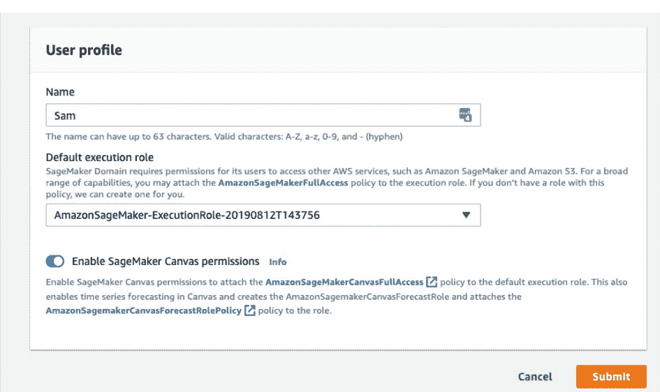

图 4.8 – SageMaker Studio 执行角色

SageMaker Canvas 不在本书讨论范围。你可以在继续之前选择保留该选项启用或在此处禁用它。

- 5. 一旦你点击 **Submit**，域创建过程就会开始。在后台，SageMaker 将为你创建一个 Studio 域、配置所需的 AWS 服务（如 EFS），并为该域创建默认用户。这需要几分钟时间，域状态将显示为 **Pending** 直到完成：

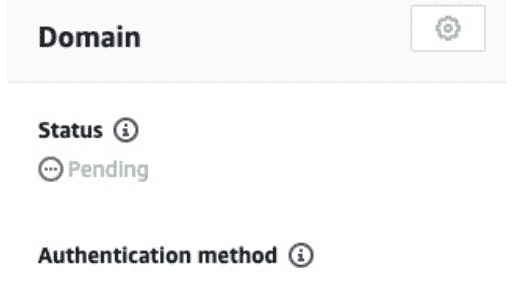

图 4.9 – 检查域创建状态

- 6. 域创建完成后，状态将更改为 **Ready**，你可以使用默认用户登录 SageMaker Studio。要登录，请在控制台的 **Launch app** 按钮中选择 **Studio**，如下图所示：

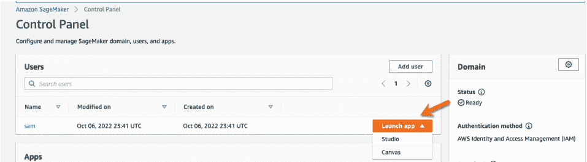

图 4.10 – 启动 SageMaker Studio

- 7. 第一次登录 SageMaker Studio 需要几分钟时间，因为它需要配置默认应用程序。后续登录会更快。一旦应用程序创建完成且登录成功，SageMaker Studio IDE 登陆页面应该会打开：

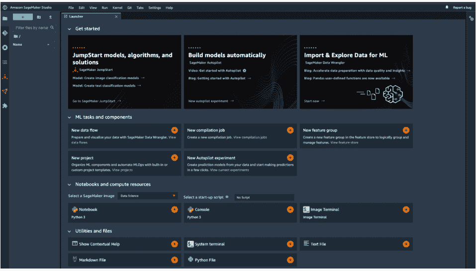

图 4.11 – SageMaker Studio IDE

就这样——从这里开始，你就可以跟随本书中的所有 Data Wrangler 示例进行学习了。

## 摘要

在本章中，我们介绍了 AWS 上的数据处理，重点关注 ML 和数据科学。我们探讨了 ML 数据处理为何独特，以及它为何是整体 ML 工作流程中如此关键且重要的组成部分。我们讨论了处理大型和分布式数据集及数据源时面临的一些挑战，以及如何大规模处理这些数据。我们讨论了拥有可靠且可重复的 ML 数据处理工作流程的重要性。随后，我们介绍了 ML 数据处理工具和框架所需的关键功能，包括检测现实数据中存在的偏差的能力、检测和修复数据不平衡的能力、快速且无错误地执行转换并大规模运行预处理报告和可视化的能力，以及大规模摄取数据的能力。

随着企业从实验和研究转向生产，重点转向运营。在此，我们在运营的背景下、特别是 MLOps 的背景下介绍了 ML 的数据处理。我们讨论了工具和框架与企业管道无缝集成的重要性。接下来，我们介绍了 SageMaker Data Wrangler，这是一项专为 ML 数据处理而构建的 SageMaker 服务。我们详细介绍了 SageMaker Data Wrangler 的关键功能，以及它们如何帮助解决我们之前讨论的一些具体数据处理挑战。数据处理工具的重要性仅限于其所能支持的数据源，我们查看了 Data Wrangler 支持的数据源，以及与其他 AWS 和第三方服务的集成点。数据处理任务和转换完成后，我们讨论了如何导出处理后的数据。我们查看了数据可以导出的各种格式，以及 Data Wrangler 支持的各种导出目标。除了处理后的数据之外，我们还需要处理步骤和转换保持一致且可重复；在此，我们查看了如何以数据流的形式导出转换。

SageMaker Data Wrangler 是 SageMaker Studio 的一个组件。使用 Data Wrangler 的先决条件之一是设置 SageMaker Studio。我们通过介绍如何在你的 AWS 账户中设置 SageMaker Studio 域以及如何入驻用户和账户来结束本章。数据处理是 ML 中最具挑战性和耗时最多的领域之一。如果做得正确，它可以为你的 ML 模型带来直接的性能提升。SageMaker Data Wrangler 提供了使数据科学家和 ML 从业者能够大规模执行数据处理并与组织的整体 ML 工作流程集成的功能。**Quick setup** 选项使用默认设置并允许互联网访问和可共享笔记本。
