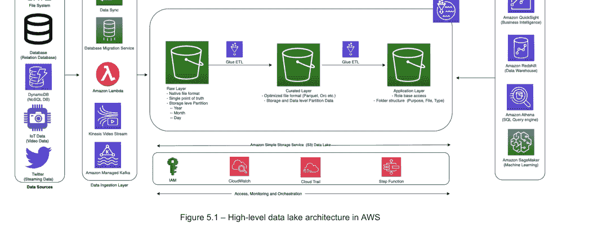
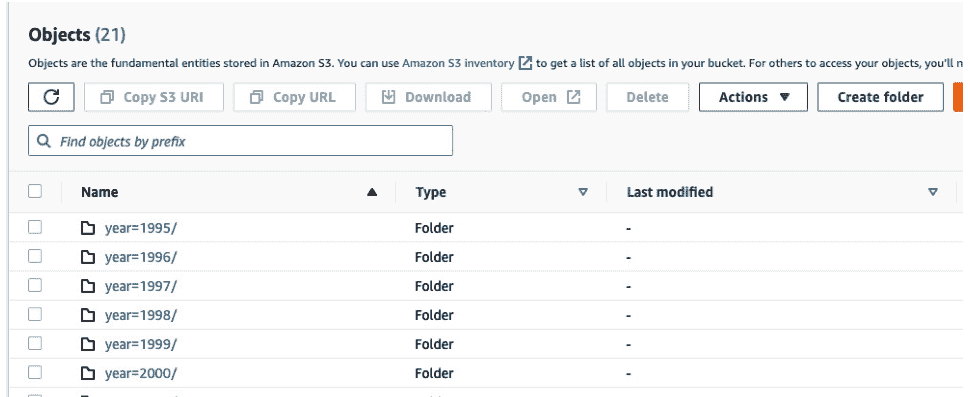
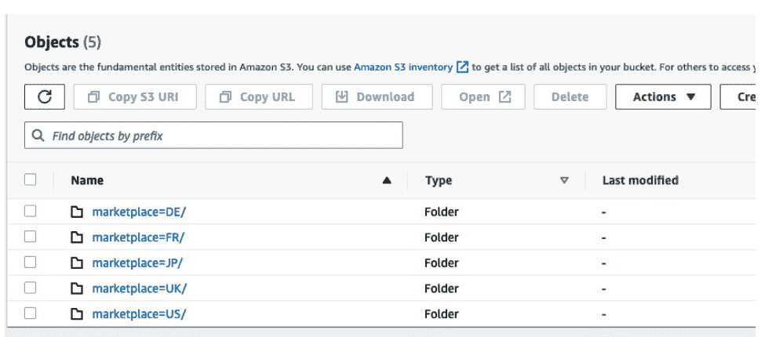
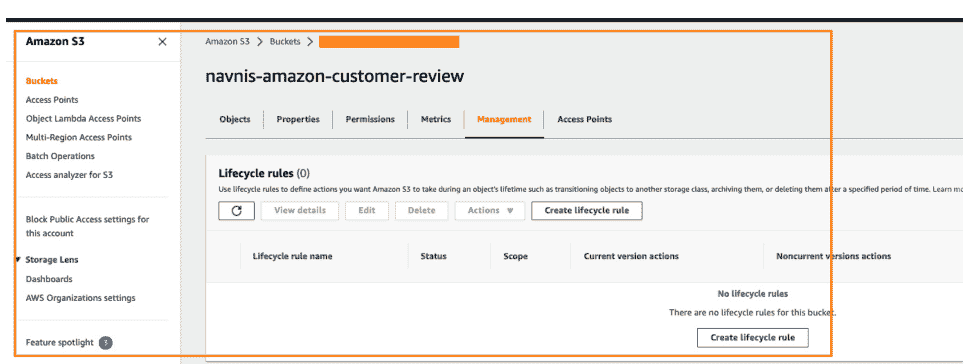
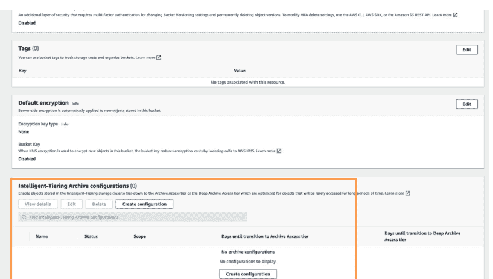

## 使用 Amazon S3

在之前的章节中，我们反复讨论了大数据和数据湖的概念，以及组织如何通过各种数据整理流程来存储和提取数据的有价值见解，如 *第 1 章* 所述，使用 **Amazon Web Services (AWS)** 服务，例如 AWS Glue DataBrew、AWS SDK for Pandas 和 SageMaker Data Wrangler。本章将更深入地探讨大数据和数据湖的具体细节。

具体来说，我们将涵盖以下主题：

- 大数据的定义和概念
- 大数据的特征
- 数据湖的概念和定义
- 在 **Amazon Simple Storage Service (Amazon S3)** 上构建数据湖的最佳实践
- Amazon S3 上数据的布局和组织

我们将首先探讨大数据的定义和特征。

## 什么是大数据？

大数据指的是极其庞大的数据集，其复杂性和多样性超出了传统数据管理和分析工具的处理和分析能力。大数据通常来自多个来源，例如传感器、社交媒体和电子商务平台，可能包括结构化、半结构化和非结构化数据。

大数据的容量、速度和多样性给数据管理和分析带来了重大挑战。传统的数据存储和处理系统并非设计用于处理如此庞大和复杂的数据集，可能无法提供大数据应用所需的性能、可扩展性和灵活性。

为克服这些挑战，组织已转向大数据技术，例如 Apache Hadoop、Apache Spark 和 Apache Flink。这些技术旨在支持大规模存储、处理和分析大数据，并提供可处理大量数据的分布式和并行架构。

大数据技术使组织能够从数据中提取有价值的见解和知识，并已成为数据驱动决策和创新流程的关键推动者。例如，大数据技术被广泛应用于欺诈检测、推荐系统和预测性维护等应用。

尽管大数据技术有很多好处，但也存在需要考虑的挑战和局限性。例如，大数据系统可能复杂且难以管理，可能需要专门的技能和专业知识。此外，大数据系统可能引发隐私和安全问题，可能需要仔细管理以确保数据的完整性和质量。

正如我们所学，术语“*大数据*”指的是大量通常复杂且需要大量计算能力处理的 structured、半结构化和非结构化数据。然而，大数据的定义是相对的，取决于可用的存储和计算选项。


例如，对于使用 Excel 处理数据的人来说，1 GB 的数据可能就被视为大数据，但对于在配备 32 GB RAM 的笔记本电脑上使用 Apache Spark 框架的人来说可能并非如此。同样，当数据增长到 1 TB 时，可能需要外部数据库和 **抽取、转换和加载 (ETL)** 工具进行处理。但当数据扩展到数十 TB 时，可能需要在本地或云端使用分布式处理选项，使用诸如 **Hadoop 分布式文件系统 (HDFS)** 之类的存储系统和诸如 Hadoop 之类的处理框架，或使用 Amazon S3 之类的对象存储以及使用 AWS 服务如 AWS Glue 进行处理。然而，即使有这些选项，当数据扩展到数百 TB 时，即使对于 AWS Glue 来说也可能被视为大数据，并且处理成本可能很高，降低其业务价值，需要诸如 **Amazon Elastic MapReduce (Amazon EMR)** 之类的选项。

客户对构成大数据的看法也可能各不相同；有些人可能认为几 TB 的数据就是大数据，而其他人可能认为 PB 甚至 EB 的数据才是大数据。这种观点与大型科技公司如 Amazon、Facebook、Google 和 Apple 存储和处理数据的规模相比也是相对的，其规模可达数 PB 甚至 EB。

根据 *Statista* 的数据，到 2025 年，世界将创造、捕获、复制和消费 181 泽字节的数据（1 泽字节 = 1,024 艾字节）（https://www.statista.com/statistics/871513/worldwide-data-created/）。

总体而言，大数据是现代数据管理和分析的关键方面，为组织带来了机遇和挑战。通过利用合适的工具和技术，组织可以释放数据的价值，推动业务增长和创新。

现在我们对大数据有了大致的了解，让我们了解其关键特征。

## 大数据的 5V

大数据的 5V 是定义大数据概念的五个关键特征。这些特征有助于理解大数据的本质以及如何有效地分析和利用它。让我们更详细地了解一下，如下所示：

- **数据量：** 大数据是指极大的数据集，其规模过大，无法使用传统方法处理。这些数据集的规模可从几 TB 到数 PB 不等。

例如，Twitter 单独每天产生超过 5 亿条推文，这意味着必须存储、处理和分析的大量数据。另一个大数据示例是大型电子商务公司如 Amazon 生成的数据。这些数据可能包括客户购买历史、网站点击流数据和客户服务交互。这些数据可以从在线交易、移动应用、社交媒体、电子邮件和客户服务交互等各种来源收集。所有这些数据加起来可能达到 TB 甚至 PB 级别，必须存储、处理和分析，以便获得可用于改善客户体验和提高收入的洞察。

- **多样性：** 大数据通常以多种格式出现，包括结构化、半结构化和非结构化数据。结构化数据以可预测的方式组织，例如在电子表格中，而非结构化数据则更自由形式，例如社交媒体帖子或电子邮件。大数据多样性的一个例子是电子商务公司如 Amazon 从各种来源收集数据，例如以下内容：
  - 来自交易系统的结构化数据，例如 **销售点 (POS)** 系统、库存管理系统和 **客户关系管理 (CRM)** 系统
  - 半结构化数据，例如日志文件和 XML 文件
  - 非结构化数据，例如客户评论、社交媒体帖子以及图像和视频

- **速度：** 大数据以惊人的速度产生，每秒产生数百万甚至数十亿个数据点。这种高速度意味着传统的数据处理和分析方法可能无法跟上所产生的数据量和多样性。

例如，一家制造公司可能在其生产线上有数百或数千个传感器，生成有关机器性能、温度、振动和其他参数的数据。这些数据必须实时收集、处理和分析，以在造成停机或质量问题之前检测并响应问题。

- **真实性：** 大数据的质量和准确性可能差异很大。在用于决策或分析之前，仔细评估大数据的真实性非常重要。

大数据真实性的一个例子是医疗保健组织从 **电子健康记录 (EHRs)** 和可穿戴设备收集数据。这些数据可能来自不同来源，可能不完整、不一致或有偏差。例如，可穿戴设备中患者自行报告的数据可能不如临床测量数据准确。此外，EHR 可能由于手动数据输入或不同的格式标准而包含错误或不一致。为了理解这些数据并将其用于决策和诊断，组织需要应用数据清洗、规范化和验证技术以确保数据的真实性。

大数据真实性的另一个例子可能是社交媒体平台收集用户帖子、评论和点赞的数据。数据的真实性值得怀疑，因为用户的帖子和评论可能无法准确代表他们的想法和感受；它们可能包含错别字、讽刺和其他可能被误解的比喻语言。此外，一些用户可能会发布虚假信息或错误陈述，这使得难以信任数据。为了解决这些问题，平台需要应用 **自然语言处理 (NLP)** 和 **机器学习 (ML)** 技术来理解数据的上下文并过滤掉不可靠或虚假的信息。

- **价值：** 大数据的价值在于其提供洞察并为决策提供信息的能力。通过分析和解释大量数据，组织可以获得有价值的洞察，有助于推动业务战略并提高运营效率。

大数据价值的一个例子是金融服务公司使用数据分析实时检测欺诈活动。该公司将从交易、客户行为和社交媒体等各种来源收集大量数据。通过分析这些数据，公司可以识别可能表明欺诈活动的模式和异常，并采取行动防止损失。在此示例中，数据的价值来自其检测欺raud并保护公司资产和声誉的能力，这将为公司及其客户创造整体价值。

总之，大数据的 5V（数据量、多样性、速度、真实性和价值）描述了大数据的关键特征以及如何有效地利用它来推动业务战略和决策。

在本章的这一部分，我们学习了客户如何创建数据湖以从数据中收集和提取有价值的洞察。现在，我们将更深入地了解数据湖的概念、其必要性原因、数据湖的各个层以及在 Amazon S3 上构建数据湖的最佳实践，但在那之前，让我们先了解什么是数据湖。

## 什么是数据湖？

数据湖是一个集中式存储库，允许组织以任何规模存储其所有结构化和非结构化数据。这种数据存储和管理方法为组织提供了一个统一的平台，用于从各种不同来源（包括社交媒体、传感器和交易系统）存储和管理数据。

数据湖旨在支持以原始格式存储大量数据，以便组织内的各个团队在以后阶段进行处理和分析。这种数据存储和管理方法为组织提供了从各种来源收集和存储数据的灵活性，而无需以任何特定方式预处理或结构化数据。

使用数据湖的关键好处之一是它允许组织从各种不同来源存储和管理数据，包括结构化和非结构化数据。这意味着组织可以从社交媒体 feed、传感器数据和交易系统等来源收集和存储数据，然后利用这些数据获得洞察并做出数据驱动的决策。

数据湖的另一个关键好处是它们为组织提供了以多种不同方式处理和分析数据的灵活性。这是因为数据湖中的数据以原始格式存储，允许组织内的各个团队（如数据科学家、业务分析师和数据工程师）访问和分析数据。

让我们详细探讨这些好处，如下所示：

- **经济高效的存储：** 数据湖可以在比传统数据仓库更低的成本下存储大量数据。这是因为数据湖使用商品硬件和开源技术，通常比专有解决方案便宜。
- **灵活性——读时模式：** 数据湖允许您以原始、原始格式存储数据，而无需提前转换或结构化。这使您能够推迟对如何使用数据做出决策，直到需要时为止，从而在数据管理策略中提供更大的灵活性。
- **可扩展性——存储与计算解耦：** 数据湖设计为水平扩展，这意味着您可以根据需要轻松添加更多存储和处理能力。这使其非常适合处理大量数据和数据量突然激增的情况。
- **集成：** 数据湖可以与各种数据源和分析工具集成，使您能够将来自多个来源的数据汇集在一起并对其进行各种分析。
- **协作：** 数据湖允许多个用户和团队访问和分析数据，促进协作并支持数据驱动的决策。

总体而言，数据湖为组织提供了一种强大的工具，用于管理和分析来自各种不同来源的大量数据。通过允许组织以原始格式收集、存储和管理数据，数据湖提供了支持各种数据驱动应用和用例所需的灵活性和可扩展性。

## 在 Amazon S3 上构建数据湖

Amazon S3 是一种基于云的存储服务，为数据和媒体提供可扩展、耐用和安全的存储。Amazon S3 因其高性能、可靠性和灵活性而成为存储和管理数据的热门选择。

在本章中，我们将讨论在 Amazon S3 上构建数据湖的过程。数据湖是一个集中式存储库，允许组织以任何规模存储其所有结构化和非结构化数据。构建数据湖最受欢迎的平台之一是 Amazon S3。Amazon S3 是一种高度耐用和可扩展的存储服务，使存储和分析大量数据变得容易。

让我们看看在 Amazon S3 上构建数据湖涉及的步骤：

- 1. 在 Amazon S3 上构建数据湖的第一步是设计数据架构。这涉及识别将存储在数据湖中的数据类型和来源，以及将使用的數據摄取、处理和分析管道。重要的是要考虑数据湖的性能、可扩展性和安全要求，并选择合适的存储、计算和网络资源。


2. 在 Amazon S3 上构建数据湖的下一步是准备和组织数据。这涉及清理、转换和丰富数据，使其适合分析可视化。确保数据的质量、一致性和完整性非常重要，并应用适当的元数据、标记和编目以促进数据发现和访问。

3. 一旦数据准备并组织好，就可将其加载到 Amazon S3 上的数据湖中。这可以使用多种工具和技术完成，例如批处理、实时流处理和批量导入。选择合适的数据文件格式和压缩方法非常重要，并应用正确的分区和索引策略以支持高效的数据存储和查询。

4. 数据加载到 Amazon S3 上的数据湖后，可以使用多种工具和框架访问和查询。这可能包括基于结构化查询语言（SQL）的查询引擎，如 Amazon Redshift 和 Amazon Athena，以及大数据框架，如 Apache Spark 和 Apache Flink。选择能够支持数据湖的性能、可扩展性和灵活性要求的正确工具和技术非常重要。

5. 最后，Amazon S3 上数据湖中的数据可用于多种用途，例如报告、分析、机器学习和数据可视化。这可以使用多种工具和平台完成，例如仪表板和可视化工具、数据科学笔记本以及分析和机器学习平台。选择能够支持数据湖和预期用例的正确工具和技术非常重要。

总结来说，在 Amazon S3 上构建数据湖需要仔细的规划、设计和执行。通过利用合适的工具和技术，组织可以创建可扩展、安全且经济高效的平台，用于存储、处理和分析大型数据集。



图 5.1 – AWS 中的高级数据湖架构

## 在 Amazon S3 上构建数据湖的优势

在上一节中，您了解了如何在 Amazon S3 上构建数据湖，但您一定在想为什么要在 Amazon S3 上构建数据湖——本节将尝试探讨这个问题。

以下是构建 Amazon S3 数据湖的一些关键优势：

- **可扩展性**：Amazon S3 具有高度可扩展性，可以处理大量数据，使其成为构建数据湖的理想选择。Amazon S3 可扩展性的一个例子是，一家公司起初只有少量数据，随着时间的推移，其收集并存储在数据湖中的数据量显著增加。有了 Amazon S3，公司可以轻松扩展其数据存储以适应数据量的增长，而无需担心存储空间不足。例如，一个组织起初有 50 GB 数据，随着时间的推移，数据量增加到 100 TB。它可以轻松扩展 Amazon S3 中的数据存储以处理数据量的增加，而无需担心存储空间不足或需要将数据迁移到新的存储系统。

- **经济高效：** Amazon S3 是经济高效的数据存储解决方案，您只需为使用的存储付费。例如，一家公司希望在数据湖中存储 1 PB 数据。如果将其数据存储在本地，则必须购买和维护昂贵的存储基础设施，这可能成本高昂。有了 Amazon S3，公司可以用更低的成本存储相同数量的数据，因为它只需为使用的存储付费，并且无需担心与维护和升级存储基础设施相关的额外成本。此外，Amazon S3 还提供经济高效的数据检索选项，例如 Amazon S3 Select 和 Amazon S3 Glacier，可让您仅检索所需的数据，从而降低数据检索成本。

- **数据安全：** Amazon S3 提供强大的安全功能，例如加密、访问控制和符合各种法规。以下是一些示例：
  - **静态加密：** 一个组织使用 Amazon S3 的 **服务器端加密（SSE）** 功能来加密存储在其数据湖中的所有患者数据。这确保即使数据湖遭到入侵，数据也受到保护。
  - **访问控制：** 一个组织使用 Amazon S3 的访问控制功能，例如存储桶策略和 **访问控制列表（ACL）**，将患者数据的访问限制为仅授权的个人和系统。
  - **合规性：** 一个组织使用 Amazon S3 的合规性功能，例如支持 **《健康保险流通与责任法案》（HIPAA）** 和 **《支付卡行业数据安全标准》（PCI DSS）**，以确保数据湖满足存储敏感患者数据的监管要求。
  - **审计：** 一个组织使用 AWS CloudTrail 和 AWS Config 来记录和监控对数据湖中患者数据的访问。这使组织能够检测并响应对患者数据的任何未经授权的访问。

- **灵活性：** Amazon S3 支持多种数据类型和格式，允许您在同一数据湖中存储结构化、半结构化和非结构化数据。例如，一家公司以 **逗号分隔值（CSV）** 格式收集结构化数据（如客户交易），以 **JavaScript 对象表示法（JSON）** 格式收集半结构化数据（如社交媒体评论），以及以文本格式收集非结构化数据（如网站日志）。使用 Amazon S3，公司可以轻松地将所有这些类型的数据存储在同一数据湖中，而无需担心兼容性问题。

- **与其他 AWS 服务的集成：** Amazon S3 可轻松与其他 AWS 服务（如 Glue、Kinesis 和 Redshift）集成，用于数据处理、分析和可视化。

- **数据管理和治理：** Amazon S3 提供数据编目、元数据管理、数据血缘和数据治理功能，使其易于管理和组织大量数据。

- **耐用性和可用性：** 耐用性和可用性是 Amazon S3 中的两个重要概念。耐用性是指 Amazon S3 能够承受因硬件故障导致的数据丢失的能力，而可用性是指 Amazon S3 能够在用户请求时向用户提供存储数据的能力。耐用性以 **年故障率（AFR）** 来衡量——即在给定年份内预计丢失的对象百分比。Amazon S3 提供 11 9s 的耐用性，这意味着 AFR 为 0.000000001，即十亿分之一。这种高水平的耐用性意味着存储在 Amazon S3 中的数据极不可能丢失。

可用性以对象成功检索的时间百分比来衡量，Amazon S3 提供 4 9s 的可用性，这意味着对象预计 99.99% 的时间可以检索。这种高水平的可用性意味着用户几乎可以随时访问存储在 Amazon S3 中的数据。

- **易于访问和共享：** Amazon S3 允许不同团队和用户轻松访问和共享数据，从而促进协作和自助分析。

## 设计 Amazon S3 数据湖的设计原则

创建 Amazon S3 数据湖时可以遵循以下几个设计原则：

- **使用扁平文件结构：** 在数据湖中，通常建议使用扁平文件结构而不是分层结构。这意味着所有数据都存储在文件系统的同一级别，而不是组织到子文件夹或嵌套目录中。扁平文件结构允许更轻松、更灵活的数据访问，因为数据可以轻松查询，而无需浏览复杂的目录结构。

- **使用分区：** 分区是将数据根据日期、位置或产品等属性划分为逻辑部分的过程。这可以通过允许您轻松访问和查询特定数据子集来帮助提高数据湖的性能和效率。


- **使用对象标记**：对象标记允许您以键值对的形式将元数据附加到您的数据中。此元数据可用于描述数据、对其实行分类或提供额外上下文。对象标记可用于组织和管理数据湖中的大量数据。
- **使用数据治理**：在创建数据湖时，拥有适当的数据治理非常重要。这包括定义角色和职责、制定数据策略和标准，以及实施安全和合规控制。
- **使用数据管理工具**：数据管理工具，例如 AWS Glue 或 Amazon EMR，可用于组织、清洗和转换数据湖中的数据。这些工具还可以帮助自动化数据管道并提高数据处理的效率。

总之，遵循这些设计原则可以帮助您在 Amazon S3 上创建结构良好且高效的数据湖。扁平文件结构、分区、对象标记、数据治理以及数据管理工具的使用都可以促进成功的数据湖设计。

## 数据湖布局

数据湖布局是指数据在数据湖内部组织和结构化的方式。这可以包括数据在数据湖内的物理位置，以及数据在不同类别中的逻辑组织，例如结构化和非结构化数据。

通常，数据湖布局旨在支持从各种不同来源高效存储和管理大量数据。这可以包括按来源、按类型或按与组织数据管理需求相关的其他标准来组织数据。

数据湖布局的一些常见元素包括以下内容：

- **物理位置**：数据在数据湖内的物理位置，例如本地存储或基于云的存储
- **逻辑组织**：将数据在不同类别中进行逻辑组织，例如结构化和非结构化数据
- **数据血缘**：数据的历史，包括其来源、如何处理以及如何使用
- **元数据**：有关数据的信息，例如其格式、质量以及与组织的关联性
- **安全和访问控制**：控制谁可以访问数据的策略和机制，以及确保数据的保密性、完整性和可用性

总体而言，数据湖布局的目标是提供一个灵活且可扩展的框架，用于以支持组织数据管理需求的方式存储和管理大量数据。

## 在 Amazon S3 数据湖中组织和结构化数据

数据可以在数据湖中以多种不同的方式组织和结构化，具体取决于组织的具体需求和要求。数据湖中一些常见的数据布局模式包括以下内容：

- **结构化与非结构化数据**：数据湖中的数据可以根据其是结构化还是非结构化进行分类。结构化数据是以固定格式组织的数据，例如数据库表中的行和列。另一方面，非结构化数据是没有固定格式的数据，例如文本文档、图像或音频和视频文件。
- **按来源的数据**：数据湖中的数据可以根据收集来源进行组织，例如社交媒体 feed、传感器数据或交易系统。这可以帮助组织以一致和协调的方式管理和分析来自不同来源的数据。
- **按类型的数据**：数据湖中的数据也可以按类型组织，例如客户数据、产品数据或销售数据。这可以帮助组织快速轻松地访问与其特定需求和用例相关的数据。
- **按时间的数据**：数据湖中的数据也可以按时间组织，例如特定时间段的数据或在特定时间范围内更新或修改的数据。这可以帮助组织分析随时间的趋势和模式并执行时间序列分析。

总体而言，数据湖中使用的特定数据布局模式将取决于组织的具体需求和要求。关键是选择一种支持组织数据的高效、有效存储、管理和分析的数据布局模式。

## 在 Amazon S3 上构建数据湖的过程

现在，让我们了解如何在 Amazon S3 上构建数据湖。

首先，如果您还没有 AWS 账户，则需要创建一个。一旦拥有 AWS 账户，您就可以创建 S3 存储桶来存储您的数据。S3 存储桶是用于存储对象的逻辑存储单元，对象是构成您数据湖的单个数据片段。

创建 S3 存储桶后，您可以开始向其上传数据。实现此目的有多种方式，包括使用 AWS 管理控制台、AWS 命令行界面 (CLI) 和编程 API。例如，您可以使用 AWS CLI 通过以下命令将数据上传到 S3 存储桶：

```
aws s3 cp <local_file_path> s3://<your_bucket_name>/<object_key>
```

上传数据到 S3 存储桶后，您可以通过在存储桶内创建文件夹和子文件夹来组织它。这将使管理和访问数据变得更容易。您还可以对数据应用标签以帮助识别和分类它。

组织并标记数据后，您可以使用 Amazon Athena 开始查询它，Amazon Athena 是一种无服务器交互式查询服务，可让您使用 SQL 轻松分析 Amazon S3 中的数据。Athena 与 S3 集成，因此您可以使用 SQL 轻松查询 S3 存储桶中的数据。

您还可以使用其他工具和服务来访问和分析 S3 上数据湖中的数据。例如，您可以使用 Amazon EMR 使用托管的 Hadoop 框架处理和分析大型数据集。您还可以使用 Amazon Redshift 使用托管的数据仓库对数据执行快速、复杂的查询。

总之，在 Amazon S3 上构建数据湖是存储和分析大量数据的简单且经济高效的方式。通过使用 S3 存储数据，您可以利用其耐用性和可扩展性，并可以使用 Athena 和 EMR 等工具轻松访问和分析数据。

## 为数据湖选择合适的文件格式

为 Amazon S3 上的数据湖选择合适的文件格式是一个重要决策，会影响数据湖的性能和效率。选择文件格式时需要考虑多个因素，包括数据的类型和结构、数据的预期用途以及与其他系统和工具的兼容性。

Amazon S3 数据湖中最受欢迎的文件格式之一是 Apache Parquet 格式。这种列式文件格式针对大数据分析进行了优化，并支持复杂数据类型，例如嵌套数据结构和数组。它也非常高效，因为它允许压缩并支持高效的数据跳过，从而可以提高查询性能。

Amazon S3 数据湖的另一种流行文件格式是 Apache Optimized Row Columnar (ORC) 格式。此格式与 Parquet 类似，但提供其他功能，例如对复杂数据类型的支持、索引和谓词下推。ORC 文件也非常高效，并支持快速的数据摄取和查询处理。

除了 Parquet 和 ORC 之外，根据数据的具体需求和用例，其他文件格式也可能适用于 Amazon S3 中的数据湖。例如，Apache Avro 格式是数据序列化的热门选择，支持广泛的数据类型。Apache JSON 格式是存储数据湖数据的另一个选项，因为它可读性强且易于与其他系统集成。

最终，Amazon S3 中数据湖的合适文件格式将取决于数据的具体需求和要求以及数据湖的预期用途。仔细评估可用选项并选择支持高效数据存储、处理和分析的文件格式非常重要。

除了我们之前讨论的列式和行式文件格式之外，文件格式的另一个重要特性是可分割性。在数据湖中，可分割文件格式是首选，因为它们允许高效并行处理大型数据集。让我们了解可分割和不可分割文件格式之间的区别。

可分割文件格式是可以分割成更小块并独立处理的文件格式，并且可以重新组合各个数据块以形成原始文件。可分割文件格式的示例包括 Hadoop 的 HDFS 和 Apache Cassandra 的 Sorted Strings Table (SSTable)。

另一方面，不可分割文件格式是不能分割并独立处理的文件格式。不可分割文件格式的示例是 PDF 文件。由于它是一种二进制文件格式，您可能无法轻松提取内容，因此无法将其分割成数据块进行处理。

需要注意的是，一些文件可以转换为可分割格式——例如，从 Excel 转换的 CSV，以及从 PDF 转换的 JSON。因此，如果需要，在将文件存储到数据湖之前进行转换为可分割格式总是好的。

|  | 可分割 | 不可分割 |
|---|---|---|
| 文件格式 | 单行分隔 CSV | 多行 CSV |
|  | 单行分隔 JSON | 多行 JSON |
|  | Apache Parquet |  |
|  | Apache ORC |  |
|  | Apache Avro |  |
|  | 带有行级 snappy 压缩的 Apache Parquet |  |
|  | 带有行级 snappy 压缩的 Apache ORC |  |
|  | 带有 gzip 压缩的 Apache Parquet |  |
|  | XML |  |
| 压缩类型 | bzip2 | gzip |

|  | zstd | LZO |
|---|---|---|
|  |  | snappy |

表 5.1 – 文件格式和压缩类型

现在我们对列式/可拆分和行式/不可拆分的文件格式有了一定的了解，让我们通过一个示例来巩固这一点，在该示例中，我们将比较基于文件类型的性能和成本如何受到影响。

在此示例中，我们将使用 *亚马逊客户评论* 数据集，您可以在此处找到：
https://registry.opendata.aws/amazon-reviews/

该数据集包含自 1995 年以来 1.3 亿条客户评论记录，同时提供 **制表符分隔值 (TSV)** 和 Parquet 文件格式。

```
(base) navn is@38f9d36a27bd ~ % aws s3 ls s3://amazon-reviews-pds/
PRE parquet/
PRE tsv/
```

图 5.2 – 亚马逊客户评论开放数据集中的数据

**TSV** 类似于 **CSV**。它是一种用于以表格格式存储数据的简单文件格式——例如数据库表或电子表格数据——表中每一行在文件中表示为单独一行，表中的每个单元格由制表符分隔。

**Parquet** 是一种用于在文件中存储大量数据的列式文件格式。它用于在分布式环境中存储数据，例如 Hadoop 集群。Parquet 针对高效查询和存储数据进行了优化，并设计为可与 Apache Spark 和 Impala 等数据处理框架配合使用。

首先，我们创建两个表——表 1 (`amazon_reviews_tsv`)，它基于 TSV 数据集构建；表 2 (`amazon_reviews_parquet`)，它基于 Parquet 数据集构建。`amazon_reviews_parquet` 表不仅使用 Parquet 文件格式，还按 `product_category` 分区，如以下屏幕截图所示：

```
(base) % aws s3 ls s3://amazon-reviews-pds/parquet/
PRE product_category=Apparel/
PRE product_category=Automotive/
PRE product_category=Baby/
PRE product_category=Beauty/
PRE product_category=Books/
PRE product_category=Camera/
PRE product_category=Digital_Ebook_Purchase/
PRE product_category=Digital_Music_Purchase/
PRE product_category=Digital_Software/
PRE product_category=Digital_Video_Download/
PRE product_category=Digital_Video_Games/
PRE product_category=Electronics/
PRE product_category=Furniture/
PRE product_category=Gift_Card/
PRE product_category=Grocery/
PRE product_category=Health_&_Personal_Care/
PRE product_category=Home/
PRE product_category=Home_Entertainment/
```

图 5.3 – 带分区的 Parquet 数据集

以下 SQL 代码用于 `amazon_reviews_tsv` 表定义：

```
CREATE EXTERNAL TABLE amazon_reviews_tsv( marketplace string,
  customer_id string,
  review_id string,
product_id string,
product_parent string,
product_title string,
product_category string,
star_rating int,
helpful_votes int,
total_votes int,
vine string,
verified_purchase string,
review_headline string,
review_body string,
review_date date)
ROW FORMAT DELIMITED
FIELDS TERMINATED BY '\t'
ESCAPED BY '\\'
LINES TERMINATED BY '\n'
LOCATION
's3://amazon-reviews-pds/tsv/'
TBLPROPERTIES ("skip.header.line.count"="1");
```

以下 SQL 用于按 product_category 分区的 amazon_reviews_parquet 表定义：

```
CREATE EXTERNAL TABLE `amazon_reviews_parquet`( `marketplace` string,
`customer_id` string,
`review_id` string,
`product_id` string,
`product_parent` string,
`product_title` string,
`star_rating` int,
`helpful_votes` int,
`total_votes` int,
`vine` string,
`verified_purchase` string,
`review_headline` string,
`review_body` string,
`review_date` bigint,
`year` int)
PARTITIONED BY ( `product_category` string )
STORED AS PARQUET
LOCATION 's3://amazon-reviews-pds/parquet';
```

下表比较了 TSV 和 Parquet 表之间的执行时间、数据扫描和成本：

| 查询 | 执行时间 | | 数据扫描 (GB) | | 成本 ($5/TB 扫描) | |
|---|---|---|---|---|---|---|
| | TSV (amazon_reviews_tsv) | Parquet (amazon_reviews_parquet) | TSV | Parquet | TSV | Parquet |
| SELECT count(*) FROM | 1 min 2.54 sec | 704 ms | 32.22 GB | 0 | $0.15 | $0 |
| SELECT count(*) FROM "<table>" WHERE marketplace = 'US' | 1 min 25.66 sec | 1.298 sec | 32.22 GB | 5.28 MB | $0.15 | $0.000025 |
| SELECT * FROM "<table>" WHERE marketplace = 'US' limit 1000; | 1.08 sec | 669 ms | 1.88 MB | 2.69 MB |  |  |
| select distinct product_category from "<table_name>" | 1 min 16 sec | 1.38 sec | 32.22 GB | 0 |  | 0 |
| SELECT product_id, product_title, count(*) as num_reviews, avg(star_rating) as avg_stars FROM <table_name> where product_category='Toys' GROUP BY 1, 2 ORDER BY 3 DESC limit 100; | 1 min 17 sec | 2.27 sec | 32.22 GB | 215 MB | $0.15 | $0.00102 |

表 5.2 – 比较 TSV 和 Parquet 文件之间执行时间、数据扫描和成本的表

如果您查看有关执行时间、数据扫描和成本的表格统计数据，您将大致了解为什么希望将数据存储在 Parquet 等优化的列式文件格式中。

例如，当您将数据以未分区的 TSV 格式存储时，在大多数查询中，您需要扫描整个数据集（例如运行 count(*) 或 distinct）或数据集的一部分。

同样，当您将数据以带分区的 Parquet 格式存储时，在 count(*) 和 distinct 等情况下，它不需要您扫描数据集，因为它维护了有关数据的统计信息。如果您需要在 TSV 中运行 WHERE 子句等过滤语句，它必须扫描整个数据集，而如果数据已分区，它只会遍历特定分区，这最终会使查询更快，因为扫描的数据量少得多。

## 为数据湖选择合适的压缩方法

在 Amazon S3 中为数据湖选择合适的压缩方法是一个重要决策，会影响数据湖的性能和效率。压缩可以帮助减少数据所需的存储空间，并提高数据传输和查询处理的速度。

Amazon S3 中数据湖最受欢迎的压缩方法之一是 Snappy 压缩算法。该算法专为高速数据压缩和解压缩而设计，可以在压缩比和性能之间提供良好的平衡。Snappy 受许多流行的大数据框架支持，例如 Apache Spark 和 Apache Flink，并且可以轻松集成到数据管道和应用程序中。

Amazon S3 中数据湖的另一种流行压缩方法是 gzip 压缩算法。该算法广泛用于数据压缩，并提供比 Snappy 更高的压缩比。然而，gzip 可能比 Snappy 更慢，可能不适合实时或交互式数据处理应用程序。

除了 Snappy 和 gzip 之外，其他压缩算法也可能适用于 Amazon S3 中的数据湖，具体取决于数据的具体需求和用例。例如，LZO 算法是数据压缩的热门选择，因为它提供高压缩比和良好性能。LZ4 算法是另一个选项，因为它提供高压缩速度和低内存使用。

最终，Amazon S3 中数据湖的正确压缩方法将取决于数据的具体需求和要求以及数据湖的预期用途。仔细评估可用选项并选择支持高效数据存储、处理和分析的压缩算法非常重要。

## 为数据湖选择合适的分区策略

为数据湖选择合适的分区策略是一个重要决策，会影响数据湖的性能和效率。分区是将大型数据集划分为更小、更易管理的部分（称为分区）的过程。每个分区单独存储和管理，可以独立查询和处理。

数据湖最常见的分区策略之一是按时间分区。这对于以规律间隔生成的数据很有用，例如传感器数据、日志数据或财务数据。基于时间的分区允许在特定时间范围内高效查询和处理数据，还可以支持数据归档和数据保留策略。您可以在此处查看按日期分区的示例：



图 5.4 – 按日期分区

数据湖的另一种流行分区策略是按位置分区。这对于与特定地理区域相关的数据很有用，例如天气数据、交通数据或零售数据。基于位置的分区允许在特定地理区域内高效查询和处理数据，还可以支持数据隐私和数据主权要求。以下是按位置分区的屏幕截图示例：



图 5.5 – 按位置分区

除基于时间和基于位置的分区外，根据数据的具体需求和要求，其他策略也可能适用于数据湖。例如，数据可以根据客户、产品、事件类型或任何其他相关属性进行分区。重要的是仔细评估可用选项并选择一种分区策略，以支持高效的数据存储、处理和分析。

## 为数据湖配置 Amazon S3 生命周期

为数据湖配置 Amazon S3 生命周期涉及为管理数据湖中存储的数据定义规则和策略。Amazon S3 生命周期允许根据数据的年龄和使用情况自动管理数据。这有助于降低存储成本并提高数据湖的性能和效率。

要为数据湖配置 Amazon S3 生命周期，首先在 Amazon S3 控制台中创建一个生命周期策略。这可以通过选择数据湖存储桶并从管理选项卡中选择生命周期来完成，如图 5.6 所示。然后，创建一个新规则并为规则指定条件和操作。

生命周期规则的条件可以基于数据的年龄、数据的存储类别或数据上次访问后的天数。例如，可以创建一条规则，将在过去 90 天内未被访问的数据移动到 S3 Glacier 存储类别中，这是一种用于不频繁访问数据的低成本存储选项。

生命周期规则的操作可以包括将数据转换到不同的存储类别、将数据归档到 S3 Glacier Deep Archive 或删除数据。例如，可以创建一条规则，删除在过去 365 天内未被访问的数据，以降低存储成本并释放数据湖中的空间：



图 5.6 – Amazon S3 生命周期规则

单击 **Create lifecycle rule** 为驻留在该 Amazon S3 存储桶中的数据创建数据生命周期。然后你应该会看到类似这样的屏幕：

### 创建生命周期规则

### 生命周期规则配置

生命周期规则名称
输入规则名称
最多 255 个字符

选择规则范围
- 使用一个或多个筛选器限制此规则的范围
- 应用于存储桶中的所有对象

### 筛选器类型

你可以根据前缀、对象标签、对象大小或适合你用例的任何组合来筛选对象。

前缀
添加筛选器以将此规则的范围限制为单个前缀。
输入前缀
不要在前缀中包含存储桶名称。在键名称中使用某些字符可能会导致某些应用程序和协议出现问题。了解更多

对象标签
你可以将此规则的范围限制为下面添加的键/值对。
添加标签

对象大小
你可以将此规则的范围限制为基于其大小的对象。例如，你可以筛选出由于每个对象的费用而可能不划算转换到 Glacier Flexible Retrieval（以前称为 Glacier）的对象。
指定最小对象大小
指定最大对象大小

### 生命周期规则操作

选择你希望此规则执行的操作。每个请求将收取费用。了解更多或查看 Amazon S3 定价

- 在存储类别之间移动对象的当前版本
- 在存储类别之间移动对象的非当前版本
- 使对象的当前版本过期
- 永久删除对象的非当前版本
- 删除过期的对象删除标记或不完整的分段上传
在按对象标签或对象大小筛选时不支持这些操作。

### 查看转换和过期操作

| 当前版本操作 | 非当前版本操作 |
| 第 0 天 未定义操作。 | 第 0 天 未定义操作。 |

图 5.7 – 配置 Amazon S3 生命周期规则

除了 Amazon S3 生命周期外，Amazon S3 还提供 Amazon S3 Intelligent-Tiering。

Amazon S3 Intelligent-Tiering 是一种存储类别，可根据不断变化的访问模式自动将数据移动到最具成本效益的存储层。数据会在两个访问层之间自动转换：一个用于频繁访问的数据，另一个用于不频繁访问的数据。这有助于你在确保频繁访问的数据始终以低延迟可用性的同时优化成本。

总之，S3 Intelligent-Tiering 可以根据访问模式将数据从不频繁访问层移动到 S3 频繁层。但生命周期策略只会导致数据向更不频繁的访问层移动（反之则不然）。

你可以通过创建或选择一个用于智能分层现有存储桶来配置 Amazon S3 Intelligent-Tiering。从存储桶的属性选项卡中，从存储类别列表中选择 Intelligent-Tiering。选择 Intelligent-Tiering 类别后，你可以为存储桶配置多个设置，例如对象锁定、版本控制和事件。你还可以设置生命周期规则，以便根据某些条件自动在频繁访问和不频繁访问层之间移动对象。图 5.8 和图 5.9 说明了如何配置 Intelligent-Tiering：



图 5.8 – 配置 Amazon S3 Intelligent-Tiering

### 创建 Intelligent-Tiering 归档配置

启用存储在 Intelligent-Tiering 存储类别中的对象，使其可下移至针对将长时间很少访问的对象进行优化的 Archive Access 层或 Deep Archive Access 层。仅在你的应用程序可以异步访问对象时才激活 Archive Access 和 Deep Archive Access 层。了解更多

### 归档配置设置

### 归档规则操作

图 5.9 – Amazon S3 Intelligent-Tiering 配置

仔细评估数据湖的生命周期规则和策略非常重要，并选择能支持数据湖性能、可扩展性和成本效率的正确选项。定期审查和更新生命周期规则和策略也很重要，以确保它们仍然相关且有效。

## 优化文件数量和每个文件的大小

优化 Amazon S3 中文件数量和每个文件的大小可以帮助提高使用 S3 作为数据存储的应用程序的性能和效率。以下是优化 Amazon S3 中文件数量和文件大小的几个提示：

- **使用大文件大小：** 一般来说，存储和检索较大的文件比较小的文件更有效。这是因为 S3 对数据传输和请求费用收费，而这些费用基于所做的请求数量而不是传输的数据量。因此，使用较大的文件大小可以帮助减少请求数量并降低使用 S3 的总体成本。
- **使用一致的文件大小：** 使用一致的文件大小可以更轻松地管理和处理你的数据。它还可以提高应用程序的性能，因为数据可以更轻松地拆分并并行处理。
- **使用合理数量的文件：** 虽然使用较大的文件大小可能更有效，但文件太少可能导致非常大的文件，这些文件可能难以管理和处理。另一方面，文件太多也可能效率低下，因为它可能导致大量请求和增加的成本。在文件大小和文件数量之间找到平衡可以帮助优化性能和成本。
- **使用前缀和分区：** 使用前缀和分区可以帮助你组织和管理 S3 中的大量文件。前缀允许你将相关文件分组在一起，而分区允许你根据日期或位置等属性将数据划分为逻辑部分。这可以更轻松地访问和处理特定数据子集。

以下是优化 Amazon S3 中文件数量和文件大小的几种方法，如下所述：

- **对较大文件使用分段上传：** 分段上传允许你将大文件以较小的块上传，这比上传一个大文件更有效。
- **使用较小的文件大小：** 不要上传一个大文件，尝试将其拆分为较小的文件。这可以减少上传和下载文件所需的时间。
- **使用对象生命周期策略：** 如前一节所述，设置对象生命周期策略以自动删除或归档不再需要的旧文件可以帮助减少 S3 存储桶中的文件数量并降低存储成本。
- 使用 AWS Glue 或 AWS EMR 在 S3 中运行数据分析，然后从 S3 存储桶中删除不必要的数据。
- 如前一节所述，使用 AWS S3 Intelligent-Tiering、S3 **Standard-Infrequent Access (Standard-IA)** 和 S3 **One Zone-Infrequent Access (One Zone-IA)** 来存储不经常访问的文件可能有助于降低存储这些文件的成本。
- 为 S3 存储桶中的文件启用服务器端压缩可以帮助减少所需的存储空间。

总之，优化 Amazon S3 中的文件数量和文件大小涉及找到一个平衡，以在最大限度降低成本的同时提高性能和效率。使用大文件大小、一致的文件大小和合理数量的文件，并利用前缀和分区，都可以帮助优化 S3 在数据存储需求方面的使用。

在本节中，我们学习了如何优化你的数据湖。在下一节中，我们将讨论构建数据湖时应注意的挑战和注意事项。

## 在 Amazon S3 上构建数据湖时的挑战和注意事项

在 Amazon S3 上构建数据湖或一般数据湖时，这里有一些你应该注意的挑战和注意事项：

- **数据摄取：** 将数据引入数据湖的过程可能具有挑战性，特别是当数据来自具有不同格式和结构的多源时。这可能导致确保数据质量和一致性方面的困难。此外，处理大量数据可能具有挑战性，特别是随着数据的增长。另一个问题是保持模式更改在所有下游应用程序中一致。


- **数据治理**：在处理数据湖中大量数据时，保持数据质量、安全性和监管合规性可能很困难。实施数据分类、质量和保留的策略和标准，以及管理访问和权限，包括 **基于角色的访问控制 (RBAC)** 和数据加密，可能具有挑战性。此外，通过血缘和审计跟踪数据源和使用情况、管理数据保留和归档，以及防止数据泄露和未经授权的访问也可能很困难。
- **数据管理**：组织和管理存储在平面文件和对象存储中的海量数据可能是一项挑战。此外，将数据血缘和治理纳入数据管理流程、管理存储和检索成本，以及将数据湖与其他数据管理和分析工具和服务集成也可能具有挑战性。确保数据质量和一致性、为不同用户和团队提供数据访问和自助服务、随着数据量增加管理可扩展性和性能，以及管理数据备份和 **灾难恢复 (DR)** 也是数据湖中数据管理面临的挑战。
- **数据处理**：数据湖内的数据处理——包括数据转换、清洗和分析等任务——可能很困难，可能需要 AWS Glue、Kinesis 等专用工具和技术。挑战可能包括与用于数据处理和分析的其他 AWS 服务和工具集成、管理数据处理和计算资源的成本、处理实时和批处理、维护数据质量和一致性、为不同用户和团队提供访问和自助服务、保护敏感数据以及满足性能和可用性要求。
- **数据访问**：为不同用户和组启用对数据湖内数据的便捷高效访问可能是一项复杂任务，尤其是在多租户环境中工作时。
- **成本**：在 Amazon S3 上存储和处理大量数据的成本可能很高，需要仔细管理。这就是为什么设置 S3 存储桶生命周期很重要。
- **数据安全**：有必要确保敏感数据得到保护并满足合规要求。我们将在安全和监控章节中探讨数据安全挑战。
- **性能**：应优化数据湖性能，以确保数据易于用于分析和报告。这就是为什么确保实施 *在 Amazon S3 数据湖中组织和构建数据* 部分中描述的最佳实践非常重要。

## Summary

在本章中，我们讨论了什么是大数据、大数据的特征、什么是数据湖、为什么需要数据湖，以及如何通过概述数据湖的优势、数据湖的不同层以及在 Amazon S3 上构建数据湖的最佳实践，在 Amazon S3 上构建数据湖。我们还提供了有关在 S3 上组织和管理数据湖内数据的详细信息，包括使用文件格式、分区、S3 生命周期管理、Amazon S3 Intelligent-Tiering 等功能。本章还讨论了在 Amazon S3 上构建数据湖时的一些挑战和注意事项，例如成本和性能。

在下一章中，我们将学习 AWS Glue。AWS Glue 是一种数据集成服务，可让您从不同的数据源获取数据，并使用 Apache Spark 和 Python 等框架在其上执行 ETL。
