## Working with AWS Glue

在上一章中，我们讨论了各种数据存储类型，包括数据仓库、数据湖、数据湖仓和数据网格，以及它们的关键区别。

本章将探讨 AWS Glue 的不同组件，提供它们如何帮助数据整理任务的见解。

完成本章后，您将能够理解并定义如何利用 AWS Glue 进行数据整理。您还将能够解释与各种 AWS Glue 功能相关的基本概念，例如 AWS Glue 数据目录、AWS Glue 连接、AWS Glue 爬虫、AWS Glue Schema Registry、AWS Glue 作业、AWS Glue 开发端点、AWS Glue 交互式会话和 AWS Glue 触发器。

本章将涵盖以下主题：

- Spark 基础
- AWS Glue 功能
- 使用 AWS Glue 进行数据发现
- 使用 AWS Glue 进行数据摄取

## What is Apache Spark?

Apache Spark 是一个用于处理大数据的统一分析引擎，于 2009 年在加州大学伯克利分校的 AMPLab 作为开源项目开发。最初，它作为一个课程项目创建，旨在解决 Hadoop 框架在机器学习用例中通过 HDFS 在迭代之间交换数据的局限性。其目标是设计一个用于快速交互式处理的新框架，包括机器学习和交互式数据分析，同时保留 Hadoop 框架中 MapReduce 和 HDFS 的隐式数据并行性和容错性。它结合了内存缓存，并针对任何规模的分析工作负载进行了优化。

Apache Spark 于 2010 年在 BSD 许可证下开源，并在 2013 年贡献给 Apache 软件基金会。2014 年，Spark 成为 Apache 顶级项目。它已在 GitHub 上获得了超过 1.7 千名贡献者和超过 30K 星标。

根据 Spark 文档，该引擎提供 Java、Scala、Python 和 R 的高级 API，并通过优化的引擎支持通用执行图。此外，它还提供了一系列高级工具，使处理不同类型的数据和执行特定任务变得更容易。例如，Spark SQL 允许您处理结构化数据并执行 SQL 查询。如果您更喜欢使用 pandas 进行数据分析，您也可以使用 Spark 上的 pandas API 来利用其功能。对于机器学习任务，有 MLlib，它提供工具和算法来帮助您构建和训练模型。如果您正在处理图数据，GraphX 可用于帮助图处理。最后，如果您需要在数据流上执行计算并处理增量更新，您可以使用 Structured Streaming，它使 Spark 能够进行流处理。

## Apache Spark architecture

在高层次上，Apache Spark 运行在主节点和工作节点架构上，其中有一个中央协调器和多个分布式工作节点。它包括驱动程序、多个执行器和集群管理器。驱动程序将用户的代码转换为可分发到工作节点上的多个任务。执行器在工作节点上运行并执行分配给它的任务。需要集群管理器在驱动程序和工作节点之间进行调解。

驱动程序和工作节点的协作称为 Spark 集群，而驱动程序和工作器的有效组合称为 Spark 应用程序。

Spark 应用程序可以在集群管理器的帮助下启动。有许多类型的集群管理器：

- **Standalone**：这是一个简单直接的集群管理器，随 Spark 一起捆绑提供。它提供了一种简单的方式来设置和管理您的集群。
- **Apache Mesos**：Mesos 是一个多功能的集群管理器，可以处理各种工作负载，包括运行 Hadoop MapReduce 和服务应用程序。然而，值得注意的是，Mesos 现在已弃用，可能不是首选。
- **Hadoop YARN**：YARN 是 Hadoop 2 和 Hadoop 3 中使用的资源管理器。它提供集群管理功能，可与 Spark 结合使用以运行和分配资源。
- **Kubernetes**：Kubernetes 是一个开源系统，旨在自动化部署、扩展和管理容器化应用程序的过程。它也可以用于管理 Spark 集群，提供灵活性和可扩展性：

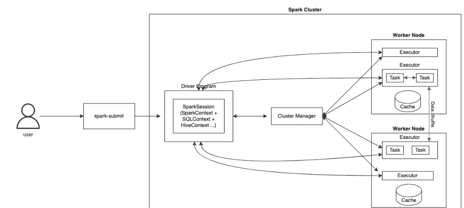

图 6.1 – Apache Spark 架构

## 让我们了解驱动程序的职责：
- 驱动程序是一个 Java 进程，负责运行 Scala、Python 和 Java 的 **main()** 方法
- 它执行用户代码并创建 SparkSession，后者负责创建 **弹性分布式数据集 (RDD)**
- 它创建血缘关系，以及逻辑和物理执行计划
- 它负责通过与集群管理器协调来调度任务的执行
- 它跟踪已缓存在执行器内存中的数据或元数据

## 让我们了解执行器的职责：
- 执行器由核心（slot）、内存和本地存储组成
- Slots 表示可用于 Spark 并行工作的线程
- 它们还包含两种类型的内存：
  - **工作内存**：此内存由 Spark 工作负载使用
  - **存储内存**：一半的内存（存储）用于持久化对象
- 它们还包含直接附加的磁盘，为 shuffle 阶段提供 shuffle 分区的空间（Spark shuffle 分区是在 shuffle 过程中数据的中间划分，以便在阶段之间进行数据交换）
- 它们负责运行单个任务并将结果返回给驱动程序：

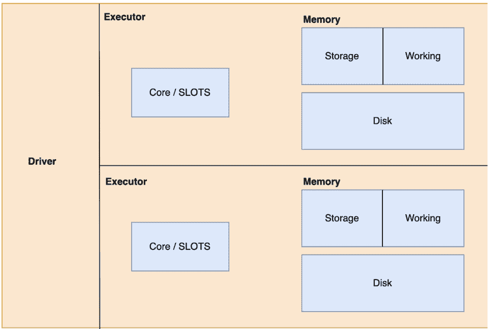

图 6.2 – Apache Spark 执行器

开始在 Spark 集群上运行应用程序时，您可以使用位于 Spark `bin` 目录中的 `spark-submit` 脚本。该脚本充当统一接口，允许您启动应用程序，而无需为 Spark 支持的每个集群管理器专门配置它们。这意味着您可以在无需为每个集群管理器单独修改应用程序设置的情况下无缝使用不同的集群管理器。

现在我们对 Apache Spark 架构有了合理的了解，让我们继续探索 Apache Spark 框架。

## Apache Spark 框架

Apache Spark 框架是一个用于大规模数据处理的统一分析引擎。它包含四个主要组件：Spark Core、Spark SQL、Spark Streaming 和 GraphX。

Apache Spark Core 是 Spark 平台的基础或基本单元，提供内存计算能力。Spark Core 促进并行和分布式处理、任务调度、分派以及基本 I/O 功能。Spark Core 可通过为 Scala、Python、Java 和 R 开发的 **应用程序编程接口 (API)** 访问。Spark API 降低了分布式并行处理引擎的复杂性。Spark 使用一种称为 RDD 的特殊数据结构来处理数据。RDD 表示分布在集群中多台机器上的数据的逻辑集合。

以下是 Spark 中的一些关键模块及其提供的功能：
- **Spark SQL**：该模块专注于处理结构化数据。它引入了一种名为 DataFrames 的编程抽象，提供了一种便捷的方式来处理结构化数据。此外，Spark SQL 可用作分布式 SQL 查询引擎，允许您使用类 SQL 语法查询和分析数据。
- **Spark Streaming**：借助 Spark Streaming，您可以构建强大的应用程序来处理实时流数据和历史数据。它继承了 Spark 的用户友好性和容错能力，使得开发能够处理连续数据流的交互式和分析型应用程序变得更容易。
- **GraphX**：GraphX 是构建在 Spark 之上的引擎，专门用于图计算。它使用户能够交互式地创建、转换和推理大规模图数据。这对于涉及分析处理具有复杂关系的数据的应用程序特别有用，例如社交网络或网页图：

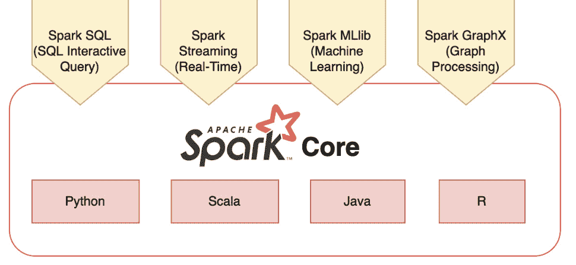

图 6.3 – Apache Spark 框架

## 弹性分布式数据集

Spark 引入了 RDD 的概念。它是分布在不同机器上的分区数据的逻辑集合。RDD 是 Spark 的基本数据结构。它是一种不可变、容错的分布式对象集合，可并行操作：

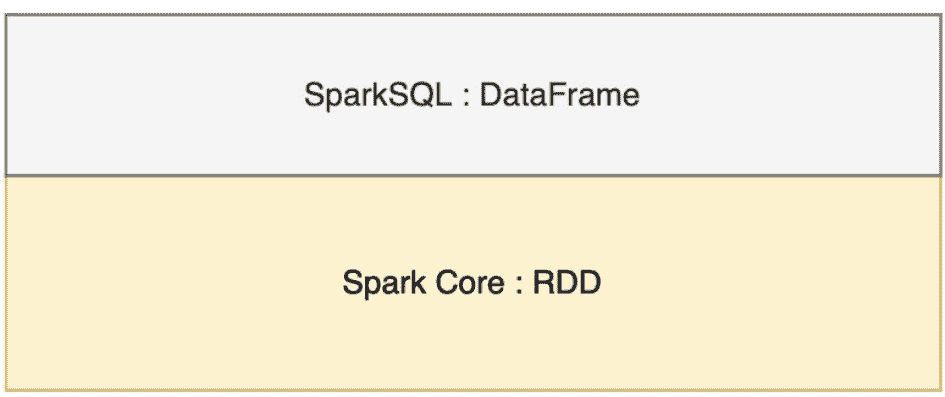

图 6.4 – Spark 框架

RDD 是不可变的，但您可以使用转换来修改它们。然而，这些转换会返回一个新的 RDD，而原始 RDD 保持不变。

RDD 支持两种类型的操作：
- **转换**是对 RDD 执行的操作（例如 `select`、`read`、`filter`、`groupBy`、`sort` 等），并生成包含结果的新 RDD。

官方 Spark 页面提供了所有可用转换的完整列表（https://spark.apache.org/docs/1.2.1/programming-guide.html#transformations）。
- **动作**是对 RDD 运行计算后返回值的操作（例如 `reduce`、`count`、`first` 等）。

官方 Spark 页面提供了所有可用动作的完整列表（https://spark.apache.org/docs/1.2.1/programming-guide.html#actions）。

Spark 中的转换称为“惰性求值”。惰性求值意味着转换不会在动作触发之前执行。

Apache Spark 中的另一个重要概念是 Spark SQL。Spark SQL 是用于结构化数据处理的编程模块。

## 数据集和 DataFrames

根据 Apache Spark 文档，DataFrames 是任何框架的关键方面。DataFrames 由命名列组成，可以被视为关系数据库中的表或 R/Python 中的 DataFrame，但具有增强的优化。它们可以从各种来源创建，包括结构化数据文件、Hive 中的表、外部数据库或现有 RDD。DataFrame API 可用于 Scala、Java、Python 和 R，其中 Scala 和 Java 将 DataFrames 表示为行的数据集；在 Java API 中，使用 `Dataset<Row>` 来表示 DataFrame。现在我们了解了 Apache Spark，可以开始学习 AWS Glue 及其构建模块。

## AWS Glue 构建模块

AWS Glue Crawler 允许您从各种数据源爬取数据，包括 S3，以及 Redshift、MySQL、MSSQL、Oracle 和 MongoDB 等数据库。爬取过程完成后，AWS Glue Crawler 会自动在 AWS Glue Data Catalog 中创建或更新表。支持的数据源列表可在 https://docs.aws.amazon.com/glue/latest/dg/crawler-data-stores.html 找到：
- **AWS Glue Data Catalog**：AWS Glue Data Catalog 是一个集中式目录，存储来自各种数据存储的元数据。这些可被其他 AWS 服务使用，例如 Amazon Athena、Amazon QuickSight、Amazon EMR 和 Amazon Redshift。
- **AWS Glue Triggers**：AWS Glue Triggers 使您能够创建可手动或自动启动一个或多个 AWS Glue Crawler 或 AWS Glue ETL 作业的计划。触发器可以配置为按需触发、基于计划触发，或基于事件组合触发。
- **AWS Glue Workflows**：AWS Glue Workflows 使您能够使用 Glue Trigger 编排 Glue ETL 和 Glue Crawler 的执行。
- **AWS Glue ETL**：AWS Glue ETL 允许用户使用 Python、PySpark 或 Scala 创建 **提取、转换和加载 (ETL)** 管道。使用 Glue ETL，您可以处理来自各种数据源的数据、执行转换，并最终写入不同的数据源（例如 Amazon Redshift、Oracle、OpenSearch 和 Amazon S3）。您可以选择不同的处理引擎：对于分布式处理，您可以选择 PySpark 和 Scala，而对于非分布式处理，您可以选择 Python：

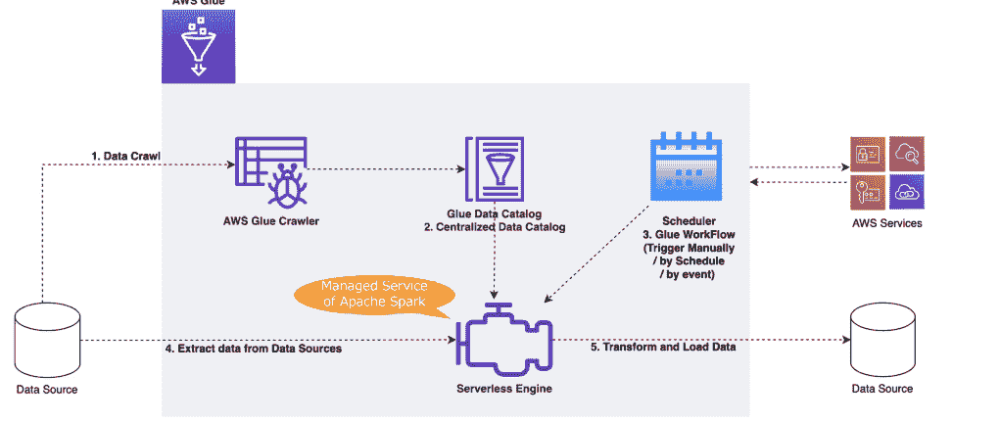

图 6.5 – 使用 AWS Glue 的简单数据管道


-   **AWS Glue 交互式会话：** AWS Glue 交互式会话提供基于受管 Jupyter notebook 的 **集成开发环境 (IDE)**，用于开发和测试 AWS Glue ETL 脚本。
-   **AWS Glue Schema 注册表：** AWS Glue Schema 注册表是一种工具，允许用户对数据流模式进行集中控制。它可无缝地与流行的流数据平台（如 Apache Kafka、Amazon Kinesis 和 AWS Lambda）配合使用。有了 AWS Glue Schema 注册表，您可以轻松管理和治理数据流中使用的模式，确保数据处理管道不同组件之间的一致性和兼容性。
-   **AWS Glue Blueprint：** AWS Glue Blueprint 允许用户通过参数化单个工作流来扩展类似的 ETL 用例，从而处理所有用例——例如，爬取不同的 S3 存储桶。Blueprint 示例可在以下位置找到： https://github.com/awslabs/aws-glue-blueprint-libs/tree/master/samples。
-   **AWS Glue 连接：** AWS Glue 连接是目录对象，为用户创建和存储不同数据存储的连接信息提供了一种便捷方式。这些连接充当 AWS Glue 与各种数据源之间的桥梁。有了 AWS Glue 连接，您可以轻松配置和管理数据存储所需的连接详细信息。

除了标准数据存储之外，AWS Glue 连接还支持 Marketplace AWS Glue 连接器。这些连接器可实现与第三方数据存储（如 Apache Hudi、Google BigQuery 和 Elasticsearch）的集成。这意味着您可以使用 AWS Glue 无缝连接和交互这些外部数据源，使从多样化系统中以统一方式访问和处理数据变得更加容易。

我们现在已经对 Apache Spark 和 AWS Glue 的构建模块有了基本的了解。在下面的讨论中，我们将深入探讨 AWS Glue 的各个组件，以了解它如何用于数据整理。

## 使用 AWS Glue 进行数据发现

与其他 ETL 工具相比，AWS Glue 的独特功能之一是其创建集中式数据目录的能力。该目录对于执行数据发现至关重要，并依赖于 Glue 的两个重要组件：

-   Glue 数据目录
-   Glue 数据爬虫

## AWS Glue 数据目录

数据目录是存储在不同数据存储中的数据的元数据的集中存储，例如数据湖、数据仓库、关系数据库和非关系数据库。元数据包含有关列、数据格式、位置以及序列化和反序列化机制的信息。Hive Metastore 是业界使用最广泛的元数据产品之一。然而，它使用 **关系数据库管理系统 (RDBMSs)**，例如 MySQL 和 PostgreSQL。使用 RDBMS 管理 Hive 元数据的问题在于管理和维护它，尤其是在生产工作负载中，必须考虑高可用性、扩展性和冗余性。这增加了解决方案的复杂性和成本。AWS Glue 数据目录通过其无服务器特性解决了这一问题，消除了在管理基础设施时需要额外管理开销的需求。

AWS Glue 数据目录由以下部分组成：

-   数据库
-   表
-   分区
-   分区索引

## 数据库

在 AWS Glue 中，数据库是元数据表的分组。每当在 AWS Glue 数据目录中创建表时，它必须与特定的数据库关联。不可能让同一个表存在于多个数据库中：

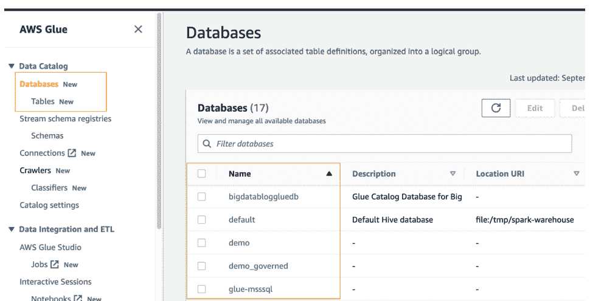

图 6.6 – AWS Glue 数据目录中的数据库

## 表

AWS Glue 数据目录表是您数据的元数据表示。它包含有关您数据的各种信息，例如名称、描述、位置、输入/输出格式、序列化库、模式、分区、索引等。

AWS Glue 数据目录支持表的版本控制，这意味着每当表更新时，默认情况下会创建一个新版本的表。这是识别源中的任何模式更改并防止因此类更改而导致下游应用程序失败的重要功能。请查看这篇博客文章，其中解释了如何检测 [使用 AWS Glue 检测您的数据源结构的变化](https://aws.amazon.com/blogs/big-data/identify-source-schema-changes-using-aws-glue/)：

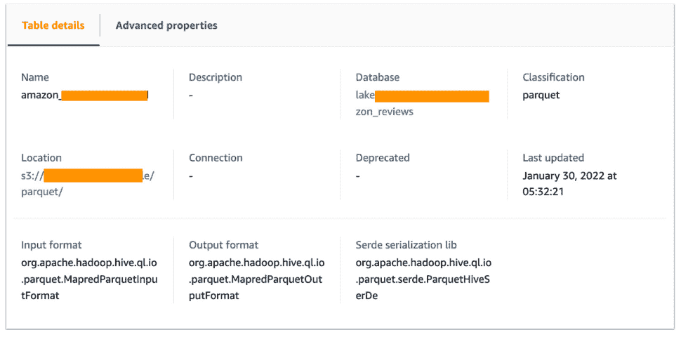

图 6.7 – AWS Glue 数据目录中的表属性

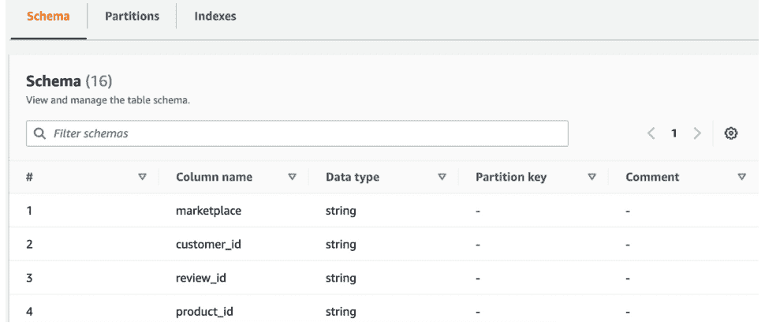

图 6.8 – AWS Glue 数据目录中的表属性

## 分区

分区是一种通过根据特定列的值对表进行划分来优化查询性能的策略。表可以有多个分区键来定义特定的分区（也称为分区规范）。该技术通过减少为回答特定查询而需要处理的数据量来提高查询性能：

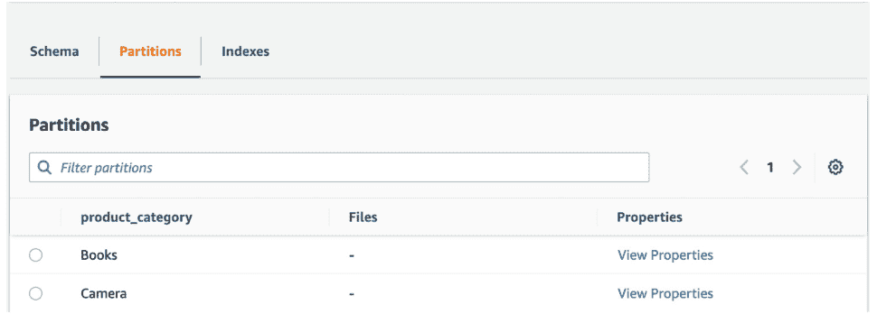

图 6.9 – AWS Glue 数据目录表中的分区

## Glue 连接

AWS Glue 提供 Glue 连接以允许您连接到不同的数据源。Glue 连接存储重要信息，例如登录凭据、连接字符串（URI）以及 VPC 配置详细信息（VPC 子网和安全组信息），所有这些信息都是建立到数据源的连接所必需的：

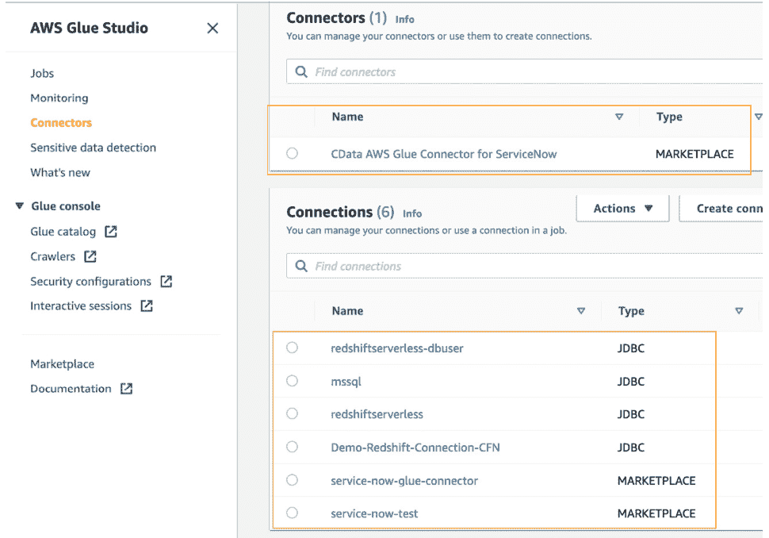

图 6.10 – AWS Glue 连接

在介绍了 AWS Glue 数据目录的基础知识后，我们接下来要讨论的话题是 AWS Glue 爬虫和分类器，以及它们在促进数据发现方面的作用。

## AWS Glue 爬虫

Glue 爬虫可让您从不同类型的数据存储中爬取数据、推断模式，并将数据集的元数据填充到 AWS Glue 数据目录中：

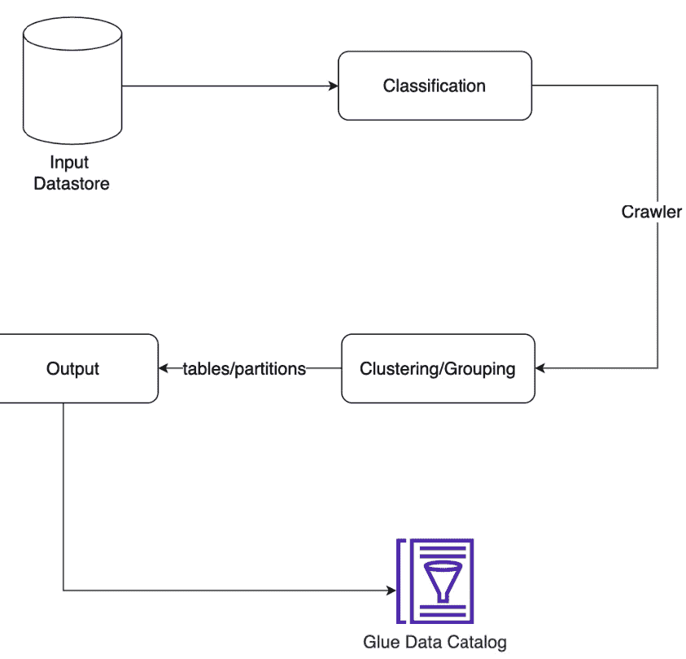

图 6.11 – Glue 爬虫的工作流程

Glue 爬虫工作流程包含多个阶段：

1.  分类：

在 AWS Glue 中，分类器负责检查数据存储中的数据并确定其格式。一旦识别出格式，分类器就会为数据生成适当的模式。

为了执行此任务，Glue 提供了内置和自定义分类器。当您创建并运行 Glue 爬虫时，它首先按爬虫配置中定义的顺序应用您指定的自定义分类器。这些自定义分类器在模式识别过程中具有优先权。

爬虫还会分配一个确定性数字，以指示对格式识别的置信程度。确定性值为 1.0 表示爬虫有 100% 的把握创建正确的模式。

如果没有分类器返回确定性值为 1.0，爬虫会选择确定性值最高的分类器。但是，如果没有分类器返回确定性值大于 0.0，AWS Glue 会返回默认分类字符串 **UNKNOWN**，表示无法确定格式。

2.  分组/聚类：

分类阶段的输出由爬虫使用，数据根据爬虫模式、分类和其他属性进行分组。

3.  输出：

在此阶段，Glue 数据目录 Glue API 会写入在聚类阶段创建的表或分区对象。为了避免表重复，如果表在上次运行中已存在，爬虫会为表创建一个带有哈希字符串后缀的表。

## Amazon S3 爬虫的内部工作原理

Glue 爬虫工作流程分为多个阶段。爬虫主要用于从 Amazon S3 爬取数据，您可能会想知道它是如何工作的。默认情况下，爬虫会读取指定 S3 路径中的所有数据。它对 S3 中可用的每个文件进行分类，并将元数据维护在爬虫的服务端存储中，该存储与 AWS Glue 数据目录不同且未向客户公开。在后续运行中，爬虫会重用存储的元数据，并且只爬取新添加的文件。这减少了后续运行中爬虫的执行时间。如果上传了同一文件的较新版本，爬虫会将其视为新文件并包含在新的爬取中。

爬虫根据文件大小对数据进行采样，并读取初始 1 到 10 MB 的数据。如果文件大小大于 10 MB，它会确保至少读取一条记录。

对于 JDBC、Amazon DynamoDB 和 Amazon DocumentDB，爬虫工作流程相同，但逻辑表是根据数据库引擎决定的。对于 JDBC，Glue 爬虫连接到数据库服务器并从与爬虫设置中包含的路径值匹配的数据库中提取模式。

让我们看一个使用 Amazon Athena 执行数据爬取并访问爬取数据的示例。在此示例中，我们将执行以下操作：

1.  探索 Covid-19 开源数据集。
2.  创建 Glue 目录数据库。
3.  创建 Glue 爬虫以爬取 Covid-19 数据集。
4.  使用 Athena 查询数据集。


为了说明此示例，我们将使用可在 AWS 上开放数据中找到的 Covid-19 数据集：

1. 前往 **AWS 开放数据注册表** (https://registry.opendata.aws/) 页面。在 **搜索数据集** 搜索框中，输入 **COVID-19 数据湖** 作为搜索条件。你应该会看到一个数据集，**COVID-19 数据湖，作为结果。**
2. 在页面上点击 **详细信息** (https://registry.opendata.aws/aws-covid19-lake/) 链接；你将看到有关如何访问数据集的 AWS 资源信息
3. 你可以使用 AWS CLI (https://aws.amazon.com/cli/) 从 Amazon S3 位置访问数据：
4. 在我们的示例中，我们希望使用 Covid-19 数据集的一个子集：

```
aws s3 ls --no-sign-request s3://covid19-lake/
```

```
aws s3 ls  s3://covid19-lake/rearc-covid-19-testing-data/
```

为继续此示例，下一步是创建 Glue Catalog 数据库。

5. 前往 AWS Glue 控制台 (https://console.aws.amazon.com/glue/) 并在左侧点击 **数据库**。
6. 通过点击 **添加数据库**，然后 **创建**，创建一个名为 **chapter6_covid19** 的数据库：

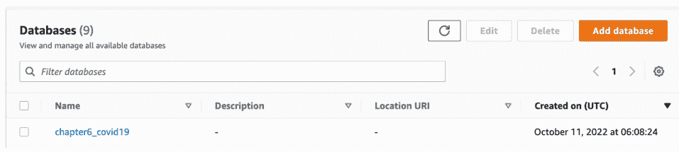

图 6.12 – AWS Glue – 数据库

为继续此示例，下一步是创建 Glue 爬虫。

7. 在左侧点击 **爬虫**。
8. 点击 **创建爬虫**。
9. 在 **设置爬虫属性** 页面，为新爬虫提供一个名称，例如 **chapter-gluecrawler**，然后点击 **下一步**。
10. 在 **选择数据源和分类器** 页面，在 **数据源配置** 下选择 **尚未**
11. 点击 **添加数据存储**，在 **S3 数据位置** 下选择 **在不同账户中**，在 **S3 路径** 下设置 **s3://covid19-lake/rearc-covid-19-testing-data/**，然后点击 **添加 S3 数据源**。然后，点击 **下一步** 并将其他选项保持默认。
12. 在 **配置安全设置** 页面，点击 **创建新的 IAM 角色** 并提供 **AWSGlueServiceRole-covid19**。然后，点击 **创建** 然后 **下一步**。
13. 在 **设置输出和调度** 页面，在 **输出配置** 部分，从 **数据库** 下拉列表中选择 **chapter6_covid19**。输入 **covid19_** 作为添加到表的前缀（可选），并且在 **爬虫计划** 下，将频率保持为 **按需**。
14. 查看所有配置并点击 **创建爬虫**：

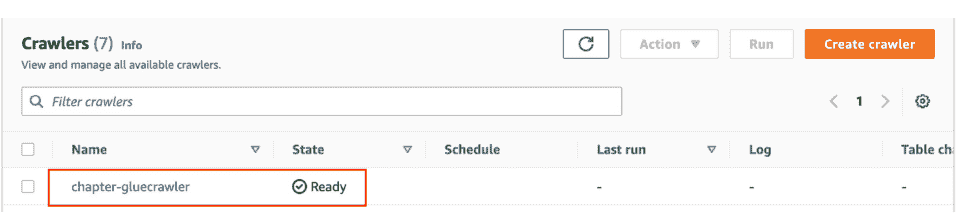

图 6.13 – AWS Glue – 爬虫

15. 现在我们已经创建了爬虫，点击其旁边的复选框并通过点击页面顶部的运行按钮来运行爬虫。爬虫完成需要一两分钟：

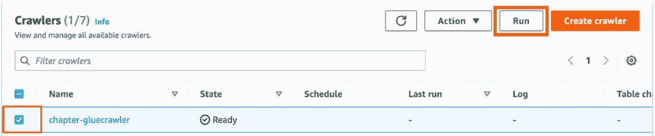

图 6.14 – AWS Glue – 运行

爬虫成功完成后，它将列出四个表。让我们进入数据库并探索表定义：

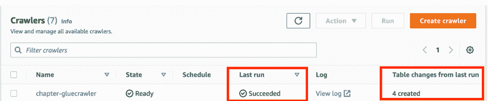

图 6.15 – AWS Glue – 爬虫状态

观察表位置和分类，我们可以看到它指向 Covid-19 数据集并为不同文件类型提取数据库定义——在本例中为 CSV 和 JSON。正如你所学，Glue 爬虫允许你从不同的 AWS 账户中爬取数据，这在构建集中式数据目录时非常有用，而数据存储在不同的 AWS 账户中：

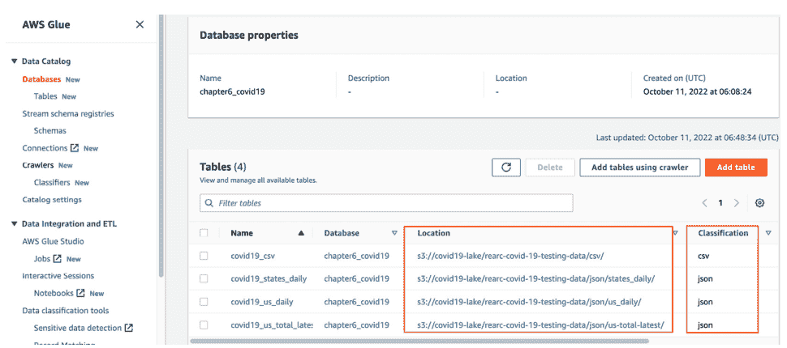

图 6.16 – AWS Glue 数据目录表

通过点击表的名称——在本例中为 'covid19_csv'——你可以探索表定义。正如我们之前所学，这提供了有关表的有价值信息，包括统计信息和元数据：

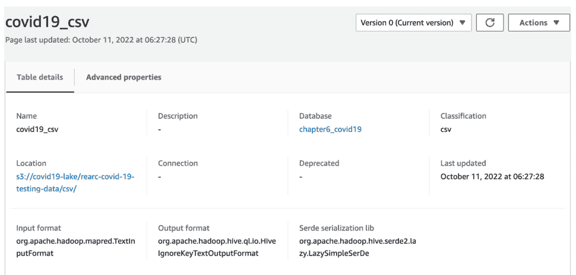

图 6.17 – AWS Glue 目录表属性

## 表统计

在 AWS Glue 中，表统计指的是 Glue 数据目录中表的统计信息。这些统计信息包括每列的总值和不同值的数量、最小值和最大值以及值的平均长度。此信息对于查询优化和性能调优很重要：

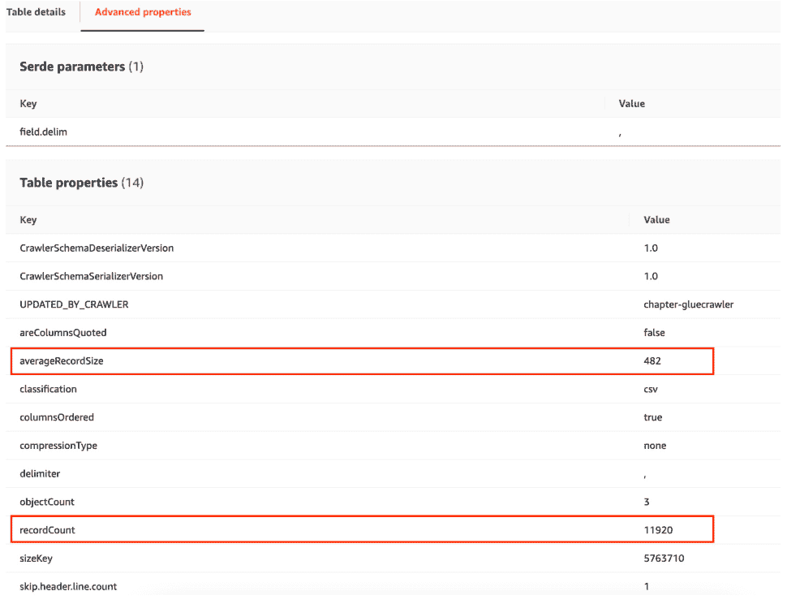

图 6.18 – AWS Glue 目录 – 高级属性

表统计可以通过 AWS Glue 控制台或 Glue API 查看和更新。它们也可以在数据发现过程中由 AWS Glue 爬虫自动收集。

Glue 数据目录中的表统计提供了有关存储在数据目录中的表的重要元数据。这些统计信息包括诸如表中的行数、表的大小以及列统计信息等信息，例如最小值和最大值、数据分布和数据类型。这些统计信息在 AWS Glue 中的查询优化和性能调优中发挥着至关重要的作用。

这些表统计信息由 AWS Glue 以及 Amazon Athena 或 Amazon Redshift Spectrum 等查询引擎用于就查询执行计划做出明智决策。以下是表统计的重要性以及如何利用它们进行查询优化和性能调优：

- **查询规划：** 查询优化器使用表统计信息来估计查询中涉及的表的基数（行数）和数据分布。此估计有助于优化器选择最有效的查询执行计划。准确的统计信息使优化器能够做出更好的决策，从而实现更快、更高效的查询处理。
- **连接优化**：在连接多个表时，查询优化器利用表统计信息来确定最佳连接策略。通过分析列统计信息（如数据分布和值范围），优化器可以决定是否执行哈希连接、合并连接或其他连接算法。此信息有助于最大限度地减少数据洗牌并提高整体连接性能。
- **谓词下推**：表统计信息也用于谓词下推，即在将数据带入查询引擎之前将过滤操作下推到数据源。通过了解列的数据分布和值范围，优化器可以确定在数据源处进行过滤是否会显著减少待处理的数据量，从而加快查询执行速度。
- **数据倾斜检测**：表统计信息可以帮助识别数据倾斜，即数据在分区或列之间的分布不均匀。数据倾斜会负面影响查询性能，导致某些任务花费的时间明显长于其他任务。通过分析表统计信息，你可以检测到数据倾斜并采取纠正措施，例如重新分布数据或使用不同的分区策略以实现更好的负载均衡并提高查询性能。

为了确保表统计的准确性，随着数据的变化定期更新它们非常重要。AWS Glue 提供了通过使用爬虫自动为表收集统计信息的功能。此外，你还可以使用 Amazon Athena 等查询引擎中的 `ANALYZE TABLE` 命令手动更新表统计信息：

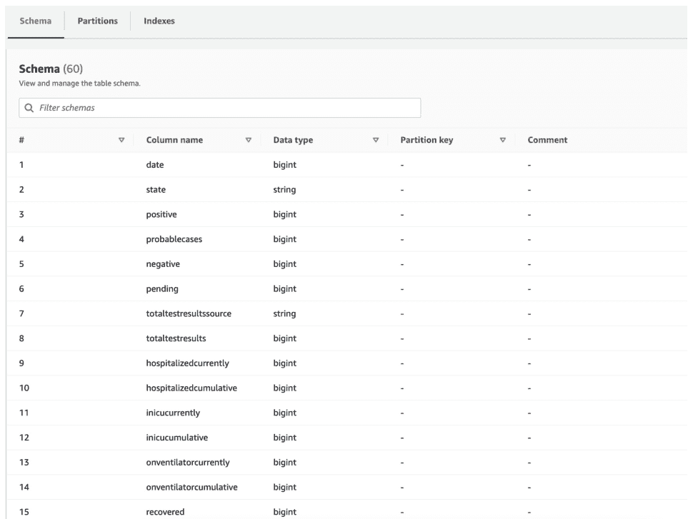

图 6.19 – AWS Glue 目录表架构定义

在探索了表定义之后，我们现在可以使用 Amazon Athena 查看数据。

点击 **表数据** 将把我们重定向到 Athena 控制台：

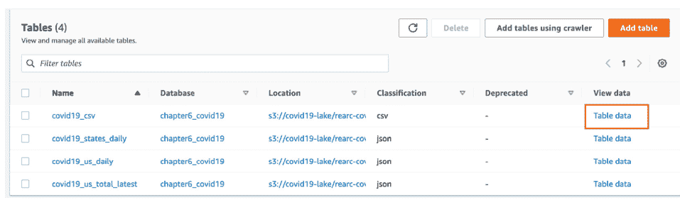

图 6.20 – AWS Glue 数据目录中的表列表

在这里，我们使用 Amazon Athena 访问了 `covid19_csv` 表的数据。通过点击 **表数据**，我们被重定向到 Athena 控制台，在那里可以看到表的数据。其他表也在 Athena 中列出。在下一章中，我们将更详细地探索 Athena：

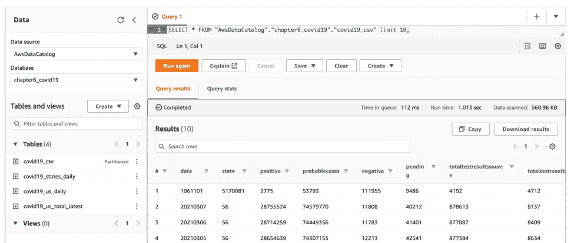

图 6.21 – Amazon Athena 查询控制台

在本示例中，我们演示了如何使用 AWS Glue 目录对 Covid-19 数据集进行编目，并使用 Amazon Athena 对其运行 SQL 查询。在下一节中，我们将重点介绍如何使用 AWS Glue ETL 执行数据摄取。

## 使用 AWS Glue ETL 进行数据摄取

在上一节中，我们学习了如何使用 AWS Glue 爬虫和 AWS Glue 数据目录的各种功能来创建用于数据发现的集中式数据目录。在本节中，我们将探索

使用 AWS Glue ETL 从各种数据源进行数据摄取的选项，例如数据湖（Amazon S3）、数据库、流数据和 SaaS 数据存储。此外，我们将学习如何使用作业书签从数据湖（S3）和 JDBC 执行增量数据加载。

Glue 使用户能够使用三种不同类型的 ETL 框架创建 ETL 作业——Spark ETL、Spark Streaming 和 Python Shell。在 Glue DataBrew 的介绍部分，我们了解到 AWS Glue 的演进情况，现在 AWS Glue Studio 可用于构建 ETL 管道。

AWS Glue 用户界面允许您使用一项有趣的功能构建 ETL 管道，该功能可将您的 UI 作业转换为脚本，这有助于您在构建类似管道时扩展，或在需要入门帮助然后添加自定义时使用。

除了支持多种 Spark 框架处理数据外，Glue 在作业创建期间还提供高级功能，例如自动扩展、作业书签、启用连续日志记录、Spark UI、Flex 实例以及传递 Spark 和作业参数。

除了 Spark 框架之外，Glue ETL 还提供 Glue 原生的高级框架/API 和格式用于复杂 ETL，例如 GlueContext、DynamicFrame、作业书签、Glue Parquet、Glue 交互式会话、工作流、触发器等。

让我们逐一探索这些功能。

## AWS GlueContext

GlueContext 类封装了 Apache 的 SparkContext，可以使用以下代码片段进行初始化：

```
sc = SparkContext()
glueContext = GlueContext(sc)
```

GlueContext 允许您与 Spark 框架通信，并且是许多 Glue ETL 功能的入口点，例如 DynamicFrame、作业书签、作业参数等。

## DynamicFrame

Glue ETL 的 DynamicFrame 是一项重要功能，使 Spark 开发人员能够创建更高效的 Spark 管道，并且是 Glue 原生的。Glue DynamicFrame 是自描述 DynamicRecord 对象的分布式集合，但它不需要它们遵循固定模式。由于 DynamicFrame 中记录的自描述特性，它不需要创建模式，并且可用于读取/转换具有不一致模式的数据。

您可以根据用例使用不同的 API 创建 Glue DynamicFrame。例如，以下代码片段为 `my_database` 数据库中的 `my_table` 表创建名为 `datasource0` 的 DynamicFrame 对象：

```
datasource0 = glueContext.create_dynamic_frame.from_catalog(database_name='my_database',
table_name='my_table', transformation_ctx='datasource0')
```

在此语句中，我们使用了使用 Glue SDK 的 `GlueContext` 对象，以连接到 Glue Data Catalog 并获取数据源分类和属性以创建对象。用户还可以使用额外的 `_options` 参数传递其他选项，例如 `push_down_predicate` 参数。

除了使用 `from_catalog` 方法创建 DynamicFrame 外，您还可以使用以下方法创建 DynamicFrames：

- **from_options**: 此方法允许用户通过手动指定连接类型、选项和格式来创建 DynamicFrames。此方法为用户提供了自定义数据存储选项的灵活性。
- **from_rdd**: 此方法允许用户使用 Spark RDD 创建 DynamicFrames。

要利用 DataFrame 中可用的功能，您可以使用以下语法将 DynamicFrame 转换为 DataFrame：

```
df = datasource0.toDF()
```

同样，您可以使用以下语法将 Spark DataFrame 转换为 Glue DynamicFrame：

```
from awsglue.dynamicframe import DynamicFrame
dyf = DynamicFrame.fromDF(dataframe=df,
glue_ctx=glueContext, name="dyf")
```

DynamicFrame 和 DataFrame 都是与 Spark RDD 交互的高级 API。然而，DynamicFrame 的结构与 DataFrame 不同：

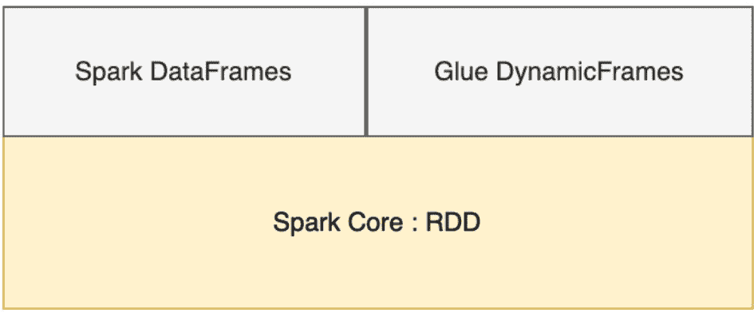

Figure 6.22 – AWS Glue ETL 高级架构

需要注意的是，将 Glue DynamicFrame 转换为 Spark DataFrame 需要 Spark 中的完整 Map 阶段，这可能资源密集并增加作业执行时间。这是因为将 DynamicFrame 转换为 DataFrame 会阻塞 Spark，使用针对 DynamicFrame 所做的所有优化。

## AWS Glue Job bookmarks

AWS Glue 提供了独特的书签功能，这使其区别于其他基于 Spark 的 ETL 解决方案，例如在 Amazon **Elastic MapReduce (EMR)** 上运行 Spark。书签通过跟踪已处理和写入的数据来启用增量数据加载。这在处理大型数据集或从数据库提取数据时特别有用。

作业书签适用于 JDBC 数据源、Amazon S3 和关系转换。对于 Amazon S3，作业书签适用于 JSON、CSV、Apache Avro、XML、Parquet 和 ORC 文件格式。在使用 JDBC 源时，用户需要指定一列作为书签键；否则，AWS Glue 将使用主键作为书签键，前提是其顺序递增或递减且无间隙。如果使用用户定义的书签键，则应单调递增或递减；此情况下允许存在间隙。

对于 Amazon S3，AWS Glue 使用对象的最后修改时间来确定需要重新处理哪些对象。提供了各种处理选项，例如重置作业书签和回溯。重置作业书签允许用户使用同一作业重新处理所有数据，而回溯使他们能够返回到任何之前的作业运行。需要注意的是，将 Glue DynamicFrame 转换为 Spark DataFrame 需要 Spark 中的完整 Map 阶段，

这可能资源密集并增加作业执行时间，因为它会阻塞针对 DynamicFrames 的 Spark 优化。

## AWS Glue Triggers

AWS Glue 触发器使您能够安排 Glue 工作流，其中包括 Glue 作业和爬虫。您可以创建按需、计划或基于事件触发的触发器。触发器可以存在于多个状态，例如 CREATED、ACTIVATED 和 DEACTIVATED。

有三种类型的触发器可用：

- **Scheduled triggers:** 这些触发器基于时间，可以使用 cron 表达式配置以定义计划。
- **Conditional triggers:** 这些触发器基于之前的作业或爬虫状态执行。例如，您可以配置触发器仅在爬虫完成后才执行 Job 1。
- **On-demand triggers:** 这些触发器按名称所示手动激活，并在您运行时执行。

## AWS Glue interactive sessions

AWS Glue 提供了在 AWS 上构建、测试和运行 ETL 作业的交互式环境。此环境包括一个开源 Jupyter 内核，可与 PyCharm、IntelliJ 和 VS Code 等流行 IDE 集成，允许您在本地编写和测试代码。要设置交互式会话，您可以参考官方 Glue 文档 https://docs.aws.amazon.com/glue/latest/dg/interactive-sessions.html。

现在我们对所有 Glue 组件有了充分的了解，让我们通过示例学习一些摄取模式：

- 从 Amazon S3（对象存储）摄取数据
- 从 SaaS 应用程序摄取数据
- 从关系数据库摄取数据

## AWS Glue Studio

Glue Studio 是 AWS Glue 提供的用于构建和管理 ETL 工作流的强大可视化界面。它提供多项功能和优势，可增强数据集成和转换过程。然而，也有一些限制和注意事项需要牢记。让我们提供一个概述。

Glue Studio 的功能和优势如下：

- **Visual ETL development**: Glue Studio 提供用户界面用于可视化设计 ETL 工作流。它通过允许用户创建、连接和配置称为“transforms”的预建组件来简化构建数据管道的过程，无需编写代码。
- **Pre-built transform library**: Glue Studio 提供丰富的预建 transforms 库，这些是数据处理操作，例如过滤、聚合、连接等。这些 transforms 可以轻松纳入工作流，节省开发复杂数据转换的时间和精力。
- **Auto-generated Spark code**: 在幕后，Glue Studio 根据可视化工作流自动生成 Apache Spark 代码。这使用户能够利用 Spark 进行分布式数据处理的强大功能，同时抽象掉 Spark 编程的复杂性。
- **Integration with Glue Data Catalog**: Glue Studio 与 Glue Data Catalog 无缝集成，允许轻松访问元数据、表定义和模式。它简化了在各种 AWS 数据源（如 Amazon S3、RDS、Redshift 等）中存储的数据的工作流程。
- **Built-in data catalog and data lake**: Glue Studio 利用 Glue Data Catalog 作为管理组织元数据的中央存储库。它使用户能够在数据湖中发现、编目和探索数据资产，促进数据治理和自助式数据发现。
- **Easy deployment and scheduling**: Glue Studio 提供简单的部署选项，允许用户只需点击几下即可将工作流部署为 AWS Glue ETL 作业。它还提供调度功能以自动重复执行工作流。

AWS Glue Studio 的一个限制和注意事项是 **limited customization**。虽然 Glue Studio 为 ETL 开发提供可视化界面，但在复杂转换或自定义逻辑方面可能存在限制。在这种情况下，您可能需要切换到使用 Glue ETL 脚本或其他 AWS 服务的传统编码方法。

## Ingesting data from object stores

此示例涉及从 Open Data on AWS 上的 COVID-19 数据湖复制数据（https://registry.opendata.aws/aws-covid19-lake/），该数据存储在名为 `s3://covid19-lake/` 的公共 S3 存储桶中。为了实现这一点，我们将使用 Amazon S3 Boto3 库，这是一个用于连接 SFTP、FTP 等不同文件存储中的数据的 Python 包。在这种情况下，将使用 Glue Python shell ETL 作业从 Amazon S3 读取 CSV 数据，将其转换为 JSON，然后复制到目标 S3 存储桶。Amazon S3 上的 COVID-19 数据湖包含各种文件夹，在此示例中将使用 `s3://covid19-lake/rearc-covid-19-testing-data/csv/us_daily/` 文件夹：

```
(base) ~ % aws s3 ls s3://covid19-lake/rearc-covid-19-testing-data/csv/us_daily/
2021-03-15 15:34:30       82926 us_daily.csv
```

以下是代码片段：

```
import boto3
import io
import pandas as pd
```


```
client = boto3.client('s3')
# covid-19 data lake - https://registry.opendata.aws/aws-covid19-lake/
src_bucket = 'covid19-lake'  # SOURCE_S3_BUCKET_NAME
target_bucket = 'S3_TARGET_BUCKET_NAME'
src_object = client.get_object(
    Bucket=src_bucket,
    Key='rearc-covid-19-testing-data/csv/us_daily/us_daily.csv'
)
# Read CSV and Transform to JSON
df = pd.read_csv(src_object['Body'])
jsonBuffer = io.StringIO()
df.to_json(jsonBuffer, orient='records')
# Write JSON to target location
client.put_object(
    Bucket=target_bucket,
    Key='target_prefix/data.json',
    Body=jsonBuffer.getvalue()
)
```

提供的代码片段利用 get_object() 方法从 Amazon S3 检索数据，然后使用 pandas 库将数据从 CSV 格式转换到 JSON 格式。最后，利用 put_object() 方法将转换后的数据写入目标位置。

## 从数据库摄取数据（JDBC 数据存储）

AWS Glue 通常用于将数据从数据库引入数据湖。这通常以批处理方式使用 JDBC 连接完成。要连接到数据库，可以使用 AWS Glue Connection，它存储数据库的登录凭据、URI 字符串和虚拟私有云（VPC）信息。AWS Glue 支持多种类型的连接，包括 JDBC、Amazon RDS、Amazon Redshift、Amazon DocumentDB、Kafka 和 MongoDB。要创建 JDBC 连接，可以使用以下格式：

```
jdbc:protocol://host:port/db_name
```

您可以通过阅读 AWS Glue 文档（https://docs.aws.amazon.com/glue/latest/dg/connection-properties.html#connection-properties-required）了解更多关于为各种数据库创建连接的信息。

以下是 Microsoft SQL Server 数据库连接的示例：

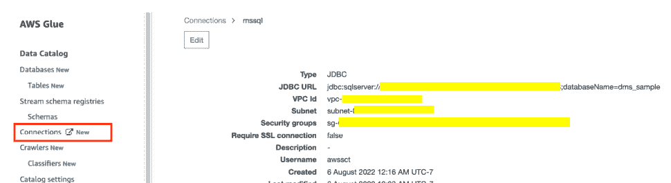

图 6.24 – AWS Glue JDBC 连接

以下是代码片段。在这里，我们正在连接 MSSQL 数据库并将数据从 MSSQL 数据库以 Parquet 文件格式移动到 Amazon S3：

```
MicrosoftSQLServer = directJDBCSources(glueContext,
    connectionName="mssql",
    connectionType="sqlserver",
    database="ec2-00-000-000-00.compute-1.amazonaws.com:1433",
    databaseName="dms_sample",
    table="dms_sample.sports",
    redshiftTmpDir="",
    transformation_ctx="MicrosoftSQLServer",
)
S3bucket_node3 = glueContext.write_dynamic_frame.from_options(
    frame=MicrosoftSQLServer,
    connection_type="s3",
    format="parquet",
    connection_options={"path": "s3://target_dir"},
    format_options={"compression": "uncompressed"},
    transformation_ctx="S3bucket_node3",
)
```

## 从 SaaS 数据存储摄取数据

到目前为止，我们已经学习了如何使用 AWS Glue 将数据从对象存储（如 Amazon S3）和关系数据库（如 Microsoft SQL Server）引入。现在，我们将学习如何使用 AWS Glue 从 SaaS 数据存储摄取数据。

要连接到 SaaS 数据存储，需要使用 AWS Glue Marketplace 连接器；这些连接器于 2020 年 12 月推出。在撰写本文时，Marketplace 总共有 66 个连接器，其中包括 AWS 和第三方连接器，如 SnowFlake、ServiceNow、Google BigQuery、ElasticSearch、Apache Iceberg、Delta Lake 等：

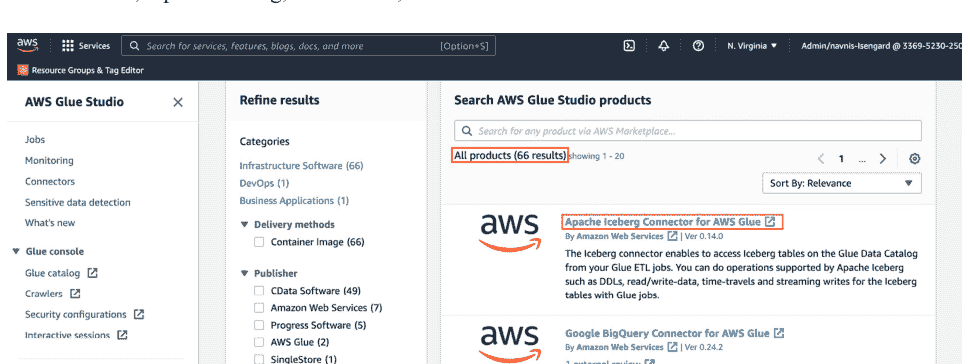

图 6.25 – AWS Glue Marketplace 连接器

要连接 ServiceNow 并将数据引入 Amazon S3 数据湖，请按照以下步骤操作：

- 1. 访问 AWS Marketplace（https://us-east-1.console.aws.amazon.com/gluestudio/home?region=us-east-1#/marketplace）并订阅 ServiceNow 连接器。在继续之前请查看文档、定价和用户指南。
- 2. 使用已订阅的 ServiceNow 连接器创建连接。
- 3. 使用 AWS Glue Studio 构建 ETL 管道：

```
import sys
from awsglue.transforms import *
from awsglue.utils import getResolvedOptions
from pyspark.context import SparkContext
from awsglue.context import GlueContext
from awsglue.job import Job
args = getResolvedOptions(sys.argv, ["JOB_NAME"])
sc = SparkContext()
glueContext = GlueContext(sc)
spark = glueContext.spark_session
job = Job(glueContext)
job.init(args["JOB_NAME"], args)
Script generated for node CData AWS Glue Connector for ServiceNow
ServiceNowCDataAWSGlueConnectorforServiceNow_node1 =
( glueContext.create_dynamic_frame.from_options( connection_type="marketplace.jdbc", connection_options={ "tableName": "incident", "dbTable": "incident", "connectionName": "service-now-glue-connector", }, transformation_ctx="CDataAWSGlueConnectorforServiceNow_node1", ))
```

您可以在 https://aws.amazon.com/blogs/big-data/extract-servicenow-data-using-aws-glue-studio-in-an-amazon-s3-data-lake-and-analyze-using-amazon-athena/ 找到一篇有用的博文，其中提供了有关如何构建管道以使用 AWS Glue Studio 连接 ServiceNow 并将数据引入 Amazon S3 数据湖的详细分步指南。该博文包括在 AWS Marketplace 订阅 ServiceNow 连接器、使用连接器创建连接以及使用 AWS Glue Studio 构建 ETL 管道的说明。此外，它还解释了在 ServiceNow 数据被摄取到数据湖后如何使用 Amazon Athena 分析该数据。

## 摘要

在本章中，我们介绍了 Apache Spark、它与 AWS Glue 的连接以及 AWS Glue 中提供的各种功能，包括用于数据发现的 AWS Glue Data Catalog、用于元数据提取的 AWS Glue Crawler 以及用于构建基于 UI 的 ETL 管道的 AWS Glue Studio。我们还探讨了如何使用 AWS Glue Marketplace 订阅不同的连接器，以便从 SaaS 应用程序中提取数据。

在下一章中，我们将讨论另一项在数据整理和发现过程中发挥重要作用的基本服务：Amazon Athena。
