## 使用 Athena

在之前的章节中，您了解了 AWS Glue 和 Amazon S3 服务以及它们如何融入数据整理管道。在本章中，我们将探讨 Amazon Athena 服务如何帮助数据整理管道中的数据发现、数据结构化、数据丰富和数据质量阶段。我们将使用一些实际示例并对数据进行分析，以使其更具趣味性。

本章涵盖以下主题：

- 了解 Amazon Athena
- 使用 Athena 进行高级数据发现和数据结构化
- 使用 Athena 从多个来源丰富数据
- 使用 Athena 设置无服务器数据质量管道

### 了解 Amazon Athena

Amazon Athena 是一种交互式、无服务器的分析服务，可帮助在不加载数据的情况下探索 Amazon S3 中可用的数据。Athena 通过 SQL 语法或交互式 Spark 应用程序帮助分析数据。它可以帮助客户通过熟悉的 SQL 分析存储在 Amazon S3 上多种数据格式中的数据集。由于 Athena 是一种无服务器服务，用户按查询扫描的数据量付费，无需维护单独的服务器来启用用户查询。这使业务和分析团队能够快速分析、转换和可视化数据湖中的数据，以满足特定用例，而无需依赖数据工程团队构建复杂的 ETL 管道。

Amazon Athena 于 re:Invent 2016 推出，并在随后的时间里经历了重大改进。它最初作为一种无服务器机制推出，用于使用 Athena 目录（与 Glue 目录不同）中的托管 Presto 服务器查询 Amazon S3 数据。现在，它支持从 Glue 目录查询数据、查询联邦、CTAS 语句、Lake Formation 集成、对事务性数据湖格式的支持、Athena for Spark 等。

在 re:Invent 2022 宣布 Athena for Apache Spark 后，Athena 支持以下两种数据分析模式：

- 用户可以使用 SQL 语法查询数据，该语法类似于 Presto/Trino 但有限制。这使没有编程语言专业知识的分析师能够在没有他人支持的情况下分析 S3 数据湖中的数据。以下博文包含

Amazon Athena 使用的最佳实践，用于优化成本并提高基于 SQL 的分析性能：
https://aws.amazon.com/blogs/big-data/top-10-performance-tuning-tips-for-amazon-athena/

- Athena for Spark 在推出时支持 Apache Spark 版本 3.2。请参考 Athena 文档了解最近 Spark 版本的支持情况。有关 Athena for Spark 的更多详细信息，请参考以下博客：。

## 何时使用 SQL/Spark 分析选项？

如果您想在不将数据湖加载到另一存储层的情况下对其进行分析，请使用 Athena SQL 对数据进行编目和查询。您还可以使用 CTAS 语句执行轻量级数据转换。如果您想以交互式和无服务器的方式为某些分析用例执行 Spark 程序，则可以使用 Athena for Spark 选项。

## 使用 Athena 进行高级数据发现和数据结构化

在本节中，我们将探讨 Amazon Athena 如何帮助执行数据整理管道中的高级数据发现和数据结构化阶段。

## 使用 Athena 进行基于 SQL 的数据发现

Amazon Athena 提供基于 SQL 的数据探索，并支持高级数据类型。优势在于，即使没有编码经验的人也可以使用熟悉的 SQL 语法在多种格式的数据和不同存储类型上探索数据。

在使用 Amazon Athena 查询数据之前，我们需要在 Glue 目录中为表创建元数据。Amazon Athena 可帮助您从不同的数据源查询数据，如下所示：

- **AWS Glue catalog**—访问 AWS Glue 目录中可用的表。我们可以通过多种方式在 AWS Glue 目录中创建表，我们将在本章后面进行探讨。
- **Federated data sources**—支持从 Apache Hive、AWS 以及第三方数据库和服务查询数据。有关受支持数据源的完整列表，请参阅 https://docs.aws.amazon.com/athena/latest/ug/connectors-prebuilt.html。

除了预构建连接器之外，您还可以创建自定义连接器来查询您选择的数据源。我们将在本章后面详细探讨联邦数据源。

让我们更深入地了解 Glue 目录，它将成为大多数 Athena 查询的中央元数据存储。Glue 目录是一个持久的元数据存储，允许用户存储、注释和共享元数据。每个 AWS 账户在每个区域内都有一个唯一的 Glue 目录。您可以使用 **Identity and Access Management (IAM)** 策略来定义和控制用户对 Glue 目录和表的访问。对于细粒度的数据访问（记录和列级别），用户将需要探索 AWS Lake Formation 服务。

如果您查看 AWS Glue 控制台，可以在 Data Catalog 部分下看到不同的链接，如下所示：

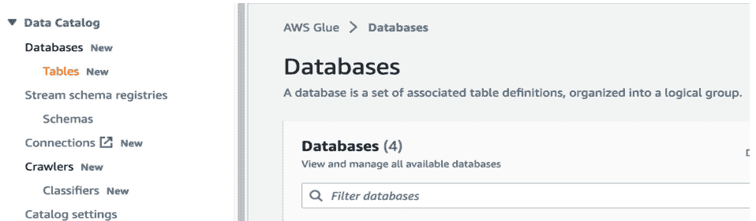

图 7.1：AWS Glue 控制台 – 数据目录部分

让我们更详细地查看这些部分：

- **Databases**：数据库是用于存储来自不同数据源的表元数据信息的容器。用户可以将此理解为与数据库世界中的 schema/数据库概念相关。
- **Tables**：每个表都将具有源数据的架构定义。我们要强调的是，这只是实际数据存储在其他地方的元数据定义，例如 S3 数据湖。当文件具有相同的架构、数据格式和压缩格式时，它还会创建表的分区。

表可以从三个来源创建，如下所示：

- 爬虫在运行时创建新表。我们可以通过按计划运行 Glue 爬虫来使架构随着新分区、额外列等保持更新。
- 手动添加架构定义。当您想要自定义表/列的名称、仅显示数据集中的特定列等时，可以采用此方法。
- 从模式注册表中现有的架构为流数据源创建表。

Glue 目录表可以有多个版本。对表元数据的每次编辑都会创建表的新版本。您可以在 AWS Glue 控制台 UI 上比较表版本，并验证不同表版本之间所做的更改，如以下屏幕截图所示。此外，我们还可以使用 `delete-table-version` API 将其恢复到以前的版本：

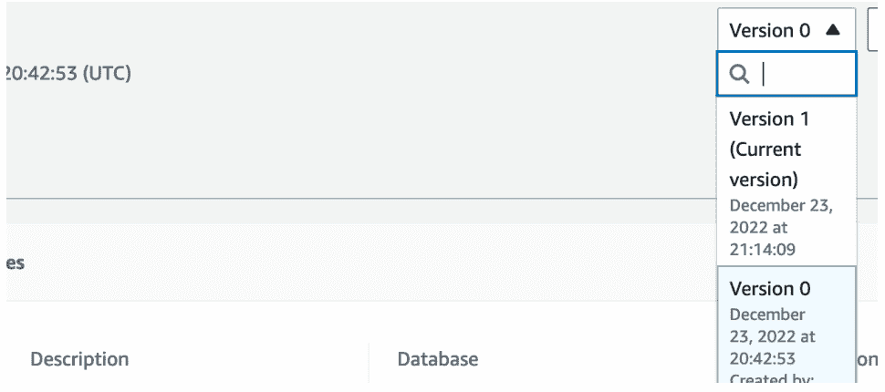

图 7.2：AWS Glue 控制台 – 具有多个版本的表

- **Connections**：存储登录凭据、URI 和 VPC 信息，以避免每次运行爬虫/作业时都提供此信息。我们还可以创建网络连接，通过 VPC 访问 Amazon S3 或其他服务，而不使用公共互联网。
- **Crawlers**：Glue 爬虫会自动为用户发现数据并编目元数据（包括半结构化和日志数据）。爬虫使用分类器来推断和识别数据类型，包括 AWS Glue 创建的（CSV、JSON 等）和使用 grok 模式的自定义分类器。爬虫可以根据用户提供的配置检测架构更改并自动更新表定义。

为了探索 Athena 的功能，我们将使用来自 https://docs.opendata.aws/noaa-ghcn-pds/readme.html 的 NOAA 示例数据集。我们有 Parquet、CSV 和压缩 CSV 格式的数据可用。

我们将创建两种格式的表，如前所述，通过 AWS Glue 爬虫和手动方法。

## 通过 AWS Glue 爬虫创建表并在 Athena 中查询

我们将按如下方式开始：

- 1. 导航到 AWS Glue 控制台，创建一个新的爬虫，并为 `noaa` 数据集提供 S3 路径，如爬虫 **Add data source** 屏幕所示：

### Network connection - optional

可选地包含一个网络连接以与此 S3 目标一起使用。请注意，每个爬虫仅限于一个网络连接，因此任何其他 S3 目标也将使用相同的连接（如果留空，则不使用）。

### S3 path

浏览或输入现有 S3 路径。

s3://noaa-ghcn-pds/parquet/by_year/

S3 路径中包含的所有文件夹和文件都将被爬取。例如，输入 s3://MyBucket/MyFolder/ 以爬取 MyBucket 中 MyFolder 内的所有对象。

### Subsequent crawler runs

此字段是全局字段，影响所有 S3 数据源。

Crawl all sub-folders

图 7.3：AWS Glue 控制台 – 配置爬虫

提供具有适当访问权限（包括 S3 读取访问权限）的 IAM 角色和数据库名称以完成爬虫创建。

- 2. 爬虫创建后，单击运行它并等待其完成。爬虫完成后，您可以看到新表已添加到 Glue 目录中，并且分区已添加到 Glue 目录中：

| 开始时间（UTC） | 结束时间（UTC） | 当前/上次持续时间 | 状态 | DPU 小时 | 表更改 |
|---|---|---|---|---|---|
| 2022年12月23日 20:40 | 2022年12月23日 20:43 | 03 分 12 秒 | 已完成 | - | 1 个表更改 7864 个分区更改 |

图 7.4：AWS Glue 控制台 – 成功爬虫运行的结果

- 3. 现在，您可以在 Athena 中查询表并开始分析数据。在表上运行 SELECT 查询，您还可以使用表中的分区来过滤数据：

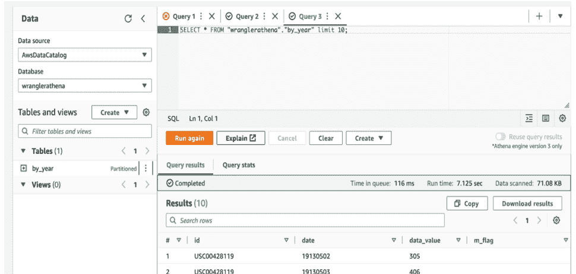

图 7.5：AWS Athena 控制台 – 查询由 Glue 爬虫创建的表

## 手动在 Athena 中创建表并查询表

在这里，我们将以手动方式为 CSV 格式创建表。我们将遵循以下列出的方法：

- 1. 下载示例文件并了解表结构。

在手动创建表之前，我们需要了解源文件中的列和数据类型，以便适当创建表数据定义语言（DDL）语句。在此示例中，我们将仅使用 CLI 中的命令下载 2022 年的数据（假设机器上已安装 AWS CLI），如下所示：

```
aws s3 cp s3://noaa-ghcn-pds/csv/by_year/2022.csv .
```

由于这是一个 CSV 文件，我们可以在 Excel 应用程序中打开它；在某些系统上可能会出现错误，因为这是一个巨大的文件，大小超过 1 GB，但您可以浏览数据中可用的不同列和数据类型。您可以在此处看到文件在 Excel 中打开：

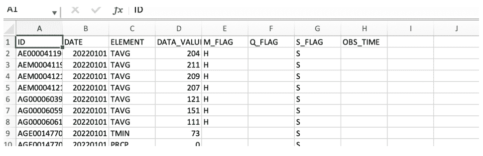

图 7.6：在 Excel 中打开的示例数据文件，以了解列结构和数据类型

2. 现在，我们将创建一个 DDL 语句并在 Athena 中执行以创建表：

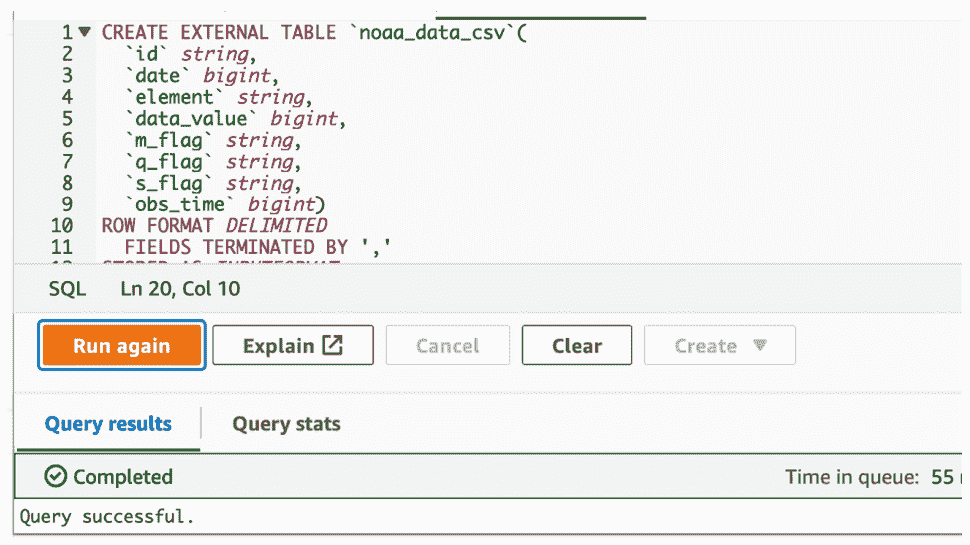

图 7.7：AWS Athena 控制台 – 使用 DDL 语句手动创建表

### NOTE

使用的 DDL 语句如下所示。 该 DDL 语句取自不同的 Glue 爬虫以节省时间，并在此处进行了更改以满足我们的需求。

```
CREATE EXTERNAL TABLE `noaa_data_csv` ( `id` string,
  `date` bigint,
  `element` string,
  `data_value` bigint,
  `m_flag` string,
  `q_flag` string,
  `s_flag` string,
  `obs_time` bigint)
ROW FORMAT DELIMITED
FIELDS TERMINATED BY ','
STORED AS INPUTFORMAT
'org.apache.hadoop.mapred.TextInputFormat'
OUTPUTFORMAT
'org.apache.hadoop.hive.ql.io.HiveIgnoreKeyTextOutputFormat'
LOCATION
's3://noaa-ghcn-pds/csv/by_year/'
TBLPROPERTIES (
  'areColumnsQuoted'='false',
  'classification'='csv',
  'columnsOrdered'='true',
  'compressionType'='none',
  'delimiter'=',',
  'skip.header.line.count'='1',
  'typeOfData'='file')
```

3. 现在，我们可以使用 Amazon Athena 从该表位置开始查询数据，如下所示：

```
SELECT * FROM "wranglerathena"."noaa_data_csv" limit 10;
```

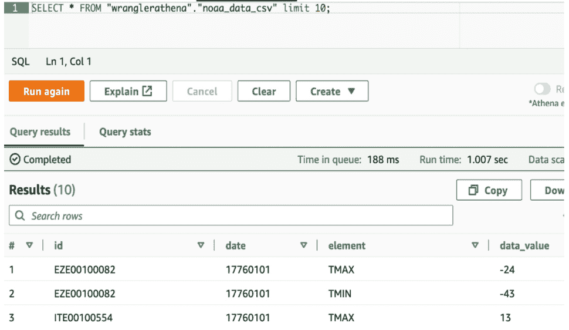

图 7.8：AWS Athena 控制台 – 查询手动创建的表

## 使用正则表达式解析器加载定宽表

更好的示例是加载 Glue 爬虫不支持的表。 我们将为库存文件 (http://noaa-ghcn-pds.s3.amazonaws.com/ghcn-d-inventory.txt) 创建一个表。 该文件具有从数据源文档页面粘贴在此处的结构：

文件结构在下表中描述。

| 变量 | 列 | 类型 |
|---|---|---|
| ID | 1-11 | 字符 |
| LATITUDE | 13-20 | 实数 |
| LONGITUDE | 22-30 | 实数 |
| ELEMENT | 32-35 | 字符 |
| FIRSTYEAR | 37-40 | 整数 |
| LASTYEAR | 42-45 | 整数 |

- ID = 站点识别代码。 请参阅“ghcn-stations.txt”以获取站点及其元数据的完整列表。
- LATITUDE = 站点的纬度（以十进制度为单位）。
- LONGITUDE = 站点的经度（以十进制度为单位）。
- ELEMENT = 元素类型。 请参阅第 III 节以了解元素的定义。
- FIRSTYEAR = 给定元素的未标记数据的第一年。
- LASTYEAR = 给定元素的未标记数据的最后一年。

图 7.9：数据的结构

这意味着前 11 个字符是 ID 字段，第 12 个字符可以是空格或任何内容，接下来 7 位数字是纬度，如 *图 7.9* 中所示。 我们可以使用 **正则表达式** (**正则表达式**) 来解析数据并查询它。 我们将执行以下步骤来查询和发现定宽文件中的数据：

- 1. 下载并识别文件内的数据结构，如下所示：

```
aws s3 cp s3://noaa-ghcn-pds/ghcn-inventory.txt .
```

一旦文件已下载到本地磁盘，您可以在任何您选择的编辑器中打开文件并分析数据以了解模式结构。 我们将了解每个列中可用的值，如下所示，以设计用于解析文件的正则表达式：

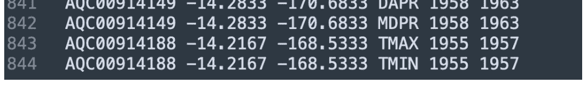

图 7.10：浏览 NOAA 库存定宽文件的内容

### NOTE

*我们也可以使用 S3 Select 来查询文件中的数据，如果文件没有特殊字符或复杂结构。*

- 2. 设计一个正则表达式来读取文件。

您可以使用基于组织安全需求的任何正则表达式验证器在创建 Glue 表之前验证正则表达式。 我们将在我们的用例中使用 https://regex101.com/ 来验证正则表达式。

对于刚接触正则表达式的人，您可以在开始之前阅读有关正则表达式的更多在线材料和速查表。 我们将复制一些代表数据文件中不同数据格式的示例记录，并开始逐字段创建正则表达式。 以下屏幕截图显示了用于捕获第一个字段的正则表达式，以匹配 11 个字符的单词以及某些记录中存在的连字符（请参阅屏幕截图中的 *记录 3*）：

/ ^([\w-]{11})

# TEST STRING

```
ACW00011604 • 17.1167 • -61.7833 • WT08 • 1949 • 1949
ACW00011604 • 17.1167 • -61.7833 • WT16 • 1949 • 1949
BR00B4-0340 • -20.3300 • -47.7700 • PRCP • 1943 • 1995
AQC00914869 • -14.3333 • -170.7167 • DAPR • 1956 • 1966
```

图 7.11：创建正则表达式语句以加载定宽文件

3. 我们将使用试错法创建一个正则表达式，直到成功匹配输入文件中的示例记录，如下所示：

/ ^([\w-]{11})\s([\w\s.+-]){8}\s([\w\s.+-]){9}\s([\w]{4})\s(\d){4}\s(\d){4}

# TEST STRING

```
ACW00011604 • 17.1167 • -61.7833 • WT08 • 1949 • 1949
ACW00011604 • 17.1167 • -61.7833 • WT16 • 1949 • 1949
BR00B4-0340 • -20.3300 • -47.7700 • PRCP • 1943 • 1995
AQC00914869 • -14.3333 • -170.7167 • DAPR • 1956 • 1966
```

图 7.12：创建正则表达式语句以加载定宽文件（续）

正则表达式的高级解释在下表中提供：

| 正则表达式 | 描述 |
|---|---|
| ([\w-]{11})\s | 匹配 id 列的前 11 个字符，然后我们将使用 \s 字符忽略空格。 |
| ([\w\s.+-]{8})\s | 匹配纬度列，可以包含字母、数字和空格（右对齐 _ 和 +/- 符号）。 这是一个 8 字符字段。 |
| ([\w\s.+-]{9})\s | 匹配经度列，可以包含字母、数字和空格（右对齐 _ 和 +/- 符号）。 这是一个 9 字符字段。 |
| ([\w]{4})\s | 匹配文件中 4 个字符的 **元素** 列。 |
| (\d){4}\s | 匹配开始年份列的 4 位数字值。 |
| (\d){4} | 匹配结束年份列的 4 位数字值。 |

表 7.1：用于解析数据的正则表达式各个组成部分的表

4. 在 Athena 中使用正则表达式创建表。

我们将使用 Athena 中的 CREATE TABLE 语句以及上一步中设计的正则表达式来创建表。 请注意，我们必须在 CREATE TABLE SQL 语句中使用之前将所有单个反斜杠更改为双反斜杠（请参阅以下 SQL 语句中的突出显示部分）：

```
CREATE EXTERNAL TABLE ghndinv(
  `id` string,
  `latitude` string,
  `longitude` string,
  `element` string,
  `firstyear` int,
  `lastyear` int
)
ROW FORMAT SERDE 'org.apache.hadoop.hive.serde2.RegexSerDe'
WITH SERDEPROPERTIES (
  "input.regex" = "([\\w\\s.+ -]{11})\\s([\\w\\s.+ -]{8})\\s([\\w\\s.+ -]{9})\\s([\\w]{4})\\s([\\d]{4})\\s([\\d]{4})"
)
LOCATION 's3://<<location your file/'
```

5. 在 Athena 中查询数据并验证它。

创建表后，您可以查询数据并验证数据是否已正确解析，如下所示：

```
CREATE EXTERNAL TABLE ghndinv
(
  `id` string,
  `latitude` string,
  `longitude` string,
  `element` string,
```

| # | id | latitude | longitude | element | firstyear | lastyear |
|---|---|---|---|---|---|---|
| 1 | US1TXLL0048 | 30.5405 | -98.3681 | WESD | 2021 | 2022 |
| 2 | US1TXLL0048 | 30.5405 | -98.3681 | WESF | 2018 | 2022 |
| 3 | US1TXLL0049 | 30.7477 | -98.6671 | PRCP | 2000 | 2022 |
| 4 | US1TXLL0049 | 30.7477 | -98.6671 | SNOW | 2000 | 2022 |

图 7.13：AWS Athena 控制台 – 查询使用正则表达式语句创建的库存表

恭喜！ 您现在已从定宽文件创建了表并使用 SQL 语句探索数据。

您现在已了解在 Amazon Athena 中创建表以进行查询的不同方法，这是我们在 Athena 中进行分析之前的第一步，也是重要的一步。 您还可以通过编程方式在 Glue 目录中创建表，或通过使用 AWS Glue 等服务的 ETL 管道创建表，等等。

## 使用 CTAS 进行数据结构化

CTAS 语句提供了一种通过 SQL 执行数据结构化的强大方法。 您还可以使用此命令转换数据类型、存储格式和其他较小的轻量级 ETL。

我们将继续执行上一步，其中我们使用 serde 正则表达式解析的定宽文件创建了表。 但如果您展开表定义和列类型，您会发现纬度和经度列的数据类型为字符串。 我们可以将这两个字段转换为 float 数据类型并将输出文件以 Parquet 格式存储，如下所示：

```
create table ghndinv_parquet with (
    format = 'Parquet',
```

```
write_compression = 'GZIP',
external_location = 's3://<<s3 bucket>>/ghndinv_parquet/')
as
select
    id, cast(latitude as real) as latitude,cast(longitude as real) as
longitude,element,firstyear,lastyear
from ghndinv
```

您可以查看 S3 位置并验证 Parquet 文件是否已为该表创建，并且它不再是固定宽度文本文件，具体如下：

- 20221224_233819_00007_wat2i_06c68780-b9e8-4a01-bfae-4fae9d1019ca
- 20221224_233819_00007_wat2i_179f1891-c2b8-42c8-a21f-2e3a56ae15fb
- 20221224_233819_00007_wat2i_223736c0-3bf7-469f-a026-fa862bae02b7
- 20221224_233819_00007_wat2i_3b745d06-b27b-4d40-a8a6-f2d2f374f6d6
- 20221224_233819_00007_wat2i_4622ef6b-49ba-4054-b649-66dafc90d76a

Figure 7.14: S3 location of the table that was created with the CTAS command

此外，纬度和经度列的数据类型已更改为 float，如下所示：

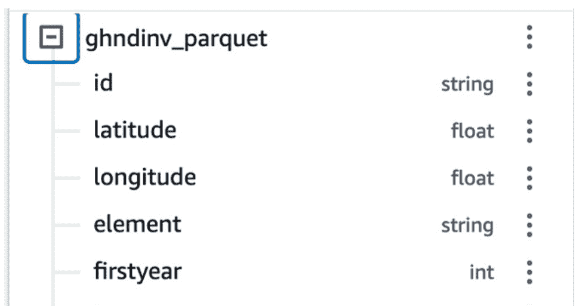

Figure 7.15: Columns and data types of the table created with the CTAS command in Amazon Athena

我们还将把 CSV 数据转换为 Parquet 格式，并根据数据访问模式所需的分区架构进行分区。我们将根据国家代码对表进行分区，以便以高效的方式访问每个国家的天气数据。

我们已在本章前面手动将 CSV 表加载到 noaa_data_csv 表中。我们将使用表中的数据，并从 id 列的前两个字符中提取 countrycode 值。我们还将把日期字段转换为日期类型，以便在查询中运行高效的时间过滤：

```
create table noaa_data_parquetwith (
    format = 'Parquet',
    write_compression = 'GZIP',
    partitioned_by = ARRAY['countrycode'],
    external_location = 's3://<<bucketname>>/noaa_data_parquet/'
)
as
select
    id, element,data_value,m_flag,q_flag,s_flag,obs_time,cast(date_parse(cast("date" as varchar(8)),'%Y%m%d') as date) as date_field,substr(id,1,2) as countrycode
from noaa_data_csv
```

请注意，在前面的查询中我们使用了分区列，而在库存表 (ghndinv) 中并未使用。执行此查询时会出现错误，如以下屏幕截图所示：

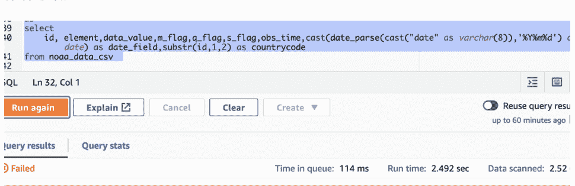

Figure 7.16: Athena error when creating a table with more than 100 values for the partition column

Athena 每次仅支持插入 100 个分区，而我们的数据中有 218 个唯一国家代码值，如图 7.17 所示：

```
Select substr(id,1,2) as countrycode from noaa_data_csv
group by substr(id,1,2) order by substr(id,1,2)
```

|  |  |
|---|---|
| 217 | WZ |
| 218 | ZA |
| 219 | ZI |

Figure 7.17: Total number of unique values in the partition column

我们必须分三次批次加载数据，每次最多 100 个分区值。由于我们已对 countrycode 值进行了排序，因此可以根据 https://docs.aws.amazon.com/athena/latest/ug/ctas-insert-into.html 文档中提到的内容构建 INSERT 查询。

我们将使用 CTAS 和 INSERT INTO 语句，根据前面的查询使用 countrycode 过滤器三次插入数据。如果数据只有 <100 个分区值，我们可以一次性运行此 CTAS 加载查询，而无需任何额外步骤。按如下步骤操作：

- 1. 创建一个 CTAS 语句以加载前 100 个分区的数据。您可以在图 7.18 的表中看到，我们已按字母顺序加载了约旦 (JO) 之前国家的数据：

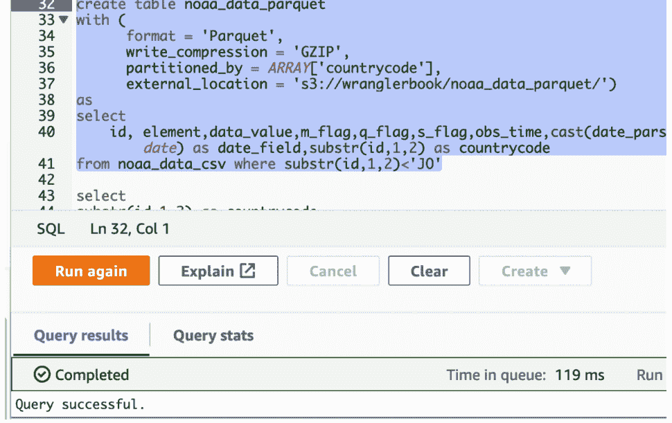

Figure 7.18: Running CTAS command restricting partition values to 100

- 2. N (Repeated multiple times as necessary): Insert statement to populate data into the target table, as follows:

```
insert into noaa_data_parquet
select
    id, element,data_value,m_flag,q_flag,s_flag,obs_time,cast(date_parse(cast("date" as varchar(8)),'%Y%m%d') as date) as date_field,substr(id,1,2) as countrycode
from noaa_data_csv where substr(id,1,2)>='JO' and substr(id,1,2)<'TX'
```

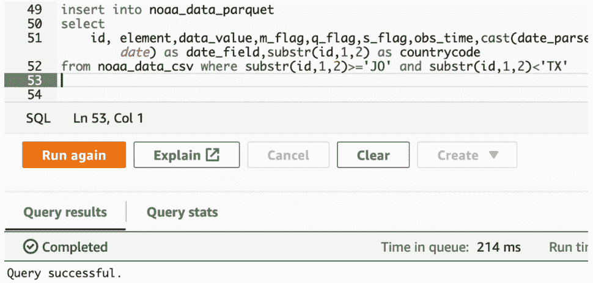

Figure 7.19: Running CTAS command restricting partition values to 100 (continued)

重复此步骤，直到从源表加载所有数据。完成后，您可以使用计数查询验证是否已从源表加载所有数据。您还可以浏览 S3 路径以验证国家代码分区中的数据。您可以在此处看到，我们已从所有国家代码加载了数据（219 个唯一国家代码值）：

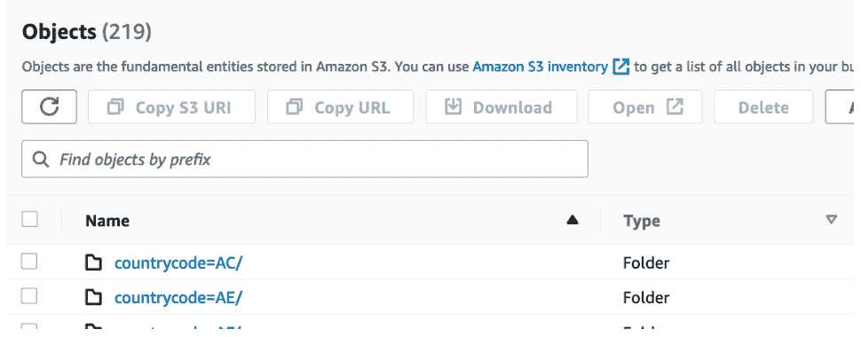

Figure 7.20: Verifying the CTAS table output in the S3 path

现在，您可以根据查询访问模式高效地探索分区数据。或者，如果您想将数据拆分为大小相等的桶，可以使用本章后面提到的分桶命令。您还可以在 https://aws.amazon.com/premiumsupport/knowledge-center/set-file-number-size-ctas-athena/ 文档中阅读有关分区（我们之前已执行）和分桶之间的差异。

我们只做了一个小的更改，以展示 Athena 在重构数据以及执行 ETL 操作方面的能力。您可以进一步尝试并在此练习中创建强大的数据转换。

## 使用 Athena 从多个源丰富数据

在本节中，我们将探讨如何使用 Athena SQL 以及使用 Athena 联邦设置来丰富来自其他受支持数据源的数据。

### 使用 Athena SQL 连接丰富数据

在上一节中，我们看到了在 Amazon Athena 中探索数据的各种方法。现在，我们将更专注于通过 Athena 查询以额外信息丰富数据的方法。

在此阶段，我们可以通过与其他数据源连接进一步丰富原始数据。我们将继续使用前面各节中使用的数据源。让我们假设一个场景，我们想要识别本世纪（2000 年之后）美国特定州（康涅狄格州）在特定年份（2022 年）的最高记录温度。我们将从上一节中使用 CTAS 语句创建的 Parquet 表 (`noaa_data_parquet`) 中获取读数数据。

我们可以根据分区架构过滤并获取记录从 `Country code =US`。但为了获取康涅狄格州的记录，我们需要将 `noaa_data_parquet` 表与站点数据文件 ([http://noaa-ghcn-pds.s3.amazonaws.com/ghcn-d-stations.txt](http://noaa-ghcn-pds.s3.amazonaws.com/ghcn-d-stations.txt)) 连接，该文件包含美国和加拿大所有站点的州信息。

我们将按照以下步骤使用州数据丰富我们的数据集：

- 1. 使用正则表达式格式加载州数据文件。我们将遵循前面章节中用于加载库存表的相同方法。我们将首先使用正则表达式验证器和示例记录设计用于加载表的正则表达式，如下所示：

/ ^([\w-]){11}\s([\w\s.+ -]){8}\s([\w\s.+ -]){9}\s([\w\s.+ -]){6}\s([a-zA-Z\s]){2}\s(.){30}\s([\w\s]){3}\s([\w\s]){3}\s([\w\s]){5}

# TEST STRING

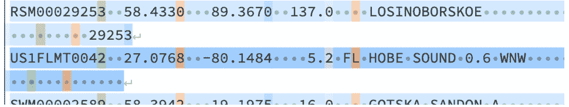

Figure 7.21: Designing a regex for loading a fixed-width file

- 2. 创建表并通过 Amazon Athena 加载固定宽度文件，如下所示。验证数据是否成功加载：

| id | latitude | longitude | elevation | state | name |
|---|---|---|---|---|---|
| US1CTFR0002 | 41.4230 | -73.5187 | 256.0 | CT | DANBURY 2.8 WNW |
| US1CTFR0003 | 41.1486 | -73.4591 | 71.6 | CT | NEW CANAAN 1.9 ENE |
| US1CTFR0005 | 41.1028 | -73.4893 | 60.0 | CT | DARIEN 3.6 N |

Figure 7.22: Amazon Athena querying the table loaded with a regex statement

- 3. 我们将使用 id 列连接表，然后仅对 state = 'CT' 且国家代码 = 'US'（分区列以加快分析）的记录进行过滤和聚合，以识别当前世纪（21 世纪）的最高温度，如下所示：

```
select max(data_value) from noaa_data_parquet t1 inner join ghnd_stations t2 on t1.id=t2.id where countrycode='US' and state='CT' and element='TMAX' and date_field>cast('2000-01-01' as date)
```

我们可以看到，从以下屏幕截图中，本世纪记录的最高温度为 54.4°C：


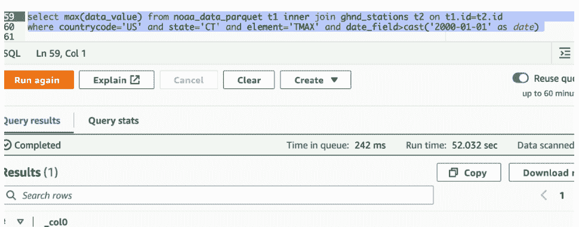

Figure 7.23: 用于识别本世纪康涅狄格州最高温度的 Amazon Athena 查询

4. 通过识别本世纪康涅狄格州记录温度最高的地点进行进一步分析。我们将使用分区和排名函数来实现此结果，通过执行以下查询：

```
select * from ( select t1.id,t1.data_value,t1.obs_time,t2.state,t2.name,ROW_NUMBER() OVER (PARTITION BY t1.countrycode,t2.state ORDER BY data_value DESC) AS temp_rank from noaa_data_parquet t1 inner join ghcnd_stations t2 on t1.id=t2.id where countrycode='US' and state='CT' and element='TMAX' and date_field>cast('2000-01-01' as date) ) TMP_TABLE where temp_rank <=3
```

你可以看到 Meriden、Danbury 和 New Haven 是本世纪记录温度最高的三个地点。此外，正如分析所示，自 2000 年以来气温从未超过 50° C：

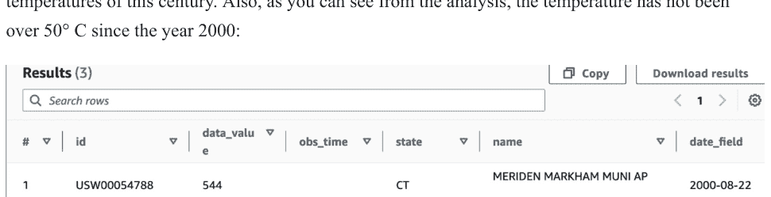

Figure 7.24: 用于识别康涅狄格州记录前三高温度的地区的 Amazon Athena 查询

前面的练习展示了使用 Amazon Athena 进行此分析的强大功能，并且它取决于数据的质量和准确性才能获得正确的结果。你必须依赖数据清洗和数据质量规则来创建更干净的数据集以提供准确的分析结果。

Amazon Athena 支持所有类型的连接，例如 INNER JOIN、LEFT JOIN、RIGHT JOIN、OUTER JOIN 和 CROSS JOIN，具体取决于你的用例要求。此外，Athena SQL 中有一套丰富的特性可供使用，你可以用它在数据上创建高度复杂的分析和转换。请参阅文档以获取 Athena SQL 功能的完整列表，网址为 https://docs.aws.amazon.com/athena/latest/ug/ddl-sql-reference.html。

## CHALLENGE EXERCISE

*你可以将我们将在第 10 章《使用 SageMaker Data Wrangler 进行机器学习的数据处理》中使用的体育博彩用例的数据集连接起来。你可以使用 Athena 查询重新创建我们在本章数据丰富部分创建的体育队伍赛程。*

## Setting up data federation for source databases

我们现在将进一步探索从不同数据源连接数据集。 由于 NOAA 天气数据集仅存储在 Amazon S3 存储桶中，我们将向 **关系型数据库服务 (RDS)** MySQL 数据库添加一些数据集，并展示如何查询数据而无需将其移动到集中位置。这有助于业务团队使用 SQL 运行快速分析，而无需依赖数据工程团队将数据从一个数据源移动到另一个位置。这对于业务团队来说非常方便，因为他们可以在无需依赖其他团队的情况下进行快速分析，但应仅用于需要快速获得结果的临时分析，以及为重复数据分析设置数据管道以获得更好性能的情况。

Athena 查询联邦通过创建具有连接源数据库所需代码的 Lambda 函数来工作。 支持源的源代码可以在此位置找到：https://github.com/aws-labs/aws-athena-query-federation。 由于这是开源代码，你可以进一步开发并为你的需求定制它，并根据存储库中提供的说明为自己的数据库创建代码。 一旦你在 AWS 账户中部署无服务器应用程序，它将创建一个 Lambda 函数，该函数将在后端由 Athena 有效执行以连接到你的数据库。 Athena 使用一种有效的机制通过多次 Lambda 调用连接到源数据库，并且 Amazon Athena 具有一种规避 Lambda 15 分钟超时并执行运行时间超过 15 分钟的查询的机制。

## Prerequisite – creating a source table in RDS MySQL

让我们假设一个场景，我们希望以类似之前的方式查询南极洲的天气数据并了解本世纪最低温度。我们在 `noaa_data_parquet` 表中有国家代码值，但我们可能不知道南极洲的正确国家代码。我们将模拟一个场景，其中国家查找表数据（包含国家代码和国家名称）可从 MySQL 数据库获得。为了创建该场景，我们将手动将数据加载到 MySQL 表中。你可以根据此处提供的信息创建 RDS MySQL 实例：https://aws.amazon.com/getting-started/hands-on/create-mysql-db/。

你可以使用 MySQL Workbench 连接到公共实例，如果你希望将 RDS 实例启动在私有子网中，则我们将使用 弹性计算云 (EC2) 实例来连接 RDS 数据库。我们还将在与 RDS MySQL 相同的 VPC 中创建 EC2 实例，并使用该机器连接到 MySQL 数据库。你可以按照此处设置 EC2 bastion 主机的步骤进行操作：https://aws.amazon.com/premiumsupport/knowledge-center/rds-connect-ec2-bastion-host/。

在本节中，我们将登录到 EC2 实例并使用 scp 命令上传国家文件。在上传文件之前，你可以使用你选择的任何编辑器并将第一个空格出现的位置替换为逗号，如下所示，并随后替换逗号或用双引号括起来。这将把数据转换为包含两个字段的 CSV 文件——国家代码和国家名称：

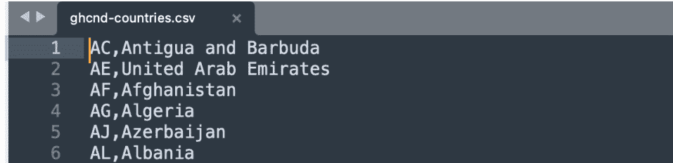

Figure 7.25: 浏览国家查找文件中的数据

在进行上述更改后，以 CSV 格式保存文件并使用 scp 命令将文件上传到 EC2 实例的主目录，如下所示：

```
scp -i "yourpemfile.pem" <path/to/ghcnd-countries.csv> ec2-user@ec2-XXX-XXX-XXX-XXX.region.compute.amazonaws.com:~/
```

我们将使用 ssh 命令登录到 EC2 实例（从 EC2 控制台连接屏幕），然后使用以下命令连接到 mysql 实例：

```
mysql -h <<database endpoint string>> -u <<db username>> -P 3306 -p
```

我们将创建新的数据库，如以下屏幕截图所示：

```
MySQL [(none)]> create database noaa;
Query OK, 1 row affected (0.01 sec)

MySQL [(none)]> show databases;
```

| Database |
|---|
| dms_sample |
| information_schema |
| mysql |
| noaa |
| performance_schema |
| sys |

6 rows in set (0.00 sec)

```
MySQL [(none)]> use noaa;
Database changed
```

Figure 7.26: 在 RDS MySQL 中创建数据库以加载国家查找文件

我们将创建表并将数据加载到表中，如下所示。此时，我们已完成在 MySQL 中创建源表的先决条件：

```
MySQL [(none)]> use noaa;
Database changed
MySQL [noaa]> CREATE TABLE noaa_country (
    -> countrycode CHAR(2) NOT NULL,
    -> countryname VARCHAR(255) NOT NULL,
    -> PRIMARY KEY (countrycode)
    -> );
Query OK, 0 rows affected (0.02 sec)

MySQL [noaa]> LOAD DATA LOCAL INFILE '/home/ec2-user/ghcn-countries.csv'
    -> INTO TABLE noaa_country
    -> FIELDS TERMINATED BY ','
    -> OPTIONALLY ENCLOSED BY '"'
    -> LINES TERMINATED BY '\n';
Query OK, 219 rows affected (0.02 sec)
Records: 219  Deleted: 0  Skipped: 0  Warnings: 0
```

Figure 7.27: 将国家查找文件加载到 RDS MySQL 中

现在，我们将为此 MySQL 数据库在 Amazon Athena 中设置查询联邦。导航到 Amazon Athena 控制台并创建数据源。或者，你也可以转到 AWS Serverless Application 存储库并创建应用程序以部署 Lambda 函数和支持查询联邦所需的资源，如下所示：

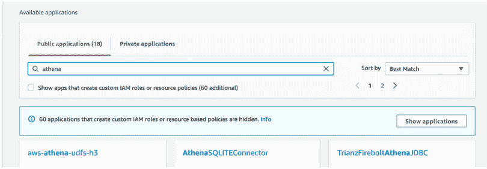

Figure 7.28: 搜索应用程序

在我们的用例中，我们将通过 Athena 控制台创建数据源，如下所述。

## Setting up data federation in your AWS account

从 Amazon Athena 创建新的数据源，如下所示：

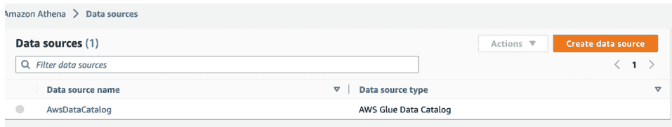

Figure 7.29: Amazon Athena 数据源屏幕

在这里，我们将选择 mysql 作为数据源并单击下一步。你可以根据不同的用例选择相应的源数据库引擎：

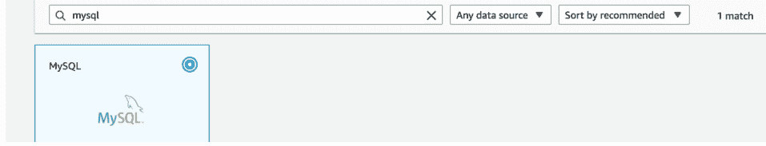

Figure 7.30: Amazon Athena MySQL 数据源的数据联邦

为应用程序输入名称——在我们的用例中为 wranglerathena——并单击创建 Lambda 函数，这将带你到无服务器应用程序部署屏幕。为了更好地了解连接器，你可以阅读许可证、README 文件和模板部分，以了解将部署的资源。在应用程序设置下，你可以为当前用例输入以下值：

- Application name: AthenaMySQLConnector (leave the default value).


-   **SecretNamePrefix**：包含源数据库用户名和密码的 **SecretsManager** 密钥的名称。对于我们的测试，我们将直接在连接字符串中提供它们。但对于生产部署，强烈建议使用具有密码轮换的密钥管理器以实现高效的安全性。因此，在此字段中输入 **dummysecret** 值。
-   **Spillbucket**：提供 Lambda 函数可用于存储超过其内存限制的数据的 S3 存储桶名称。此功能可有效防止较大查询结果导致的 Lambda 内存错误。
-   **DefaultConnectionString**：按此格式提供连接字符串：
-   **DisableSpillEncryption**：**False**（除非您不想在 S3 中加密溢出数据）。
-   **LambdaFunctionName**：提供与 Athena 数据源连接器相同的名称以便于识别。在我们的例子中，这是 **wranglerathena**。
-   **LambdaMemory** 和 **LambdaTimeout**：除非您想更改它们，否则保留默认最大值。
-   **PermissionsBoundaryARN**：对于我们的用例，请将其留空。
-   **SecurityGroupIds**：提供您想要与 Lambda 函数关联的安全组 ID。安全组需要具有访问 MySQL 数据库的规则。
-   **SpillPrefix**：将其保留在默认值 **athena-spill**。
-   **SubnetIds**：提供 Lambda 函数将启动以连接到 RDS MySQL 的子网 ID。提供 RDS MySQL 实例所在的子网 ID，或可访问数据库连接的子网列表。

```
mysql://jdbc:mysql://<<database endpoint>>:3306/noaa?user=<<username>>&password=<<password>>##Replace << >> values in the above string with correct values for your use case
```

应用程序创建完成后，选择上一步创建的 Lambda 函数并在 Amazon Athena 中完成数据源创建。

## 联邦数据源的工作验证

**方法 1**：在 Athena 中不使用数据源选项，通过直接按名称引用 Lambda 函数执行查询，如下所示。如果一切设置正确，您应该能够看到源表中的数据，如下所示：

```
select * from "lambda:wranglerathena".noaa.noaa_country;
```

SQL 第 71 行，第 1 列

再次运行 解释 取消 清除 创建

## 查询结果

完成

队列时间：446 ms

## 结果 (100+)

| # | countrycode | countryname | parti |
|---|-------------|-------------|-------|
| 1 | AC | Antigua and Barbuda | * |
| 2 | AE | United Arab Emirates | * |
| 3 | AF | Afghanistan | * |

Figure 7.31: Amazon Athena 通过 Lambda 函数直接从 MySQL 查询国家表

## 方法 2：使用上一步创建的 Amazon Athena 数据源执行查询。在通过此选项验证之前，我们需要在无服务器应用程序创建的 Lambda 函数中进行以下更改：

-   导航到 Lambda 控制台并选择配置部分中使用的函数名称——wranglerathena。
-   选择配置然后选择环境变量。现在，复制默认键名中的环境变量并创建另一个名为 wranglermysql_connection_string 的键，如以下屏幕截图所示。此键名应为 athenadatasource_connection_string 格式：

| Key | Value | |
|-----|-------|---|
| default | mysql://jdbc:mysql://awswrangler.ci2nx | Remove |
| disable_spill_encryption | false | Remove |
| spill_bucket | athenaresults-sankar | Remove |
| spill_prefix | athena-spill | Remove |
| wranglermysql_connection_string | mysql://jdbc:mysql://awswrangler.ci2nx | Remove |
| Add environment variable |  | |

Figure 7.32: 更新联邦 Lambda 函数中的配置

-   然后，单击 **Save** 以更新我们对 Lambda 函数所做的新的环境变量更改。

现在，导航到 Amazon Athena 控制台并选择 `wranglermysql` 作为数据源，您将能够看到新创建的表，如以下屏幕截图所示：

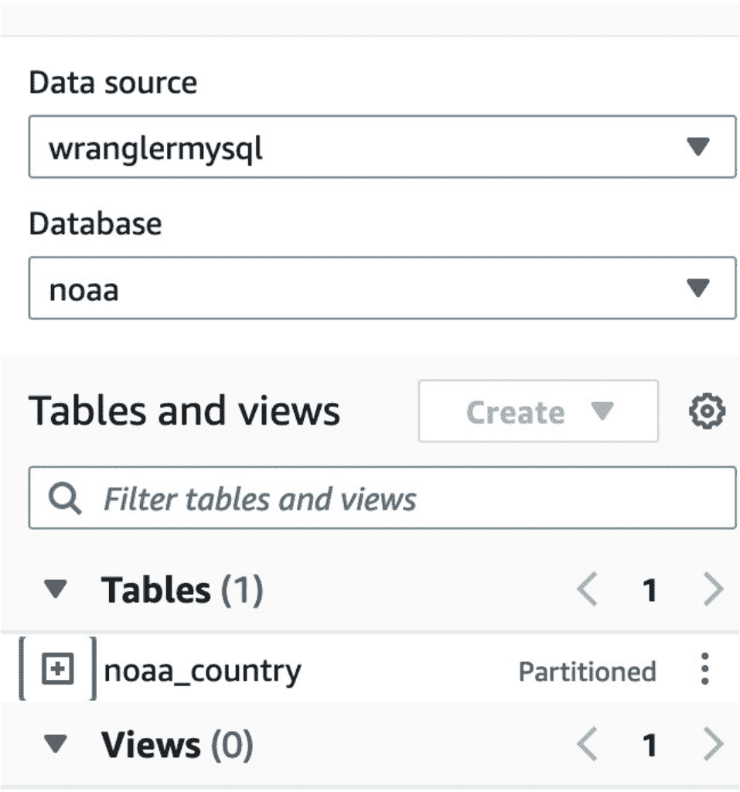

Figure 7.33: 在 Amazon Athena 控制台中从联邦源访问表列表

您可以使用 datasource.database.tablename 格式查询表并验证连接器的运行情况，如下所示：

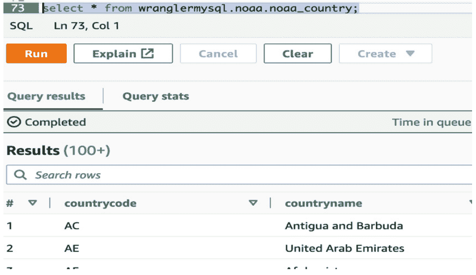

Figure 7.34: 通过 Athena 控制台和已注册的数据源查询 RDS MySQL 中的国家表

现在，我们将探讨如何使用 Athena 查询将 MySQL 中的国家数据与可在 Amazon S3 中获得的 noaa_parquet 表结合起来。

## 使用数据联邦丰富数据

为了演示 Athena 联邦的好处，让我们考虑这样一种情况：您的经理要求您（作为公司的数据分析师）尽快找到本世纪南极洲和其他 10 个国家的最低温度。您作为公司的数据分析师知道您必须查询 noaa_data_parquet 表，但您不确定这些国家的国家代码值。您还知道 MySQL 中有一个包含此信息的表，并且不想等待数据工程团队将此表移至 Amazon S3 并在其上创建数据目录以便在 Amazon Athena 中查询。

让我们创建一个联邦查询，将 Amazon S3 和 RDS MySQL 中的数据连接起来，并为我们的用例提供所需的输出。我们将执行以下查询以在数据源之间无需数据迁移的情况下组合所需的数据集：

```
select min(data_value) as min_temp from AwsDataCatalog.wranglerathena.noaa_data_parquet t1
inner join wranglermysql.noaa.noaa_country t2 on t1.countrycode=t2.countrycode where
```

```
trim(t2.countryname)='Antarctica' and date_field>cast('1900-01-01' as date) and element='TMIN'
```

```
select min(data_value) as min_temp from AwsDataCatalog.wranglerathena.noaa_data_parquet t1 inner join wranglermysql.noaa.noaa_country t2 on t1.countrycode=t2.countrycode where trim(t2.countryname)='Antarctica' and date_field>cast('1900-01-01' as date) and element='TMIN'
```

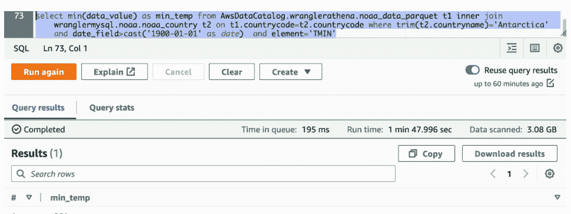

Figure 7.35: 使用联邦连接的 Amazon Athena 查询以识别南极洲的最低温度

这展示了 Athena 在不实际移动数据的情况下从多个来源丰富数据的能力。这在很多时候对各个团队都非常有用。

现在我们已经了解了通过 Amazon Athena 丰富数据的各种方法，我们将在下一节中探讨如何使用 Athena 查询设置数据质量管道。

## 使用 Athena 设置无服务器数据质量管道

数据质量验证是数据整理管道中非常重要的一步，确保用于分析和可视化的数据的准确性。我们将在本节中探讨如何通过 Amazon Athena 执行数据质量验证。

## 在 Athena 中实现数据质量规则

让我们考虑我们想要在 NOAA 天气数据集中验证的规则。以下内容仅是对一些数据质量规则的高层次表示，并不是天气数据集的全面规则集：

-   1. 当国家代码为 US 时，state 列应具有两个字符值。
-   2. date 字段不应有任何未来日期值，否则会导致测量不正确。
-   3. 验证 element 列是否仅接受文档中提供的列表中的值。

我们可以有更多规则来确保更好的数据质量，但前述规则足以让我们演示使用 Amazon Athena 进行数据质量验证。我们将首先设计查询，然后在 Athena 中执行它们以确保语法和语义正确性。

## 数据质量规则 1：对于州代码列验证，使用此处给出的查询：

```
--Identify incorrect state codes when Country is US
select * from ghnd_stations where substring(ID,1,2)='US'
and length(state)<>2
```

在 Athena 中执行查询并验证我们没有任何违反数据质量规则的记录，如以下屏幕截图所示。这确保了当前数据没有任何数据错误，并且验证了我们的查询按预期正确工作：

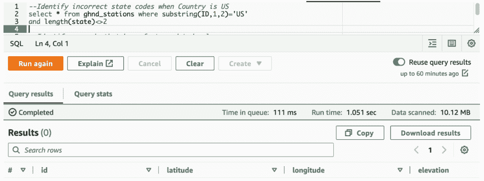

Figure 7.36: Amazon Athena 数据质量以识别州代码不等于 2 个字符的记录

## 数据质量规则 2：为了验证我们没有任何来自未来日期的天气观测，我们将使用下一个查询。这确保我们没有任何来自未来日期的不正确观测：

```
--Identify records that have future dated values
select * from noaa_data_parquet where date_field > current_date
```

我们可以以类似的方式执行并验证之前的查询，并确保我们没有任何数据质量问题记录。

## 数据质量规则 3：我们将执行下一个给出的查询以验证观测是否仅针对有效维度进行。这是通过对 element 列进行验证来完成的。

我们通过使用 NOAA 数据集 README 文件 (https://docs.opendata.aws/noaa-ghcn-pds/readme.html) 中的数据获得了值列表。我们将值复制到 Excel 表格中，使用 = 分隔符将其拆分为两列，然后在以下查询中使用它们：

```
--Identify records with invalid values in element column
select element,s_flag,max(date_field) as latest_date,count(*) as cnt from noaa_data_parquet where countrycode='US' and element not in ('PRCP','SNOW','SNWD','TMAX','TMIN','ACMC','ACMH','ACSC','ACSH','AWDR','AWND','DAEV','DAPR
```

```
', 'DASF', 'DATN', 'DATX', 'DAWM', 'DWPR', 'EVAP', 'FMTM', 'FRGB', 'FRGT', 'FRTH', 'GAHT', 'MDEV', 'MDPR', 'MDSF', 'MDTN', 'MDTX', 'MDWM', 'MNFN', 'MXPN', 'PGTM', 'PRCP', 'PSUN', 'SNOW', 'SNWD', 'TAVG', 'THIC', 'TMAX', 'TMIN', 'TOBS', 'TSUN', 'WDF1', 'WDF2', 'WDF5', 'WDFG', 'WDFI', 'WDFM', 'WDMV', 'WESD', 'WESF', 'WSF1', 'WSF2', 'WSF5', 'WSFG', 'WSFI', 'WSFM')
and element not like ('SN%') and element not like ('SX%')
and element not like ('WT%') and element not like ('WV%')
group by element,s_flag
```

执行查询时，我们发现了一些在文档中未提供但似乎是有效值的元素值，因为有大量记录可用，如下所示：

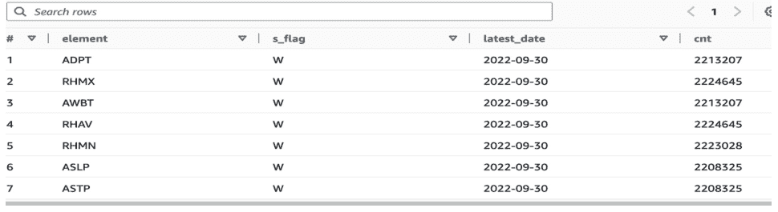

图 7.37：Amazon Athena 数据质量，用于识别不在有效值列表中的元素值

现在，我们有三个数据质量查询，其中一个有一些记录需要我们进一步分析和理解。下一步是将查询设置在 DynamoDB 表中，以便可以通过 AWS Step Functions 以无服务器方式在 Amazon Athena 中执行。

## Amazon DynamoDB 作为数据质量管道的元数据存储

我们将使用 DynamoDB 存储查询，以便可以通过您选择的工具以自动化方式执行。让我们创建一个 DynamoDB 表来存储 SQL 脚本。输入表名以及分区键和排序键，并将其他设置保留为默认值，如下所示：

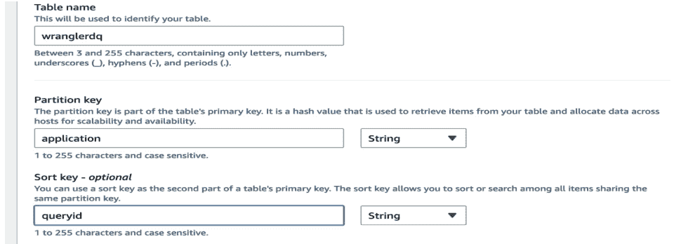

图 7.38：Amazon DynamoDB 表创建过程 – 用于存储数据质量查询

我们使用应用程序名称作为分区键，这样我们就可以使用同一个 DynamoDB 表为多个应用程序存储数据质量查询。`queryid` 可以是一个字段，帮助我们在每个应用程序内唯一标识数据质量查询。

一旦表成功创建，我们将把在前一步设计的查询加载到之前创建的 DynamoDB 表中。选择 **Explore items** -> **Choose table name** -> **Create item** 按钮。然后您应该会看到以下内容：

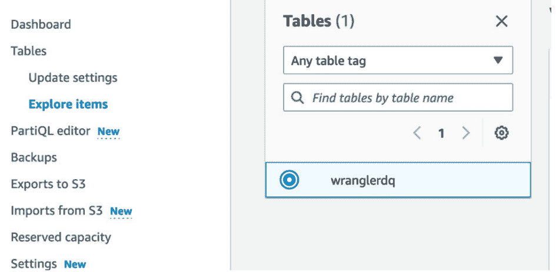

图 7.39：Amazon DynamoDB 表 – 从存储数据质量脚本的表中添加项目

为每个项目输入以下值并保存回表中：

- **application**：输入 `noaa_weather`
- **queryid**：输入 `query<x>`
- **querystring**：从 Athena 控制台复制并粘贴查询字符串

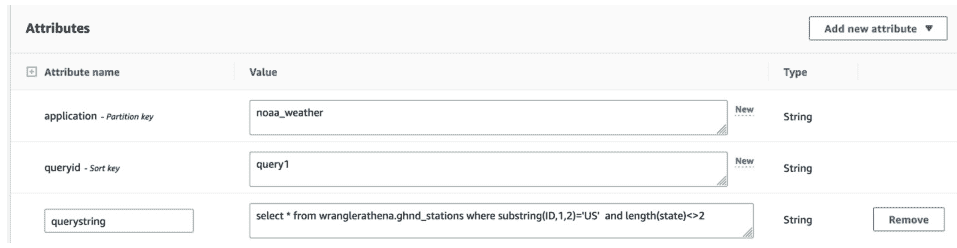

图 7.40：Amazon DynamoDB 表 – 向表中添加项目

一旦所有值都存储在表中，您可以通过选择 DynamoDB 表名然后选择 **Explore table items** 来验证它们是否正确加载，这将带您到此屏幕：

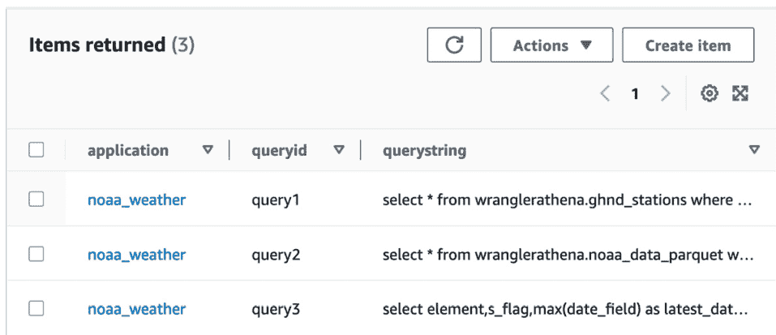

图 7.41：Amazon DynamoDB 表 – 查看已添加到元数据表的数据

现在我们的查询已准备好在 DynamoDB 表中执行，我们将了解如何通过无服务器方式的步骤函数工作流执行它们。

## 无服务器数据质量管道

导航到 AWS 控制台中的 **Step function**，并创建一个状态机。选择 **Standard** 工作流并选择可视化开发，如下所示：

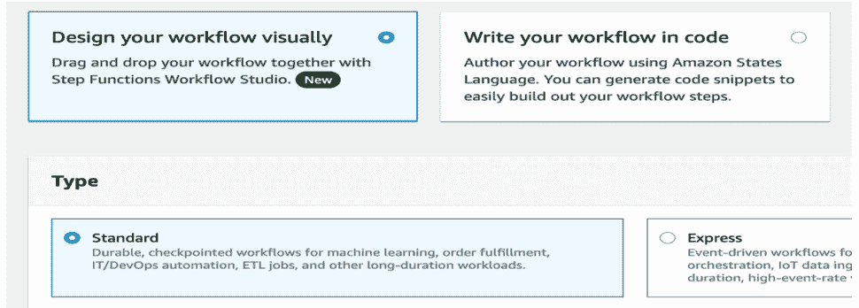

图 7.42：Step function 控制台创建新工作流

以下工作流应为我们的用例在状态机中设计：

- 1. 对 Amazon DynamoDB 运行查询并检索我们应用程序的数据质量 SQL 脚本。
- 2. 以并行方式在 Athena 中执行数据质量 SQL 脚本。
- 3. 收集结果并在 Lambda 函数中进行汇总。
- 4. 将 Lambda 函数的汇总输出发送到 Simple Notification Service (SNS) 端点。这将使一组人员能够收到步骤函数结果的通知以采取适当行动。
- 5. 执行并验证步骤函数工作流的工作情况。
- 6. 配置步骤函数通过 Amazon EventBridge Scheduler 定期执行。

步骤 1：在状态机的步骤函数控制台中，在搜索框中搜索 `dynamoDB query` 并将 DynamoDB 查询图标拖到可视化调色板中。

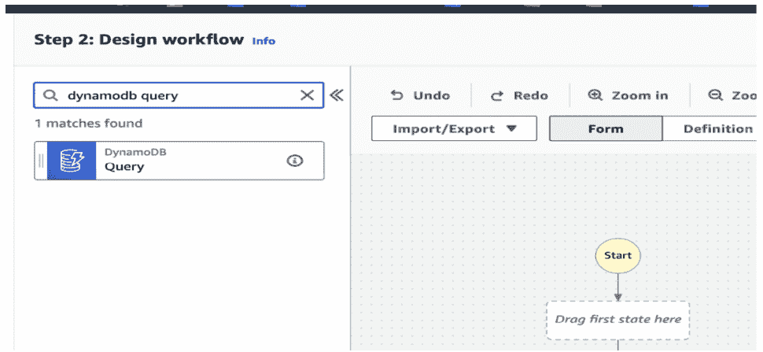

图 7.43：Step function 工作流 – 添加 API 调用以查询 DynamoDB 表

现在，按如下所示更新参数：

```
{
  "TableName": "wranglerdq",
  "KeyConditionExpression": "application=:v1",
  "ExpressionAttributeValues": {
    ":v1": {
      "S": "noaa_weather"
    }
  }
}
```

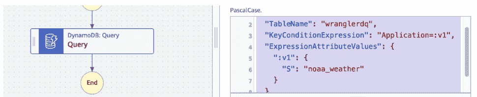

图 7.44：Step function 工作流 – 查询 DynamoDB 表 API 的配置选项

此步骤将针对 `wranglerdq` 表运行 DynamoDB Query SDK，并根据 `Application = noaa_weather` 属性过滤结果。您可以通过查看该 API 调用的文档来了解此 API 调用的输出 https://docs.aws.amazon.com/amazondynamodb/latest/APIReference/API_Query.html#API_Query_ResponseSyntax。

我们可以看到它有一个 `Items` 数组字段，其中将包含字段名称和字段类型。我们需要仅提取 SQL 脚本并将其传递给 Athena 执行，如下所示：

```
"Items": [
  {
    "string" : {
      "B": blob,
      "BOOL": boolean,
      "BS": [ blob ],
      "L": [
        "AttributeValue"
      ],
      "M": {
        "string" : "AttributeValue"
      },
      "N": "string",
      "NS": [ "string" ],
      "NULL": boolean,
      "S": "string",
    }
  }
```

图 7.45：查询 DynamoDB 表 API – 响应元素结构片段

我们将使用 $.Items[*].querystring.S JSON 路径过滤此步骤的输出。在输出部分，选择使用 OutputPath 过滤输出并提供粘贴在此处的 JSON 路径：

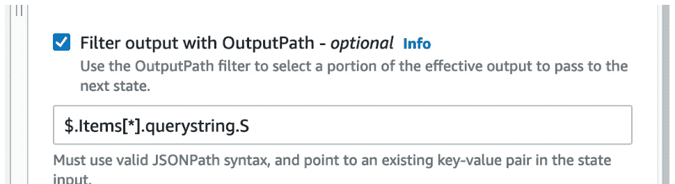

图 7.46：查询 DynamoDB 表 API – 过滤输出以仅获取查询字符串 DynamoDB 查询 API 响应

现在，我们将继续为无服务器数据质量工作流开发进一步的步骤。

步骤 2：我们可以使用映射函数以并行方式执行 Athena 查询。此函数将以并行方式执行操作，不同的输入来自作为输入传递给它的数组。在我们的用例中，我们将把查询列表作为数组传递给映射函数，该函数将为输入数组中的每个查询并行执行 AthenaStartqueryexecution API。

映射函数将在 Flow 选项卡下可用，如以下屏幕截图所示：

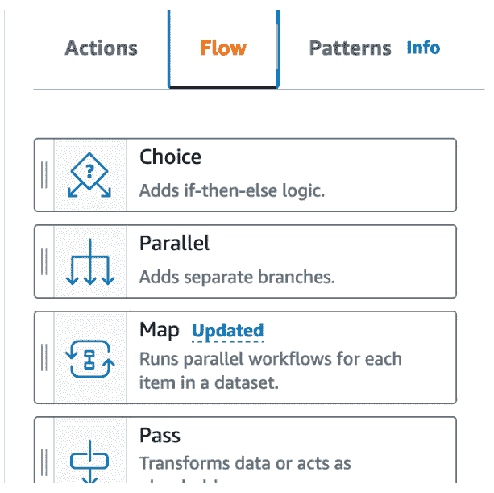

图 7.47：添加映射函数以并行执行 Amazon Athena 查询

我们将提供要为映射函数更新的各种参数的值，您可以在工作流中按如下方式更新它们：

- **Processing Mode**：选择 `Inline`。
- **Provide a path to items array**：输入 "$"。由于我们已经在上一步的输出中仅过滤了查询字符串，我们将从顶级 JSON 元素（使用 "$"）获取数据。
- **Maximum concurrency**：输入 5。您可以为您的用例输入不同的值。我们将通过以五次查询为一批执行来查看查询的性能，然后使用此参数增加/减少并行查询执行计数。

搜索 Athena start，您应该在结果窗口中看到 Athena StartQueryExecution API 对象。将它拖到映射函数内部，如下所示：

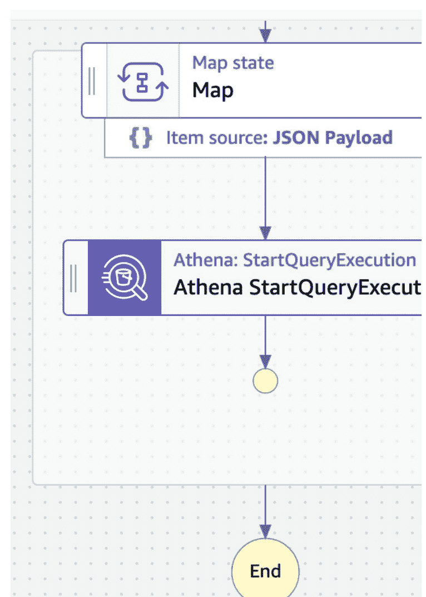

图 7.48：Step function 工作流 – 映射函数并行执行 Athena 查询

为 Athena StartQueryExecution API 对象输入以下参数：

API 参数：输入以下值。如果您使用不同的工作组用于特定功能，请相应地更新输入：

```
{ "QueryString.$": "$", "WorkGroup": "primary", "ResultConfiguration": {
```


```
    "OutputLocation": "s3://<<path to store athena results>>/"
  }
}
```

**等待任务完成**：勾选复选框。这非常重要，这样工作流才能等待查询完成。如果未勾选此复选框，后续步骤在尝试检索尚未完成的 Athena 查询结果时将会失败。

## 第 3 步：使用 Lambda 函数整合上一步的结果。

### 第 3a 步：我们在此添加一个“pass 步骤”，以获取 map 函数的结果并将其传递给 Lambda 函数。

搜索“Pass”步骤并将其拖到工作流中 map 函数之后。点击 **Pass 步骤**，导航到 **输入** 选项卡，然后选择 **使用参数转换输入** 复选框并输入以下值：

```
{
  "Resultpath.$": "$[*].QueryExecution.ResultConfiguration.OutputLocation",
  "query.$": "$[*].QueryExecution.Query"
}
```

### 第 3b 步：创建一个 Lambda 函数来整合 Athena 查询执行的结果。

在另一个标签页中打开 Lambda 控制台，并将函数名称输入为 `Consolidateathena results`，运行时选择为 "Python3.9"。将其他参数保持默认并创建 Lambda 函数。

### 第 3c 步：更新 Lambda 函数中的以下代码。点击部署以保存 Lambda 代码。

以下代码从 S3 位置读取数据并将其整合以通过电子邮件发送：

```
import json
import boto3
import csv
from urllib.parse import urlparse
s3 = boto3.resource('s3')
def Lambda_handler(event, context):
    # TODO implement
    i=0
    output=""
    for file in event["Resultpath"]:
        #Get a S3 URL from which we read the results of Athena query.
        parsed_path = urlparse(file, allow_fragments=False)
        #Read data from the S3 file and get results and split each line
        s3_object = s3.Object(parsed_path.netloc,
        parsed_path.path.lstrip('/'))
        data = s3_object.get()['Body'].read().decode('utf-8').splitlines()
        #Create a new section for each query output and print the output from those
        queries
            output=output+"-------------------------------\n" + event["query"][i] +"\n "
            i=i+1
            lines = csv.reader(data)
            headers = next(lines)
            output=output + "Header -"+ ",".join(headers)+"\n"
            for line in lines:
                output=output+",".join(line)+"\n "
    return output
```

### 第 3d 步：更新附加到 Lambda 函数的 IAM 角色以具有 Amazon S3 权限。我们将 `AmazonS3FullAccess` 受管策略附加到 IAM 角色。在生产环境中，仅提供对所需 S3 位置的访问权限以进一步限制访问。

### 第 3e 步：在 Step Functions 控制台中搜索 `Lambda` 并将其添加到工作流中 pass 步骤之后。将函数名称参数输入为在 *第 3b 步* 中创建的 Lambda 函数，如下图所示：

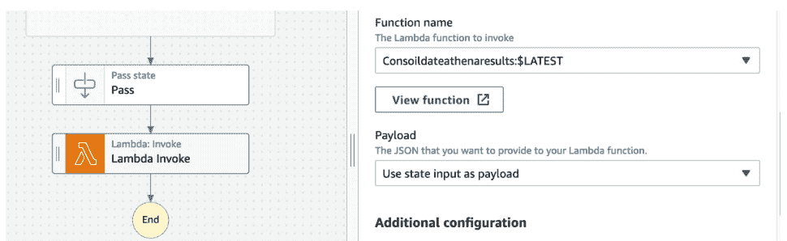

Figure 7.49: Step Functions 工作流 – 用于整合 Athena 查询执行结果的 Lambda 函数

### 第 3f 步：过滤输出路径以仅获取通过 SNS 主题发送到电子邮件的 Lambda 输出。在 **输出** 选项卡中，选择 **使用 OutputPath 过滤输出** 并输入 `$.payload`。

## 第 4 步：通过电子邮件发送整合后的结果。

### 第 4a 步：在单独的标签页中导航到 SNS 控制台并创建一个 **标准** 主题类型的 SNS 主题。主题创建后，点击该主题并从主题创建订阅。选择 **电子邮件** 作为协议，并在 **终端节点** 字段中输入您的电子邮件地址（或群组）。确保点击确认订阅电子邮件。

### 第 4b 步：返回到 Step Functions 工作流并搜索 `sns publish`。将 **SNS Publish API** 图标拖到工作流中 Lambda 函数之后。

我们现在已完成工作流的创建。点击 **下一步** 并验证所有组件和配置是否均已提供且无任何错误。应如下所示：

Start

Query

Athena StartQueryExecution

Pass

Lambda Invoke

SNS Publish

End

Figure 7.50: Step Functions 工作流 – 无服务器数据质量管道的整体工作流

## 第 5 步：为 Step Functions 工作流输入名称，将其余参数保持默认并创建状态机。我们将验证附加到状态机的 IAM 角色是否具有所有必需的访问权限。您可以通过点击状态机名称访问步骤机的 IAM 角色，在详细信息部分下会有指向 IAM 角色的链接。

在创建 Step Functions 时，您可能会注意到有关 DynamoDB 权限未添加到附加到状态机的 IAM 角色的警告。我们将 AmazonDynamoDBReadOnlyAccess 受管策略添加到 IAM 角色。

现在，使用默认参数执行 Step Functions 并等待其完成。如果所有配置和 IAM 权限均正确提供，您可以看到状态机成功完成，如下所示：

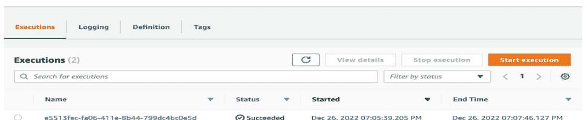

Figure 7.51: Step Functions 工作流 – 数据质量管道的成功执行

您还可以点击当前执行并探索每个阶段的输入和输出值以了解状态机的运行方式：

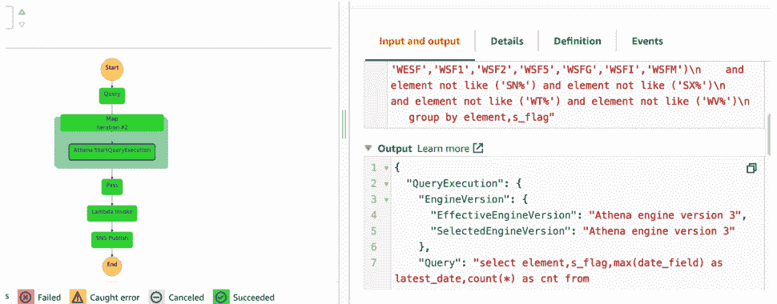

Figure 7.52: Step Functions 工作流 – 验证执行以了解其运行方式

然后您可以检查您的电子邮件以验证是否已向您发送了包含整合结果的电子邮件。应如下所示：

## AWS 通知消息

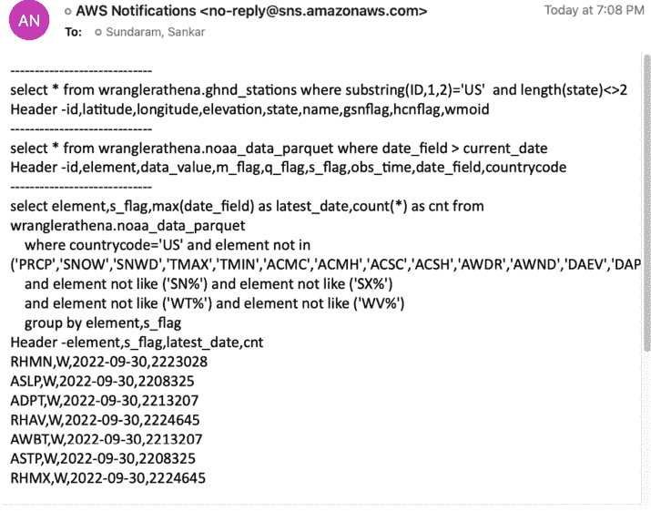

Figure 7.53: 数据质量工作流成功完成后收到的电子邮件片段

我们现在拥有一个可定制的无服务器数据质量管道。我们可以更改现有的数据质量查询、添加更多数据质量查询，并为其添加具有自己数据质量查询集的新应用程序。但数据质量管道将在无需任何更改的情况下执行它们。

## 挑战练习

您能否更改电子邮件输出，使其包含已执行的规则及其通过/失败状态的汇总表，以及仅来自失败规则的示例记录以供进一步分析？

### 提示

设计数据质量查询，使其输出不符合规则的记录。因此，如果查询没有记录输出，则数据质量规则应被视为通过，反之亦然。您可以在 Lambda 函数中添加此逻辑。在迭代过程中收集每个查询的结果，最后打印汇总仪表板。仅当它们处于失败状态时，才将示例记录附加到电子邮件中的输出数据。

## 自动化数据质量管道

无服务器管道目前以临时方式执行。我们可以通过 EventBridge Scheduler 使管道按自定义计划执行。

导航到 EventBridge 控制台并选择 **计划**，如下所示：

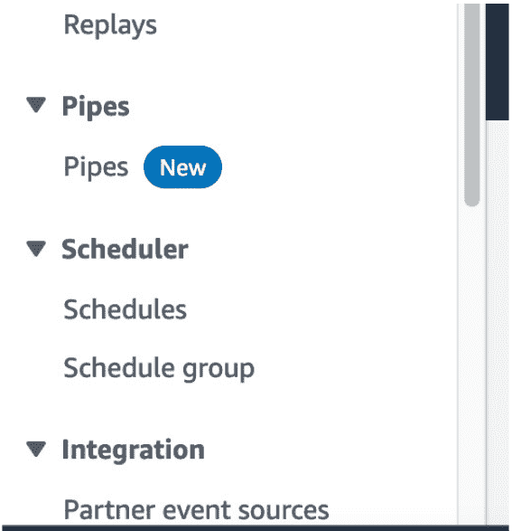

Figure 7.54: 来自 AWS 控制台的 EventBridge 调度程序

选择 **创建计划** 并为计划提供名称。我们目前将使用循环计划将数据质量管道安排为每小时执行一次，但您也可以使用基于 cron 的方法设置更复杂的计划，如下所示：

## 计划模式

发生时间

信息

您可以定义一次性或循环计划。

一次性计划

循环计划

计划类型

选择最符合您需求的计划类型。

基于 Cron 的计划

使用 cron 表达式设置在特定时间运行的计划，例如每月第一个星期一太平洋标准时间上午 8:00。

基于速率的计划

按固定速率运行的计划，例如每 10 分钟一次。

速率表达式

信息

输入运行计划的值和时间单位。

rate ( 1 hours )

灵活时间窗口

如果您选择灵活时间窗口，Scheduler 将在您指定的时间窗口内调用计划。例如，如果您选择 15 分钟，您的计划将在计划开始时间后 15 分钟内运行。

关闭

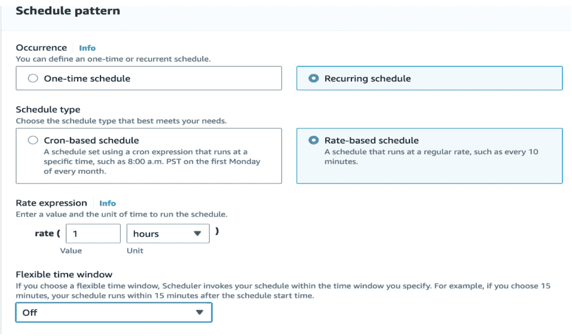

Figure 7.55: EventBridge 调度程序 – 设置每小时运行一次的计划

在目标 API 下，选择 AWS Lambda（调用）选项并选择我们在上一节中创建的 Step Functions，如下所示：

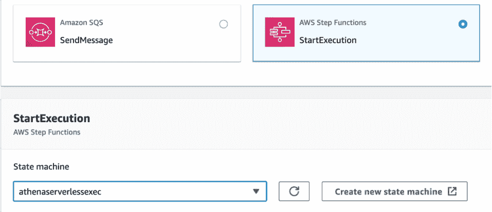

# StartExecution

AWS Step Functions

State machine

athenaserverlessexec

Create new state machine

Figure 7.56: EventBridge 调度程序 – 将 Step Functions 作为目标调用

将其他参数保持默认并创建计划。恭喜！我们现在已设置按计划执行的无服务器数据质量管道。

您可以看到从以下屏幕截图中，工作流已每小时运行并执行数据质量查询：

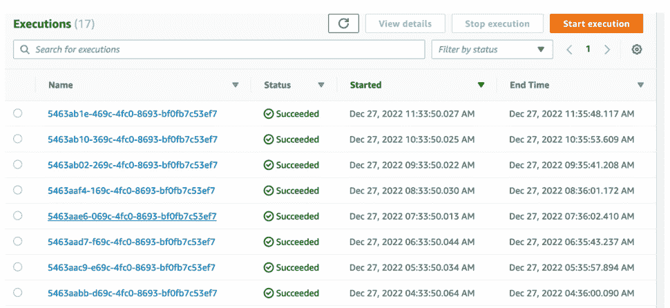

图 7.57：EventBridge 按每小时执行的工作流步骤函数

在当前场景中，我们反复对数据执行相同的查询。我们可以更改查询，使其仅在数据填充时针对新数据运行，使用时间戳列或标识新数据的分区列。您还可以使用更多参数和 Athena 预准备语句进一步自定义管道，以满足您的需求。

## 摘要

本章中，我们探讨了 Amazon Athena 服务以及它如何在数据整理管道的各个阶段提供帮助。Amazon Athena 将提供功能，帮助您以更佳且高效的方式，利用 SQL 语言中的高级函数执行数据发现、数据转换、数据结构化和数据质量。

在下一章中，我们将学习 Amazon QuickSight 以及它如何在数据整理管道的数据发现和数据可视化阶段提供帮助。
