## 使用 QuickSight

在上一章中，您了解了 Amazon Athena 服务以及它如何有效地用于数据发现、数据丰富和数据质量管道。本章中，我们将探讨 Amazon QuickSight 服务如何帮助数据整理管道的数据发现和数据可视化阶段。

本章涵盖以下主题：

- 介绍 Amazon QuickSight 及其概念
- 使用 QuickSight 进行数据发现
- 使用 QuickSight 进行数据可视化

## 介绍 Amazon QuickSight 及其概念

Amazon QuickSight 是一项 **业务智能 (BI)** 服务，可帮助您从各种数据源（例如云、本地和第三方服务）生成具有可视化/图表的交互式仪表板。此外，Amazon QuickSight 还提供嵌入式分析和 AI 启用搜索栏等高级功能。

为什么需要数据可视化工具？

如前所述，一图胜千言。用户可以通过可视化和图表比表格数据更轻松地理解数据中的模式。此外，当识别出数据洞察时，可以通过仪表板与业务和执行团队共享，以更有效地传达信息。

QuickSight 如何工作？

QuickSight 从受支持的数据源加载数据，用户可以在 QuickSight 中准备数据以满足其可视化需求。数据在 QuickSight 中渲染可视化之前，会从 **超快、并行、内存计算引擎 (SPICE)** 本地检索，或通过直接查询数据源检索。以下屏幕截图显示了 QuickSight 的重要组件：

查找分析及更多

- 收藏夹
- 最近使用
- 我的文件夹
- 共享文件夹
- 仪表板
- 分析
- 数据集
- 主题 新
- 社区 新

图 8.1：QuickSight 菜单下拉

我们将在此处探索这些组件中的每一个：

- **数据集**
- **分析**
- **仪表板**
- **主题**

本节将帮助设置与数据源的连接，并在准备数据以进行分析。数据可以存储在 SPICE 中或以 DirectQuery 格式访问。这是 QuickSight 中任何数据可视化项目中需要执行的第一步（假设 QuickSight 初始设置和配置已就绪）。

在这里，用户将创建不同的可视化和报告，这些可视化和报告会发布在仪表板中。具有作者权限的 QuickSight 用户将在 **分析** 部分花费大量时间，创建可与更广泛的用户共享的可视化。

本节将包含在 **分析** 部分创建的仪表板，可与各个团队成员共享。具有只读访问权限的用户可以访问本节并探索仪表板中的可视化/报告。可以通过电子邮件按计划与不同利益相关者共享仪表板，可以在此处配置。

这是使业务用户能够用英语提问并通过理解您数据中关系机器学习技术获得答案的部分。这避免了希望快速从数据中获得答案的团队不得不构建报告和仪表板。

现在我们已经从高层次了解了 QuickSight，让我们探索如何使用 QuickSight 从各种数据源执行数据发现。

## 使用 QuickSight 进行数据发现

Amazon QuickSight 支持从各种数据源加载数据，然后我们可以在 **分析** 选项卡中创建可视化以了解数据。数据发现也可以使用 Jupyter 笔记本和自定义可视化库进行，但这可能需要在执行数据发现活动之前具备编程专业知识和复杂的设置。相比之下，业务用户可以在 QuickSight 的 **分析** 选项卡中使用可视化进行数据发现。

## QuickSight 支持的数据源和设置

QuickSight 支持各种数据源。完整列表可在 https://docs.aws.amazon.com/quicksight/latest/user/supported-data-sources.html 找到。

这些来源可分为以下几个大类：

- **关系数据源**：涵盖云和本地数据源，包括 MySQL、Postgres、SQL Server、Oracle、Snowflake 和 Redshift 等流行的数据引擎。连接本地数据源时，还需要创建 QuickSight VPC 接口以通过安全连接导入数据。
- **文件数据源**：从 S3 或本地网络导入文件。用户可以从本地网络上传文件以便快速分析，或提供包含需要分析的 S3 文件位置的符号链接文件。
- **软件即服务 (SaaS) 数据源**：支持从 Salesforce、Twitter、Jira 和 ServiceNow 等流行 SaaS 数据源导入数据。如果您的 SaaS 提供商未在 QuickSight 数据源列表中列为受支持，您可以使用 AWS AppFlow 服务导入数据，或选择通过在 ECS 容器、AWS Glue 或 Lambda 函数中运行的代码以编程方式将 SaaS 数据导入 Amazon S3。
- **分析数据源**：支持从分析服务导入数据，以便可视化分析引擎的数据。支持从 Amazon Athena、Presto、Spark、Amazon OpenSearch、IoT Analytics 等导入数据。

请参阅 AWS 文档，了解如何为流行数据源设置连接的一些示例：https://docs.aws.amazon.com/quicksight/latest/user/connecting-to-data-examples.html。

设置数据源有几种选项：

- **从新数据源创建数据集**：当我们从 QuickSight 中之前未使用过的新数据源设置连接时使用此选项。以下屏幕截图显示了可用于为新数据源创建连接的连接器列表。用户可以单击任何数据源并提供适当的配置选项以创建新数据集。

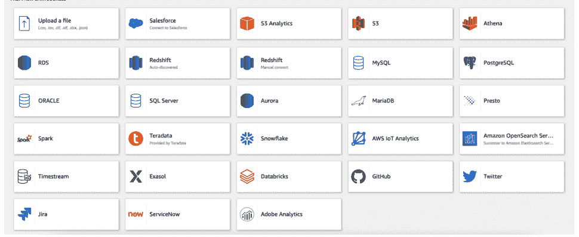

图 8.2：QuickSight – 从新数据源创建数据集

- **从现有数据源或数据集创建数据集**：您可以使用现有连接信息创建新数据集。当您想使用相同的数据源但在可视化数据之前执行不同的转换时，此选项很有用。考虑一个由销售团队使用的 Redshift 数据仓库连接的示例。销售团队还删除某些属性并以不同的方式转换数据以满足其 BI 需求。如果市场营销团队也想从 Redshift 运行报告，但不需要销售团队所做的更改，它可以重用连接为其可视化创建新数据集。

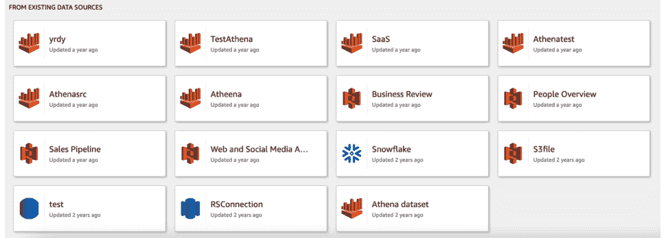

图 8.3：QuickSight – 从现有数据源创建数据集

## 使用 QuickSight 分析进行数据发现

现在，我们可以通过从示例数据集中导入销售管道数据，使用 Amazon QuickSight 查看数据发现（请参阅图 8.3 了解销售管道数据集）。您可以导入数据并为我们的分析创建新数据集。

导入数据后，它将显示一个空白画布，数据集的字段显示在左侧。您可以通过在想要使用 QuickSight 探索的字段上创建可视化来尝试使用它。

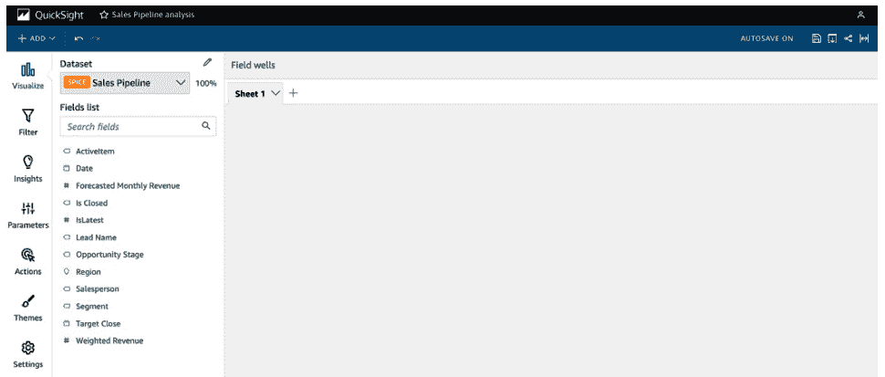

图 8.4：QuickSight – QuickSight 控制台中的分析屏幕

我们将考虑以下情况以执行数据发现活动：一位没有编码经验的业务用户希望在做出销售预测决策之前探索并理解销售数据集。

使用可视化工具的优势在于，您无需任何编程经验即可创建快速可视化。要在一段时间内可视化销售数据，我们只需点击日期列，QuickSight 就会自动创建最适合该类型数据的可视化。

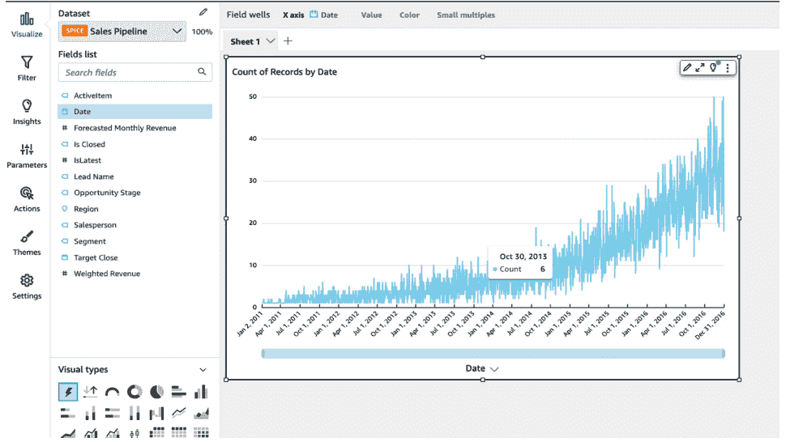

图 8.5：QuickSight – 自动图表，可自动为日期字段选择最佳可视化方式

如前面的屏幕截图所示，QuickSight 为日期字段创建了自动图表，其中包含跨日期的销售记录计数。该图表显示销售额呈上升趋势，您可以悬停在图表上查看特定时间段的记录计数，如前面的屏幕截图所示。

但我们的数据仍跨越了很长的时间段，我们希望将分析重点放在仅 2016 年的销售记录上，这是该示例数据集中最新的年份。我们将添加一个筛选器以仅可视化 2016 年的数据。点击左侧的筛选器图标，它将显示添加筛选器选项，如下所示：

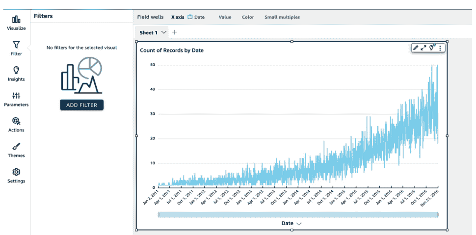

图 8.6：QuickSight – QuickSight 筛选器选项，用于仅可视化特定数据

点击添加筛选器并从数据集中选择列/属性以应用筛选条件。请记住选择仅此视觉对象选项，以避免日期筛选器应用于本工作表中我们可能创建的其他视觉对象。我们将条件选择为之后，并将日期字段设置为 2016/01/01。我们也有选择滚动窗口的选项，以便继续查看最新数据（仅可视化最近 90 天的数据）。选择所有选项后，点击应用。现在您可以看到数据仅显示 2016 年的数据，这使得图表更易读：

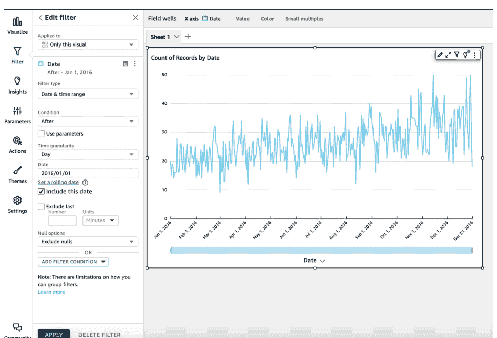

图 8.7：QuickSight – 在 QuickSight 控制台中应用筛选器以可视化数据

尽管如此，数据仍跨越 365 天，我们希望查看每个月的汇总数字，以便了解销售数据集中的销售模式。我们可以通过点击视觉对象并查看画布上方字段井部分来实现。参考以下突出显示字段井中日期字段的屏幕截图。

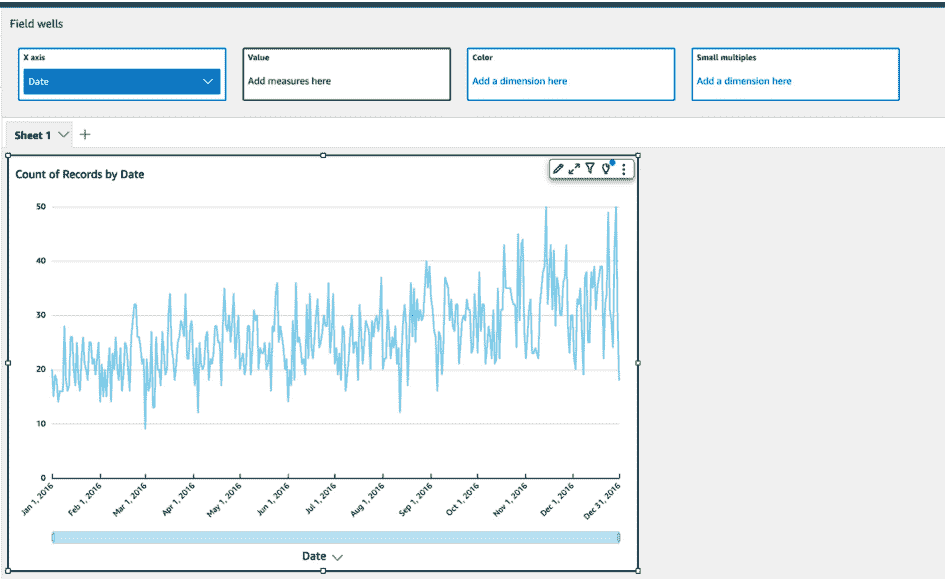

图 8.8：QuickSight — QuickSight 字段井演示

现在，我们可以点击字段井下的日期字段并按月汇总数据，如下图所示：

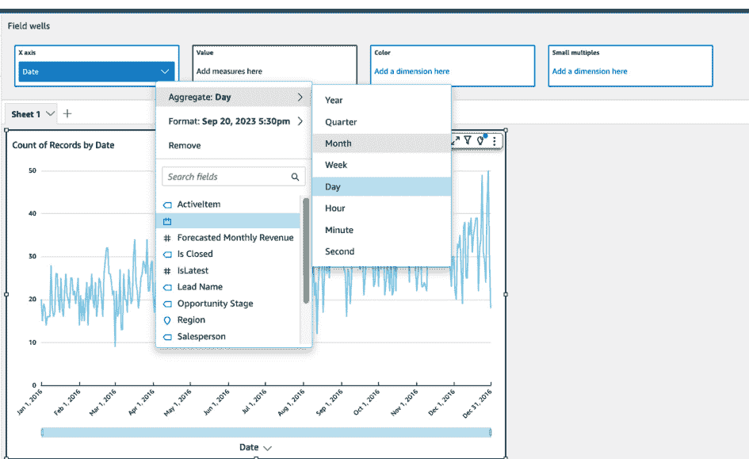

图 8.9：QuickSight – 通过字段井在视觉对象中汇总数据

这将显示按月汇总的数据，如下所示，这使得我们更轻松地可视化和了解 2016 年的销售趋势：

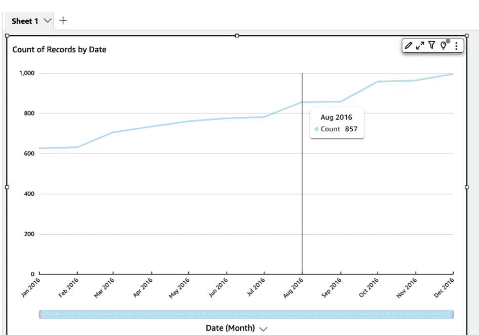

图 8.10：QuickSight – 折线图 – 按月汇总的记录计数

这看起来不错，但我们仍然没有数据标签来清晰地查看销售数字，并且不想悬停在图表上获取某个月的销售数字。点击视觉对象右上角的格式化视觉对象（参考以下屏幕截图）：

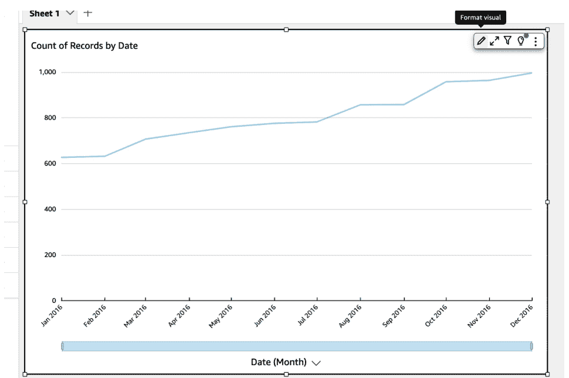

图 8.11：QuickSight – 在 QuickSight 控制台中选择格式化视觉对象来自定义视觉对象

现在您可以自定义此视觉对象的各个方面，包括添加标签。我们可以通过在 **数据标签** 部分提供以下值来添加数据标签：

- 选中 **显示数据标签** 复选框
- 将 **字体大小** 设置为 **大**
- 将 **字体颜色** 设置为 **黑色**

现在您可以看到一段时间内的销售数字模式。我们可以看到 2016 年销售数字的增长模式。

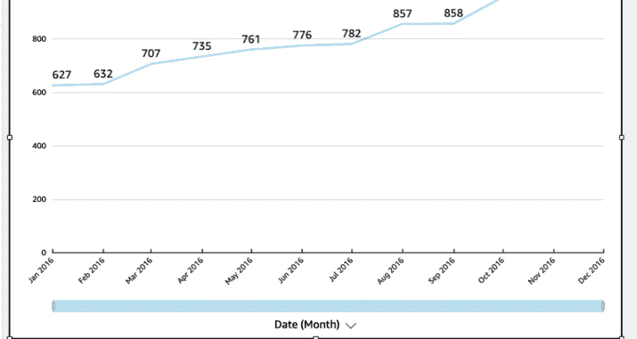

图 8.12：QuickSight – 带有数据标签的折线图

我们还可以向此视觉对象添加其他字段，以使用不同因素的组合分析销售数字。我们可以添加 **细分** 和 **区域** 字段，以了解是否有任何特定属性对我们的销售增长做出了重大贡献。这只需点击 **字段列表** 下的 **细分** 字段即可实现。

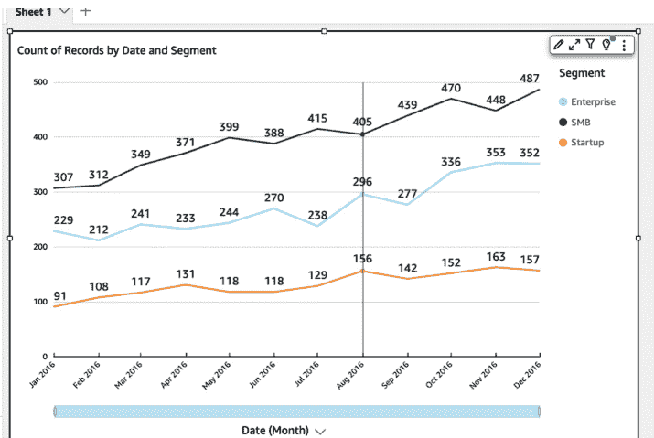

图 8.13：QuickSight – 折线图，字段井中的颜色细分中添加了细分字段

我们仍然想了解是否有特定区域对我们的销售数字贡献更大。我们只需在 **字段列表** 下也点击 **区域** 字段，QuickSight 将在主图表内自动渲染子图/子图表以提供区域级可视化，如下所示：

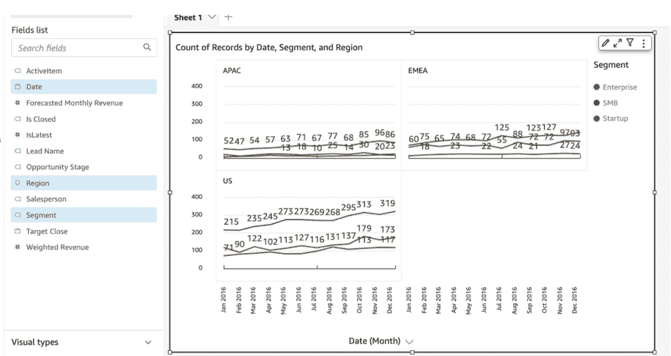

图 8.14：QuickSight – 添加了子图/子图表的折线图

这一切看起来都不错，但 QuickSight 如何不断创建这些不同的可视化？如果您查看 **字段井**，您会看到 QuickSight 已将第一个字段 **细分** 添加到 **颜色** 部分，并将第二个字段 **区域** 添加到 **小型多图** 部分，并创建了我们之前看到的漂亮可视化：

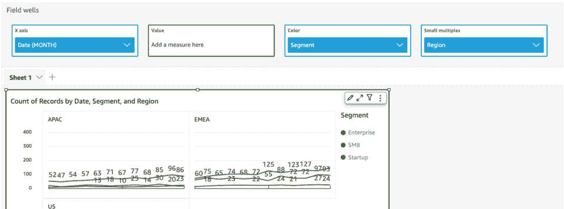

图 8.15：QuickSight – 折线图，颜色和小型多图已设置，在字段井下显示

对于好奇的人来说，如果我们继续通过点击添加新字段会发生什么？让我们继续点击 **销售人员** 字段。现在您会看到 **区域** 在 **小型多图** 中已被 **销售人员** 替换。QuickSight 使用机制来理解图表类型并不断添加适合当前可视化选项的属性（这里我们有折线图）。

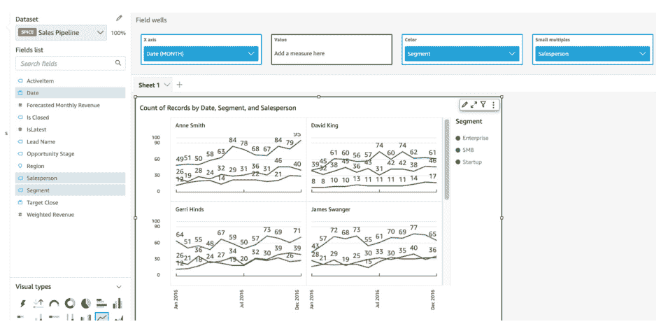

图 8.16：QuickSight – 在 QuickSight 控制台中向视觉对象添加新属性时折线图的工作情况

对于其他字段也可以这样做，QuickSight 将根据所选字段类型渲染图表。我们将进一步探索销售人员字段以了解该字段中的唯一值。点击当前折线图外部并从字段列表中选择销售人员。您将看到使用销售人员姓名创建了条形图。QuickSight 会自动确定最适合用户选择的字段的可视化类型。我们可以在此处显示的视觉对象类型部分轻松更改可视化：

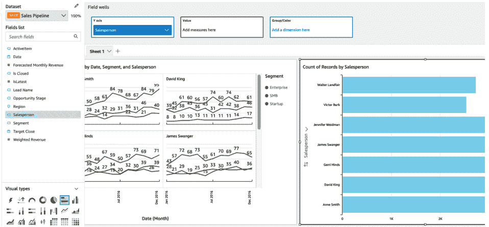

图 8.17：QuickSight – 为具有不同属性的字段创建的条形图

您可以继续添加更多可视化并高效地发现数据。但这里的关键收获是用户无需任何编程语言专业知识即可高效探索数据的便捷性。

## QuickSight Q 与基于 AI 的数据分析/发现

Amazon QuickSight Q 还通过业务语言问题提供高级数据分析或数据探索，而不是需要 IT 团队创建的 SQL 脚本或 BI 仪表板。QuickSight Q 在后端使用自然语言处理模型来回答问题。这有助于业务和领导团队无需任何编程语言专业知识即可从数据中获得答案，并且他们也不必等待 IT 团队为他们创建仪表板。

您可以向 QuickSight Q 提问，例如“Who are the best sales agents by sales?” 和 “Who were the top sales agents last year?”。使用的词语可能不同，但 QuickSight Q 仍然可以理解并从数据集中提供有意义的结果。

让我们使用 QuickSight 提供的示例数据集探索 QuickSight Q。您可以选择主题并点击试用 Q 以使用示例数据集探索 Q。如果您想使用您的数据探索 Q 并配置 QuickSight Q，您可以点击开始免费试用。您可以查看附加组件定价部分以了解使用 QuickSight Q 的费用详情。为了本书的学习目的，让我们继续使用试用 Q 选项。

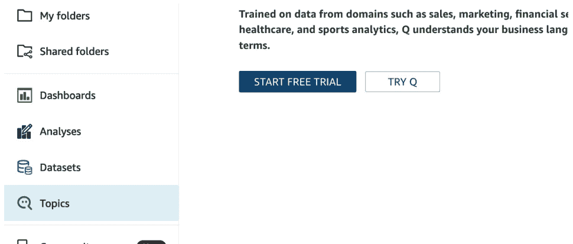

图 8.18：QuickSight – QuickSight 控制台中已启用 QuickSight Q

从示例数据集中选择产品销售。现在您将看到可以通过 Q 提问的屏幕。它还提供了可以关于示例数据集提出建议问题以及一个已经提供良好数据可视化的仪表板。

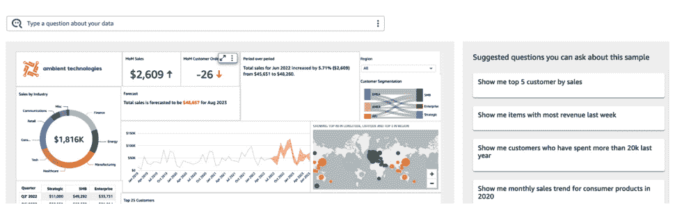

图 8.19：QuickSight – QuickSight Q 主屏幕，带搜索栏

我们可以先使用 Q 建议的示例问题之一。我们可以看到输出结果为水平条形图，按美元销售额排序的前五名客户。

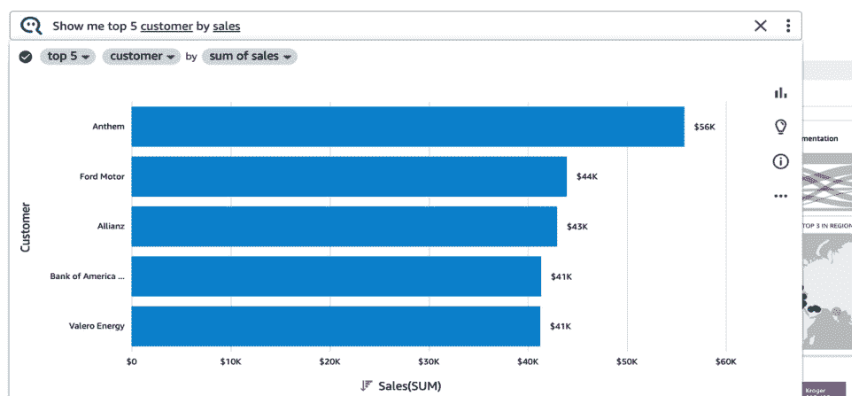

图 8.20：QuickSight – QuickSight Q 显示热门建议问题的结果

让我们通过细化问题来进一步探索，按地区获取销售代理。我们会看到结果现在按地区分组。

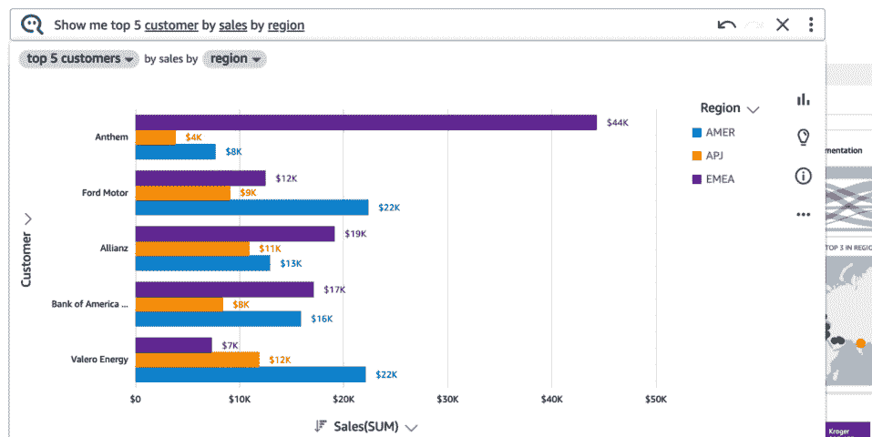

图 8.21：QuickSight Q – 按地区汇总的前五名客户销售额结果

我们可以看到，排名第一的客户来自 EMEA 地区的收入最高。我们希望确定 AMER 地区的顶级客户。让我们通过询问特定地区的顶级客户来细化问题。

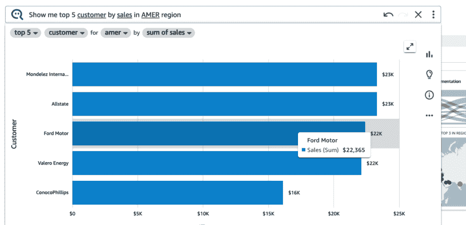

图 8.22：QuickSight Q – 仅限 AMER 地区的前五名客户销售额结果

现在，我们希望查看最近数据的顶级客户。业务团队希望从过去两年的数据中确定顶级客户，以便为这些顶级客户提供激励/折扣。

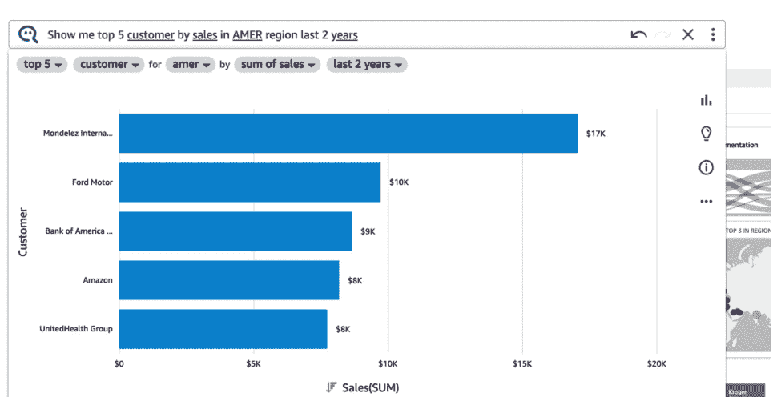

图 8.23：QuickSight Q – 仅限 AMER 地区的前五名客户销售额结果，筛选为最近两年

现在，您可以导出数据或从这些结果中进行进一步分析。从中获得的重要启示是，我们可以使用简单的英语语句轻松获取图表和可视化。用户无需知道如何使用任何编程语言、SQL 脚本或 BI 工具，但仍可以使用 QuickSight Q 创建可视化来探索数据。它还可以处理一些拼写错误、缩写和同义词，并根据每个项目的业务需求提供自动完成功能。用户还可以对结果提供进一步反馈，以便 QuickSight Q 从用户交互中学习和改进。

我们仅从数据发现的角度使用示例数据探索了 QuickSight Q 的功能。但 QuickSight Q 具有许多高级功能，可用于在您的数据集上启用自然语言查询（NLQ）。现在我们已经了解了使用 QuickSight 探索数据的方法，我们将查看 QuickSight 的数据可视化选项。

## 使用 QuickSight 进行数据可视化

在本节中，我们将探索 QuickSight 中可用的不同可视化和选项。我们将在本节中探索 QuickSight 中的高级概念以及不同的可视化和功能。

## QuickSight 中的可视化和图表

发布 QuickSight 仪表板时执行以下步骤。

图 8.24：QuickSight – 高级仪表板发布工作流

- 1. **创建数据源**：这是建立与数据源连接的步骤。这可以是一次性活动，并且在从数据源创建新数据集时可以多次重复使用。
- 2. **创建数据集**：可以根据不同的分析需求从新的数据源或现有数据集创建数据集。数据集可以根据特定的分析需求进行修改、解析或丰富。
- 3. **创建分析（创建可视化）**：从特定数据集创建可视化。在这里，仪表板作者将创建交互式可视化，可发布到仪表板供用户使用。
- 4. **发布仪表板**：从 **分析** 选项卡创建仪表板后，仪表板作者可以发布仪表板，然后可供用户（读者或作者）使用。用户现在可以订阅报告，将其导出为 PDF，或根据适用情况将其嵌入到其应用程序中。

以下是可在 QuickSight 中使用的不同类型的可视化图表。我们没有提供 QuickSight 中所有可用的可视化的完整列表，但将重点介绍一些常用的图表以及您可以使用它们的场景：

- **折线图**可以帮助持续可视化随时间的变化。如果一个度量较小而另一个很大，您可以使用双轴折线图，例如，在一段时间内比较收入（金额较高）和利润（金额较小）。折线图和条形图都可以帮助可视化一段时间内维度的变化。
- **面积图**与折线图类似，但线下区域会被着色以便更好地可视化。当存在多个度量且其下方的区域不重叠时，可以使用面积图。以下图显示了折线图和面积图：

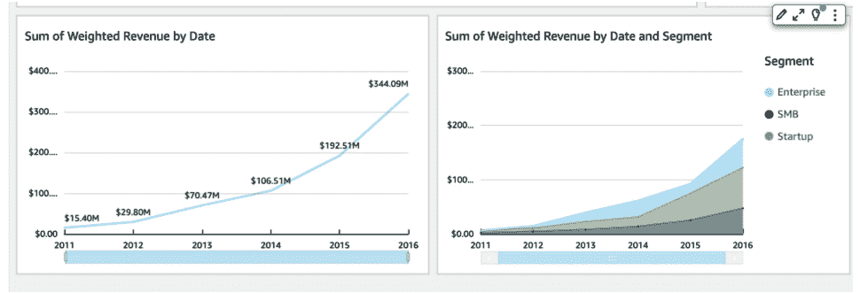

图 8.25：QuickSight – 使用折线图和面积图可视化随时间的变化

- **条形图**可以帮助可视化和比较维度，如果维度列中存在离散值：
  - **单一度量**：将维度添加到 x（垂直）或 y 轴（水平），图表将显示每个出现的次数
  - **多个度量**：每个维度并排比较一个或多个度量，例如，比较每个部门的成本和利润
- **堆叠条形图**可用于在单个度量上可视化按单个堆叠分组的多个维度

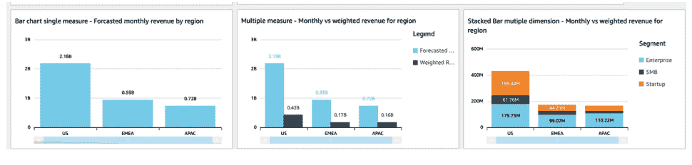

图 8.26：QuickSight – 使用条形图可视化和比较维度

- **组合图**可用于显示条形图和折线图之间存在关系时。以下图表显示了在折线图上可视化预测收入，在条形图上可视化实际收入。

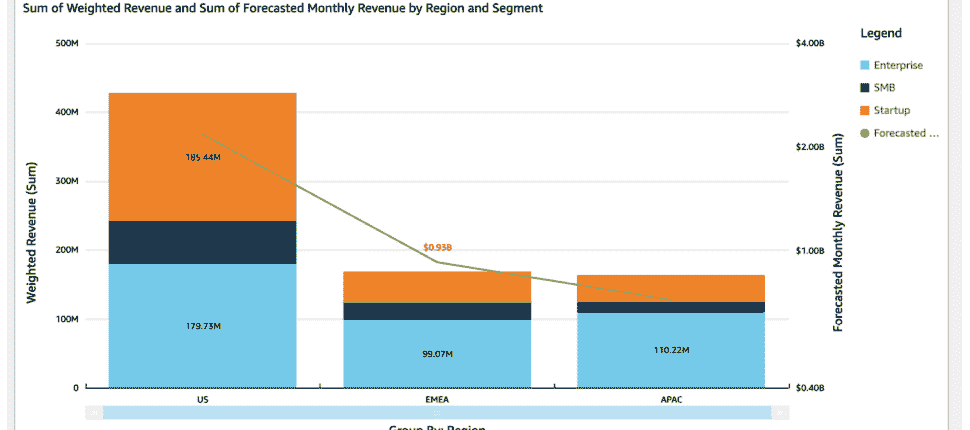

图 8.27：QuickSight – 使用组合图进行可视化

- **饼图**让我们可视化每个值在总段中的贡献。每个楔形/饼的大小代表该值在整个段中所占的百分比。任何可以分解为不同类别的数据类型都可用于此图表，但请尝试将图表中的数据类别数量限制在五个以下，否则可能难以阅读和比较饼图中的切片。
- 在**环形图**中，除了每个值的贡献外，整体值还显示在中心以便轻松参考。在以下图中，您可以看到每个地区在饼图和环形图中的收入贡献。

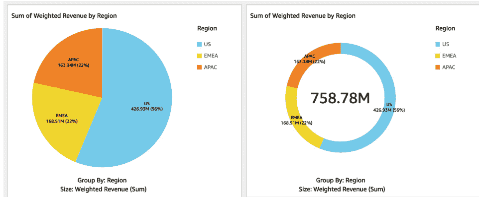

图 8.28：QuickSight – 使用饼图和环形图进行可视化

- **仪表图**帮助我们了解指标相对于总体目标的进展。在以下仪表图中，我们可以看到实际收入与预测收入的比较。它清楚地表明当前实际收入仅为预测收入的 19.84%。该图表可用于定期跟踪指标相对于目标的进展。
- **KPI 图表**通过将其与目标值进行比较来显示关键绩效指标。我们还可以使用它来比较指标在一段时间内的进展，如图所示。图 8.29 右侧显示的 KPI 图表显示加权收入在 2016 年第三季度和 2016 年第四季度之间增长了 8.82%。

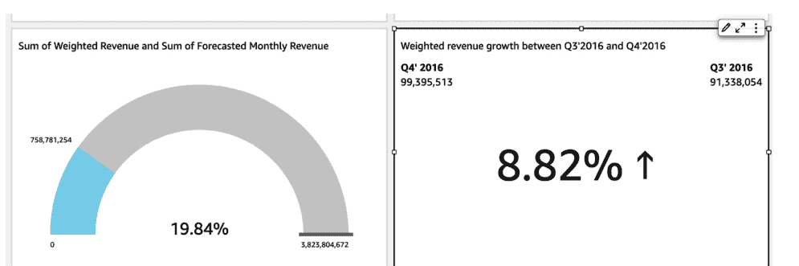

图 8.29：QuickSight – 仪表图和 KPI 图表

- **热力图**将有助于识别数据异常值以及两个不同维度属性之间的数据分布。数据以表格格式显示，每个方框根据为热力图选择的指标列进行颜色编码。指标值越高，方框颜色越深，值越低，颜色越浅。在下面的图表中，我们可以立即看出 EMEA 企业客户应获得更多关注，因为该细分市场/地区的收入与其他地区相比较低（即使这仍是 EMEA 地区内收入最高的细分市场）。

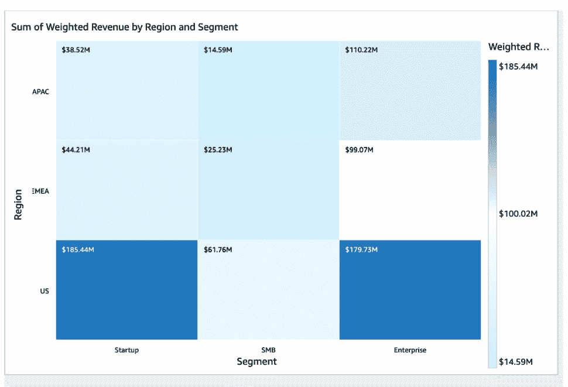

图 8.30：QuickSight – 热力图

- **箱线图**有助于在轴上可视化数据的分布。在下图中，您可以看到不同业务细分市场的收入分布。这有助于我们看到初创细分市场具有收入潜力。

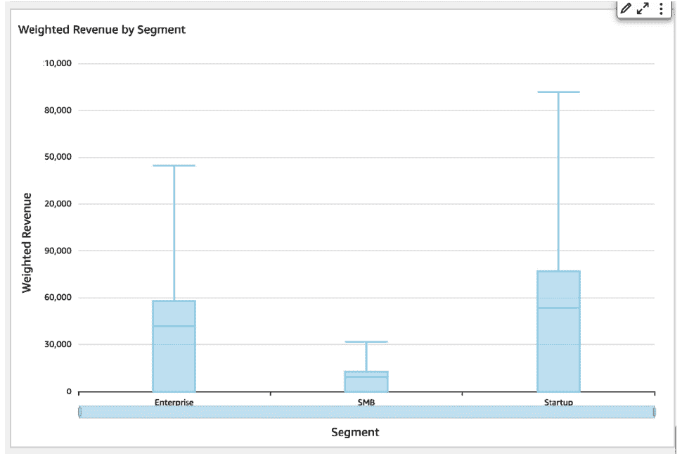

图 8.31：QuickSight – 箱线图/须线图

- **桑基图**显示从一个维度到另一个维度的数据流。下面的图表显示了区域和业务细分市场之间的收入分布，连接路径的大小提供了该区域该业务细分市场产生的收入量的概念。

## 按区域和细分市场划分的加权收入总和

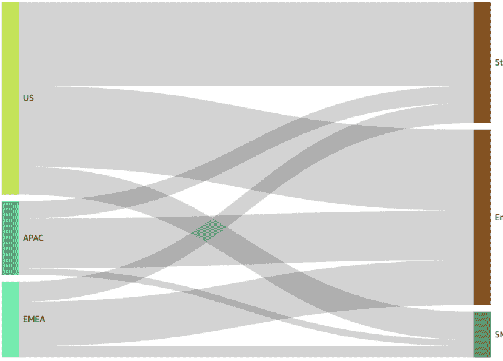

图 8.32：QuickSight – 桑基图

- **地图图表**让我们使用地理字段（邮政编码、州、县等）在地图上可视化指标。QuickSight 中可以创建两种类型的地图图表：
  - **点地图**以不同大小的点显示指标——值较高时点更大，值较低时点更小
  - **填充地图**以不同色调的颜色显示指标——值较高时色调更深，值较低时色调更浅

下图显示了来自不同医院的加权收入的点地图。每个区域使用不同的颜色，以便业务团队更轻松地进行分析。

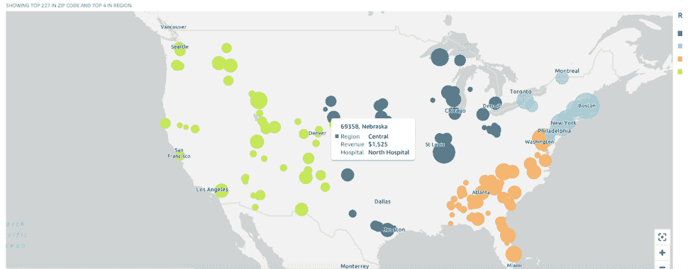

图 8.33：QuickSight – 地图图表 – 点地图

下图显示了填充地图，每个州根据该州内医院的收入着色。

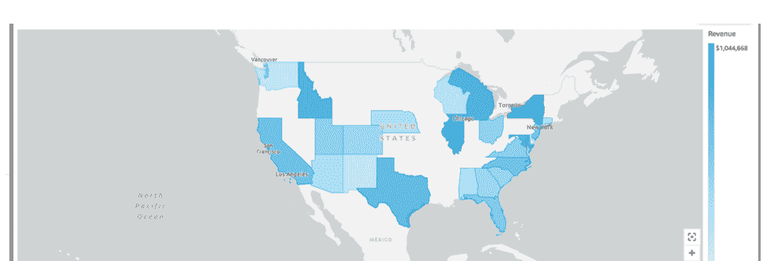

图 8.34：QuickSight – 地图图表 – 填充地图

在本节中，您已了解了不同的图表。Amazon QuickSight 中还有其他图表可用于在不同用例中可视化您的数据。在仪表板中使用合适的图表可以帮助用户更有效地向更广泛的受众讲述他们的故事。在下一节中，我们将学习嵌入式分析。

## 嵌入式分析

本节非常简短，仅旨在向您介绍嵌入仪表板的概念。组织可以将仪表板嵌入到其应用程序或 Web 门户中，以便用户无需登录 AWS 控制台即可访问 QuickSight 来探索 QuickSight 仪表板。

这让团队的生活更简单，因为他们现在可以在 Web 门户上发布高级仪表板和可视化，并具有增强的用户交互。QuickSight 支持三种不同的嵌入方式：

- **QuickSight 控制台**：将整个 QuickSight 控制台嵌入到 Web 门户中，以便用户可以创建和发布仪表板。团队可以使用它将 QuickSight 作者体验嵌入到其 Web 门户中，并为其员工添加附加功能。
- **仪表板和可视化**：嵌入在 QuickSight 控制台中开发的仪表板，用户只能查看和与仪表板交互。团队可以使用它在 Web 应用程序中向客户发布高级仪表板。
- **QuickSight Q**：将 QuickSight Q 搜索栏嵌入到 Web 应用程序中。

QuickSight 支持一键仪表板嵌入。步骤记录在此博文中：https://docs.aws.amazon.com/quicksight/latest/user/1-click-embedding.html。

为了启用一键公共嵌入，您需要将 QuickSight 订阅更改为基于会话的模型。

## 摘要

在本章中，我们探讨了 Amazon QuickSight 服务以及它如何帮助数据整理管道的各个阶段。我们了解了各种 AWS 服务以及它们如何融入数据整理管道，并能够以高效的方式执行某些数据整理活动。

在下一章中，我们将学习数据整理管道的实际用例。
