# 第 4 部分：高级数据操作和 ML 数据优化

在本节中，我们将使用 AWS Data Wrangler 和 AWS SageMaker Data Wrangler 探索高级数据操作和机器学习数据优化。*第 9 章*展示了 AWS Data Wrangler 和 pandas 的强大组合，指导您进行高级数据转换和分析。*第 10 章*深入探讨了使用 AWS SageMaker Data Wrangler 进行 ML 数据优化，帮助您预处理和准备 ML 项目的数据，以最大化模型性能和准确性。

本部分包含以下章节：

- *第 9 章*，使用 AWS SDK for Pandas 构建端到端数据整理管道
- *第 10 章*，使用 SageMaker Data Wrangler 进行机器学习数据处理

## 使用 AWS SDK for Pandas 构建端到端数据整理管道

在前几章中，我们了解了数据整理过程以及如何在 AWS 生态系统中利用不同的服务进行数据整理活动：

- 我们探索了 AWS Glue DataBrew，它通过基于 GUI 的方法帮助您为每种类型的用户创建数据整理管道。
- 我们还介绍了 SageMaker Data Wrangler，它也帮助用户创建基于 GUI 的数据整理管道，但它更紧密地与机器学习工作负载相关联，并与 SageMaker 服务集成更紧密。
- 我们还探索了 AWS SDK for Pandas，即 awswrangler，这是一种动手编码的数据整理方法，将 Pandas 库与 AWS 生态系统集成。这将由更擅长 Python 编程且热爱 Pandas 库及其功能的用户使用。
- 我们还介绍了 Amazon S3、Amazon Athena、AWS Glue 和 Amazon QuickSight 等不同的 AWS 服务，以及这些服务如何帮助数据整理管道的不同方面。

在本章中，我们将使用 `pandas` 库探索端到端数据整理管道。我们将使用一个虚构的示例，并利用各种 AWS 服务在整理管道中执行数据发现、结构化、清洗、丰富、验证和发布。

本章涵盖以下主题：

- sportstickets.com 的解决方案演练
- 数据发现
- 数据结构化
- 使用 Pandas 重构数据
- 数据清洗
- 数据丰富
- 数据质量验证
- 数据可视化

开始吧！

## sportstickets.com 的解决方案演练

我们将介绍一个虚构的示例 sportstickets.com，这是一个体育票务连锁企业。该公司管理不同的体育赛事并以折扣价销售体育赛事门票。sportstickets.com 的业务分析师希望建立端到端的数据整理管道，以便对数据进行门票销售分析。

我们将探讨数据整理管道的不同阶段，并解释 Pandas 库如何以有效和高效的方式帮助执行这些操作。


图 9.1：数据整理管道的不同阶段

## 数据摄取的前提条件

为了执行前述用例的数据整理活动，我们首先需要将数据摄取到数据湖中。为了将数据从本地数据库摄取到云环境中，我们有以下选项：

1. 使用诸如 AWS Glue 之类的服务或部署在 Elastic Kubernetes Service (EKS)/Elastic Container Service (ECS) 上的容器，使用 SQL 查询以编程方式提取数据。

这种方法的优点如下：

- 只要有用于连接数据库的包/库，它就可以与大多数数据库一起使用
- 它不需要除具有所需权限的登录凭据以外的任何额外设置即可提取数据
- 这种方法直接从表中读取数据，因此服务器无需创建用于捕获数据更改 (CDC) 流式传输实用程序所需的数据库日志文件，从而不会产生额外的工作负载

这种方法的局限性如下：

- 数据使用 SQL 查询提取，并且需要额外的书签列来增量提取后续运行的数据。如果有一个时间戳列表示记录上次更新的时间，我们可以使用它仅提取新数据。
- 管理书签列状态的额外负担也由用户承担。因此，用户必须将元数据存储在数据库中，例如 DynamoDB，以获取上次成功数据提取的值。
- 已删除的记录无法使用书签列提取，并且需要额外的设置，这在数据库中资源密集。
- DDL 更改也无法通过这种方法捕获。
- 由于提取过程使用 SQL 脚本完成，它会与用户查询竞争数据库资源，并可能影响数据库性能。


2. 使用 AWS **数据库迁移服务 (AWS DMS)**、Debezium 等工具从数据库变更日志中提取数据。

## 该方法的优点如下：
- 可以使用数据库日志捕获几乎所有的数据变更，包括记录删除和 DDL 变更
- 变更记录在数据库日志中，不会与用户查询竞争数据库资源来提取数据
- 变更会以增量的方式捕获并通过工具立即流式传输

## 该方法的局限性如下：
- 用户将依赖该工具及其支持的数据库才能使此方法正常工作。从数据库 CDC 流式解决方案迁移到另一种方法将需要大量工作。
- 对于计划的数据导出，持续流式传输不是一种具有成本效益的方法。但是，使用 AWS DMS，您可以在计划的基础上仅加载增量数据，而无需持续运行 DMS 实例，从而节省成本，如本文所述博客文章中所述：https://aws.amazon.com/blogs/database/build-an-incremental-data-load-solution-using-aws-dms-checkpoints-and-database-logs/
- 需要额外的权限来读取数据库日志，并且数据库必须启用以捕获日志并在足够长的时间内保留它们。如果日志在被数据库 CDC 工具捕获之前被删除，这将导致数据丢失情况，用户在继续之前必须重新捕获所有数据。
- 数据库将产生少量开销，以捕获每个事务的完整日志，正如某些 CDC 工具所要求的。

## 何时使用它们？
对于大多数情况，从 CDC 工具（如 AWS DMS）开始设置会更快更简单。如果您从头开始，请根据您的生态系统使用 AWS DMS/Debezium。还有来自不同厂商的其他 CDC 捕获工具，您可以进一步探索。如果 CDC 捕获工具不支持您的源数据库类型，或者您需要工具不支持的不同配置（例如，从副本数据库捕获变更），则可以使用编程方法来提取数据。

在我们的示例中，我们将使用编程提取来展示 AWS SDK for Pandas（awswrangler）在数据提取过程中的能力。

## 将示例数据加载到源数据库
我们将使用 Amazon RDS MySQL 作为源数据库，但此方法也可以扩展到本地数据库。

我们将使用 https://aws.amazon.com/getting-started/hands-on/create-mysql-db/ 中提到的步骤创建 RDS MySQL 数据库。请注意，在前述方法中数据库是使用公共访问创建的。限制附加到数据库的安全组的访问，仅允许来自客户端机器 IP 地址的流量。对于生产部署，数据库应部署在私有子网中，并通过更安全的机制以及额外的设置进行访问。

在此，我们将使用 Amazon EC2 实例连接到 RDS MySQL 数据库，并从 aws-database-migration-samples Git 仓库（https://github.com/aws-samples/aws-database-migration-samples）加载示例数据库。我们将使用票务数据库并按照以下步骤将其加载到 RDS MySQL 中：

1. 登录到 EC2 实例并安装 MySQL 客户端和 git。执行以下命令在 EC2 上安装 git 和 MySQL：
```
sudo yum update #as needed
sudo yum install git
git version
sudo yum install mysql
mysql --version
```
以下屏幕截图显示了在 EC2 实例上成功安装 git 和 MySQL：
```
Dependency Installed:
    git-core.x86_64 0:2.37.1-1.amzn2.0.1                git-core-doc.noarch 0:2.37.1-1.amzn2.0
    perl-Error.noarch 1:0.17020-2.amzn2                perl-Git.noarch 0:2.37.1-1.amzn2.0.1
    perl-TermReadKey.x86_64 0:2.30-20.amzn2.0.2

Complete!
[ec2-user@ip-10-0-30-62 ~]$ git version
git version 2.37.1
[ec2-user@ip-10-0-30-62 ~]$ sudo yum install mysql
Loaded plugins: extras_suggestions, langpacks, priorities, update-motd
Resolving Dependencies
--> Running transaction check
```
图 9.2：EC2 实例上的 MySQL 安装

2. 连接到 migration-samples Git 仓库并克隆代码。在 EC2 实例上执行以下命令：
```
git clone https://github.com/aws-samples/aws-database-migration-samples.git
cd aws-database-migration-samples/mysql/sampledb/v1/
```
您可以列出 MySQL 克隆文件夹下的文件，以确保代码已成功复制。
```
[ec2-user@ip-10-0-30-62 ~]$ git clone https://github.com/aws-samples/aws-database-migration-samples
Cloning into 'aws-database-migration-samples'...
remote: Enumerating objects: 1015, done.
remote: Total 1015 (delta 0), reused 0 (delta 0), pack-reused 1015
Receiving objects: 100% (1015/1015), 2.58 MiB | 13.63 MiB/s, done.
Resolving deltas: 100% (449/449), done.
[ec2-user@ip-10-0-30-62 ~]$ ls
aws-database-migration-samples
[ec2-user@ip-10-0-30-62 ~]$ cd aws-database-migration-samples/mysql/sampledb/v1/
[ec2-user@ip-10-0-30-62 v1]$ ls
data  install-rds.sql  README.md  remove-sampledb.sql  schema  user
[ec2-user@ip-10-0-30-62 v1]$
```
图 9.3：从 GitHub 复制示例数据到 EC2 实例

3. 连接到 MySQL 数据库并确保连接正常。使用以下命令连接到 MySQL 数据库，并在提示时提供密码：
```
mysql -h <<database endpoint>> -u admin -P 3306 -p
```
您可以在 RDS 控制台中获取数据库端点，如 Connectivity & Security 选项卡所示。

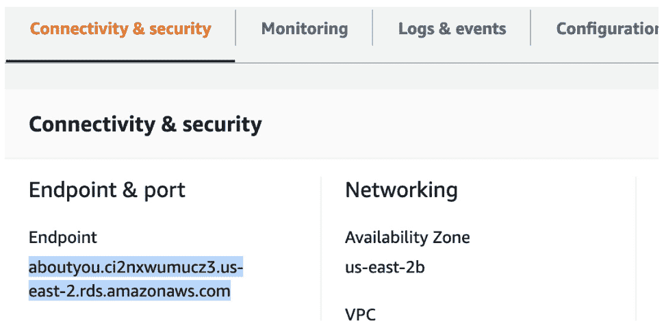

图 9.4：来自 RDS UI 控制台的数据库端点

4. 将示例数据库加载到我们的源数据库。从 GitHub 仓库执行加载脚本，它将把票务数据库加载到 MySQL 实例中。加载示例数据库需要一些时间。此步骤必须在 aws-database-migration-samples/mysql/sampledb/v1/ 文件夹下执行，我们在连接 MySQL 之前已导航到该文件夹。在 MySQL 中执行以下命令：
```
source install-rds.sql
```
加载完成后，您可以通过执行以下命令来验证：
```
show databases; --Display available databases, verify dms_sample is present in the list
use dms_sample;
show tables;
```

## 从源本地数据库进行数据迁移
如前所述，我们将使用 awswrangler 连接到源数据库并使用 Glue Python shell 作业提取数据：

1. 在 Glue 控制台中创建 Python shell 作业。选择 Python Shell 脚本编辑器，如以下屏幕截图所示：

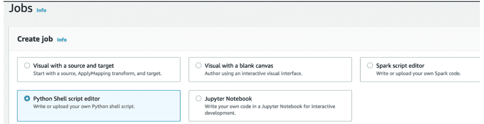

图 9.5：创建 Glue Python shell 作业

2. 在脚本编辑器中输入以下代码并保存作业：
```
import sys
import awswrangler as wr
import time
import csv
#Connect to MySQL using Glue
con = wr.mysql.connect("wranglerbook")
schema = "dms_sample"
table_list = ["mlb_data","name_data","nfl_data","nfl_stadium_data","person","player","seat_type","sport_division","sport_league","sport_location","sport_team","sport_type","sporting_event","ticket_purchase_hist"]
for table in table_list:
    #Read data from MySQL
    # tables into Pandas dataframe
    start_time = time.time()
    output_data = wr.mysql.read_sql_query("SELECT * FROM "+schema+"."+table +";", con=con)
    #Print one row for debugging
    #print(output_data.loc[1,:])
    #output_data['Name'] = output_data['Name'].apply(lambda x: "'" + str(x) + "'")
    if len(output_data.axes[0])>0:
        #Write Pandas dataframe into S3
        wr.s3.to_csv(
            df=output_data,
            path="s3://wranglerbook/awswrangler/"+table+"/",
            dataset=True,
            index=False,
            mode="overwrite",
            header=True,
            database="mysql_extract",
            table="mysql_"+table,
            compression="gzip"
        )
        end_time=time.time()
        print(f"Completed the data extraction for table - {table} .Loaded record count - {len(output_data.axes[0])} and took {round(end_time-start_time,2)} seconds")
    else:
        print(f"Data load not performed for table {table} as it is empty.")
print("Completed the data extraction process")
con.close()
```

3. 我们现在将配置作业以具有从 MySQL 读取数据的适当访问权限：
1. 选择具有读取 RDS 和写入 S3 访问权限的 IAM 角色，以及 Glue 作业所需的其他权限。
2. 在作业详细信息下将 Python 版本更改为 Python 3.9，因为 Python 3.9 环境已预安装 AWS SDK。
3. 将 Glue 连接附加到作业，以便作业在具有访问权限连接到 MySQL 的环境中执行。如果您不在 Glue 作业控制台的高级设置下进行此配置，作业将无法访问私有子网上的 MySQL 实例。

4. 执行作业并验证数据是否已填充到 S3 存储桶中。请注意，如果表具有空列，作业将失败，因为 awswrangler 需要一些值来推断数据类型。您可以按如下所示验证数据是否已填充到 S3 存储桶中。

此外，您可以查看 AWS Glue 作业 output_logs 以了解填充的记录数。您可以看到 ticket_purchase_hist 表被跳过，因为源表中也没有任何记录。


完成表 mlb_data 的数据提取。加载记录数 - 2230，耗时 1.32 秒
完成表 name_data 的数据提取。加载记录数 - 5358，耗时 1.15 秒
完成表 nfl_data 的数据提取。加载记录数 - 2928，耗时 1.17 秒
完成表 nfl_stadium_data 的数据提取。加载记录数 - 32，耗时 1.0 秒
完成表 person 的数据提取。加载记录数 - 7021016，耗时 239.27 秒
完成表 player 的数据提取。加载记录数 - 5157，耗时 2.63 秒
完成表 seat 的数据提取。加载记录数 - 3565082，耗时 61.78 秒
完成表 seat_type 的数据提取。加载记录数 - 6，耗时 1.62 秒
完成表 sport_division 的数据提取。加载记录数 - 14，耗时 1.05 秒
完成表 sport_league 的数据提取。加载记录数 - 2，耗时 1.62 秒
完成表 sport_location 的数据提取。加载记录数 - 62，耗时 1.09 秒
完成表 sport_team 的数据提取。加载记录数 - 62，耗时 1.1 秒
完成表 sport_type 的数据提取。加载记录数 - 2，耗时 1.04 秒
完成表 sporting_event 的数据提取。加载记录数 - 1158，耗时 1.18 秒
表 ticket_purchase_hist 为空，未执行数据加载。
完成数据提取过程

图 9.6：显示数据提取完成的 Glue 控制台输出

你可以看到 person 表加载 700 万条记录几乎花费了 4 分钟，而 seat 表加载花费了 1 分钟。其余表几乎花费了 1 秒。总作业耗时 5 分钟 31 秒，我们可以理解表是按顺序加载的。通过使用多线程执行作业可以加快执行速度，但这会消耗额外的内存，如果数据量较大可能导致内存不足错误。

## 挑战

我们已从 MySQL 数据库中提取了全量加载的数据，但如何提取后续加载所需的增量数据？

## 提示

你必须更改提取脚本以查询源表，仅提取特定时间戳列之后的数据。如果源数据库中目前没有此类列，我们有几个选项：

选项 1：更改源数据库表以添加时间戳列，可帮助你增量提取数据。请记住，此方法仍然无法帮助你获取已删除记录和 DDL 更改。

选项 2：使用 AWS DMS 或任何其他流式解决方案从源数据库进行 CDC。

尽管我们展示了如何使用 AWS SDK for Pandas 通过 Glue Python shell 作业以编程方式提取数据，但我们建议使用 AWS DMS 设置数据库的数据摄取，这具有多重优势且性能更佳。如果尝试加载数据量更大的表，Glue 作业将因内存不足异常而失败。你可以通过添加数据量更大的 sports_event_ticket 表来尝试。此外，在本章剩余部分，我们将探索 MySQL 数据库中的所有表，并已使用 AWS DMS 将数据迁移到 S3 原始层以供探索。你可以按照这篇博文迁移数据与 DMS – https://aws.amazon.com/blogs/database/replicate-data-from-amazon-aurora-to-amazon-s3-with-aws-database-migration-service/。

现在我们将通过各种数据整理活动探索源数据，例如数据发现、数据结构化、数据清洗、数据丰富、数据质量验证和数据可视化。让我们在下一节开始数据发现。

## 数据发现

数据发现是整理管道中的重要阶段，因为它帮助用户了解数据并指导下一步应如何进行。例如，如果用户查看数据并确定某些列存在缺失值，数据清洗应修复这些值，任何缺失的列可以通过将数据与其他数据源连接或从原始数据派生来添加。本质上，此步骤将为用户提供数据集的完整性、有用性和相关性的概念。

有多种方法可以执行数据发现，包括在本地机器上下载小文件并使用 Excel 文件探索数据。我们将查看如何探索存储在数据湖中的原始数据。在数据发现阶段执行的常见步骤如下：

- 识别源数据结构/格式及其相关属性
- 可视化数据集上的数据分布
- 验证数据集中有用数据值的存在
- 可视化探索数据集以了解数据模式
- 对数据集进行切片和切分，并探索特定业务需求的数据

你的特定项目可能还有其他数据发现活动，你仍然可以使用以下各节中提到的选项执行它们。

## 使用 S3 Select 命令探索数据

S3 Select (https://docs.aws.amazon.com/AmazonS3/latest/userguide/selecting-content-from-objects.html) 功能有助于通过 AWS 控制台 UI 和代码探索较小的数据集，以查看示例记录并运行一些探索性 SQL 查询。这仅预期支持小于 128 MB 的文件，并且在行组和记录大小方面存在限制的情况下最多可提取 40 MB 的数据。对于受这些限制影响的数据集分析或发现，建议使用其他形式的分析。

## 注意

*128 MB 和 40 MB 的文件大小/检索数据限制适用于控制台，而以编程方式使用 S3 Select 时没有此限制。但是，行组和记录大小限制无论访问*

机制（通过控制台或以编程方式）。

我们将使用 S3 Select 命令探索 S3 原始桶中可用的数据，如以下步骤所示：

1. 导航到可用于探索的源文件所在的 S3 路径。在我们的示例中，让我们取一个表进行探索，即 `nfl_data`：

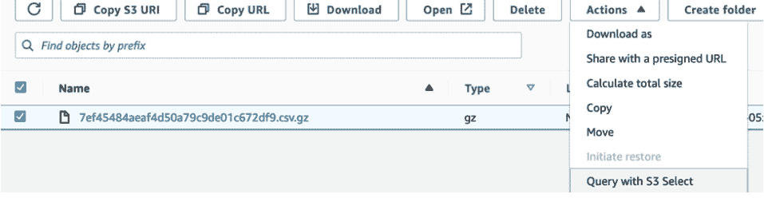

图 9.7：使用 AWS 控制台中的 S3 Select 查询 S3 文件

2. 在 AWS 控制台中，验证输入和输出设置是否正确。它将自动填充并为大多数用例正确推断，但你也可以为我们的用例验证。我们将输入数据存储为 **GZIP** 压缩的 **逗号分隔值** (**CSV**) 文件格式。

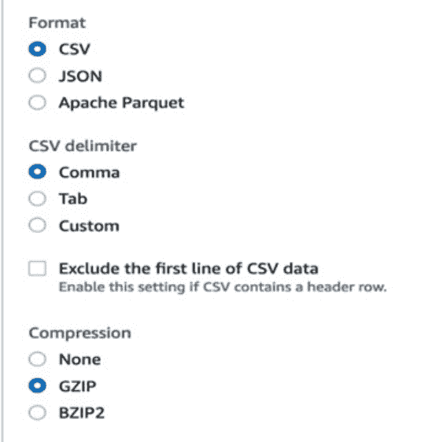

图 9.8：AWS 控制台 S3 Select 配置

如果你以 CSV 格式运行查询，可以在格式化视图中看到标题已正确填充。但是，列和字段对齐存在问题，我们将在下一步中进一步探索。查看以 name 开始的列：

| position | player_number | name | status | stat1 | stat1_val | stat2 | stat2_val | stat3 | stat3_val | stat4 | stat4_val | team |
|---|---|---|---|---|---|---|---|---|---|---|---|---|
| OT | 66 | Graf\ | Kevin | ACT | G | -- | GS | -- |  |  |  | IND |
| FS | 32 | Green\ | T.J. | ACT | TCKL | -- | SCK | -- | FF | -- | INT | -- | IND |
| FS | 27 | Guy\ | Winston | ACT | TCKL | 6 | SCK | 0 | FF | 0 | INT | -- | IND |
| OT | 73 | Haeg\ | Joe | ACT | G | -- | GS | -- |  |  |  | IND |

图 9.9：使用 S3 Select 探索 CSV 文件数据

3. 如果你想以 JavaScript Object Notation (JSON) 格式查看输出，请在输入设置中勾选排除 CSV 数据的第一行，并在输出设置中选择 JSON。没有此 JSON 设置，输出将不会将第一行解释为列标题。

```
{
  "position": "OT",
  "player_number": "66",
  "name": "Graf\\",
  "status": "  Kevin",
  "stat1": "ACT",
  "stat1_val": "G",
  "stat2": "--",
  "stat2_val": "GS",
  "stat3": "--",
  "stat3_val": "",
  "stat4": "",
  "stat4_val": "",
  "team": "",
  "": "IND"
}
```

图 9.10：作为 JSON 格式输出探索的示例记录

现在，正如你从数据中看到的，我们的 CSV 导出文件包含列中的逗号。Name 字段是名字和姓氏的组合。你可以从源（MySQL CLI）或 Glue 作业中的日志中参考原始数据：

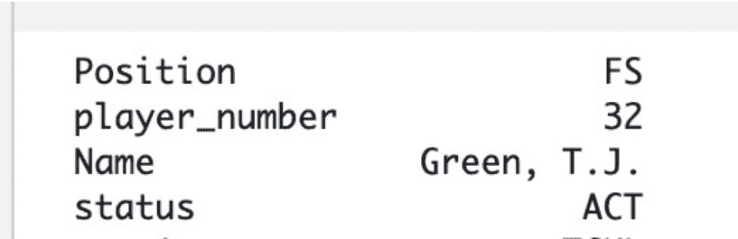

Figure 9.11: 从 Glue 控制台输出中看到的示例记录

现在我们发现我们的作业在不使用包装字符包装字段的情况下写入 CSV 输出，这导致了字段错位。然而，我们无法使用 awswrangler 代码为这些列添加包装器，因为 AWS SDK GitHub 站点上的文档指出，如果我们在同一代码中使用 Glue 目录同步（我们就是这样做的，以便在 Athena 中查询最终数据），pandas 关键字参数将被忽略。

- 4. 如果传递了 table 和 database 参数，则 pandas_kwargs 将被忽略，因为 Athena/Glue 目录要求的限制性 quoting、date_format、escapechar 和 encoding。

AWS SDK for Pandas 将 escapechar 设置为 \\ 以启用与 Athena 的协作。可以从以下代码片段看出，当我们需要 Glue 目录集成时，pandas 的额外关键字参数将被忽略，并且 escapechar 默认被设置。

```
if database and table:
    quoting: Optional[int] = csv.QUOTE_NONE
    escapechar: Optional[str] = "\\"
    header: Union[bool, List[str]] = pandas_kwargs.get("header", False)
    date_format: Optional[str] = "%Y-%m-%d %H:%M:%S.%f"
    pd_kwargs: Dict[str, Any] = {}
```

Figure 9.12: 显示 escapechar 配置的 AWS SDK for Pandas 代码片段

- 5. 让我们重新执行 Glue 作业以填充数据，手动用双引号包装列。在将其作为 CSV 文件写入之前，添加以下代码片段以用双引号包装 Name 列。取消注释代码片段中的这一行并再次运行作业：

```
output_data['Name'] = output_data['Name'].apply(lambda x: '"' + str(x) + '"')
```

现在如果我们查询输出文件，可以看到数据已与列正确对齐，但我们在逗号分隔符前面仍会添加转义字符：

| 位置 | 球员编号 | 姓名 | 状态 | 统计1 | 统计1值 | 统计2 | 统计2值 | 统计3 | 统计3值 | 统计4 | 统计4值 | 球队 |
|---|---|---|---|---|---|---|---|---|---|---|---|---|
| OT | 66 | Graf, Kevin | ACT | G | -- | GS | -- |  |  |  |  | IND |
| FS | 32 | Green, T.J. | ACT | TCKL | -- | SCK | -- | FF | -- | INT | -- | IND |
| FS | 27 | Guy, Winston | ACT | TCKL | 6 | SCK | 0 | FF | 0 | INT | -- | IND |
| OT | 73 | Haege, Joe | ACT | G | -- | GS | -- |  |  |  |  | IND |

Figure 9.13: 输出文件，其中列包含带双引号的转义字符包装

即使我们修复了单个文件，仍有更多文件存在类似问题，并且转义字符的存在会导致该列上的数据过滤器无法正常工作。因此，根据我们的初步分析，将原始文件以 JSON 格式存储以供进一步分析是合适的。

- 6. 在 Glue 控制台中更改源代码以将数据存储为 JSON 文件格式。克隆当前 Glue 作业并将脚本更改为此处所示的内容：

```
import sys
import awswrangler as wr
import time
import csv
#Connect to MySQL using Glue connections
con=wr.mysql.connect("wranglerbook")
schema="dms_sample"
table_list=
["mlb_data","name_data","nfl_data","nfl_stadium_data","person","player","seat","seat_type","sport_division","sport_league","sport_location","sport_team","sport_type","sporting_event","ticket_purchase_hist"]
table_list=["nfl_data"]
for table in table_list:
    #Read data from MySQL tables into Pandas dataframe
    start_time = time.time()
    output_data=wr.mysql.read_sql_query("SELECT * FROM "+schema+"."+ table +";", con=con)
    #Print one row for debugging
    #print(output_data.loc[1,:])
    if len(output_data.axes[0])>0:
        #Write Pandas dataframe into S3
        wr.s3.to_json(
            df=output_data, path="s3://wranglerbook/awswrangler/"+table+"/",
            dataset=True,
            orient='records',
            lines=True,
            mode="overwrite",
            database="mysql_extract",
            table="mysql1_"+table)
        end_time=time.time()
        print(f"Completed the data extraction for table - {table} .Loaded record count - {len(output_data.axes[0])} and took {round(end_time-start_time,2)} seconds")
    else:
        print(f"Data load not performed for table {table} as it is empty.")
print("Completed the data extraction process")
con.close()
```

如果注意到差异，我们只是将 to_csv 函数更改为 to_json。这说明了我们可以轻松地将文件保存到 S3。

现在您可以看到数据已正确填充为 JSON 文件，并且可以从 S3 Select 验证这一点，如下所示。

```
{
  "position": "OT",
  "player_number": 66,
  "name": "Graf, Kevin",
  "status": "ACT",
  "stat1": "G",
  "stat1_val": "--",
  "stat2": "GS",
  "stat2_val": "--",
  "stat3": null,
  "stat3_val": null,
  "stat4": null,
  "stat4_val": null,
  "team": "IND"
}
{
```

Figure 9.14: JSON 文件格式输出的示例记录

name 列现在已正确填充，但由于当前的 Pandas 限制（https://github.com/aws/aws-sdk-pandas/issues/1168），文件内部我们将有一个额外的行名列。现在我们可以探索文件的内容，以查看是否存在填充不正确字段、缺失列等情况。

## 使用 Pandas 库进行原始数据探索

Pandas 库提供了出色的数据发现工具集。我们将在 SageMaker 笔记本（Jupyter 笔记本）中执行这些活动，以进行基于 Python 的交互式数据分析。作为用户，您可以使用 pip 命令（https://jupyter.org/install）在本地实例上启动 Jupyter 笔记本，或从 SageMaker 服务中使用。我们还有 Glue 和 Elastic MapReduce（EMR）等支持笔记本的服务，但它们主要用于大数据处理和整理。如果数据量较小，您可以选择使用 SageMaker 或本地实例/EC2 安装。

我们将探索在上一步中摄取到 S3 存储桶中的票务数据库数据。打开一个 SageMaker 实例并启动一个用于探索的 Jupyter 笔记本。按照 awswrangler 简介章节中提到的步骤操作，并首先使用以下命令安装 awswrangler 包：

```
!pip3 install awswrangler
```

现在从 JSON 文件加载数据到 pandas DataFrame 中，并使用 head 函数探索数据。这将为您获取示例记录以供浏览：

```
output_data=wr.s3.read_json("s3://wranglerbook/awswrangler/nfl_data/", lines=True)
output_data.head(2)
```

|   | 位置 | 球员编号 | 姓名 | 状态 | 统计1 | 统计1值 | 统计2 | 统计2值 | 统计3 | 统计3值 | 统计4 | 统计4值 | 球队 |
|---|----------|---------------|------|--------|-------|-----------|-------|-----------|-------|-----------|-------|-----------|------|
| 0 | OT | 66.0 | Graf, Kevin | ACT | G | -- | GS | -- | None | None | None | None | IND |
| 1 | FS | 32.0 | Green, T.J. | ACT | TCKL | -- | SCK | -- | FF | -- | INT | -- | IND |

Figure 9.15: 使用 Jupyter 笔记本探索 JSON 数据

一旦数据加载到 pandas DataFrame 中，您就可以使用 pandas 数据探索功能来分析您的数据。根据数据类型和业务用途，可以执行不同类型的探索。我们将在此处解释一些高级数据探索活动，并使用 info 函数识别数据的结构，包括记录数、列数、列类型、内存使用情况等。这让您了解数据及其结构。

```
output_data.info()

<class 'pandas.core.frame.DataFrame'>
RangeIndex: 2928 entries, 0 to 2927
Data columns (total 13 columns):
#   Column        Non-Null Count  Dtype 
---  ------        --------------  -----
0   Position      2928 non-null   string
1   player_number 2916 non-null   Int64
2   Name          2928 non-null   string
3   status        2928 non-null   string
4   stat1         2928 non-null   string
5   stat1_val     2928 non-null   string
6   stat2         2928 non-null   string
7   stat2_val     2928 non-null   string
8   stat3         2390 non-null   string
9   stat3_val     2390 non-null   string
10  stat4         2390 non-null   string
11  stat4_val     2390 non-null   string
12  team          2928 non-null   string
dtypes: Int64(1), string(12)
memory usage: 300.4 KB
```

Figure 9.16: Pandas DataFrame info 函数用于探索所有列

如果您只对 DataFrame 中的记录数和列数感兴趣，可以使用 shape 函数。该函数的用法为 dataframe.shape。

假设您只想关注分析中的某些列，而 DataFrame 具有大量列；您可以按名称选择列，如下所示。或者，您可以使用 loc 函数从特定索引中获取记录。


```
#Explore only first specific columns from specific records, if you use iloc, need to
output_data.loc[1:5,["player_number","Name"]]
```

|   | player_number | Name |
|---|---|---|
|1|32|Green, T.J.|
|2|27|Guy, Winston|
|3|73|Haeg, Joe|
|4|72|Harrison, Jonotthan|
|5|38|Hightower, Lee|

图 9.17：Pandas DataFrame info 函数用于探索所有列

如果您想专注于满足特定选择条件的记录，可以按如下所示进行筛选。对于以下屏幕截图，我们将仅筛选有关印第安纳波利斯（IND）队跑卫（RB）的信息记录：

```
#filter records for certain values
output_data[(output_data["team"]=="IND") & (output_data["Position"]=="RB")]
```

|   | Position | player_number | Name | status | stat1 | stat1_val | stat2 | stat2_val | stat3 | stat3_val | stat4 | stat4_val | team |
|---|---|---|---|---|---|---|---|---|---|---|---|---|---|
|38|RB|35|Price, Chase|ACT|CAR|--|YDS|--|AVG|--|TDS|--|IND|
|57|RB|28|Todman, Jordan|ACT|CAR|4|YDS|22|AVG|5.5|TDS|0|IND|
|59|RB|33|Turbin, Robert|ACT|CAR|50|YDS|199|AVG|4|TDS|1|IND|
|67|RB|40|Williams, Trey|ACT|CAR|2|YDS|12|AVG|6|TDS|0|IND|
|607|RB|34|Ferguson, Josh|ACT|CAR|--|YDS|--|AVG|--|TDS|--|IND|
|611|RB|23|Gore, Frank|ACT|CAR|260|YDS|967|AVG|3.7|TDS|6|IND|

图 9.18：从 Pandas DataFrame 中筛选特定记录

此外，在进行进一步分析之前，您应该确定 DataFrame 中 NULL/缺失值的数量。以下代码片段展示了如何识别 DataFrame 中为空的列。为了演示此示例，我们手动在 Pandas DataFrame 中添加了一个空列：

```
#Find empty columns from the dataset
empty_cols = [col for col in output_data.columns if output_data[col].isnull().all()]
empty_cols
```

[]

```
import numpy as np
output_data["new_column_null"]=np.nan
empty_cols = [col for col in output_data.columns if output_data[col].isnull().all()]
empty_cols
```

['new_column_null']

图 9.19：识别 DataFrame 中的空列

如果您想识别每列中的空值数量以了解数据完整性，请使用以下函数：

```
output_data.isna().sum()
```

```
Position       0
player_number  12
Name           0
status         0
stat1          0
stat1_val      0
stat2          0
stat2_val      0
stat3          538
stat3_val      538
stat4          538
stat4_val      538
team           0
dtype: int64
```

图 9.20：识别 DataFrame 中各列的完整性

可选地，您可以使用 matplotlib 按如下所示可视化数据。这提供了有关具有空值的列的思路：

```
output_data.isna().sum().plot.bar()
```

]: <AxesSubplot:>

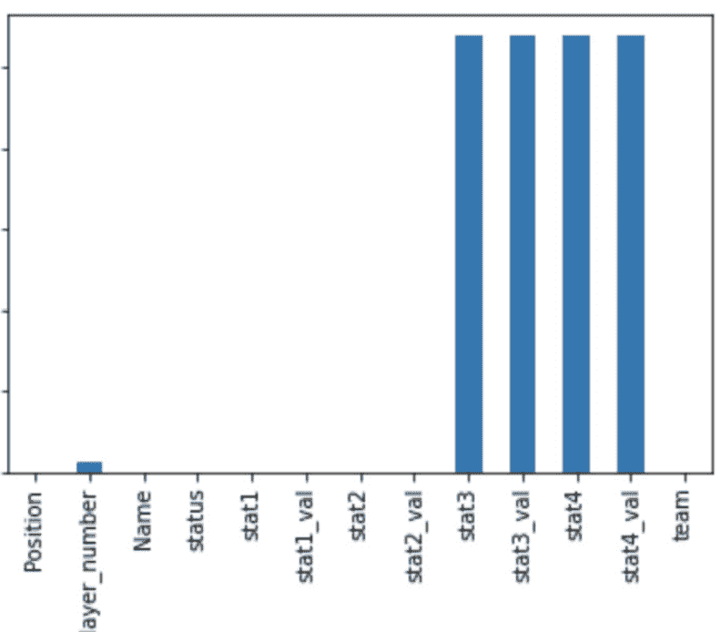

图 9.21：可视化 DataFrame 的数据完整性

然后，我们可以从某些列中数据值的分布角度探索数据集，这将让您了解数据集。以下函数提供值的计数、最频繁出现的值和最少出现的值，以及不同的值的总体计数（4058 个唯一值）：

```
output_data["last_name"].value_counts()
```

```
Williams    57
Johnson     47
Jones       40
Smith       40
Brown       27
.. 
Forte       1
Barney      1
Bishop      1
Bohanon     1
Shead       1
Name: last_name, Length: 4058, dtype: Int64
```

图 9.22：DataFrame 中特定列的数据值分布

如果您想查看擒杀次数最多的球队的球员，必须进一步探索数据。以下代码片段将帮助您浏览数据：

```
output_data[["stat1_val", "stat2_val"]] = output_data[["stat1_val", "stat2_val"]].apply(pd.to_numeric,errors='coerce')
```

```
output_data[output_data["stat2"]=="SCK"].groupby(["team"])["stat2_val"].sum().sort_values(ascending=False)[:3]
```

team
DEN    45.0
TB     44.5
MIN    44.5
Name: stat2_val, dtype: float64

```
output_data[(output_data["team"]=="DEN") & (output_data["stat2"]=="SCK") & (output_data["stat2_val"]>0)].\
dropna(subset=["stat2_val"]).\
sort_values(by="stat2_val",ascending=False)
```

|  | position | player_number | name | status | stat1 | stat1_val | stat2 | stat2_val | stat3 | stat3_val | stat4 | stat4_val | team |
|---|---|---|---|---|---|---|---|---|---|---|---|---|---|
| 1399 | OLB | 58.0 | Miller, Von | ACT | TCKL | 35.0 | SCK | 11.0 | FF | 4 | INT | -- | DEN |
| 1439 | OLB | 94.0 | Ware, DeMarcus | ACT | TCKL | 25.0 | SCK | 7.5 | FF | 1 | INT | -- | DEN |
| 1359 | OLB | 48.0 | Barrett, Shaquil | ACT | TCKL | 50.0 | SCK | 5.5 | FF | 4 | INT | -- | DEN |
| 1445 | DE | 95.0 | Wolfe, Derek | ACT | TCKL | 49.0 | SCK | 5.5 | FF | 0 | INT | -- | DEN |
| 1416 | LB | 56.0 | Ray, Shane | ACT | TCKL | 20.0 | SCK | 4.0 | FF | 0 | INT | -- | DEN |
| 1443 | NT | 92.0 | Williams, Sylvester | ACT | TCKL | 25.0 | SCK | 3.0 | FF | 0 | INT | -- | DEN |
| 1365 | DE | 93.0 | Crick, Jared | ACT | TCKL | 48.0 | SCK | 2.0 | FF | 1 | INT | -- | DEN |
| 1437 | DE | 96.0 | Walker, Vance | ACT | TCKL | 33.0 | SCK | 2.0 | FF | 0 | INT | -- | DEN |
| 1438 | SS | 43.0 | Ward, T.J. | ACT | TCKL | 61.0 | SCK | 2.0 | FF | 2 | INT | -- | DEN |
| 1396 | ILB | 54.0 | Marshall, Brandon | ACT | TCKL | 102.0 | SCK | 1.5 | FF | 2 | INT | 1 | DEN |
| 1406 | OLB | 52.0 | Nelson, Corey | ACT | TCKL | 16.0 | SCK | 1.0 | FF | 0 | INT | -- | DEN |

图 9.23：识别擒杀次数最多的球队中擒杀次数最高的球员

您还可以使用 matplotlib 库可视化数据并将其导出为图像。以下代码片段提供了可视化擒杀次数最多的球队的示例：

```
#plotting values
import matplotlib.pyplot as plt
vis_data=output_data[output_data["stat2"]=="SCK"].groupby(["team"])["stat2_val"].sum().sort_values(ascending=False)[:10]
vis_data=vis_data.to_frame()
ax=vis_data.plot.barh(color="red")
ax.bar_label(ax.containers[0]);
ax.get_legend().remove()
plt.title('Team with highest sacks')
plt.xlabel('Sacks')
plt.ylabel('Team');
```

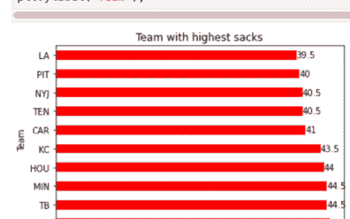

图 9.24：可视化擒杀次数最多的球队

前面的示例旨在展示 Pandas DataFrame 在以您想要的任何结构或格式对数据进行深入分析方面的强大功能。您可以使用 `matplotlib` 继续探索数据并可视化结果，以更深入地了解您的数据。

## 通过 Amazon Athena 和 Glue Catalog 访问

为了让习惯于基于 SQL 访问的用户能够进行数据发现，我们可以将数据集编目到 AWS Glue Data Catalog 中，并探索数据集以进行更复杂的分析。

Athena 提供了一种基于 SQL 的访问机制，可在没有任何文件大小限制的情况下探索数据，支持 SQL，并且无需 Python 编程即可探索数据集。

让我们探索 `nfl_data` 表以进行进一步分析，其中我们希望从 `stat1_val` 列运行复杂值：

```sql
select case when regexp_like(stat1_val, '^ -?\d+$') then 'valid'
    else stat1_val end as column_spread,count(*)
from mysql1_nfl_data
group by case when regexp_like(stat1_val, '^ -?\d+$') then 'valid'
    else stat1_val end
```

| # | column_spread | count(*) |
|---|---------------|----------|
| 1 | -- | 1218 |
| 2 | valid | 1710 |

图 9.25：Amazon Athena 查询以识别数据集中有效的统计值

您可以验证并看到 `stat1_val` 列中接近 40% 的值未填充有效统计值。

## 注记

> *单个行或其列的大小不能超过 32 兆字节。例如，当 CSV 或 JSON 文件中的一行包含 100 兆字节的单列时，可能超出此限制。超出此限制还可能产生错误消息 Line too long in text file. (https://docs.aws.amazon.com/athena/latest/ug/other-notable-limitations.html)*


现在我们已经了解了不同的数据探索技术，让我们讨论何时使用前面提到的数据探索方法：

- 如果文件大小较小且不需要从多个文件中探索数据，请使用 S3 Select 来探索数据集。这将支持您快速搜索数据集中是否存在错误值、缺失列等。
- 如果文件大小很大，并且您希望对数据进行更深入的分析（例如某列中空值的百分比），并且团队熟悉 Python 编程，请使用 Pandas 探索数据集。
- 如果文件大小很大且团队熟悉基于 SQL 的探索活动，则使用 Athena 并结合 Glue Catalog。awswrangler 在写入文件时有助于填充 Glue Catalog。对于来自其他数据源的文件，Glue Crawler 将帮助您推断模式，该模式可使用 Athena 进行查询。

我们已经了解了不同的数据探索技术，现在可以探索数据整理管道的下一阶段——数据结构化。

## 数据结构化

现在我们需要进入将数据从原始格式重构为可用格式的部分。在我们的用例中，我们以 JSON 格式提取了数据，使用原始数据格式对于探索性分析是合适的。当我们进一步进入数据整理管道时，不同的文件格式和结构会更高效。

## 不同文件格式及其使用场景

在数据管道中常用的文件格式有多种：

- **可读文件格式：** CSV、JSON 和 **可扩展标记语言（XML）** 是一些可被人工用户阅读的文件格式：
  - CSV 文件主要在数据提取阶段使用，当数据需要与分析师共享以便阅读和执行进一步操作时。优点是您不需要任何编程语言即可读取文件，并且可以在最常见的文本编辑器中打开。这些文件格式在数据分析社区中与 Excel 文件一起广泛流行。它们可用于在 Excel 应用程序本身内执行快速透视和其他分析/可视化。然而，它们不支持数据类型或复杂数据格式（分层数据）的概念，并且可扩展性有限。
  - XML 于 1990 年代创建，并迅速成为共享分层和复杂数据类型的 W3C 标准。这是第一个支持分层数据格式的流行格式，并被广泛用于各种系统之间的数据交换。XML 文件在存储大小上非常庞大，因为它们使用开放和关闭标签来表示数据，而不像 CSV 文件格式。
  - JSON 文件格式主要被 Web 应用程序用于存储数据，并被传递到下游数据管道用于数据分析。JSON 文件比 XML 文件更受欢迎，因为它们比 XML 更容易阅读和理解。它们支持更复杂的数据格式，包括分层数据、对象和数组。它们还支持使用键值组合的模式演进，这有助于我们理解存储的数据。如果某些字段不适用，我们可以选择性地跳过它们，而不像 CSV 文件那样具有刚性模式，这对前端应用程序是有利的。然而，与 CSV 文件相比，它们消耗的存储空间和处理内存更多。

选择可读文件格式的主要原因是为了满足用户希望下载文件并用于不同用例的情况（例如，与另一个团队共享用户列表以进行电话跟进）：

- 如果数据结构相对简单且没有分层字段，您可以选择 CSV 文件格式，因为它易于阅读且轻量。CSV 文件结合 Excel 将为轻量级数据分析提供良好的可视化效果。
- 如果数据具有更复杂的数据类型并且您需要存储不同的数据格式，请选择 JSON 文件格式。在前面的示例中，我们从 CSV 迁移到 JSON 文件格式，因为我们的数据中包含逗号，使用 pandas 库处理该数据会带来更多挑战。
- **二进制文件格式：** Parquet、Avro 和 ORC 是一些常见的不可人工阅读的文件格式，用于数据管道的分析阶段。这些文件格式以机器可读的二进制格式存储，可以拆分并存储在多个磁盘上，从而支持并行处理。这些文件格式在大数据处理领域广泛使用。它们是自描述的，这意味着它们将模式和数据一起存储，因此处理系统可以轻松读取数据。

行存储与列存储是什么？Parquet 和 ORC 文件格式以列式格式存储数据，而 Avro 以记录级格式存储数据。列式格式将同一列的数据对记录块进行集中存储。这在数据按特定列进行聚合和可视化的分析系统中很有帮助。将相邻列的数据存储在一起有助于更快地读取数据并跳过分析查询中未使用的其他列的读取。例如，见下文：

| Name | stat1 | stat2 |
|---|---|---|
| Test_user1 | 12 | 13 |
| Test_user2 | 14 | 15 |
| Test_user3 | 16 | 17 |

表 9.1：原始数据（包含记录块 – 3 条记录）

这是记录级存储：

| Test_user1 | 12 | 13 | Test_user2 | 14 | 15 | Test_user3 | 16 | 17 |

表 9.2：表的记录级存储

这是列式存储：

| Test_user1 | Test_user2 | Test_user3 | 12 | 14 | 16 | 13 | 15 | 17 |

表 9.3：表的列式存储

前面的表格仅用于说明和理解目的，实际存储将与数据块一起存储额外信息，并进行压缩。

## 何时选择文件格式

Parquet 文件最常用，如果您不确定数据存储格式的选择，但知道数据将用于分析用例，可以从它们开始。如果需要实时流处理且模式演进是主要关注点，并且数据将用于探索性目的，您可以选择使用 Avro 文件格式。

## 使用 Pandas 重构数据

我们将继续以票务数据库中的 seat 表为例。表的结构如下所示：

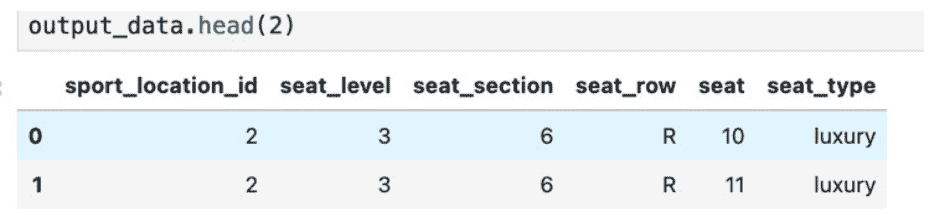

图 9.26：探索 seat 表中的示例记录

我们将考虑一种情况，即需要重命名某些列以更好地符合数据治理标准，并根据需要重新排列某些列：

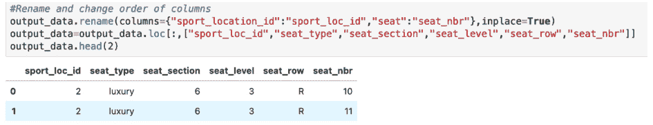

图 9.27：在 DataFrame 中重命名和重新排列列

Pandas 还提供了强大的功能，可使用透视函数将数据形状从宽格式转换为长格式，反之亦然。考虑一个示例，我们希望将数据从原始格式转换为每个运动场地的每个类别的座位聚合计数。该数据将用于仪表板，以可视化不同场地上可用的座位类型。

透视函数提供了实现类似聚合的能力。我们将使用 `merge` 操作连接 `sport_location` 表数据和 `seat` 表数据，后者已加载到 `output_data` DataFrame 中。我们将在本章的数据结构化部分进一步探讨连接 DataFrame。透视表将根据座位类型和体育场名称汇总座位数。

```python
import awswrangler as wr
import pandas as pd
import numpy as np
con=wr.mysql.connect("wranglerbook")
sport_loc=wr.mysql.read_sql_query("SELECT * FROM dms_sample.sport_location", con=con)

pivot_data=pd.merge(output_data,sport_loc,left_on="sport_loc_id",right_on="id",how='inner')
final_data=pivot_data.pivot_table(values="seat_nbr", index="name", margins="True", columns="seat_type", aggfunc="count")
final_data
```

| name | luxury | obstructed | premium | standard | sub-standard | All |
|---|---|---|---|---|---|---|
| AT&T Park | 1000.0 | NaN | 13000.0 | 23915.0 | 4000.0 | 41915 |
| AT&T Stadium | 1000.0 | 1000.0 | 22999.0 | 42000.0 | 13001.0 | 80000 |
| Angel Stadium | NaN | NaN | 17001.0 | 26482.0 | 2000.0 | 45483 |
| Arrowhead Stadium | 3415.0 | 1000.0 | 16000.0 | 50001.0 | 6000.0 | 76416 |
| Bank of America Stadium | 8000.0 | NaN | 23001.0 | 33418.0 | 11000.0 | 75419 |
| ... | ... | ... | ... | ... | ... | ... |
| US Cellular Field | 5000.0 | 1000.0 | 12614.0 | 18001.0 | 4000.0 | 40615 |

图 9.28：使用透视表聚合并将数据集转换为所需结构

在前面的示例中，我们可以看到 AT&T Park 中没有 **obstructed** 座位（请记住这是虚构数据，😊）。然而，座位计数是十进制类型，这具有误导性，因为我们不能有部分座位。让我们通过使用 `format` 函数转换列的数据类型来修复这个问题，如下所示：

```python
final_data.head(5).style.format("{:.0f}")
```

| name | luxury | obstructed | premium | standard | sub-standard | All |
|---|---|---|---|---|---|---|
| AT&T Park | 1000 | nan | 13000 | 23915 | 4000 | 41915 |
| AT&T Stadium | 1000 | 1000 | 22999 | 42000 | 13001 | 80000 |
| Angel Stadium | nan | nan | 17001 | 26482 | 2000 | 45483 |
| Arrowhead Stadium | 3415 | 1000 | 16000 | 50001 | 6000 | 76416 |
| Bank of America Stadium | 8000 | nan | 23001 | 33418 | 11000 | 75419 |

图 9.29：在 pandas 中使用数据格式化和样式选项

现在我们拥有原始数据源中不可用的不同数据表示。同样，您可以使用 `pandas` 操作根据项目消费需求转换数据

例如 `pivot`、`unpivot` 等等。

## 使用 Pandas 展平嵌套数据

Pandas 提供了通过删除不需要的列、重命名列以及根据需要更改索引来构建数据的功能。这有助于将数据格式更改为更标准、适合每种用例的格式。此外，Pandas 中还有一些函数可用于展平单列中的嵌套数据，以便更好地分析数据。

为了演示我们的工作，让我们考虑一个示例体育场数据，其中包含体育场的地址和餐饮选择。我们在示例数据集中没有该数据，因此将使用示例值来展示 JSON 数据展平的工作方式。我们将使用 `json_normalize` ([https://pandas.pydata.org/docs/reference/api/pandas.json_normalize.html](https://pandas.pydata.org/docs/reference/api/pandas.json_normalize.html)) 函数将嵌套的 JSON 数据展平成列以进行分析。现在我们可以用这种数据更高效地查询列。你可以通过按 **Location.State** 列进行筛选来查询加利福尼亚州有多少个体育场。

```python
stadium_address = {'Name':'Angel Stadium', 'Location':{'City':'Anaheim','Zipcode':'92806','State':'CA','Address':{'Street Name':'E Gene Autry Way','Number':'2000'}}, 'Dining':['The Sweet shop','Big A Burger']}
```

```python
from pandas import json_normalize
flat1=json_normalize(stadium_address)
flat1
```

| Name | Dining | Location.City | Location.Zipcode | Location.State | Location.Address.Street Name | Location.Address.Number |
|---|---|---|---|---|---|---|
| Angel Stadium | [The Sweet shop, Big A Burger] | Anaheim | 92806 | CA | E Gene Autry Way | 2000 |

图 9.30：使用 json_normalize 函数展平分层 JSON 数据

然而，**Dining** 列中仍然有列表数据。如果我们希望扩展该列，将有助于进一步分析。为此，我们需要创建一个函数来展平 JSON 字符串中的字典和列表数据。

```
#Function referenced from https://towardsdatascience.com/flattening-json-objects-in-python-f5343c794b10
def flatten_json(y):
    out = {}
    def flatten(x, name=''):
        if type(x) is dict:
            for a in x:
                flatten(x[a], name + a + '_')
        elif type(x) is list:
            i = 0
            for a in x:
                flatten(a, name + str(i) + '_')
                i += 1
        else:
            out[name[:-1]] = x
    flatten(y)
    return out
```

图 9.31：用于展平 JSON 数据中列表和字典列的函数

现在，你可以看到输出中字典和列表数据都已从 JSON 字符串展平。我们使用了前一步创建的 flatten_json 函数来实现所需输出：

```
flat = flatten_json(stadium_address)
json_normalize(flat)
```

| Name | Location_City | Location_Zipcode | Location_State | Location_Address_Street Name | Location_Address_Number | Dining_0 | Dining_1 |
|---|---|---|---|---|---|---|
| 0 Angel Stadium | Anaheim | 92806 | CA | E Gene Autry Way | 2000 | The Sweet shop | Big A Burger |

图 9.32：展平包含列表和字典列的 JSON 数据

让我们花点时间了解该函数的工作原理，以便你能进一步开发它。我们将为函数添加注释并演示 flatten 函数的工作方式。该函数将递归调用以展平 JSON 字符串：

```python
#For learning the working of the function.
def flatten(x, name='',out={}):
    print(x)
    a=""
    if type(x) is dict:
        for a in x:
            print("___________________")
            print("Dictionary route " + a)
            flatten(x[a], name + a + '_')
    elif type(x) is list:
        i = 0
        for a in x:
            print("*******************")
            print("List route " + name + str(i) + '_')
            flatten(a, name + str(i) + '_')
            i += 1
    else:
        print("====> Found a value for target column --> "+ x)
        out[name[:-1]] = x
```

图 9.33：通过添加注释了解 flatten 函数的工作原理

我们在函数中立即添加了 print 语句，以了解正在传递的输入字符串。我们在每个部分都添加了 print 语句，这些语句执行以下功能：

- 展平字典对象
- 展平列表对象
- 识别要存储在目标列中的原子值

### 函数的工作原理是什么？

该函数将遍历提供的数据并识别当前对象是字典还是列表：

- 字典对象将具有大括号并具有键值对结构，例如：{ "name":"Angel stadium", "state":"CA" }。字典内部可以包含字典或列表对象。
- 列表对象将具有重复多次的相似数据项。它们存储在大括号结构中。它们可用于存储多值属性。在前面的示例中，我们将 Angel 体育场内多个餐厅的数据存储在列表中——例如：["The sweet shop", "Big A burger"]。

一旦识别出对象，如果它是另一个对象内的字典或列表，它将递归调用该函数。

以下屏幕截图说明了该函数在提供最终输出之前如何解析数据。逐步跟进，你可以更好地理解该函数的工作原理：

```
flatten(stadium_address)
{'Name': 'Angel Stadium', 'Location': {'City': 'Anaheim', 'Zipcode': '92806', 'State': 'CA', 'Address': {'Street Name': 'E Gene Autry Way', 'Number': '2000'}}, 'Dining': ['The Sweet shop', 'Big A Burger']}
Dictionary route Name
Angel Stadium
====> Found a value for target column --> Angel Stadium
Dictionary route Location
{'City': 'Anaheim', 'Zipcode': '92806', 'State': 'CA', 'Address': {'Street Name': 'E Gene Autry Way', 'Number': '2000'}}
Dictionary route City
Anaheim
====> Found a value for target column --> Anaheim
Dictionary route Zipcode
92806
====> Found a value for target column --> 92806
Dictionary route State
CA
====> Found a value for target column --> CA
Dictionary route Address
{'Street Name': 'E Gene Autry Way', 'Number': '2000'}
Dictionary route Street Name
E Gene Autry Way
====> Found a value for target column --> E Gene Autry Way
Dictionary route Number
2000
====> Found a value for target column --> 2000
Dictionary route Dining
['The Sweet shop', 'Big A Burger']
********************
List route Dining_0_
The Sweet shop
====> Found a value for target column --> The Sweet shop
********************
List route Dining_1_
Big A Burger
====> Found a value for target column --> Big A Burger
```

图 9.34：JSON 展平函数的内部工作原理

现在，我们已成功将数据展平为单独的列以便更好地分析。然而，列表项在同一表中被拆分为多个列，这可能会创建宽列表和稀疏数据，这不利于查询数据。更好的方法是将列表中的数据拆分为具有外键关系的单独表。

为了实现这一点，我们将进一步更改 flatten 函数。以下是对 flatten 函数所做的更改摘要：

- 添加逻辑来处理数据集的主键，以便主键可以存储在子表中以便将它们连接起来。
- 我们将更改列表对象的展平逻辑以创建不同的 DataFrame。该逻辑还将填充主键迭代器列以识别原始列表对象中的不同值。
- 现在我们的函数将返回多个字典项，因此我们将更改函数输出以返回字典/列表对象的列表。

```
#For learning the working of the function.
def flatten_v2(x, name='',df_name="df",pk="Name",pk_val="",out={},out_dfs={}):
    print("Input -->",x, "--", df_name,"--",name)
    a=""
    df1={}
    df_list=[]
    if pk_val=="":
        pk_val=x[pk]
    if type(x) is dict:
        for a in x:
            print("___________________________")
            print("Dictionary route " + a)
            flatten(x[a], name + a + '_',"df",pk_val=pk_val)
    elif type(x) is list:
        i = 0
        for a in x:
            df1={}
            print("***************************")
            print("List route " + name + str(i) + '_')
            df_name=name[:-1]
            df1[name[:-1]]=a
            df1[name[:-1]+"_pk"]=i
            df1[pk]=pk_val
            df_list.append(df1)
            print("Output in list-->",df_list)
            i += 1
        out_dfs[df_name]=df_list
        return out_dfs
    else:
        print("====> Found a value for target column --> "+ x)
        out[name[:-1]] = x
    out_dfs[df_name]=out
    print("Output-->",out)
    return out_dfs
```

图 9.35：更新的 flatten 函数，用于将列表对象拆分为具有主键外键关系的另一个 DataFrame


探索该函数，您可以在自己的环境中执行它以更好地理解其内部工作原理。现在让我们将其打包成一个可用的 flatten 函数并验证输出：

```
def flatten_json_v2(y):
    out = {}
    out_dfs= {}
    def flatten(x, name='',df_name="df",pk="Name",pk_val=""):
        a=""
        df1={}
        df_list=[]
        if pk_val=="":
            pk_val=x[pk]
        if type(x) is dict:
            for a in x:
                flatten(x[a], name + a + '_',"df",pk_val=pk_val)
        elif type(x) is list:
            i = 0
            for a in x:
                df1={}
                df_name=name[:-1]
                df1[name[:-1]]=a
                df1[name[:-1]+"_pk"]=i
                df1[pk]=pk_val
                df_list.append(df1)
                i += 1
            out_dfs[df_name]=df_list
            return out_dfs
        else:
            out[name[:-1]] = x
            out_dfs[df_name]=out
    flatten(y)
    return out_dfs
```

图 9.36：作为 flatten 函数的版本 2 创建的更新后的展平代码

在此处为我们的示例数据集执行该函数，我们现在可以看到该函数创建了两个 DataFrame，其中一个 DataFrame 包含来自列表对象的內容以及主键值（在此示例用例中为体育场名称），用于连接目的。

```
flat = flatten_json_v2(stadium_address)
json_normalize(flat['df'])
```

|   | Name | Location_City | Location_Zipcode | Location_State | Location_Address_Street Name | Location_Address_Number |
|---|------|---------------|------------------|----------------|------------------------------|-------------------------|
| 0 | Angel Stadium | Anaheim | 92806 | CA | E Gene Autry Way | 2000 |

```
json_normalize(test['Dining'])
```

|   | Dining | Dining_pk | Name |
|---|--------|-----------|------|
| 0 | The Sweet shop | 0 | Angel Stadium |
| 1 | Big A Burger | 1 | Angel Stadium |

图 9.37：验证更新后的 flatten 函数的工作原理

我们通过此练习展示了使用 pandas 和 Python 可以执行强大的数据转换以满足我们的需求。然而，这一逻辑可以进一步开发和微调。

## 挑战
您能否还更新脚本以处理嵌套列表？一个例子可以是体育场有一个餐饮店列表，而每个餐饮店都有一个菜单项列表。

## 提示
您可以尝试为层次结构中的每个表单独存储主键，然后将其与该表特定的迭代器列一起添加到子表中。

在下一节中，将了解更多关于使用 pandas’ 操作执行数据清洗活动的内容。

## 数据清洗
数据清洗是数据整理过程中的重要步骤。花费大量时间来识别正确的数据源并清洗数据。Pandas 提供了许多用于清洗数据的功能。

此阶段所需的确切活动因数据集类型而异。某些数据源的数据可能只需要最少量的清洗，而某些其他数据源可能需要在项目中使用数据集之前进行大量清洗活动。您也可以使用数据探索活动的输出来了解需要对数据执行的数据清洗活动的程度。

## 使用 Pandas 进行数据清洗
为了演示数据清洗步骤，我们将使用数据库中的 seat_type 表。

该表只有最小的数据量，因此在进行数据清洗之前我们将插入一些数据。

seat_type 中的数据如下图所示。它有三个列：座位类型名称、该座位类型的描述，以及一个提供该座位类型质量相对排名的列：

```
con=wr.mysql.connect("wranglerbook")
cursor=con.cursor()
cursor.execute("show columns from seat_type")
cursor.fetchall()
```

```
(('name', 'varchar(15)', 'NO', 'PRI', None, ''),
('description', 'varchar(120)', 'YES', '', None, ''),
('relative_quality', 'tinyint', 'YES', '', None, ''))
```

```
cursor.execute("select * from seat_type ;")
cursor.fetchall()
```

```
(('luxury', 'Excellent seats – box seats, behind the plate, etc. etc.', 1),
('obstructed', 'Pretty crappy, partially obstructed seats', 5),
('premium', 'Really good seats – first level, mid field, etc. etc.', 2),
('standard', 'Standard seats – not super awesome but pretty good', 3),
('standing', "Really? That's not a seat at all now, is it?", 10),
('sub-standard', 'End zone, nose bleed, etc.', 4))
```

图 9.38：探索座位表中当前可用的数据

我们将修改数据以模拟一个数据集，帮助我们逐步进行数据清洗活动。与其删除或更新座位表中的当前数据，不如插入新记录，这些记录是当前数据的模拟版本。

以下截图显示了 seat_type 表中具有相同列的新模拟记录。然而，description 列现在具有额外详细信息，例如座位类型可用的体育场层级以及该特定类型可用的座位数，以及描述。

```
cursor.execute("insert into seat_type values('Luxury1','level5,1500 seats,Comfortable seats,Leather seats!!!',1);")
cursor.execute("insert into seat_type values('Obstructed1','level3,100 seats,Comfortable seats though,But wont have any v...")
cursor.execute("insert into seat_type values('Premium1','level4-5,500 seats,Comfortable but normal seats, good views for ...")
cursor.execute("insert into seat_type values('Standard1','level1,5500 seats,Comfortable seats,Leather seats!!!',3);")
cursor.execute("insert into seat_type values('standing1','Level1-5,Comfortable seats,Leather seats!!!',10);")
cursor.execute("insert into seat_type values('sub-standard1','level1,200 seats,Front row , risk of injury!!!',4);")
```

图 9.39：座位表的模拟记录

对于当前用例，我们将仅提取插入表中的数据。我们将筛选座位类型名称列的值以字母（a-z）开头并以数字值（0-9）结尾的记录，这将仅获取名称列末尾附加数字 1 的新插入记录。

```
#Filter data that starts with characters and ends with a single number
cleanse_data=output_data[output_data["description"].str.contains("^[a-zA-Z]*[0-9]+")]
cleanse_data
```

|  | name | description | relative_quality |
|---|---|---|---|
| 1 | Luxury1 | level5,1500 seats,Comfortable seats,Leather se... | 1 |
| 3 | Obstructed1 | level3,100 seats,Comfortable seats though,But ... | 5 |
| 5 | Premium1 | level4-5,500 seats,Comfortable but normal seat... | 2 |
| 7 | Standard1 | level1,5500 seats,Comfortable seats,Leather se... | 3 |
| 9 | standing1 | Level1-5,Comfortable seats,Leather seats!!! | 10 |
| 11 | sub-standard1 | level1,200 seats,Front row , risk of injury!!! | 4 |

图 9.40：单独提取模拟数据记录用于数据清洗活动

然后我们将拆分 description 列中的数据，以便对数据进行更好的分析。我们将在逗号分隔符上使用 split 函数，并将数据获取到不同的列中，如以下截图所示：

```
#Extract data from column into different columns
pd.options.mode.chained_assignment = None
cleanse_data["Level_data"]=cleanse_data["description"].str.split(",",n=2).str[0]
cleanse_data["No_of_seats"]=cleanse_data["description"].str.split(",",n=2).str[1]
cleanse_data["Seat description"]=cleanse_data["description"].str.split(",",n=2).str[2]
```

识别异常值 删除空值并填入有效值

|  | name | description | relative_quality | Level_data | No_of_seats | Seat description |
|---|---|---|---|---|---|---|
| 1 | Luxury1 | level5,1500 seats,Comfortable seats,Leather se... | 1 | level5 | 1500 seats | Comfortable seats,Leather seats!!! |
| 3 | Obstructed1 | level3,100 seats,Comfortable seats though,But ... | 5 | level3 | 100 seats | Comfortable seats though,But wont have any vis... |
| 5 | Premium1 | level4-5,500 seats,Comfortable but normal seat... | 2 | level4-5 | 500 seats | Comfortable but normal seats, good views for t... |
| 7 | Standard1 | level1,5500 seats,Comfortable seats,Leather se... | 3 | level1 | 5500 seats | Comfortable seats,Leather seats!!! |
| 9 | standing1 | Level1-5,Comfortable seats,Leather seats!!! | 10 | Level1-5 | Comfortable seats | Leather seats!!! |
| 11 | sub-standard1 | level1,200 seats,Front row , risk of injury!!! | 4 | level1 | 200 seats | Front row , risk of injury!!! |

图 9.41：验证更新后的 flatten 函数的工作原理

现在我们已将数据拆分为多个列，但数据仍然不够干净，无法进行最终分析。让我们一次修复一个列的问题，以便更好地理解。Level_data 列提供了有关体育场的哪个层级有该类型座位可用的信息。然而，

某些记录的数据例如 Level1-5，表示座位在 **level1**、**level2**、**level3**、**level4** 和 **level5** 可用。这对人类思维来说非常清晰易读，但如果您想查询 **level3** 可用的座位类型，此数据将无法提供正确的结果。我们希望在适用时扩展层级数据。

下面的截图展示了如何使用 Python 中的列表推导式来实现这一点。我们将使用连字符 (-)（如果存在）拆分字符串，然后在左右数字之间生成一个数字序列。例如，`Level1-4` 将生成从 1（左侧）到 4（右侧）的数字序列，该序列会加上字符串 `Level` 并使用逗号连接起来。如果没有连字符，则数据将按如下方式填充：

```python
#Iterate through data and fix issues
#Generate a string of level data from the list by parsing and appending data appropriately
import re
cleanse_data['Level_data'] = [",".join(["level"+str(i) \
    for i in list(range(int(re.findall(r'\d+',x.split("-")[0])[0]),int(re.findall(r'\d+',x.split("-")[1])[0])+1))] \
    if x.find("-")!=-1 else x for x in cleanse_data['Level_data']]
cleanse_data
```

|  | 名称 | 描述 | 相对质量 | Level_data | 座位数 | 座位描述 |
|---|---|---|---|---|---|---|
| 1 | Luxury1 | level5,1500 seats,Comfortable seats,Leather se... | 1 | level5 | 1500 seats | Comfortable seats,Leather seats!!! |
| 3 | Obstructed1 | level3,100 seats,Comfortable seats though,But ... | 5 | level3 | 100 seats | Comfortable seats though,But wont have any vis... |
| 5 | Premium1 | level4-5,500 seats,Comfortable but normal seat... | 2 | level4,level5 | 500 seats | Comfortable but normal seats, good views for t... |
| 7 | Standard1 | level1,5500 seats,Comfortable seats,Leather se... | 3 | level1 | 5500 seats | Comfortable seats,Leather seats!!! |
| 9 | standing1 | Level1-5,Comfortable seats,Leather seats!!! | 10 | level1,level2,level3,level4,level5 | Comfortable seats | Leather seats!!! |
| 11 | sub-standard1 | level1,200 seats,Front row, risk of injury!!! | 4 | level1 | 200 seats | Front row , risk of injury!!! |

图 9.42：使用列表推导式扩展 level_data 列

现在我们可以查询 `level3` 可用的座位类型，如下所示。在对 `Level_data` 列进行数据清洗之前，我们只会得到视线受阻座位的记录（`Level_data` 列中具有 `level3` 值），现在我们知道站立容量在 Level 3 也可用：

```python
cleanse_data[cleanse_data['Level_data'].str.contains('level3')]
```

|  | 名称 | 描述 | 相对质量 | Level_data | 座位数 | 座位描述 |
|---|---|---|---|---|---|---|
| 3 | Obstructed1 | level3,100 seats,Comfortable seats though,But ... | 5 | level3 | 100 seats | Comfortable seats though,But wont have any vis... |
| 9 | standing1 | Level1-5,Comfortable seats,Leather seats!!! | 10 | level1,level2,level3,level4,level5 | Comfortable seats | Leather seats!!! |

图 9.43：查询体育场 Level 3 可用的座位类型

我们还可以使用 `capitalize` 函数按如下方式将该列中的数据大写。

```python
#Capitalize the first letter of the column
cleanse_data["Level_data"]=cleanse_data["Level_data"].str.capitalize()
cleanse_data
```

|  | 名称 | 描述 | 相对质量 | Level_data | 座位数 | 座位描述 |
|---|---|---|---|---|---|---|
| 1 | Luxury1 | level5,1500 seats,Comfortable seats,Leather se... | 1 | Level5 | 1500 | Comfortable seats,Leather seats!!! |
| 3 | Obstructed1 | level3,100 seats,Comfortable seats though,But ... | 5 | Level3 | 100 | Comfortable seats though,But wont have any vis... |
| 5 | Premium1 | level4-5,500 seats,Comfortable but normal seat... | 2 | Level4,level5 | 500 | Comfortable but normal seats, good views for t... |
| 7 | Standard1 | level1,5500 seats,Comfortable seats,Leather se... | 3 | Level1 | 5500 | Comfortable seats,Leather seats!!! |
| 9 | standing1 | Level1-5,Comfortable seats,Leather seats!!! | 10 | Level1,level2,level3,level4,level5 | None | Leather seats!!! |
| 11 | sub-standard1 | level1,200 seats,Front row , risk of injury!!! | 4 | Level1 | 200 | Front row , risk of injury!!! |

图 9.44：capitalize 函数将列的第一个字符更改为大写

然而，这不会将逗号后的值大写。如果您想将每个单词都大写，则可以使用 title 函数将所有单词大写，如下所示：

```python
#Capitalize the first letter of the column
cleanse_data["Level_data"]=cleanse_data["Level_data"].str.title()
cleanse_data
```

|  | 名称 | 描述 | 相对质量 | Level_data | 座位数 | 座位描述 |
|---|---|---|---|---|---|---|
| 1 | Luxury1 | level5,1500 seats,Comfortable seats,Leather se... | 1 | Level5 | 1500 | Comfortable seats,Leather seats!!! |
| 3 | Obstructed1 | level3,100 seats,Comfortable seats though,But ... | 5 | Level3 | 100 | Comfortable seats though,But wont have any vis... |
| 5 | Premium1 | level4-5,500 seats,Comfortable but normal seat... | 2 | Level4,Level5 | 500 | Comfortable but normal seats, good views for t... |
| 7 | Standard1 | level1,5500 seats,Comfortable seats,Leather se... | 3 | Level1 | 5500 | Comfortable seats,Leather seats!!! |
| 9 | standing1 | Level1-5,Comfortable seats,Leather seats!!! | 10 | Level1,Level2,Level3,Level4,Level5 | None | Leather seats!!! |
| 11 | sub-standard1 | level1,200 seats,Front row , risk of injury!!! | 4 | Level1 | 200 | Front row , risk of injury!!! |

图 9.45：title 函数将列中每个单词的起始字符大写

接下来，假设我们想要确定特定层级可用的座位数。No_of_seats 列同时包含数字和带有 seats 的后缀值。我们可以仅提取数据的数字部分并将其存储在列中。我们将使用 extract 函数配合正则表达式来识别并仅提取数据的数字部分，如以下截图所示：

```python
#Extract only numbers from the seat column
import numpy as np
cleanse_data["No_of_seats"]=cleanse_data["No_of_seats"].str.extract('(\d+)')
cleanse_data
```

|  | 名称 | 描述 | 相对质量 | Level_data | 座位数 | 座位描述 |
|---|---|---|---|---|---|---|
| 1 | Luxury1 | level5,1500 seats,Comfortable seats,Leather se... | 1 | level5 | 1500 | Comfortable seats,Leather seats!!! |
| 3 | Obstructed1 | level3,100 seats,Comfortable seats though,But ... | 5 | level3 | 100 | Comfortable seats though,But wont have any vis... |
| 5 | Premium1 | level4-5,500 seats,Comfortable but normal seat... | 2 | level4,level5 | 500 | Comfortable but normal seats, good views for t... |
| 7 | Standard1 | level1,5500 seats,Comfortable seats,Leather se... | 3 | level1 | 5500 | Comfortable seats,Leather seats!!! |
| 9 | standing1 | Level1-5,Comfortable seats,Leather seats!!! | 10 | level1,level2,level3,level4,level5 | NaN | Leather seats!!! |
| 11 | sub-standard1 | level1,200 seats,Front row , risk of injury!!! | 4 | level1 | 200 | Front row , risk of injury!!! |

图 9.46：从列中提取并存储数值

现在 No_of_seats 列只有数值，并且对于站立类型具有 Not a Number (NaN) 值。这是对的，因为站立实际上不是座位类型。然而，我们可以将 NaN 值替换为 None，以更好地将其表示为 NULL 值，意味着 No_of_seats 列不适用于此座位类型。

```python
#Replace Nan to None in the data
cleanse_data=cleanse_data.replace({np.nan: None})
cleanse_data
```

|  | 名称 | 描述 | 相对质量 | Level_data | 座位数 | 座位描述 |
|---|---|---|---|---|---|---|
| 1 | Luxury1 | level5,1500 seats,Comfortable seats,Leather se... | 1 | level5 | 1500 | Comfortable seats,Leather seats!!! |
| 3 | Obstructed1 | level3,100 seats,Comfortable seats though,But ... | 5 | level3 | 100 | Comfortable seats though,But wont have any vis... |
| 5 | Premium1 | level4-5,500 seats,Comfortable but normal seat... | 2 | level4,level5 | 500 | Comfortable but normal seats, good views for t... |
| 7 | Standard1 | level1,5500 seats,Comfortable seats,Leather se... | 3 | level1 | 5500 | Comfortable seats,Leather seats!!! |
| 9 | standing1 | Level1-5,Comfortable seats,Leather seats!!! | 10 | level1,level2,level3,level4,level5 | None | Leather seats!!! |
| 11 | sub-standard1 | level1,200 seats,Front row , risk of injury!!! | 4 | level1 | 200 | Front row , risk of injury!!! |

图 9.47：使用 replace 函数将 NaN 转换为 NULL 值

我们可以按如下方式获取 Level 5 的座位总数。但在此之前，我们必须将 No_of_seats 字段转换为整数类型并将空值替换为零以便求和：

```python
cleanse_data['No_of_seats']=cleanse_data['No_of_seats'].fillna(0).astype('int')
cleanse_data[cleanse_data['Level_data'].str.contains('Level5')]['No_of_seats'].sum()
```

```
2000
```

图 9.48：聚合函数获取体育场特定层级的座位数


在本节中，我们探索了用于有意义分析的数据清洗的不同功能。用户可以进一步探索不同的 Pandas 函数，用于去重以及针对其数据源的其他清洗活动。我们现在将探索数据整理管道的数据丰富阶段。

## 数据丰富

我们已经学习了如何从各种来源提取数据，将其放入通用或期望的结构中，并清洗数据问题。然而，数据仍处于各个来源的孤岛状态，将多个来源的数据结合起来以丰富数据的额外信息将很有价值。

让我们考虑一个用例，我们将为特定球队发布足球比赛日程。在此之前，我们必须了解我们的数据集，以便连接相关表。我们将首先打印源数据库中可用的表列表。

```
con=wr.mysql.connect("wranglerbook")
cursor=con.cursor()
cursor.execute("show tables;")
cursor.fetchall()
```

```
(('mlb_data',),
('name_data',),
('nfl_data',),
('nfl_stadium_data',),
('person',),
('player',),
('seat',),
('seat_type',),
('sport_division',),
('sport_league',),
('sport_location',),
('sport_team',),
('sport_type',),
('sporting_event',),
('sporting_event_ticket',),
('ticket_purchase_hist',))
```

图 9.49：打印体育票务数据集源数据库中的所有表

我们有一个表列表，下面的图表将说明我们数据集中不同表之间的关系：

| 表名 | 描述 |
|---|---|
| mlb_data | 包含 MLB 球员的统计数据和详细信息。 |
| name_data | 关于人员/球员姓名的详细信息，如姓氏或名字。 |
| nfl_data | 包含 NFL 球员的统计数据。 |
| nfl_stadium_data | 包含 NFL 体育场馆的详细信息，如其场地表面、是否封闭/开放等。 |
| person | 包含人员详细信息，并链接到票务购买历史表。 |
| player | 包含球员详细信息及其所属的体育队伍。 |
| seat | 包含与体育场馆位置关联的座位数据。 |
| seat_type | 包含体育场馆座位的详细信息、不同分类及其舒适度排名。 |
| sport_division | 包含关于球队参加的体育联赛分区描述，例如 NFL -> AFC South。 |
| sport_league | 包含关于球队参加的体育联赛描述，例如 MLB、NFL 等。 |
| sport_location | 包含体育场馆/体育场地址和座位容量的信息。 |
| sport_team | 包含关于球队的详细信息、其简称、所属联赛和主场体育场。 |
| sport_type | 包含关于不同运动类型的描述——在这里我们将仅有足球和棒球的数据。 |
| sporting_event | 包含比赛队伍的详细信息以及比赛地点 ID、比赛日期等。 |
| sporting_event_ticket | 包含每个体育赛事购买的票务详细信息，以及购买者信息、票价以及座位等附加信息。 |
| ticket_purchase_hist | 将包含票务购买历史的详细信息以及票务的任何转让情况。 |

表 9.1：表名和描述

我们期望在最终发布的赛程中看到参赛队伍、比赛举办的体育场馆、相应体育场馆的城市和州、比赛日期以及体育场馆的座位容量。凭借前述信息，我们将为特定足球球队（在本例中为 New York Giants）准备赛程。

## Pandas 数据转换操作

第一步是从体育赛事表中获取信息。让我们探索体育赛事表中可用的数据：

sporting_event

| id | sport_type_name | home_team_id | away_team_id | location_id | start_date_time | start_date | sold_out |
|---|---|---|---|---|---|---|---|
| 1 | baseball | 33 | 34 | 20 | 2022-04-02 13:00:00 | 2022-04-02 | 0 |
| 2 | baseball | 33 | 35 | 20 | 2022-04-09 16:00:00 | 2022-04-09 | 0 |
| 3 | baseball | 33 | 36 | 20 | 2022-04-16 16:00:00 | 2022-04-16 | 0 |
| 4 | baseball | 33 | 37 | 20 | 2022-04-23 18:00:00 | 2022-04-23 | 0 |
| 5 | baseball | 33 | 38 | 20 | 2022-04-30 14:00:00 | 2022-04-30 | 0 |

图 9.50：探索 sporting_event 表中可用的数据

现在我们有了体育赛事日期和运动类型，我们将对其进行过滤以筛选足球球队。然而，我们仍需要知道参加比赛的队伍名称。现在我们将 sporting_event 表与 sport_team 表连接以获取队伍名称信息。我们将使用 pandas’ merge (https://pandas.pydata.org/docs/reference/api/pandas.DataFrame.merge.html) 命令来连接 DataFrames。我们将使用 left_on 和 right_on 属性来指定在连接子句中使用的键名称：

```
sporting_event_temp1=pd.merge(sporting_event,sport_team,left_on="home_team_id",right_on="id",how='left')
```

sporting_event_temp1

| id_x | sport_type_name_x | home_team_id | away_team_id | location_id | start_date_time | start_date | sold_out | id_y | name | abbreviated |
|---|---|---|---|---|---|---|---|---|---|---|
| 1 | baseball | 33 | 34 | 20 | 2022-04-02 13:00:00 | 2022-04-02 | 0 | 33 | San Diego Padres | |
| 2 | baseball | 33 | 35 | 20 | 2022-04-09 16:00:00 | 2022-04-09 | 0 | 33 | San Diego Padres | |

图 9.51：使用 pandas’ merge 函数连接表

现在我们了解到 4 月 2 日和 4 月 9 日安排的比赛的主队是来自 MLB 联盟的 San Diego Padres。细心的读者会注意到 id 列在 sporting_event（左表）DataFrame 中附加了 _x，在 sport_team（右表）DataFrame 中附加了 _y。这是为了避免结果数据集中出现重复的列名。类似的后缀也会附加到其他具有相似名称的列上。我们必须注意这一点，并在结果 DataFrame 中使用此名称来访问这些列。

这很棒，但你能想到前面方法有什么问题吗？如果你再与另一个也具有名为 id 的列的表进行连接会怎样？这将导致连接条件出错。

并且当结果数据集导出供不同用途使用时，很难记住使用了哪个表作为左表或右表。幸运的是，Pandas 还允许我们为相似的列名添加自定义后缀。我们将使用 _set 表示 sporting_event 表，使用 _se 表示 sporting_event_temp1 表，如以下屏幕截图所示：

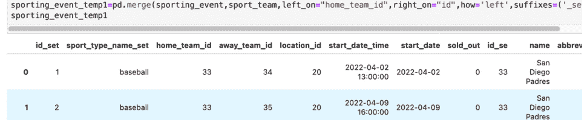

图 9.52：使用自定义后缀连接表

现在让我们同样进行连接以获取客队信息，如下所示。你可以看到我们在连接语句中对不同的键列 home_team_id 和 away_team_id 进行了连接：

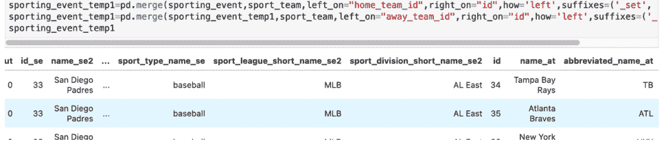

图 9.53：连接表以获取主客队信息

现在我们有了参赛体育队伍的信息，我们仍需要比赛举办地点的地点信息/体育场信息。我们将通过连接 sport_location 表来获取该信息，以便它具有体育场信息（名称、城市和州）以及座位容量，如以下屏幕截图所示：

```
sporting_event_temp1=pd.merge(sporting_event,sport_team,left_on="home_team_id",right_on="id",how='left',suffixes=('_set',
sporting_event_temp1=pd.merge(sporting_event_temp1,sport_team,left_on="away_team_id",right_on="id",how='left',suffixes='_
sporting_event_temp1=pd.merge(sporting_event_temp1,sport_location,left_on="location_id",right_on="id",how='left',suffixes=
sporting_event_temp1
```

| _at | sport_type_name | sport_league_short_name_at | sport_division_short_name_at | id_loc | name | city | seating_capacity | levels | sections |
|---|---|---|---|---|---|---|---|---|---|
| 26 | baseball | MLB | AL East | 20 | Petco Park | San Diego California | 40162 | 2 | 40 |
| 27 | baseball | MLB | AL East | 20 | Petco Park | San Diego California | 40162 | 2 | 40 |

图 9.54：连接 sport_location 表以获取体育赛事的体育场/地点信息

现在我们拥有了所有所需字段，但我们有许多需要过滤掉的额外字段。

我们可以利用 df.loc[:, list of columns] 函数来实现这一点，通过仅选择所需的列：

```
sporting_event_temp1=pd.merge(sporting_event,sport_team,left_on="home_team_id",right_on="id",how='left',\
    suffixes=('_se1', '_ht'))
sporting_event_temp1=pd.merge(sporting_event_temp1,sport_team,left_on="away_team_id",right_on="id",how='left',\
    suffixes=('_se2', '_at'))
sporting_event_temp1=pd.merge(sporting_event_temp1,sport_location,left_on="location_id",right_on="id",how='left',\
    suffixes=('_se3', '_loc'))
sporting_event_schedule=sporting_event_temp1.loc[:,['id_se1','sport_type_name_se1','sport_league_short_name_se2',\
    'start_date_time','name_se2','name_at','sport_division_short_name_se2'\
    'sport_division_short_name_at','name','city','seating_capacity']]
sporting_event_schedule
```

|  | id_se1 | sport_type_name_se1 | sport_league_short_name_se2 | start_date_time | name_se2 | name_at | sport_division_short_name_se2 | sport_d |
|---|---|---|---|---|---|---|---|---|
| 0 | 1 | baseball | MLB | 2022-04-02 13:00:00 | San Diego Padres | Tampa Bay Rays |  | AL East |
| 1 | 2 | baseball | MLB | 2022-04-09 16:00:00 | San Diego Padres | Atlanta Braves |  | AL East |
| 2 | 3 | baseball | MLB | 2022-04-16 16:00:00 | San Diego Padres | New York Yankees |  | AL East |
| 3 | 4 | baseball | MLB | 2022-04-23 |  | Texas |  | AL East |

图 9.55：从 pandas DataFrame 中仅选择所需的列

前面的输出仍然具有冗长的列名，并且没有有意义的业务名称。我们可以使用 rename 函数按如下所示更改名称，以更好地表示数据。


```python
sporting_event_temp1=pd.merge(sporting_event,sport_team,left_on="home_team_id",right_on="id",how='left',\
    suffixes=('_se1','_ht'))
sporting_event_temp1=pd.merge(sporting_event_temp1,sport_team,left_on="away_team_id",right_on="id",how='left',\
    suffixes=('_se2','_at'))
sporting_event_temp1=pd.merge(sporting_event_temp1,sport_location,left_on="location_id",right_on="id",how='left',\
    suffixes=('_se3','_loc'))
sporting_event_schedule=sporting_event_temp1.loc[:,['id_se1','sport_type_name_se1','sport_league_short_name_se2',\
    'start_date_time','name_se2','name_at','sport_division_short_name_se2',\
    'sport_division_short_name_at','name','city','seating_capacity']]
sporting_event_schedule.rename(columns={'id_se1':'id','sport_type_name_se1':'sport_name',\
    'sport_league_short_name_se2':'league_name','name_se2':'home_team','name_at':'away_team',\
    'sport_division_short_name_se2':'home_team_league',\
    'sport_division_short_name_at':'away_team_league','name':'stadium name'}, \
    inplace=True)
sporting_event_schedule
```

| 运动名称 | 联赛名称 | 开始日期时间 | 主队 | 客队 | 主队联赛 | 客队联赛 | 球场名称 | 城市 | 座位数 |
|---|---|---|---|---|---|---|---|---|---|
| baseball | MLB | 2022-04-02 13:00:00 | San Diego Padres | Tampa Bay Rays | AL East | AL East | Petco Park | San Diego, California | 40162 |
| baseball | MLB | 2022-04-09 16:00:00 | San Diego Padres | Atlanta Braves | AL East | AL East | Petco Park | San Diego, California | 40162 |
| baseball | MLB | 2022-04-16 16:00:00 | San Diego Padres | New York Yankees | AL East | AL East | Petco Park | San Diego, California | 40162 |

图 9.56：重命名函数以更改列名，使其与数据的业务使用保持一致

现在我们有一个包含所需数据属性的工作数据集，但我们仍需将其过滤为足球比赛以及纽约巨人队作为主队或客队参与的比赛：

```python
#Hand-out to individual team fans their schedule
sporting_event_schedule.loc[(sporting_event_schedule["home_team"]=="New York Giants") | \
|(sporting_event_schedule["away_team"]=="New York Giants")]
```

| 运动名称 | 联赛名称 | 开始日期时间 | 主队 | 客队 | 主队联赛 | 客队联赛 | 球场名称 | 城市 | 座位数 |
|---|---|---|---|---|---|---|---|---|---|
| football | NFL | 2022-08-28 18:00:00 | Dallas Cowboys | New York Giants | NFC East | NFC East | AT&T Stadium | Arlington, Texas | 80000 |
| football | NFL | 2022-09-04 12:00:00 | New York Giants | Philadelphia Eagles | NFC East | NFC East | MetLife Stadium | East Rutherford, New Jersey | 82500 |
| football | NFL | 2022-09-11 14:00:00 | New York Giants | Washington Redskins | NFC East | NFC East | MetLife Stadium | East Rutherford, New Jersey | 82500 |
| football | NFL | 2022-09-18 14:00:00 | New York Giants | Dallas Cowboys | NFC East | NFC East | MetLife Stadium | East Rutherford, New Jersey | 82500 |

图 9.57：将 DataFrame 过滤以仅提取纽约巨人队的数据

现在我们已经了解了通过连接多个数据源并转换数据来创建新数据集。您可以利用 pandas 和 Python 的功能以更强大的方式转换数据，以满足业务需求。我们现在将进入下一节，探索使用 Pandas 功能进行数据质量验证。

## 数据质量验证

数据质量验证是数据管道中的一个重要阶段，因为它确保了分析中使用的数据的正确性。如果没有正确的数据，即使使用良好的分析工具，分析洞察也会是错误的。因此，客户/开发人员需要更关注数据质量阶段，以创建准确的数据集供进一步分析。

数据质量和数据清洗有什么区别？我们中的一些人可能会在数据清洗和数据质量验证之间感到困惑。实际上，这两个阶段之间会有一些重叠，并且一些活动可以互换使用：

- 数据清洗是我们清理和去重数据并识别通用数据问题的阶段，例如拆分数据以进行更有意义的分析、清洗数据错误等等。如果不进行清洗，数据可能不适用于分析工作。例如，在学生数据库和成绩表中，分数列可能包含非数值或缺失值，需要在将数据用于分析之前进行清理。
- 数据质量验证是我们配置规则并验证数据是否符合这些规则的阶段。即使在应用数据质量规则之前，数据看起来仍然很好，外行人也无法在数据集中看到任何问题。例如，在成绩表中，分数列可能只有数值，但如果测试的最高分为 100，则任何大于该值的值都没有意义，需要在分析前进行修复。

有了这种理解，让我们继续在数据丰富步骤中创建的计划表上工作，并用数据质量规则对其进行验证。

### 使用 Pandas 进行数据质量验证

对于了解 NFL 比赛的人来说，赛季期间每周都会进行一场比赛，中间会有休息周。让我们首先验证为纽约巨人队准备的赛程，并验证实际数据是否符合这些规则。现在，这是一个数据质量验证步骤，因为数据本身没有问题，但我们期望数据符合我们的规则以匹配现实情况。请注意，这是由脚本生成的虚构数据，用于说明我们的用例。

我们将首先确定纽约巨人队是否安排了在同一时间段进行的比赛，这将使这些比赛无法进行。我们将使用 pandas 的 `groupby` 功能对比赛开始时间进行分组，并计算比赛数量，如下所示：

```python
#We need to identify schedule issues where the same team is playing multiple games on the same day across different stadiums
#We can highlight the issues as the same team can't play games at the same time
sport_schedule_NYG.groupby(['start_date_time'])['start_date_time'].count()
```

```
start_date_time
2022-08-28 18:00:00    1
2022-09-04 12:00:00    1
2022-09-11 14:00:00    1
2022-09-18 14:00:00    1
2022-09-25 13:00:00    1
2022-09-25 15:00:00    1
2022-10-16 19:00:00    4
2022-11-13 14:00:00    4
2022-12-11 12:00:00    4
Name: start_date_time, dtype: int64
```

图 9.58：pandas 的 groupby 函数用于识别安排重复的比赛

我们在 3 周内的同一时间安排了 4 场比赛，这是不可能进行的。但我们在其他周是否有问题，例如 9 月 25 日安排了两场比赛，时间不同？即使我们做出一个大胆的假设，即同一支球队可以在一天内在不同时间进行两场比赛，让我们了解在比赛举办地方面的情况。我们将对比赛的开始时间和比赛举办的城市同时执行 groupby 函数。

```python
#Go one level further, to identify issues that have same team playing games on same day at different locations
sport_schedule_NYG.groupby(['start_date_time','city'])['start_date_time'].count()
```

```
start_date_time    city
2022-08-28 18:00:00  Arlington, Texas    1
2022-09-04 12:00:00  East Rutherford, New Jersey    1
2022-09-11 14:00:00  East Rutherford, New Jersey    1
2022-09-18 14:00:00  East Rutherford, New Jersey    1
2022-09-25 13:00:00  Philadelphia, Pennsylvania    1
2022-09-25 15:00:00  Landover, Maryland    1
2022-10-16 19:00:00  East Rutherford, New Jersey    4
2022-11-13 14:00:00  East Rutherford, New Jersey    4
2022-12-11 12:00:00  East Rutherford, New Jersey    4
```

图 9.59：pandas 对位置和时间进行 groupby 以识别同一天内比赛的进一步问题

现在我们了解到球队无法在同一天在这些城市之间移动以进行多场比赛，因此我们也必须修改该周的赛程。之前的验证旨在展示 pandas 用于数据验证的能力。我们的业务规则是确保每支球队每周只有一场比赛。让我们在样本数据中验证该业务规则。我们将开始时间转换为日期字段，提取其周部分，并统计球队每周的比赛场数。

输出与我们之前的验证类似。现在我们将继续为该球队纠正赛程。


## 实际上，一支球队每周可以进行一场比赛，让我们识别出每周比赛超过一场的球队

```
sport_schedule_NYG.loc[:,"week_nbr"]=sport_schedule_NYG['start_date_time'].dt.isocalendar().week
sport_schedule_NYG.groupby(['week_nbr'])['week_nbr'].count()
```

week_nbr
34  1
35  1
36  1
37  1
38  2
41  4
45  4
49  4
Name: week_nbr dtype: int64

图 9.60: 验证 NFL 球队每周是否只有一场比赛

我们将使用 numpy 库及其 where 子句函数，通过开始日期以及在开始日期数据重复时对手球队来识别记录。以下更新语句仅用于本书的学习目的。我们已手动更新赛程，以确保纽约巨人队每周只有一场比赛，但我们尚未比较其他球队的赛程，实际上，创建反映这一点的赛程将是一项复杂的练习。因此，我们将只关注纽约巨人队，并假设其他球队的赛程不会有任何冲突：

```
# The above gave an idea that the team is incorrectly scheduled on same week multiple times and some weeks are missing.
# We can then re-arrange our team schedule to better reflect the workload
import numpy as np
sport_schedule_NYG.loc[:,"start_date_time"] = np.where((sport_schedule_NYG["start_date_time"]=="2022-09-25 15:00:00")&
    (sport_schedule_NYG["home_team"]=="Washington Redskins"), \
    sport_schedule_NYG["start_date_time"]+pd.DateOffset(7),sport_schedule_NYG["start_date_time"])
sport_schedule_NYG.loc[:,"start_date_time"] = np.where((sport_schedule_NYG["start_date_time"]=="2022-10-16 19:00:00")&
    (sport_schedule_NYG["away_team"]=="Cincinnati Bengals"), \
    sport_schedule_NYG["start_date_time"]+pd.DateOffset(-7),sport_schedule_NYG["start_date_time"])
sport_schedule_NYG.loc[:,"start_date_time"] = np.where((sport_schedule_NYG["start_date_time"]=="2022-10-16 19:00:00")& \
    (sport_schedule_NYG["away_team"]=="Cleveland Browns"), \
    sport_schedule_NYG["start_date_time"]+pd.DateOffset(7),sport_schedule_NYG["start_date_time"])
sport_schedule_NYG.loc[:,"start_date_time"] = np.where((sport_schedule_NYG["start_date_time"]=="2022-10-16 19:00:00")&\
    (sport_schedule_NYG["away_team"]=="Pittsburgh Steelers"), \
    sport_schedule_NYG["start_date_time"]+pd.DateOffset(14),sport_schedule_NYG["start_date_time"])
sport_schedule_NYG.loc[:,"start_date_time"] = np.where((sport_schedule_NYG["start_date_time"]=="2022-11-13 14:00:00")&\
    (sport_schedule_NYG["away_team"]=="Denver Broncos"), \
    sport_schedule_NYG["start_date_time"]+pd.DateOffset(-7),sport_schedule_NYG["start_date_time"])
sport_schedule_NYG.loc[:,"start_date_time"] = np.where((sport_schedule_NYG["start_date_time"]=="2022-11-13 14:00:00")&\
    (sport_schedule_NYG["away_team"]=="Kansas City Chiefs"), \
    sport_schedule_NYG["start_date_time"]+pd.DateOffset(7),sport_schedule_NYG["start_date_time"])
sport_schedule_NYG.loc[:,"start_date_time"] = np.where((sport_schedule_NYG["start_date_time"]=="2022-11-13 14:00:00")&\
    (sport_schedule_NYG["away_team"]=="San Diego Chargers"), \
    sport_schedule_NYG["start_date_time"]+pd.DateOffset(14),sport_schedule_NYG["start_date_time"])
sport_schedule_NYG.loc[:,"start_date_time"] = np.where((sport_schedule_NYG["start_date_time"]=="2022-12-11 12:00:00")&\
    (sport_schedule_NYG["away_team"]=="Indianapolis Colts"), \
    sport_schedule_NYG["start_date_time"]+pd.DateOffset(-7),sport_schedule_NYG["start_date_time"])
sport_schedule_NYG.loc[:,"start_date_time"] = np.where((sport_schedule_NYG["start_date_time"]=="2022-12-11 12:00:00")&\
    (sport_schedule_NYG["away_team"]=="Jacksonville Jaguars"), \
    sport_schedule_NYG["start_date_time"]+pd.DateOffset(-7),sport_schedule_NYG["start_date_time"])
sport_schedule_NYG.loc[:,"start_date_time"] = np.where((sport_schedule_NYG["start_date_time"]=="2022-12-11 12:00:00")&\
    (sport_schedule_NYG["away_team"]=="Tennessee Titans"), \
    sport_schedule_NYG["start_date_time"]+pd.DateOffset(14),sport_schedule_NYG["start_date_time"])
sport_schedule_NYG
```

图 9.61: 更新纽约巨人队的赛程，使其每周只有一场比赛

你也可以验证数据是否已成功更新到 DataFrame 中，使其每周只有一场比赛。

|  | id | 运动名称 | 联赛名称 | 开始日期时间 | 主队 | 客队 | 主队联赛 | 客队联赛 | 球场名称 | 城市 |
|---|---|---|---|---|---|---|---|---|---|---|
| 930 | 931 | football | NFL | 2022-08-28 18:00:00 | Dallas Cowboys | New York Giants | NFC East | NFC East | AT&T Stadium | Arlington, Texas |
| 933 | 934 | football | NFL | 2022-09-04 12:00:00 | New York Giants | Philadelphia Eagles | NFC East | NFC East | MetLife Stadium | East Rutherford, New Jersey |
| 934 | 935 | football | NFL | 2022-09-11 14:00:00 | New York Giants | Washington Redskins | NFC East | NFC East | MetLife Stadium | East Rutherford, New Jersey |
| 935 | 936 | football | NFL | 2022-09-18 14:00:00 | New York Giants | Dallas Cowboys | NFC East | NFC East | MetLife Stadium | East Rutherford, New Jersey |
| 938 | 939 | football | NFL | 2022-09-25 13:00:00 | Philadelphia Eagles | New York Giants | NFC East | NFC East | Lincoln Financial Field | Philadelphia, Pennsylvania |

图 9.62: 探索纽约巨人队更新后的赛程

另外，你也可以运行查询来验证我们是否每周只安排了一场比赛，如以下屏幕截图所示。我们将对 `week_nbr` 列使用 `groupby` 函数，可以看到每周只安排了一场比赛。现在我们的数据也符合业务规则，可以用于可视化和报告目的。我们可以设置这些数据质量规则以执行，并仅显示不符合规则的记录，并向业务团队成员发送电子邮件以检查我们数据管道中的数据。

```
sport_schedule_NYG.loc[:,"week_nbr"]=sport_schedule_NYG['start_date_time'].dt.isocalendar().week
sport_schedule_NYG.groupby(['week_nbr'])['week_nbr'].count()
```

week_nbr
34  1
35  1
36  1
37  1
38  1
39  1
40  1
41  1
42  1
43  1
44  1
45  1
46  1
47  1
48  1
49  1
50  1
51  1

图 9.63: 验证纽约巨人队更新后的赛程

我们还可以执行其他验证规则。我们可以对 `ticket_purchase_hist` 表运行查询，看看它是空的。在实际生产环境中，这可能是因为负责填充票务购买数据的流程可能已损坏。然而，在我们当前的使用案例中，初始设置期间本应插入票务购买数据的存储过程并未执行。我们将登录到“加载示例数据到源数据库”部分中之前使用的 EC2 机器。连接 RDS MySQL 数据库后，使用 use 命令选择 dms_sample 数据库并执行存储过程以插入 1,000 张票，调用 generateTicketActivity(1000,0);：

```
MySQL [(none)]> use dms_sample;
Reading table information for completion of table and column names
You can turn off this feature to get a quicker startup with -A

Database changed
MySQL [dms_sample]> call generateTicketActivity(1000,0);
+-------------------------------------------------------------------+
| CONCAT('Congratulations! You''ve just purchased ',p_quantity,' tickets.') |
+-------------------------------------------------------------------+
| Congratulations! You've just purchased 6 tickets.                |
+-------------------------------------------------------------------+
1 row in set (0.22 sec)

+-------------------------------------------------------------------+
| CONCAT('Congratulations! You''ve just purchased ',p_quantity,' tickets.') |
+-------------------------------------------------------------------+
| Congratulations! You've just purchased 4 tickets.                |
+-------------------------------------------------------------------+
```

图 9.64: 生成票务购买活动的存储过程

现在让我们查询 ticket_purchase_hist 表，查看记录是否正在填充。这将确保数据在整个数据管道中按预期全部填充。

```
[99]: #After executing the insert tickets stored procedure. This SP is created but not called during initial run
#We can insert 1000 tickets and validate the ticketing activity now. This ensures the data is complete
ticket_purchase_hist=wr.mysql.read_sql_query("SELECT * FROM dms_sample.ticket_purchase_hist", con=con)
ticket_purchase_hist
```

| 赛事票证 ID | 购买者 ID | 持票人 ID | 交易日期时间 | 转让人 ID | 购买价格 |
|---|---|---|---|---|---|
| 0 | 65536 | 410959 | 2022-12-07 03:23:29 | None | 43.13 |
| 1 | 65537 | 410959 | 2022-12-07 03:23:29 | None | 43.13 |
| 2 | 131071 | 4232646 | 2022-12-07 03:22:48 | None | 44.59 |
| 3 | 131072 | 4232646 | 2022-12-07 03:22:48 | None | 44.59 |
| 4 | 131090 | 4232646 | 2022-12-07 03:22:48 | None | 44.59 |
| ... | ... | ... | ... | ... | ... |

图 9.65: 探索票务购买历史表中的数据

我们将查询以查看纽约巨人队与费城老鹰队（event_id = 934）比赛的购票情况。我们现在会看到一些记录的 ticketholder_id 已填充了值，用于标识购买票的人（该值来自我们之前执行的存储过程填充）：

sporting_event_ticket=wr.mysql.read_sql_query("SELECT * FROM dms_sample.sporting_event_ticket where sporting_event_id=934")
sporting_event_ticket.loc[sporting_event_ticket["ticketholder_id"].notnull()]

| id | sporting_event_id | sport_location_id | seat_level | seat_section | seat_row | seat | ticketholder_id | ticket_price |
|---|---|---|---|---|---|---|---|---|
| 82496 | 63339564 | 934 | 32 | 2 | 10 | A1 | 2051116 | 29.44 |
| 82497 | 63339565 | 934 | 32 | 2 | 10 | A10 | 2051116 | 29.44 |
| 82498 | 63339562 | 934 | 32 | 2 | 10 | A8 | 2051116 | 29.44 |
| 82499 | 63339583 | 934 | 32 | 2 | 10 | A9 | 2051116 | 29.44 |

Figure 9.66: 验证 sporting_event_ticket 表中 ticketholder_id 列是否已填充

现在我们可以分析哪些比赛已售罄，哪些比赛的票销售量不高。

我们已使用几条规则在示例数据集中验证了数据质量：

- 每个 NFL 球队在整个赛季每周都需要安排一场比赛
- 票务购买历史数据应得到填充，以便了解每个活动的空座数量

## 数据质量验证与数据管道的集成

我们可以根据每个项目的具体要求对数据集执行不同的验证。数据质量验证可通过以下更新进一步改进：

- 创建可以 SQL 格式执行的业务规则并将其存储在元数据存储中（如 DynamoDB）。每次运行都执行存储的数据质量规则并识别不符合的记录。加载应仅使用分区或自定义书签功能处理新数据。
- **Great Expectations** 是一个基于 Python 的开源库，用于数据验证、分析文件和数据文档。通过该库，我们可以对数据集的预期创建断言。该库还支持多个内置期望。一旦执行期望，您将以名为 Data Docs 的格式化的 HTML 文档形式获得结果。

现在，我们将在下一节中探索数据可视化，这是数据整理管道的最后阶段。

## 数据可视化

数据可视化是您将创建可视化和图表以更好地向业务用户传达分析结果的阶段。一图胜千言，想法/信息可以通过图表/仪表板比表格/文本数据更好地传达。

### 使用 Python 库进行可视化

在本节中，我们将探讨使用 Python 库（如 matplotlib (https://matplotlib.org/) 和 Seaborn (https://seaborn.pydata.org/index.html)）创建仪表板。还有更多 Python 库可以帮助可视化数据，但我们这里不会比较所有这些库。

我们将继续使用本节的同一体育数据集。还有其他数据集，例如纽约出租车行程数据集，我们可以用它们来涵盖不同的可视化方面，但为了本章的连贯性，我们将使用体育数据。让我们考虑一个用例，我们希望可视化以下要求：

- 按日售出的票数及其价格范围
- 按座位类别售出的票的价格范围，以便更好地了解票价带的构成

为了获取售出的票数，我们将使用 ticket_purchase_hist 表的数据。该表中的数据将具有以下屏幕截图所示的信息：

|   | sporting_event_ticket_id | purchased_by_id | transaction_date_time | transferred_from_id | purchase_price |
|---|--------------------------|-----------------|-----------------------|---------------------|----------------|
| 0 | 1 | 3299597 | 2022-12-15 04:27:27 | None | 47.02 |
| 1 | 2 | 3299597 | 2022-12-15 04:27:27 | None | 47.02 |
| 2 | 22 | 3299597 | 2022-12-15 04:27:27 | None | 47.02 |
| 3 | 65536 | 410959 | 2022-12-07 03:23:29 | None | 43.13 |
| 4 | 65536 | 5909803 | 2022-12-15 04:27:30 | None | 43.13 |
| ... | ... | ... | ... | ... | ... |
| 5426 | 90143400 | 2496803 | 2022-12-15 04:22:07 | None | 34.82 |
| 5427 | 90143401 | 2452671 | 2022-12-15 04:24:00 | None | 34.82 |

Figure 9.67: 探索 ticket_purchase_hist 表

该表详细说明了票证 ID、交易日期、购买价格和购买者 ID。我们可以单独使用此表来可视化每日售出的票数。

我们将使用 Matplotlib 散点图来可视化按日售出的票数。请注意这只是测试数据，我们已在本章前面运行存储过程来填充票务购买历史。在屏幕截图中显示的示例数据中，存储过程在两天内执行以生成票务购买数据量：

```python
import matplotlib.pyplot as plt
plt.xticks(rotation=90)
plt.scatter(ticket_purchase_hist['transaction_date_time'].dt.date, ticket_purchase_hist['purchase_price'])
```

<matplotlib.collections.PathCollection at 0x7f9310af05b0>

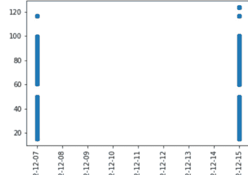

Figure 9.68: Matplotlib 对每日票务购买历史数据的可视化

我们使用了 xticks 旋转参数使日期值易于阅读。然后我们使用交易日期和购买价格创建散点图，如图所示。我们可以看到在较低价格范围内售出的票数更多（点密集分布），但也有一些票以较高价格范围售出。让我们探索并找出售价超过 120 美元的票有多少。您可以通过将此数据集与其他表连接来进一步探索，以了解体育赛事和座位类型，从而了解这些票对应的内容。

```python
ticket_purchase_hist[ticket_purchase_hist["purchase_price"]>120]
```

| | sporting_event_ticket_id | purchased_by_id | transaction_date_time | transferred_from_id | purchase_price |
|---|---|---|---|---|---|
| 4497 | 67075059 | 6294092 | 2022-12-15 04:24:15 | None | 123.81 |
| 4498 | 67075059 | 6928398 | 2022-12-15 04:25:53 | None | 123.81 |
| 4499 | 67075060 | 6294092 | 2022-12-15 04:24:15 | None | 123.81 |
| 4500 | 67075060 | 6928398 | 2022-12-15 04:25:53 | None | 123.81 |
| 4501 | 67075061 | 6928398 | 2022-12-15 04:25:53 | None | 123.81 |
| 4502 | 67075062 | 6928398 | 2022-12-15 04:25:53 | None | 123.81 |
| 4503 | 67075081 | 4360752 | 2022-12-15 04:25:27 | None | 123.81 |
| 4504 | 67075081 | 6294092 | 2022-12-15 04:24:15 | None | 123.81 |
| 4505 | 67075081 | 6928398 | 2022-12-15 04:25:53 | None | 123.81 |

Figure 9.69: 探索以高价售出的票

这是一个起点，Matplotlib 仍支持大量不同的可视化选项。我们将探索另一个基于 Matplotlib 的 Python 可视化库 Seaborn。Seaborn 提供了绘制有吸引力且信息丰富的统计图形的高级接口。我们可以在同一可视化中使用 Matplotlib 和 Seaborn 来创建只需少量编码的出色图表。

在使用 Seaborn 之前，我们需要在环境中安装该库。对于 SageMaker 笔记本，我们将使用以下命令：

```
!pip install seaborn
```

我们将使用 Seaborn 创建相同的图表，现在您可以看到语法简单直观，图表会自动填充 x 轴和 y 轴名称。对于那些眼尖的人，我们在以下可视化中仍在使用 Matplotlib 和 Seaborn。我们使用 Matplotlib 的 xticks 旋转参数来更改 x 轴标签的方向。此示例展示了如何在同一可视化设置中同时使用 Matplotlib 和 Seaborn 来创建符合我们要求的图表。

```python
import seaborn as sb
plt.xticks(rotation=90)
scatter_plot=sb.scatterplot(x='transaction_date_time' , y='purchase_price', data=ticket_purchase_hist)
```

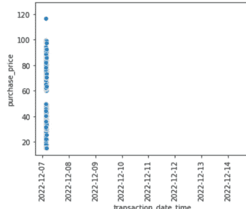

Figure 9.70: 使用 Seaborn 包绘制的票务购买历史散点图

为了了解座位类型对票价的影响，我们将票务购买历史与 sporting_event_ticket 表和座位表连接起来。


```
sporting_event_temp1=pd.merge(ticket_purchase_hist,sporting_event_ticket,left_on="sporting_event_ticket_id",right_on="id", suffixes=('_tph', '_ht'))
sporting_event_temp1.head(5)
```

```
sporting_event_temp2=pd.merge(sporting_event_temp1,seat,left_on=["sport_location_id","seat_level","seat_section","seat_row"], suffixes=('_tph', 'seat'))
sporting_event_temp2.head(5)
```

|  | sporting_event_ticket_id | purchased_by_id | transaction_date_time | transferred_from_id | purchase_price | id | sporting_event_id | sport_location_ |
|---|---|---|---|---|---|---|---|---|
|0|1|3299597|2022-12-15 04:27:27|None|47.02|1|1| |
|1|2|3299597|2022-12-15 04:27:27|None|47.02|2|1| |
|2|22|3299597|2022-12-15 04:27:27|None|47.02|22|1| |
|3|65536|410959|2022-12-07 03:23:29|None|43.13|65536|2| |
|4|65536|5909803|2022-12-15 04:27:30|None|43.13|65536|2| |

Figure 9.71: 将体育赛事表与票务购买历史连接以获取座位详情

有了这些新数据，我们还将把座位类别可视化到之前的散点图中。我们将添加 seat_type 作为 hue 参数，这将根据座位类型对图表中的数据点进行着色，如下所示：

```
import seaborn as sb
plt.xticks(rotation=90)
scatter_plot1=sb.scatterplot(x='transaction_date_time', y='purchase_price',hue='seat_type', data=sporting_event_temp2, ma
```

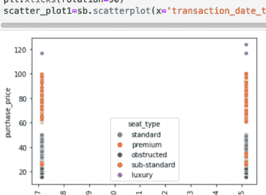

Figure 9.72: 包含座位类型的票务购买历史可视化

这让我们了解到豪华座位价格昂贵且售出频率较低，而高级座位和标准座位则销售量很大。

让我们通过了解每个座位类型类别的平均票价来进一步探索。我们将为此用例绘制条形图。但在此之前，我们需要了解 pandas DataFrame 中 purchase_price 列的数据类型：

```
<class 'pandas.core.frame.DataFrame'>
Int64Index: 5431 entries, 0 to 5430
Data columns (total 15 columns):
#   Column                     Non-Null Count  Dtype
---  ------                     --------------  -----
0   sporting_event_ticket_id   5431 non-null   Int64
1   purchased_by_id            5431 non-null   Int64
2   transaction_date_time      5431 non-null   datetime64[ns]
3   transferred_from_id        0 non-null      object
4   purchase_price             5431 non-null   float64
5   id                         5431 non-null   Int64
6   sporting_event_id          5431 non-null   Int64
7   sport_location_id          5431 non-null   Int64
8   seat_level                 5431 non-null   Int64
9   seat_section               5431 non-null   string
10  seat_row                   5431 non-null   string
11  seat                       5431 non-null   string
12  ticketholder_id            5431 non-null   Int64
13  ticket_price               5431 non-null   object
14  seat_type                  5431 non-null   string
dtypes: Int64(7), datetime64[ns](1), float64(1), object(2), string(4)
memory usage: 716.0+ KB
```

Figure 9.73: pandas DataFrame info 函数用于了解列的数据类型

我们可以看到 purchase_price 列是 object 类型，这在条形图上进行聚合时会抛出错误。让我们将其转换为 float 对象类型，然后创建条形图。我们还将在条形上方添加 purchase_price 值，以便更好地了解票价范围，如下所示：

```
sporting_event_temp2["purchase_price"]=sporting_event_temp2.purchase_price.astype(float)
ax=sb.barplot(x='seat_type',y='purchase_price', data=sporting_event_temp2)
for i in ax.containers:
    ax.bar_label(i,)
```

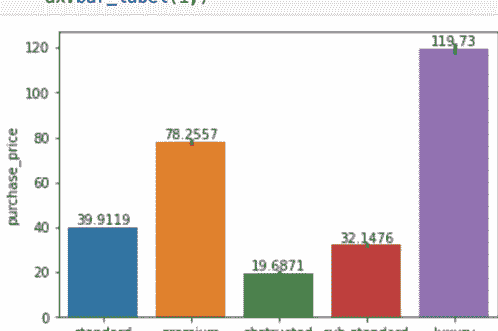

Figure 9.74: 显示每种票类型平均购买价格的条形图

这个图表还可以，但如果我们能按 purchase_price 的顺序对图表进行排序，以便更好地可视化会更好。因此，我们将先按购买价格对 DataFrame 进行排序并重置 pandas DataFrame 索引。我们还将使用 alpha 参数以更美观的方式绘制图表来调整条形图的透明度。

```
sporting_event_temp2["purchase_price"]=sporting_event_temp2.purchase_price.astype(float)
sporting_event_temp2 = sporting_event_temp2.sort_values(["purchase_price"]).reset_index(drop=True)
ax=sb.barplot(x='seat_type',y='purchase_price', data=sporting_event_temp2, alpha=0.5)
for i in ax.containers:
    ax.bar_label(i,)
```

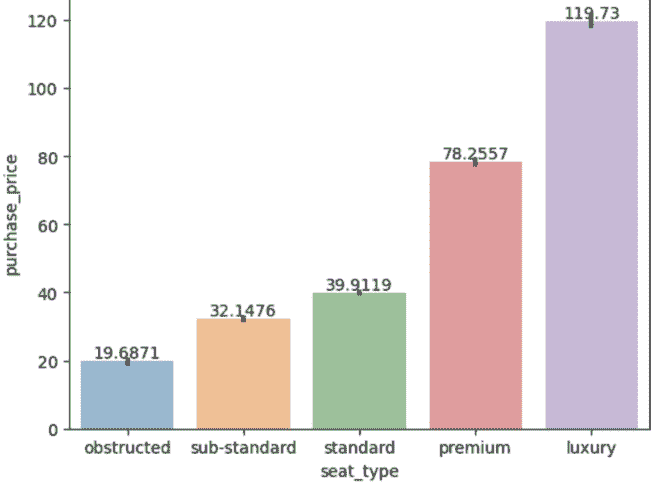

Figure 9.75: 排序后的条形图，用于了解座位类型及其类别的平均价格

现在我们能够更清晰地可视化不同座位类型对票价区间的影响。我们可以进一步探索如何根据每种座位类型售出的票数，通过对某些座位类型进行折扣来最大化票务销售。

这些库支持更多可视化，您可以使用前面提供的这些库的链接了解更多信息。对于大多数用例，前述的库足以用于可视化用户数据。此外，我们建议使用 Amazon QuickSight 来可视化更复杂的用例。

## 摘要

在本章中，我们学习了如何对数据集执行 pandas 操作以进行数据整理目的。我们探索了数据整理生命周期的各个阶段，通过发现、结构化、清洗、丰富、数据质量验证和可视化，以及使用 pandas 操作无缝执行这些活动。用户可以使用 AWS SDK for pandas，即 awswrangler 集成，与 pandas DataFrame 配合，在 AWS 云服务上执行数据整理活动。

下一章，我们将学习 SageMaker Data Wrangler，它有助于作为 ML 管道的一部分执行数据整理活动。
