## 使用 SageMaker Data Wrangler 进行机器学习的数据处理

在 *第 4 章* 中，我们向您介绍了 SageMaker Data Wrangler，这是一款专为机器学习处理数据而设计的工具。我们讨论了为什么机器学习的数据处理是整体机器学习管道中如此关键的组成部分，以及使用不干净或原始数据工作的一些风险。我们还介绍了 SageMaker Data Wrangler 的核心功能，以及它如何有助于解决机器学习数据处理中涉及的一些关键挑战。

在本章中，我们将通过一个实际的逐步数据流进一步深入，对示例数据集进行机器学习预处理。我们将从使用 SageMaker Data Wrangler 预加载的示例数据集开始，然后使用 Data Wrangler 内置分析进行一些基本探索性数据分析。我们还将为数据集中的不平衡和偏差添加几项自定义检查。特征工程是机器学习周期中的关键步骤。它包括选择和转换原始数据特征为新的特征，更好地代表机器学习模型的底层问题。我们将创建一个 Data Wrangler 流程，并在示例数据集上定义数据转换以进行特征工程。SageMaker Data Wrangler 是一个统一的数据处理工具，使您能够完成完整的机器学习周期，包括直接从工具内部训练机器学习模型并部署用于推理。我们将导出处理后的数据并从 Data Wrangler 训练和部署模型。

本章涵盖以下部分：
- 登录 SageMaker Studio
- 导入数据
- 探索性数据分析
- 添加转换
- 导出数据
- 训练机器学习模型

## 技术要求

如果您希望跟随操作，我强烈推荐，您需要一个 **亚马逊网络服务** (**AWS**) 账户。如果您没有现有账户，可以在 Free Tier 下创建 AWS 账户。AWS Free Tier 为客户提供在每个服务的指定限制内免费探索和试用 AWS 服务的能力。如果您的应用程序使用超过 Free Tier 限制，您只需按标准、按使用付费的服务费率付费。在本章中，我们将通过了解如何访问和熟悉 SageMaker Data Wrangler 用户界面开始。跟随操作时，您将使用 AWS 计算资源，并在您的 AWS 账户中创建资源。这尤其适用于本章的 *训练机器学习模型* 部分，该部分计算密集且会创建您需要删除的端点。请记住通过删除任何未使用的资源进行清理。我们将在本章末尾再次提醒您；现在，让我们开始吧。

## 第 1 步 – 登录 SageMaker Studio

在本节中，我们将介绍登录 AWS 控制台和 SageMaker 并在其中导航的步骤。如果您已熟悉使用 SageMaker，可以跳过本节直接进入下一节。

在您创建账户并设置 SageMaker Studio 域并创建用户，如 *第 4 章* 中所述后，您可以登录 AWS 控制台并选择 **SageMaker**。您可以在 **所有服务** 下的 **机器学习** 部分导航到 SageMaker，或在 AWS 控制台顶部搜索框中开始输入 `SageMaker`。

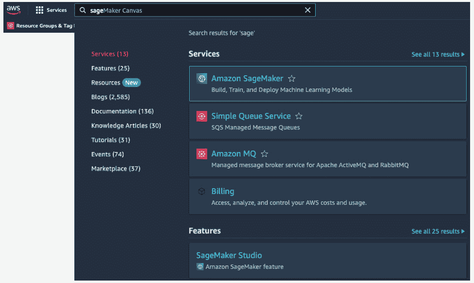

Figure 10.1: AWS 控制台 – SageMaker


一旦您进入 SageMaker 屏幕，您应该能在先决条件部分在 *第 4 章* 中创建的域。确保域的状态为 **InService** 后再继续。如果完全看不到域，请验证您是否处于创建域时所在的同一区域。从 AWS 控制台右上角检查并切换您的区域。单击域名称。

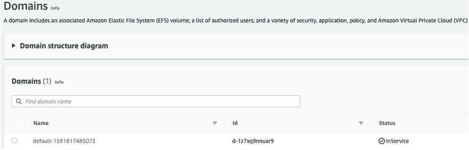

图 10.2：SageMaker 域

这将带您进入该域的已注册用户列表。如果您按照 *第 4 章* 中的先决条件步骤操作，您将在这里看到您创建的用户。如果看不到用户，您可以使用 **添加用户** 按钮创建新的 SageMaker Studio 用户。详情请参阅 *第 4 章* 中的先决条件步骤。在 **启动** 按钮上使用下拉选项选择 **Studio**。这将带您进入 SageMaker Studio 登陆页面。


图 10.3：SageMaker Studio

如果这是您第一次登录 SageMaker Studio，创建和设置您的用户环境需要几分钟时间。在 SageMaker Studio 登陆页面上，单击 **可视化导入和准备数据**。这将带您进入 Data Wrangler 页面并创建一个新的流程。

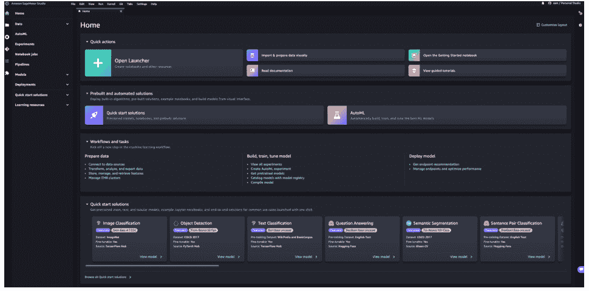

图 10.4：SageMaker Studio 登陆页面

一旦您登录并启动了 Data Wrangler，您需要将数据导入 SageMaker。我们将在 *步骤 2* 中介绍此操作。

## 第 2 步 – 导入数据

在开始将数据导入 SageMaker Data Wrangler 之前，我们需要与数据源建立连接。SageMaker Data Wrangler 提供了开箱即用的原生连接器，可连接到 Amazon S3、Amazon Athena、Amazon Redshift、Snowflake、Amazon EMR 和 Databricks。除此之外，您还可以使用 Amazon AppFlow 设置新的数据源，Amazon AppFlow 是一款完全托管的集成服务，可帮助您在 **软件即服务 (SaaS)** 应用程序之间安全传输数据。**创建连接** 屏幕显示了 Data Wrangler 中的连接器，以及您可以使用 Amazon AppFlow 设置的额外数据源。

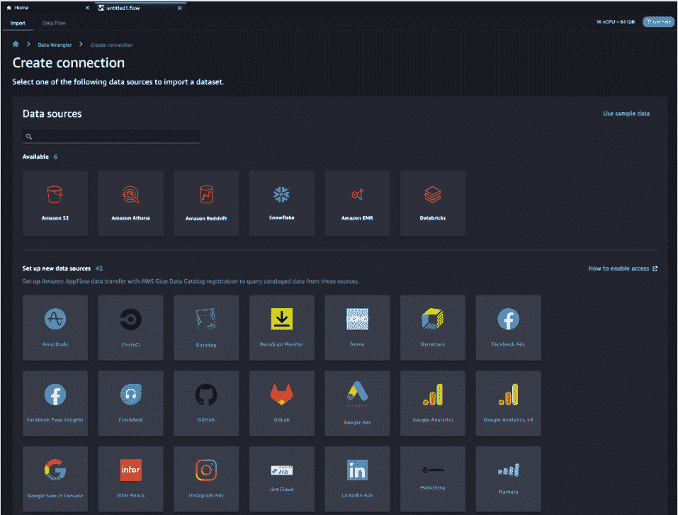

图 10.5：Data Wrangler 数据源

在本章中，我们将使用一个公开可用的示例，即 Titanic 数据集。Titanic 数据集被认为是机器学习数据集的“Hello World”，这是由于使用此示例数据集可以进行大量常用的数据处理和机器学习技术。我们将使用 Titanic 数据集的略有更改版本。您可以在此处了解有关数据集的更多信息：https://www.openml.org/search?type=data&sort=runs&id=40945&status=active。该数据集可通过公共 S3 存储桶获得。要将此数据集与 Data Wrangler 一起使用，我们可以将其上传到我们 AWS 账户中的 S3 存储桶，或者我们可以通过数据源部分右上角的 Use sample data 选项直接将数据集直接导入 Data Wrangler。在本章中，我们将使用后者选项。

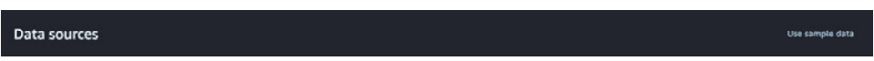

图 10.6：Data Wrangler 示例数据

单击 Use sample data 后，将在托管数据集的 S3 存储桶中创建 Data Wrangler 连接，并且该数据集的一个样本子集将被加载到 Data Wrangler 中。这也为您的<|message|> 数据流程创建了起点。

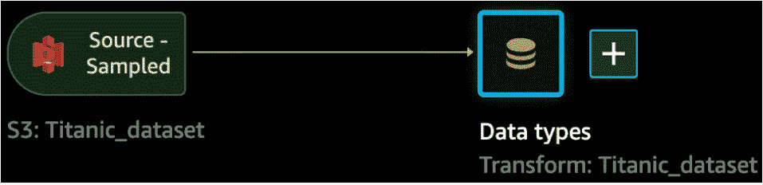

图 10.7：Data Wrangler 数据流程

您可以通过双击源来检查数据集样本，在我们的例子中是 S3。这将显示数据集的前几行以及如果存在的话的标题或列名。在这里，您还可以检查 Data Wrangler 自动确定的每个特征或列的数据类型。

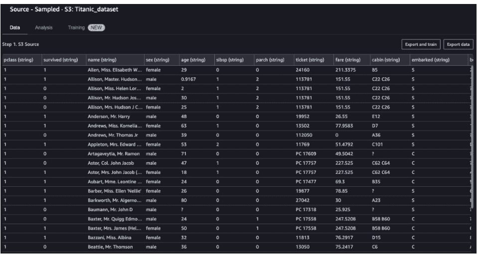

图 10.8：数据集数据类型

您可能已经注意到 Data Wrangler 对您的数据集做出了某些假设，例如文件格式、数据类型、采样方法和数量。您可以通过单击加号并选择编辑数据集选项来更改这些设置。Data Wrangler 还自动检测了我们的数据集文件格式、其分隔符以及第一行包含标题。您可以更改这些设置。例如，您可以将文件从 csv 更改为 Parquet 或将分隔符从 COMMA 更改为空格。有时，您的数据集可能没有标题，因此您也可以在此处更新标题设置。默认情况下，Data Wrangler 将选择 First K 方法来采样数据集。您可以将此采样方法更改为 **随机** 或 **分层**。您也可以在此处设置样本大小。

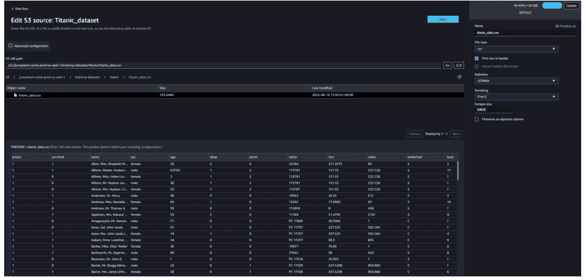

图 10.9：编辑数据类型和源

这里需要记住的一个关键提示是，如果您计划使用 Data Wrangler 进行模型训练，则在使用此处采样时需要重新导入数据。我们将在本章后半部分介绍模型训练。在下一步中，我们将进行一些探索性数据分析以更好地了解我们的数据。

## 探索性数据分析

在进行任何数据转换或操作之前，我们需要很好地了解我们的数据。**探索性数据分析 (EDA)** 是数据科学中的关键步骤，因为它使我们能够了解我们正在处理的数据的结构和特征。EDA 涉及使用各种技术和工具来汇总和可视化数据，以便识别模式、趋势和关系。在进行任何数据转换或建模之前执行此步骤也很重要，因为 EDA 可以帮助我们了解哪些特征相关以及哪些特征对我们试图解决的机器学习问题最重要。EDA 可以帮助您了解数据的分布并识别数据集特征之间存在的任何关系。在处理真实世界数据时，您不可避免地会遇到数据质量问题，例如缺失数据、各个类别的不平衡、数据收集错误和异常值。EDA 有助于识别这些数据质量问题，而这些问题会对机器学习模型的质量产生不利影响。Data Wrangler 通过内置的数据分析报告提供常用的 EDA 工具，您也可以生成自己的自定义数据分析。

## 内置数据洞察

AWS Data Wrangler 开箱即用提供了几种常用的数据分析工具。在本节中，我们将查看其中一些。您可以通过单击数据源图标旁边的 + 按钮并选择 **获取数据洞察** 来进入 **数据分析** 部分。

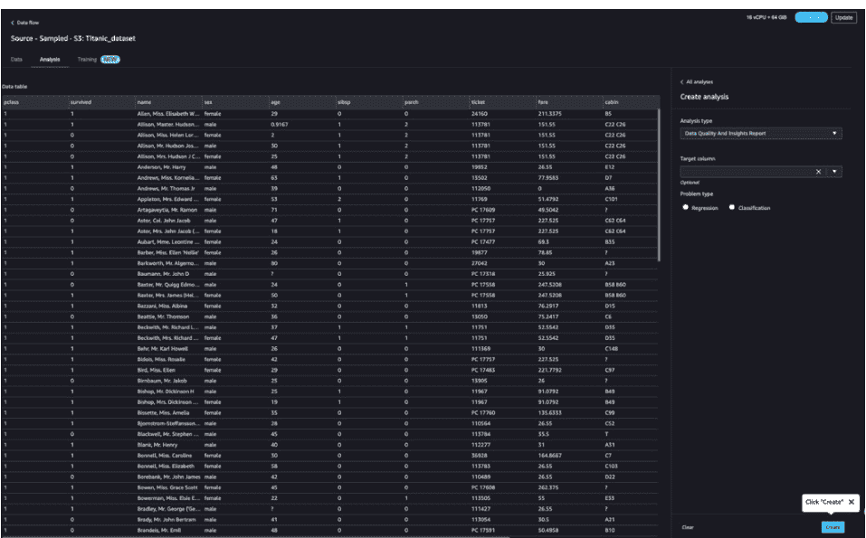

图 10.10：Data Wrangler 数据洞察

让我们创建一个新的分析报告：

- 1. 选择 **数据质量和洞察报告**。
- 2. 选择您的目标列或机器学习模型将尝试预测的列。
- 3. 在这里，我们还选择我们将尝试解决的机器学习问题的类型，是分类还是回归问题。在我们的例子中，我们试图预测乘客是否幸存于 *泰坦尼克号* 灾难。我们将目标列更改为 **Survived**，将问题类型设置为 **分类**，然后单击 **创建** 按钮。Data Wrangler 需要几分钟时间来生成报告。这当然取决于您的数据集和样本大小。

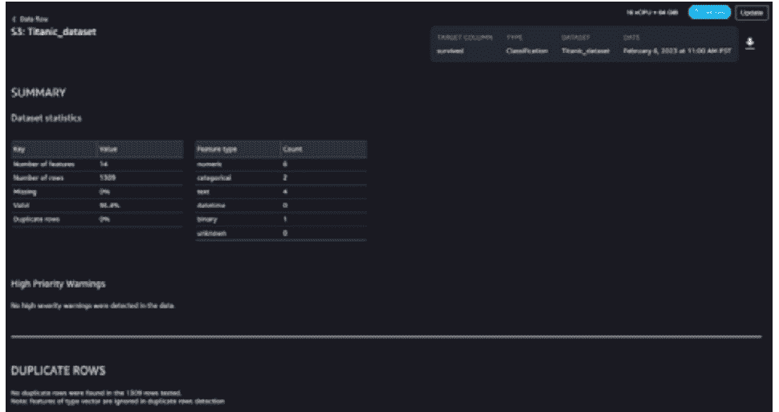

图 10.11：数据洞察摘要

让我们回顾报告的不同部分，从顶部的摘要开始。摘要包括数据集的关键统计信息和特征类型。在这里，我们可以看到数据集中的总行数、缺失行数以及重复行数（如果有）。在 SUMMARY 部分，您还可以查看数据集中的特征数量及其计数。如果数据集存在会显著影响机器学习模型质量的关键错误，它们将显示在报告的高优先级警告部分。高优先级警告的一个例子是目标泄漏。目标泄漏发生在特征直接受目标影响时，导致训练集上的准确率高但测试数据上的性能差。为了防止目标泄漏，重要的是将目标排除在训练过程之外，确保我们仅在独立特征上训练模型。

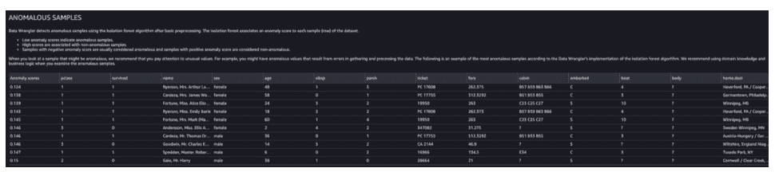

图 10.12：数据洞察异常

报告的下一部分显示了我们数据中可能存在的任何异常。Data Wrangler 在基本预处理后使用 Isolation Forest 算法检测异常样本。隔离森林算法根据数据点与数据的其余部分相距多远来检测异常。


算法为数据集中每条记录计算一个异常分数。负分数被视为异常，而较高的分数表明样本是非异常的。虽然诱人的是移除所有被归类为异常的样本，但有时根据机器学习问题和数据集，保留异常值在训练数据集中可能是有用的。在我们的示例数据集中，我们可以看到某些记录的异常分数较低，但没有负值。我们将保留这些样本作为训练数据的一部分。

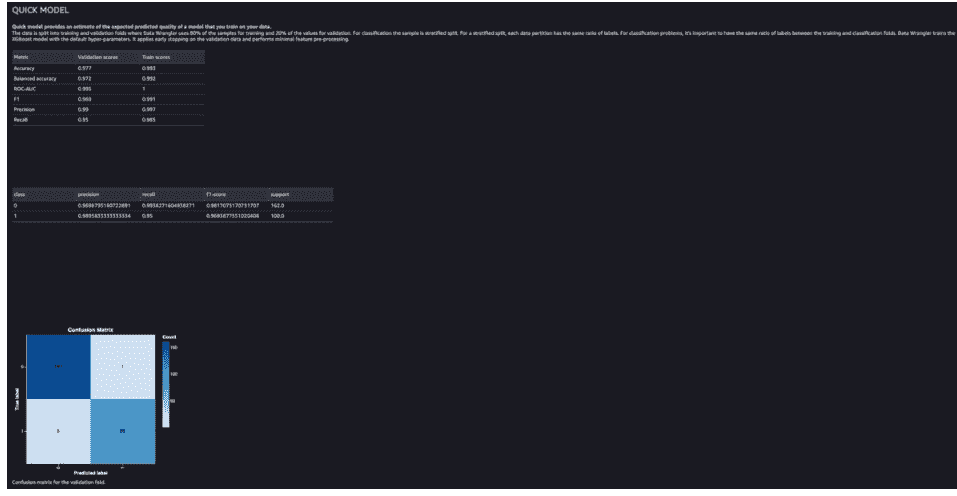

Figure 10.13: 数据洞察快速模型

目标列部分告诉我们目标变量的分布以及其他相关信息，例如缺失记录。在我们的示例数据集中，我们可以看到在泰坦尼克号悲剧中幸存的人数少于未幸存的人数。虽然数据集中存在轻微的类别不平衡，但不足以对我们的机器学习模型造成损害。在发现显著类别不平衡的情况下，例如某个类别过度代表或代表不足的情况，请考虑其他数据平衡技术，例如对多数类进行欠采样或对少数类进行过采样。

报告的快速模型部分是通过在数据集样本上自动训练 XGBoost 模型生成的。快速模型会自动保留样本数据的 20% 并用于测试。快速模型的目的在于提供对模型预期预测质量的估计。根据机器学习问题的类型（即分类或回归），快速模型会生成各种指标来评估模型质量。在我们的示例中，由于我们有一个分类问题，我们可以看到诸如准确率、F1 分数、精确率、召回率和 AUC 等指标。例如，我们可以看到训练数据集中 F1 分数为 .99，验证数据集上的分数为 .96。较高的 F1 分数意味着模型具有更好的准确性，在精确率和召回率之间取得更好的平衡，表明假阳性和假阴性更少，从而在分类任务中表现更好。由于我们处理的是分类问题，除了这些关键指标外，快速模型部分还生成混淆矩阵，将我们样本数据集的实际类别与预测类别进行比较。

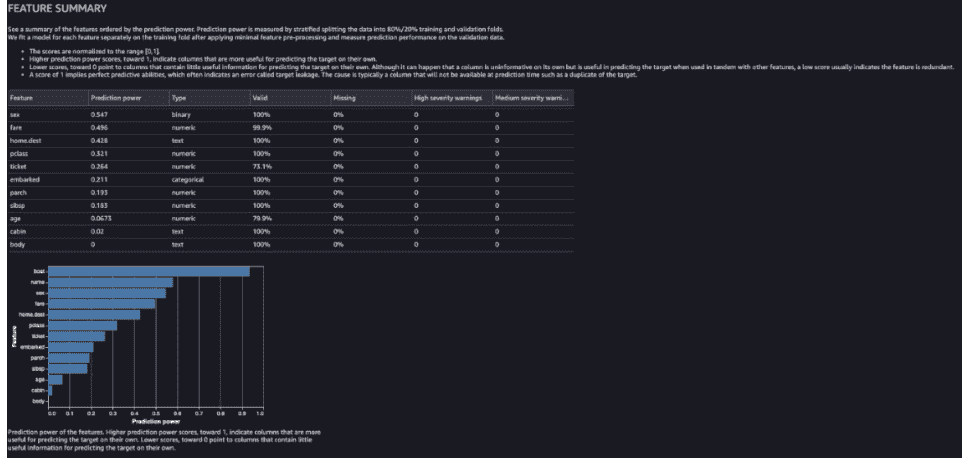

Figure 10.14: 数据洞察特征摘要

报告的特征摘要部分生成特征重要性或特征的预测能力。这有助于使我们的机器学习模型具有可解释性。我们将特征重要性的值归一化到 0 到 1 的范围内。接近 1 的值表明该特征在最终预测中非常重要。等于 1 的值可能表明存在目标泄漏。相反，接近 0 的较低分数指向对预测目标几乎没有有用信息的列。你可能会决定对这些特征进行特征工程或完全删除它们。

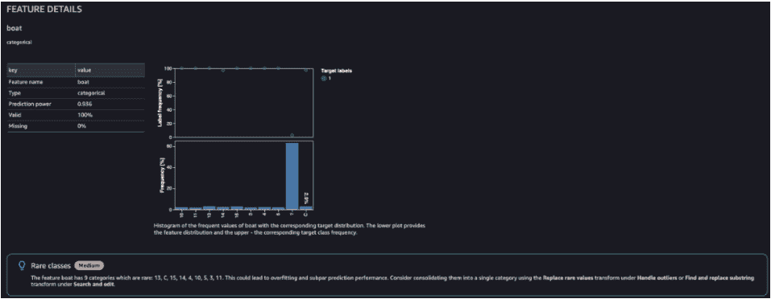

Figure 10.15: 数据洞察特征详情

特征详情部分列出了我们数据集中每个特征的关键信息。例如，它可以突出可能包含错误或不干净数据的列。我们可以看到一个特征“boat”，它是一个具有九个类别的分类特征。这很罕见，可能指向数据收集中的错误。在数据转换阶段，我们可能会决定删除该列或对其应用特征工程。

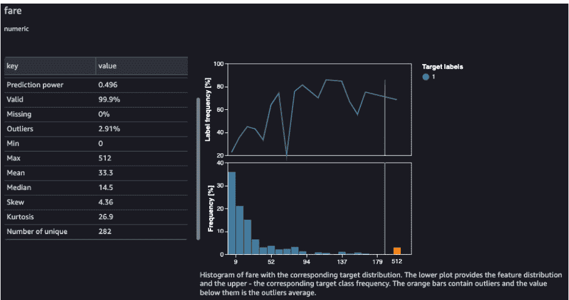

Figure 10.16: 数据洞察数值特征

同样，对于数值特征，特征详情部分可以列出关键描述性统计信息，例如均值和中值，以及最大值、最小值、缺失值和异常值。你还可以获得这些数值特征值的频率分布。

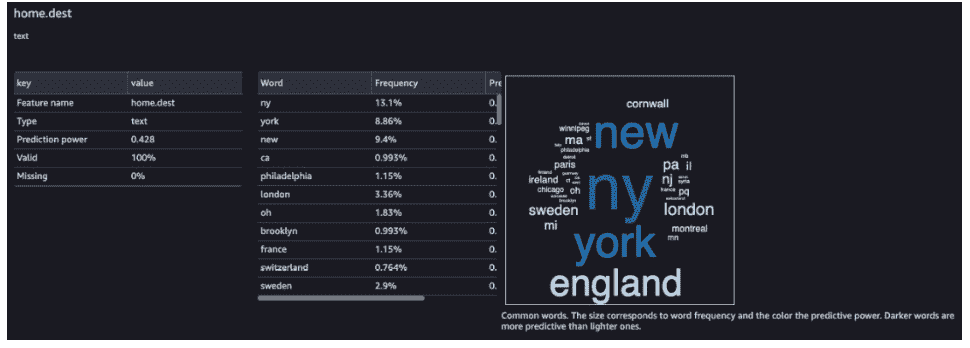

Figure 10.17: 数据洞察基于文本的特征

尽管我们处理的是结构化表格数据，但某些列包含纯文本数据，例如目的地或姓名特征。虽然看起来很明显要删除这些特征，但可能应用数据转换并提取有用的信息，以帮助做出更好的预测。在处理这些特征时，报告的 **特征详情** 部分可以对包含文本的特征进行分词并显示有用的信息，例如词频，这可以帮助我们做出特征转换决策。

**特征详情** 部分是确定我们将添加到数据整理流程中的特定特征转换步骤的重要位置。

## 步骤 3 – 创建数据分析

正如我们在前一节中所介绍的，Data Wrangler 随附的开箱即用的内置数据分析报告涵盖了机器学习中常用的大量 EDA；然而，你也可以在 Data Wrangler 中创建额外的分析和自定义分析。在本节中，我们将介绍其中一些内容：

- **目标泄漏** 是机器学习中的一个常见问题，其中目标变量或结果的信息被用于创建特征或预测因子，导致过于乐观或有偏的模型。目标泄漏发生在使用在预测或决策时不可用的信息创建的特征来训练预测模型时。目标泄漏分析至关重要，因为它有助于确保预测模型建立在有效且无偏的数据之上。在 Data Wrangler 中，你可以通过单击数据集旁边的 + 图标并选择 **添加分析** 来生成目标泄漏分析。在 **分析类型** 下拉菜单中，选择 **目标泄漏**。然后，选择问题类型和 **目标** 下拉菜单中的一个选项。

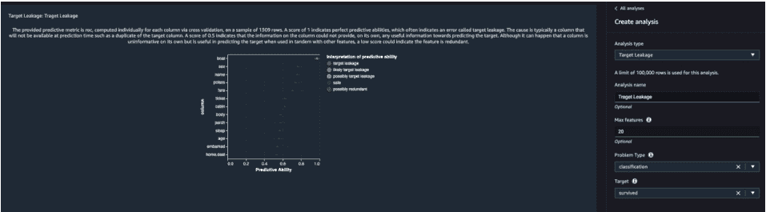

Figure 10.18: 目标泄漏

正如你所见，在我们的数据集中，**船** 特征存在可能的目标泄漏问题。**船** 特征包含乘客如果在船上时的救生艇编号。可能该特征并非我们数据集所有记录都可用，并且是在预测后填充的。我们将在数据转换和特征工程步骤中查看如何处理这个问题。

- **散点图分析**：散点图表示两个或三个变量之间的关系。在我们的示例数据集中，我们将使用散点图可视化 **票价**、**年龄** 和目标变量 **生存** 之间的关系。你可以以与添加上一个分析相同的方式添加新的分析。在 **分析类型** 下拉菜单中，选择 **散点图**，然后选择 **年龄** 作为 *X* 轴，**票价** 作为 *Y* 轴。要将目标作为另一个变量添加，请在 **按颜色** 下拉菜单下选择 **生存**。

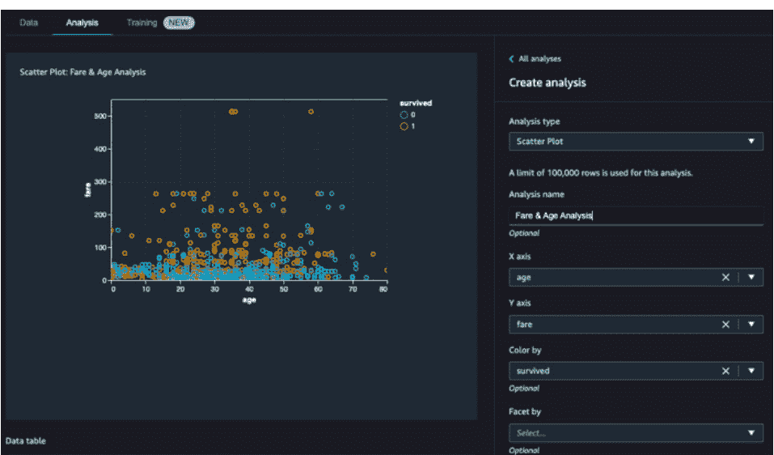

Figure 10.19: 散点图分析

虽然年龄和票价之间可能没有明显的趋势或关系，但我们可以在散点图上观察到一些模式，这些模式提供了对数据的额外见解。例如，我们可以发现支付更高票价的乘客生存率更高。或者，我们可以发现与成年人相比，儿童的生存率更高，显示出生存中潜在的年龄相关因素。

- **自定义可视化**：除了使用预定义的分析和可视化之外，你还可以使用 Altair 在 Data Wrangler 中创建自己的自定义数据可视化。Altair 是一个 Python 数据可视化库，允许用户使用简洁直观的代码轻松创建交互式可视化。它还与 pandas、NumPy 和 SciPy 等其他 Python 数据分析库集成良好，使其成为数据科学家和分析师的热门选择。Data Wrangler 使用 **df** 变量来存储数据框，用户可以访问它。你可以通过单击任何步骤的 + 按钮并选择 **添加分析** 来添加与前面类似的自定义可视化。将分析类型设置为 **自定义可视化**。在这里，我们将创建一个自定义可视化来显示我们泰坦尼克号数据集中乘客的年龄分布和平均年龄。在代码部分使用以下代码片段：

```
# Table is available as variable `df`
import altair as alt
df = df.iloc[:100]
df = df.assign(count=df.groupby('age').age.transform('count'))
df = df[["age", "count"]]
base = alt.Chart(df)
bar = base.mark_bar().encode(x=alt.X('age', bin=True),
y=alt.Y('count'))
rule = base.mark_rule(color='red').encode(x='mean(age):Q',
size=alt.value(5))
chart = bar+rule
```

你还必须提供一个输出变量（chart）来存储 Altair 输出图表。一旦你单击 **预览**，你应该会看到与以下图所示类似的图表。这将在 *X* 轴上创建我们数据集中所有行的分箱年龄的直方图，*Y* 轴上为计数。它将找到平均值并在直方图上以红色线视觉呈现。

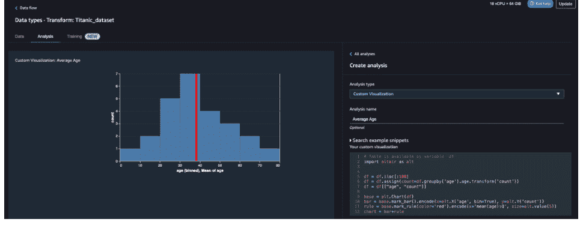

Figure 10.20: 自定义可视化

- **多重共线性**：理解和解决多重共线性在数据分析中很重要，以确保统计模型准确、可靠且有用以做出明智的决策。多重共线性是数据集中两个或多个自变量之间的高度相关。它可能使隔离各个自变量对因变量的影响变得困难。最后但同样重要的是，多重共线性也可能使模型更难解释，因为当自变量之间存在相关性时，很难理解每个自变量的独特贡献。Data Wrangler 提供了开箱即用的分析选项来检测数据中的多重共线性。有几种不同的选项来分析多重共线性。让我们看看如何在我们的泰坦尼克号数据集上使用其中一些预构建的分析。**方差膨胀因子（VIF）** 是变量之间共线性的度量。我们通过解决回归问题来预测一个变量，同时给定其余变量来计算它。VIF 分数是一个大于或等于 1 的正数，分数为 1 表示该变量与其他变量完全独立。分数越大，依赖性越强。作为经验法则，我们可以丢弃或特征-

对 VIF 分数大于 1 的特征进行工程化。要创建使用 VIF 的多重共线性分析，请选择添加分析，然后选择多重共线性。

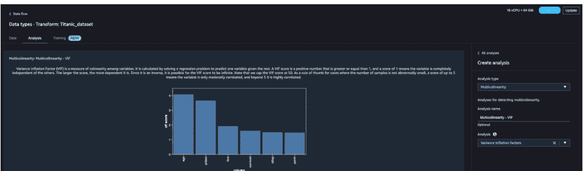

图 10.21：使用 VIF 的多重共线性

一旦你点击预览，你将看到一个直方图，X 轴为特征名称，Y 轴为 VIF 分数。在我们的示例中，我们可以看到基于 VIF 没有任何特征存在多重共线性。

- 除了 VIF，Data Wrangler 还内置了另外几种多重共线性分析可供选择。让我们来看 Lasso 特征选择分析。Lasso 方法涉及在回归模型中添加一个惩罚项，使自变量的系数向零收缩。该惩罚项可以帮助识别预测因变量最重要的自变量，也有助于解决多重共线性问题。要在 Data Wrangler 中使用 Lasso 特征选择方法，请如前所述选择多重共线性分析，然后将分析设置为 Lasso 特征选择。你可以 optionally 选择 L1 大小，即惩罚项；默认值是 1。接下来，我们将问题类型设置为分类，并将标签列设置为 Survived。这将创建一个基线回归模型，使数据集中所有自变量在正则化参数设置为足够大的情况下，部分系数被收缩向零。这将创建一个直方图，显示最重要的特征——即系数非零的特征。

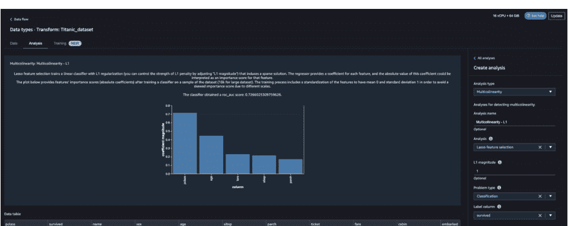

图 10.22：使用 Lasso 特征选择的多重共线性

检查所选自变量之间的相关性，以确定是否存在多重共线性问题。通过这种方式使用 Lasso 特征选择方法，你可以识别并解决回归模型中的多重共线性，从而有助于提高其准确性和可靠性。

除了我们在此介绍的分析之外，Data Wrangler 还能够分析其他特定类型的数据集，例如时间序列数据。这些可以让你进行额外的异常检测和分析季节性趋势。现在你对数据和潜在模式有了良好的理解，可以进入下一步，通过添加转换来修改数据。

## 第 4 步 – 添加转换

作为数据分析的一部分，你可能会注意到数据集中想要更改或转换的元素。数据转换的目标是使数据更适合建模，以提高机器学习算法的性能，或处理缺失或损坏的值。机器学习的数据转换可以包括诸如归一化、标准化、数据编码和分箱等。并非所有数据集都相同，也并非所有转换都适用于所有数据集。数据分析的目标是为你的数据集识别特定的转换。虽然我们通常将数据转换作为机器学习管道中的早期步骤，在数据用于训练模型之前应用，但在现实世界的机器学习中，我们会持续监控模型性能并根据需要应用转换。在 Data Wrangler 中导入并检查数据集后，你可以开始向数据流添加转换。你可能已经注意到，我们数据集中某些列没有关联正确的数据类型。例如，我们数据集中 `age` 特征具有 `String` 类型而不是 `Numeric`。在应用转换之前，我们建议查看并修复数据集中所有特征的数据类型。

你可以查看 Data Wrangler 自动分配给你的特征的数据类型。

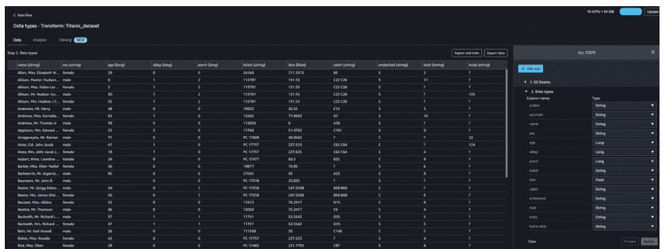

图 10.23：数据源数据类型

你可以使用以下步骤来执行此操作：

- 1. 进入数据流屏幕并双击 **数据类型** 框。这将打开一个部分，列出你的所有特征以及每个特征的自动推断数据类型。屏幕右侧还将实时显示数据集的预览。
- 2. 你可以使用 **类型** 下拉菜单更改特定特征的数据类型。让我们在继续之前先做一些这些操作。在这里，我们将 **age**、兄弟姐妹（**sibsp**）和父母（**parch**）的数据类型更改为 Long 以及 **age** 特征更改为 **浮点**。在我这里，Data Wrangler 自动将所有这些特征分类为 **字符串**。如果你在自己的账户中尝试，可能结果会略有不同。选择好特征所需的数据类型后，你可以使用 **预览** 按钮预览它。
- 3. 对更改感到满意后，你可以点击 **更新** 按钮来应用更改。

## 分类编码

在前一节中删除特征后，我们示例数据集中仍有两个具有表示类别的文本数据的特征，即 **sex** 和 **boat** 特征。我们将使用分类编码来转换 **sex** 特征。分类编码是一种常见的特征工程技术，它将表示一组离散值的分类数据转换为可用于机器学习模型的数据。分类编码是必要的，因为大多数机器学习算法使用数值数据，而分类数据不能直接用于许多机器学习模型。有几种常见的分类编码技术，例如“独热编码”，其中每个类别值转换为新列并分配 1 或 0。例如，**sex** 特征可以独热编码为两个新列 `sex_male` 和 `sex_female`，每个列包含 1 或 0，具体取决于 **sex** 特征的原始值。标签编码是另一种常用的分类编码方法，它为每个类别分配一个唯一的整数值。例如，在我们的例子中，如果我们对 **sex** 特征应用标签编码，我们将得到 `female` 和 `male` 值分别为 1 和 2。由于我们使用的是数字，因此较高的值可能与机器学习模型对目标的较高正相关或负相关相关联，而这对于该特征是不需要的。除了独热编码和标签编码之外，其他分类编码方法还包括计数编码，它用类别在数据集中出现的次数替换每个类别，以及目标编码，它用该类别目标变量的平均值替换每个类别。现在，让我们对 **sex** 特征应用独热编码。我们将通过在数据流中点击 **删除列** 按钮旁边的 + 号来添加一个新的转换步骤。

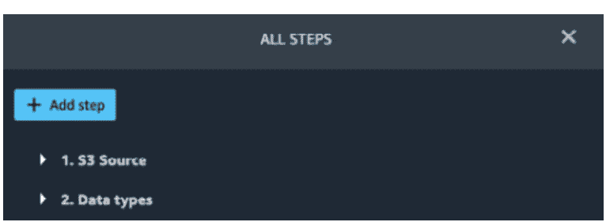

图 10.24：数据转换 – 添加步骤

接下来，点击 **添加步骤** 按钮并选择 **编码分类** 部分。在这里，你可以从 **转换** 下拉菜单中选择编码类型。我们将选择 **独热编码**。我们将指定输入列，在我们的例子中是 **sex**。接下来，指定如何处理该列中的缺失值。你可以选择保留它们、跳过它们，或在遇到缺失值时以错误结束转换过程。你可以预览转换，一旦满意，可以点击 **添加** 按钮将新的转换步骤添加到你的流程中。

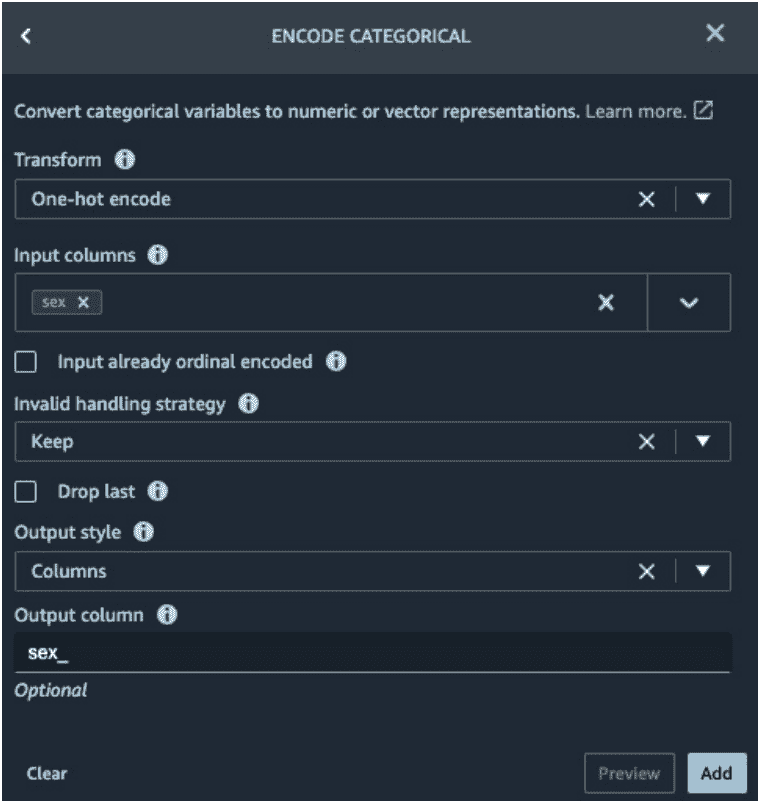

图 10.25：数据转换 – 独热编码

在可视化器中检查数据流，以确保一切看起来都符合预期。你现在应该看到一个用于独热编码的额外步骤。

## 自定义转换

Data Wrangler 提供了多个常用的内置转换，可直接使用，无需从头编写代码。我们在前面的章节中介绍了其中两种——首先，使用 drop column 转换从数据集中删除冗余或不相关的特征。另一个我们使用的内置转换是应用独热编码，使用分类编码转换对 DataFrame 的 sex 特征进行处理。除此之外，还有其他内置转换可用于处理文本数据和时间序列数据、处理缺失值和异常值，以及应用常见的数据工程任务，例如进行降维和在平衡数据集中工作。然而，可能存在需要你做

在内置转换之外对您的数据进行转换。Data Wrangler 通过 **自定义转换** 为您提供了这样做的能力，您可以在其中提供自己的自定义代码，使用 PySpark、PySpark SQL 和 Python pandas 以及 Python 用户定义函数。在选择要使用的特定类型的自定义转换代码之前，务必注意数据集的大小。例如，如果您选择 Python（pandas），您的数据集应适合单个实例的内存。如果您有更大的数据集，请选择提供 PySpark 代码，这样可以让您将数据拆分到多个实例中并汇总结果。在我们的示例中，Titanic 数据集有一个 **救生艇** 特性，其中包含乘客的救生艇编号（如果他们能上船）。虽然救生艇编号本身并不包含重要信息，但乘客能够使用救生艇会显著提高他们的生存机会。我们将使用自定义转换为我们的数据集生成一个新特性，指定乘客是否有救生艇可以使用。以下自定义 Python 代码片段正是这样做的。它创建了一个新的特性 **救生艇存在**，并检查 **救生艇** 特性是否有值，如果有，则添加值为 1，如果没有，则插入 0。最后，它会删除现有的 **救生艇** 特性，因为我们不再需要它：

```
# Table is available as variable `df`
# Assign a target value to check, in our case '?' and use an escape as this is a special character
target_value = '\?'
# Create a new column that will check if value exists for boat number
df['lifeboat_exists'] = (~df['boat'].str.contains(target_value, na=False)).astype(int)
# Drop the existing "boat" column
df.drop('boat', axis=1, inplace=True)
```

在 Data Wrangler 中添加自定义转换，请使用以下步骤：

- 1. 转到 Data Wrangler 流程，通过在数据流程中点击 **删除列** 步骤旁边的 + 号来添加新的转换步骤。
- 2. 接下来，点击 **添加步骤** 按钮并选择 **自定义转换** 部分。在这里，我们将为您的自定义转换步骤提供一个可选名称；我们将将其命名为 **救生艇检查**。
- 3. 然后，我们将选择类型；由于我们的数据集相对较小，我们将选择 Python（pandas）。您将收到一条警告消息，提醒您检查数据集大小并确保可以将其放入单台机器的内存中。
- 4. 然后您可以粘贴上一节的代码。为确保没有错误，请点击 **预览** 按钮并确保一切看起来正常。您应该会看到创建了一个新列 **lifeboat_exists**，并且之前的 **boat** 列不再存在。
- 5. 一旦您对结果满意，请点击 **添加** 按钮将此转换作为额外步骤添加到您的数据流程中。您也可以像之前一样在可视化器中查看您的数据流程。

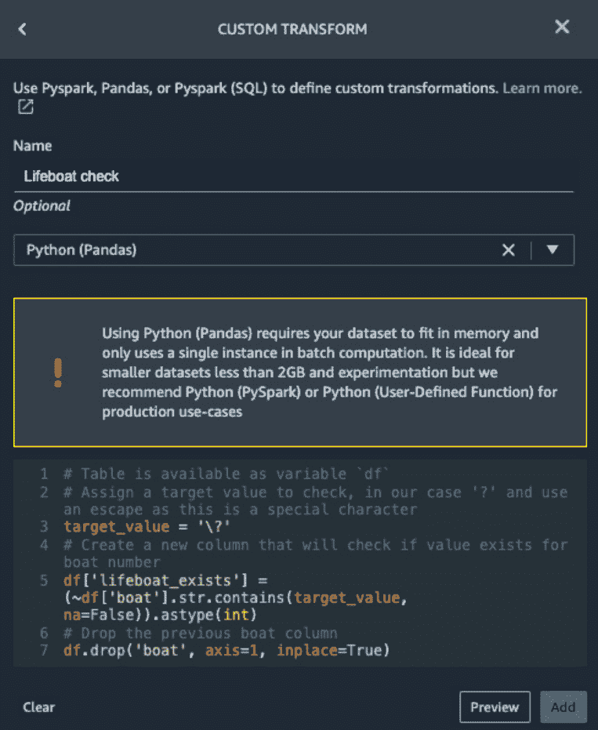

图 10.26：自定义转换 – 救生艇检查

数据集的 cabin 特性是另一个棘手的特性。一开始，该特性可能不包含相关信息。然而，随着您进一步分析数据集，您可能会注意到与目标之间存在某种相关性。换句话说，乘客的生存机会可能会受到他们是否在船舱内以及船舱类别的影响。该特性的一个挑战是其类别数量很高，直接编码可能会创建过多的列，进而导致维度问题。为了解决这个问题，我们使用另一种常用的数据科学技术，称为分箱。分箱是一种数据预处理技术，用于将连续或分类变量转换为具有更少类别或箱的分类变量。这可以使分析数据、识别模式和做出预测变得更容易，尤其是在处理大型

数据集或嘈杂数据时。在这里，我们将再次使用 **自定义转换** 功能通过以下代码在 Python 中实现分箱：

```
import pandas as pd
# define the number of bins you want to create
num_bins = 5
df['cabin_bin'] = pd.cut(pd.factorize(df['cabin'])[0], num_bins, labels=False)
# Drop the existing "cabin" column
df.drop('cabin', axis=1, inplace=True)
```

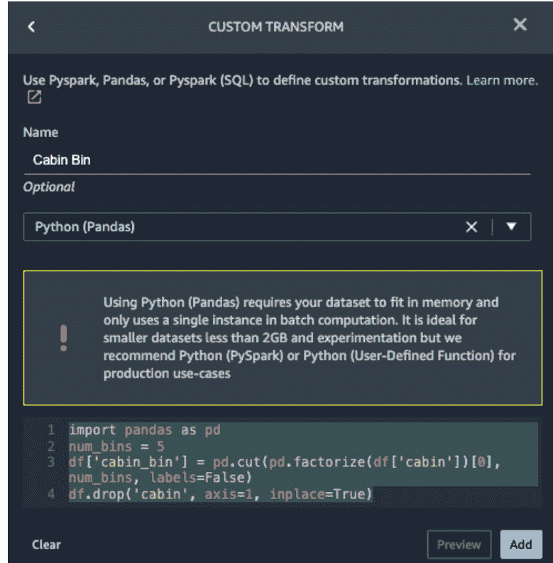

图 10.27：自定义转换 – 船舱分箱

您可以通过选择新的自定义转换来添加此转换步骤，与我们为救生艇检查所做的类似。

## 自定义转换

使用 Pyspark、Pandas 或 Pyspark（SQL）来定义自定义转换。了解更多。

```
# Table is available as variable `df`
# Assign a target value to check, in our case '?' and use an escape as this is a special character
target_value = '\?'
# Create a new column that will check if value exists for boat number
df['lifeboat_exists'] = (~df['boat'].str.contains(target_value, na=False)).astype(int)
# Drop the previous boat column
df.drop('boat', axis=1, inplace=True)
```

## 数值缩放

机器学习算法，例如使用梯度下降作为优化技术的线性回归、逻辑回归、神经网络等，要求数据进行缩放。您可以在数据集中缩放特征有两种方式

您可以应用归一化，也可以选择标准化。使用归一化还是标准化的决定取决于特征分布的归一化。我们对具有正态分布的特征使用标准化。如果特征具有偏态分布，归一化可能更合适。归一化将特征缩放到 0 到 1 的范围，而标准化将特征缩放到均值为 0 且标准差为 1。在我们的例子中，**票价** 严重右偏，而 **年龄** 更接近正态分布。为了简单起见，我们将对这两个特征都应用归一化。要在 Data Wrangler 中应用缩放，请转到 Data Wrangler 流程，通过在数据流程中点击最后一个步骤旁边的 + 号来添加新的转换步骤。这里是创建分箱的转换步骤。接下来，点击 **添加步骤** 按钮并选择 **处理数值** 部分。在这里，选择 **最小-最大缩放器** 作为缩放器。对于输入列，选择 **年龄** 和 **票价**。指定 **最小值** 和 **最大值**。我们将它们保持为 0 和 1。可选地，为新的输入列提供前缀为 **scaled_**。点击 **预览** 按钮以确保数据看起来正确。

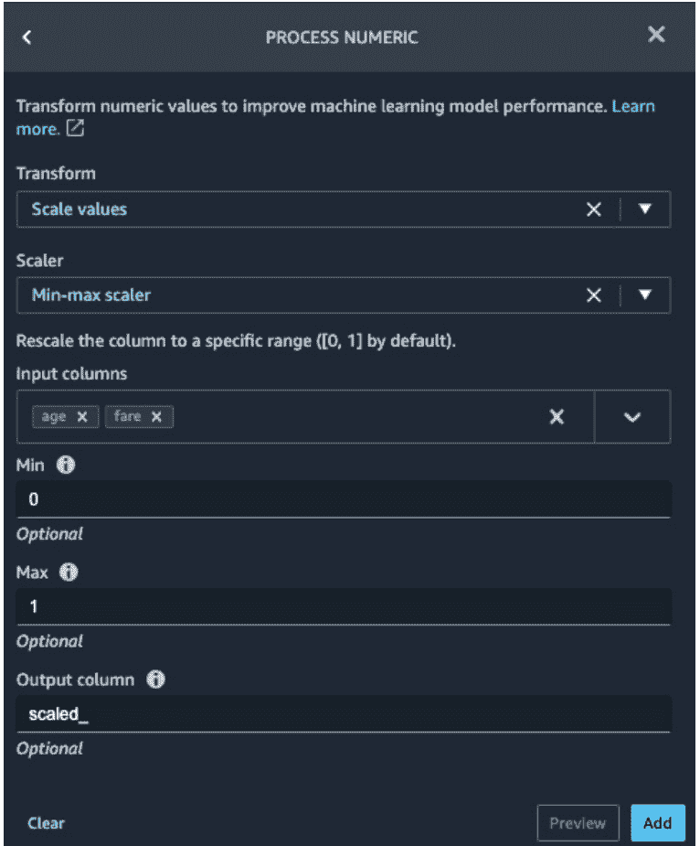

图 10.28：缩放值

一旦您对结果满意，请点击添加按钮将此新转换添加到您的数据流程中。像往常一样，您可以在 Data Wrangler 可视化器中验证流程。

## 删除列

现在我们已经应用了多个转换，我们的数据集中可能存在冗余或不再需要的列和特征。让我们现在回顾一下。挑选合适的特征并删除不相关或冗余的特征是构建机器学习模型的关键步骤，因为它们会显著影响模型的性能和预测质量

虽然特征选择通过防止过拟合问题直接提高模型的准确性，但它也有助于保持模型简单且更易于解释，并减少训练时间，从而带来成本和性能效益。换句话说，添加过多的特征可能会导致复杂模型，可能在训练数据上过拟合，并且难以解释和训练。但您如何选择要删除哪些特征以及保留哪些特征？从数据集中选择列或特征通常取决于特定的机器学习问题和您进行的分析。让我们看看我们示例数据集中可能考虑删除的一些特征，从 **姓名** 特性开始。虽然我们可能从乘客姓名中推导出有意义的信息，例如乘客的性别，但它不太可能对乘客是否幸存产生直接影响，并且很难从该列中得出有意义的见解。此外，我们已经将乘客的性别作为数据集中一个独立的特征，因此该信息变得无关紧要。同样，**票号** 不太可能影响生存，也可能没有提供任何有用的见解。我们可以尝试从 **票号** 特性中推导出其他有用信息，例如乘客等级，但该信息在数据集中也已作为独立特征存在。这也不太可能影响生存机会。我们将出于类似原因删除 **家庭目的地** 特性，该特性显示乘客的最终目的地。**遗体** 特性代表乘客遗体的遗体编号。该特性有值将表明该人没有幸存于这场悲剧。**救生艇** 特性具有乘客的救生艇编号，这也表明乘客幸存了。这两个特性都可能很棘手。在我们的示例中，我们将删除 **遗体** 特性，因为它是目标的强有力和独立的预测因子。我们将保留 **救生艇** 特性。最后，由于我们已经对 **性别** 特性进行了编码并对 **年龄** 和 **票价** 特性进行了缩放，我们也不再需要这些。 要删除一个特征，请点击最后一个步骤旁边的 + 号并选择 **添加转换**。Data Wrangler 将我们定义的每个数据转换称为一个步骤。在 **所有步骤** 屏幕上，点击 **添加步骤** 创建新的转换。这将打开 **添加转换** 屏幕。在这里，我们将获得 Data Wrangler 提供的开箱即用转换的全面列表。让我们选择 **管理列** 部分，然后从 **转换** 下拉菜单中选择 **删除列**。


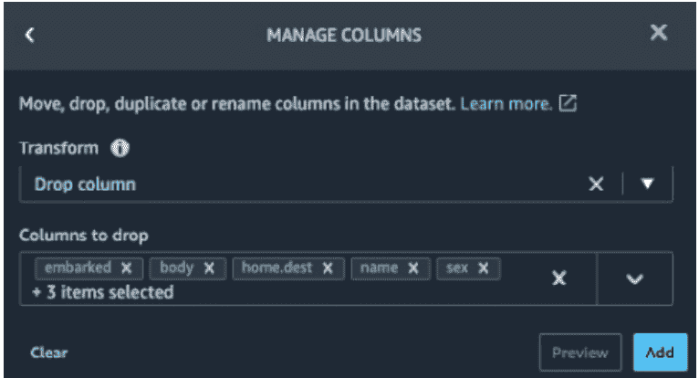

图 10.29：删除列

**Drop column** 转换允许您选择要从数据集中删除的列。一旦我们选择了特征，我们可以预览更改并单击 **Add** 按钮将数据转换添加到我们的流程中。您还可以返回并检查数据流可视化器中是否已向您的数据流添加了新步骤。一旦我们定义了所有转换，我们就可以实际应用它们并导出数据。我们将在 *第 5 步* 中介绍这一点。

## 第 5 步 – 导出数据

到目前为止，我们已经对数据集执行了几次分析。我们还定义了几个特征工程数据转换。但是，重要的是要记住，我们尚未对实际数据本身进行任何更改。我们已定义了数据流，其中包含一系列可在构建机器学习模型之前执行的分析和转换步骤。如果您检查数据流，它看起来会与以下内容类似：

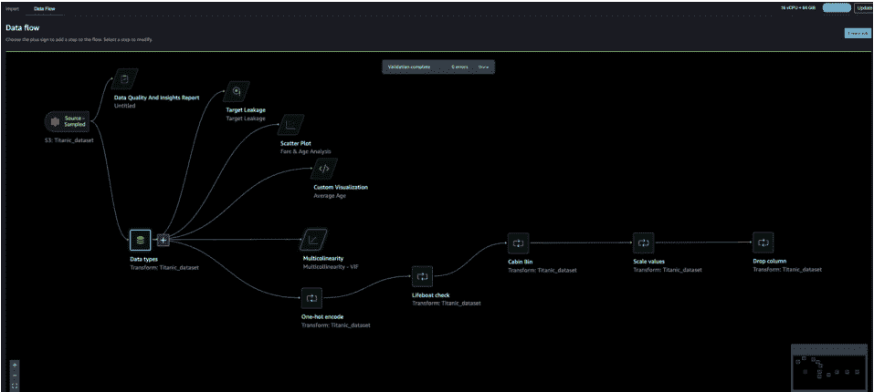

图 10.30：已完成的数据流

Data Wrangler 为您提供了多种导出数据流的选项：

- **导出到 S3：** Data Wrangler 使您能够将数据导出到 Amazon S3 存储桶内的位置。您可以通过单击数据转换步骤旁边的 = 按钮并选择 **导出到**，然后选择 **导出到 S3** 来执行此操作。Data Wrangler 将创建一个 Jupyter notebook，其中包含执行您的数据流中定义的所有转换并将数据导出到 S3 存储桶的代码。

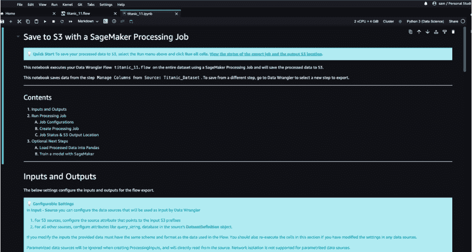

图 10.31：用于数据导出到 S3 的 Jupyter notebook

您可以在执行之前直接在 Jupyter notebook 中更新源和目标位置。Data Wrangler 使用 SageMaker Processing 作业来应用数据流中的转换，这些转换在 Jupyter notebook 中定义。

- **导出到 SageMaker Pipelines：** SageMaker Pipelines 是一种用于构建机器学习管道的全托管服务。当您选择此选项时，Data Wrangler 会创建一个 Jupyter notebook，其中包含代码来创建一个执行整个数据流的 SageMaker pipeline。与导出到 S3 选项一样，您可以直接从生成的 Jupyter notebook 更新输入和目标源。
- **导出到推理管道：** 使用 Data Wrangler，您可以直接导出到可与 SageMaker 端点一起使用的 SageMaker 推理管道。当您选择此选项时，Data Wrangler 会创建一个 Jupyter notebook，其中包含代码来应用数据流中的所有转换，然后训练一个 autopilot 模型。然后它会创建一个推理管道并将其部署到端点。推理管道使用 Data Wrangler 流程将来自推理请求的 data 转换为训练有素的模型可用的格式。
- **导出为 Python 代码：** 此选项会创建包含数据流中定义的所有转换的 Python 脚本文件。根据您运行此脚本文件的位置和方式，您可能需要提供额外的权限来访问您的 AWS 资源。
- **导出到 Feature Store：** 最后，您可以使用 Data Wrangler 直接导出到 SageMaker Feature Store。SageMaker Feature Store 是用于存储和检索所有特征及其相关元数据的全托管特征存储库。SageMaker Feature Store 使用特征组，即特征的集合。使用 Data Wrangler，您可以更新现有的特征组或创建新的特征组。当您选择此选项时，Data Wrangler 将创建包含在 SageMaker Feature Store 中定义和配置特征组的代码的 Jupyter notebook。然后它将运行一个 SageMaker Processing 作业来应用数据流中定义的转换并更新特征组。

一旦我们将数据放在正确的格式和我们想要的位置，我们就可以继续下一步，构建和训练机器学习模型。

## 训练机器学习模型

我们现在已使用 Data Wrangler 进行数据分析和处理，其中涉及多个步骤，例如数据清理、预处理、特征工程和探索性数据分析。在进行机器学习之前，这些步骤至关重要，因为它们确保数据处于正确的格式，我们选择了相关特征，并且我们使用数据转换处理了异常值和缺失值。Data Wrangler 提供统一的体验，使您能够准备数据并无缝训练机器学习模型，所有操作均在工具内部完成。

**SageMaker Autopilot** 是一种工具，可自动化 **自动机器学习** (**AutoML**) 过程中的关键任务。这包括探索您的数据、选择与问题类型相关的算法以及准备数据以促进模型训练和调优。只需单击几下，您就可以使用 Autopilot、XGBoost 或您自己的算法自动构建、训练和调优 ML 模型，直接从 Data Wrangler **用户界面 (UI)**。当您训练和调优模型时，Data Wrangler 会将您的数据导出到 Amazon S3 位置，以便 Amazon SageMaker Autopilot 可以访问它。让我们看看如何从 Data Wrangler 内部开始模型训练：

- **导出数据：** 首先，单击 + 旁边的 Data Wrangler 步骤，从该步骤开始训练。

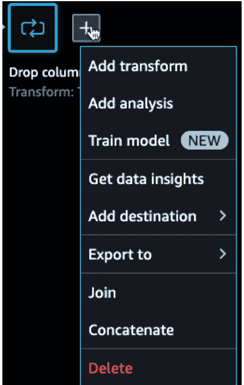

图 10.32：Data Wrangler – 训练模型

然后，选择 **训练模型**。这将打开一个数据导出屏幕，您可以在其中指定要导出转换后数据的 S3 存储桶。SageMaker Processing 作业将应用从您选择训练模型的步骤开始的所有数据转换。

接下来，您指定导出数据的格式。默认情况下，您选择了 CSV，但您也可以选择以 parquet 格式导出数据。您可以选择为数据指定加密密钥。

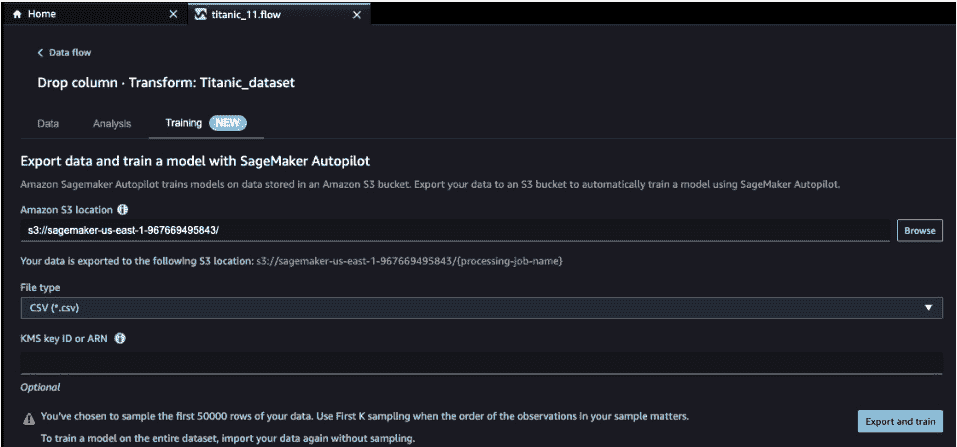

图 10.33：训练模型 – 数据导入

需要注意的是，如果您选择在 Data Wrangler 中导入记录样本，则必须在开始模型训练之前重新导入数据而不进行采样，以确保训练过程使用整个数据集。当您准备就绪时，单击 **导出并训练**。这将启动导出过程。

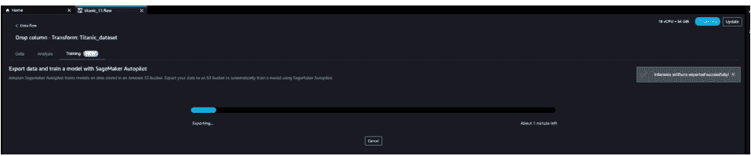

图 10.34：训练模型 – 开始导出过程

- **创建实验：** 接下来，我们将创建一个 Autopilot 实验。当您创建 Autopilot 实验时，Amazon SageMaker 会分析您的数据并创建包含候选模型定义的笔记本。您首先为实验命名并输入 S3 中数据的输入位置。如果您有清单文件，可以在此处切换单选按钮。SageMaker Autopilot 会自动拆分训练数据集，将 80% 用于训练，其余 20% 用于验证；如果您不想这样做并使用整个数据集进行训练，可以通过 **自动拆分数据** 切换按钮将其禁用。最后，指定 Autopilot 工件的输出位置。

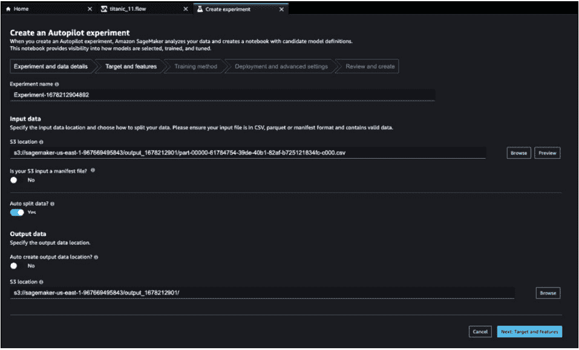

图 10.35：训练模型 – 创建 Autopilot 实验

如果一切看起来都符合预期，请单击 **实验和数据详情** 按钮。

- **指定目标和特征：** 在这里，您指定模型将预测的目标列。在我们的例子中，这是 **Survived** 列。以下部分允许您选择要用于训练的特征。默认情况下，Data Wrangler 将使用除目标外的所有特征进行训练。您还可以在此处指定特征的数据类型。由于我们已经在 Data Wrangler 中处理了数据，因此我们将使用默认值。


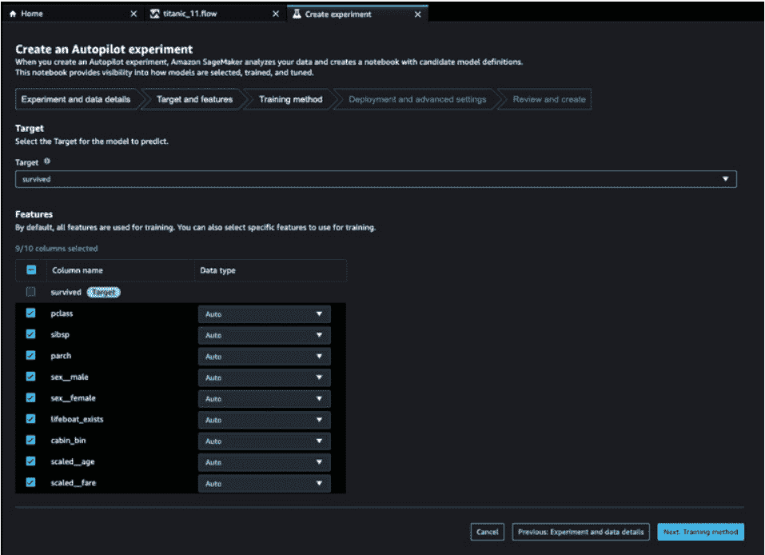

Figure 10.36: 训练模型 – 目标和特征

当您准备好时，单击 **下一步：训练方法** 按钮继续。

- **选择训练方法**：SageMaker Autopilot 提供三种不同的训练方法。默认是 **Auto**，Autopilot 将根据您的训练数据集大小自动决定最佳方法。除此之外，您可以选择 **Ensembling**，其中 Autopilot 使用一种 AutoML 算法，从您的数据中直接训练多层堆叠集成模型来预测回归和分类数据集。最后，Autopilot 提供 **超参数优化** 方法，其中 Autopilot 将通过调整超参数并在我们的数据集上运行训练作业来找到模型的最佳版本。

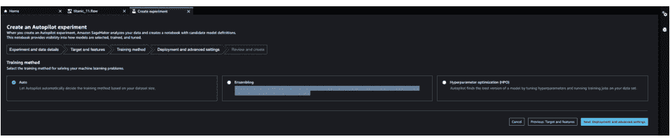

Figure 10.37: 训练模型 – 训练方法

在我们的案例中，我们将选择默认的 **Auto** 方法。单击 **下一步：部署和高级设置** 按钮继续前进。

- **指定部署设置：** 在这里，我们将指定模型部署选项。SageMaker Autopilot 可以自动将模型部署到实时端点，我们可以使用它进行推理。默认情况下，SageMaker Autopilot 将把模型的最佳版本以及数据转换部署到端点。然而，您可以覆盖此设置，选择不进行数据转换部署或根本不部署到端点。接下来，为端点指定一个名称。高级设置是可选的。您可以指定机器学习问题的类型，在我们的案例中是二元分类——也就是说，我们要预测的只有两种结果，乘客是否幸存。您还可以指定用于评估模型的指标；对于 **二元分类**，默认选择 **F1** 分数，我们将保留该设置。这里还有一些其他可以调整的高级选项。我们将保留默认值，但让我们看看其中一些。

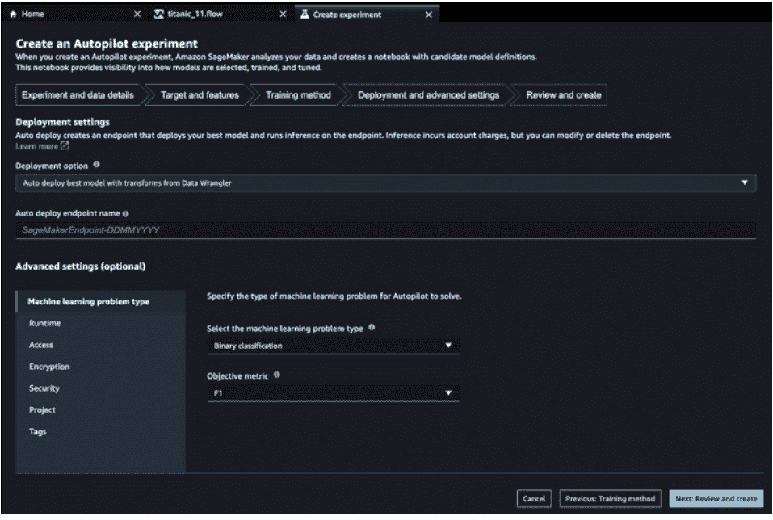

Figure 10.38: 训练模型 – 部署设置

默认情况下，Autopilot 实验将运行多个训练作业以及超参数优化作业。如果您想限制这些作业的持续时间，可以在运行时限制部分进行设置。您还可以指定 SageMaker Autopilot 用于访问您的数据、运行处理和训练作业以及部署端点的特定 IAM。默认情况下，选择了 SageMaker 角色。您还可以通过指定 AWS 密钥来加密 S3 位置和训练实例的存储卷。在安全部分，您可以通过指定虚拟私有云来选择在私有网络中运行 Autopilot 作业。在 **项目** 部分，您可以将实验与特定的 SageMaker 项目关联，并在 **标签** 部分指定额外的标签。接下来，单击 **下一步：查看并创建** 按钮。

- **查看并创建：** 在最后一部分，查看所有内容以确保所有细节都正确。当您准备好时，单击 **创建实验** 按钮从 Data Wrangler 启动 SageMaker Autopilot 实验。

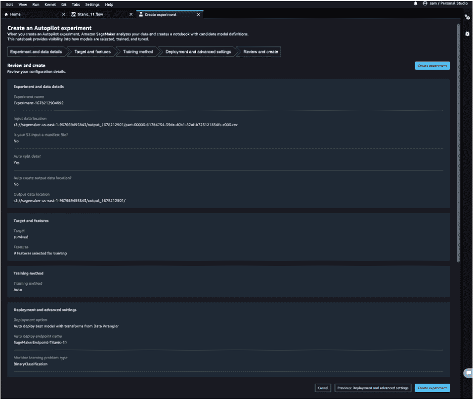

Figure 10.39: 训练模型 – 查看实验

您可以在下一屏幕上查看训练进度，该进度从数据预处理阶段开始。

您还可以在 **作业配置文件** 选项卡下找到有关该作业的更多信息。

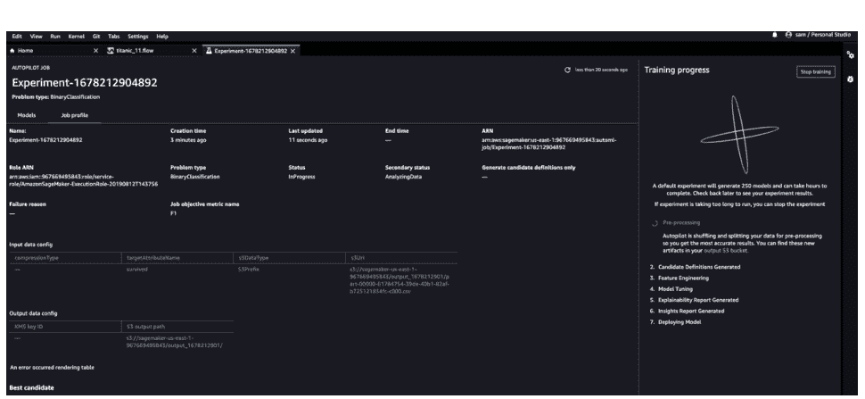

Figure 10.40: 训练模型 – 实验进度

使用我们的数据集和默认作业设置，该过程需要几个小时才能完成。完成后，SageMaker Autopilot 将列出所有实验或作业运行以及关键评估指标、状态和时间。它还将显示用于创建部署端点的最佳模型。

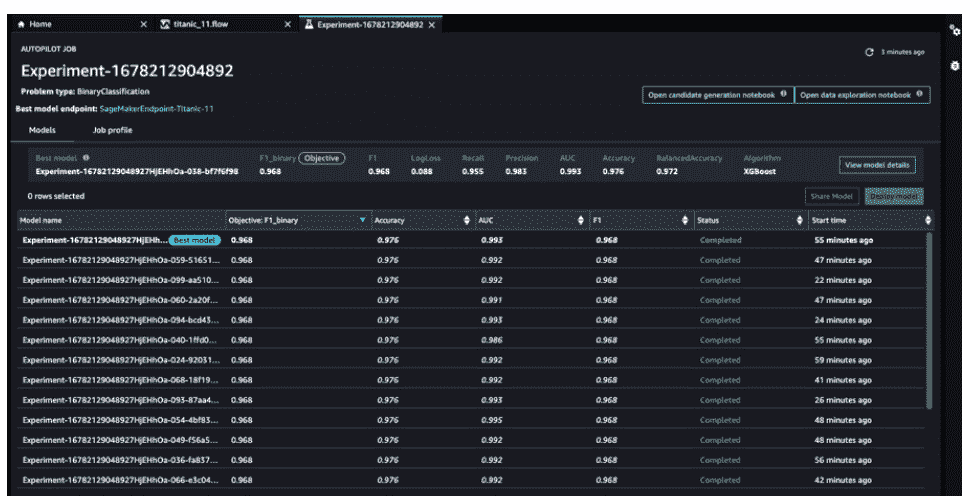

Figure 10.41: 训练模型 – 列出模型

在本节中，我们使用 Data Wrangler 和 SageMaker Autopilot 转换的数据训练了机器学习模型。我们还运行了微调作业并选择了最佳模型。您也可以选择部署模型。

## 摘要

SageMaker Data Wrangler 是一个专门用于分析和处理机器学习数据的专用工具。它也是 AWS 上机器学习的基础平台之一。这是一个很长的章节，虽然我们涵盖了 Data Wrangler 的几个关键功能，但本书中仍有几个功能未涉及。我们首先了解如何登录 SageMaker Studio 并访问 Data Wrangler。对于示例数据集，我们使用了通过公共 S3 存储桶提供的内置 Titanic 数据集。我们通过默认采样方法将此数据集导入 Data Wrangler。然后我们执行了 EDA，首先使用 Data Wrangler 中的内置洞察报告，然后添加额外的分析，包括使用我们的自定义代码。接下来，我们为 Data Wrangler 流程定义了几个数据转换步骤以进行特征工程。为此，我们使用了 Data Wrangler 中的多个内置数据转换。我们还研究了使用 Python（pandas）应用自定义数据转换。在定义数据转换后，我们研究了将 Data Wrangler 流程导出到各种目标的各种选项，包括 S3、SageMaker Feature Store、SageMaker Pipelines 和独立的 Python 脚本。最后但同样重要的是，我们研究了直接在 Data Wrangler 内部运行完整的端到端机器学习周期的便捷性，该周期包括所有数据处理步骤、选择合适的算法以及运行训练实验和超参数调优作业。作为本次练习的一部分，我们还将实验中的最佳模型部署为 SageMaker 实时端点。在结束本章时，请确保删除帐户中创建的任何已使用资源。

当我们进入本书的最后一章时，我们将重点关注数据安全和监控。在这一最终部分，我们将汇集本书中探索的各种 AWS 服务，重点关注安全和监控。
