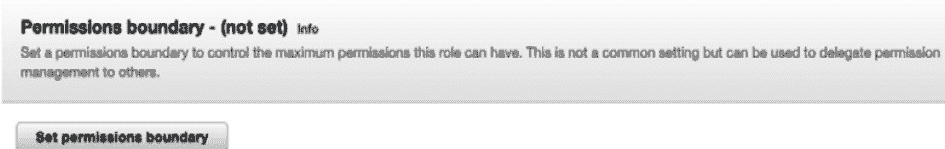
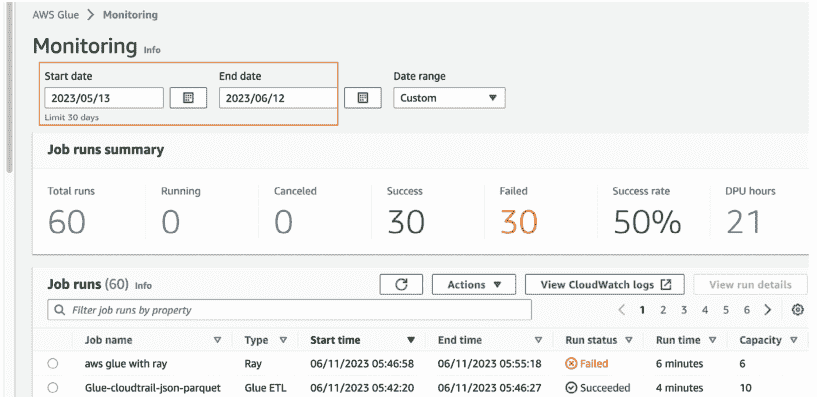
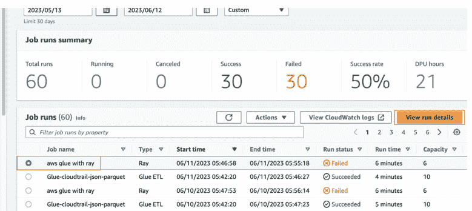
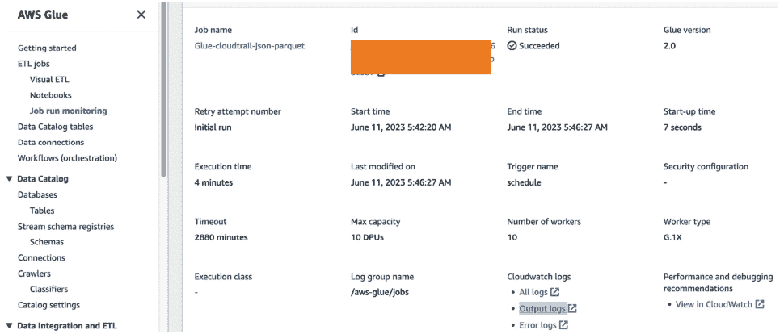
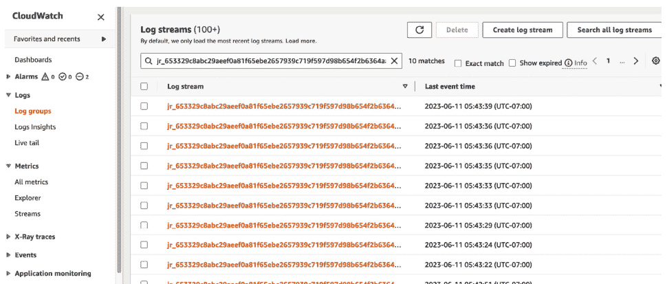

## 数据湖安全和监控

在前几章中，我们了解了数据整理过程以及如何在 AWS 生态系统中利用不同的服务进行数据整理活动。到目前为止，您应该已经具备使用 Glue DataBrew、SageMaker Data Wrangler 和 AWS SDK for pandas 创建数据管道的知识。我们还讨论了 AWS Glue、Athena、Amazon S3 和 QuickSight 等 AWS 服务提供的功能，所有这些服务都更有效地支持您的数据整理管道中的特定活动。在本章中，我们将探讨如何为您的负载设置数据整理管道的安全性和监控。

本章涵盖以下主题：

- 数据湖安全
- 监控和审计

## 数据湖安全

在本节中，我们将讨论增强数据湖安全方面的各种选项和方法。我们将讨论多层面的安全；然而，这只能被视为一个起点。您需要做更多的工作，并根据项目的适用情况添加额外的安全层。

## 数据湖访问控制

为了保护数据湖，我们可以使用基于用户访问策略和基于资源访问策略的组合。用户策略附加到用户/角色，并控制用户/角色在帐户内可以执行的操作。除了基于用户的控制策略外，我们还可以将访问策略附加到 Amazon S3、Amazon SQS 等资源，以专门控制该资源的访问。这为保护 AWS 资源提供了另一层安全保障。作为一般最佳实践，访问策略应保持最小权限，仅允许在特定条件下执行所需操作。

## 基于用户的访问策略

AWS Identity and Access Management（IAM）有助于以集中方式控制您 AWS 帐户对 AWS 资源的访问。它有助于身份验证和授权 for

您的 AWS 账户：

- 身份验证在用户/资源访问 AWS 资源之前会使用其凭据验证其身份
- 授权验证经过身份验证的用户/资源是否允许执行特定操作

我们将在本节中进一步讨论 IAM 授权，以了解它如何保护对数据湖的访问。

IAM 策略的一些最佳实践在此详细说明。您还应遵循以下 AWS 文档中概述的最佳实践：
https://docs.aws.amazon.com/IAM/latest/UserGuide/best-practices.html. 让我们看一下：

- 您应为整个账户或组织内多个账户应用权限防护栏，使用 **服务控制策略 (SCPs)**。防护栏策略是账户上用户可用的最大权限。组织可以使用这些策略来防止某些操作，以确保严格的安全态势。一个示例可以是添加 SCP 策略以阻止个人团队成员创建新的角色/用户。以下链接提供了示例 SCP 策略，可帮助您入门：
https://docs.aws.amazon.com/organizations/latest/userguide/orgs_manage_policies_scps_examples_general.html#example-scp-restricts-iam-principals.
- 您还可以为用户或角色提供 **IAM 权限边界**，以定义可添加到该角色的权限的最大边界。这将防止添加超出最初意图的额外权限。即使通过托管策略或内联策略向 IAM 用户/角色添加了更宽泛的权限，权限边界仍将作为预防性防护栏，确保用户/角色只能拥有权限边界内定义的访问权限。一个常见用例是允许开发人员创建额外的角色以执行日常任务，同时限制这些服务角色拥有更宽泛的权限以避免任何安全问题。请参阅以下博文，了解有关使用权限边界的更多详细信息：
https://aws.amazon.com/blogs/security/when-and-where-to-use-iam-permissions-boundaries/.

您可以通过基础设施配置代码或控制台为特定用户将权限边界附加到单个用户角色：



图 11.1：IAM 控制台上的权限边界

为了确定用户/角色是否有权限对资源执行操作，IAM 会评估 SCPs、基于身份的策略、权限边界、基于会话的策略和基于资源的策略。明确的拒绝语句优先于允许语句。请阅读以下文档以了解有关策略评估逻辑的更多信息：
https://docs.aws.amazon.com/IAM/latest/UserGuide/reference_policies_evaluation-logic.html.

- 您可以利用 **最小权限** 和 **IAM 条件** 来进一步限制 IAM 策略，以获得更好的安全态势。IAM 为常见用例提供托管策略。然而，这些权限可能超过某些特定用例所需的权限
。此外，客户过去常创建权限更宽泛的策略以避免开发阶段的访问错误。为了更严格的安全性，请创建客户管理的策略，仅提供完成工作所需访问特定资源和特定操作的权限。**IAM 访问分析器** 可用于根据访问模式生成最小权限策略。

您还可以在 IAM 策略上使用条件作为额外的安全层，在满足某些条件时提供对资源的访问。例如，假设您希望向用户提供承担角色的访问权限，但仅当该请求来自特定的 IP CIDR 范围（企业网络）时才允许。请参阅以下文档以了解如何有效使用条件：
https://aws.amazon.com/premiumsupport/knowledge-center/iam-restrict-calls-ip-addresses/

## 基于资源的访问策略

用户可以将访问策略附加到 S3 存储桶、对象和资源以保护对 S3 存储桶的访问。**存储桶策略** 提供了使用特定访问模式保护存储在 Amazon S3 中的对象的机制。这提供了控制如何/在何处/写入/读取 Amazon S3 对象的机制。通过精心设计的存储桶策略，我们可以实现以下功能：

- 网络来源控制，仅允许从特定 VPC、IP地址范围、浏览器等访问。最佳做法是限制对 S3 存储桶的访问，除允许的 IP CIDR/VPC 设置外：

```
{
  "Version": "2012-10-17",
  "Statement": [
    {
      "Sid": "Statement1",
      "Principal": "*",
      "Effect": "Deny",
      "Action": "*",
      "Resource": ["arn:aws:s3:::wranglerbook","arn:aws:s3:::wranglerbook/*"],
      "Condition": {
        "NotIpAddress": {
          "aws:SourceIp": "172.0.0.0/24"
        }
      }
    }
  ]
}
```

图 11.2：仅限制从特定 IP 地址前缀访问的 S3 访问策略语句

- 您还可以按文件夹级别控制用户访问。请注意，Amazon S3 是一个具有扁平文件存储层次结构的对象数据存储；AWS 控制台将具有相同前缀的数据可视化为文件夹，以便更轻松地浏览。因此，在共享数据集的情况下，仅提供对特定前缀的访问。例如，假设我们有来自多个客户的数据存储在不同的文件夹下。我们可以将特定用户角色的访问限制到特定文件夹/前缀。请参阅以下文档路径，了解设置文件夹级访问的存储桶策略示例：
https://docs.aws.amazon.com/AmazonS3/latest/userguide/example-bucket-policies.html#example-bucket-policies-folders

- 对于需要为一组用户提供对不同文件夹中对象的访问的情况，请使用对象标签仅限制对 S3 存储桶中某些对象的访问。例如，假设我们有三个不同的数据源（电子商务、代理、杂项）将用户数据填充到 S3 存储桶中。每个源每天将上传两个文件，其中一个包含敏感数据（用户不应访问），另一个不包含敏感数据（所有用户均可访问）。每个源将在以其名称命名的文件夹下上传文件。在这种情况下，我们可以使用对象标签提供对不包含敏感数据的文件的访问权限，如下所示：

```
{
  "Version": "2012-10-17",
  "Statement": [
    {
      "Principal": {"AWS": [
        "arn:aws:iam::<<accountid>>:role/role_name"
      ]},
      "Effect": "Allow",
      "Action": ["s3:GetObject"],
      "Resource": "arn:aws:s3:::wranglerbook/*",
      "Condition": { "StringEquals": {"s3:ExistingObjectTag/dataclassification": "sensitive"} }
    }
  ]
}
```

图 11.3：基于附加到 S3 存储桶的标签限制访问的 S3 访问策略语句

您还可以通过使标签对 PutObject 操作成为强制性要求，确保在数据上传到 S3 存储桶时对象被正确标记。请参阅以下 AWS 文档，了解有关基于对象的标记的更多详细信息：
https://docs.aws.amazon.com/AmazonS3/latest/userguide/example-bucket-policies.html#example-bucket-policies-object-tags

## 控制数据湖访问的附加选项

您可以执行以下活动来保护数据湖中的数据：

- **S3 访问点** 有助于简化由多个团队访问的共享存储桶的访问控制。它们是附加到 S3 存储桶并具有不同权限策略的命名网络端点。S3 端点通过将每个用例的策略分离到单独的端点，有助于管理具有复杂且难以维护的存储桶策略的存储桶。一些常见用例是托管大型共享数据集的存储桶，每个数据集具有不同的访问策略，以及在不影响现有策略的情况下对 S3 存储桶进行新的访问策略更改测试。
- **对象 Lambda 访问点** 如果您希望在访问点前面使用 Lambda 函数则很有用。它们有助于使用 Lambda 对象编辑 PII 数据等情况。请参阅以下博文以了解如何为此实现解决方案：
https://docs.aws.amazon.com/AmazonS3/latest/userguide/tutorial-s3-object-lambda-redact-pii.html
- **IAM 访问分析器** 可帮助验证策略的语法和最佳实践，识别与外部实体共享的资源，并根据 CloudTrail 日志生成策略。它帮助您应用符合最小权限模型的策略，并仅授予用户所需的最小权限。应定期验证以确保策略根据最近的用户活动进行更新。
- **Amazon S3 日志选项：** Amazon S3 提供了一些日志选项，用于捕获所有用户操作以进行审计、合规和安全目的：

- Amazon S3 服务器日志用于以细粒度细节捕获日志（生命周期转换事件、身份验证失败等）。这些日志具有对象大小、HTTP 引用者等额外字段。除日志存储成本外没有额外费用。

- AWS CloudTrail 事件（S3 API 调用）通过 CloudTrail 捕获对象和存储桶的 API 操作。日志可以交付到多个位置并转发到 Amazon CloudWatch 以进行进一步分析。除日志存储成本外，CloudTrail 事件捕获还有额外费用，但它与其他系统具有更好的集成能力。

请参考以下文档页面了解 AWS CloudTrail 与 Amazon S3 服务器日志之间的区别：https://docs.aws.amazon.com/AmazonS3/latest/userguide/logging-with-S3.html。

- Amazon S3 Inventory 可帮助您定期导出包含 S3 存储桶或前缀中对象列表的 CSV/ORC/Parquet 格式文件。该报告可用于分析对象的复制和加密状态以确保数据安全。清单文件可使用 Amazon Athena 通过 SQL 查询来识别 S3 存储桶中的监管或合规问题。

## 监控、发现和识别安全问题

以下服务可以帮助您监控、发现和识别数据湖中的安全问题：

- AWS Config 帮助用户持续监控 AWS 资源并审计配置更改。用户可以在 AWS Config 上配置规则以监控并标记不符合配置规则的资源。您可以设置 AWS Config 以验证组织内所有存储桶的公共读/写配置。请参考以下博客文章了解如何使用 AWS Config 识别和更新账户中 S3 存储桶的公共设置：https://aws.amazon.com/blogs/security/how-to-use-aws-config-to-monitor-for-and-respond-to-amazon-s3-buckets-allowing-public-access/。

- AWS Trusted Advisor 扫描您账户上的 AWS 基础设施并提供遵循最佳实践的建议。它可用于识别数据湖配置中的任何问题并适当修复。这适用于 AWS 企业级支持客户。Trusted Advisor 提供优化的建议，帮助以下方面：
  - 成本优化：识别未分配、未充分利用和空闲的 AWS 资源以帮助用户优化成本。
  - 性能：通过分析 AWS 资源的吞吐量、延迟和计算使用情况提供改进性能的建议。
  - 安全：识别并提供有关暴露的凭据、安全组漏洞、S3 存储桶权限更开放等问题的建议。
  - 容错：识别并突出显示 EC2 自动扩展、健康检查、数据备份等。
  - 服务限制：AWS 对不同服务有服务限制。它们会在用户达到服务限制的 80% 时发出提示，以便更好地做好准备。

- Amazon Macie 通过在 S3 存储桶中使用机器学习模式匹配来识别敏感数据。Macie 还支持对 S3 存储桶进行自动敏感数据发现。请参考以下帖子了解可使用 Amazon Macie 在多个账户中使用的自动化敏感数据发现框架：https://aws.amazon.com/blogs/security/use-amazon-macie-for-automatic-continual-and-cost-effective-discovery-of-sensitive-data-in-s3/。

- AWS GuardDuty 是一种威胁检测服务，可持续监控您的 AWS 账户中的可疑活动。您可以使用 GuardDuty 监控 S3 管理事件和数据事件以识别安全问题。将生成报告以便用户采取行动。一些常见用例如下：
  - 识别存储在 EBS 存储卷中的文件的问题
  - 通过分析 EKS 审计日志识别容器部署的问题
  - 识别受损凭据、可疑登录和访问模式等

## AWS Lake Formation 集成

AWS Lake Formation 为数据湖提供细粒度访问控制，允许您向 Data Catalog 资源、Amazon S3 位置和底层数据上的各个主体授予权限。这实现了对数据访问和用户操作的确切控制。

在 Lake Formation 中执行细粒度访问控制有两种方法：

- **IAM 访问控制**：推荐的方法涉及向 Data Catalog 资源、S3 位置和底层数据上的各个主体授予 IAM 权限。此方法提供对数据访问的最大控制。
- **IAM 和 Lake Formation 权限**：此方法将 IAM 权限与 Lake Formation 权限相结合。它可用于强制执行额外的安全控制，例如行级访问控制。

配置安全规则时，请考虑以下因素：

- **数据安全要求**：确定数据所需的安全级别，包括防止未经授权的访问、修改或删除
- **数据访问要求**：确定谁需要访问数据以及他们应能够执行的操作
- **数据治理要求**：考虑需要强制执行的任何数据治理策略

要有效配置安全规则，请遵循以下提示：

- 从最小权限原则开始，仅向需要的人员授予权限以减少攻击面
- 通过授予对特定资源（如表或列）的访问权限来使用细粒度权限，以获得对数据访问的更多控制
- 通过将权限分配给角色，然后将这些角色分配给用户或组来实现 **基于角色的访问控制 (RBAC)**，以简化安全管理
- 启用审计日志记录以跟踪数据访问和用户采取的操作，帮助排查安全事件

通过考虑这些因素并遵循安全规则配置的最佳实践，您可以有效控制对数据湖的访问，降低安全风险并强制执行数据治理策略。

## 数据保护

数据必须在必要时通过安全和加密进行保护。在适用情况下对 S3 存储桶和数据库中的数据进行加密。敏感数据可在必要时进行标记化以增加另一层安全性。标记化数据除非您有权访问标记化服务器，否则无法逆向工程为原始数据项。请参考以下 Protegrity/Athena 博客了解在 AWS 中实施标记化解决方案的更多详细信息：https://aws.amazon.com/blogs/apn/data-tokenization-with-amazon-athena-and-protegrity/。

为实现强大的安全性，我们需要启用额外的 S3 数据保护选项以防止恶意或意外删除：

- **启用对象版本控制**：对象版本控制在每次更改时在存储桶中保留对象的多个版本。当对象被删除时，会插入删除标记，对象不会永久从存储桶中移除。这有助于在出现问题时回滚到对象的先前版本。
- **启用 MFA 删除以防止意外删除**：此功能通过要求删除或更改对象状态时进行两种形式的身份验证来帮助防止意外文件删除。
- **阻止公共访问**：为数据湖存储桶启用此功能以避免每个人都能访问存储桶。这在存储桶策略和其他访问控制机制之外增加了另一层安全性，以保护数据湖对象。
- **对象锁定**：对象锁定可防止对象在一定时间内被删除或覆盖。此功能有助于为监管合规性存储对象（**一次写入多次读取 – WORM**）
- **强制使用 TLS 连接**：您可以通过使用存储桶策略和加密数据存储来实现这一点。

请参考以下 Amazon S3 博客了解有关保护数据的最佳实践的更多信息：https://aws.amazon.com/blogs/security/top-10-security-best-practices-for-securing-data-in-amazon-s3/。

对于 Redshift/RDS 数据库，最佳实践是使用 IAM 身份验证以增强安全性。或者，您可以使用 AWS Secrets Manager 安全地存储数据库用户名/密码并自动轮换密钥以提高安全态势。Redshift 原生支持行级和列级过滤器以提供细粒度访问控制。对于其他自定义数据库，您可以利用视图来强制执行安全：https://aws.amazon.com/blogs/big-data/achieve-fine-grained-data-security-with-row-level-access-control-in-amazon-redshift/。

关于 Redshift，请参考以下文档了解有关安全的更多信息：https://docs.aws.amazon.com/redshift/latest/dg/c_security-overview.html。

## 在 AWS Glue 中保护您的数据

在上一章中，我们学习了如何使用 AWS Glue，它提供了一种简便高效的方式来准备和转换数据以进行分析。在本节中，我们将探讨如何使用 AWS Glue 来保护数据：

- **使用静态数据加密**：保护数据最关键的步骤之一是对其进行加密。AWS Glue 为静态数据提供多种加密选项。您可以使用 Amazon S3 服务器端加密在将数据存储到 S3 之前对其进行加密。您

也可以使用 AWS Key Management Service (KMS) 安全地管理您的加密密钥。此外，您可以使用 Glue 的 Data Catalog Encryption 功能来加密 Data Catalog 中存储的元数据。

- 2. 限制数据访问：为防止未经授权访问您的数据，需要控制对 AWS Glue 资源的访问。AWS Glue 提供了多种限制数据访问的工具。您可以使用 AWS IAM 创建策略来定义谁可以访问 AWS Glue 资源。您还可以使用 VPC 端点将对 AWS Glue 资源的访问限制在您的 VPC 内。此外，您可以使用 AWS PrivateLink 通过私有网络安全地访问 AWS Glue 资源。

让我们看一个示例。在此策略中，使用 Deny 效果来限制对 glue:GetTable、glue:GetPartition 和 glue:GetDatabase 操作的访问。Resource 字段用于指定受此策略影响的资源，例如 catalog、数据库、表和分区。Condition 字段用于指定策略仅适用于未在 aws:PrincipalArn 字段中指定的用户或角色：

```
{
    "Version": "2012-10-17",
    "Statement": [
        {
            "Effect": "Deny",
            "Action": [
                "glue:GetTable",
                "glue:GetPartition",
                "glue:GetDatabase"
            ],
            "Resource": [
                "arn:aws:glue:region:account-id:catalog",
                "arn:aws:glue:region:account-id:database/database-name",
                "arn:aws:glue:region:account-id:table/database-name/table-name",
                "arn:aws:glue:region:account-id:table/database-name/table-name/*",
                "arn:aws:glue:region:account-id:partition/database-name/table-name/*/*"
            ],
            "Condition": {
                "StringNotEquals": {
                    "aws:PrincipalArn": [
                        "arn:aws:iam::account-id:user/username",
                        "arn:aws:iam::account-id:role/role-name"
                    ]
                }
            }
        }
    ]
}
```

通过使用 IAM 策略限制对 AWS Glue 中数据的访问，您可以确保只有授权的用户和角色可以查看、修改或删除您的数据。您可以在 AWS Glue 官方文档中找到更多示例：https://docs.aws.amazon.com/glue/latest/dg/glue-policy-examples.html。

- 3. 监控数据访问：监控谁在访问您的数据以及何时访问至关重要。AWS Glue 提供了多种监控和日志功能来帮助您监控数据访问情况。您可以使用 AWS CloudTrail 记录 API 调用并跟踪谁在访问您的 AWS Glue 资源。您还可以使用 Amazon CloudWatch 监控特定事件或阈值并发出警报。例如，您可以创建一个规则来查找 eventName 字段设置为 GetTable、GetPartition 或 GetDatabase 的 Glue.DataCatalog 事件。

- 4. **传输中数据安全**：为了在数据在架构的不同组件之间传输时确保安全，需要使用安全协议。AWS Glue 提供了多种传输中数据保护选项。您可以使用 HTTPS 在 Glue 作业和 S3 之间传输数据时进行加密。您还可以使用 SSL/TLS 在 Glue 作业与其他 AWS 服务之间传输数据时进行加密。
- 5. **使用 IAM 角色和策略**：AWS Glue 使用 IAM 角色来控制对 AWS Glue 资源的访问。您可以创建授予特定 Glue 资源权限的 IAM 角色。IAM 策略定义每个角色的权限。您可以使用 IAM 策略控制对 AWS Glue 资源的访问，包括作业、爬虫和触发器。

至此，我们已探讨了确保数据湖安全的各种选项。即使平台具有最高可能的安全标准，也应建立监控和审计框架以确保安全标准/规则按预期工作。我们将在下一节详细继续探讨监控和审计的选项。

## 监控和审计

在本节中，我们将查看监控数据湖工作负载的不同选项。这将帮助您了解数据湖和其他 AWS 服务的性能和健康状况。我们还将使用 Amazon CloudTrail 探讨数据湖的审计方面。

## Amazon CloudWatch

Amazon CloudWatch 是一项监控和可观测性服务，为用户提供其 AWS 资源和应用程序的性能和健康状况的可见性。它从包括 EC2 实例、Lambda 函数、RDS 数据库等在内的各种 AWS 资源收集和存储指标、日志和事件。用户随后可以使用这些数据来排除故障、优化性能并提高运营效率。

## Amazon CloudWatch 概述

- **指标**：表示资源随时间推移的性能或利用率的数值数据点，例如 CPU 利用率、网络流量或数据库延迟
- **日志**：应用程序或系统内发生的事件和活动的基于文本的记录，例如服务器日志、应用程序日志和安全日志
- **事件**：AWS 资源内发生的重大更改或操作的通知，例如启动新的 EC2 实例或更改安全组

## Amazon CloudWatch 的关键功能

- **指标和警报**：CloudWatch 从 AWS 资源和服务收集和存储指标，并允许用户基于特定指标设置警报和触发器。当指标超出阈值时，用户可以接收通知并采取自动操作，例如扩展或缩减资源。
- **日志和洞察**：CloudWatch 允许用户收集、监控和分析来自 AWS 资源和应用程序的日志。用户可以搜索和过滤日志，并使用 CloudWatch Logs Insights 深入了解日志数据并识别问题。
- **事件和规则：** CloudWatch 提供了一个集中式事件管理系统，允许用户监控和响应其 AWS 资源和服务中的更改和操作。用户可以创建规则以基于特定事件触发自动操作，例如启动 EC2 实例或停止 RDS 数据库。
- **仪表板和可视化：** CloudWatch 提供了用于可视化和分析指标和日志的各种工具，包括可定制的仪表板、图表和图形。用户可以创建自定义可视化以监控其 AWS 基础设施和应用程序的特定方面。
- **集成和 API：** CloudWatch 与各种 AWS 服务和第三方工具集成，并提供用于以编程方式访问和管理 CloudWatch 数据的 API。用户还可以使用 AWS CloudFormation 模板自动创建和管理 CloudWatch 资源。

## Amazon CloudWatch 的优势

- **实时监控和可见性：** 使用 Amazon CloudWatch，用户可以实时了解其 AWS 基础设施和应用程序的性能和健康状况，并快速响应问题和事件
- **自动扩展和优化：** Amazon CloudWatch 允许用户基于特定指标设置警报和触发器，并采取自动操作，例如扩展或缩减资源以优化性能和成本
- **提高运营效率：** Amazon CloudWatch 提供了用于监控和分析 AWS 基础设施和应用程序的各种工具，使用户能够更快、更高效地识别和排除故障
- **降低成本：** Amazon CloudWatch 可通过优化资源使用以及在问题导致停机或性能下降之前识别和解决它们来帮助用户降低成本

## 使用 AWS Glue ETL 作业监控监控 AWS Glue 作业

要使用 AWS Glue ETL 作业监控监控您的 AWS Glue 作业的状态和进度，请按照以下步骤操作：

- 1. 转到 AWS Glue 并导航到 **ETL 作业** 部分。单击 **作业运行监控**。
- 2. 指定要监控作业的日期范围。系统将提供在指定日期范围内执行的所有作业的摘要，包括 **总运行次数**、**成功**、**失败**、**DPU 小时** 等：




图 11.4：AWS Glue ETL 监控

3. 要监控特定作业，请选择所需作业并单击“查看运行详情”：



图 11.5：监控 AWS Glue ETL 作业

4. “作业运行”选项卡将显示作业的当前状态，包括作业的运行 ID、开始时间和状态。

5. 如果您想查看作业的详细日志，请单击 CloudWatch 日志下的超链接。此操作将打开一个指定日志详细信息的 CloudWatch 页面：



图 11.6：在 CloudWatch 中打开 AWS Glue ETL 作业日志

6. CloudWatch 日志将被列出，为您提供必要的信息：



图 11.7：在 CloudWatch 中监控 AWS Glue ETL 作业

7. 要获取有关作业的更多详细信息，请单击任何可用的日志流。

按照这些步骤操作，您可以使用 AWS Glue ETL 作业监控有效地监控您的 AWS Glue 作业。

## Amazon CloudTrail

CloudTrail 是 Amazon Web Services (AWS) 提供的一项服务，可让您记录和监控 AWS 账户中进行的所有 API 调用。它提供了一个全面的审计跟踪，可用于安全分析、合规性审计和故障排除。

## CloudTrail 的功能

- **API 日志记录**：CloudTrail 记录对 AWS 服务进行的所有 API 调用，包括通过 AWS 管理控制台、SDK、命令行工具和其他 AWS 服务进行的调用
- **事件历史记录**：CloudTrail 提供所有 API 事件的详细历史记录，包括调用者的身份、事件时间以及 API 调用中使用的参数
- **日志文件完整性验证**：CloudTrail 使用加密哈希来确保日志文件的完整性，防止篡改或未经授权的访问
- **S3 集成**：CloudTrail 可以将日志文件存储在 S3 存储桶中，为您提供经济高效、耐用且可扩展的日志文件存储
- **实时通知**：CloudTrail 可以在特定事件发生时向您发送实时通知，例如 EC2 实例的创建或删除

## CloudTrail 的优势

- **提高安全性**：CloudTrail 为您提供 AWS 账户内所有 API 调用的完整审计跟踪，使您能够快速识别和响应安全威胁
- **合规性审计**：CloudTrail 通过提供所有 API 事件的详细历史记录来帮助您满足合规性要求，可用于审计和报告
- **故障排除**：CloudTrail 通过提供所有 API 事件的详细历史记录使您能够排除故障，可用于识别问题的根本原因
- **经济高效的存储**：CloudTrail 可以将日志文件存储在 S3 存储桶中，为您提供经济高效、耐用且可扩展的日志文件存储

## CloudTrail 的工作原理

CloudTrail 通过捕获和记录 AWS 账户中进行的 API 调用而工作。当进行 API 调用时，CloudTrail 会创建包含有关调用的信息的 JSON 格式日志文件，例如调用者的身份、调用时间以及调用中使用的参数。然后日志文件存储在 S3 存储桶中。

您可以配置 CloudTrail 为特定 AWS 服务或整个 AWS 账户记录 API 调用。您还可以配置 CloudTrail 在特定事件发生时发送实时通知，例如 EC2 实例的创建或删除。

要使用 CloudTrail，您必须先在 AWS 账户中启用它。然后您可以配置它为特定服务记录 API 调用并发送实时通知。启用后，CloudTrail 将开始捕获和记录 AWS 账户中进行的 API 调用。

## 摘要

本章中，我们讨论了在 AWS 中保护、监控和审计数据管道的选项。本书前面，我们探索了在 AWS 中执行数据整理活动的各种选项。让我们总结一下本书前面讨论的数据：

- 首先，我们探索了 AWS Glue DataBrew，它通过基于 GUI 的方法帮助您为每种类型的用户创建数据整理管道。这对于希望快速设置数据整理管道而无需担心管道的编码和管理方面的团队非常有用。
- 我们还介绍了 SageMaker Data Wrangler，它帮助用户创建基于 GUI 的数据整理管道。然而，它更紧密地针对机器学习工作负载，与 SageMaker 服务集成更紧密。这对于计划在 SageMaker 中管理模型训练和推理的数据整理任务的团队非常有用。
- 我们还探索了 AWS SDK for pandas，也称为 awswrangler，这是一种动手编码的数据整理方法，将 pandas 库与 AWS 生态系统集成。这被更喜欢 Python 编程并且热爱 pandas 库及其功能的团队使用。
- 我们还介绍了不同的 AWS 服务，例如 Amazon S3、Amazon Athena、AWS Glue 和 Amazon QuickSight，以及这些服务如何帮助数据整理管道的不同方面。这些功能应有效使用，以使您的数据整理管道更有效、性能更好。

我们希望您学到的关于在 AWS 中创建健壮数据管道的概念对您有所帮助。您可以使用所学知识开始在您的 AWS 账户中实施数据整理管道。

如果您有任何其他问题，请联系本书的作者——我们很乐意帮助您。祝学习愉快！！
