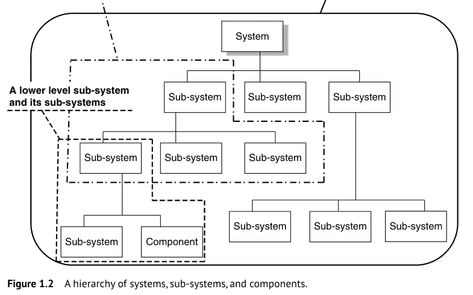
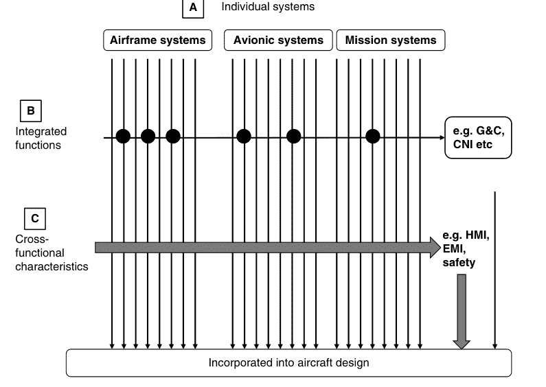
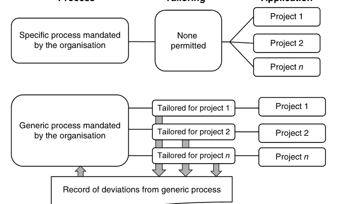
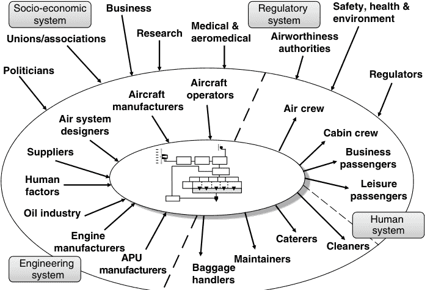
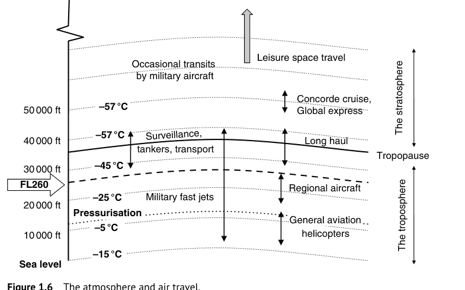
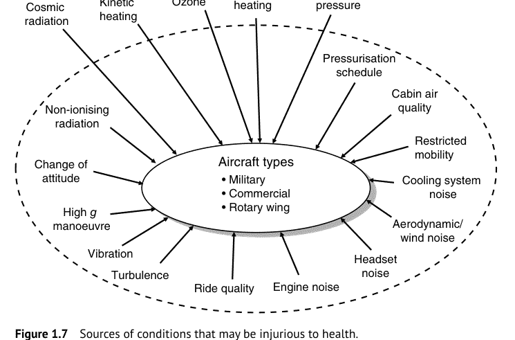
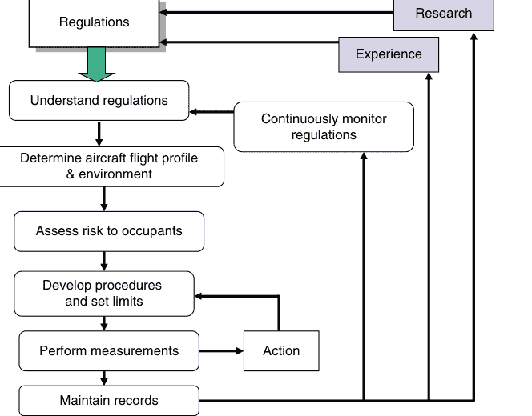

# 1 引言

## 1.1 总论

在航空航天系列的三本配套书籍中——《飞机系统》、《民用航空电子系统》和《军用航空电子学》（Moir and Seabridge 2006, 2008, 2013）——作者描述了军用和商用飞机使用的系统的技术方面，本质上是系统和系统产品的工程。系列中的其他书籍描述了各种系统的技术方面，例如燃油系统（Langton et al. 2009）和显示系统（Jukes 2004）。然而，我们并未深入探讨此类系统是如何设计和开发的，尽管系统开发过程是确保设计一致性、质量和稳健性的一个至关重要的方面。

本书的第一版试图弥补这一遗漏，描述了典型飞机系统的设计和开发过程以及生命周期。自首次出版以来，本书的材料已被用于多门研究生课程和面向航空航天系统工程师的继续专业发展短期课程中，并根据在课程交付过程中收到的提问和讨论，对其进行了改进，以适应工程受众。

第二版沿此思路继续，略微拓宽了其范围，为同一行业中未专门从事工程但需要了解工程师工作方式的人提供主题，例如采购、合同和支持。

第三版的制作旨在继续为学习系统或航空航天相关专业的学生介绍飞机系统和系统开发过程，以及希望进入飞机行业或相关行业的人，以及赞助这些人员的组织。该内容旨在引起以下人群的兴趣：

- 直接参与有人驾驶和无人驾驶固定翼和旋翼飞机设计、开发和制造的组织，无论是军用还是商用
- 系统和设备供应公司，为航空产品制造商提供服务、分系统、设备和组件
- 参与为自身使用或代表商业或军事运营商维修、维护和翻新飞机的组织
- 商业航空公司和武装部队每天运营自有或租赁飞机
- 参与培训飞机工作人员的组织。

本书还面向从事系统工程、航空航天工程或其专业分支（如航空电子学或设备工程）教学的教育机构，面向高中、大学本科或研究生水平。它也适用于旨在为行业专业人士和从业人员提供专业发展的短期课程。

这些就是可以在复杂航空航天项目中广泛的利益相关者中发现的人。图 1.1 给出了航空系统的一个示例，以及受系统影响或直接影响系统的人员和群体。该图已开发用于说明为满足环境考虑而开发飞机解决方案的利益相关者。具体项目将有其自身特定的利益相关者集。

每个利益相关者对设计和开发过程都有不同的视角，并且每个利益相关者都能够对过程施加影响。对于直接参与者来说，确保设计过程对所有各方可见至关重要，以便他们能够协调各自的贡献，使项目受益最大化。清晰且有充分记录的过程对于使利益相关者能够将设计和开发路径可视化为讨论其不同观点的框架至关重要。这可用于划定界限、提出意见分歧，并就技术、商业或法律理解的差异进行仲裁。

值得注意的是，自本书第一版以来，航空航天行业的商业实践发生了重大变化。以前，飞机的开发主要由客户指定的总承包商负责，供应链竞争单个设备和组件。在现代飞机开发中，一级供应商在系统层面竞争，并且在许多情况下，供应商团队在总承包商基地现场工作。在许多国际合作的情况下，这通常意味着在不同国家设有多个总承包商合作伙伴基地。在这种情况下，供应商和总承包商工程团队作为综合产品团队（IPT）共同制定设备和组件规范。系统供应商现在通常负责系统级和组件级性能；在许多情况下，供应商还负责与其系统相关的直接维护成本。这种商业实践的变化要求供应商基础变得“系统智能”，而本书应为商业界有效满足这一需求提供宝贵的见解（Langton et al. 1999）。

所确立的原则同样适用于其他平台，例如水面和水下舰艇、商用海运船舶和陆地车辆。航空航天行业几乎是独一无二的，鉴于飞机的特性，必须解决高完整性、可用性、重量、体积、功耗、成本和性能问题。相互竞争的系统驱动因素的冲突往往使权衡在试图实现满足客户要求和实现经济实惠的产品之间的最佳平衡时变得更加尖锐。商业和军事解决方案之间也存在差异，可能需要对过程和适用的标准进行细微不同的解释。无人飞行器的出现将系统概念扩展到纳入用于远程驾驶飞行器的地面站。对自主无人飞行器的追求将导致设计方法的更多创新，并需要在系统认证方面更加严格。尽管如此，本书中描述的过程应是适用的，尽管需要适当的定制。

尽管文本主要围绕航空平台的示例形成，但读者也可以将其应用于其他高价值系统，例如地面雷达、通信、安全系统、海事和航天器系统，甚至制造或工业应用。

使所有这些平台和系统相似的是，它们都是复杂的、高价值的产品，由许多相互作用的子系统组成，并且旨在由人类操作员使用。它们还具有共同的特点，即具有长的使用寿命，通常超过 25 年，通常具有长期的孕育和开发时间表，并且需要操作员和维护培训以及全寿命期在役支持。如此长的时间尺度要求有一个严格、受控和一致的开发过程，可用于在整个生命周期内保持对平台标准或配置的理解，以便支持维修、维护和更新计划。

## 1.2 系统开发

系统工程领域有很多宝贵的经验可以学习。作者认为，系统工程的许多理论和实践可以应用于飞机上使用的硬件和软件系统的工程。它是一个广泛的实践领域，涵盖了系统在广泛主题中的行为，

包括组织、运营、政治、商业、经济、人类和教育系统。系统和系统工程的概念在许多不同类型的组织中，在不同层面上运作。早期对系统行为的分析大多关注组织或管理问题——即所谓的“软”系统。这项工作使人们理解了复杂组织中沟通、人员、流程和信息流之间的相互作用。（Checkland 1972；Lockett 和 Spear 1983）。

这项工作的一项重要成果是“系统思维”的出现。该术语涵盖了对任何系统的发展或分析采取整体或总系统视角的能力。这项活动的关键在于能够考虑到可能影响系统行为的所有影响或因素。这通过将系统视为存在于一个环境中来实现，该环境中存在对理解系统至关重要的一些因素。在本书中，单一环境的概念被扩展为包含多层或多层环境，使组织中的人员能够采取自己的视角，并审视对他们来说最重要的方面。通过这种方式，可以自上而下地检查系统，并允许诸如政治家、营销人员、会计、工程师以及制造和支持人员等个人批判性地审视和发展他们自己的特定需求（Burge 2019）。

系统的另一个重要特性是它们几乎可以无限地分解为子系统。因此，图1.2展示了一个系统如何被视为一个系统的系统，即多个子系统的组合，在正在检查系统的层面上可能不需要详细定义。该系统的所有者

图1.2 系统、子系统和组件的层次结构。

## 图1.3 集成的一些方面。

各个系统功能的总和。这种功能的一个例子是制导与控制（G&C），它是飞行控制、液压、自动飞行控制和燃油系统功能的集成（详见第6章）。图中还显示了通信、导航和识别（CNI）系统的集成。

图1.3中的C点展示了集成的另一种观点，即作为一种通用纪律，同等地适用于所有系统的设计方面。这方面的例子包括安全性、人机界面（HMI）、电磁健康（EMH）和可维护性。这些纪律通常由总工程师办公室集中管理，它们对各个系统的影响将汇集在一起，形成整个产品的设计说明。

上述系统概念可用于飞机系统工程。它们可用于从理解客户的顶层系统需求出发，开发一种特定类型的飞机以执行特定角色，并且经过多次连续分析或分解，可以导致产品的实现。顶层系统可能与国防需求或运输系统相关，这些需求可以用人员、通信和流程来表达，并最终表示为各种硬件产品的组合。

这样的顶层系统是许多客户认为代表其最高操作需求的系统。系统工程和系统集成的作用是确保由此产生的产品组合能够证明满足整体

从这个顶层提出的需求。顶层设定的需求必须以清晰可追溯和可测试的方式向下流动到产品的最低层级，以便产品的完整性（即用途适宜性）能够向客户以及负责强制国家与国际法规合规性的监管机构展示。

系统思维包含了一个系统开发的过程。这已由Checkland（1972）定义，并基于Hall（1962）定义的方法论。尽管这一方法论年代久远，但其根源在当今使用的许多方法中都能看到。方法论如下：

- 问题定义——本质上是定义需求
- 目标选择——定义物理需求以及必须满足这些需求的价值体系
- 系统综合——创建可能的替代系统
- 系统分析——根据对目标的不同解释来分析假设系统
- 系统选择——选择最有前景的替代方案
- 系统开发——直至原型阶段
- 当前工程——原型阶段之后的系统实现，包括监控、修改和向设计反馈信息。

为了在不同项目之间保持一致，组织通常使用“正式”流程，要么是由行业标准定义的，要么是由他们自己开发的流程。图1.4展示了流程如何在设计和开发环境中部署的两个示例。

图1.4 流程部署示例。

一些组织将强制所有项目都采用某一流程，并且不容忍任何偏差。其他组织则会容忍流程的偏差或“裁剪”，前提是有充分的理由这样做。这些理由包括考虑联合项目中的工业合作伙伴、考虑其客户的偏好，或调整项目以适应项目技术。

本书旨在通过对流程进行总体概述并提供具体示例，展示该流程如何应用于飞机系统。其意图是在日益复杂的世界中促进对系统的整体观。

## 1.3 技能

无论系统工程流程多么完善，只有通过个人和团队技能的应用，以及多学科组织之间的成功互动，它才能取得成功。人是系统的基本要素，无论是在其设计和实施中，还是作为其操作者和用户。在设计、开发和制造一个成功的系统时，需要运用许多技能。认识到对技能和经验的需求，以及对发展和维持技能基础的培训需求，这一点非常重要。这将确保技能不会变得“过时”，并且个人和团队能够不断了解可能促成或促进有效新系统的新技术、新方法、新工具，同时确保维持传统技能以支持使用寿命长的产品。

在特定项目中，组织内的人员或利益相关者将不同于图1.1中所示，而更可能类似于图1.5中所示。

**图1.5** 项目中的典型利益相关者。

图1.6 大气与航空旅行。

他们可能对飞行感到焦虑；许多人可能健康状况不佳，或者因基因构成或近期疾病而容易患上某些疾病。他们呼吸来自飞机发动机的再循环空气，长时间暴露于噪音、振动和运动之中，同时环境也使飞机受到太阳和宇宙辐射。在这种情况下，数百万乘客中有一些人抱怨飞行后感到不适，或者经常飞行的人声称患有某种职业病，也就不足为奇了。

飞机上可能遇到的典型条件如图1.7所示。虚线形状内的条件属于飞机内部环境的一部分，可以加以控制；虚线外的条件存在于环境中，超出了设计人员的控制范围。并非所有这些条件都适用于所有类型的飞机，也并非对不常乘坐飞机的人有显著影响，但它们可能对在工作过程中受到这些条件影响的机组人员产生影响。然而，这些条件值得设计安全系统的系统工程师进行研究，并且应记录这些条件，并确认在设计过程中已对它们进行了考虑。

### 1.4.2 设计考虑

设计不同类型飞机的工程团队旨在满足在严苛环境和操作条件下对性能与后勤支持的客户规格要求。其中许多条件同样作用于机组人员，此外还有因在和平时期大多时间居住和操作复杂军事机器而产生的其他操作条件。商业飞机的机组人员、客舱乘务员和乘客……

图 1.7 可能有害健康的各种条件来源。

飞机同样会经历这些条件的组合，尽管极限程度较低。这些条件单独或组合起来，都可能对机组人员和乘客的身体健康产生影响，这些影响可能立即显现，也可能在长期飞行后才逐渐暴露。在某些情况下，对于从事航空职业的人来说，这些影响甚至可能在飞行生涯结束之后才出现。

优秀的系统工程师需要关注这些影响以及最可能导致这些影响的条件。这将有助于在飞机设计中尽可能纳入一些缓解措施，并且最重要的是确保其产品的用户了解相关风险，以及他们对所雇佣机组人员所负有的关怀义务。同时，组织应开展或支持相关研究，以理解这些问题及其带来的风险。

系统工程师必须确保获得知识和经验，并将其应用于飞机及其系统的工程设计中：

- 了解立法及其对设计和运行的影响
- 了解相关领域的研究
- 了解如何将工程与航空医学或生理学方面相结合。

“关注”一词可能并不完全准确。军用飞机的设计者和制造商对其自己的试飞员以及客户负有责任和关怀义务，以确保产品的长期使用不会对机组人员的健康造成危害。同样，商用飞机的运营商必须对其飞机的使用者负责，因此，对产品使用者既有道德上的关怀义务，也有法律上的关怀义务。商用飞机的运营商对其飞行员、客舱乘务员和乘客同样负有类似的关怀义务。

立法在不断修订，以应对不同的工作场所环境，保护劳动者。负责任的飞机制造商和运营商尽最大努力降低风险，但工作场所立法往往比大型飞机产品的设计生命周期发展得更快，这意味着现役产品与立法之间往往存在差距。

飞机提供了一个动态环境，这是机组人员和客舱乘务员的日常工作环境——“办公室”。这种环境的某些方面特别严苛，尤其是对军用机组人员而言。长期暴露在这些条件下可能导致长期健康损害，除非采取措施降低风险。这可以通过飞机及其环境的设计，或通过控制飞行小时数来实现。

### 1.4.3 立法

立法的存在是为了保护工作场所中的劳动者。这通常被理解为对办公室和工厂工人的保护，他们的工作环境受到良好监管和治理。机组人员的工作场所是飞机的客舱或驾驶舱，这是一个动态环境，较难监管，但同样会影响他们的健康。

英国1974年《工作健康与安全法》概述了一些必须依法满足的一般条件，以保障人们在工作中场所的健康。所有雇员都有法定义务遵守该法案，并证明他们确实遵守了。此外，还有一些法规对工人接触特定健康威胁（如噪声、振动、电离辐射等）进行了规定。所有国家都会有类似的立法。

该法案包含的要求应作为任何飞机设计的指导方针。它将责任置于产品设计者身上，要求他们开展或促进必要的研究，以发现并尽可能合理地消除或最小化设计或产品可能带来的健康或安全风险。此外，在发生任何法律诉讼时，设计者必须证明他们已经采取了必要措施来消除风险，或者没有切实可行或可行的替代方案。

飞机运营商有可能因机组人员声称在工作中使用所制造产品导致健康损害或职业影响而面临诉讼。客户随后可能声称飞机制造商因产品设计的局限性而导致了这种状况。

### 1.4.4 法律威胁概述

如果飞机制造商提供的产品被发现不安全或对操作者有害，则可能适用以下几种潜在制裁：

- 如果能证明制造商违反了相关立法，特别是健康与安全立法以及一系列与安全相关的立法，则可能提起刑事诉讼。飞机制造商将受到的处罚通常是罚款，金额从相对较小到巨额不等。

  还存在因疏忽导致个人死亡而提起企业过失杀人指控的可能性。虽然目前这种情况不太可能发生，但法律变革已被提出，可能导致公司董事入狱。

- 如果个人因使用产品而受伤，并且能证明该伤害是由产品缺陷造成的，则可能提起民事诉讼，飞机制造商将面临被该个人起诉要求赔偿的前景。赔偿金额将取决于伤害的严重程度，但无论如何，如果被认定负有责任，飞机制造商将需要支付所有相关方的法律费用。如果所提供或维护的产品有缺陷，客户也可能对制造商采取法律行动。同样，对此的处罚将是损害赔偿和巨额法律费用。
- 如果飞机制造商因供应本质上不安全并导致用户受到伤害的产品而声名狼藉，客户/公共关系将受到损害；客户购买其产品的可能性降低，从而影响利润和股东价值。
- 制造商需要确保其在所有情况下提供的产品尽可能安全，并不断评估和尽可能降低风险。如果不这样做，可能会产生重大而深远的后果。

### 1.4.5 结论

很明显，飞机上的乘员会受到多种不同现象的影响，如果是受雇操作飞机，则是知情自愿的；如果是付费乘客，则是不知情的。操作者由于飞行频率更高，会长时间暴露于这些现象，而休闲和商务旅客则只是偶尔暴露。同样显而易见的是，一些乘员会同时受到这些现象中的多种影响，即在同一航班中同时经历噪声、振动、过载机动和硬着陆。然而，常见的是研究报告和新闻报道针对单个主题进行讨论。重要的是要着眼于整体系统——机器、人以及各种现象的综合效应。

明智的系统工程师会通过考虑车辆设计的各个方面来尝试解决这个问题。然而，应该指出的是，组织通常将其工程团队划分为不同的职能责任，这使得采取整体观点变得困难。

设计和发布飞机设计并投入使用的公司员工需要意识到其设计对飞机乘员的影响。所有员工都应了解立法，并跟上任何变化。公司应发布程序和流程，确保工程师得到关于在哪里查找标准、如何应用标准以及如何处理任何偏差的指导。应提供培训，以确保工程人员充分了解当代立法。

跟踪和理解立法是所有飞机公司的一项基本任务。直接客户和潜在客户的要求必须纳入设计标准。认证机构和政府机构关于健康和安全的强制性要求也必须被理解。图1.8展示了一个示例。

Figure 1.8 An example process for monitoring and applying legislation.

process for monitoring and applying legislation, and making a contribution to a body of knowledge that can be used for future updates of regulations.

## 1.5 Overview

The intention of this book is to provide a basic understanding of the principles of practical systems engineering, not to justify or recommend specific processes or tools. Examples will be used to illustrate the principles, but it is important to note that there is not one single ‘right’ approach to an engineering process, nor need there be. As long as there is consistency of approach in the partners in a project, and as long as the process works, then that is the correct approach for that project. This understanding will be particularly useful to engineers designing systems or equipment, and will provide essential background information for engineers or technicians using or maintaining the systems.

What this book aspires to do is to create an open-minded approach, so that systems engineers feel comfortable that the process they have chosen will produce a safe and successful result. It will also serve to introduce people to the language, jargon, and terms used in industry.

Exercises have been included at the end of most chapters to encourage readers to develop their reading of the chapter. There are no answers given; in many cases there are no ‘right answers’, but doing the work, alone or in groups, will help to develop the skills of

understanding a system and developing it to a firm solution. Many references and suggestions for further reading have been provided to assist in this process, and the internet serves as a source of further information.

Chapter 2 addresses the general nature of an aircraft system and leads to a definition of such systems in the context of a physical application. Some characteristics of systems and their environments are introduced to encourage the reader to adopt a behavioural skill of broad systems.

Chapter 5 looks briefly at system architectures and block diagrams to give a high-level view of systems design. This high-level view is used to show how simple block architectures can be used to gain an understanding of complex systems and their behaviours. Such simple architectures are used as a stimulus for communication between stakeholders. There is also a discussion of the complexity of modern architectures with functions and data in the system being shared and transmitted by various data bus systems and relayed to the crew on multifunction displays. The levels of complexity being encountered cast some doubt on the reality of exhaustively testing systems and on the understanding of systems status by the crew in major failure conditions.

Chapter 6 addresses systems integration as the discipline of combining systems in terms of functions performed, data produced, data used, systems interactions, and the HMI, leading to the production of a system that is fit for purpose. Integration is a most important topic as there is an increasing trend towards ‘tighter’ integration, especially as technology offers greater computing and storage power. There is a risk that the introduction of non-deterministic techniques in software languages and in data bus scheduling may lead to non-linear systems tending to behaviours that are unexpected and maybe even chaotic.

Chapter 7 describes methods of modelling used in the product lifecycle. Modelling a system is a quantitative description of the behaviour of a system to predict performance over a range of operating conditions at all phases of the lifecycle. At little cost modelling enables the system to be analysed under differing conditions that would be extremely time-consuming, sometimes impossible, to emulate in hardware. Modelling is used in various ways throughout the product lifecycle to perform trade-offs of different solutions. It is a

quick and effective way of examining complex solutions before committing to design. Models can also be used to examine system performance for prediction and qualification, providing evidence to support qualification of the product long before the functional product is available.

Chapter 8 introduces some practical considerations based on experience in the industry in the areas of communication and criticism, both essential aspects of the open-minded systems approach. The considerations are not simply technical, but also address people and communication issues on the basis that complex projects undertaken by complex organisations demand clear and unambiguous communications in order to be successful.

Chapter 9 outlines the issues associated with the subject of configuration control and shows how the key system attributes must be maintained in a compatible manner. In this way forward and backward compatibility may be maintained between successive system or product development iterations, easing development and support costs. This control is essential in a product where many sub-systems will develop at different rates and it is inevitable that differing design standards will co-exist in the lifecycle. Also included is a discussion on control of information in the information age where ownership of multiple devices and access to many ways of creating and exchanging information may compromise information integrity.

Chapter 10 addresses an example of aircraft systems, showing how key aircraft systems all contribute to the total aircraft functionality and also interact with one another. Specific system examples are given.

Chapter 11 examines some issues of integration and complexity, and their potential impact on flight safety. Developments leading to increased integration, automation, and complexity in modern aircraft are described followed by a study of literature and reports of some unexplained events that may be due to complexity in modern systems. The issue of complexity in modern architectures that leads to decreasing visibility of design and functional performance and the difficulty, maybe of impossibility, of exhaustive testing of complex systems are discussed. A view is taken of the potential impact of all this on flight safety. Finally, the chapter looks at the possibility of complex systems integrated with an expanding air transport management system and with aircraft systems remaining powered up continuously for many days, which may lead to chaotic behaviour.

Chapter 12 presents the key characteristics of all aircraft systems in an abbreviated tabular form. The intention is to provide a brief summary of what each system is and to provide references to source material for further detailed descriptions.

A section provides a short process to assist engineers who need to examine their system further for the purpose of quantifying aspects of mass, power demand, dissipation, and fuel penalties. The tables contain an entry to enable students to identify the key components that need to be considered to do this. This is often done to provide a model of individual systems, or even a whole project, to enable trade-off studies to be conducted to evaluate different proposals.

Chapter 13 summarises the content of the book and provides a table of the systems covered in the book along with key integration and interfacing aspects. Also included are references to textbooks providing more detailed system descriptions. Each systems description in the tables contains information to enable students to ‘size’ a system for project work, for which typical parameters are mass, power demand, dissipation, and installation factors.

## Exercises

- 1. Re-draw Figure 1.1 from the perspective of your own sector of the aviation system. Now take a personal view of the stakeholders and identify them by name to form a personal contact list for your sector.
- 2. Carry out this process using Figure 1.5 and apply it to the project on which you work.
- 3. Consider Figure 1.3. From your own experience can you think of an example of a project composed of a number of technical strands in the line management that would benefit from a cross-functional or integrating viewpoint? What benefits would result from this?

## References

Burge, S. (2019). *Tutorial on How to ‘Systems Think’* INCOSE. www.incoseuk.org.uk. [Accessed March 2019].
Checkland, P.B. (1972). Towards a systems based methodology for real world problem solving. *Journal of Systems Engineering* 3: 87–116.
Frank, M. (2000). Cognitive and personality characteristics of successful systems engineers. INCOSE 10th International Symposium.
Goodlass, Sue and Seabridge, Allan. (2003). Engineering tomorrow’s systems engineers today. INCOSE 13th International Symposium
Hall, A.D. (1962). *A Methodology for Systems Engineering*. Van Nostrand.
Jukes, M. (2004). *Aircraft Display Systems*. Wiley.
Langton, R., Clark, C., Hewitt, M., and Richards, L. (2009). *Aircraft Fuel Systems*. Wiley.
Langton, R., Jones, G., O’Connor, S., and DiBella, P. (1999). Collaborative methods applied to the development and certification of complex aircraft systems. INCOSE Symposium, Brighton, UK.
Lockett, M. and Spear, R. (eds.) (1983). *Organisations and Systems*. Open University Press.
Moir, I. and Seabridge, A. (2006). *Military Avionic Systems*. Wiley.
Moir, I. and Seabridge, A. (2008). *Aircraft Systems*, 3e. Wiley.
Moir, I. and Seabridge, A. (2013). *Civil Avionic Systems*, 2e. Wiley.

## Further Reading

Ackoff, R.L. (1977). Towards a system of system concepts. In: *Systems Behaviour* (eds. J. Beishon and G. Peters). Open University Press.
Buede, D.M. (2009). *The Engineering Design of Systems: Models and Methods*. Wiley.
Jenkins, G.M. (1977). The Systems Approach. In: *Systems Behaviour* (eds. J. Beishon and G. Peters). Open University Press.
Longworth, J.H. (2005). *Triplane to Typhoon*. Lancashire County Council.
Maier, M.W. and Rechtin, E. (2002). *The Art of Systems Architecting*, 3e. CRC Press.
Mynott, C. (2012). *Lean Product Development*. IET.

