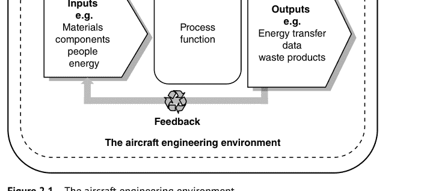
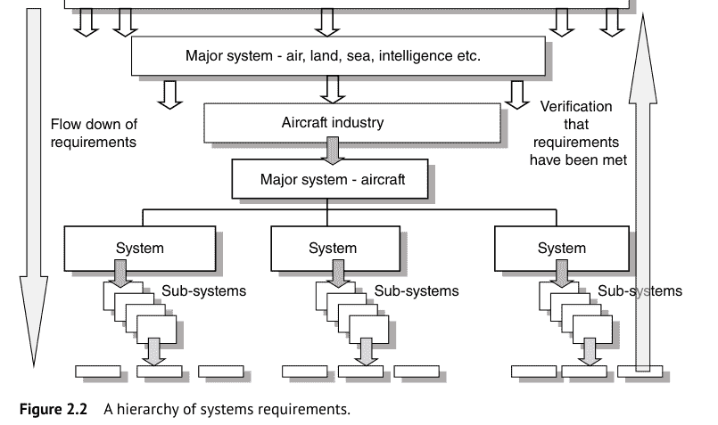
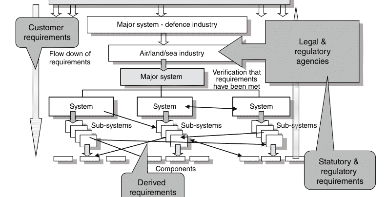
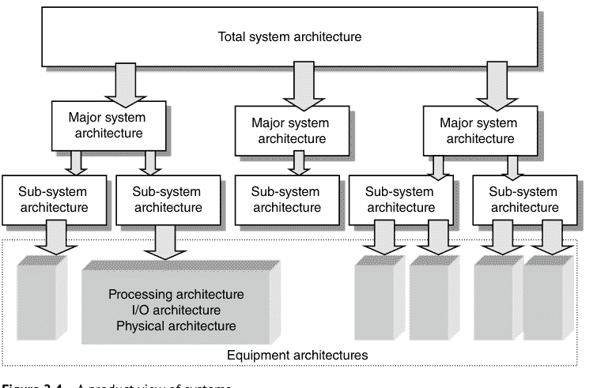
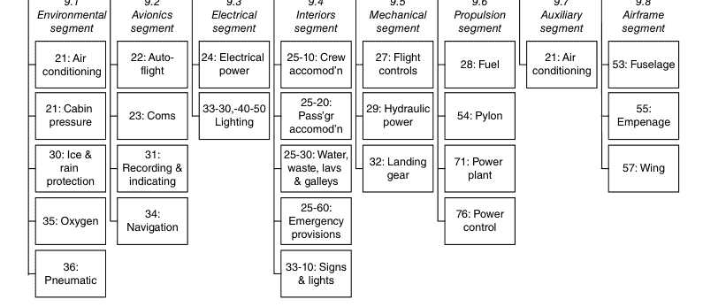
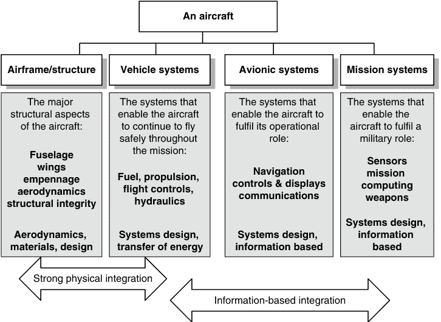
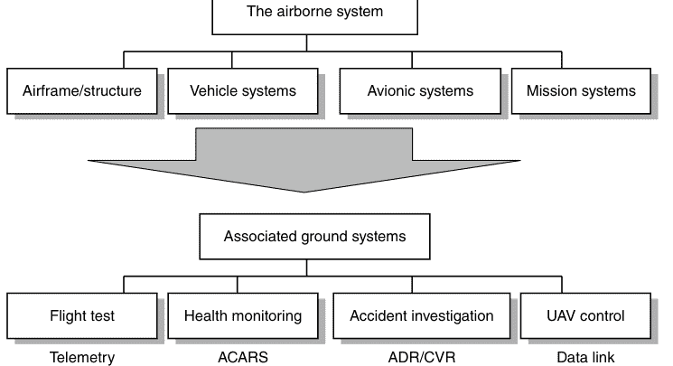
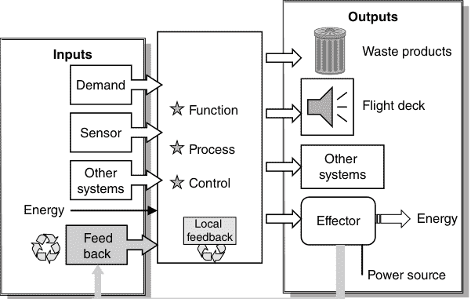
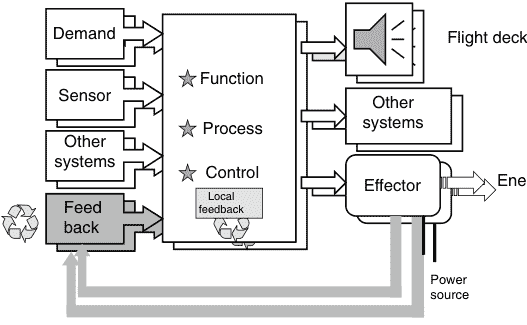

# 2 飞机系统

## 2.1 简介

典型的飞机配备了一组相互作用的系统，这些系统结合在一起，使飞机能够执行特定角色或一组角色。提供主动力和能源的系统已由作者详细描述（Moir 和 Seabridge 2008），使飞机能够在受控空域安全运行的航空电子系统（Moir 和 Seabridge 2013）以及使军用飞机能够执行其角色的军用航空电子系统或任务系统（Moir 和 Seabridge 2006）也已详细描述。每个系统都有其自身的特定设计要求，以及自身的约束和设计驱动因素；有些系统独立存在，其他系统则与一个或多个系统集成。它们都必须结合起来，为完整的飞机提供执行其角色的能力。

飞机的系统还必须设计以满足严格的设计目标，如低质量、低功耗、高性能、高精度、高完整性、高可用性和低成本，并必须满足严格的安全目标。其中一些目标是相互冲突的；所有目标都难以实现。除了基本目标之外，还有一些“设计驱动因素”，将在第 4 章中描述。本章将简要描述系统的特征，以说明系统实现和设计考虑的多样性。

## 2.2 定义

“系统”一词在许多组织中使用：政治、学术、商业、教育、工业、军事和技术。它经常出现在日常用语中，每个用户可能心中都有对该术语的特定理解。在本书中，“系”一词适用于各种组件和控制单元的组合，这些组合在飞机运行中执行有用功能，通常涉及人机交互。

工程和技术界有许多系统的定义。词典定义（Collins Dictionary and Thesaurus）如下：具有相互依赖功能的电子、电气或机械部件的组装，通常形成一个自包含单元。

MIL-HDBK-338B 电子可靠性设计手册（美国国防部 1998）使用更广泛、更明确的定义：能够执行或支持操作角色的设备、技能和技术的复合体。完整系统包括其运行和支持所需的所有设备、相关设施、材料、软件、服务和人员，以至于可以被认为在其预期的操作环境中是自给自足的。

该定义引入了人员及其技能作为系统不可分割的一部分。人员参与系统，既在原始需求的定义中，也作为系统在其整个服务生命周期中的用户。该定义还包括作为系统一部分或作为整个系统提供的设施和服务。这些元素的总体通常被概括为交付和运行系统的“能力”，许多组织使用此术语。

开放大学长期使用另一种定义（Jenkins 1977）：

- 系统是以有组织的方式连接在一起的部件、组件、过程或功能的组装。
- 部件、组件、过程或功能执行某项操作。
- 部件、组件、过程或功能受到在系统中存在的影响，如果离开系统就会发生变化，即整体大于部分之和。
- 特定的组装已被识别为具有特殊兴趣。

在此定义中，协同效应的概念很重要——系统由相互依赖的元素组成，这些元素结合形成有用的功能整体。

作者和机构使用许多其他定义，同样有助于展示特定观点或提供解释。它们在各自的上下文中都同样有效，不需要教条式地应用定义。这些定义的关键点的综合显示在图 2.1 中作为图示摘要，将作为本书其余部分系统的通用形式。本章稍后将开发此通用形式，以说明典型飞机系统的通用模型，这将作为进一步解释飞机系统和系统工程过程的基础。

图 2.1 飞机工程环境。

图 2.1 显示了飞机系统工程环境，其中包含本章描述的系统，这些系统位于航空系统环境（在第 1 章中描述）之内，该环境来自所有利益相关者对系统设计的影响。该环境对于不同项目会有所不同。理想情况下，应在项目开始时充分识别和开发此环境，以确定关键利益相关者及其对整个系统和各个子系统的影响。理想情况下，应根据航空系统利益相关者的重要性及其对系统设计的影响对其进行优先级排序。

## 2.3 日常系统示例

“系统”一词在日常言谈中常被人们松散地用来描述庞大的无定形“事物”或公司。这些是难以简单描述的复杂事物。示例包括：

- 自然系统，如生态系统或太阳系
- 国民保健服务
- 建筑和建设行业
- 集成运输系统
- 制造系统
- 公用事业。

航空环境中可以看到类似的国家和国际组织系统，它们对项目设计施加影响和压力。它们包括：

- 监管系统
- 航空交通管理（ATM）
- 航空交通管制
- 国际飞机公司，如空客和国际航空发动机公司，它们供应 V2500 发动机，这些公司是国际财团，其工程、制造和支持活动整合了全球范围内的一组供应商
- 飞机系统集成：A380 飞机起落架系统的集成要求空客（英国）管理来自欧洲和美国多个不同国家的多个工程供应商的工程工作。

这些示例中的大多数之所以存在，是因为它们经过多年演变，而不是作为系统设计和开发的。尽管如此，今天其中大多数可以被视为具有系统的经典属性，即输入、过程或功能、输出和控制反馈。

公用事业等系统，例如电力、燃气和水、电信、邮政服务和运输，具有高度可见的公共方面，其背后是庞大的基础设施。例如，家用和工业设备连接的电源插座背后是一个包括以下内容的结构：

- 从原材料能源来源产生电力——石油、天然气、煤炭或水力发电
- 向用户分配和变换电力
- 原材料的订购、使用和处置
- 消费者计量和账单
- 设备制造
- 高街设备展厅和销售点
- 就业
- 健康与安全以及环境问题
- 维修和保养
- 研发
- 销售和营销
- 公共关系
- 法律服务。

此列表大致说明了表征大型系统的功能的复杂性和多样性。

上述列出的大多数系统是组织的示例，可以在顶层可视化为由人员和流程主导的子系统集合。如果详细检查组织，连续的子系统层次会变得可见，变得更加机械化，包括人们用来完成工作的机器和硬件组件。在一些组织的较低层次，事物被设计和制造为产品或组件。原材料和能源被转换为有用的输出。正是在这个层次，机动车辆和飞机作为熟悉的基于系统的产品出现。

以这种方式看待系统，产生了系统作为子系统层次结构的观点。在层次结构的每个层次，都有符合系统一般特征并受到与顶层组织相同压力的子系统，但它们也可以被视为在其自身权利上是自主的。

在图 2.2 中，军用飞机被视为一组复杂的相互作用系统——一个由系统、子系统和组件组成的高度复杂产品。然而，它只是生产它的飞机工业组织产出的一小部分——这还包括商用飞机、轻型飞机和旋翼飞机。在层次结构的顶部是保卫国家的系统，包括政府、所有武装部队、征召兵、监管者、规划者等。

为保卫国家所需的操作场景中出现的要求必须流转到所有产品，以确保支持它们的全部武器和后勤到位。在图 2.2 中，主要系统可以是空、陆、海或情报系统；在此特定示例中，已开发空系统。验证这些要求是否已满足是流转上去并与原始要求进行比较。如果在任何点不匹配，则必须采取纠正措施或承认有效性的局限性，换句话说，系统不会执行预期的操作，但可以做一些事情来实现接近预期结果的结果。

图 2.2 系统需求的层级结构。

图 2.3 系统需求层级的扩展视图。

这种需求的逐级分解可以进一步扩展，以显示它们不一定必须源自客户需求，如图 2.3 所示。

来自标准和直接来自监管机构的监管要求是一个关键输入。这些监管输入可能由飞行安全、健康和安全决定

图 2.4 系统的产品视图

或由满足环境立法的需要决定。这些要求通常由国际机构制定，并通过航空监管机构强制执行。图中一个最重要的方面，对系统设计有强烈影响，是由派生需求所示。这些需求随着各个系统的开发以及系统之间关系开始显现为接口、功能共享和物理相互作用而产生。工程师需要具备很强的技能来识别、定义和记录这些需求。这是在航空航天组织中进行的大部分设计工作，其结果是产品的设计数据集。

由此产生的产品视图如图 2.4 所示，其中整体系统架构由若干个单独的子系统和子子系统组成，并辅以组件。最上层系统级别描述的架构原则必须遵守。

## 2.4 感兴趣的飞机系统

空中运输协会（ATA）章节编号系统多年来一直被用于为所有民用飞机提供通用的参考系统。该系统由 ATA 控制并发布，ATA 是一个总部位于美国、已有 75 多年历史的航空公司协会，负责协调美国空中运输系统的要求。该组织最近已更名为 Airlines for America（A4A），尽管其章程基本保持不变。该组织的关键支柱是安全、工程和维护，以及飞行运行和空中交通管理。

ATA 章节系统提供了一个统一的参考系统，使得飞机系统无论机型如何都共享通用标识符，例如第 24 章代表飞机电气系统，无论飞机是 B747 还是小型公务喷气机。对于空中运输工程界而言，该参考系统为飞机技术文件和维护手册提供了一个一致的框架。

ATA 参考系统的简化版本如图 2.5 所示。经典的“航电”系统，如自动飞行、通信、记录和指示（显示）以及导航显示在 9.2 段。现代空中运输飞机的高度集成性意味着一些或许多 ATA 章节功能可能相互作用以提供顶层飞机功能。典型飞机在我们今天的天空中运行所需的任务管理功能的集成水平示例在第 10 章第 10.6 节中给出。

ATA 100 系统一直使用到 2000 年初，但现在已被联合飞机系统/组件（JASC）四位数字代码（FAA 2002）取代。该系统与 ATA 提供类似作用，但现在是现代飞机普遍使用的系统。对于使用老旧飞机和文件系统的用户，ATA 参考系统已在本版中保留。

上面描述的许多系统实际上是子系统的集合，它们组合起来作为一个单一系统发挥作用。每个单独的子系统将以不同的方式设计和实现以执行其功能，尽管主系统组织可能为设计制定一些总体规则。

现代飞机本身就是一个系统。现代军用飞机是为特定角色设计的相互依赖的子系统集合。现代民用飞机同样是

图 2.5 ATA 参考系统的简化表示。现在已被 FAA JASC 代码取代（FAA 2002）。

子系统集合，其中许多在运行原理上与军用飞机相同，尽管有些有显著不同。这些子系统被设计为执行特定的单独任务，并组合起来形成整架飞机，其中单个系统的组合明显发挥的作用大于各部分之和。换句话说，子系统以协同的方式发挥作用。

所有子系统都可以被泛化地考虑，本书的其余部分将尝试这样做，同时指出两种类型飞机之间的任何差异。

图 2.6 显示了飞机作为一组子系统，这些子系统常见于大多数商用和军用机型。这些子系统映射到许多工程师受教育或在其职业生涯中发展的领域。许多总承包商或飞机制造商组织也是以这种方式构建的。

子系统显示出一些有趣的集成特性，必须在整体系统设计中予以考虑。车辆系统与机身或结构表现出非常强的物理相互作用。这是因为推进和燃油等系统在很大程度上是结构的一部分。在商用飞机中，发动机通常安装在悬挂于机翼的舱体内，推力载荷必须在机翼设计中予以考虑；在军用高速喷气机中，发动机及其进气道和喷气管道必须纳入结构中。燃油系统油箱也同样纳入结构中，尤其是在机翼油箱中。许多车辆系统产生的热量和载荷会传递到结构中。这种相互作用的一个例子如图 2.7 所示，并随后进行解释。

这种系统之间显著相互作用的例子展示了各个系统如何协同工作以将废热从飞机中排出。当流体被压缩时以及能量转换过程并非完全有效时就会产生热量。图 2.7 描述了多个主要系统的相互作用，这次是在民用飞机的背景下。图表说明了如何在一系列系统中总共八个热交换器使用飞机燃油和环境冲压空气作为热沉，将废热排放到其中。从发动机开始，过程如下：

- 1) 从发动机风扇机匣抽取的空气用于冷却从中压或高压压气机抽取的引气（取决于发动机类型）。
- 2) 空气用于在初级油冷却器热交换器中冷却发动机油。
- 3) 燃油用于在次级油冷却器热交换器中冷却发动机油。
- 4) 电气集成驱动发电机（IDG）油由空气冷却。
- 5) 液压回路流体在返回油箱前由燃油冷却。
- 6) 飞机燃油由空气/燃油热交换器冷却。
- 7) 冲压空气用于空调组件内的初级热交换器，在进入次级热交换器之前冷却进入的引气。
- 8) 次级热交换器进一步将空气冷却至适合与暖空气混合后输送到客舱的温度。

航电和任务系统主要基于信息结构，虽然对安装和低阻力有要求，但大部分集成基于数据总线网络。

这些系统和子系统可以进一步分解为如下所述的各个子子系统。

### 2.4.1 机身系统

机身可以被视为一个系统，因为它是一组复杂且集成的结构部件，支撑着系统和乘客的质量，并在整个结构中承载载荷和应力。机身被设计和构建为一组子系统，这些子系统集成形成整体结构。本书不会进一步描述机身，而将集中于飞机的其余系统，这些系统使机身能够执行其角色。

### 2.4.2 车辆系统

飞机车辆系统也称为通用系统或实用系统。许多这些系统同时存在于民用和军用飞机中；它们是具有非常不同特性的系统混合体。有些是高速、闭环、高完整性控制，如飞行控制；其他是实时数据采集和处理，具有一些过程控制功能，如燃油系统。还有一些是简单的逻辑处理，如起落架序列。

它们的共同点是它们都以某种方式影响飞行安全——换句话说，操作不正确可能会严重危及飞机、机组人员或乘客。

许多这些系统的功能由软件控制单元执行，要么是单独的单元，要么是集成处理系统，如车辆系统管理系统。这意味着软件必须设计到适当的稳健性水平。下面的列表提供了每个车辆系统主要用途的总结。

- *推进系统*：通过飞行员需求以及电子和液力机械燃油控制提供主要推力和动力源。该系统提供飞行所需的推力和能量，并为电气、液压和气动系统的产生提供动力。
- *燃油系统*：为推进系统提供能量来源，由油箱、数量测量系统、泵、阀门、单向阀和管道组成，用于将燃油从油箱转移到油箱并输送到发动机。燃油系统还用于重心控制，并且由于其在热交换器中的使用，是其他系统热能的接收者。
- *电气功率产生和分配系统*：从发动机连接的发电机和电池产生交流电和直流电，并将电力分配给所有连接设备，同时保护电气母线和电气线束免受连接故障的影响。
- *液压功率产生和分配系统*：从发动机驱动泵产生液压动力，并将液压动力分配给所有连接系统。

液压供应必须在所有需求工况下无脉动且压力恒定，由清洁液压油提供，并加以监测以检测和隔离泄漏。系统中耗散的大部分热量将通过燃油冷却式滑油冷却热交换器传入燃油系统。

- *辅助动力系统：*为地面上的飞机提供电力、液压和冷却动力源，并提供一种启动发动机的能量形式。
- *应急发电系统：*提供能量，以便在重大电力丧失时使飞机得以安全恢复。
- *飞行控制系统：*将飞行员指令或引导系统的指令转换为操纵面运动，以控制飞机姿态。
- *起落架系统：*确保飞机在所有载荷下并能在指定跑道道面上安全着陆。这包括所有相关舱门以及支柱和机轮组件的顺序收放，以将各组件收入起落架舱内。
- *刹车/防滑系统：*在多种着陆速度和载荷下提供安全的刹车方式，且不丧失附着力。
- *转向系统：*提供一种在飞机自身动力下或被牵引时进行转向的途径。
- *环境控制系统：*提供温度和湿度适当的空气，以确保机组、乘客和航空电子设备处于安全舒适的环境中。
- *防火系统：*监测所有存在火灾、烟雾或过热潜在危险的舱位，以警告机组并提供灭火手段。
- *防冰系统：*监测外部环境条件，以探测结冰状况并防止冰的形成或除冰。
- *外部照明系统：*确保飞机对其他运行方可见，并确保地面移动期间跑道/滑行道的可见性。
- *探头加温系统：*确保飞机外蒙皮上的空速管、静压、姿态和温度探头保持无冰。
- *飞行器系统管理系统：*提供集成处理和通信系统，用于连接系统组件、执行内建测试、执行控制功能、向执行机构和效应器提供功率需求，并与驾驶舱显示器通信。

军用飞机还需要以下系统：

- *机组逃生系统：*为机组人员提供辅助逃生手段。
- *座舱盖抛放或碎裂系统：*提供将座舱盖从飞机上移离或碎裂座舱盖材料的手段，为逃生的机组人员提供出口。
- *生物和化学防护系统：*保护机组免受化学或生物污染的有毒影响。
- *拦阻装置：*提供在航母甲板上或跑道尽头使飞机停住的手段。
- *空中加油系统：*允许飞机从加油机获取燃油。
- *直升机甲板锁系系统：*将直升机固定到航母甲板上。

商用飞机和大型军用飞机还需要以下专供其使用的系统：

- *厨房系统：*允许为乘客准备和烹饪餐食。
- *乘客撤离系统：*允许乘客安全撤离。
- *娱乐系统：*为乘客提供视听娱乐。
- *电信系统：*允许乘客在飞行中打电话和发送电子邮件。
- *卫生间和废水系统：*提供卫生间和废水的卫生管理。
- *气态氧气系统：*供乘客在失压情况下使用。
- *客舱和应急照明系统：*为客舱和厨房提供一般照明、阅读灯、出口照明和应急灯，以提供通往出口的视觉路径。

### 2.4.3 飞行器系统的接口特性

为了控制这些系统，接口的设计必须满足各种各样的传感器和执行机构类型。下面列出的输入示例在类型、范围、源阻抗和转换速率方面具有多样性：

*输入示例*

| 输入类型 | 接口类型 |
|---|---|
| 继电器或开关 | 离散 28 或 0 V |
| 燃油量探头 | 电容 |
| 燃油密度 | 燃油特性传感器 |
| 燃油特性 | 介电常数传感器 |
| 转速 | 脉冲探头（转速表） |
| 线性位置 | 线性可变差动变压器 |
| 旋转位置 | 轴编码器、旋转可变差动变压器、自整角机 |
| 执行机构位置 | 电位计或可变差动变压器 |
| 温度 | 热敏电阻或铂电阻 |
| 压力 | 气压或压电 |
| 电流（交流） | 电流互感器 |
| 电流（直流） | 霍尔效应传感器 |
| 液位感测 | 热敏电阻 |
| 接近 | 接近开关传感器 |

*输出示例*

| 输出类型 | 接口类型 |
|---|---|
| 阀门指令 | 28 或 0 V 离散 |
| 直流电机 | 直流功率驱动 |
| 执行机构驱动 | 低压模拟 |
| 执行机构伺服 | 低电流伺服驱动 |
| 燃油泵 | 大电流驱动 |
| 警告灯 | 灯丝负载或LED |
| 大功率负载 | 电气接触器（高达400安/相） |

输入和输出示例的差异很大。飞行器系统和航空电子系统所执行任务的不同导致了相当大的变化，如下所述。

#### 2.4.5.1 飞行器系统

飞行器系统具有以下特性：

- 非数据密集型——信号类型多样且繁多
- 通常数据速率和迭代速率较低（有些例外）
- 数据分辨率较低——通常为8位，偶尔为12位分辨率
- 内存和吞吐量较低
- 按需显示密集
- 物理上高度输入/输出（I/O）密集且布线密集

#### 2.4.5.2 航空电子系统

航空电子系统具有以下属性：

- 数据和信息密集
- 数据速率和迭代速率高
- 通常采用32位浮点算术运算
- 内存和吞吐量要求高
- 显示密集
- 物理I/O不密集——I/O布线极少

### 2.4.6 任务系统

军用飞机需要一系列传感器和计算能力，以使机组能够执行指定任务。任务系统从有源和无源传感器获取有关外部世界的信息，并处理这些信息以形成情报。机组人员利用这些情报做出可能涉及攻击的决策，有时会与地面远程分析师协同。因此，这些决策可能导致武器或防御辅助装置的投放，这一动作需要一套特定的安全和完整性设计考虑：

- *攻击或监视雷达：*提供有关敌我目标的信息。
- *光电传感器：*提供对目标的被动监视。
- *电子支援措施（ESM）：*一种被动系统，提供敌方发射机的辐射源信息、距离和方位。
- *磁异探测器（MAD）：*在攻击前确认海面下存在大型金属物体（潜艇）。
- *声学传感器：*提供探测和跟踪水下物体通过的手段。
- *任务计算：*整理传感器信息，并向驾驶舱或任务机组工作站提供融合数据图像。
- *防御辅助装置：*提供探测导弹攻击和部署对抗措施的手段。
- *武器系统：*在飞机武器站上完成武器的挂载、导引和投放。
- *通信：*使用各种不同的视距、高频或卫星通信系统。
- *编队保持：*提供在禁止使用编队保持灯的条件下安全保持编队的方式。
- *电子战系统：*探测和识别敌方辐射源，收集和记录通信，并在必要时提供干扰传输的手段。
- *摄像机：*记录武器效果，并为情报目的提供地面的高分辨率图像。
- *平视显示器：*为机组提供主要飞机信息和武器瞄准信息。
- *头盔显示器：*为机组提供主要飞行信息和武器信息，同时允许头部自由活动。
- *数据链：*在安全通信下使用数据而非语音提供消息的发送和接收。

### 2.4.7 任务系统的接口特性

除了前文概述的数字数据技术的广泛使用外，任务系统还利用各种电子传感器，覆盖电磁频谱多达十个数量级，范围从100 kHz（1×10⁵ Hz）到1000 THz（1×10¹⁵ Hz）。这涵盖了通信、雷达和光电（EO）设备运行的电磁频谱区域。这是一个高度复杂的主题，读者可参阅Moir和Seabridge（2006）所著的*《军用航空电子系统》*一书以获取更多信息。

## 2.5 地面系统

重要的是要认识到，机载系统将与一组地面系统交互，如图2.8所示。

- *飞行试验：*在飞机研制的试验阶段，需要从飞机系统收集信息用于地面分析。分析结果告知系统设计者其系统设计是否得到验证，并将用作安全且正确运行的证据的一部分。数据通过直接连接系统线路或从飞机数据总线网络收集。数据存储在可移动数据介质中，以便飞行后取出，或通过遥测传输到地面站。
- *健康监测：*通常对机体、发动机和飞机系统的健康状态进行连续监测，以记录可观察到的故障，但更常见的是收集数据以识别性能退化趋势，从而可以就设备更换做出更明智的决策。现有系统用于收集机载数据并将其转发到地面设施，例如发动机健康监测、结构健康和使用监测系统；许多类型飞机上还装有预测/诊断系统。数据通过数据链和飞机通信寻址与报告系统（ACARS）传送到地面。
- *事故调查：*持续从与飞机系统的直接连接以及飞机数据总线网络收集数据，以协助确定事故原因。这些数据通常存储在事故数据记录器中，该记录器设计用于

图2.8 机载与地面系统的集成。ACARS，即ARINC通信与报告系统；ADR/CVR，即事故数据记录器/驾驶舱话音记录器。

以承受坠毁、火灾和海水浸泡的严酷考验。系统数据辅以驾驶舱话音记录和视频记录。

- 无人机（UAV）控制：无人机系统用于收集信息和执行军事行动，通常在人类指挥结构的控制下进行。即使此类飞行器获得了更多自主性，仍然需要在地面收集信息以供分析，并将指令发送给飞行器。这将要求飞行器在设计中具备遥测能力，并提供下载信息和上传指令的通信路径。

## 2.6 通用系统定义

飞机将根据其特定任务，装备上述系统的各种组合。有些系统是飞机的组成部分，另一些则作为任务设备装载在货盘或翼下吊舱中。这些工程系统大多在形式上相似。图2.9给出了一个通用飞机系统，以说明任何系统的主要属性。

- 输入由以下各项的组合构成：
  - 需求（或指令）是向系统发出的有意识输入，要求系统作出明确的响应。需求可能来自操作员，也可能来自另一个系统。通常，需求是操作员移动选择机构（如油门杆、开关、驾驶杆、方向盘或舵柄）的结果。现代技术已允许通过直接语音输入（DVI）或光标控制装置（如鼠标或轨迹球）获得需求。对于无人机或遥控飞机，需求将通过数据链路由地面设施发出。

图2.9 通用飞机系统框图。

- 提供传感器输入以改变系统行为，或提供信息以执行功能或过程。通常，这些数据来自传感器或测量装置，它们以模拟或数字形式监测系统性能或环境参数，如速度、角位移或旋转位移、变化率、压力、温度等。
- 其他系统可能根据所需执行的功能或过程的要求提供信息。这些数据可以以模拟、离散或数字格式提供。
- 反馈来自输出装置中的测量装置或传感器，以便出于输出稳定性的原因进行控制。
- 提供能源以使系统运行。这通常采用来自电源的交流电或直流电形式。系统通常需要对此进行调节，以确保电压正确且无瞬变或噪声，从而保证正确运行。
- 一个必要的处理过程或功能，可以通过智力、物理、机械、电气、电子、流体或软件驱动的方式实现。该过程可以由人员或自然或生物事件执行，也可以由机器执行，或由人和机器组合执行。后一种组合是航空航天和工业系统中最常见的，其中包含大量人机界面挑战。

- **输出**由以下各项的组合构成：
  - 执行器是将电能转换为运动（旋转、直线或角运动）的装置，通常借助另一种介质，如液压油或高压空气，尽管高压电气设备正变得越来越普遍。这些执行器通常称为作动器，并通过机构驱动飞行操纵面、舱门、起落架、制动卡钳等表面。

- 其他系统可能需要数据或指令作为输入以完成其过程。这些数据可以是模拟、离散或数字格式。
- 驾驶舱指示和警告使机组人员能够了解系统运行的正确与错误。
- 系统因能量转换或系统运行而产生废弃物。典型的废弃物包括声学噪声、电噪声或干扰、热量或振动。所有这些废弃物都可能对其他系统产生不利影响，或者成为其他系统存在的原因。例如，系统排出的热量需要由另一个系统（通常是冷却系统）转移并耗散。如果在设计阶段未仔细考虑废弃物，它们可能严重影响飞行器的性能。热能也可以被利用，通过将其转化为电能的装置加以利用。
- 反馈用于使系统确定其输出指令已在所需时间尺度内达到期望状态，并且该期望状态是稳定的。反馈作为系统的一个输入出现，来自监测系统输出的测量装置。
- 外部世界和其他系统会对系统及其组件施加外部影响。必须清楚了解这些影响，并在设计阶段考虑它们对系统设计及其性能的影响。

有些因素影响着图2.5所示的通用模型，使其在某些系统实现中并不理想。安全性、完整性、可用性、任务成功率和客户感知是影响系统设计的因素。考虑这些因素可能导致引入传感器、控制过程和输出设备的冗余，以便在保持一定程度安全运行的同时容忍故障。基本控制机制的完整性必须贯穿整个系统，包括电源和为机组提供信息。换句话说，系统必须自始至终都安全。图2.10给出了一个冗余示例，显示了一个双余度系统。

在此示例中，所有输入、功能和输出都是重复的，并被仔细分离，以避免故障或失效从一个系统传播到另一个系统，这种故障称为共模故障。这一理念可以扩展到更多级别的多重冗余；三余度和四余度在高完整性系统设计中很常见。

第10章将说明，飞机包含许多具有不同冗余程度的系统，这些系统共同为实现整个产品所需的完整性和可用性目标做出贡献。

## 练习

- 1. 搜索更多关于“系统”的定义。选择你认为与自身工作或学习最相关的定义并采用之。
- 2. 与同事讨论你的选择，看看它与他们的理解有何不同。如果存在差异，尝试理解这种差异是否重要。
- 3. 检查系统和输入/输出设备的列表。这些列表是否完整？未来可能会出现哪些可能影响系统设计的替代方案？

## 参考文献

FAA (2002). *FAA联合飞机系统/部件代码表及定义.* 2002年2月版. Google JASC Codes PDF [访问日期：2019年3月].

Jenkins, G.M. (1977). 系统方法. 载于：《系统行为》（J. Beishon 和 G. Peters 编）. 米尔顿凯恩斯：开放大学出版社.

Moir, I. 和 Seabridge, A. (2006). 《军用航空电子系统》. Wiley.

Moir, I. 和 Seabridge, A. (2008). 《飞机系统》（第3版）. Wiley.

Moir, I. 和 Seabridge, A. (2013). 《民用航空电子系统》（第2版）. Wiley.

美国国防部 (1998). 《电子可靠性设计手册》. MIL-HBK-338B. 美国国防部.

## 扩展阅读

Jukes, M. (2003). 《飞机显示系统》. Wiley.

另见第12章中的参考文献。

