# 3 设计与开发过程

## 3.1 引言

第2章介绍了对众多不同飞机系统的理解，这些系统需要被设计和开发成一个集成的系统解决方案，以确保飞机具备执行其既定任务的能力。要从客户需求出发开发这样一个系统直至实现，需要一种纪律，使人们能够以严谨且一致的方式运用其技能和经验。重要的是要认识到，产品在生命周期中会经历多个阶段，包括初始概念、设计与开发，以及客户投入使用，直到产品不再需要为止。就飞机而言，整个生命周期通常约为25年；如果进行中期更新和翻新，寿命可能超过50年，如今在役的一些飞机就是如此。甚至在产品设计足够成熟以投入生产之前的初始开发阶段，现在也比某些技术的生命周期更长——换句话说，“新”技术可能在其被使用之前就已经过时，更不用说服役25年了。

在这样一个漫长的生命周期中，不可避免地会出现技术时效性、过时淘汰、需求变化、不同技能和流程的应用以及法规变化等问题。为了管理所有这些方面，需要一种有纪律的设计与开发方法。本章将探讨相关工程领域的最佳实践，并描述一个生命周期过程。

在这个漫长的生命周期中，相关人员所需的技能组合也会发生变化。最初，技能主要是理解运行需求并产生满足这些需求的概念。要将概念转化为实实在在的产品，需要来自多个领域的工程师，例如发电、飞行控制、雷达、驾驶舱显示——这些技能与第2章所述的系统相匹配。本章描述了一个示例产品生命周期以及工程师在该生命周期中的角色。

## 3.2 定义

从系统工程领域可以汲取一些重要的经验教训和优秀的实践。有许多原则和实践与既定的工程流程有很多共同之处，正如其他人所观察到的：它[系统

单个产品的生命周期会与此不同，但它是一个足够好的模型，足以说明工程在基于系统的产品的设计和实现中的作用。该生命周期类似于客户使用的采购生命周期。

在生命周期的每个步骤中，都遵循一个工程过程，以确保每个阶段的输出达到所需的质量。这个过程，或者说一系列工程活动，是工程直觉过程的正式化表示。大多数系统工程组织都采用了一个文档化的过程，用以确保工作的可重复性和高质量，并确保在不同地点工作的工程师使用相同的过程。各个组织都开发了自己特定的过程以及推行和管理该过程的方法。因此，在下面的描述中，对过程的引用旨在是通用的，或者仅作为示例。

重要的是要注意，在实践中，生命周期的各个阶段不一定是严格顺序的。各个阶段的工作经常存在重叠或并发。因此，各方之间必须保持良好的沟通，以确保工作按照明确理解的接口进行。这种理解对于避免设计过程中出现错误或误解至关重要。下面将讨论一个关于延迟发现错误所付出代价的例子。

除了并发性之外，所示模型还具有误导性，因为它暗示生命周期的所有阶段持续时间相同，而实际情况并非如此。图3.2展示了一种更真实的情况，并提供了一些当代飞机典型持续时间的经验。

图3.2显示，许多复杂产品（不仅仅是飞机）的一些开发项目从概念到投入使用可能需要10到20年。它还显示，一旦投入使用，许多机型的使用时间超过了曾经被认为是合理的时间范围。如今在役的一些机型，其原始设计已服役超过50年，有时仍执行相同的任务，但通常已从其原始角色改装为执行新任务。例如，许多商用客运飞机被改装为货运飞机，一些商用机身型号被改装用于军事角色，如部队运输、监视平台和空中加油机。同样清楚的是，这样的时间跨度超出了参与原始设计的工程师的工作寿命（有关此主题的更多信息，请参见第4章）。

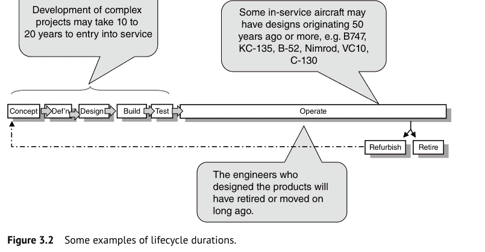

图3.2 生命周期持续时间的一些示例。

人们曾尝试缩短其中一些阶段的持续时间，这项工作仍在继续。诸如“快速工程”、“精益制造”和“并发”等术语已被使用，事实上这些技术已得到普遍应用（Hartmann et al. 2004; Mynott 2011）。人工智能和增强现实的使用已被提出，并且软件自动代码生成已得到应用，且在很大程度上取得了成功。现在注意力正转向系统架构的计算机辅助生成。所有这些机制都存在一定程度的风险，这些风险可能只有在测试和运行阶段才会显现，而在该阶段纠正错误的成本很高。在考虑引入新的设计技术时必须谨慎，并且必须始终牢记，许多计算机辅助技术的性能取决于定义它们的算法。

图3.3显示了对此延长生命周期的一些外部影响，其中大多数源于业务压力，这些压力要求供应商和客户的优先事项在如此长的时间尺度上发生变化。

在这张图中首先要注意的是，供应商设备的生命周期比飞机生命周期短。供应商有多个客户，受竞争需求以及不断开发产品、采用新技术以使产品更具吸引力的需要所驱动。这意味着在飞机生命周期早期做出的决策可能导致选择过时的产品，而推迟到后期做出的决策则可能导致项目延误。因此，曾经在运行阶段才显现出来的过时问题，如今在开发生命周期的初始阶段就已构成威胁。

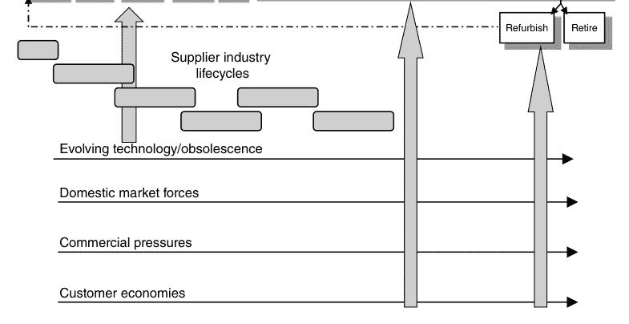

图3.3 对生命周期的一些外部影响。

图3.4 系统在生命周期中的发展方式。

有许多产品未能满足客户需求的例子。良好工程过程的一部分挑战在于确保这种情况不会发生，并确保在生命周期的每个阶段都能发现并消除错误和误解。这在并行工作中尤其重要，因为组织内部的客户数量众多，每个客户都将承担纠正错误的成本。纠正错误的成本与产品在生命周期中发展的成熟度密切相关，如图3.4所示。生命周期早期的产品是“软”的，易于更改——想法、方案、笔记、粗略计算。随着生命周期的发展，产品变得“硬”，要么是因为它们变得更加实体化，例如比例模型或原型，要么是因为使用公共或共享信息的人员或利益相关者数量增加。这种对共享信息日益增长的依赖意味着，如果信息数据库发生变化，就必须重复更多的设计工作。因此，有必要对信息源的配置进行控制。关于如何在生命周期中管理产品设计配置的说明，请参见第9章。

图3.5展示了在生命周期中发现错误后纠正成本的一个示例。该图显示，当产品定义主要局限于纸面或仅由一小部分人使用时，纠正成本相对较小，但当产品被制造出来后，纠正成本会迅速上升。产品在役期间纠正错误的成本因需要召回产品进行更改以及维持客户对其自身客户的服务而放大。还存在商誉损失和负面宣传的隐性成本，特别是如果客户在产品停用期间遭受能力或收入损失。

一些研究表明，纠正产品在役期间发现的错误的成本可能比纠正生命周期早期发现的错误贵1000倍以上。

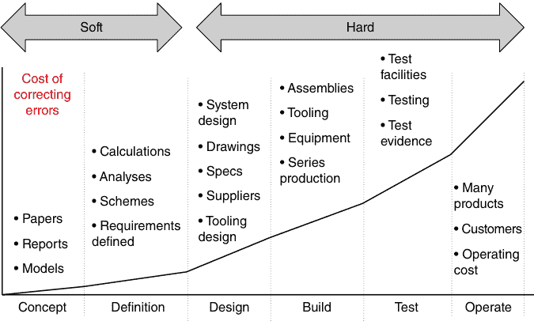

图 3.5 生命周期中纠正错误的相对成本。

一种用于应对大型复杂系统中错误 proliferations 的机制已在当代项目中成功使用。这涉及风险管理与成熟度管理的结合。一方面评估应用技术所带来的风险以及在存在感知不确定性的情况下推进项目的风险，另一方面则试图衡量设计的成熟度，提出问题：在每个阶段，设计团队是否确信已不存在不确定性？评估的常见论坛是由总承包商、供应商和客户代表组成的项目独立专家和管理人员团队，有时还得到“老专家”的支持，以提供独立的智慧并注入来自以往项目的“经验教训”。这应在每个流程阶段完成之前以及在每次正式生命周期评审时进行。

生命周期的每个阶段都需要组织的各个部分开展工作以产生一系列交付物。这些交付物可能以报告、图纸、测试数据、财务信息或硬件的形式存在，这些都是组织其他部分所需要的。工作需要对所采用的整体工程流程有理解、对每个阶段内开展的工作（子流程）、所需交付物以及交付时间表有理解。完成这项工作需要多种技能的组合，工程团队将由具有不同技能的人共同组成。团队中的技能组合会在整个过程中发生变化。初始技能集将基于对需求和广泛概念解决方案的理解，并将发展为涵盖多个特定工程领域的技能，以开发单个系统设计。随后是能够将这些设计转化为硬件和软件解决方案，并在单独测试后逐步组装成整体，然后再投入系列制造并交付给客户的能力。

除了培养个人技能外，通过培养对其他团队成员所具备技能的理解，还可以获得显著的效率提升。例如，一名了解采购和法律流程的工程师

将在编制规范或谈判中使用这一知识。同样，采购和合同人员也应了解工程流程，以便敏感地处理供应商和合同问题。在以下对生命周期阶段的描述中，将给出所需技能的说明。

生命周期中预期的部分输出如下，将在每个阶段的描述中进一步说明：

- concept – definition of technology
- definition – schemes, plans, preliminary hardware and software specs, supplier selection, models, mock-ups
- design – drawings, hardware and software specifications, materials
- build - build plan, tooling, facilities, materials, resources
- test – plans, schedules, test rigs, test results
- operate – flight test plans, schedules, results.

## 3.4 概念阶段

图 3.6 说明了与生命周期此阶段相关的关键工程活动。概念阶段是关于理解客户的新兴需求并形成解决这些需求的解决方案概念模型。客户会持续评估其现有资产，并确定其满足未来需求的有效性。新型军用系统的需求可能源于当地或世界政治局势的变化，或是感知到的威胁变化需要改变国防政策。新型商用系统的需求

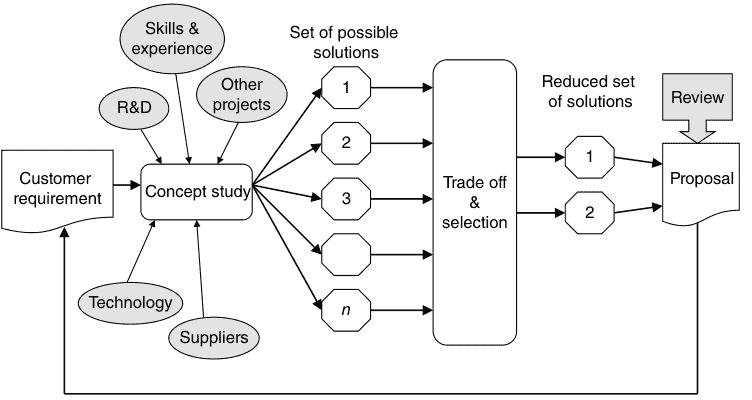

**图 3.6** 概念阶段流程。

可能由商业或休闲旅客需求所导致的变化的国家和全球旅行模式驱动。

客户需求对于某些项目可能仅简单陈述，概念研究利用公司的所有资源更好地理解它并生成若干潜在解决方案。其中一些解决方案将在权衡过程中被舍弃，留下少量方案，最好只有一个。该方案经过评审后提供给客户。本阶段的重点是建立信心，即需求可以在可接受的商业或技术风险范围内得到满足。成熟技术的基线建立可首先通过信息征询请求（RFI）提出。此过程允许潜在供应商展示其技术及其他能力，也为平台集成商提供了评估和量化竞争供应商相对优势的机会，同时还能捕获其此前未知的成熟技术以惠及项目。

本阶段的一个关键职能是利用概念团队所掌握的一切手段产生创意。精益产品开发中使用的一个示例创意生成流程如图 3.7 所示。正是这种流程产生了图 3.6 中的解决方案，权衡和筛选部分应产生下一阶段的输出。被舍弃的创意应存档供未来团队使用，并在需要重新审视本阶段流程时作为资源。

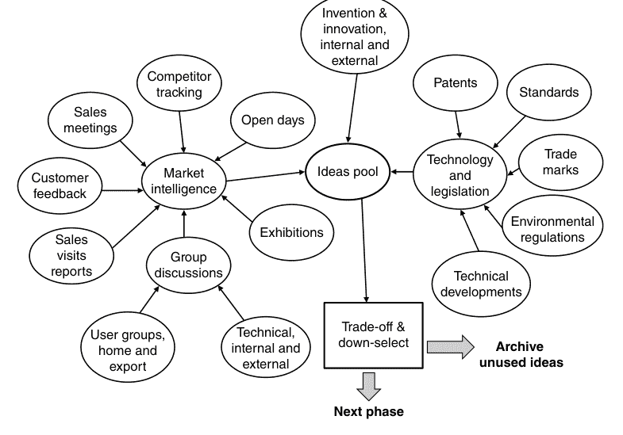

图 3.7 一个示例创意生成流程。来源：基于 Mynott (2011)，图 7.1，第 63 页。

### 3.4.1 工程流程

客户的需求将提供给行业，以便针对该目的专门开发解决方案，或从当前研究与开发（R&D）基础中进行改编。这是行业与客户及其工业供应商讨论和理解需求的理想机会，以实现双方互利，了解提供完全符合要求的解决方案或更具进取性且符合市场需求的解决方案的影响。并非所有研发都由客户驱动，也并非全部由客户资助。作为其前瞻性战略的一部分，行业将寻求识别并开展投机性的、自筹资金的研究。这可能是为了支持当前项目或降低提出创新解决方案的风险。它也可能是与项目无关的“蓝天”研究。

本阶段的典型考虑因素包括：

- 建立并理解所需系统的首要角色和功能
- 建立并理解期望性能和市场驱动因素，例如：
  - range
  - endurance
  - routes or missions
  - technology baseline
  - operational roles
  - number of passengers
  - mass, number, and type of weapons
  - availability and dispatch reliability
  - fleet size to perform the role or satisfy the routes
  - purchase budget available
  - operating or through-life costs
  - commonality or model range
  - market size and export potential
  - customer preference
- 建立信心，即需求可以在可接受的商业或技术风险范围内得到满足
- 发展对可制造的解决方案的理解。这将导致提出飞机外形、内部和外部配置以及初步系统架构。

### 3.4.2 工程技能

在本阶段，关键技能与能够设想满足客户需求的选项和解决方案的能力相关。典型的技能领域包括以下内容：

- 理解需求：利用客户的信息和商业情报确定客户作为解决方案的需求如何表达为可实现的定向商业战略，以满足性能、成本和进度约束。

- R&D：对新概念、新工艺或新技术的调研，以及将其引入当前或未来项目。关键技能在于确定应研究哪些技术、何时将研发定向并应用于特定领域，并确保活动聚焦于提供有利于业务的解决方案。
- 针对特定威胁的概念化。四种不同外形搭配不同发动机配置的方案被认为合适，这些配置被“冻结”以便进行评审。评审后，其中一个候选方案被选中进行进一步设计。所示P1A模型在风洞中进行了测试，以确定尾翼面最合适的位置——图中所示即最终选定的位置。使用模型黏土来确定操纵杆手柄的形状。最初按人因团队设计的形状进行捏制，然后提供给几位飞行员，由他们将其塑造成他们认为在能够触及所有开关的同时仍保持舒适的最佳形状。同样，其中一个模型被选中用于制造。在高机动飞机上，座椅角度可以提高对高过载的耐受性；但过大的角度会降低仪表的可视性，并可能无法提供最佳的弹射间隙。在选定最合适的角度之前，对多种不同构型进行了分析。

### 工程计划

分配需求

功能定义

初步架构

各系统定义

飞行器

航电

任务

评审

- 计划
- 子系统规范
- 设备规范
- 方案
- 模型

供应商识别

客户需求

需求管理

需求数据库

武器系统规范

顶层架构

图3.9 定义阶段流程。

(a)

(b)

(c)

(d)

图3.10 定义阶段流程的典型产物：(a)驾驶舱图形模型，(b)LRU全尺寸木制模型(照片来源：BAE Systems)，(c)起落架主支柱动画CAD模型，(d)翼结构粘接方案(照片来源：Jim Banks)。

以及与舱门重量和间隙相关的安全问题。详细结构部件的初步方案可以被提出以供讨论，作为更正式的计算机辅助设计定义的初步步骤。

### 3.5.1 工程流程

客户通常会汇集概念阶段收集到的所有信息，以确定其需求。这通常会导致发布规范或征求建议书（RFP）。这使得工业界能够将概念发展为确定的定义，评估技术、科技和商业风险，并研究完成设计并进入批量生产解决方案的可行性。此阶段的典型考虑因素包括：

- 将概念发展为确定的解决方案定义
- 开发系统架构和系统配置
- 重新评估供应商基础，以确定哪些设备、部件和材料可用于支持新兴设计，或可能需要哪些
- 确定物理和安装特性及接口需求
- 开发各系统的模型
- 量化关键系统性能指标，例如：
  - 质量
  - 体积
  - 增长能力
  - 航程/续航时间
- 识别风险并引入缓解计划
- 选择并确认适当的技术。

这一阶段要求开始采用严格的方法来记录需求并建立变更的可追溯性。需求管理工具用于明确表述需求并记录设计方案，其中一个例子是DOORS（Rational提供的动态面向对象需求管理工具），目前正用于许多现代项目。结合该工具，可以使用统一建模语言（UML）或系统建模语言（SysML）等工具开始对设计进行建模。这些工具记录设计，并为验证阶段提供有价值的输入。

这一阶段的输出通常以可行性研究报告、性能估算、各系统行为的数学模型组以及运行性能模型的形式呈现。此外，还可能有面包板或实验模型，以及由概念阶段模型发展而来的三维计算机模型形式的实体模型或木质和金属物理模型。在某些情况下，客户可能希望进入原型阶段，如果资金允许，可能会要求两家竞争对手进行“飞行竞赛”，即开发并试飞两个原型以确定最佳方案。这种方法适用于大规模生产合同，因为单一未经测试的方案可能风险太大而难以承受。

这方面的例子可见于美国的联合攻击战斗机（Joint Strike Fighter）计划，两家飞机公司各被要求生产一个原型，通过试飞来展示能力和性能。这最终使客户选定了一个方案。

### 3.5.2 工程技能

在这一阶段，关键技能与将概念性解决方案转化为单一确定产品以满足客户需求的能力相关。典型技能领域包括：

- 需求管理：系统需求的捕获、操作和管理，包括设计各层级之间可追溯性的管理。这通常涉及使用数据库工具来管理大量数据，并能够在需求与各设计和测试阶段之间实现追溯。还有一种技能是获取需求的“顶层”视图，并将需求逐级传达给项目团队和供应商，以逐步建立对客户需求更详细的理解。这种分析有助于更好地理解如何构建一个完全满足这些需求的完整解决方案。
- 工艺能力：包括必要的设计工具开发和定制、合适培训材料的开发等。工艺支持包括承担系统设计责任（SDR）、解决工艺问题、提供“帮助台”等。
- 设计流程工程：开发、部署和控制各工程学科使用的公认流程，并定义支持工具的接口。遵循受控流程可在整个项目生命周期中保持一致的方法。如果团队分布在地理位置分散的地区（多国合作中常见），这一点尤其重要。
- 系统集成：对复杂系统进行结构和划分，通常是为了最大限度地降低子系统之间的接口复杂性，同时保持“全局系统视图”，以确保最终产品满足其要求。
- 系统架构设计：构建满足需求的架构，并将功能划分或分配给架构的各要素。这通常从系统的简单框图开始，标明功能位置和数据流。一旦达成一致，该架构就可以逐步展示更多细节。
- 行为设计工程：从系统行为角度分析需求、识别潜在解决方案，并选择最具成本效益的解决方案（除非需求另有规定）。需求或解决方案的表述可以有多种形式，包括功能型、状态型、转换型和面向对象型。
- 系统安全工程：系统工程师中涉及与飞机系统相关的认证要求和安全责任的部分。安全工程包括识别危害、进行危害风险评估、定义安全需求、对设计和实施进行安全评估、编制安全案例，以及从安全管理角度对系统设计过程进行分析和评估。安全工程除了要考虑所涉领域的最佳实践外，还需要熟悉标准、合同和法规的要求。应积累并记录飞机服役行为知识和实际危害。
- 性能分析：从性能角度分析系统行为，理解整个系统应实现什么目标以及已设定哪些数值目标。一项关键技能是判断被建模系统的比例，以及

以最具成本效益的方式获得所需分析结果的手段。包括性能预算、特性分析、统计分析、调度分析等。另一个关键技能是选择和使用可用的工具对单个系统进行建模，并将这些模型组合起来表示完整的解决方案。

- **任务分析：**分析任务需求，定义任务类型和阶段或航段，并定义任务时间线和可用性目标。任务是指从飞行前简报（pre-flight briefing）到飞行后任务汇报（post-flight de-briefing）的一种特定类型运行，例如军用飞机的作战任务或商用飞机的常规机场间航班。
- **人为因素与驾驶舱/飞行甲板集成：**识别系统的人为因素问题，确定潜在解决方案及其管理和实施，以确保人员（操作员和维护人员）与系统成功集成。
- **建模与仿真工程：**分析设计需求和解决方案，以确定系统最关键的特性，并以最具成本效益的方式模拟这些特性。
- **可靠性工程：**分析设计和需求，并应用技术、方法和技术手段，以确保和证明产品具有可接受的可靠性和“容错能力”。可靠性工程必须通过规范逐级向下传递并融入供应商的技能组合。实例包括：分析可用性目标与“可承受的”技术能力之间的关系，与安全性设计要求进行权衡，保障、备件储备、可测试性需求，对产品进行分析以确定可接受的已实现可靠性水平（如故障模式与影响分析[FMEA]等），开发容错机制（如冗余、降级模式等），防御性编程，开发和评估“可靠”软件等。
- **可维护性工程：**分析设计和需求，并应用技术、方法和技术手段，以确保产品具有成本效益的可维护性。这项工作通常由具有维修活动实际知识的退役军人或航空公司人员承担。最好具备工具、可达性要求和地面设备方面的知识。
- **可测试性工程：**分析设计和需求，并应用技术、方法和技术手段，以确保产品在各层级均具备令人满意的测试和诊断能力。包括对可测试性需求进行分析，为内置测试、飞行前测试、建造测试、可用性测试和设备更换后测试提供框架。实例包括设计和工程能力（按需）以在整机层面“测试”整个系统（包括其组件及其接口）的健康状况。
- **估算、测量与度量：**利用流程、工作分解结构（WBS）和产品分解结构（PBS）确定产品以及设计、测试和建造所需的工作。这能够估算完成工作所需的成本，即完工成本。识别、捕获和分析适当的度量指标，以了解活动的实际成本并帮助流程改进，以及评估成本对项目风险和货币汇率变化的敏感性。这通常被视为项目管理任务。

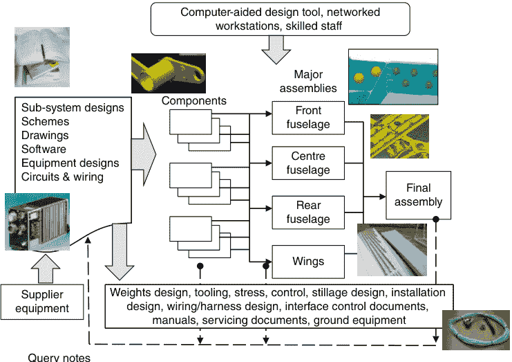

对于当今飞机上发现的复杂集成系统，由平台集成商和供应商组成的集成设计团队或集成产品团队（IPT）至关重要。

### 3.6.2 工程技能

设计阶段需要定义阶段所需的全部技能，因为此阶段可视为向可制造解决方案的延伸。其他技能包括：

- **软件设计：**应用面向对象设计（OOD）等软件设计技术来生成初步设计和详细设计。注意：软件设计还涉及其他技能中与软件相关的要素，如需求工程、架构设计、性能分析、可靠性、可维护性和可测试性工程、安全性等。
- **物理设计：**分析、定义并规范物理产品及其物理集成依赖关系，包括需求分析和规范编制、接口控制要求和工程设计需求（EDR）的生成，以及对令人满意的安装设计和环境条件的分析。
- **供应商管理：**根据供应商对征求建议书（RFP）的响应选择供应商，将需要对每个供应商进行管理，即让他们随时了解所有项目进展和决策，同时将供应商信息加以协调并提供给项目团队。

## 3.7 建造阶段

建造阶段是指利用设计阶段的成果来生产物理产品的阶段。这意味着所有设计信息（图纸或计算机辅助设计模型）都已在配置控制下生成、检查、批准并存档。这些信息用于订购材料并规划装配线流程，以确保所有夹具、工具和材料在正确的时间、正确的地点就位。建造可采取两种不同形式：(i) 按需制造原型，以及(ii) 批量生产建造，即大批量制造产品。每架飞机在离开生产线前都要接受测试，以确保适合发动机运转和飞行。在建造和测试的每个阶段，任何差异、故障、缺陷、失效等情况都会通过正式的问询单程序反馈给设计部门。采取的任何纠正措施都会记录在设计数据中（遵循适当的配置控制纪律），以便将更改纳入建造过程生产的所有产品中。图3.13展示了生命周期这一阶段的关键工程活动。

图3.14给出了建造阶段产物的一些典型示例，图中展示了众多部件中的一部分，这里包括将安装到设备舱的驾驶舱面板和航空电子设备机架、一只尚未蒙皮的机翼、处于型架中的前机身，以及进行中的总装。

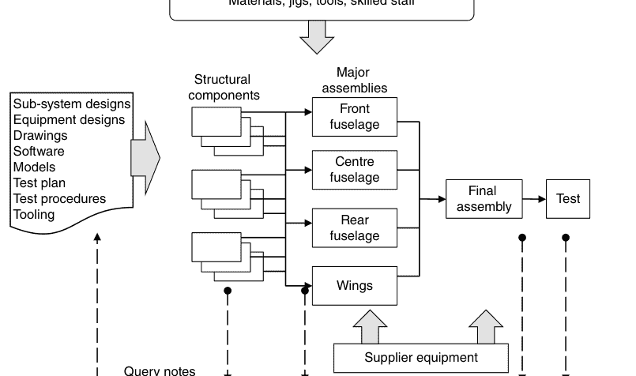

图3.13 建造阶段流程。

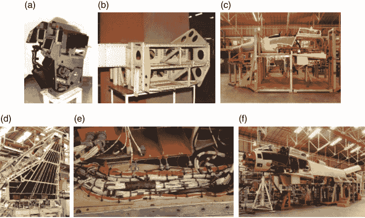

**图3.14** 建造阶段流程的典型产物：(a) 驾驶舱组件（照片来源：BAE Systems），(b) 航空电子设备机架（照片来源：BAE Systems），(c) 前机身（照片来源：BAE Systems），(d) 机翼（照片来源：BAE Systems），(e) 线束（照片来源：Alan Seabridge），以及(f) 总装（照片来源：BAE Systems）。

### 3.7.1 工程流程

飞机制造依据设计部门发布的图纸和数据。这包括详细子组件的制造及其逐步组装或最终组装成完整机身，并安装管道、导管、线束和设备。在该阶段，系统工程的主要支持是为制造部门提供服务，回答有关无法实际实现或从批量生产角度看不够经济的解决方案的问询。在建造早期给出及时有效的答复，可以降低批量生产中出现错误的可能性。

### 3.7.2 工程技能

在此阶段，关键技能涉及为制造过程提供支持，以确保问题出现时能够被解决，设计错误能被发现并纠正，解决方案能纳入设计中。典型的技能领域包括：

- 对设计的了解以及解答制造问题的能力
- 变更管理和配置管理知识
- 硬件/软件集成，即软件负载在其目标硬件环境/设备中的集成与认证
- 制定建造测试方法和编写测试程序的能力

## 3.8 测试阶段

图3.15展示了生命周期这一阶段相关的关键工程活动。这是飞机寿命中的一个重要阶段。它是由独立测试工程师团队对制造完成的设计进行测试的机会，以确保其功能正确、系统稳健，能在所需的环境条件下运行，并在飞机的整个寿命期内持续运行。这一测试制度由飞机公司、供应商和客户在多个测试台架和设施上进行，以确保产品适合其用途。无论在设施还是工时方面，这都是一个成本高昂的阶段。

### 3.8.1 工程过程

飞机及其部件需经过严格的测试程序以验证其是否适合用途。该程序包括设备、部件、子组件的测试和逐步集成，最终对整架飞机进行测试。在地面和飞行试验中对系统进行的功能测试，可验证设备的性能和运行是否符合规定。测试程序及相关设计分析和文档的完成，将促成飞机或设备的认证。

### 3.8.2 工程技能

在此阶段，关键技能在于解决问题的能力以及维持测试进度的能力，并且与之前一样，设计中的任何错误都必须解决，设计数据集需相应更新。典型的技能领域包括：

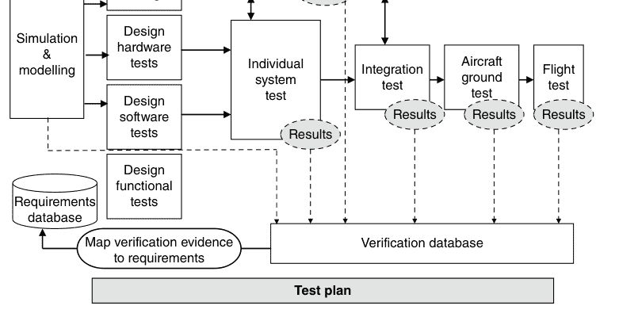

图3.15 测试阶段过程。

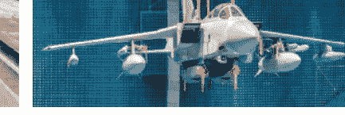

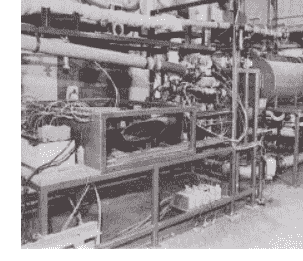

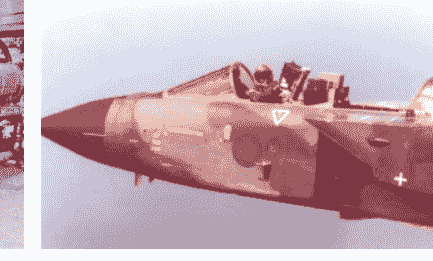

图3.16 测试阶段过程的典型产物：(a) 在未完工的M55公路上着陆的“美洲虎”S2，(b) “龙卷风”RF互操作性测试，(c) 环境控制系统测试台架，以及 (d) 座舱盖抛投后的“龙卷风”飞行（照片来源：BAE系统公司）。

- 测试设施设计：分析测试需求，并对完成测试范围所需的设施进行范围界定和规模确定。这包括单个测试台架的设计与位置，以及将其安置在合适且安全的建筑物中。
- 测试准备：定义测试规范、方法、通过/失败标准与程序、测试测量技术，以及硬件、软件、子系统、系统和整机测试所需的测试设备和仪表的使用。
- 测试执行：执行测试/评估活动，记录和分析测试结果以验证其有效性。为合格鉴定提供证据。

图3.16展示了测试阶段产物的一些示例。一架“美洲虎”飞机被用来演示该机型在公路上着陆的能力，图中它正降落在布莱克浦附近几乎完工的M55公路上。“龙卷风”P12的最后一次飞行用于演示在座舱盖抛投后飞机仍可安全飞行。图中还展示了一个用于在实验室测试环境控制系统冷气装置的大型测试台架。一架“龙卷风”GR4被悬挂在电子战舱室中，正在进行防撞警告系统（CWS）的射频（RF）互操作性测试。

## 3.9 运行阶段

这一阶段是真正的考验，离开了受控的测试实验室环境，进入乘客、行李、饮料车和定期清洁所构成的随机世界。在此阶段，飞机将每天承受磨损，并可能收到乘客、客舱机组和维护机组的意见。客机预计会定期升级，以改善客舱内的设施和服务。军用飞机也会经历类似时期，对系统和武器进行升级，若在战区使用，还可能面临严酷条件。图3.17展示了生命周期这一阶段相关的关键工程活动。

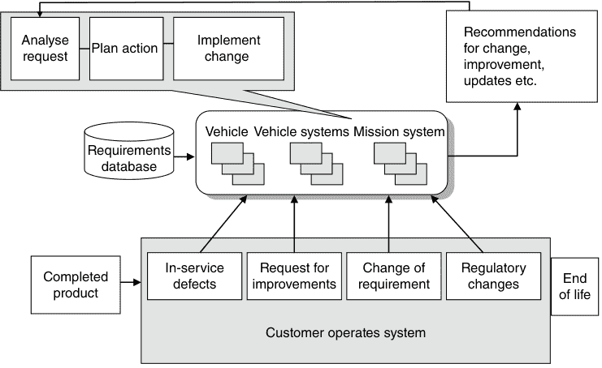

此阶段的产出可能是渐进式的改进，主要使飞机保持服役状态。然而，对客户意见与需求、新兴技术和法规问题的持续监控，会促成对机型的重大改进。对更高舒适度、更长航程、更安静运行和更低排放的需求可推动改进，正如波音737从737-100到737-900的发展历程所证明的那样。

### 3.9.1 工程过程

在此阶段，客户每天都会操作飞机。其性能将通过正式的缺陷报告流程进行监控，以便制造商分析出现的任何缺陷或故障。故障原因可归因于随机部件失效、操作员误操作或设计错误。根据合同规定，飞机制造商及其供应商应参与运行期间出现问题的原因分析与纠正。任何出现的系统性故障都可能需要采取设计措施，并需进行调查以确定责任归属。

### 3.9.2 工程技能

在此阶段，关键技能在于支持客户及其运营。敏锐的客户关注度以及快速解决问题的能力以最大限度地减少飞机停机时间至关重要。典型的技能领域包括：

- 需要提供所有系统工程技能，以便按需支持运行阶段。运营商通常会运行查询报告系统，使服役中的问题能够被报告并获得纠正措施。
- 工程师需要具备编写测试需求的能力，使测试部门能够对单个系统和集成系统进行回归测试。

## 3.10 处置或退役阶段

飞机在使用寿命中总会迎来一个不再适合继续运行的时刻。这可能是因为运营一架日益不可靠或维护不经济的飞机的经济性原因，或者仅仅是因为其寿命已到。退役可能是自然发生的，这种情况下飞机会在一段时间内逐步退出服役。也可能是由于管理决策而强制执行，或者在某些军用项目中，当项目资金终止时。需要决定如何以符合健康、安全和环境条件的方式处置该产品。

图3.18展示了生命周期这一阶段相关的关键工程活动。

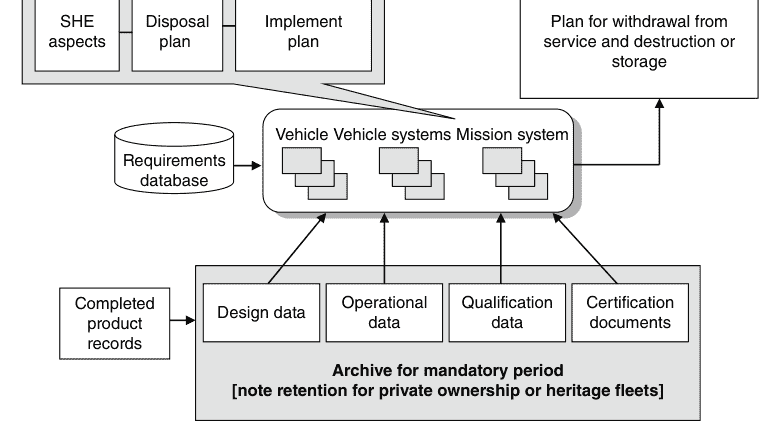

图3.18 退役阶段过程。SHE，安全、健康与环境。

图3.19展示了一些处于不同情况下的产物示例。实验飞机项目（EAP）是一架实验验证机，在项目目标达成且许多主要部件达到寿命终点后退役。由于其历史意义，它最初被捐赠给拉夫堡大学，用作航空航天课程的教学辅助工具。后来决定将其移至科斯福德的皇家空军博物馆，至今仍陈列在那里。为此征询了工程建议，以便安全拆解飞机、在两地之间运输并重新组装。部分出于历史原因，或许也出于公众的赞赏，多架协和式飞机被捐赠给博物馆。图3.19所示的是曼彻斯特机场跑道访客公园内的G-BOAC。有些飞机被出售给打算继续飞行的组织和私人买家。一些从沙特阿拉伯返回的“闪电”飞机就经历了这种情况，但许多其他飞机被报废，例如“海盗”XK523。开普敦附近的“雷霆之城”曾飞行过多种退役机型，并为人们提供乘坐稀有飞机飞行的体验。许多其他飞机在工业场所、博物馆和武装部队所在地充当“门户守卫”的有用角色。腐蚀常常使它们变得不安全且维护不经济，因此常以全尺寸塑料复制品替代。飞机制造商将被要求提供合适的飞机图纸及其标识。

处置是许多飞机的最终归宿。对于拥有广阔空间的国家，有机会将飞机储存在炎热干燥的条件下，美国就有多处专门的沙漠储存地点。大多数飞机只是被拆解为废料。

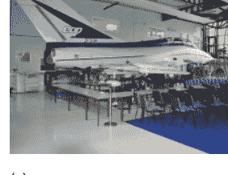

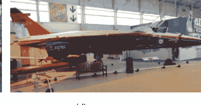

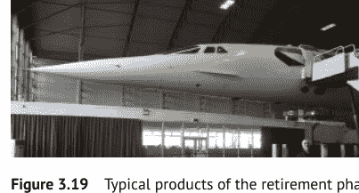

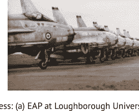

图3.19 退役阶段过程的典型产物：(a) 拉夫堡大学内的EAP（照片来源：Allan Seabridge），(b) 科斯福德皇家空军博物馆内的FBW“美洲虎”（照片来源：Allan Seabridge），(c) 曼彻斯特机场跑道访客公园内的协和式G-BOAC（照片来源：Allan Seabridge），以及 (d) 等待处置的“闪电”飞机（照片来源：BAE系统公司）。

尽管一些组织和私人收藏家竞标零件以放入博物馆，许多零件最终还是出现在 eBay 上。

### 3.10.1 工程流程

在飞机使用寿命或预测寿命结束时，必须对其未来做出决定。寿命终结可能由不可接受的高运营成本决定（如将协和式飞机退役的决定所示），不可接受的环境因素——噪音、污染等——或由供应商试验台确定的机械或结构部件的预测性失效。在军事领域，退役机型决定的驱动因素可能是政治上的权宜之计，例如需要削减国防开支，或在某些情况下是因为认识到某种特定威胁已不再存在。如果无法继续运营飞机，则可能将其处置——出售作废品或另作他用，例如被博物馆、航空爱好者团体购买，或在军事基地用作门卫。 如果飞机仍具有一定的剩余商业价值寿命，则可能对其进行翻新。

这里的一个关键流程组成部分是制定计划以协助客户退役飞机，并确保其按照法定和建议要求安全地移除、储存或销毁。

### 3.10.2 工程技能

- 协助客户识别用于安全储存的部件。
- 提供支持拆卸、重新组装和运输的信息。
- 了解处置潜在危险部件和消耗品（如燃料、油、润滑脂、制冷剂等）的要求。
- 在项目记录中记录该决定。
- 确保所有设计权记录的设计和鉴定资料按相关法规规定的期限存放在安全储存处。这对于向冗余飞机的购买者提供建议至关重要。

## 3.11 翻新阶段

图 3.20 说明了与生命周期这一阶段相关的关键工程活动。飞机的生命周期中会出现需要翻新的阶段。这可能是因为飞机在其原始用途中已过时，或是被出售给希望改变其用途的客户。一个例子是将商业客运机身改装为货运或空中加油用途。

VC10 和洛克希德 L1011 三星客机被改装为军用空中加油用途。VC10 于 1961 年由皇家空军订购，并于 1977 年改装为加油机角色。该机队于 2013 年 9 月退役。一些商用飞机在其客运用途到期后被改装为货运角色。在某些情况下，这种改装需要进行广泛的重新设计以适应军事作战。

### 图 3.20 翻新阶段流程。

### 3.11.1 工程流程

- 在项目记录中记录该决定。
- 确保所有设计权记录的设计和鉴定资料在翻新期间存放在安全储存处，以支持仍在服役的飞机。
- 将现有型号记录退回概念阶段，以便开始翻新设计。

### 3.11.2 工程技能

与概念阶段所需的技能相似，因为翻新或改装为不同用途的选项需要以开放的心态进行考虑。

## 3.12 全生命周期任务

除了上述流程中描述的具体领域工程任务外，还有其他工程任务在整个生命周期中持续进行。其中一些任务与对流程的控制有关，而另一些则是为了在各领域对某些学科施加一致的方法。这是一项重要的整合活动，确保所有领域工程师在行使各自技能时都遵守标准和流程。该整合活动已在第 1 章中介绍。在现代项目中，工程任务可能分散在国际合作伙伴之间，这种整合对于项目一致性至关重要。这些活动的例子包括：

- *工程管理* 以管理工程团队的活动，对特定领域要求承担责任，并确保要求在项目约束范围内得到满足
- *项目管理* 以确保任务按照商定的时间表、预算执行，并满足性能标准
- *配置管理* 以确保产品的配置得到正确记录并传达给所有利益相关者，并确保对配置的更改得到记录（参见第 9 章）
- *需求管理* 以在合适的需求管理工具中分析和结构化客户需求，将需求分配给特定工程领域，并在整个生命周期中记录需求变更
- *风险管理* 以识别并登记影响技术、完成情况、成本、进度或安全性的风险，并确保每个风险得到正确记录、传达给其他风险管理人员，并制定有成本的缓解计划
- *鉴定和认证* 以从生命周期活动中收集证据，支持项目证明能够满足客户需求并证明产品适用
- *安全* 以确保对产品安全采取一致的方法，应用法规安全标准，并遵守与设计安全证明相关的所有流程（Drysdale 2010）
- *可靠性* 以确保工程设计经过分析，能够满足其可靠性验证标准和客户的可用性目标
- *可维护性* 以确保工程设计反映客户使用适当工具、支持设备和熟练地勤人员维护飞机的需求
- *可测试性* 以确保设计中包含因素，使飞行员和地勤人员能够执行飞行前和飞行后检查，以确保飞机适航，并能快速隔离缺陷以支持快速纠正和维修
- *人因* 以确保在设计的人机工学和工作负荷相关方面应用相关标准，以便飞机能够由适当百分位范围的机组人员和维护人员在没有过度压力或健康安全影响的情况下安全操作
- *电磁* 以确保各个系统能够在不相互干扰的情况下运行，并且系统能够在外部危害存在时运行，例如高功率射频传输、高静电场或雷电（MacDiarmid 2010）
- *系统安全* 以确保军用飞机不会无意中辐射信息，并控制所有与加载、存储和销毁机密数据相关的方面。

## 3.13 总结

所使用的系统生命周期是可视化开发过程不同阶段的一种便捷方式。它不是唯一的方式，读者应鼓励设计自己的生命周期，注意只有在整个项目中采用时才有效。它是显示各个阶段以及整个生命周期中发生情况的便捷简写。

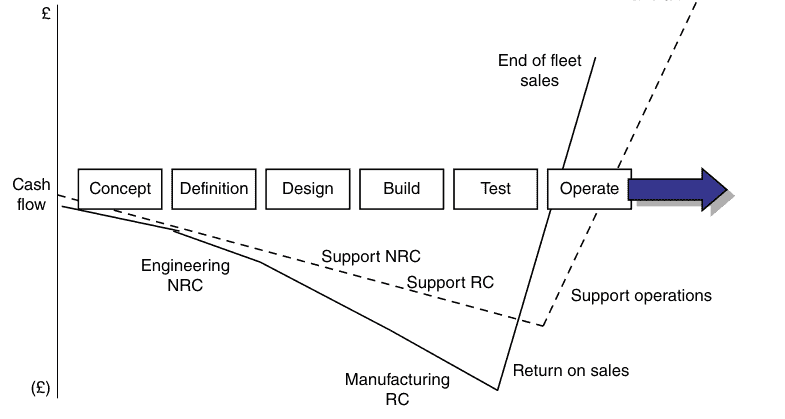

图 3.21 产品生命周期中的指示性现金流。NRC，非经常性成本；RC，经常性成本。

最后一点需要注意的是生命周期中的现金流。图 3.21 仅说明了大型项目所需的投资，以及投资回报通常在生命周期后期才出现的情况。经常是产品支持带来利润。需要一个良好的付款计划来尝试尽早收回成本。

图 3.22 显示了一些已完成整个生命周期并已运行不同时期的项目示例。照片中的 Tornado 在当时已在三支欧洲空军服役 40 年。该项目始于欧洲合作的早期尝试，英国、德国和意大利的三家航空航天公司共同按照统一标准生产多用途战斗机。 resulting 飞机经历了多次更新，其中包括一种新变型，即防空变型，成为 F3。该飞机在其服役生涯中参与了许多战役，至今仍继续为德国、意大利和沙特空军服役。

最后，从过去经验中吸取的教训。工程师们熟知一种现象，称为“需求蔓延”。这是在生命周期阶段冻结后出现的新或“改进”的需求，通常由人们出于善意试图改进产品而产生。有时，它们会由更卑劣的因素刺激，如野心、自豪、嫉妒、部门间争斗或商业考虑。这种“蔓延”通常会导致产品复杂性增加，因为工程师努力纳入更改，往往迫使更改进入系统设计；这通常会导致昂贵的返工。它还有进一步的含义，因为更改是在建筑原则确立后纳入的，新功能和物理接口可能与这些原则相矛盾，威胁到稳健的系统集成。2019 年初，一架新客机因系统的一项后期更改而发生致命事故，而飞行员并未清楚理解该更改。需要健全而强大的项目管理和配置管理来限制这种影响。

(a)

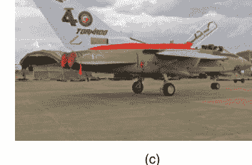

(b)

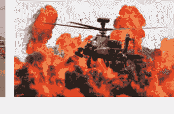

(c)

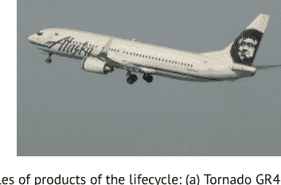

图 3.22 生命周期产品的示例：（a）Tornado GR4（照片：Allan Seabridge），（b）执行任务的阿帕奇直升机（照片：Leon Skorczewski），以及（c）阿拉斯加航空 B737（照片：Allan Seabridge）。

## 练习

- 1. 本书中使用的生命周期是由作者选定，用以说明产品开发中一些可识别的主要阶段，可据此提供合适的评审点。设计一个更适合你自身任务的生命周期。描述每个阶段的输出。将其与图 3.2 中给出的示例进行比较和对比，并解释差异。

- 2. 图 3.5 显示了在生命周期的不同阶段发现错误时的纠正成本示例。成本刻度已被有意留空。利用你自己的判断完成该刻度，以显示每个阶段的相对成本，并提供你的理由。

- 3. 第 3.3 节列出了可用于确定特定飞机方案可行性的性能参数示例。假设你即将购买机动车或车辆作为（i）个人车主/使用者，（ii）当地企业运输或客运租赁车队运营商，或（iii）跨国车辆租赁企业。列出这些情景下会影响你购买决策的性能参数清单。确定这些清单之间的差异并解释对你决策的影响。

- 4. 使用与问题 3 相同的情景，解释你将要经历的过程以确定如何最好地处理车辆或车队在有用寿命结束时的处置。

- 5. 概念阶段的主要目标是什么？确定在该阶段用于缩小解决方案数量的权衡中可以考虑的至少六个问题。

- 6. 对于每个生命周期过程阶段，从你熟悉的项目中提供每个阶段输出的一些示例。

- 7. 在生命周期的每个阶段，对变更的接受程度不同。解释为什么在早期阶段鼓励变更，但在后期阶段则积极阻止变更。

## 参考文献

Checkland, P.B. (1972). Towards a systems-based methodology for real world problem solving. Journal of Systems Engineering. 3: 87–116.

Drysdale, A.T. (2010). Safety and integrity in vehicle systems, Chapter 11. In: Encyclopedia of Aerospace Engineering, vol. 8 (eds. R.H. Blockley and W. Shyy), 5036–5044. Wiley.

Eisner, H. (2002). Essentials of Project and Systems Engineering Management, 2e. Wiley.

Hall, A.D. (1962). A Methodology for Systems Engineering. Van Nostrand.

Hartmann, J., Meeker, C., Weller, M., Izzard, N. (2004). Determinate Assembly of Tooling Allows Concurrent Design of Airbus Wings and Major Assembly Fixtures. SAE Aerospace Manufacturing & Automated Fastening Conference & Exhibition.

Jenkins, G.M. (1972). The systems approach. In: Systems Behaviour (eds. J. Beishon and G. Peters). The Open University, Harper & Row.

MacDiarmid, I. (2010). Electromagnetic integration of aircraft systems, Chapter 412. In: Encyclopedia of Aerospace Engineering, vol. 8 (eds. R.H. Blockley and W. Shyy), 5045–5057. Wiley.

Mynott, C. (2011). Lean Product Development. Westfield Publishing.

Seabridge, A. and Skorczewski, L. (2016). EAP: The Experimental Aircraft Programme. BAE Systems Heritage Department.

Shisko, R. (1995). NASA Systems Engineering Handbook. SP-6105. Linthicum Heights MD. NASA Technical Information Program Office.

## 延伸阅读

Assadi, M., Dobbs, S., Stewart, B. et al. (2015). Panel Assembly Line (PAL) for high production rates. SAE Int. J. Aerosp. 8 (1): 104–116. https://doi.org/10.4271/2015-01-2492.

Boothroyd, G., et.al. (1994) Product Design for Manufacture and Assembly.

Eisner, H. (2002). Essentials of Project and Systems Engineering Management, 2e. Wiley.

International Council on Systems Engineering (INCOSE), (n.d.) INCOSE. 2033 Sixth Avenue, #804, Seattle, WA 98121, USA. www.incose.org. Accessed January 2019.

Judt, D., Forster, K., Lockett, H. et al. (2016). Aircraft wing build philosophy change through system pre-equipping of major components. SAE Int. J. Aerosp. 9 (1): 2016.

Jukes, M. (2004). Aircraft Display Systems. Wiley.

Kossiakoff, A. and Sweet, W.N. (2003). Systems Engineering – Principles and Practice. Wiley.

Longworth, J.H. (2013, 2014, 2015). Test Flying in Lancashire, vol. 1, 2 and 3. BAE Systems Heritage Department.

Meakin, B. and Wilkinson, B. (2002). The ‘Learn from Experience’ Journey in Systems Engineering. INCOSE 12th International Symposium, Las Vegas, July 2002.

Moir, I. and Seabridge, A. (2013). Civil Avionic Systems, 2e. Wiley.

Overmeyer, L. and Bentlage, A. (2014). Small-scaled modular design for aircraft wings. In: New Production Technologies in Aerospace Industry, Lecture notes in Production Engineering (ed. B. Dekena), 55–62. Switzerland: Springer International Publishing https://doi.org/10.1007/978-3-319-01964-2.

Saif, U., Guan, Z., Wang, B. et al. (2014). A survey on assembly lines and its types. Frontiers of Mechanical Engineering 9 (2): 95–105.

Schrage, D.P. (2010). Product lifecycle engineering (PLE): an application, Chapter 390. In: Encyclopedia of Aerospace Engineering, vol. 8 (eds. R.H. Blockley and W. Shyy), 4767–4784. Wiley.

Seabridge, A. and Skorczewski, L. (2016). EAP: The Experimental Aircraft Programme. BAE Systems Heritage Department.

Stevens, R., Brook, P., Jackson, K., and Arnold, S. (1998). Systems Engineering – Coping with Complexity. Prentice Hall.

Whitney, D.E. (2004). Mechanical Assemblies: Their Design, Manufacture, and Role in Product Development. Oxford: Oxford University Press.

Wise, P.R. and John, P. (2003). Engineering Design in the Multi-Disciplinary Environment. Professional Engineering Publishing.

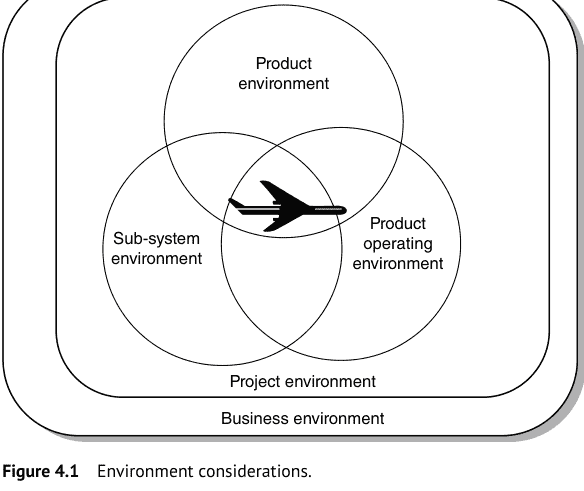
