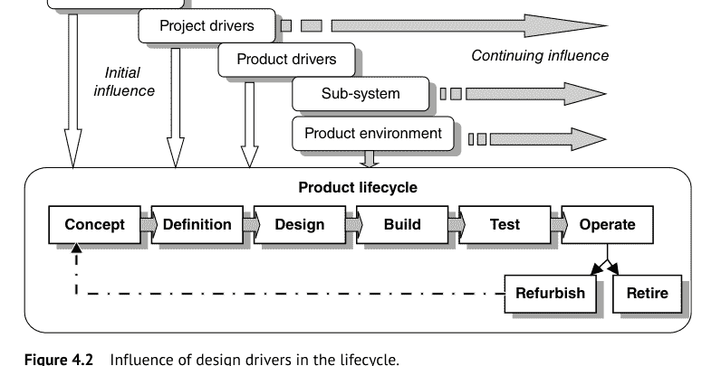
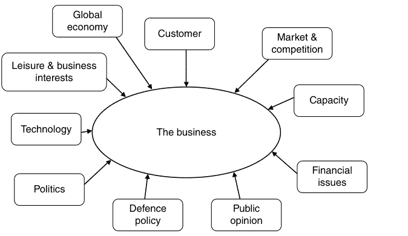
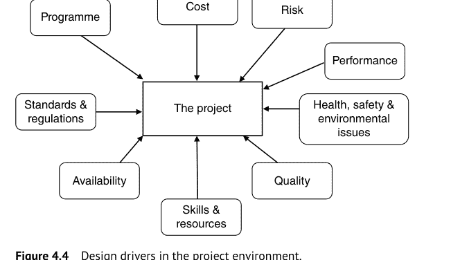
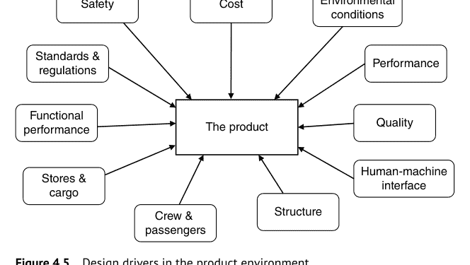
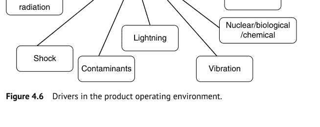
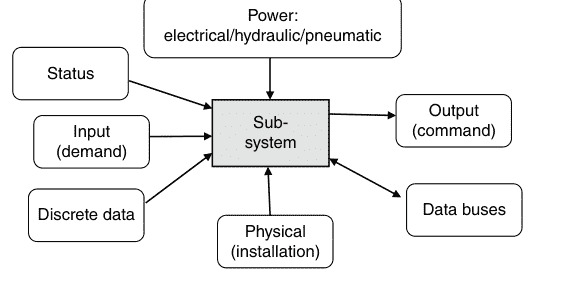
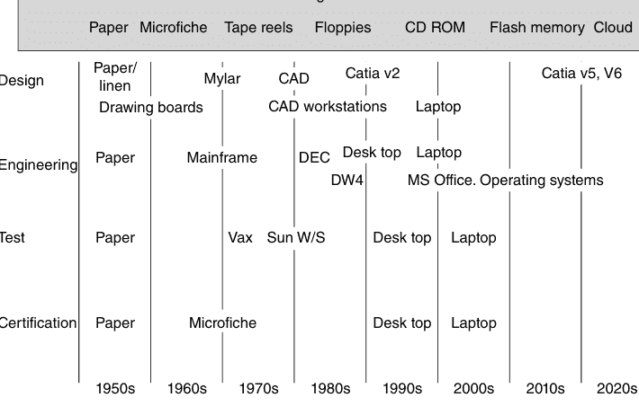
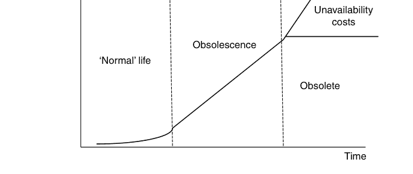

图 4.1 环境考虑因素。

这在很大程度上是一个风险降低阶段，以确保企业已识别出将项目顺利完成的适当技能、经验和资源。

- 产品环境：必须考虑的详细设计和生产就绪因素。这包括现有的<|message|> 人力、设施和资产，以及将其提升至适当就绪状态所需的任何未来投资。
- 产品运行环境：确保设计纳入产品投入使用时可能遇到的所有已知因素。这需要对客户的运行场景有全面的理解。
- 子系统环境：子系统和组件设计的详细因素。

这些层级代表了从概念到详细设计以及硬件和系统安装的设计阶段。

图 4.1 说明了企业和项目团队在生命周期早期阶段必须考虑的高层驱动因素，以及与产品密切相关的重叠驱动因素。为了说明设计驱动因素的作用，假设它们将起源于特定的环境并在该环境中发挥主导作用。然而，它们也会向下传递并对所有后续环境产生影响——换句话说，即使在项目非常早期的阶段做出的决策仍将继续产生影响。这可能是有益的，但如果不良或不理想的决策未被识别和纠正，也可能构成相当大的威胁。因此，需要审查决策过程以记录所有做出的决策及其理由。

正如第 2 章所明确指出的，环境边界并非不可渗透，也并非下文所述的驱动因素仅限于某一环境。这在图 4.2 中有所说明，该图显示原始的业务和项目驱动因素始终存在，而其他驱动因素仅在后期阶段适用。

Figure 4.2 Influence of design drivers in the lifecycle.

不言而喻的是，子系统或系统每个元素的实际实现往往是一种妥协，而非理想的解决方案。本章将深入揭示系统工程师日常生活中所面临的众多相互冲突的要求、期望、愿望和现实。本章将描述示例驱动因素，以说明系统工程师需要应用的典型考虑因素。设计驱动因素将在下面以项目符号列表的形式呈现以提高清晰度。示例列表绝非 exhaustive，聪明的工程团队将为其自身设计问题陈述进行头脑风暴，并指定其自身的设计驱动因素，同时利用客户的需求和自身公司的商业战略。换句话说，公司是否有能力提供客户想要的东西，以及适用性和客户接受度将如何衡量？

# 4.2 Design Drivers in the Business Environment

商业环境包含与企业满足其股东以及客户、员工和当地社区的能力相关的驱动因素。股东不能被忽视——他们是为企业提供资金和投资的人。与此同时，客户也不能被忽视，因为正是他们购买了为此进行的投资的产品。这些驱动因素在项目的概念阶段占主导地位，企业在此阶段关注其可以获得的业务性质、所需的投资以及风险的规模和影响。这些是企业在进一步为项目投入资金之前会持续审查的因素。

这些驱动因素在整个生命周期中仍然有效，并将向下传递给项目团队。一些典型的设计驱动因素如图 4.3 所示，并在下面描述。

Figure 4.3 Design drivers in the business environment.

## 4.2.1 Customer

客户至关重要，必须理解他们的需求，并持续监控或跟踪并予以满足。在我们的日常生活中，我们都是消费者，会购买产品，并根据我们是否喜欢产品或服务、其价格是否昂贵、其使用可靠性如何等因素来决定未来的购买行为。需要注意的是，在此上下文中，客户不仅仅是购买产品的代理。工程团队内部存在内部客户和供应商，以及与外部供应商的正式客户-供应商关系。典型考虑因素包括以下内容：

- 客户的需求应在需求定义过程的各个阶段进行跟踪和监控。
- 必须清楚地理解客户的需求，并经常与客户核对供应商的理解，以确认相互理解。
- 必须与客户建立稳固的关系，并在整个生命周期中保持这种关系。
- 通常有必要尽早了解客户需求，甚至可以通过帮助客户制定其需求来实现。
- 必须了解客户的预算：规模有多大？何时可用？
- 如果客户对产品有经验，其体验是好是坏？如何改进？
- 公司内部的客户关系很重要，以确保项目内信息流的相互理解。

## 4.2.2 Market and Competition

必须认识到产品的市场是有限的。要使产品成功，它必须满足需求，必须适用，即完成其预期用途，必须定价正确，并且必须被潜在客户视为物有所值。典型考虑因素包括以下内容：

- 产品是否有市场？
- 市场有多广泛，有多少客户？
- 市场是否还有空间容纳另一款产品？
- 市场稳定吗？在项目生命周期内是否有任何迹象表明市场会发生变化、增长或下降？
- 预计市场份额是多少？
- 市场能否发展以包括其他消费者或开发产品的变体？
- 有多少竞争对手，是否还有空间容纳另一家参与者？
- 竞争对手表现如何（收集市场情报和客户偏好）？
- 产品定价是否已理解——投资、数量、盈亏平衡时间？
- 赢得并继续赢得的概率是多少？
- 产品能否在初步市场渗透后继续开发？

## 4.2.3 Capacity

在接受合同之前，必须确定企业是否有足够的产能将项目顺利完成。这需要了解当前项目的状态，以及同期投标的状态和确定性，以确保业务不会“过多”。典型考虑因素包括以下内容：

- 当前熟练资源部署状态和剩余产能如何？
- 需要哪些培训？
- 当前设施是否有灵活性和储备？
- 供应商基地是否有合适的产能？
- 是否需要外包？
- 是否有机会与战略合作伙伴进行工作共享？
- 新项目是否可以与现有项目同时进行？

## 4.2.4 Financial Issues

尽管潜在回报看起来不错，但在承诺投标或招标之前仍有许多方面需要考虑，其中大部分将是商业审查的主题。典型问题包括：

- 新技术投资
- 基础设施、设施、资源和产能投资
- 在现有项目资金之间平衡投资
- 融资可用性和利率
- 投资回报率和盈亏平衡点
- 安全和专有权利限制可能限制信息交流，例如《国际武器贸易条例》（ITAR）和英国出口管制法。

## 4.2.5 Defence Policy

政府国防政策会影响军用空中资产的销售和持续使用。国防政策可能受全球战略政治局势以及当地战术情况的影响。例如，冷战导致了适合战略核打击和北欧防御的产品。最近的冲突越来越多地使用快速反应部队、维和部队和迅速解决冲突。在许多冲突中，战术空军的果断使用都是决定性因素。最近转向“不对称战争”将影响国防政策，可能出现远离部署资本武器装备、转向更适合城市恐怖主义镇压、网络安全、互联网保护和情报收集的装备。典型考虑因素包括：

- 随着全球政治条件的变化而变化的国防政策变化，以及当前和未来订单的影响
- 全球对国防预算的持续压力，导致传统战斗机订单减少且规模变小，而这些订单已面临来自成熟制造商的激烈竞争
- 监控全球战略国防审查和研究以观察和应对趋势
- 飞机产品生命周期很长，因此能够使产品适应不断变化的需求是可取的
- 鼓励客户对产品、支持、基础设施、培训、设施等采取长期、更广泛的商业视角，这将责任置于政府，因为政府必须提供稳定性，以便主要供应商不会在项目上大量投资后发现原始需求已被稀释或消失。

## 4.2.6 Leisure and Business Interests

商业飞机市场由商务和休闲旅客需求驱动，并可能受经济趋势和其他因素的影响，例如2003年的严重急性呼吸系统综合征疫情。客户和航空公司的忠诚度对长期业务安全很重要。典型考虑因素包括以下内容：

- 商业飞机市场必须响应消费者需求，并必须监控商务旅行趋势和度假目的地扩张趋势。
- 商务和休闲旅行都对恐怖主义或贸易禁运等政治威胁敏感。
- 票价结构是吸引商务和休闲客户的重要因素。
- 环境立法对票价结构（税收）以及可接受材料和耗材的使用的影响。
- 环境意识对某些乘客群体长途旅行愿望的影响。
- 商业飞机领域将开始主导航空航天活动，因为新型客机旨在满足具有挑战性的环境立法。

## 4.2.7 政治

本地和国际政治在军用和商用飞机的销售与运营中都扮演着重要角色。除了产品的政治可接受性之外，技术的性质及其在国家间的传播也可能受到影响。典型的考量因素包括：

- 原产国和客户国的政治局势可能导致贸易禁运，从而影响出口潜力。
- 政治局势和贸易禁运也可能影响国家间的技术或材料转让。
- 世界经济形势的变化可能对军用产品的国防预算产生重大影响。
- 世界经济形势的变化可能对商务旅行和休闲旅行产生严重影响，导致需求波动，进而影响飞机的航程和尺寸。
- 环境法规将要求飞机设计和经济运营采用“更绿色”的解决方案。
- 航空旅行环境税可能会降低需求，同样，随着人们改变休闲旅行习惯以体现对环境问题的关注，环境意识的提高也可能降低需求。

## 4.2.8 技术

技术是飞机项目中的关键驱动力，技术引入长期以来一直是维持航空航天工业的关键。需要在既能适当提升性能并最大限度减少过时风险的技术，与开发和成熟度风险过高的技术之间取得微妙的平衡。现代电子技术正以相对无结构且快速发展的信息技术（IT）/个人电脑（PC）行业所决定的速度向前推进。这意味着在任何一个飞机项目的生命周期中，都会出现多代技术进步的更迭。此外，航空航天工业不再像30年前那样是电子元器件技术的主要驱动力，而是转而跟随信息技术、电信以及休闲/游戏开发行业所确立的趋势。

需要指出的是，技术进步不仅仅为技术问题提供解决方案。它还需要更多的专家和专业人员，并产生对行政、监管和审批流程的补充需求。

采用特定技术需要考虑以下因素：

- 技术必须在已知的项目时间范围内可用且负担得起——必须是现实可行的。
- 如果需要为某个项目专门开发技术，那么成本风险或未能证明其适用性的失败风险是什么？
- 需要对工业研究开发（R&D）进行投资，并聚焦关键技术。
- 必须制定过时淘汰计划，以了解其影响并及时响应，从而在整个生命周期内保持产品的现役性和持续支持。
- 必须认识到，使用产品周期极短的电子产品和技术（通常由商业市场推动）的项目，将面临市场上元器件可用性和价格波动的影响。

## 4.2.9 全球经济

全球经济对以上所有方面都有影响，因为它会对本地和海外经济产生一些具体影响：

- 投资者信心
- 贷款成本
- 旅行和度假市场以及航空公司稳定性
- 国防预算限制及其对项目的潜在影响
- 就业和技能可用性
- 培训预算限制

## 4.3 项目环境中的设计驱动因素

这些驱动因素与早期定义阶段密切相关，用于评估需要满足的要求、需要应用的标准以及需要在成本、时间和性能限制内完成项目所需的资源。这些是项目规划中的重要方面。图4.4展示了一些典型的驱动因素，下文将对其进行描述。

### 4.3.1 标准与法规

飞机及其系统的设计需要满足许多严格要求，并且必须按照标准和法规进行。这些标准和法规是由航空航天工业多年来制定的，旨在在设计过程中强制实现一定的一致性和可见性。然而，适用于特定项目的确切标准因客户而异，其中许多由国家要求决定。例如，美国、英国、法国和斯堪的纳维亚都有各自明确的标准。

图4.4 项目环境中的设计驱动因素

必须严格控制成本，以确保实现财务目标。典型考量因素包括：

- 所有工作都必须在工作说明书（SOW）中加以描述，并且必须对照进度进行正式估算，以确保时间和成本得到正确分配。
- 必须对照指定的成果节点或里程碑持续监控成本。
- 变更、返工和错误会导致不必要的开支，增加成本并降低利润率，尤其是在生命周期的后期阶段。
- 在生命周期的早期阶段对设计进行彻底的分析、检查和测试是一项宝贵的投资。
- 采用包含成本和进度审查的正式评审流程至关重要。

### 4.3.4 项目计划

项目将被定义为在特定时间限制内启动和完成，并将设定主要项目目标以衡量成就。这代表了一个顶层计划（或按美国说法称为schedule），可从中构建下层计划。典型考量因素包括：

- 计划中需要单独识别的活动数量
- 主要里程碑——付款、评审、阶段完成
- 利益相关方之间的依赖关系
- 关键路径
- 风险

### 4.3.5 性能

客户将定义预期满足所述要求的项目性能参数。这些要求必须转换为性能参数和公差的规范，供设计团队将其落实到设计中，并供测试团队在试验期间进行评估。性能指标将成为合同的一部分，其达成的验证结果将在很大程度上决定项目的成败。典型考量因素包括：

- 客户期望能否用现有技术实现？
- 每项性能指标如何验证——通过检查、分析、建模、测试还是现场演示？
- 系统性能（不仅仅是功能）可以在多大程度上进行建模，以减少昂贵的测试？

### 4.3.6 技能与资源

拥有合适技能、培训和经验的人员可用性，会对项目内可完成的工作类型产生重大影响。项目因缺乏适当资源而失败的情况并不少见。计划的技术内容必须与时间要求相平衡，以确保合同能够履行。典型考量因素包括：

- 有哪些可用技能？
- 是否存在稀缺技能？
- 是否存在过时技能？
- 可以安排哪些培训来确保具备适当技能？
- 是否需要将工作分包？
- 能否在计划的正确时间提供正确类型和数量的人员？

### 4.3.7 健康、安全与环境问题

健康与安全必须考虑所有与项目相关人员的需求——包括设计、建造和管理项目的员工，以及参与运营使用的人员，如机组人员、维修人员和乘客。除了道德责任之外，还有法定法规要求组织为所有员工和用户提供关怀义务，组织必须遵守。

飞机的某些环境方面已引起足够的媒体和公众关注，以至于公司在道德上有义务遵守有助于减少环境影响的政策。同时，它们在法律和合同上也有义务遵守强制执行某些限制性标准的法规和规范。典型考量因素包括：

- 就健康、安全和环境法规进行协商并遵守——客户会期望这一点
- 提供安全的办公场所、厂房和场地条件
- 提供安全的工作流程
- 考虑并通报新的和潜在有害的材料、处理方法及表面处理
- 向当地环境排放污染物
- 废料处理
- 回收政策
- 公众对环境问题的意识日益提高，导致对噪音、排放、污染物和材料使用的监管日益严格
- 考虑国际议定书和国家协议，特别是针对面向全球市场的产品
- 日益关注排放对环境影响，例如氟碳化合物对臭氧层的影响（1987年《蒙特利尔议定书》）
- 产品设计要最大限度地减少噪音、能源消耗、可见和不可见排放以及对环境的干扰
- 在正常运行和维护期间减少对环境的影响
- 不断追求燃油经济性运营，既为了节省成本，也出于环境方面的考虑

环境已成为飞机工业中的一个主要因素，多年来关于这一问题的讨论持续升温，但显然尚未达成普遍共识。

航空航天工业总体上是否对环境造成了有害程度的污染？如果是，又是通过哪些机制造成的？更重要的是，这种影响能否被测量，其影响能否被确定性地预测，以及可以采取哪些措施？这场辩论一直在报刊、教科书、政治舞台和学术期刊中进行。在辩论过程中，形成了一系列两极分化的观点，很难将科学与通俗观点、客观与既得利益观点、严肃与煽动性言论区分开来。

议题范围十分广泛，涵盖创新飞机与发动机设计、空气动力学与推进技术、飞机运行与空中交通管理、替代燃料、轻质高强度材料、机载辅助动力装置、降噪技术，以及非传统飞机（电动、太阳能、氢能）。

### 4.3.8 风险

企业必须持续评估项目能否成功完成所面临的风险。风险评估应在生命周期非常早的阶段就开始，以建立完整的风险数据库或风险目录，并明确其项目绩效的影响。可以利用基于统计分析或建模技术（如蒙特卡洛分析）的风险分析工具，来评估各种风险以不同组合出现的概率。许多项目使用动态风险日志或风险登记册，根据风险发生的概率以及风险一旦发生对项目进度和成本的影响严重程度，对风险进行优先级排序。该日志将受到严格控制并定期审查。典型的考虑因素包括：

- 技术风险，即技术在正确的时间框架内是否可用
- 技术失效的概率
- 针对每项已识别风险的缓解计划
- 从绩效、进度和成本影响角度对每项风险进行的量化。

## 4.4 产品环境中的设计驱动力

这些设计驱动力与产品及其子系统和部件的设计密切相关，尤其适用于生命周期的设计阶段。图4.5展示了一些典型的设计驱动力，下文将对其进行描述。

### 4.4.1 功能性能

为了满足客户需求，必须执行大量功能。其中一些功能将由机组人员执行，但大多数功能将由系统执行，要么响应用户的指令，要么完全自动执行。对于无人机而言，机组人员远离飞行器，指令通过数据链接收。

系统工程师必须确定需要执行哪些功能，以及如何将这些功能分配给各个子系统和设备项目。功能必须以能够衡量其性能的方式加以定义。这些方式包括：

图4.5 产品环境中的设计驱动力。

- 使用适当的需求技术和工具以无歧义的语言陈述进行需求描述
- 事件的时间或持续时间
- 重复率或数据更新率
- 来自传感器及其他系统的数据需求
- 发送至执行机构及其他系统的数据需求
- 数据精度、范围和缩放。

### 4.4.2 人机接口

现代飞机是一台复杂的机器，机器与操作人员之间的接口必须经过精心设计以达到最大效能，从而确保飞机在任何时候都能安全运行，这一点至关重要。运行范围包括无压力的正常飞行、高工作负荷的作战飞行，以及紧急状态下高工作负荷、高压力的飞行。在所有情况下，机组人员都必须在清晰、设计良好且直观的环境中工作。典型的考虑因素包括：

- 操作人员与飞机之间接口的定义
- 空勤人员与驾驶舱控制和显示装置之间的接口：
  - 触达范围、手感、力度、阻尼、触觉识别、机组人员身体尺寸范围
  - 颜色、音频、速率、显示尺寸、字体、字符识别及其他显示问题
- 维护人员与飞机之间的接口：
  - 设备质量、搬运、健康与安全
  - 拆卸、更换或调整的便捷性
  - 连接测试设备的便捷性
  - 进出通道要求
- 飞行服、抗浸服、化学/生物防护服的使用。

### 4.4.3 机组人员与乘客

机组人员和乘客必须得到安全舒适的安置。飞行机组人员需要保持舒适以承受长时间飞行而不丧失警觉性，而乘客是为乘坐付费的，如果他们不喜欢某架飞机，可能会选择乘坐其他航空公司的航班。这促使航空公司在休闲旅行航班上提供更高水平的舒适度和服务。典型的考虑因素包括：

- 座椅与约束装置
- 客舱空调与空气质量
- 一般照明和个人照明
- 行李存放空间
- 机上娱乐/商务系统配置
- 配餐区，如厨房
- 卫生间和盥洗室区域
- 出口与安全标识/照明
- 应急设备——烟雾罩、逃生滑梯、救生筏、救生衣
- 应急氧气
- 弹射座椅

与上述某些考虑因素相反，许多“廉价”或低成本航空公司取消了机上餐饮服务，并牺牲了腿部空间以降低票价。

### 4.4.4 外挂物与货物

许多军用飞机携带外部挂载物——该术语涵盖武器、油箱、侦察吊舱和拖靶等物品。这些挂载物因其质量和阻力而对性能产生影响，但许多飞机的物理尺寸使其无法进行内部挂载。商用客机以行李、邮件或商业货运物品的形式在内部搭载货物，这些货物通常装在标准化集装箱或托盘上。军用和商用货运飞机均搭载车辆或集装箱。典型的考虑因素是：

- 外部挂载物的连接点或发射架硬点
- 投放能力
- 对性能的影响（质量和阻力）
- 弹药安全
- 货物集装箱标准和接口
- 约束装置
- 行李处理系统
- 舱门/坡道通道
- 地面处理设备
- 注意活体动物的安全运输，如宠物、马匹和合法动物贸易
- 相关地面设施，如兽医护理和检疫。

### 4.4.5 结构

系统、外挂物和传感器的安装对飞机结构有影响。任何在结构上开孔的行为都会以某种方式损害其完整性，系统工程师和结构设计师必须了解需要安装什么设备以及安装某些设备时存在哪些设计约束，这一点至关重要。典型的考虑因素包括：

- 外部挂载物的连接点
- 内部设备安装
- 检修口盖
- 用于天线、窗户、外部管道连接等处的压力壳体密封垫圈
- 用于线束、连接器、管道、导管等的内部结构开孔
- 搭接与接地。

### 4.4.6 安全

安全至关重要——包括乘客、空勤人员、地面人员以及飞越区域居民的安全。系统的设计遵循使安全在设计过程中固有化的流程。在系统、设备硬件和软件层面进行独立的危害与安全分析，并对整体系统设计进行审查，以消除影响飞行安全的错误或失效模式。典型因素包括：

- 消除导致灾难性失效的单点事件
- 消除共模失效
- 采用稳健的软件设计流程，确保不存在可能使系统以不安全方式运行的事件。

### 4.4.7 质量

确保项目具有高水准且一致质量的一个简单而有效的方法是：确保所有设计团队都了解适用且共同的标准和流程，并知晓遵守这些标准和流程的必要性。在生命周期的每个阶段，对文档进行严格检查并定期审查工程文档的流程，可确保独立审查者有机会以建设性的方式审查和改进设计过程。应建立质量管理体系，明确组织、职责、流程和程序，并制定定期审查政策。

### 4.4.8 环境条件

客户将确定其期望在全球哪些地区运行飞机，这在很大程度上决定了飞机将承受的气候条件。然而，专门针对该运行环境进行设计可能会限制飞机在全球其他地区的销售，因此按全球运行条件进行设计可能更具成本效益。飞机和系统必须承受的条件已得到充分理解，并且有相应的测试标准来验证设计在各种环境条件下的表现，其中许多条件极为严苛。

飞机的使用条件将决定影响结构、系统和乘员的局部环境，包括振动、冲击、温度等方面。

系统工程师将结合这些环境因素来确定其设计和测试要求的范围。此类条件的手册或数据库将有助于系统工程团队确保任何单个项目内部采用一致的方法。典型考虑因素包括：

- 飞机将在世界哪些区域使用
- 为增加市场而针对全球运营进行设计的影响
- 使用条件对内部设备和乘员的影响，以及如何将其转化为工程参数
- 飞机不同区域或舱室存在的各种环境条件
- 在手册或数据库中定义所有工程要求。

## 4.5 产品运行环境中的设计驱动因素

这些是影响产品设计的因素，以确保产品能够在规定的环境中全寿命运行。运行环境由产品的使用条件及其必须在世界（或世界以外）哪些区域运行所决定。部分设计驱动因素如图4.6所示，下文将进行说明。

### 4.5.1 热量

热量是一种废产物，由能源利用效率低下、用电设备、太阳辐射、机组人员和乘客以及空气与飞机表面摩擦（尤其是在高速飞行时）产生。

Figure 4.6 产品运行环境中的驱动因素。

因此，飞机上的所有人员和物理载荷都会受到热效应的影响，而他们自身也会辐射热量。这些效应从影响乘员舒适性，到对设备部件造成不可修复的损坏不等。典型考虑因素包括：

- 如果系统或系统部件可能受到热影响，则不应将其安装在主要热源附近，或应为其提供冷却。
- 飞机环境控制系统（ECS）可使用空气或液体冷却剂为设备降温。
- 某些系统在执行功能时会产生热量，必须与其他系统隔离或绝缘，例如发动机和大功率发射机。
- 某些系统通过能量转换做功而产生热量，例如飞行控制系统的液压油，这些热量需要被排出。

### 4.5.2 噪声

噪声在飞机环境中无处不在。它由发动机或辅助动力装置、风扇和电动机等电动驱动装置，以及流经机身的气流产生。噪声会给乘客和机组人员带来不适，而飞机外部的高噪声水平则可能造成损害。典型考虑因素包括：

- 高声压或高声学噪声水平会损坏设备。应避免将设备安装在噪声水平较高的区域。典型区域包括发动机舱、受发动机排气影响的外部区域，或高速飞行时可能打开的舱室，例如炸弹舱。
- 设备可能会产生对飞机造成干扰的噪声，导致疲劳和注意力不集中。例如安装在驾驶舱中的风扇、泵或电动机。必须采取措施安装设备，以避免过度噪声并保持机组人员的工作效率。
- 可以通过为机组人员配备降噪耳机、为乘客配备耳塞、为地勤人员配备护耳器来降低部分噪声。
- 必须符合健康与安全法规。

### 4.5.3 射频辐射

射频（RF）从设备和飞机上辐射出来，可能是有意的，也可能是意外的。就飞机系统而言，射频发射通常出现在10 MHz到几十GHz的电磁频谱范围内。意外辐射发生在设备或布线安装不当，或屏蔽不足或错误时。有意辐射发生在无线电传输、导航设备传输以及雷达和其他通信设备运行期间。射频辐射可能通过影响系统部件运行或破坏数据来中断或损坏系统功能。典型考虑因素包括：

- 应通过实施电磁健康（EMH）策略来保护设备免受射频辐射的影响。这包括使用信号线隔离、屏蔽、搭接、布线和设备分离以及设备射频密封。这将消除一些关键电磁效应的影响：
- 由飞机上本地设备的影响引起的电磁干扰（EMI）
- 对飞机结构或其附近区域的雷击
- 来自本地大功率发射机（如机场主监视雷达或民用无线电发射机）的高强度射频（HIRF）
- 辐射传输会向敌方暴露飞机的存在，这些信息可用作情报或识别攻击目标的手段。
- 在军事领域，电子支援措施（ESM）团队对信号的分析可以提供有关军事资产部署的宝贵情报。
- 人们普遍认为，信号情报是和平时期、紧张时期或冲突时期最多产的情报来源之一。它对外交或军事成功的贡献，其作用可能远远超过收集和分析信息所需的相对较小的投入（Schleher 1999）。
- 屏蔽不正确的安全通信可能导致机密信息从飞机上“泄漏”，并被敌方探测到。
- EMH策略还旨在降低机载本地设备产生射频发射的风险，供应商必须充分意识到需要证明合规性。
- 每个项目都将有一个EMH计划，规定该项目要采用的策略。
- 发射机和接收机之间存在相互干扰的风险。在设计射频系统时必须注意防止这种情况发生。

### 4.5.4 太阳能

阳光会照射到飞机表面，并通过窗户和座舱盖进入机内，从而使内部某些部分暴露在光照下。在高空长时间暴露于未经滤除的紫外线（UV）和红外线（IR）辐射下，可能会损坏某些材料。飞机长时间停在停机坪上时也会受到紫外线照射。典型考虑因素包括：

- 太阳辐射中的紫外线和红外线成分会导致塑料材料损坏，例如变色、开裂和变脆。这可能影响内部装饰，如显示器边框和开关/旋钮手柄。
- 受影响最严重的物品是位于飞机外表面的物品，例如天线，它们会经历高空、长时间的暴露。
- 驾驶舱内的物品在飞行中或飞机停放时如果处于阳光直射下也很容易受损——在世界上某些地方，驾驶舱温度曾达到100 °C以上。所有此类物品必须设计成能够承受这些影响，并且必须经过测试。
- 眩光和反射会影响机组人员的视觉表现，并可能对显示器可见性产生不利影响。

### 4.5.5 高度

许多飞机在海平面至40 000英尺之间运行，协和式飞机常规飞行高度可达50 000英尺，一些军用飞机的常规飞行高度远高于此。导弹和航天器将进入平流层或在真空中运行。传统飞机的内部压力维持在机组人员和乘客可承受的水平，因此飞机蒙皮存在压差。这种压差的任何扰动都可能导致快速或爆炸性减压，从而可能造成损坏。典型考虑因素包括：

- 飞机可以在高达50 000英尺甚至更高的高度上常规运行。这将使乘员和设备暴露于宇宙辐射产生的电离辐射中，这可能影响人类健康，并可能暂时改变高密度闪存单元的状态。随着存储器密度不断提高，这可能会成为一个更严重的问题。必须监测和记录机组人员飞行小时数，以避免超过法规规定的辐射剂量率。
- 设备和空勤人员必须能够在代表海平面至50 000英尺高度的压力下运行。
- 压差会影响密封部件的性能。
- 尽管驾驶舱、客舱和设备舱通常处于增压状态，但快速或突然减压（压力快速变化）可能导致部件故障。这可能是由损坏、密封失效、座舱盖脱落或战斗损伤引起的。

### 4.5.6 温度

所有飞机都预计要在从北极到沙漠的广泛温度范围内运行。环境温度对内部温度的影响可能影响设备，尤其是在通电状态下。外部环境温度的影响是一个关键的设计考虑因素。典型考虑因素包括：

- 飞机预计将在−55至+90°C的极端温度范围内运行。该范围取决于产品预期部署的世界区域。在某些情况下，经过热浸或冷浸后，环境可能更加严酷。在世界上某些地区，−70°C并不罕见。
- 飞机预计将在全球条件下运行，经历极端温度，在某些情况下，在正常飞行过程中会在不同气候区之间经历巨大偏差，例如加拿大北部、冰岛、挪威、沙特阿拉伯、亚利桑那州。
- 为全球运营设计和开发系统以提高市场潜力，避免重新设计或重新测试，这样做可能是经济的。
- 飞机可能会在高温或低温条件下长时间停放（热浸或冷浸），或受到阳光直射。关键设备可能需要在这样的条件下立即运行，但不一定是整个系统。
- 热浸和冷浸会影响加油，尤其是机翼油箱的容量，可能导致燃油溢出。
- 在非常寒冷的地区，燃油类型将由当地供应商选择，这可能会影响燃油计算。

- *化学战剂*：是指通过炸弹、导弹或喷洒装置适当散布后，能够产生失能、伤害或致命效应的化合物。飞机及其设备的污染可能危害空勤和地勤人员。
- *核效应*：指冲击波、辐射和电磁脉冲，它们可能损坏飞机、设备、通信系统和人员。
- 电离辐射会损坏电子元件。

### 4.5.10 振动

所有设备都会受到从机身传递到安装座的振动影响。这种振动反过来又会耦合到电路板和元器件上，导致导线、连接器引脚和电路板断裂。如果发生谐振模式，影响更为严重。典型的考虑因素包括：

- 正常运行中遇到的振动：
  - 可随机或连续施加的三轴振动
  - 固定频率和方向的正弦振动
  - 由设备安装所在的飞机区域确定的特定振动状态
- 战斗机和攻击直升机中的射击振动
- 可在某些安装中使用的减振安装座
- 柔性设备机架。

### 4.5.11 冲击

剧烈或猛烈的冲击可使设备和元器件从其安装座上脱落。它们随后可能成为松散物品，对设备其他项目或乘员造成二次伤害。冲击还可能导致设备内部元器件脱落，从而引发故障。典型的冲击原因包括：

- 剧烈的飞机机动
- 重着陆
- 中断起飞
- 坠机状况
- 人工搬运时的意外跌落。

## 4.6 与子系统环境的接口

子系统环境中的驱动因素直接影响子系统的设备和元器件。这些驱动因素影响着各种接口：设备与设备、设备与结构、设备与机组人员之间的接口。这些接口产生了前面描述的许多派生需求。图4.7中显示了一些典型的设计驱动因素，并在下文进行了说明。

### 图4.7 子系统环境中的设计驱动因素。

### 4.6.1 物理接口

这些接口影响设备在飞机上的安装。它们对设计人员很重要，并直接影响制造和装配。此阶段的任何错误都可能渗入批量生产中，并可能多次重复。典型考虑因素包括：

- 质量和重心（cg）或质心
- 设备相对于飞机区域或安装托盘内可用空间包络的尺寸和纵横比
- 压紧机构/连接件
- 连接器类型、数量和样式
- 电缆/管道连接
- 设备及元器件进行调节/修理/拆卸所需的通道
- 设备或元器件的朝向
- 突起物/导管/孔口。

### 4.6.2 电源接口

系统组件将连接到电源，以提供其运行所需的能量，并实现能量从一种形式到另一种形式的转换。典型考虑因素包括：

- 电力：具有适当额定电流和保护的交流或直流电源
- 选择适当的电源保护装置
- 搭接和接地：这是实现良好电气和信号屏蔽的重要考虑因素，并确保结构的所有部分（金属和非金属）均进行搭接
- 硬件的保护和隔离
- 正确的导线尺寸和绝缘材料
- 导线/线束尺寸和连接
- 液压动力：压力、流体、管道连接类型、流体特性、工作温度
- 压力/压力损失/流量
- 气动动力：压力、温度、管道连接类型。

### 4.6.3 数据通信接口

系统之间经常通过数据总线或数据链路以串行或并行电气格式发送数据。与数据总线的接口通常通过一个控制单元来实现，多个组件连接到该控制单元。数据总线可有效减少传输数据所需的导线数量。需要注意的要点包括：

- MIL-STD-1553B（Def Stan 00-18, Stanag 3838）：双线变压器耦合总线指令/响应，军用应用，特定类型数据格式，消息格式采用1 Mbit/s传输速率。
- ARINC 429：成熟的商用航空电子总线标准，具有定义的协议、消息格式和数据名称/标签。通常使用110 kbits/s。
- ARINC 629：民用标准，采用2 Mbit/s数据速率。技术与MIL-STD-1553类似。
- 现代数据总线类型，包括IEEE-1498、CANBus、ARINC 664等。
- 数据总线传输不得在控制回路中引入足以降低系统性能的延迟（数据延迟）。
- 数据总线架构的完整性必须与其所服务的目的相适应。

### 4.6.4 输入/输出接口

系统功能通常在控制单元中执行，这些控制单元需要来自系统组件的信号以测量流量、运动、压力或温度等特性。控制单元将发出需求信号，以将能量转换为某些组件的运动，或向机组人员提供信号。

- 离散输入：开关（开/关）型输入，从一个固定状态变化到另一个固定状态，例如0至28 V信号表示起落架从收起状态（UP）变为放下状态（DOWN），或表示着陆灯打开（ON）或关闭（OFF）。
- 模拟输入：连续可变的模拟信号，用于要求某一状态发生变化，例如油门需求增大或减小推力，请求改变飞机高度。
- 电气输出：驱动执行器或电机，例如燃油阀、泵。
- 液压输出：移动操纵面或舱门，例如升降舵、炸弹舱门。

### 4.6.5 状态/离散数据

- 状态数据向系统组件指示其他系统组件的状态，例如工作或故障，通常作为测试结果产生。测试可由系统自动启动、内置测试（BIT）或机组人员启动。
- 生成的警告信息用于告知机组人员特定状况或故障，例如“滑油压力低”（LOW OIL PRESSURE）、“火警”（FIRE）。
- 状态条件或离散信号类型通常采用两态信号形式：开（ON）或关（OFF）。

## 4.7 过时

### 4.7.1 引言

过时问题长期以来一直存在，而且技术发展的速度使得它在整个生命周期中都会显现。已有人描述了在整个生命周期中管理过时问题的技术（Aerostrategy Commentary 2010）。

在开发时间长、服役时间长的复杂航空航天产品中，过时现象有很多出现的机会。除了过时技术和零部件这些明显例子外，过时往往还是初始作战需求，甚至设计制造过程、设计工具集、组织技能、保障和运行以及支持这一切的信息处理系统中的一个主要因素。

如果不能识别过时可能产生影响的地方，可能会导致项目生命周期中的重大成本，因为无法满足原始规范或无法应对市场竞争。

过时对航空航天和国防业务而言，在能力发展、持续保障、设备可用性和全寿命支持服务方面构成了重大且日益增长的风险。它与技术密切相关，尤其是现代技术快速成熟的方式。十到二十年大致是与最近服役项目相关的时间尺度，原因相同：为了满足交付日期而提前承诺采用某项技术。这在航空电子系统所用电子元件的选择上尤为明显。缺乏持续供应导致的前景是：用新型设备替换现有设备，或者继续使用过时设备“勉力维持”直到不得不更换。这种情况导致高成本的维护，并可能使飞机可用性降低到不可接受的水平。

虽然这不仅影响飞机，大型基础设施项目也受到类似影响。这意味着商用飞机设施面临压力，军用飞机基地和保障也可能不足以支持长期持续保障规划。

现代飞机设计和制造代表了复杂结构、系统和设备的集成。许多飞机系统被定义为安全关键型和保障主导型。这些系统是按照严格的航空航天要求设计和制造的，并经过严格的鉴定和认证程序。它们具有很长的开发和制造生命周期，预计将保持运行，并在40至50年内进行维护和保障。

过时被定义为：由于停止生产、原材料不可获得、法规影响或产品保障服务撤出，零部件从原始供应来源中断供应或突然不可用。

过时可能在产品生命周期的所有阶段（从概念到处置）出现，所有形式的系统、设备（包括地面设备、硬件和软件）和资源（人员、工具、工艺、材料、知识、环境和设施）都面临未加管控的过时影响的风险。

部件过时是最明显的问题，尤其是在电子或航空电子领域，因为技术在功能、性能和可用性方面迅速过时。

目前为新选用的部件，很可能在系统投入使用之时或之前被宣布过时，并且在后续需要时无法获得。

### 4.7.2 产品生命周期中的过时威胁

过时在专业技术领域早已被视为重大威胁。查尔斯·巴贝奇在1842年曾试图说服首相罗伯特·皮尔为分析机提供政府资金，以取代他从未完成的差分机：*在我们几个主要的制造部门中，机器几年后就被取代这一普遍事实是众所周知的*（埃辛格 2012）。

很久以后，在太空时代初期，阿波罗15号指挥官戴夫·斯科特在牛津自然历史博物馆发表讲话。在回答关于（总统）布什火星计划的问题时，他说：*问题在于你从哪里冻结技术？……当你准备出发时，你使用的技术已经过时十年或二十年了。这是一个难题，我不知道如何处理它*（马丁 2005）。商用客机在很大程度上也是如此。

现代权威文件也遭受着类似的有效性和冻结点问题。*对于地形测量局来说，这意味着持续不断的修订和各种比例尺的新地图。这项工作从未完成，也永远不会完成。地形测量局的测量员刚刚坐下来庆祝新系列的完成，工作就已经过时了*（加菲尔德 2012）。类似的问题也适用于需求、规范和标准。

托伦贝克在航空航天文件中发现了同样的问题：*……设计手册基本上基于现有甚至过时的技术，当应用于未来先进飞机设计项目时，可能会产生不切实际的结果*（托伦贝克 2013）。从这些摘录中可以清楚地看到，无论设计路径多么谨慎，过时都将会是一个问题，而且需要透彻理解技术和设计“冻结”点的决策，并从此处开始进行风险评估。

过时也是飞机及其系统的设计、开发、制造和鉴定中的一个主要因素。这里的关键因素是熟练资源、设计工具、主机，以及在长期开发生命周期和长期服役期内过时的流程，尤其是在现代电子系统的快速更替中。

第3章中的图3.3展示了一个产品生命周期示例，说明了涉及的部分时间尺度。军用和商用飞机类型在原始买家中都有很长的服役寿命，而且通常通过二手购买、租赁或改装以用于其他角色而延长。某些类型从最初设计决策到退役之间的间隔达到五十年并不罕见。这比许多人的工作寿命都要长，因此随着新一代工程师加入项目以及人员流动，人员技能的过时也很常见，这不足为奇。

图3.3还显示了影响主要产品过时开始的一些因素。一个主要因素是重点从定制（且昂贵）的飞机部件和设备转向为商业和国内市场开发的部件，这些市场的大批量周转压低了价格。为了满足国内需求，这些市场已经形成了非常短的发展时间尺度和快速变化的技术生命周期，导致短寿命产品几乎成了一种时尚化的过时，这与飞机产品延长的寿命不太匹配。

图4.8展示了飞机系统生命周期中过时有可能出现的环节。通常认为材料、部件和技术是过时和老化的主要诱因。然而，许多因素会对任何复杂的航空航天项目产生影响，导致过时，对系统的整体视角有助于理解总风险。

参考图4.8，这些影响包括以下项目，下文将进一步讨论：

- A) 需求规范
- B) 人员
- C) 法规
- D) 设计、开发和制造
- E) 供应链。

#### 4.7.2.1 需求规范

客户根据其新兴的未来需求形成需求，通常以竞争性招标的形式向航空航天业表达。在军事领域，需求将基于对已知或可疑威胁的理解，并结合现有武器系统库存。重要的是要在引入新产品和撤出现有资产之间取得平衡，以保持正确的能力平衡。确保新技术的引入低风险也很重要。这听起来简单，但在过去却导致了制定需求、启动、开发产品并投入使用的冗长计划——在某些极端情况下，这可能需要20年或更长时间。

因此，客户的需求本身可能会过时，这不足为奇。最近的例子是前苏联威胁的撤除，导致了一些武器系统投入使用，这些系统是为欧洲机械化战争设计的，以空中优势飞机、航空母舰、纵深打击武器、核武装潜艇和战略导弹防御系统为特色。这些系统很少适用于当今许多国家面临的所谓“非对称战争”，这种战争在城市环境或靠近平民人群的地方进行。

结果，各国正在应对因过时威胁而过时的能力，以及一个维护作战准备状态需要花费大量金钱的武器库存。

军事领域的过时也源于构成军事威胁的国家库存的发展。雷达系统可能因为隐身技术的改进而过时；一些武器可能因为对抗技术的改进或敌方战术的变化而过时。在对军事系统进行利益相关者分析时，将敌方纳入考虑总是明智的，因为那是国防能力面临重大威胁的地方。

在商用航空领域，航空公司的需求是由商业问题驱动的，例如休闲和商务旅行的趋势。当前趋势是大型横贯大陆飞机，这对机场和旅客处理设施的设计产生了重大影响。时尚已见证了支线和超音速运输系统的衰落，这至少在英国，导致了商用飞机工业的衰退。廉价航空公司正以低价格和“无花哨”旅行吸引客户，这一举措创造了新航线，但也使其他航线过时。

公众和政治压力正导致对更经济、更少污染的飞机的需求，以减少全球环境损害。这将最终带来更清洁的飞机，但现有类型的资本成本意味着过时和污染的飞机将继续以某种形式服役。由于这些压力，过时可能会影响某些航线、飞机类型、燃料和润滑油以及机场。

#### 4.7.2.2 人员

人员的主要影响在于劳动力完成项目以满足原始需求的能力。鉴于现代项目的长开发时间，在整个生命周期中保持适当的技能和经验总是会有问题的，因为技能的运用根据要执行的任务而有所不同。具有提供原始概念定义——创新、灵感、原创思维、概念把握等——的技能和经验的人，只需要相对较短的时间，而且他们不一定具备将概念转化为现实——详细设计、产品定义、对标准的理解等——的适当技能。同样，拥有详细设计知识和产品定义技能的人不一定擅长概念设计。

#### 4.7.2.3 法规

法规会随着技术以及技术、商业和政治环境中的压力而发生变化。这可能导致标准及其适用性的变化，进而导致技术和制造工艺及程序的变化。这会影响飞机装配结构材料的选择（如镁合金）和电子元件的选择（如铍），影响保护材料的处理方式选择（如镉），以及消耗品如燃料（如苯）或制冷剂（如氯氟碳化合物 [CFCs]）的选择。其中一些变化是出于环境原因而实施，一些则是出于健康和安全原因。在任何情况下，制造商都必须遵守法规并证明合规。因此，许多材料在飞机的使用寿命期间会变得过时，通常允许在服役中继续使用，但禁止在新项目中使用。

由于环境或健康和安全方面的担忧，许多物质和材料都受到监管审查。随着时间的推移，许多物质已被禁止或限制在新项目中的应用，现在只能在申报其预期用途并获得许可后才能用于遗产项目。此类物质包括：

- lead solder
- cadmium plating
- cleaning agents such as trichloroethylene
- volatile oil compound (VOC) based paints
- halons in fire suppressant systems
- coolanol in liquid cooling systems
- chloro-fluorocarbon based fluids (CFC) in cooling systems
- yttria powder
- older carbon fibre composite resins
- aluminium magnesium alloys
- copper beryllium alloys
- micarta (dust in machining)
- aluminium lithium.

工程师在选择任何材料之前必须仔细考虑，以确保它们不受现有或新兴立法的约束。这些禁令和持续的监管变化对制造商和用户都构成重大问题，他们必须记录材料使用情况并监控员工健康及其环境义务。还必须进一步考虑在寿命结束时安全处置以及在事故或坠毁事件中遏制污染。

#### 4.7.2.4 设计、开发和制造

一项服役 50 年的当代项目，其设计记录可能建立在以下媒介上：

- paper drawings – drawing board and stores
- linen – drawing board and stores
- mylar film – drawing board and stores
- microfiche – microfiche/film reader
- computer aided design (CAD) database – workstation
- floppy discs – desk-top computer and operating system dependency
- diskettes – desk-top computer and operating system dependency
- CD ROM – desk-top computer and operating system dependency
- remote memory vaults and cloud storage.

图 4.10 显示了主要材料、工具和媒介使用的时间段，以及它们大约何时变得过时。这并不意味着其中一些不再在小规模使用。它们会在处理老旧飞机的组织、遗产团体中被找到，在某些情况下是因为它们仍可用于记录概念研究。

所有这些类型的媒介都需要保存到产品退役为止，并在该日期之后保存一段规定的时间，以支持任何正式调查或来自退役后所有者的事故调查。这意味着读取这些媒介所需的机器也需要保存和维护。这需要设计方提供的存储空间和维护成本。对于现代系统而言，这意味着在设计和开发期间保留所使用的计算设备的示例以及操作系统的不同版本。可能仍需要刷新数据，因为磁性介质的稳定性没有长期保证，完整数据的恢复也存在风险。另一种选择是逐步将记录更新到新技术存储系统，这伴随着成本和转录错误的关联风险。

小规模存储设备的过时以及向存储库的过渡会带来额外风险。目前，数据所有者可以将物理存储设备保存在防火且安全的存储中。将数据放在远程库中意味着

Figure 4.10 Indicative timeline for materials, tools, and media.

访问控制性较差，可能存在信息被篡改、被盗或被挪用的风险。

#### 4.7.2.5 供应链

不可避免地，所有这些问题都会通过原始需求规范传递到供应链。供应链本身也将面临过时问题，这是由于指定因年龄、发展技术（尤其是电子产品）、商业市场压力、法规和标准变化而变得过时的材料、工艺和组件所致。

计划性报废是指制造商用来缩短消费品和商品使用寿命和/或限制其耐用性的技术，以刺激购买替代商品。这是航空航天和国防行业日益严重的问题，因为商用现成产品 COTS 的使用越来越多，硬件和软件也是如此。

> An FAA report stated that commercial aircraft systems comprised of COTS components will be in a continual state of enhancement because of commercial market pressures levied on vendors to improve product functionality and performance (FAA 1996).

总承包商必须从项目最早阶段就让供应链参与过时规划。供应商设施和资产的过时是一个严重问题，可能因合并和所有权变更而产生。制造工艺、设施或材料的这种变化可能导致需要重新认证设备或组件。

### 4.7.3 管理过时

管理过时始于理解问题——对一些工业来源的调查显示，飞机变得过时：

- when no longer economical to provide a service
- when no longer economical to operate
- when too costly to repair
- when it is no longer possible to obtain parts
- when route changes and passenger trends mean you have the wrong type of aircraft, for example operating on a short regional route such as Manchester to Heathrow with an A380 is not feasible
- when military capability has been superseded by the enemy’s capability, for example radar detection capability vs enemy countermeasures development, which can result in constant escalation.

在理解问题后，重要的是要认识到过时的来源，借鉴以往经验、市场预测、对所应用技术及其成熟度的信心、一般知识和判断。从中可以实施过时管理策略：

- Produce a management plan for the product.
- Agree the plan with the customer.

可以使用电子表格构建一个简单的工具，以规范管理流程并形成决策记录及其理由的记录。表 4.1 和表 4.2 显示了两个简单示例。

为什么这一切都是必要的？过时是一个不可避免且隐蔽的过程；它会慢慢成为一个问题，不仅使产品的持续运行变得昂贵，还可能反映出产品及其提供者的质量不佳。图 4.12 显示了产品运行生命周期中的一些成本影响。

Table 4.1 An example table for monitoring avionics items.

| Item | Cause | When | Decision | Risk | Owner |
|---|---|---|---|---|---|
| Processor/memory | Commercial pressures, domestic markets |  |  |  |  |
| Data bus | Commercial pressures |  |  |  |  |
| Components | Commercial pressures |  |  |  |  |
| Semiconductors | Materials advances |  |  |  |  |
| Regulations | Regulatory changes |  |  |  |  |

Table 4.2 An example table for monitoring airframe items.

| Item | Cause | When | Decision | Risk | Owner |
|---|---|---|---|---|---|
| Materials | Shortages of resins and fibres |  |  |  |  |
| Fasteners | New standards |  |  |  |  |
| Finishes/plating | Health and safety |  |  |  |  |
| Solvents | Environmental issues |  |  |  |  |
| Regulations | Regulatory changes |  |  |  |  |

Figure 4.12 The impact of obsolescence on cost.

在“正常”情况下，缓解过时带来的成本往往会随着实施可能未被充分理解的策略而增加。最初的活动往往集中于购买库存以抵消可用性下降的初始影响，或寻找替代供应来源。对于常用物品而言，所有用户都会争相囤货，会出现一段“竞争”期。随着过时问题的出现，其他问题开始出现：

- 难以获得物品的持续供应
- 稀缺导致投机性成本增加
- 交货时间难以保证
- 假冒伪劣成为问题
- 必须腾出时间来识别替代物品。

当某项物品被宣布过时时，则会出现不同的问题：

- 需要寻找替代物品
- 它们需要经过适当的鉴定
- 在任何不可用期间，产品性能可能会下降
- 公司声誉可能会受影响
- 支持成本将 escalate。

## 4.8 老龄飞机

### 4.8.1 引言

老龄飞机被纳入本章，因为工程师在其职业生涯的不同阶段很可能会遇到老龄飞机。人们可能受雇于的典型领域包括：

- 现役现有飞机的改装设计
- 中期更新计划
- 研究/试验平台
- 服役期满后改装为其他用途——货运、军用、加油
- 事故调查
- 退役和报废
- 用于私人或博物馆用途的认证。

服役 15–20 年的飞机或机队通常被视为老龄机型。这通常适用于大型民用飞机和仍保留大部分原始机身或设备的军用机型，尽管它们可能已从原始机身更新了系统。飞机可能因使用率低而达到这种情况，或者它们可能不再对新客户有吸引力，或其对航线或任务的特定应用已被取代。在这种情况下，飞机可能仍有可用的寿命，但它可能是在另一个角色中。

### 4.8.2 一些例子

民用飞机可能因需要收回资本成本与运营成本之间的差额而使用很长时间。改装和改进或升级可能会延长其使用寿命。出行模式的变化可能会导致飞机被调往更受欢迎的不同航线。曾经，二线航空公司会将老旧飞机视为有吸引力的购买选择，尽管大多数低成本航空公司现在租赁自己的新机型。改装为货运、邮件和包裹递送等替代用途仍然是一个可行的选择，最后的办法是出售飞机改装为军用角色，如人员运输或加油。有一些机型在这些角色中拥有悠久而光荣的服役历史。

军用飞机可能会进行中期更新计划以提高其能力，通常会配备新武器和新传感器以应对不断变化的威胁。有时这是因为在国防预算紧张时期开发替代品的成本过高，或者因为更换涉及更昂贵的培训和后勤成本，在这种情况下继续使用同一基本平台是明智的。

在运营寿命结束时，飞机可能会出售给私人用户和博物馆，在那里它们可能用作博物馆展品、门卫或作为遗产飞机用于私人飞行或私人租赁。

因此，飞机在其职业生涯的后期阶段可能具有源自原始设计的特征，例如结构材料和制造技术，以及新的子组件和材料。飞机还可能配备新系统。一些例子包括以下内容：

- 波音 737-200，首次生产于 1970 年，阿拉斯加航空使用至 2007 年，加拿大北方航空至今仍在使用。多年来已生产了 737 的多个版本，与原始机型相比进行了大量修改。
- 洛克希德 L-1011 三叉戟于 1970 年开始服役，并于 2014 年 4 月从英国皇家空军空中加油机服役中退役。
- KC-135 自 1957 年起服役于美国空军，至今仍为美国空军飞机加油，预计还将使用数年。
- 泛欧 Tornado 于 1980 年开始服役，是英国皇家空军主要打击和防空飞机，但在 2019 年从英国皇家空军退役。其他用户将继续运营该机型。
- 西科斯基海王号 Sea King（S-61）自 1961 年起运营，至今仍被多个国家用于搜救以及反潜作战。
- 英国最近的一个例子是尼姆罗德海上巡逻机的开发，这是一个有趣的案例研究，涉及一架预期使用寿命近 100 年的飞机。这始于 1948 年设计的 de Havilland Comet 客机，并于 1965 年 2 月成为海上彗星 HS801 要求的主题，以 Comet IV 为改装基准。首架尼姆罗德 MR1 原型机于 1967 年 5 月首飞，38 架飞机的交付从 1969 年 10 月持续到 1972 年 8 月。这些 MR1 于 1975 年 4 月开始改装为尼姆罗德 MR2，这些飞机一直服役到 2010 年代初。经过工业招标，2010 年开始将 MR2 改装为 MRA4，预期使用寿命结束日期为 2040 年。 resulting 设计是新旧机身结构、新发动机、新旧系统以及增强海上作战能力的混合体。该合同于 2014 年被取消。

### 4.8.3 系统问题

老龄飞机研究以结构为主，有大量有据可查的研究和数据可供使用。一些飞机超出原始结构设计寿命飞行，以便运营商通过继续飞行而不是在设计寿命结束时更换来降低成本，这对机载系统产生影响。超出疲劳模型许可飞行是一项重大风险。典型的结构和材料问题包括腐蚀、多点损伤和广泛疲劳损伤。

飞机系统可能会因机身接近老龄时维护保养的程度而遭受多种不同问题。这可能不仅仅是疏忽，而是因为飞机可能在重新使用前被搁置或存放了一段时间。

气动系统可能会因气道腐蚀而受损，尤其是在高压端，以及密封件老化。翼前缘皮卡管和内部表面存在受热损伤的可能性，因此腐蚀和变弱的风险增加。

液压系统也可能因密封件老化、管接头泄漏而受损。流体分解以及受潮和碎屑污染并不少见。流体分解可能是由于超压或超温以及长期使用造成的。流体可能已过时，较旧类型的流体可能易燃，可能不符合基于磷酸酯流体的现代标准，后者不支持燃烧。长期以来，环境和健康安全问题可能在流体处置方面出现，导致系统维护时需要更加小心。

电气系统可能会因接触磨损而受损，尽管使用智能接触器或固态开关时这种问题不太可能发生。电池性能始终是个问题，但更严重的是电池舱腐蚀，这可能导致结构失效或火灾。线路可能出现多种问题，而这些问题在拥挤的机身空间和大型线束中难以定位。尽管在项目开始时经过精心选择，但绝缘材料在服役中会老化，露出裸线。这可能是由于污染、材料分解为脆性化合物，或简单的振动和热效应造成的。或者，在某些热带气候中，已知会发生动物和昆虫害虫造成的损坏。夹持点处的损坏是另一种故障原因。

由于线束夹持不当或仅仅是严重的振动环境，导体材料疲劳可能因弯曲或振动而出现。热量也可能导致导体变脆，特别是在线束布线靠近机身热源或因线束设计不良而自热时。维修、维护和保养期间造成的损坏并不少见，导体可能在被缺乏经验的维护人员用作手柄或脚踏后被拉伸。压接连接处的磨损或疲劳可能导致高电阻或间歇性连接。最后，灰尘和污垢沉积也可能成为问题。

燃油系统受线路问题困扰，可能导致电路或油箱中出现裸线。这以及搭接的恶化可能导致固有安全性降低，有火灾或爆炸的潜在风险。油箱密封化合物或油箱材料老化可能导致泄漏。燃油箱包含表面和夹杂物，可能被厌氧细菌群落侵入。

ECSs 存在管道和密封件老化问题，以及高效颗粒空气（HEPA）过滤器严重老化。管道和舱内通风口的微生物污染可能构成健康和安全问题。

### 4.8.4 认证问题

初始规范通常假设一个最大寿命——飞行小时数，由此可推导出总运行小时数。材料和设备的选择将该假设作为一项明确要求传递给供应商。所有设备都经过严格测试，以根据该假设收集测试证据，用于以飞行小时为基准的小时/周期相关的环境测试和耐久性测试。这反映在设计声明、设计和性能声明以及设计证书中，这些文件共同构成设计数据集。要延长此许可意味着通过计算外推、重复测试或更换来进行，从而对试验台的寿命产生连带影响。

在处理老龄飞机时，至少会遇到以下问题，并且需要找到解决方案：

-   获取原始设计数据和型号记录的难度
-   获取使用数据的难度
-   证明符合现代标准
-   过时材料、过时流体、润滑剂和防护处理
-   过时的建造技术
-   接触危险材料，例如哈龙、氟利昂、镀镉、含铅焊料、铍等
-   违反现代健康和安全标准。

## 练习

1 对于您自己的项目，选择一些技术将产生重大影响的方面。制定一个计划，说明您将如何为该技术的应用做好准备。

2 考察在家庭领域中，音响系统从独立的收音机和唱片播放系统发展到集成收音机、磁带和唱片播放系统，再到 iPod 和流媒体的过时影响。绘制该完整历史，然后并行绘制从黑胶唱片到云存储的介质历史。这如何受到过时的影响？

3 利用存储介质和再现设备的这种逐渐过时，描述这如何反映在飞机设计数据的存储中。

4 查看行业如何在项目的生命周期内确定其所需技能的方式。行业如何与教育部门合作以确保这些技能持续可用？是否有任何内部培训计划可用？这是否涉及任何风险？

5. 解释大型线束中自加热现象。如何发生以及如何减轻其严重程度？准备一份指导设计人员实现线束安全设计的说明。

## 参考文献

Aerostrategy Commentary September (2010). *From Tooth-to-Tail and Back Again: Military Sustainment’s Difficult but Possible New Mission.*
Boeing AERO No 10 – March 2000. http://www.boeing.com/commercial/aeromagazine/aero_10
Essinger, J. (2012). *A Female Genius – How Ada Lovelace Started the Computer Age.* Melville House.
Federal Aviation Administration, (1996). *Report of the Challenge 2000 Subcommittee of the FAA Research, Engineering, and Development Advisory Committee, March 6th 1996, Use of COTS/NDI in Safety Critical Systems.*
Garfield, S. (2012). *On the Map.* Profile Books.
Martin, A. (2005). *Moon Dust.* Bloomsbury.
Montreal Protocol (1987) *The Vienna Convention for the Protection of the Ozone Layer and the Montreal Protocol on substances that Deplete the Ozone Layer.* United Nations Environment Programme. www.unep.org/ozone.
Schleher, C. (1999). *Electronic Warfare in the Information Age.* Artech House.
Torenbeek, E. (2013). *Advanced Aircraft Design – Conceptual Design, Analysis and Optimization of Subsonic Civil Airplanes.* Wiley.

## 进一步阅读

Agarwal, R., Collier, F., Schäfer, A., and Seabridge, A. (eds.) (2016). *Green Aviation.* Wiley.
Bamford, J. (2001). *Body of Secrets.* Century.
Davidson, P.E. (1996), *Coral Reach: USAF KC-135 Aging Aircraft Program, Aging Combat Aircraft Fleets – Long Term Applications*, AGARD Lecture Series 206.
DeFazio, M.S. (1996), *F-16 System/Structural Upgrades, Aging Combat Aircraft Fleets – Long Term Applications*, AGARD Lecture Series 206.
Enloe, S.M. (1999), *Achieving Total System Aging Aircraft Solutions, Second Joint NASA/FAA/DoD Conference on Aging Aircraft*, January 1999. NASA/CP-1999-208 982.
*Flight Safety Digest*, (1994). ‘Landing Gear Topped List of Aircraft Systems Involved in Accidents during 35-year Period.’
Lombardo, D.A. (1998). *Aircraft Systems – Understanding your Airplane.* PA: Tab Books Inc., Blue Ridge Summit.
Marlow-Spalding, M.J. (Capt RAF). (1996). *Ageing Aircraft – Managing the Tornado Fleet, Aging Combat Aircraft Fleets – Long Term Applications*, AGARD Lecture Series 206.
Moir, I. and Seabridge, A. (2013). *Civil Avionic Systems*, 2e. Wiley.
Pappas, J. (Capt USAF) and Ward, R. (1999). *The C/KC-135 Functional Systems Integrity Program, Second Joint NASA/FAA/DoD Conference on Aging Aircraft*, January 1999. NASA/CP-1999-208 982.
Rudd, J.L. (1996). USAF Aging Aircraft Program, Aging Combat Aircraft Fleets – Long Term Applications. AGARD Lecture Series 206.
Sampath, S.G. (1996). Introduction to Lecture Series, Aging Combat Aircraft Fleets – Long Term Applications. AGARD Lecture Series 206.
Sandborn, P. (2004). Beyond reactive thinking – we should be developing pro-active approaches to obsolescence management too! DMSMS Center of Excellence Newsletter 2 (4).
Sandborn, P., Mauro, F., and Knox, R. (2007). A data mining based approach to electronic part obsolescence forecasting. IEEE Transaction on Components and Packaging Technologies 30 (3): 397–401.
Sandborn, P. (2007). Designing for Technology Obsolescence Management. Proceedings of the 2007 Industrial Engineering Research Conference
Singh, P., Sandborn, P., Lorenson, D., and Geiser, T. (2007). Determining Optimum Redesign Plans for Avionics Based on Electronic Part Obsolescence Forecasts. SAE.
Sandborn, P. and Singh, P. Forecasting Technology Insertion Concurrent with Design Refresh Planning for COTS-Based Electronic Systems. CALCE, Department of Mechanical Engineering, University of Maryland.
Singh, P. and Sandborn, P. Obsolescence Driven Design Refresh Planning for Sustainment Dominated Systems. CALCE, Department of Mechanical Engineering, University of Maryland.
Solomon, R., Sandborn, P., and Pecht, M. (2000). Electronic part life cycle concepts and obsolescence forecasting. IEEE Transactions on Components and Packaging Technologies 1: 707–717.
Young, D. Lifecycle management and the impact of obsolescence on military systems. http://vmcritical.com/columns/military
